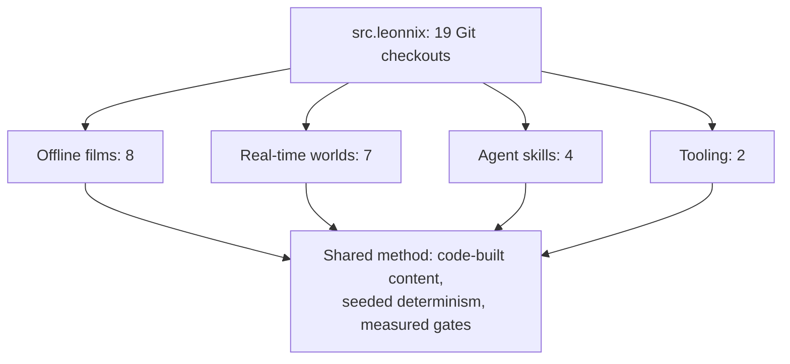
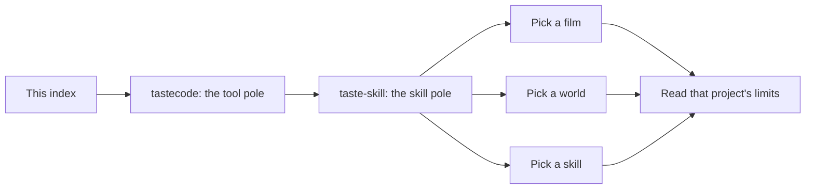

# src.leonnix: nineteen code-built design projects

`src.leonnix` is not one project. It is a container of nineteen separate Git checkouts. The
container has no root repository, no root `README.md`, and no root `package.json`. Each child
directory is its own project with its own history and its own commit.

The projects look unrelated. They include an offline piano film, a Greek temple world, a house at
dusk, four agent skills, an audio analysis tool, a Backrooms game, a first-person shooter, and a
desktop application for design work. They share one method. Each project builds its content from
code. Most visual projects render frames offline. A seeded random number generator makes the
output repeatable. Where judgement is needed, the project adds a deterministic check before it
trusts a model report.

This page is the index. Each project has its own folder with its own `spec.md`, its own documents,
and its own generated pages. Every project receives the same full exploration: six documents that
cover the overview, the architecture, the core mechanism, the workflow and quality checks, and the
limits. The depth is the same for every project. A small project divides a small surface into
those five parts.

## Thesis

The collection is a study in one idea: **taste is a process, not a prompt**.

The visual projects express the idea through geometry, light, and time. A scene is a program. A
frame is a function of a seed, a time, and a camera. The film is a loop over frames, not a
recording of a live session.

The skill projects express the idea through gates. An agent can claim that a page is good. A
checker measures the page in a real browser. The finish gate blocks the agent until the measured
result passes.

The two largest projects are the two poles of the idea. `tastecode` is the tool pole: a local
server owns state, runs a phase pipeline, and stores every event in an append-only log. The model
is one component inside a larger machine. `taste-skill` is the skill pole: a text skill and a set
of Node scripts run inside another agent, and a stop hook turns the checker into a condition for
finishing.

Both poles reach the same conclusion by different routes. A model's opinion of its own work is not
evidence. A deterministic check is evidence.

## The four groups

| Group | Projects | Shared shape |
|-------|----------|--------------|
| Offline films | afterglow, first-bloom, golden-temple, halo-above-the-clouds, needle-drop, procedural-alpine-lake, room-at-dawn, shanshui | A frame renderer, a frame loop, and an encoder |
| Real-time worlds | athenaion, casa-ocaso, feed-backrooms, halo-above-the-clouds, room-at-dawn, unsung-vale, valle-morta | A Three.js scene, asset-free geometry, and a browser or WebGPU renderer |
| Agent skills | cinetic, cook, taste-skill, unlazy | `SKILL.md`, references, scripts, and gates |
| Tooling | tastecode, earshot | A local process with a typed interface |

Two projects appear in two groups because each has a real-time scene and an offline film:
`halo-above-the-clouds` and `room-at-dawn`.

## The nineteen projects

Every project has a folder under this one, a `spec.md` with its pinned commit, and a `markdown/`
tree of six documents. The **Start here** column fills as each project is published.

| Project | Group | Files | Commit | Start here |
|---------|-------|------:|--------|------------|
| tastecode | Tooling | 3,519 | c216616 | [Start here](../tastecode/html/README.html) |
| taste-skill | Agent skills | 1,663 | f6b7657 | [Start here](../taste-skill/html/README.html) |
| cinetic | Agent skills | 964 | f4bbfc8 | [Start here](../cinetic/html/README.html) |
| valle-morta | Real-time worlds | 524 | 64471ca | [Start here](../valle-morta/html/README.html) |
| afterglow | Offline films | 351 | ced1038 | Planned |
| earshot | Tooling | 287 | 4ac3d2a | Planned |
| unsung-vale | Real-time worlds | 239 | 9f61b0d | Planned |
| athenaion | Real-time worlds | 220 | 9b8bd23 | Planned |
| casa-ocaso | Real-time worlds | 193 | fcc3379 | Planned |
| shanshui | Offline films | 146 | b5357c0 | Planned |
| golden-temple | Offline films | 121 | 97fd9ec | Planned |
| needle-drop | Offline films | 100 | 8982f09 | Planned |
| feed-backrooms | Real-time worlds | 94 | 81cdb6a | Planned |
| procedural-alpine-lake | Offline films | 79 | b84c254 | Planned |
| halo-above-the-clouds | Films and worlds | 55 | 1d08819 | Planned |
| first-bloom | Offline films | 52 | 713525b | Planned |
| room-at-dawn | Films and worlds | 48 | aab8be2 | Planned |
| unlazy | Agent skills | 37 | 1667149 | Planned |
| cook | Agent skills | 12 | b23cac6 | Planned |

The file counts exclude `.git` and `node_modules`. The commit column gives the short local
identifier. A short identifier is not a release tag and not a proof of upstream state.

## Reading order

A reader who wants the design argument should read `tastecode` and `taste-skill` as a pair. A
reader who wants the graphics method should read one offline film and one real-time world. A
reader who wants the smallest complete example should read `cook`, which has twelve files.

## What this exploration does not claim

- It does not claim that any project builds. No build was run.
- It does not claim that any project renders correctly. No render was run.
- It does not claim that any test passes. No test was run.
- It does not claim that a stated licence is correct. Each package records what its files state.
- It does not claim that a checkout matches its upstream repository. It records the local commit.
- It does not compare visual quality. Quality claims need output, and no output was produced.

Each package repeats these limits in its own words, because each package is read on its own.
