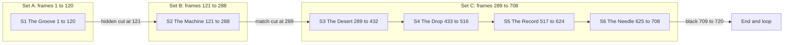
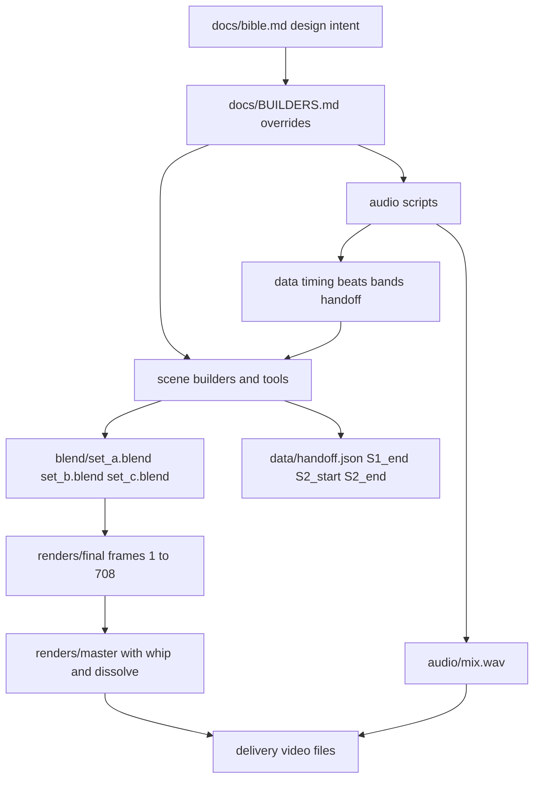

# 00 Overview: The Film, the Six Shots and the Three Sets

Needle Drop is a 30 second film. Three headless Blender scenes build it. Headless means that
Blender runs without a window. Each scene is a Python script that rebuilds one `.blend` file from
an empty factory state. The film has six shots and one visual motif. The record and its parts
appear at four scales. A canyon is a record groove. A turntable is the machine that plays it. A
desert becomes a 2.4 kilometre record. A mountain-sized tonearm lowers a needle onto that record.

This document gives the film, the shot map, the three set builders, the set-piece structure and
one frame traced end to end. It also explains how the production bible and the builder brief
relate. It does not repeat the mechanism detail of [document 02](02-core-mechanism.md). It does
not repeat the production detail of [document 03](03-workflow-and-quality.md).

| Term | Meaning |
|---|---|
| vinyl | the plastic material of a record |
| cantilever | the tube that carries the stylus |
| stylus | the small tip that reads the groove |
| cove | a curved seamless studio backdrop |
| crackle | the light noise from a record surface |
| ring | one raised circular groove ridge |
| match cut | a cut that joins two shots at one shared shape or colour |
| screen-space raytracing | ray tracing against the depth and normal buffers of the visible image |
| Punchy | an AgX look that raises contrast and saturation |
| view transform | the tone mapping from scene light to image values |
| node construction | the set of nodes that builds a field |
| shape language | the shared set of forms and colours |
| ramp | a colour map from a value to a colour |
| stop | a position and colour pair in a colour ramp |
| marble ramp | the colour ramp of the marble field |
| `nt` | the node tree argument |
| `fract` | the fractional part of a number |
| chalk vein | the white band at ramp position 0.70 |
| shader | a material program |

## The film in one paragraph

The film opens inside a glossy marbled canyon. The canyon is the groove of a vinyl record. A
chrome cantilever and a black diamond stylus appear at the end of the first shot. The camera pulls
back to a vermilion turntable in a studio cove. The turntable spins at 200 degrees per second. The
camera dives at the record and turns with it until the marbled surface fills the frame. A match cut
turns the same marble into a desert seen from 380 metres above. A match cut joins two shots at one
shared shape or colour. The desert reorganises into a
record on the music drop. A shock wave of sand races outward. The camera cranes up and looks down
on a 2.4 kilometre disc with a saffron label and a central crater. A giant tonearm casts a shadow
across the rings. The needle lands on the outer groove at 29 seconds. The film cuts to black and
loops on the crackle that opened it.

The image is 2560 by 1440 pixels. The frame rate is 24 frames per second (fps). The rendered
picture runs from frame 1 to frame 708. Frames 709 to 720 are black. The encoder adds them. The
render engine is EEVEE, the Blender real-time render engine, with screen-space raytracing. The
view transform is AgX, a Blender tone-mapping transform, with the Punchy look.

## The idea: one record motif at four scales

The film uses the record motif at four scales. The first appearance is the groove canyon in Set A.
The second is the turntable in Set B, where the tonearm is 0.235 metres long. The third is the
desert record in Set C, where the disc radius is 1200 metres and the diameter is 2400 metres. The
fourth is the same tonearm in shot S6, scaled 8000 times to 1880 metres. A tonearm is not a
record. The motif is the record and its playing parts. The chain is groove, machine, desert and
giant needle. The production bible names three scales: microscopic, human and geological. The
package specification is `spec.md`. It counts four appearances, because the giant tonearm is a
separate reveal. The film has one typography rule. The turntable label reads SIDE A. The desert
label reads SIDE B.

The idea survives the cuts because the marble field is shared. The same node construction paints
the vinyl, the groove wall and the pre-drop desert sand. The numbers change with each scale. The
shape language does not.

```text
# tools/nd_lib.py:9-14
PAL = {
    'magenta': '#FF1F8E', 'saffron': '#FFB30F', 'ultramarine': '#2236FF', 'violet': '#7B2BFF',
    'vermilion': '#FF3A1C', 'night': '#1B0A3F', 'anodised': '#2B1660', 'apricot': '#FF9A5A',
    'chalk': '#F6EFE3', 'plum': '#6B1F5C', 'cream': '#F3DFC1', 'outer_sand': '#E8895A',
    'diamond': '#0B0A14', 'chrome': '#E6E6EC', 'alu': '#C9CBD3', 'mesa_rock': '#D9452A',
}
```

The palette is data, not a set of hand-painted textures. Each colour is converted from a
hexadecimal string to linear red, green and blue. The marble ramp then reads named stops from this
table.

```text
# tools/nd_lib.py:38-44
def build_marble_field(nt, vec, scale=1.0, warp=None, freq=None, scale_socket=None):
    """Build the banded marble field inside ANY node tree (shader or geometry nodes).
    vec: input vector socket. Returns dict(m=fract band value 0..1, color=ramp colour, vein=0..1).
    Uses only nodes that exist in both tree types, so GN dunes follow the shader swirls exactly."""
    warp = MARBLE_WARP if warp is None else warp
    freq = MARBLE_FREQ if freq is None else freq
    N, L = nt.nodes, nt.links
```

The function returns a dictionary with four entries. The entry `m` is the repeating band
coordinate from 0 to 1. The entry `raw` is the continuous band coordinate. The entry `color` is
the ramp colour. The entry `vein` is the chalk vein mask. The docstring names only three entries
and leaves out `raw`. The code at `tools/nd_lib.py:84` returns all four. The same function runs in
a shader node tree and in a Geometry Nodes tree. Geometry Nodes is the Blender node system that
builds mesh geometry. That property is the reason a dune can follow a swirl that a shader paints.

## What the package ships

The package is a source checkout at pin `8982f09c1502b5f6c01b1aa7c1eee23e5139677b`. It has 100
tracked files. It has no licence file. It has no package manifest and no version field.

The source tree has four source layers: three code trees and one data tree. The `scenes` tree holds the
three set builders and their helper modules. The `tools` tree holds the shared look library, the
safe Blender runner, the frame render tool, and the mastering and encode scripts. The `audio/scripts`
tree holds the music edit, the analysis, the cue build, the delivery master and the checks. The
`data` tree holds the beat grid, the timing events, the handoff values and the Set C layout file.
The scripts also name `docs/`, `blend/`, `renders/`, `delivery/`, `stills/` and `assets/`. The
checkout contains `docs/` and `stills/`. The other four directories are absent at the pin.

The build outputs are not in the checkout. The package does not include the rendered frames, the
mixed audio, the source music or the downloaded Poly Haven assets. Poly Haven is an external
library of three-dimensional models and textures. A rebuild needs Blender 5.2.2, ffmpeg, Node.js
and a network connection. Blender builds the scenes and renders the frames. ffmpeg encodes the
picture and the sound. Node.js runs the audio helper scripts in `audio/scripts`. The exploration
reads the source and runs nothing.

The three scene builders do not share one file. They share two libraries and one data contract.
The libraries are `tools/common.py` and `tools/nd_lib.py`. The data contract is the `data/`
directory. Set A and Set B both write `data/handoff.json`. Each builder loads the existing file
and keeps the blocks that it does not own. Set C reads the file. The audio stage writes
`data/timing.json`, `data/beats.json` and `data/bands.json`. Set A reads the timing events through
its design module. Set C reads the beat list and the band series. Set B reads no audio data and
uses fixed frame constants. The event map is the shared time reference for the production, and the
audio stage owns it. The beat list gives the kick times. The band series gives eight frequency
band energies for each frame. Set C uses them to light the sand.

## The six shots

The film has six shots. A shot is one continuous camera take, or one continuous camera move in a
single scene. The shot ranges are global frame numbers. Frame `n` covers the time from `(n-1)/24`
seconds to `n/24` seconds. The table gives the ranges and the set that renders each shot.

| Shot | Name | Frames | Set | Length | What happens |
|---|---|---:|---|---:|---|
| S1 | The Groove | 1 to 120 | A | 5.0 s | The camera races down a marbled canyon, climbs a crystal spire and finds a stylus. |
| S2 | The Machine | 121 to 288 | B | 7.0 s | The camera pulls back to a turntable, dives at the spinning record and locks to its rotation. |
| S3 | The Desert | 289 to 432 | C | 6.0 s | The match cut opens on marbled dunes from 380 metres, then descends and skims the sand. |
| S4 | The Drop | 433 to 516 | C | 3.5 s | The drop sends a sand front outward, past the lens, and leaves grooves and spokes behind. |
| S5 | The Record | 517 to 624 | C | 4.5 s | The camera cranes to 1750 metres and looks down on the full record and its label. |
| S6 | The Needle | 625 to 708 | C | 3.5 s | The giant tonearm appears, swings over the rings and lowers the stylus at 29 seconds. |

```text
# data/timing.json:23-48
 "shots": {
  "S1": [
   1,
   120
  ],
  "S2": [
   121,
   288
  ],
  "S3": [
   289,
   432
  ],
  "S4": [
   433,
   516
  ],
  "S5": [
   517,
   624
  ],
  "S6": [
   625,
   708
  ]
 },
```

The set ranges are wider than the shot ranges in one place. Set C owns frames 289 to 708. That is
four shots in one `.blend` file. The four shots share one camera object, one terrain and one
record. Set A owns frames 1 to 120. Set B owns frames 121 to 288. The three set ranges are
contiguous and do not overlap.

The timing file also holds event frames. An event gives a time in seconds and a frame number. The
note in the file says the audio stage snapped event frames to detected beats. The snap limit is
plus or minus 2 frames. The note names two moved events. `lint_pass` moved from 47 to 49.
`shadow_enters` moved from 615 to 613.

The event map uses `frame = round(t * 24) + 1`, which is the nearest frame. The kick list in
`data/beats.json` uses `frame = floor(t * 24) + 1`, which is the containing frame. For
`spire_visible`, `round(2.6 * 24) + 1` is 63. Frame 63 starts at 2.583 seconds and ends at
2.625 seconds, so it contains 2.6 seconds. The two formulas differ only near a frame boundary.

```text
# data/timing.json:49-61
 "events": {
  "fade_in_end": {
   "t": 0.25,
   "frame": 7
  },
  "lint_pass": {
   "t": 2.0,
   "frame": 49
  },
  "spire_visible": {
   "t": 2.6,
   "frame": 63
  },
```

The event map is the time base for the production. Set A uses `lint_pass` to place its lint
bundle. Set C uses the same beat grid through `data/beats.json` for its kick rings. It uses fixed
frame constants for the drop and the touchdown. The audio stage writes the same file. A retime of
the six shots is a data change. A retime of the drop or the touchdown also needs code changes,
because Set B and Set C hold those frame numbers as constants.

## The three sets

The three sets are separate Blender files. The sets are never combined into one scene. Each set
has its own physical subject size. The unit does not change: one Blender unit is one metre in
every set. The subjects differ by about four orders of magnitude: the largest ratio is 2400 /
0.235, which is 10,213, so the numbers differ.

| Set | File | Frames | Physical subject | Entry point | Modules |
|---|---|---:|---|---|---|
| A | `blend/set_a.blend` | 1 to 120 | A 30 metre deep groove canyon | `scenes/set_a/build.py` | `design.py`, `assets_a.py`, `check_path.py` and probes |
| B | `blend/set_b.blend` | 121 to 288 | A turntable and a 0.235 metre tonearm | `scenes/set_b/build.py` | One build file plus probes |
| C | `blend/set_c.blend` | 289 to 708 | A desert that becomes a 1200 metre record | `scenes/set_c/build.py` | `c_common.py`, `c_terrain.py`, `c_look.py`, `c_cam.py`, `c_props.py`, `c_fx.py`, `c_nodes.py` |

Set A builds a V-shaped groove field, a cut-gem spire, a lint bundle and dust rocks. The cut-gem
spire is the crystal tower in shot S1. The lint bundle is a small group of floating fibres. A
render sample is one ray pass used to estimate a pixel. Its render is 2560 by 1440 at 32 samples
for each pixel. Its colour exposure is plus 0.2. Its marble field uses scale 0.05, which sets the
field size, and warp 1.3, which sets how far the bands bend. The helper modules include probes.
A probe is a small script that prints measured scene values for a person to read.

```text
# scenes/set_a/build.py:47-53
sc = C.reset()
sc.name = 'SetA'
C.setup_render(sc, res=(2560, 1440), samples=32)
C.color(sc, 'AgX - Punchy', exposure=0.2)
sc.frame_start, sc.frame_end = D.F0, D.F1
sc.frame_current = 1
sc.render.fps = 24
```

In this excerpt, `C` is `tools/common.py`, and `D` is `scenes/set_a/design.py`. `D.F0` and `D.F1`
are the first and last frame of Set A, 1 and 120 (`scenes/set_a/build.py:17-18`).

Set B builds a studio cove, a platter, a record, a label, controls and a tonearm. A cove is a
curved seamless backdrop. A platter is the round plate that carries the record. The controls are
the buttons and switches on the turntable base. The tonearm is built in a local frame with the
pivot at the origin. A local frame is the coordinates of the asset before placement. The pivot is
the origin of that frame. A collection is a named group of Blender objects. Set B writes the
tonearm collection to `blend/tonearm_asset.blend`. Set C
appends that file. Append copies the objects from one Blender file into another. This is the asset
handoff that makes one arm serve two scales.

Set A and Set B both write `data/handoff.json`. Each builder reads the existing file first. It
replaces only its own block. Set A owns `S1_end`, which carries the last three camera frames of
Set A. Set B owns `S2_start` and `S2_end`, which carry the first and last camera frames of Set B.
Set C reads the `S2_end` block to match its marble to the Set B record. The other two blocks are
continuity records for a person. No code reads them.

```text
# scenes/set_b/build.py:15-20
F0, F1 = 121, 288
FPS = 24
MARBLE_SCALE = 12.0           # marble field input = record object coords (m) * MARBLE_SCALE
MARBLE_FREQ_REC = 4.4         # band frequency of the record's CLOSE-UP field (= the S2_end handoff field):
                              # same swirl shapes, 2x more combed bands -> filigree at the f288 match cut
MARBLE_FREQ_LO = 2.2          # shared ND default: bold legible swirls at mid/hold range (director 02:05 note)
```

`ND` is `tools/nd_lib.py`. `adr1` and `adr2` are labels on director review notes; the source does
not expand them. The `director 02:05 note` is a review note at 2 minutes 5 seconds. A filigree is
fine ornamental metalwork. Combed bands are the parallel ridges left by a comb.

Set C builds the desert record. It has a disc mesh, a patch sector for the close view, an outer
desert mesh, props, effects and a giant tonearm. The build order matters. The camera is baked
before the live node keys because the ring positions use the camera path. The terrain is built
before the camera because the camera needs ground height.

```text
# scenes/set_c/build.py:31-34
disc, patch, outer, live, ground = c_terrain.build(coll)
log('terrain')
cam, path, alts = c_cam.bake_camera(sc, ground)
log('camera')
```

The Set C layout constants show the scale of the geological record. The disc radius is 1200
metres, so the diameter is 2400 metres. The groove band runs from 270 to 1160 metres. The ring
pitch is 40 metres. The crest height is 11 metres. The label mesa is 240 metres in radius and 40
metres high. The tonearm pivot is at a radius of 1720 metres and a bearing of 145 degrees. The
landing point is at a radius of 1150 metres and a bearing of 66 degrees. A bearing is an angle in
degrees from the plus X axis, measured counterclockwise. The conversion is `x = r cos(bearing)`
and `y = r sin(bearing)`, with the bearing in degrees. The pivot is at X about minus 1408.9 metres
and Y about 986.5 metres. The landing point is at X about 467.8 metres and Y about 1050.6 metres.
The arm length is 1880 metres, which is 0.235 metres times 8000.

```text
# scenes/set_c/c_common.py:15-27
R_CRATER = 25.0
R_LABEL = 240.0
R_GROOVE0 = 270.0
R_GROOVE1 = 1160.0
R_LEADIN = 1170.0
R_RIM = 1200.0          # disc mesh ends exactly here, OuterDesert starts here (3600 shared ring)
RING_PITCH = 40.0
CREST_H = 11.0         # adr1: taller, broader ridges so the low sun carves real relief (bible 6 m read flat)
MESA_H = 40.0
SUN_ELEV = 9.0
P_PIVOT = (1720.0, 145.0)   # r, bearing deg
L_LAND = (1150.0, 66.0)
ARM_LEN = 1880.0
```

`R_CRATER` is the layout report value. The terrain formula uses `CRATER_R = 38.0`, which is at
`scenes/set_c/c_terrain.py:81`.

The crest height note records a divergence from the bible. The bible says 6 metres. The code uses
11 metres. The comment says the 6 metre value read flat. The code is the final authority.

Set C renders at 48 samples with exposure plus 0.2. Its ray tracing method is `SCREEN`. `SCREEN`
means EEVEE screen-space tracing. Its motion blur shutter is 0.5 and its filter size is 1.5. The
filter size is the renderer's pixel filter width in pixels. The output is 16-bit colour. Its frame
range is 289 to 708.

```text
# scenes/set_c/c_look.py:78-80
def render_settings(sc):
    C.setup_render(sc, res=(2560, 1440), samples=48)
    C.color(sc, 'AgX - Punchy', exposure=0.2)
```

The three sets also use different sample counts and exposures. Set A uses 32 samples and plus 0.2
exposure. Set B uses 24 samples and minus 0.5 exposure. Set C uses 48 samples and plus 0.2
exposure. These values are in the code. The bible lists a different plan for samples and
exposure. The code wins.

## The set-piece structure

The film is built from six shots. It has four hard transition points. The first is a hidden
occluder cut at frame 121. An occluder cut hides the edit behind an object that fills the frame.
The camera has climbed onto the cantilever, and the new shot starts on the cantilever at a smaller
scale. A cantilever is the tube that carries the stylus. The second is a rotation-locked match cut
at frame 289. The camera turns with the record, so the record surface stays still in frame. The
marble pattern does not change shape. Only the scale and the camera change. The third is a hard
reverse-angle smash cut at frame 433, on the drop. A smash cut is an abrupt cut to a contrasting
view. The fourth is a hard cut to black at frame 709. The boundaries at frames 517 and 625 are
continuous camera moves inside Set C, not cuts.

The film also has three deliberate holds (`docs/bible.md:35`). A hold keeps the camera still. The
turntable orbit holds from 7.5 to 10.0 seconds, frames 181 to 241. The top-down marble holds from
12.0 to 12.75 seconds, frames 289 to 307. The top-down record holds from 24.5 to 26.75 seconds,
frames 589 to 643. The top-down marble hold is the S2 to S3 match cut at frame 289. The top-down
record hold is in shot S5. The third hold crosses the S5 to S6 boundary at 26.0
seconds. The camera stays still while the tonearm enters, so shot S6 starts inside the hold. The
film also has a visual freeze from 17.5 to 18.0 seconds. The master forces digital zero from
17.500 to 17.998 seconds. The tempo is 120 beats per minute, from `data/timing.json`, so the 0.5
second freeze is one beat. The sand grains are small mesh particles that the drop front throws
outward. The kick rings are expanding sand rings placed on the kick times. The grains and the
rings freeze in that interval.



The diagram shows the chain of ownership. Set A stops at frame 120. Set B owns the next 168
frames. Set C owns the last 420 frames. The last 12 frames are black and belong to the encoder,
not to a scene.

## One frame end to end: frame 289

Frame 289 is the first frame of Set C and the match cut. It is a useful example because it
connects all three layers: data, scene and delivery.

The time is 12.0 seconds. The timing file gives the event `match_cut` at 12.0 seconds and frame
289. The previous frame, 288, is the last frame of Set B. Set B leaves a handoff record for that
frame.

The handoff gives a point on the record in record space. The point radius is 0.074 metres. The
visible width is 0.064286 metres. The camera is 0.05 metres above the vinyl. The lens is 28
millimetres. The sensor is 36 millimetres wide. The marble scale is 12.0 and the marble frequency
is 4.4. The record turns clockwise at 200 degrees per second. The record also publishes a desert
mapping for Set C. These values are at `data/handoff.json:82-105`.

```text
# data/handoff.json:106-110
  "marble_scale": 12.0,
  "marble_freq": 4.4,
  "marble_field_input": "ND.build_marble_field(tree, vec, scale=marble_scale, freq=marble_freq) with vec = Record object coords (m) (Texture Coordinate Object of the Record; z of the vinyl surface = point z). NOTE freq is NOT the ND default 2.2.",
  "record_rotation": "clockwise seen from above, 200 deg/s; the S2 camera co-rotates exactly from f282 so f283-288 are still",
  "cam_drift_last_frame_m": 4e-08,
```

The matching block is a ready-made mapping. It has a scale, an angle, an offset and a frequency.
Set C reads the block in `marble_mapping`. It applies the transform `rotZ(angle) * (x, y, 0) *
scale + offset`. It then calls the shared marble field with scale 1 and frequency 4.4. The note in
the block says "drop-in for handoff key set_c_marble". That note is stale. The pin reads the
`set_c_marble_match` key now.

```text
# data/handoff.json:111-122
  "set_c_marble_match": {
   "scale": 0.001578855,
   "angle": 0.093215,
   "offset": [
    -2.267505,
    -0.211979,
    0.018
   ],
   "freq": 4.4,
   "record_m_per_desert_m": 0.0001315712,
   "note": "drop-in for handoff key set_c_marble once Set C passes freq=freq to ND.build_marble_field"
  }
```

The handoff value `record_m_per_desert_m` is 0.0001315712. It gives record metres per desert
metre. One desert metre equals 0.0001315712 record metres. One record metre therefore equals
about 7600 desert metres. The value comes from the Set B frame width divided by the Set C frame
width. The Set B camera sensor is 36 millimetres wide, the lens is 28 millimetres and the depth is
0.05 metres. The visible width is `2 * 0.05 * (36 / 2) / 28`, which is 0.064286 metres. The Set C
width is 488.6 metres. The two cameras see the same marble pattern at two scales. The cut has no
visible pattern change. The mesh geometry does change, because Set C shows dunes.

The mapping scale is the Set B marble scale times this ratio: `12.0 * 0.0001315712` equals
0.001578855. The angle aligns the Set B record coordinates with the Set C desert axes. The offset
places the record point at the desert camera target. The z offset 0.018 metres sets the field
height on the sand surface.

The Set C camera at frame 289 is at desert position (880, 0, 380). It looks straight down. The
lens is 28 millimetres and the sensor is 36 millimetres wide. The visible frame width is
`2 * 380 * (36 / 2) / 28`, which is 488.6 metres. The screen up direction is plus X. The screen
right direction is minus Y.

```text
# scenes/set_c/c_common.py:178-179
        's3_first_frame': {'frame': 289, 'cam': [880, 0, 380], 'look': 'straight down', 'screen_up_world': '+X', 'screen_right_world': '-Y',
                           'lens_mm': 28, 'frame_width_m': 488.6},
```

The Set C camera path is a pure NumPy function. NumPy is the Python numerical array library. The
function samples the start of each frame, `t = (f - 1) / 24`. Frame 433 therefore samples 18.0
seconds. At time 12.0 seconds, the S3 branch holds the altitude at 380 metres and the pitch at
minus 90 degrees. The branch changes at 12.75 seconds, when the descent starts. The camera is
baked as one linear key per frame. Baked means that the path is computed in advance and stored as
keyframes. A keyframe stores a value at a frame. Set C also adds two keys at `CUT - 0.01` and
`CUT + 0.01`, where `CUT` is 432.5. The source docstring calls them half-frame keys, but the offset is 0.01 frame, not
0.5 frame. The two keys make the camera change almost instant at the S3 to S4 cut. Linear
interpolation does not blend the two camera branches across a full frame.

```text
# scenes/set_c/c_cam.py:9-19
CUT = 432.5
YAW4, Y4 = 16.0, -80.0   # adr2: S4 push yaw (deg) + lateral drift (m), carried into the S5 crane
DX_DESC = 65.0   # S3 descent travel (880 -> 945): the skim stays inside the marble field
# S6 end (adr1): the arm RECEDES in depth. Camera over the outer grooves at E, 45 m up, heading 145, 26 mm: headshell +
# cartridge right of centre ~670 m away, the chrome tube S-bends away to the left toward counterweight / gimbal / tower
# at P (~2.3 km, hazed); the low sun (+Y) is ~55 deg right of the axis (off-frame) so the chrome gets a hard rim.
E6 = (890.0, 530.0)
PITCH6 = 1.5     # adr2: horizon higher, ridges lead into the cartridge (was +4)
ALT6 = 45.0
HEAD6 = 145.0
LENS6 = 26.0
```

| Symbol | Meaning |
|---|---|
| `YAW4` | S4 push yaw in degrees |
| `Y4` | S4 lateral drift in metres |
| `DX_DESC` | S3 descent travel in metres |
| `E6` | S6 camera ground position in metres, as X and Y |
| `PITCH6` | S6 pitch in degrees |
| `ALT6` | S6 height in metres |
| `HEAD6` | S6 heading in degrees |
| `LENS6` | S6 focal length in millimetres |
| gimbal | the pivot that lets the arm turn in two axes |
| counterweight | the mass that balances the arm |
| headshell | the part that holds the cartridge |
| cartridge | the part that holds the stylus |
| hazed | faded by atmospheric mist |

At frame 289 the record morph is not active. The function `front_r` gives the radius of the drop
front. It returns minus 200 metres for every time below 18.0 seconds. The live node group computes
`u = (front - radius) / 60` and clamps `u` to the range 0 to 1. A front at minus 200 metres gives
`u = 0` for every disc radius above minus 200 metres. The disc therefore shows the dune height,
not the record height. The desert is still a desert.

The shader, the material program, does the same. The sand material mixes the pre-drop marble
colour with the post-drop record colour by the stored `morph` attribute. An attribute is a named
value stored on each mesh point. At frame 289 the attribute is zero, so the pre-drop colour wins.
The same marble field paints the sand and the vinyl. That is the reason the cut works.

The render uses EEVEE with screen-space raytracing. The resolution is 2560 by 1440 at 48 samples.
The view transform is AgX Punchy with plus 0.2 exposure. The compositor, the Blender image combine stage, adds mist tint, bloom, streaks, lens dispersion,
saturation and a vignette. Bloom is a soft glow around bright areas. Streaks are light lines drawn
from bright pixels. Lens dispersion shifts colour channels outward from the centre. A vignette
darkens the corners. The frame is written as a 16-bit portable network graphics (PNG) file. The
16-bit value is per channel.

The audio at 12.0 seconds is in the build section of the music edit. A build section is the part
of a track that raises energy before a drop. The music segment from 12.0 to 17.5 seconds rises.
The event `match_cut` is a visual event, not a sound hit. A sound hit is a strong sound placed on
a cut. The audio stage still snapped its frame to the beat grid if a beat was within 2 frames.

The finishing script is `tools/master.sh`. A dissolve is a cross-fade between two images. The
script dissolves frames 289 to 305 from the colour of frame 288 into the Set C opening. The weight is the old colour weight. It starts at
17/18 for frame 289 and falls to 1/18 for frame 305. The new set therefore supplies 1/18 of the
colour at frame 289 and 17/18 at frame 305. The geometry already matches, so the dissolve reads as
a slow colour shift and not as a visible cross-fade.

```text
# tools/master.sh:26-30
# S2->S3 match cut: f289-305 are a static hold on the same marble, so a 17-frame dissolve from f288's grade
# reads as a slow colour shift (no visible pop on the downbeat)
A=$(srcof 288)
for k in $(seq 289 305); do
  n=$(printf %04d $k); w=$(awk "BEGIN{printf \"%.4f\", (306-$k)/18}")
```

Frame 289 therefore passes through six stages. The data stage names the event. The Set B handoff
gives the marble mapping. The Set C builder bakes the camera and keys the live group. The renderer
makes the image. The master script blends the first 17 frames of the new set into the old colour.
The audio stage has already fixed the event time.

**Aha:** The match cut is not a model swap. It is a coordinate mapping. Set B publishes the
mapping as data, and Set C rebuilds the same field with a different scale. The cut works because
the pattern is a function, not an image.

## Production bible versus builder brief

The project has three planning documents. The package specification is `spec.md` in this
exploration package. It gives the package inventory, the line counts and the known divergences.
The production bible is `docs/bible.md`. The builder brief is `docs/BUILDERS.md`. The brief
states that it overrides the bible wherever the two disagree.

```text
# docs/BUILDERS.md:3-4
Project root = the current working directory. The film spec is `docs/bible.md` (read it; it is long but it is the
spec). This file OVERRIDES the bible wherever they disagree.
```

The bible is a design document. It gives the logline, the palette, the shot intent, the lighting,
the material recipes, the build order and the render plan. A logline is a one-sentence summary of
the film. The builder brief is an engineering
document. It gives the real file layout, the shared helper rules, the marble replacement and the
machine safety rules. The marble replacement is the rule that every set calls
`build_marble_field`, and no set forks the node group. To fork the node group means to make a
separate copy of the shared node group. The machine safety rules keep one Blender
process at a time, keep memory below a limit and yield to the user's own Blender work. The code is
the final authority.

The difference matters because several bible numbers do not match the code. The bible plans a
sample count of 48 for S1, 64 for S2, 48 for S3, 64 for S4, 48 for S5 and 48 for S6. The code
uses 32 for Set A, 24 for Set B and 48 for Set C. The bible plans exposures of minus 0.3, 0.0 and
plus 0.2 for Set A, Set B and Set C. The code uses plus 0.2, minus 0.5 and plus 0.2. The bible
plans a 6 metre crest. The code uses 11 metres. The bible plans a mix at minus 14 loudness units
relative to full scale (LUFS). The delivery script targets minus 14.3 LUFS.

The bible also names files that do not exist. It names `scripts/safe_launch.ps1`,
`scripts/probe.py`, `scripts/render_queue.ps1` and `scripts/assemble.ps1`. A `.ps1` file is a
PowerShell script. A `.sh` file is a shell script. The repository uses `tools/brun.sh` in place of
`safe_launch.ps1`, `tools/render_seq.sh` in place of `render_queue.ps1` and `tools/assemble.sh` in
place of `assemble.ps1`. `probe.py` has no single replacement. Each set has its own probe script.
The builder brief gives the real layout.
[Document 04](04-limits-and-comparison.md) records each divergence and its evidence.

A reader must use three levels of trust. The bible is the design intent. The builder brief is the
working instruction. The code and the `data/` files are the final state. A number in the bible is
not a measured result.



The diagram shows the authority chain and the two delivery inputs. The edge "master with whip and
dissolve" names two finishing effects. A whip is a fast camera move that smears the image. The
whip smear covers frames 119 to 122. The audio scripts write the
data files and the mix. The scene builders read the data files. The picture path and the sound
path meet only at the encoder. The timing file feeds the picture path through Set A and Set C. Set
B does not read it.

## Who this document is for

This document is for a reader who wants the shape of the film before the mechanism. A graphics
engineer can use it to see how one idea maps to three scenes. A Blender user can use it to see the
split between a set builder and a shared library. A pipeline engineer can use it to see the data
contract between sets. A reviewer can use it to see which numbers are design intent and which are
code.

The document assumes no Blender experience. It names each object and each file. It explains the
Blender concepts that the argument needs. It expands each abbreviation at first use. The source
comments use `ND` for the module `tools/nd_lib.py`, `GN` for Geometry Nodes, and `adr1` and `adr2`
as note labels. It does not assume that the reader has run the project.

## The limits of this overview

This document is a static reading. It did not open Blender. It did not build a `.blend` file. It
did not render a frame. It did not play the audio. It did not encode a film. Every statement about
appearance is an inference from source. Every timing value is a data value, not a measured frame
time.

The package has no licence file. The package has no rendered frame sequence. It has ten release
stills, but this reading made no render. The package has no source audio. These limits apply to
the whole exploration. [Document 04](04-limits-and-comparison.md) gives the full list.
