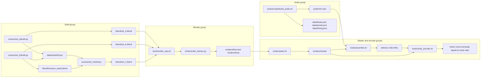
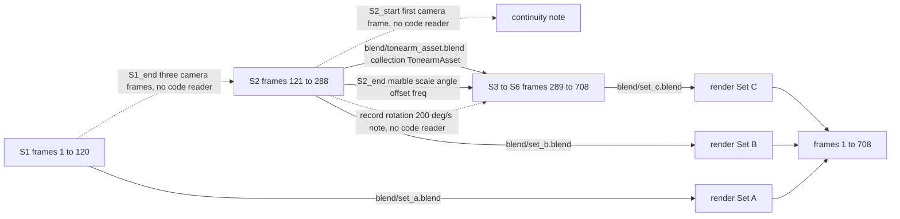

# 01 Architecture: Processes, Modules, Data and Handoff

Needle Drop is a 30 second film. It is not one program. It is five process groups around three
scene files and one asset file. A process group is one pipeline stage that runs as its own
process. An asset file is a `.blend` file that holds objects for another scene to append. The
groups are build, render, audio, master, and encode and
verify. The last two form the finishing stage. Each group has a narrow job. Each group writes a
small set of files. No group edits the output of another group in place.

A set is one Blender scene that renders a group of shots. Set A renders shot S1, frames 1 to 120.
Set B renders shot S2, frames 121 to 288. Set C renders shots S3 to S6, frames 289 to 708. A shot
is one continuous camera move. A frame is one image at 24 frames per second. Blender is the
three-dimensional program that builds and renders the scenes. EEVEE is its real-time render
engine. A shader is a material program. Geometry Nodes is the Blender node system that builds
mesh geometry. The compositor combines the rendered image with effects. A keyframe stores a value
at a frame. A render sample is one ray pass used to estimate a pixel. A portable network graphics
(PNG) file is a lossless image file. A master is the final picture sequence. An encode compresses
picture and sound into a delivery file. A mix is the final audio file. A beat is one musical
pulse, and a kick is a low drum hit.

This document explains the process groups, the module boundaries, the ownership of state and the
data contracts. It then follows the handoff chain from Set A to Set B to Set C. It ends with the
storage layout and the determinism rules.

## The five process groups

| Process group | Entry point | Reads | Writes |
|---|---|---|---|
| Build | `scenes/set_a/build.py`, `scenes/set_b/build.py`, `scenes/set_c/build.py` through `tools/brun.sh` | `tools/`, `data/`, `assets/` | `blend/set_a.blend`, `blend/set_b.blend`, `blend/set_c.blend`, `blend/tonearm_asset.blend`, `data/handoff.json`, `data/layout_c.json` |
| Render | `tools/render_seq.sh`, which calls `tools/brun.sh` and `tools/render_frames.py` | One `.blend` per run, `logs/render_override.json` | `renders/final/f_####.png`, `renders/tests/`, `logs/render_seq.log` |
| Audio | `audio/scripts/build_audio.sh` | Downloaded music and effects in `audio/`, `audio/_work/timing_orig.json` when present, else `data/timing.json` | `audio/music_edit.wav`, `data/timing.json`, `data/beats.json`, `data/bands.json`, `audio/cues.json`, `audio/mix.wav` |
| Master | `tools/master.sh` | `renders/final/`, `renders/fix/` | `renders/master/` |
| Encode and verify | `tools/assemble.sh`, `tools/verify_encode.sh` | `renders/master/`, `audio/mix_final.wav` when present, else `audio/mix.wav` | three delivery files: 2560 by 1440 Advanced Video Coding (H.264), 4K H.264 and 4K High Efficiency Video Coding (H.265) 10-bit; `verify_encode.sh` writes no file and prints a report |

The build group is the only group that writes a Blender file. The render group never saves a
`.blend` file. It opens a file, sets a frame and writes a PNG file. The audio group never opens
Blender as a scene builder. It uses Blender's bundled Python for NumPy, in isolated mode. NumPy is
the numerical Python library. Isolated mode means Blender starts with no user preferences. The
finishing stage never changes a source frame. It makes hard links and new derived frames. A hard
link is a second directory entry for one file's bytes. A
repair run of `tools/render_frames.py` writes `renders/fix/`; no automatic group owns that path.



The diagram has one important property. The final picture frames and the final sound mix are
separate until `tools/assemble.sh`. The two paths meet only at the encoder. A change to the final
mix does not require a new render. A change to a frame does not require a new mix. The picture
build still reads the audio data files, so the analysis stage must run before Set A and Set C.

## Module boundaries

The project has three source groups: `scenes`, `tools` and `audio/scripts`. The boundary between
`scenes` and `tools` is an import rule. A scene script adds the `tools` directory to the Python
path and imports the shared modules. Set A imports four modules in total: two from `tools` and
two local modules.

```text
# scenes/set_a/build.py:17-22
import common as C, nd_lib as ND
import design as D
import assets_a as A

T0 = time.time()
RNG = np.random.default_rng(20261109)
```

`tools/common.py` holds the environment helpers. It has the scene reset, the render setup, the
colour setup, the compositor builder, the material helpers and the Poly Haven downloader.
`tools/nd_lib.py` holds the look library. It has the palette, the marble field, the shared
materials and the black diamond material. The marble field is the shared banded pattern that
paints every set.

```text
# tools/common.py:6-10
import bpy, os, json, math, urllib.request

ROOT = os.path.dirname(os.path.dirname(os.path.abspath(__file__)))
ASSETS = os.path.join(ROOT, 'assets')
UA = {'User-Agent': 'Mozilla/5.0 (blender-film-build)'}
```

The `ROOT` value is derived from the file location, not from the current directory. This choice
makes the downloader and the asset path stable when a script runs through the safe runner. The
safe runner is `tools/brun.sh`, which adds a lock and a memory gate. The
builder brief is `docs/BUILDERS.md`, the build instruction that overrides the bible. It also
requires the project root as the current working directory. The two rules
agree in practice. A command that reads `data/` by a relative path still needs that directory.

The scene reset is a factory reset with an empty scene. This is the first step of every build.
The result is a deterministic starting state. The empty flag means the scene starts with no
default cube, camera or light.

```text
# tools/common.py:15-17
def reset():
    bpy.ops.wm.read_factory_settings(use_empty=True)
    return bpy.context.scene
```

Set C splits its builder into modules. The entry file makes one star import from `c_common` and
five module imports. Each module owns one subject. `c_terrain` owns the disc and the sand. `c_cam`
owns the camera path. `c_props` owns the label, mesas, trees, boulders and tonearm. `c_fx` owns
the point sets and the dust. `c_look` owns the sky, sun, render settings and compositor. `c_nodes`
holds the node builder helper. `c_common` holds constants, timing helpers and data loaders. The
node-tree modules import `c_nodes` directly.

```text
# scenes/set_c/build.py:5-9
import bpy, sys, os, time, math
HERE = os.path.dirname(os.path.abspath(__file__))
sys.path.insert(0, HERE)
from c_common import *          # noqa
import c_terrain, c_look, c_cam, c_props, c_fx
```

The import style is a star import from `c_common`. That import brings constants and helper
functions into the entry file. A star import is `from module import *`. A mesa is a flat-topped
raised block. A point set is a mesh whose points are drawn as separate grains. Dust is the fine
particle layer. The other imports are module imports. The entry file calls
`c_terrain.build`, `c_cam.bake_camera`, `c_props.tonearm` and `c_fx.build`. It also calls
`c_look.render_settings`, `c_look.world`, `c_look.sun` and `c_look.compositor` at
`scenes/set_c/build.py:24-29`. This shape gives one clear owner for each part of the scene.

Set B has one build file. The file is 1801 lines. It builds the cove, platter, record, label,
controls, strobe and tonearm. It also writes the asset file and the handoff file. The single-file
shape is a deliberate choice for a set with one camera and one hero object. A strobe ring is the
ring of light on the turntable platter. The hero object is the main subject of a shot. A Blender
library is a `.blend` file used as a source of appended data.

There is no cross-set import. Set C does not import Set B. Set C appends the Set B tonearm as a
Blender library and reads the Set B handoff as JavaScript Object Notation (JSON). This rule keeps the two builders independent.
A change to a Set B module cannot break a Set C import.

## State ownership

The project has no database and no service. Its state is in files. Each file has one writer. The
writer is the only process that changes the file, except for `data/handoff.json`. That file has
one writer for each block.

| File | Writer | Readers | Role |
|---|---|---|---|
| `data/timing.json` | Audio stage, snapped from the director grid | Set A | Event map and shot ranges |
| `data/beats.json` | `audio_analyze.py` | Set A, Set C | Beat times and validated kicks |
| `data/bands.json` | `audio_analyze.py` | Set A, Set C | Eight band energy series per frame |
| `data/handoff.json` | Set A writes `S1_end`; Set B writes `S2_start` and `S2_end` | Set C reads `S2_end`; `S1_end` and `S2_start` have no code reader | Camera, marble and review records |
| `data/layout_c.json` | Set C builder | No script in the checkout | Build record for layout, arm geometry and final camera |
| `blend/tonearm_asset.blend` | Set B builder | Set C builder | One tonearm asset used at two scales |
| `blend/set_*.blend` | One set builder each | The render group | The scene at a fixed frame range |

The timing file has a two-stage life. The director authors the event map. The audio stage then
snaps each event frame to a detected beat within plus or minus 2 frames. The snap rewrites the
`note` string in the file. The file is therefore an output of the audio stage and not only an
input.

```text
# data/timing.json:1-13
{
 "fps": 24,
 "bpm": 120,
 "total_frames": 720,
 "rendered_frames": [
  1,
  708
 ],
 "sets": {
  "A": [
   1,
   120
  ],
```

The beat file is a data contract from the audio stage to Set A and Set C. It holds the beats, the measured drop time
and a kick list with strength and source validation. Set C reads it through `c_common.kicks` and
`c_common.band_series`.

```text
# data/beats.json:1-9
{
 "default": false,
 "bpm": 120.0,
 "source": "audio/music_edit.wav",
 "drop": 18.0,
 "drop_measured": {
  "flux_onset": 18.0017,
  "attack_start": 17.9991
 },
```

The measured drop attack is 17.9991 seconds. The nominal drop is 18.0 seconds. A kick ring is an
expanding sand ring placed on a kick time. It adds height and a colour tint. The kick ring
generator uses the beat times and the strength value. The `bands.json` file gives eight values per
frame. The shader uses those values to pulse the crests by frequency band.

The `handoff.json` file has three blocks. `S1_end` carries three frames of Set A camera vectors.
`S2_start` carries the first frame of Set B. `S2_end` carries the last frame of Set B, the marble
mapping and the Set C match values. Only `S2_end` feeds a build. No script reads `S1_end` or
`S2_start`; they are review records for the two cuts.

The design of the Set B to Set C handoff is a contract by value, not by reference. Set C does not
read the Set B `.blend` to find the camera. It reads numbers from JSON. This choice makes the
match verifiable without Blender. It also means a stale handoff is possible. The Set C builder
must read the file at build time.

## The Set A to Set B handoff

Set A ends on the cantilever and the stylus. Set B starts on the same cantilever at a smaller
scale. The `S1_end` block gives the last three frames of the Set A camera. Each frame gives a
forward vector, an up vector, a position, the centre object, the centre distance and the screen
velocity. A forward vector is the camera viewing direction as a unit vector. An up vector is the
camera up direction as a unit vector. The centre object is the object under the frame centre. The
centre distance is its distance from the camera. Screen velocity is the motion of the frame-centre
point per frame. Normalised frame units are fractions of the frame width. The block is a record
for a person who matches Set B by hand, not a code input.

```text
# data/handoff.json:2-5
 "S1_end": {
  "note": "Set A camera, last 3 frames (118-120). forward/up are world unit vectors in Set A space (Z up, +X along the groove; the cantilever axis heads 100 deg CCW from +X). screen_velocity_per_frame = motion of the world point under frame centre, in normalised frame units (x right, y up) per frame. Camera rides just above and behind the front of the brushed-aluminium cantilever looking along it (pitched ~8 deg down, rising with it); the tube is a bright neutral-silver wedge rising from bottom-centre with a thin cream streak and magenta / ultramarine side streaks.",
  "lens_mm": 18.0,
  "fps": 24,
```

The note gives the orientation of the Set A world. The Z axis is up. Positive X runs along the
groove. The cantilever axis heads 100 degrees counter-clockwise from positive X. A person uses
this orientation to match the first Set B camera. The screen velocity gives the motion of the
world point under the frame centre in normalised frame units. It is a continuity check, not a
render input.

Set B also publishes `S2_start`. This block describes the first frame of the turntable shot. It
gives the camera forward and up vectors in world space and the lens. The note explains the visual
match.

```text
# data/handoff.json:124-138
 "S2_start": {
  "frame": 121,
  "note": "S2 first frame (world, set B metres). Camera rides 0.38 mm above the cantilever axis, 1 mm back from the stylus tip, looking back along the tapered tube (4 deg below horizontal; vinyl horizon ~1/3 from the top). The tube runs out of the frame bottom ~65% wide and converges toward the top edge like the S1 f120 spire, painted with the three S1 streaks (magenta left flank, saffron/cream crest, ultramarine right flank; keyed macro tint f121-125 fading out by f131). Nearly deep focus at the cut; the camera then rises + pulls back.",
  "cam_forward_world": [
   0.71265,
   0.69804,
   -0.06976
  ],
  "cam_up_world": [
   0.04983,
   0.04881,
   0.99756
  ],
  "lens_mm": 28.0
 }
```

The first frame of Set B is 0.38 millimetres above the cantilever axis. It is 1 millimetre back
from the stylus tip. The camera looks back along the tapered tube at 4 degrees below horizontal.
The tube leaves the bottom of the frame at about 65 percent width. The shot then rises and pulls
back. The cut is hidden because the subject fills the frame on both sides.

## The Set B to Set C handoff

Set B writes a second asset file for Set C. The tonearm collection is written with a fake user
and compression. A fake user makes Blender keep data with no scene user. Compression means
Blender's compressed `.blend` save. The pivot is at the origin and the arm points along local
minus Y. Local minus Y means the arm points along the asset's negative Y axis.

```text
# scenes/set_b/build.py:1127-1131
# ---- write the asset file now (pivot at origin, identity)
asset_path = os.path.join(ROOT, 'blend', 'tonearm_asset.blend')
os.makedirs(os.path.dirname(asset_path), exist_ok=True)
bpy.data.libraries.write(asset_path, {COL_ARM}, fake_user=True, compress=True)
print('ASSET_WRITTEN', asset_path, len(COL_ARM.objects), 'objects')
```

Set C appends this collection as real objects. It renames the collection, rotates the arm 90
degrees about Z and sets the scale. The arm length is 1880 metres. The Set B effective length is
0.235 metres. The scale is therefore 8000. The scale here is a linear factor, not the marble field
scale. Set C computes it as `ARM_LEN / abs(tip.y)` at `scenes/set_c/c_props.py:421`. The value
`tip.y` is the stylus tip distance from the pivot, 0.235 metres. The Set C build records this
value in its layout file.

A pure scale of 8000 would make the cartridge and the stylus invisible at the desert scale. The
cartridge is the part that holds the stylus. Set C uses a cheat table. A cheat table is a set of
per-part scale and offset overrides. The table moves and scales selected parts. The goal is a
readable silhouette.
[Document 04](04-limits-and-comparison.md) lists the cheat values and the limits of the evidence.

The marble handoff is the second contract. Set B computes the mapping from its last frame width to
the Set C first frame width. The value `width` is the visible record width in metres under the Set
B camera at frame 288. It comes from the camera depth, the sensor width and the lens at
`scenes/set_b/build.py:1740`. The divisor 488.6 is the visible width in metres of the Set C first
frame. The ratio is `_k = width / 488.6`, which is record metres per desert metre. The desert
scale is `MARBLE_SCALE * _k`. The angle comes from the Set B up vector. The offset comes from the
record point and the scale.

```text
# scenes/set_b/build.py:1767-1774
_k = width / 488.6
_S = MARBLE_SCALE * _k
_ang = math.atan2(upv.y, upv.x)
_U = Vector((math.cos(_ang), math.sin(_ang), 0.0))
_O = Vector((pt.x, pt.y, pt.z)) * MARBLE_SCALE - _U * (_S * 880.0)
s2_end['set_c_marble_match'] = {'scale': round(_S, 9), 'angle': round(_ang, 6), 'offset': [round(_O.x, 6), round(_O.y, 6), round(_O.z, 6)],
                                'freq': MARBLE_FREQ_REC, 'record_m_per_desert_m': round(_k, 10),
                                'note': 'drop-in for handoff key set_c_marble once Set C passes freq=freq to ND.build_marble_field'}
```

The code uses the Set C first frame position of 880 metres on the X axis. The term `_U * (_S *
880.0)` places the desert origin so that the record point and the desert point agree. The rounded
values are 0.001578855 for the scale and 0.093215 for the angle. The offset is minus 2.267505,
minus 0.211979 and 0.018.

Set C reads this block through one function. If the block is absent, the function prints a warning
and uses the fallback constants in `c_common`. The values are `MARBLE_S = 0.0042`,
`MARBLE_ANG = 0.0` and `MARBLE_O = (7.31, 2.17, 0.37)`
(`scenes/set_c/c_common.py:30-32`). The cut then loses its exact match.

```text
# scenes/set_c/c_common.py:76-86
def marble_mapping():
    """Return (S, ang, O, freq) for the desert marble. adr2: Set B publishes the match-cut mapping as
    handoff.json["S2_end"]["set_c_marble_match"] {scale, angle, offset, freq}; also accepted at top level as
    "set_c_marble". field = rotZ(ang) * (x, y, 0) * S + O -> ND.build_marble_field(scale=1, freq=freq)."""
    h = load_json('handoff.json') or {}
    m = (h.get('S2_end') or {}).get('set_c_marble_match') or h.get('set_c_marble')
    if m:
        return (float(m['scale']), float(m.get('angle', 0.0)), tuple(m.get('offset', MARBLE_O)),
                float(m.get('freq', ND.MARBLE_FREQ)))
    print('WARN marble mapping: no handoff key, fallback scale')
    return MARBLE_S, MARBLE_ANG, MARBLE_O, ND.MARBLE_FREQ
```

The block also publishes the frequency. The default marble frequency is 2.2. The record close-up
uses 4.4. The note in the block says Set C must pass the frequency too. If Set C used the default,
the band count would disagree at the cut.



The chain has two kinds of handoff. The `.blend` files carry geometry. The JSON file carries
numbers. The geometry handoff is one asset. The number handoff is the camera and the marble. Both
are required for the match cut.

## Storage layout

The storage follows the builder brief. The build outputs live in `blend/`. The test frames live
in `renders/tests/<set>/`. The final frames live in `renders/final/`. The repaired frames live in
`renders/fix/`. The mastered frames live in `renders/master/`. The encoded files live in
`delivery/`.

The `.gitignore` file excludes the large outputs. It ignores every `.blend` file, the `renders/`
tree and the `logs/` tree. The checkout therefore holds source and data, not output. The ignore
file does not list `delivery/`, `audio/mix.wav` or `assets/`, because those files were never
tracked. The absence of those paths is a history fact, not an ignore rule.

```text
# .gitignore:1-6
__pycache__/
*.pyc
*.blend
*.blend1
renders/
logs/
```

The root README uses a shorter layout list. The builder brief gives the exact file names. The
actual checkout has 100 tracked files. It has no `.blend` file, no frame and no delivery file.

The audio tree has a working subdirectory, `audio/_work/`. It holds intermediate Waveform Audio File Format (WAV) files, the
timing original, the alignment log, the master report and the reference mix. The delivery file is
`audio/mix.wav`. The reference file `audio/_work/mixjs_reference.wav` is not a delivery input.

The `assets/` tree holds downloaded Poly Haven files. The ignore file does not list it. The tree
is absent because the checkout does not include the downloads. The downloader writes to
`assets/polyhaven/hdri`, `assets/polyhaven/tex` and `assets/polyhaven/models`. Set C also uses a
short-path copy in `assets/c` for Windows path limits. A short-path copy is a copy at a short
filesystem path, made to stay under the Windows path length limit.

## Determinism

The build is deterministic when the input files are the same. Set A fixes its random seed. Set C
fixes the seed in the outer dune generator. The camera paths are closed-form NumPy functions, not
interactive solves. A closed-form function is a formula evaluated directly. An interactive solve
depends on user interaction. The keyframes are written by script with a fixed interpolation mode.

Set A fixes the seed at the top of the build file. The seed controls the dust cluster mask and any
other random placement in the set. The dust cluster mask is the noise mask that groups dust grains
into clusters.

```text
# scenes/set_a/build.py:19-22
import assets_a as A

T0 = time.time()
RNG = np.random.default_rng(20261109)
```

Set C fixes a separate seed in `outer_height`. The seed 7 controls six wave directions,
wavelengths, amplitudes and phases for the outer dunes.

```text
# scenes/set_c/c_terrain.py:122-136
def outer_height(x, y):
    """Apricot outer dunes (numpy): elongated ridged sines, grows from 0 at the rim."""
    r = np.hypot(x, y)
    rng = np.random.RandomState(7)
    h = np.zeros_like(x); asum = 0.0
    wx = 0.0018 * np.sin(x * 0.0021 + 1.3) + 0.0011 * np.sin(y * 0.0017 + 0.4)
    warp = 140 * np.sin(x * 0.0013 + 2.0) * np.sin(y * 0.0011 + 0.7) + 90 * np.sin((x + y) * 0.0024)
    for i in range(6):
        ang = 1.35 + rng.uniform(-0.35, 0.35)
        lam = rng.uniform(150, 420)
        amp = rng.uniform(2.5, 6.5) * (lam / 300.0)
        u = (x * math.cos(ang) + y * math.sin(ang) + warp * (0.6 + 0.4 * i / 5)) * (2 * np.pi / lam) + rng.uniform(0, 6.28)
        h += amp * (0.5 + 0.5 * np.sin(u + 0.6 * np.sin(u)))
        asum += 0.5 * amp
    h = (h - asum) * 1.1 + 0.5
```

The seed does not cover the downloaded assets. The Poly Haven files come from a network service.
A new download can differ from an old download. The project does not record a content hash. This
is a determinism limit and not a code bug. Set B and the Set C props and effects modules also use
fixed seeds. The mappings are:

| Seed | Source | Controls |
|---:|---|---|
| 7 | `scenes/set_c/c_terrain.py:125` | Outer dune height, through six ridged sine terms |
| 7 | `scenes/set_b/build.py:785` | Turntable surface particles |
| 11 | `scenes/set_c/c_props.py:121` | Six mesas, 80 to 170 metres high and 70 to 150 metres in radius |
| 5 | `scenes/set_c/c_props.py:280` | Tree placement |
| 9 | `scenes/set_c/c_props.py:312` | Boulder placement |
| 4330 | `scenes/set_c/c_fx.py:428` | Drop geyser jets |
| 6972 | `scenes/set_c/c_fx.py:735` | Crown sprites moved behind the cartridge |
| 3 | `scenes/set_c/c_fx.py:894` | Dust, curtain and grain effect build |

The render uses `--factory-startup`. The safe runner passes this flag to Blender. It prevents a
user preference or an add-on from changing the scene. It also passes `-noaudio`, which removes
audio evaluation from a render job.

```text
# tools/brun.sh:5-16
# Guarantees:
# - Only one pipeline Blender at a time (lock dir). Never touches Blender processes we did not start.
# - Waits until free RAM >= minfree before starting.
# - If the user's own Blender is busy: we drop to 4 threads; render jobs also wait (max 10 min) while it uses >30% of the GPU.
# - Runs at BelowNormal priority with capped render threads.
# - Watchdog kills ONLY this job if free RAM drops under 5 GB.
B="/e/experimentswithclaude/tools/blender/blender-5.2.2-windows-x64/blender.exe"
ROOT="$(cd "$(dirname "$0")/.." && pwd)"
LOCK="$ROOT/logs/.blender.lock"
OURS="$ROOT/logs/our_pids.txt"
LOG="$ROOT/logs/brun.log"
THREADS=8; MINFREE=${BRUN_MINFREE:-16}; RENDER=0
```

The runner is a concurrency control, not a scheduler. It allows one pipeline Blender at a time.
It waits for at least 16 gigabytes of free random access memory (RAM). It drops to fewer threads
when another Blender job is busy. It sets BelowNormal priority. It kills only its own process if
free memory falls below 5 gigabytes.

```text
# tools/brun.sh:48-57
"$B" -b --factory-startup -noaudio -t "$THREADS" "$@" &
mpid=$!
wpid=$(cat /proc/$mpid/winpid 2>/dev/null)
echo "$wpid" > "$LOCK/pid"; echo "$wpid" >> "$OURS"
powershell -NoProfile -Command "try{(Get-Process -Id $wpid).PriorityClass='BelowNormal'}catch{}" >/dev/null 2>&1
( while kill -0 $mpid 2>/dev/null; do
    f=$(freegb)
    if [ -n "$f" ] && [ "$f" -lt 5 ]; then log "WATCHDOG: free RAM ${f}GB, killing our Blender $wpid"; taskkill //PID "$wpid" //T //F >/dev/null 2>&1; break; fi
    sleep 10
  done ) &
```

The runner is Windows-specific. It runs under Git Bash. It calls PowerShell, uses `cygpath` to
translate Unix paths for Windows tools, and calls `taskkill`. The header path is a Windows path
under `/e/`. The script cannot run on macOS or Linux without changes. This is a portability limit.
The render logic itself is portable. The wrapper is not.

The render script does not add determinism. It adds crash recovery. It renders frames in 24-frame
chunks. A chunk is one Blender run. Existing frames are skipped. A crash costs at most one chunk.
The script appends filtered progress lines and a final count to `logs/render_seq.log`.

```text
# tools/render_seq.sh:14-24
for ((a=S; a<=E; a+=CH)); do
  b=$((a+CH-1)); [ $b -gt $E ] && b=$E
  missing=0
  for ((f=a; f<=b; f++)); do [ -s "${OUT}$(printf %04d $f).png" ] || { missing=1; break; }; done
  [ $missing = 0 ] && continue
  tools/brun.sh --threads 8 --render -- "$BLEND" --python tools/render_frames.py -- \
      --frames "$a-$b" --out "$OUT" --skip-existing "$@" 2>&1 \
    | grep --line-buffered -E "^FRAME|RENDER_DONE|Error|Traceback|brun" \
    | sed -u "s#^#[$(date +%H:%M:%S)] $(basename "$BLEND") #" >> "$LOG"
  sleep 8
done
```

The chunk size is a policy, not a scene property. It protects a long render from a lost day. It
also lets a director interleave a quick test render with the final render. The lock is released
between chunks. Another job can run in that gap.

The render tool also supports per-range sample overrides. It reads
`logs/render_override.json` and applies a sample count for each frame range. A person writes that
file by hand, and it is not in the checkout. If the file is absent, the render uses the `.blend`
settings. The tool drops any keyed sample curve in the session only. The `.blend` file is never
saved. The override is therefore a render-time policy and not a scene change.

## Process isolation

The pipeline has five process groups. Each group has a narrow view of the project. The view is the
set of files that the group reads and writes. A group does not call another group at run time. The
groups meet through files.

| Process group | Reads | Writes | Cannot see |
|---|---|---|---|
| Build | `scenes/`, `tools/`, `data/`, `assets/` | `.blend`, tonearm asset, handoff, layout | renders, mix, encode |
| Render | `.blend` | PNG frames | handoff, mix, encode |
| Master | PNG frames | master frames | `.blend`, mix |
| Audio | recordings, `audio/scripts/` | `mix.wav`, timing, beats, bands | `.blend`, frames |
| Encode and verify | master frames, `mix.wav` or `mix_final.wav` | MPEG-4 Part 14 (MP4) files, logs | `.blend`, assets |

The build group is the only group that writes scene data. Set A writes `S1_end`. Set B writes the
tonearm asset, `S2_start` and `S2_end`. Set C reads `S2_end` and appends the tonearm asset. The
build group does not open a render. A build can finish with a correct file graph and a wrong
image. The build checks are import success, file existence and a few printed values.

The render group is the only group that writes frames. `render_frames.py` opens a blend, sets a
frame and writes a PNG. It can override the resolution percentage, the sample count and motion
blur. It does not save the blend. The final settings must therefore live in the blend, as the
builder brief requires. A test render cannot leak its overrides into the film.

The master group reads frames and writes frames. `master.sh` builds a hardlink tree. A hardlink
tree is a directory of hard links to source frames. It applies a
whip smear at frames 119 to 122, the Set A to Set B cut. A whip smear is a vertical blur that
hides a cut. It applies a dissolve at frames 289 to
305, the Set B to Set C match cut. It does not read the blend or the handoff. It cannot change the
camera, the geometry or the timing. A master defect is a frame defect or a transition defect.

The audio group is the only group that writes sound and beat data. `build_audio.sh` runs the edit,
the analysis, the cue build, the reference mix and the linear master. A linear master is an
unencoded high-bit-depth audio master before delivery. It writes `data/timing.json`,
`data/beats.json` and `data/bands.json`. It does not open a blend. The only bridge to the picture
is the data files. The sets read them or ignore them.

The encode group reads master frames and the delivery mix. `assemble.sh` writes three MP4 files
and checks the frame count. `verify_encode.sh` reads the master and one encoded file that the user names. It
prints a report and writes no file. Neither script can repair a frame or a sample. They can only
accept, reject or report.

This isolation has two effects. The good effect is failure attribution. A wrong frame comes from the
build, the render or the master. A wrong sound comes from the audio group. A sync error comes from
the encoder or the data bridge. The bad effect is silent drift. A stale handoff still loads. A missing
key can fall back. A non-empty PNG can be corrupt. The architecture prevents most import conflicts,
but it does not prevent stale data.

The order is a partial order. Set A and Set B both read `data/handoff.json` and write their own
blocks. Each builder preserves the other block. Neither builder requires the other block, so they
can run in either order. Set B must build before Set C, because Set C reads `S2_end` and appends
the tonearm asset. The audio stage must run before Set A, because Set A reads the event map, the
kick list and the band series. The audio stage must run before Set C, because Set C reads the kick
list and the band series. A full rebuild therefore starts with audio, continues with A and B in
either order, then C, and ends with render, master, encode and verify. A single-set rebuild can
skip the earlier sets only when the files they own are current.

The process boundary is also a memory boundary. Every scene builder starts from an empty scene
through `C.reset`. A render process opens a saved `.blend` instead. The audio scripts do not build
a scene. A Blender process ends after its build or its frame range. No Python object, modifier or
material survives the process. A modifier is a non-destructive operation on Blender geometry. The
next process reads the saved file or starts empty. This rule is
why a build can repeat. It is also why a value that is not saved in the file does not exist for
the next stage.

## Who can break the cut

The Set B to Set C cut has three dependencies. The first is the Set B handoff file. The second is
the Set B asset file. The third is the Set C mapping function. A missing handoff gives a warning
and a fallback mapping. A stale handoff gives a wrong mapping with no warning. A missing asset
gives a build error or a missing arm.

A reader should treat the handoff file as a contract with a version risk. The file has no version
field. Set C reads keys by name. A key rename in Set B breaks Set C at build time. The build does
not check the values for consistency. The `set_c_marble_match` key is a late addition. The note in
the key says it is a drop-in for another key name.

The data flow is therefore strong but not typed. The `.blend` file is a binary contract. The JSON
file is a text contract. Neither has a schema file or a validator. The build scripts are the
validators, and they fail at the point of use.

## Summary

The architecture has one idea. Separate the scene from the process and separate the process from
the data. Three set builders make three files. A wrapper renders them in chunks. An audio chain
makes the sound and the beat data. A finishing chain masters, encodes and checks. A small JSON
file connects the scales. The cut works because the connection is data, not a manual match.

**Aha:** The most important interface in the project is not a function call. It is
`data/handoff.json`. Set B writes a camera, a scale, an angle and an offset. Set C reads them and
rebuilds the same marble. The match cut is an export and import of coordinates.

[Document 02](02-core-mechanism.md) traces one drop frame. [Document 03](03-workflow-and-quality.md)
follows a build to an accepted frame.
