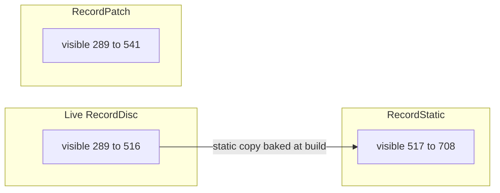
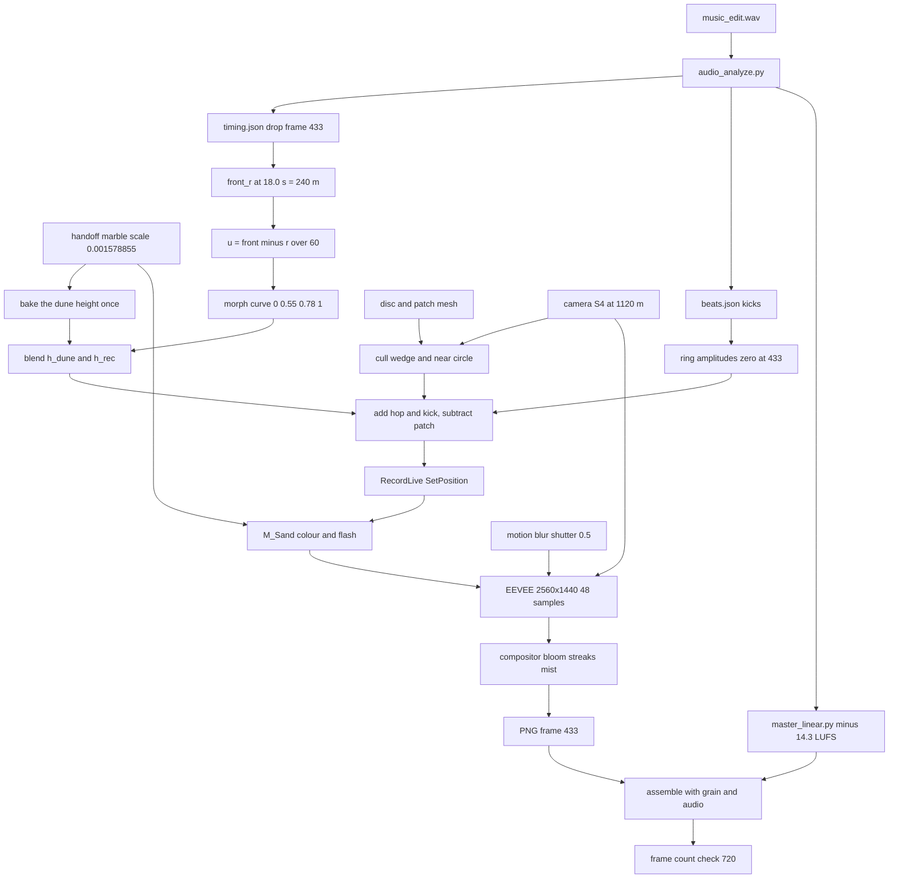

# 02 Core Mechanism: One Frame of the Drop, from Beat Grid to Encoded Pixel

This document follows frame 433 from data to delivery. The [README](README.md) gives the package
map. Frame 433 starts at 18.0 seconds and opens shot S4, where the desert becomes the record.

The table places frame 433 in the film. Frames 709 to 720 are black and are added at encode.

| Unit | Frames | Time (s) | Contents |
|---|---:|---:|---|
| Set A | 1-120 | 0.000-5.000 | S1 groove canyon |
| Set B | 121-288 | 5.000-12.000 | S2 turntable |
| Set C | 289-708 | 12.000-29.500 | S3 to S6 desert record |
| S3 | 289-432 | 12.000-18.000 | Top-down descent to a 7 metre skim |
| S4 | 433-516 | 18.000-21.500 | Stationary at X 1120 metres, then rise |
| S5 | 517-624 | 21.500-26.000 | Above the finished record |
| S6 | 625-708 | 26.000-29.500 | Tonearm landing |

Set C owns S3 to S6. The S3 to S4 cut sits at frame coordinate `CUT = 432.5`, halfway between the
frame 432 and frame 433 samples. Its time is `(432.5-1)/24 = 17.979` seconds. The camera path uses
S4 from `CUT` and S3 before it. The camera bake adds keys at `CUT - 0.01` and `CUT + 0.01`, so the
frame 433 shutter sees only the S4 pose. The live record group (Stage 8) keys the same times.

The trace has 16 stages, tabled below. Each `text` block is a byte-exact source or data copy.

| Stages | Subject |
|---|---|
| 1-4 | Time, beat list, frozen beat, front radius |
| 5-8 | Morph curve, height fields, dune bake, live group |
| 9-12 | Ring keys, flash, record objects, view cull |
| 13-16 | Camera, renderer, compositor, encode and sound |

The scene is Z-up. Radius is the XY distance from the origin. The disc lies in the XY plane. The
tables give the render terms and the code symbols.

| Term | Meaning |
|---|---|
| EEVEE | Blender real-time render engine |
| shader | material program |
| node | one operation box in a node tree |
| node group | reusable set of nodes |
| Geometry Nodes | Blender mesh-building node system |
| modifier | operation attached to an object |
| attribute | named value on a mesh point |
| keyframe | stored value at a frame |
| interpolation | rule that fills values between keyframes; linear uses a straight line |
| float curve | map from one number to another |
| node socket | one node input or output |
| visible | present to the renderer and the viewport |
| shutter sweep | the keyed value at the shutter start and at the shutter end |
| render layer | one pass of the scene |
| pass | image channel, such as depth or mist |
| shutter | fraction of a frame interval that the render integrates |
| clip start, clip end | nearest and farthest draw distances |
| index switch | value selected by an integer index |
| live record | generated vinyl record mesh driven by the `RecordLive` node group |
| CUT | frame coordinate of the camera cut from the S3 shot to the S4 shot, 432.5 |
| front | signed radius of the drop front; negative before 18.0 seconds |
| kick | low-frequency beat hit in the music |
| limiter | process that stops peaks above a ceiling |
| sub stack | bass layers under the kick |
| viewport | the Blender window that shows the scene |
| sprite | a small image drawn at a point |
| tangent | the direction of a curve at a point |
| vertex | one mesh point |
| Gaussian | a bell-shaped falloff |
| sigma | the width of a Gaussian |
| half sine | one half period of a sine curve |
| hop | the raised leading lip of the drop front, 18 metres high and 95 metres wide |
| touchdown | the needle contact at 29.0 seconds |
| patch | the close-view sector mesh |
| analytic signal | a complex signal whose amplitude is the envelope |
| onset | the start of a sound event |
| analytic height | height from a formula, not a simulation |
| ridge | a raised line on the surface |
| spiral | a curve that winds around a centre |
| logical ring | one ring index in the groove band |
| windward | the side that the wind meets first |
| lee | the side away from the wind |
| chalk vein | the white band at ramp position 0.70 |
| banded marble noise | the two-warp noise field that makes the bands |
| dependency graph | Blender's record of node inputs and outputs |
| view cull | removal of geometry outside the camera view |
| wedge test | the angular sector test |
| constant interpolation | hold a key value until the next key |
| emission | shader output that adds light without a light object |
| crest glow | emission applied to the ring crests |
| un-eased descent | descent with no easing at the start |
| envelope | the time-varying amplitude factor |
| border skirt | the 2 metre strip that hides the patch edge |
| camera footprint | the ground area that the camera sees |
| ray slope | vertical change per horizontal metre along a view ray |
| disc local frame | the disc's rotating coordinate frame |
| S4 branch | the camera path branch used at and after the cut |
| yaw | rotation about the vertical axis |
| roll | rotation about the view axis |
| rotation quaternion | a four-number rotation representation |
| depth of field | the range of distance that stays sharp |
| temporal anti-aliasing (TAA) | many time-shifted samples for each pixel |
| normal buffer | per-pixel surface direction |
| light path | one route for light through the scene |
| Punchy | an AgX look with more contrast and saturation |
| bloom | soft glow around bright areas |
| streak | a light line drawn from a bright pixel |
| lens dispersion | colour channels shifted outward from the centre |
| vignette | corner darkening |
| mist pass | image channel that holds mist depth |
| whip smear | a vertical blur that hides a cut |
| grain | fine noise added to the image |
| filter chain | the ordered ffmpeg filters |
| mux | combine picture and sound into one file |
| drop crack | the loud crack at the drop |
| needle click | the sound of needle contact at 29.0 seconds |
| zero-phase | a filter with no phase shift |
| fourth-order | 24 decibels per octave |
| Linkwitz-Riley | a crossover that sums flat at the cut frequency |
| STFT | short-time Fourier transform |
| HPF | high-pass filter |
| RMS | root mean square amplitude average |
| dBFS | decibels relative to full scale |
| smoothstep | a clamped cubic, `3u^2 - 2u^3`, from 0 to 1 between two edges |

| Term | Meaning |
|---|---|
| label mesa | raised centre label, terraces end at radius 262 metres |
| groove band | ring area from 270 to 1160 metres |
| run-out band | flat annular trench from 1170 to 1200 metres |
| spoke | one of eight radial channels |
| zone | one of eight logical ring groups |
| band | one of eight music frequency ranges |
| marble band | repeating coordinate from the marble noise, 0 to 1 |
| grain | one sand particle sprite |
| sand point set | mesh points that draw sand grains |
| handoff | Set B data file that carries the marble mapping to Set C |
| mist start, mist depth | distance where fog begins; distance from start to full fog |
| handle type | tangent control at a curve point |
| CRF | constant rate factor, the encoder quality setting |
| BT.709 | International Telecommunication Union Radiocommunication Sector standard for high-definition television |
| bible, round-1 | production bible; first mix revision |
| adr2, qafix, scfix | source review labels |
| `V` | vertex position after the handoff scale, rotation and offset |
| `hb_d` | baked dune height array from `bake_dunes` |
| `CUT` | 432.5, the S3 to S4 cut |
| `F0`, `F1` | 289, 708, the Set C frame range |
| `Z4`, `A4` | 17.0 metre start lens height, 110.0 metre end altitude |
| `g1120` | ground height at X 1120 metres, Y 0 |
| `S` | handoff marble scale, 0.001578855 |
| `R_GROOVE0`, `R_GROOVE1` | 270 metres, 1160 metres |
| `RING_PITCH` | 40 metres between logical rings |
| `HOP_W`, `HOP_H` | 95 metre hop width, 18 metre hop height |
| `KICK_SIGMA` | 14 metre Gaussian ring width |
| `L_LAND` | touchdown point, radius 1150 metres, bearing 66 degrees |
| `PATCH_R`, `PATCH_TH` | patch radius 940 to 1200 metres, plus or minus 7.5 degrees |
| `hd`, `hr`, `hc`, `pl` | dune, record, crest and patch-lower attributes |
| `fr`, `m1` | front minus radius; `min(morph, 1.0)` |
| `nb`, `ND` | node-builder helper; shared look library in `tools/nd_lib.py` |
| `sb0` to `sb7`, `spa` | keyed shader band values and pulse amplitude |
| `mv` | largest camera offset from the middle sample |
| `COUNT` | output frame trim, default 708 |

## Stage 1: the time base

The film time base is a frame number and a time in seconds. Frame `n` covers the time from
`(n-1)/24` seconds to `n/24` seconds. Frame 433 therefore starts at `(433-1)/24 = 18.0` seconds.

The camera path samples the start of each frame, `t = (f - 1) / 24`
(`scenes/set_c/c_common.py:40-42`). The motion blur shutter is 0.5 at frame 433, so the render
integrates from 17.9896 to 18.0104 seconds, a half-frame window centred on 18.0. This document
follows the path value, not the integrated image.

The timing file places one beat of silence before the drop.

```text
# data/timing.json:102-109
  "silence": {
   "t": 17.5,
   "frame": 421
  },
  "drop": {
   "t": 18,
   "frame": 433
  },
```

The audio stage measured the drop downbeat at 17.9991 seconds. It also moved two other events to
detected beats. The event snap uses `frame = round(t*24)+1`, because an event is a point. The kick
list uses `floor(t*24)+1`, because a kick is an interval. A point event takes the nearest frame
boundary; a kick takes the frame that contains its start. The drop frame is fixed at 433, not
snapped.

```text
# data/timing.json:151-151
 "note": "Event frames snapped by the audio stage to detected beats of audio/music_edit.wav (120.000 BPM, drop downbeat measured at 17.999 s). frame = round(t*24)+1. Snapped: lint_pass 47->49, shadow_enters 615->613."
```

The timing note rounds the attack to 17.999 seconds. The master
forces digital zero from 17.500 to 17.998 seconds. That span is 0.498 seconds, one beat minus the
2 millisecond release. The signal returns at 17.998 seconds, and the measured attack is 0.9
milliseconds before the freeze ends at 18.0 seconds. The table gives the times; the frame column
uses the event snap.

| Event | Time (s) | Frame | Source |
|---|---:|---:|---|
| Freeze starts | 17.500 | 421 | `timing.json` |
| Master silence ends | 17.998 | 433 | `master_linear.py` |
| Measured attack | 17.9991 | 433 | `beats.json` |
| Frame 433 starts | 18.000 | 433 | `t_of` |
| Shutter window | 17.9896 to 18.0104 | 433 | 0.5 shutter |
| Added kick window | 18.008 | 433 | `master_linear.py` |

## Stage 2: the beat grid and the kick list

The audio analysis reads the edited music at 48 kilohertz. It uses a fixed frame rate of 24
frames per second (fps) and a fixed frame count of 720. The nominal tempo is 120 beats per minute.

```text
# audio/scripts/audio_analyze.py:26-35
SR = 48000; FPS = 24; NF = 720; BPM = 120.0; DROP = 18.0
NFFT = 2048; HOP = 512          # bible STFT (bands)
HOP_FINE = 240                  # 5 ms hop for onset candidates
SUB_MIN_DB = -20.0              # dry-source 40-110 Hz 35 ms RMS a real kick must reach
SUB_RISE_DB = 6.0               # ... and its rise over the preceding 35 ms
EDIT_MIN_DB = -30.0             # edit-side audibility: 40-110 Hz 35 ms RMS (at the round-1 edit level, see NORM_REF_DB)
EDIT_RISE_DB = 3.0              # ... and its rise over the preceding 35 ms
NORM_REF_DB = -2.72             # round-1 music_edit.wav normalisation gain: dB thresholds are shifted by (gain - this)
STRENGTH_DB = (-30.0, -10.0)    # edit 40-110 Hz kick level mapped to strength 0..1 (global, at the round-1 edit level)
SWEEP = (16.0, 17.5)            # build HPF sweep: kicks here are rated at their pre-sweep (unfiltered) edit level
```

The analysis uses a short-time Fourier transform with size `NFFT` and band step `HOP`. `HOP_FINE`
is the 5 millisecond onset step. The dry source is the unprocessed music; the edited mix is
`audio/music_edit.wav`.

The detector finds candidates in the 30 to 150 hertz band. It runs seven steps. First, band-pass
30 to 150 hertz. Second, build the Hilbert envelope of the analytic signal. Third, smooth with a
2 millisecond box. Fourth, find the flux peak. Fifth, search 60 milliseconds before to 40
milliseconds after it. Sixth, take the 50 percent envelope crossing. Seventh, validate in 40 to
110 hertz. The 2 millisecond box is not the kick length. `NORM_REF_DB` is -2.72 decibels, the
round-1 music edit gain used as the level reference. The table gives the tests. Values outside the
strength range clip to 0 and 1. Kicks inside the 16.0 to 17.5 second high-pass sweep keep their
pre-sweep level.

| Test | Dry source | Edited mix |
|---|---:|---:|
| 40 to 110 hertz, 35 millisecond RMS floor | -20 dBFS | -30 dBFS |
| Rise over the preceding 35 milliseconds | +6 dB | +3 dB |
| Strength map | not used | -30 dBFS to 0, -10 dBFS to 1 |

```text
# audio/scripts/audio_analyze.py:306-308
                                   time='50 % crossing of the 2 ms Hilbert envelope of the edit 30-150 Hz band (search -60..+40 ms around the flux peak)',
                                   frame='floor(t*24)+1',
                                   strength=f'global: edit 40-110 Hz 35 ms RMS peak mapped {STRENGTH_DB[0]} dBFS -> 0, {STRENGTH_DB[1]} dBFS -> 1 (kicks in the 16.0-17.5 HPF sweep rated at their unfiltered level)'),
```

The same analysis writes eight band values per frame. The bands are logarithmic from 30 to 16000
hertz. The table gives the edges.

| Band | Low (Hz) | High (Hz) |
|---:|---:|---:|
| 0 | 30.0 | 65.8 |
| 1 | 65.8 | 144.2 |
| 2 | 144.2 | 316.0 |
| 3 | 316.0 | 692.8 |
| 4 | 692.8 | 1518.8 |
| 5 | 1518.8 | 3329.4 |
| 6 | 3329.4 | 7298.7 |
| 7 | 7298.7 | 16000.0 |

Each value is the root mean square power in its band per frame, then shaped and normalized
(`audio/scripts/audio_analyze.py:260-275`).

| Shaping step | Rule |
|---|---|
| Attack | take the larger of the current and previous value for 1 frame |
| Release | decay over 6 frames with `exp(-1/6)` |
| Scale | divide by the 95th percentile of positive values |
| Change limit | clamp to 0.25 per frame, except at gate edges |

The kick list feeds the sand rings through `c_common.kicks`, which reads `data/beats.json` and
returns `(time, strength)` pairs. `timing.json` holds the set, shot and event map. Without a
`kicks` list, the function returns 60 synthetic half-second kicks at strength 1.0, from 0 to 29.5
seconds. The kick list covers the build section only.

## Stage 3: the frozen beat

The film has 0.5 seconds of frozen time before the drop. The master makes it digitally silent from
17.500 to 17.998 seconds. At 120 beats per minute, one beat lasts 0.5 seconds, so the gap is one
beat, not half a beat. The source docstring calls it a "half-beat". The helper `tau` returns the
time before 17.5, 17.5 inside the silence, and the time minus 0.5 seconds after 18.0.

```text
# scenes/set_c/c_common.py:59-62
def tau(t):
    """Frozen time for the half-beat of silence 17.5-18.0 (grains and kick rings hang)."""
    t = np.asarray(t, dtype=float)
    return np.where(t < 17.5, t, np.where(t < 18.0, 17.5, t - 0.5))
```

Grains and kick rings hang while the music is silent. The build applies the frozen clock to ring
age at `scenes/set_c/build.py:76`, and the sand point sets use it as a node
expression at `scenes/set_c/c_fx.py:168`. After 18.0 the frozen clock runs 0.5 seconds behind raw
time. The front uses raw time.

## Stage 4: the drop front radius

The front is a radius that starts inside the label edge and grows at a fixed speed. The function
is a straight line with two clamps.

```text
# scenes/set_c/c_common.py:150-155
def front_r(t):
    """Drop front radius. Before 18.0 it is far inside the label (no morph)."""
    t = np.asarray(t, dtype=float)
    fr = 240.0 + 880.0 * (t - 18.0)
    fr = np.where(t < 18.0, -200.0, fr)
    return np.where(t > 19.2, 1300.0, np.minimum(fr, 1300.0))
```

The base radius is 240 metres, inside the label mesa, whose outer terrace ends at 262 metres. The
speed is 880 metres per second. The front stops at 1300 metres, outside the 1200 metre disc rim.

At 18.0 the front is at 240 metres and the record groove starts at 270 metres. The front reaches
the groove start at about 18.034 seconds, inside frame 433. The line gives 1296 metres at 19.2
seconds. The branch returns 1300 metres for any later time, a 4 metre jump. The camera holds
X 1120 and Y 0 until 19.2 seconds, so the front passes the lens at 19.0 seconds. The timing file
names `front_passes_lens` at frame 457 (`data/timing.json:110-113`).

The front travels 1060 metres in about 1.2 seconds. Shot S4 holds 84 frames, or 3.5 seconds.

## The node-building helper

Stages 5 to 15 use `nb`, a small wrapper around Blender nodes.

| Member | Meaning |
|---|---|
| `NB(nt, kind)` | wraps a node tree |
| `.N`, `.L` | the node and link collections |
| `.node(type, **props)` | creates a node |
| `.math(op, a, b, c, clamp)` | creates a Math node and returns its socket |
| `.vmath` | returns a value for LENGTH, DOT_PRODUCT and DISTANCE; a vector otherwise |
| `.sep`, `.comb` | split and join XYZ |
| `.ss(e0, e1, x)` | smoothstep, including reversed edges |
| `.mixc`, `.mixf` | mix colour and float |
| `.attr` | reads a named attribute |
| `.noise` | creates a noise texture |

```text
# scenes/set_c/c_nodes.py:5-36
class NB:
    def __init__(self, nt, kind='SHADER'):
        self.nt, self.N, self.L, self.kind = nt, nt.nodes, nt.links, kind

    def _in(self, sock, v):
        if v is None:
            return
        if isinstance(v, bpy.types.NodeSocket):
            self.L.new(v, sock)
        else:
            sock.default_value = v

    def node(self, typ, **props):
        n = self.N.new(typ)
        for k, v in props.items():
            setattr(n, k, v)
        return n

    def math(self, op, a, b=None, c=None, clamp=False):
        n = self.N.new('ShaderNodeMath'); n.operation = op; n.use_clamp = clamp
        self._in(n.inputs[0], a)
        if b is not None: self._in(n.inputs[1], b)
        if c is not None: self._in(n.inputs[2], c)
        return n.outputs[0]

    # sugar
    def add(self, a, b): return self.math('ADD', a, b)
    def sub(self, a, b): return self.math('SUBTRACT', a, b)
    def mul(self, a, b): return self.math('MULTIPLY', a, b)
    def div(self, a, b): return self.math('DIVIDE', a, b)
    def clamp01(self, a): return self.math('ADD', a, 0.0, clamp=True)

```

## Stage 5: the morph curve

A vertex does not jump from the dune height to the record height. It follows a curve with an
overshoot and four control points. The values are 0 at 0, 1.10 at 0.55, 0.96 at 0.78 and 1.0 at
1.0.

```text
# scenes/set_c/c_common.py:158-162
def morph_curve(u):
    """Spring-overshoot morph: points (0,0) (0.55,1.10) (0.78,0.96) (1,1) (smooth)."""
    xs = np.array([0.0, 0.55, 0.78, 1.0]); ys = np.array([0.0, 1.10, 0.96, 1.0])
    u = np.clip(u, 0, 1)
    return np.interp(u, xs, ys)
```

The curve rises 10 percent past the target, falls 4 percent below it and settles. Height and
colour use the raw morph, so the overshoot raises both. Only the ring fade clamps it. The Python
function joins points with straight lines, because `np.interp` is linear. The docstring says
"smooth", but `np.interp` is linear between points. The render uses the node curve.

The same four points form a float curve in the Geometry Node tree. Python serves the build
checks; the node curve serves the render. The two curves agree at 0, 0.55, 0.78 and 1.0. The code
does not set the handle type, so the between-point shape is not defined in this excerpt.

```text
# scenes/set_c/c_terrain.py:234-246
    r = nb.attr('r'); hd = nb.attr('h_dune'); hr = nb.attr('h_rec'); hc = nb.attr('h_crest')
    pl = nb.attr('patch_lower'); zone = nb.attr('zone', 'INT')
    fr = nb.sub(V['front'], r)
    u = nb.math('MULTIPLY', fr, 1 / 60.0, clamp=True)
    fc = nb.node('ShaderNodeFloatCurve')
    mp = fc.mapping; mp.use_clip = False
    cv = mp.curves[0]
    cv.points[0].location = (0.0, 0.0); cv.points[1].location = (1.0, 1.0)
    cv.points.new(0.55, 1.10); cv.points.new(0.78, 0.96)
    mp.update()
    fc.inputs['Factor'].default_value = 1.0
    nb.L.new(u, fc.inputs['Value'])
    morph = fc.outputs[0]
```

The input `u` is `(front - r) / 60`, clamped to the range 0 to 1. A vertex completes the morph
while the front travels 60 metres past it. The 60 metre width is a soft edge, so the front is not
a hard step. The source does not state why it is 60 metres.

The value `m1 = min(morph, 1.0)` scales the kick rings by `1 - m1`. A ring fades where the morph
is done, so it cannot add height to a finished groove.

## Stage 6: two height fields

The disc has two height fields, the dune field and the record field. The morph blends them per
vertex.

The record field is analytic at build time: a formula gives the height directly. The first excerpt
gives `label_mesa`, `spoke_mask` and `groove_window`. `label_mesa` has two 20 metre terraces with
12 metre wide walls, a 30 metre deep crater and a 3.5 metre rim. `groove_window` fades the ridges
in over 270 to 295 metres and out over 1135 to 1160 metres. `spoke_mask` makes eight rays. The
trench is a flat annular run-out band from 1170 to 1200 metres, not a spiral. The groove band is
890 metres wide, from 270 to 1160 metres. Division by the 40 metre pitch gives 22.25, and
half-step rounding gives ring indices 0 to 22, which is 23 logical rings. The zone is
`floor(k * 8 / 23)`, clamped to 0 to 7: eight groups. The mesh uses 1,054 rings and 3,600 angular
segments, so groove sharpness depends on mesh density.

| Radius band (m) | Step (m) | Rings |
|---|---:|---:|
| 0 to 10 | 0.6 | 17 |
| 10 to 60 | 0.6 | 83 |
| 60 to 300 | 0.75 | 320 |
| 300 to 1150 | 1.5 | 567 |
| 1150 to 1200 | 0.75 | 67 |
| Total | | 1,054 |

`CRATER_R` is 38.0 metres (`scenes/set_c/c_terrain.py:81`), and it shapes the crater in the
analytic formula and the colour mask. `R_CRATER = 25.0` (`scenes/set_c/c_common.py:15`) is only a
layout report value, under `radii.crater` at `c_common.py:170`.

```text
# scenes/set_c/c_terrain.py:82-98
SPOKE_W = 0.24     # spoke half-width in cos(8 theta) units: constant ANGULAR width -> rays widening outward (~30 m at r 1000)


def label_mesa(r):
    # two 20 m terraces with 12 m wide sloped walls (strata read from above), a wide 30 m deep spindle crater with
    # a raised lit rim
    h = 20.0 * (1 - smoothstep(250, 262, r)) + 20.0 * (1 - smoothstep(234, 246, r))
    h = h - 30.0 * (1 - smoothstep(12, CRATER_R, r)) + 3.5 * np.exp(-((r - CRATER_R - 5.0) / 5.0) ** 2)
    return h


def spoke_mask(r, th):
    return np.exp(-(np.cos(8 * th) / SPOKE_W) ** 2)


def groove_window(r):
    return smoothstep(R_GROOVE0, R_GROOVE0 + 25, r) * (1 - smoothstep(R_GROOVE1 - 25, R_GROOVE1, r))
```

```text
# scenes/set_c/c_terrain.py:101-115
def h_record(x, y):
    r = np.hypot(x, y); th = np.arctan2(y, x)
    win = groove_window(r)
    rr = r + 2.5 * np.cos(16 * th) * win
    xg = np.pi * (rr - R_GROOVE0) / RING_PITCH
    eps = 0.2
    s = np.sqrt(np.sin(xg) ** 2 + eps * eps) - eps
    c = np.clip(1 - s / (math.sqrt(1 + eps * eps) - eps), 0, 1)
    spk = spoke_mask(r, th) * win
    crest = CREST_H * c ** 1.4 * win * (1 - 0.8 * spk)          # ridges flatten into broad smooth spoke channels
    spoke = -2.5 * spk
    trench = -18.0 * smoothstep(1170, 1177, r) * (1 - smoothstep(1193, 1200, r))
    k = np.floor((rr - R_GROOVE0) / RING_PITCH + 0.5)
    zone = np.clip(np.floor(k * 8 / 23.0), 0, 7).astype(np.int32)
    return label_mesa(r) + crest + spoke + trench, crest, zone
```

The crest term uses a rounded absolute sine: `c` is 1 at the crest and 0 in the trough. The crest
height is 11 metres and the ring pitch is 40 metres. An angular warp of 2.5 metres at 16 cycles
makes the rings slightly non-circular. The spoke term removes 80 percent of the crest height in
eight channels and lowers the surface by 2.5 metres.

The dune field comes from the banded marble noise in `tools/nd_lib.py`. The field returns the
continuous `raw` value and its fractional
part `m`. The dune profile is asymmetric: a cosine rise on the windward side and a quadratic drop
on the lee side, with the crest at 0.71. The palette `PAL` at `tools/nd_lib.py:9-14` puts chalk at
0.70, as does `MARBLE_VEIN_POS` at `:28`; the crest at 0.71 sits on the vein.

```text
# scenes/set_c/c_terrain.py:155-163
def dune_profile(nb, m):
    """asymmetric dune: rounded windward rise to the crest at 0.71 (chalk vein), sharp lee drop."""
    c = 0.71
    w = nb.math('DIVIDE', m, c, clamp=True)
    hw = nb.sub(0.5, nb.mul(0.5, nb.math('COSINE', nb.mul(w, math.pi))))
    s = nb.math('DIVIDE', nb.sub(m, c), 1 - c, clamp=True)
    hl = nb.math('POWER', nb.sub(1.0, s), 2.0)
    lt = nb.math('LESS_THAN', m, c)
    return nb.add(nb.mul(lt, hw), nb.mul(nb.sub(1.0, lt), hl))
```

The profile is a shape from 0 to 1. The band width sets its amplitude, and the marble gradient
sets the band width.

## Stage 7: the dune bake

A per-frame gradient would cost too much, so the build bakes the dune height once. `ND` is the
shared look library. `_marble_vec` at `scenes/set_c/c_terrain.py:143-152` maps a position: take
(x, y, 0), scale by `S`, rotate about Z by the handoff angle, add the handoff offset. The bake
group evaluates the marble field at the mapped vector `V` and at `V` plus a 0.0025 offset. The
offset is in the mapped vector. The field returns `raw` as `q2.x * freq`, so the world gradient
divides by the step times `S`. Without `S`, the gradient would be per mapped unit, not per world
metre. The inverse gradient gives the band width in metres. The width sets the dune amplitude.

```text
# scenes/set_c/c_terrain.py:166-194
def bake_group():
    ng = bpy.data.node_groups.new('GN_BakeDune', 'GeometryNodeTree')
    ng.interface.new_socket('Geometry', in_out='INPUT', socket_type='NodeSocketGeometry')
    ng.interface.new_socket('Geometry', in_out='OUTPUT', socket_type='NodeSocketGeometry')
    nb = NB(ng, 'GEO')
    gi = nb.node('NodeGroupInput'); go = nb.node('NodeGroupOutput')
    pos = nb.node('GeometryNodeInputPosition').outputs[0]
    V = _marble_vec(nb, pos)
    S, _a, _o, FQ = marble_mapping()
    d = 0.0025
    f0 = ND.build_marble_field(ng, V, scale=1.0, freq=FQ)
    fx = ND.build_marble_field(ng, nb.vmath('ADD', V, (d, 0, 0)), scale=1.0, freq=FQ)
    fy = ND.build_marble_field(ng, nb.vmath('ADD', V, (0, d, 0)), scale=1.0, freq=FQ)
    gx = nb.sub(fx['raw'], f0['raw']); gy = nb.sub(fy['raw'], f0['raw'])
    g = nb.div(nb.math('SQRT', nb.add(nb.mul(gx, gx), nb.mul(gy, gy))), d * S)  # raw per metre
    width = nb.div(1.0, nb.math('MAXIMUM', g, 1e-4))                           # band width (m)
    amp = nb.math('MINIMUM', nb.math('MAXIMUM', nb.mul(width, 0.19), 0.8), 15.0)
    x, y, _ = nb.sep(pos)
    p2 = nb.comb(x, y, 0.0)
    var = nb.noise(nb.vmath('SCALE', p2, scale=1 / 420.0), 1.0, 1.0, 0.5)
    amp = nb.mul(amp, nb.madd(var, 0.9, 0.35))
    prof = dune_profile(nb, f0['m'])
    fbm = nb.mul(nb.sub(nb.noise(nb.vmath('SCALE', p2, scale=1 / 160.0), 1.0, 3.0, 0.55), 0.5), 5.0)
    h = nb.add(nb.mul(prof, amp), fbm)
    st = nb.node('GeometryNodeStoreNamedAttribute'); st.data_type = 'FLOAT'; st.domain = 'POINT'
    st.inputs['Name'].default_value = 'h_bake'
    nb.L.new(gi.outputs[0], st.inputs['Geometry']); nb.L.new(h, st.inputs['Value'])
    nb.L.new(st.outputs[0], go.inputs[0])
    return ng
```

The bake writes one float attribute, `h_bake`. `bake_dunes` then adds the group as a modifier,
evaluates the dependency graph, reads the attribute, removes the modifier and returns the array.

```text
# scenes/set_c/c_terrain.py:197-205
def bake_dunes(obj, ng):
    mod = obj.modifiers.new('bake', 'NODES'); mod.node_group = ng
    dg = bpy.context.evaluated_depsgraph_get(); dg.update()
    ev = obj.evaluated_get(dg)
    me = ev.data
    arr = np.zeros(len(me.vertices), np.float32)
    me.attributes['h_bake'].data.foreach_get('value', arr)
    obj.modifiers.remove(mod)
    return arr
```

The amplitude floor is 0.8 metres, the ceiling is 15 metres, and the width factor is 0.19. A
second noise multiplies the amplitude by 0.35 to 1.25; its output is 0 to 1. A fractal noise
subtracts 0.5 and multiplies by 5, so it adds minus 2.5 to plus 2.5 metres.

The build combines the bake with the label mesa:
`h_dune = label_mesa(r) + hb_d * dune_weight(r)` at `scenes/set_c/c_terrain.py:511`, where `hb_d`
is the baked array from `bake_dunes`. `dune_weight` at `:118-119` is
`smoothstep(262, 340, r) * (1 - smoothstep(1135, 1198, r))`. It is 0 at 262 metres and below, so
the label mesa stays smooth, ramps to 1 at 340, holds 1 to 1135, then falls to 0 at 1198. The
outer desert is a separate `OuterDesert` mesh; `outer_height` at `:122` adds six ridged sine
layers.

The build also computes `h_rec`, `h_crest` and `zone`. The live tree reads `r`, `h_dune`, `h_rec`
and `patch_lower`; it reads `h_crest` into `hc` but does not use it. The shader reads `zone` and
recomputes the crest. `patch_lower` is 0.15 metres inside the patch sector. The mesh therefore
carries six precomputed fields at `scenes/set_c/c_terrain.py:516-517`: `r`, `h_dune`, `h_rec`,
`h_crest`, `zone` and `patch_lower`.

## Stage 8: the live Geometry Node group

The live group is named `RecordLive`. It sets each vertex Z from the two height fields and the
front. Its inputs are the front, three ring radii, three ring amplitudes, eight band values and
the pulse amplitude. The cull inputs are a centre, a direction, a cosine, a maximum distance and a
near radius. The lists are at `scenes/set_c/c_terrain.py:209-210`.

The first part is a view cull. The group deletes points that fail both the near-circle test and the
wedge test. The camera values are keyed per 12-frame block with constant interpolation.

```text
# scenes/set_c/c_terrain.py:213-233
def live_group():
    ng = bpy.data.node_groups.new('RecordLive', 'GeometryNodeTree')
    ng.interface.new_socket('Geometry', in_out='INPUT', socket_type='NodeSocketGeometry')
    ng.interface.new_socket('Geometry', in_out='OUTPUT', socket_type='NodeSocketGeometry')
    nb = NB(ng, 'GEO')
    gi = nb.node('NodeGroupInput'); go = nb.node('NodeGroupOutput')
    V = {k: nb.value(0.0, k) for k in LIVE_INPUTS}
    V['front'].node.outputs[0].default_value = -200.0
    # ---- view cull (keyed per 12-frame block, constant interpolation): keep a wedge + near circle
    CV = {k: nb.value(0.0, k) for k in CULL_INPUTS}
    CV['c_dmax'].node.outputs[0].default_value = 1e6; CV['c_near'].node.outputs[0].default_value = 1e6
    cpos = nb.node('GeometryNodeInputPosition').outputs[0]
    qx, qy, _ = nb.sep(cpos)
    vx = nb.sub(qx, CV['c_x']); vy = nb.sub(qy, CV['c_y'])
    dd = nb.math('SQRT', nb.add(nb.mul(vx, vx), nb.mul(vy, vy)))
    ca = nb.div(nb.add(nb.mul(vx, CV['c_hx']), nb.mul(vy, CV['c_hy'])), nb.math('MAXIMUM', dd, 1e-3))
    keep = nb.math('MAXIMUM', nb.math('LESS_THAN', dd, CV['c_near']),
                   nb.mul(nb.math('LESS_THAN', dd, CV['c_dmax']), nb.math('GREATER_THAN', ca, CV['c_cos'])))
    dl = nb.node('GeometryNodeDeleteGeometry'); dl.domain = 'POINT'
    nb.L.new(gi.outputs[0], dl.inputs['Geometry']); nb.L.new(nb.math('LESS_THAN', keep, 0.5), dl.inputs['Selection'])
    geo_in = dl.outputs[0]
```

The cull keeps a point inside the near circle, or inside the distance limit and the wedge angle.
The wedge is a dot product against a unit direction.

The second part computes the morph and the height. The hop is a wave behind the front. The kick is
a sum of three Gaussian rings. The pulse is a per-zone band value, stored but not added to height:
the code sets `hrp = hr`. The shader gets the same pulse through the keyed sockets `sb0` to `sb7`
and `spa`, so the glow exists without geometry. The height is the dune height plus the morph
difference, plus the hop and kick, minus the patch lowering.

```text
# scenes/set_c/c_terrain.py:247-269
    hop = nb.mul(nb.mul(nb.math('POWER', nb.math('SINE', nb.mul(nb.math('MULTIPLY', fr, 1 / HOP_W, clamp=True), math.pi)), 1.4), HOP_H), nb.maprange(r, 930.0, 1090.0, 1.0, 0.22))
    ks = None
    for i in range(3):
        d = nb.mul(nb.sub(r, V[f'kr{i}']), 1.0 / KICK_SIGMA)
        k = nb.mul(nb.math('EXPONENT', nb.mul(nb.mul(d, d), -1.0)), V[f'ka{i}'])
        ks = k if ks is None else nb.add(ks, k)
    m1 = nb.math('MINIMUM', morph, 1.0)
    ks = nb.mul(ks, nb.sub(1.0, m1))
    isw = nb.node('GeometryNodeIndexSwitch'); isw.data_type = 'FLOAT'
    while len(isw.index_switch_items) < 8:
        isw.index_switch_items.new()
    nb.L.new(zone, isw.inputs['Index'])
    for i in range(8):
        nb.L.new(V[f'b{i}'], isw.inputs[str(i)])
    pulse = nb.mul(isw.outputs[0], V['pulse_amp'])
    hrp = hr        # adr2: no geometric pulse (shader glow only) -> f517+ uses the static baked RecordStatic
    h = nb.add(hd, nb.mul(nb.sub(hrp, hd), morph))
    h = nb.sub(nb.add(nb.add(h, hop), ks), pl)
    pos = nb.node('GeometryNodeInputPosition').outputs[0]
    x, y, _ = nb.sep(pos)
    sp = nb.node('GeometryNodeSetPosition')
    nb.L.new(geo_in, sp.inputs['Geometry']); nb.L.new(nb.comb(x, y, h), sp.inputs['Position'])
    geo = sp.outputs[0]
```

The hop uses a half sine over the 95 metres behind the front. The height is 18 metres. The wave
is weaker from radius 930 to 1090 metres. The kick rings use a Gaussian with a sigma of 14
metres. The ring height fades as the morph completes.

The group stores four attributes at `scenes/set_c/c_terrain.py:270`: `morph`, `pulse`, `kick`
and `hop`. Nothing reads the stored `pulse` attribute; the shader uses the keyed sockets instead.

| Attribute | Shader use |
|---|---|
| `morph` | selects the sand or record colour (`:374`) |
| `kick` | mixes the sand 60 percent toward orange (`:389-391`) |
| `hop` | mixes 7 percent toward warm orange and adds emission (`:392-393`) |
| crest glow | `smoothstep(0.80, 0.97, crest)` times zone, `spa` and `morph` (`:395-412`) |

## Stage 9: the ring keys and the drop switch

The build keys the live record node inputs at every frame 289 to 708, and at `CUT` minus 0.01 frame
and `CUT` plus 0.01 frame. `CUT` is 432.5, so the extra keys are 432.49 and 432.51. The keyed front
is minus 200 metres at both extra keys. The front rises to 240 metres at frame 433, so the rise
spans 0.49 frame. No live record object is visible after frame 541, so later keys in that group do
not change the mesh (`scenes/set_c/build.py:209-211`).

| Key | Front value | Role |
|---|---|---|
| 432.49 | minus 200 metres | last key before the cut |
| 432.51 | minus 200 metres | first key after the cut; holds the front until the cut |
| 433 | 240 metres | first frame of shot S4; starts the rise |
| 434 | 276.7 metres | next key; sets the rise per frame |

Ring amplitudes are nonzero only below 18.0 seconds. The excerpts show the update. Age comes from the
frozen clock. The radius is `R0 + 220 * age`. The start radius `R0` is 35 to 245 metres behind the
lens, farther when the lens is high. An envelope shapes attack and decay, and a near fade uses 16
to 48 metres of 3D distance from the lens.

```text
# scenes/set_c/build.py:41-62
KS = [(tk, s) for tk, s in kicks() if 12.0 <= tk < 17.5]
V_RING = 220.0


def ring_r0(tk):
    pos = path.s3(f_of(tk), ease=False)[0]          # qafix: un-eased descent, so ring timing/positions stay as before
    alt = pos[2] - path.gx(pos[0])
    return pos[0] - (35.0 + 210.0 * min(1.0, alt / 380.0))


R0 = [ring_r0(tk) for tk, _ in KS]
# qafix (QA must-fix 1): in the S3 skim (t >= 16.0: lens ~7 m over the sand, pitch -3 deg) a kick ring born ~39 m behind
# the lens crossed the bottom third in ~1 frame (220 m/s) -> one-frame washed-out flash (f392/404/416). The ring amplitude
# now fades to zero within RING_NEAR[0] m (3D) of the lens and is untouched beyond RING_NEAR[1] m: rings rise ahead and
# travel out as before, the 17.5-18.0 hang ring (~50 m ahead) is unchanged, descent kicks (t < 16) are unchanged.
RING_NEAR = (16.0, 48.0)


def ring_near_fade(t, kr, cpos, calt):
    if t < 16.0:
        return 1.0
    return float(smoothstep(RING_NEAR[0], RING_NEAR[1], math.hypot(kr - math.hypot(cpos[0], cpos[1]), calt)))
```

The list `KS` holds only kicks from 12.0 to 17.5 seconds. At frame 433 the condition `if t < 18.0`
is false, so the build sets the three amplitudes to zero and the radius to minus 500 metres. The
ring system stops at the drop.

```text
# scenes/set_c/build.py:67-82
for fi, f in enumerate(frames):
    t = t_of(f); ta = float(tau(t))
    vals = {'front': float(front_r(t))}
    for s in range(3):
        vals[f'kr{s}'] = -500.0; vals[f'ka{s}'] = 0.0
    if t < 18.0:
        cpos, _h, _p, _r, _l, calt = path.s3(f)
        for i, (tk, st) in enumerate(KS):
            s = i % 3
            age = ta - tk
            if age < 0:
                continue
            A = (0.6 + 0.6 * float(smoothstep(14.0, 17.5, tk))) * st
            env = (1 - math.exp(-age / 0.03)) * math.exp(-age / 0.7) * (1 - float(smoothstep(1.0, 1.45, age)))
            vals[f'kr{s}'] = R0[i] + V_RING * age
            vals[f'ka{s}'] = A * env * ring_near_fade(t, vals[f'kr{s}'], cpos, calt)
```

The frozen age holds the last rings at 17.5 until the `t < 18.0` cutoff. The drop then replaces
them with the front, the hop and the flash. The frame 433 image is a front frame, not a ring
frame.

The pulse amplitude is zero at frame 433. It ramps from 0 at 20.0 seconds to 1 at 20.6 seconds,
starting at frame 481 in S4. The record does not pulse on the drop; it pulses after the morph, when the camera is
above the finished record.

## Stage 10: the shader flash

The drop needs a bright event at the label mesa base. The sand shader adds two keyed emission
rings: the drop flash and the touchdown shock at 29 seconds. The touchdown has three effects: the
sand emission ring, the `TouchRing0` and `TouchRing1` objects, and a compositor streak. They share
one event, not one object.

The build keys the flash amplitude and radius. The amplitude is 0 at frame 432, 4.0 at frame 433,
and 0 by frame 444. The radius is `max(272, front_r + 30)` from frame 432 to 444. At frame 433
the front is 240, so the radius is 272, not 270.

```text
# scenes/set_c/build.py:217-224
# adr2: keyed hot rings in M_Sand: f433 drop flash at the label-mesa base, touchdown shock ring from L (f697-708)
_sn = bpy.data.materials['M_Sand'].node_tree.nodes
# scfix: 12 -> 4 peak (saturated, never white), ring radius keyed ~30 m ahead of the dust front (visibly expands)
for f, v in ((432, 0.0), (433, 4.0), (434, 3.8), (436, 3.0), (438, 2.0), (440, 1.0), (442, 0.3), (444, 0.0)):
    _sn['flash433'].outputs[0].default_value = v; _sn['flash433'].outputs[0].keyframe_insert('default_value', frame=f)
for f in range(432, 445):
    _sn['flash_r'].outputs[0].default_value = max(272.0, float(front_r(t_of(f))) + 30.0)
    _sn['flash_r'].outputs[0].keyframe_insert('default_value', frame=f)
```

The material makes a hot leading line and a magenta wake. The lead has an 18 metre rise and a 6
metre fall, 24 metres in total. The wake has a 73 metre rise and a 20 metre fall, 93 metres in
total. The comment's 20 and 80 metres are visible band widths, not edge spans. The mask ramps from
0 at radius 256 metres to 1 at 266 metres, so it dims the inner edge of the flash across the outer
mesa. The comment says 12
washed out and 4.0 keeps the ring saturated. That is an intent.

```text
# scenes/set_c/c_terrain.py:425-435
    # scfix: the f433 DROP flash is a thin saturated shockwave racing out over the sand (keyed radius 'flash_r'):
    # hot saffron-orange leading line + magenta wake, masked off the label-mesa walls (they read as a white UFO disc)
    flr = nb.value(272.0, 'flash_r')
    dfl = nb.sub(r, flr)
    lead = nb.mul(nb.ss(-18.0, 0.0, dfl), nb.ss(6.0, 0.0, dfl))           # ~20 m hot line (grazing view needs width)
    trail = nb.mul(nb.ss(-95.0, -22.0, dfl), nb.ss(0.0, -20.0, dfl))      # ~80 m magenta wake
    offm = nb.mul(nb.ss(256.0, 266.0, r), fl)
    efl = nb.N.new('ShaderNodeEmission'); efl.inputs['Color'].default_value = (*C.hex2lin('#FF8A12'), 1.0)
    nb._in(efl.inputs['Strength'], nb.mul(lead, offm))
    emg = nb.N.new('ShaderNodeEmission'); emg.inputs['Color'].default_value = (*ND.lin('magenta'), 1.0)
    nb._in(emg.inputs['Strength'], nb.mul(nb.mul(trail, offm), 0.7))
```

`fl` is the keyed flash amplitude and `flr` is the keyed radius.

The flash is an emission shader added to the sand shader. It is not a light object and does not
cast light on other objects. The camera sees the emissive surface directly.

The same material has a second emission path for the touchdown ring at 29.0 seconds, frame 697.
The build keys its radius from frame 694 to 708. The emission is zero before frame 697.
`L` is `L_LAND` at `scenes/set_c/c_common.py:26`, the polar point at radius 1150 metres and bearing
66 degrees. This path does not affect frame 433.

## Stage 11: the record objects and the cost split

The Set C record is three objects. The patch sector runs from 940 to 1200 metres, spans plus or
minus 7.5 degrees, uses a 0.30 metre step and has a 2 metre border skirt
(`scenes/set_c/c_terrain.py:8-10`). The patch outlives the live disc by 25 frames and uses the same
`RecordLive` group on its finer mesh.

| Object | Role | Visible frames |
|---|---|---:|
| RecordDisc | live mesh with `RecordLive` modifier | 289-516 |
| RecordPatch | near sector with a finer mesh | 289-541 |
| RecordStatic | baked record heights, parented to the disc | 517-708 |

```text
# scenes/set_c/build.py:209-211
c_fx.key_visibility(patch, [(F0, 541)])
c_fx.key_visibility(disc, [(F0, 516)])                     # adr2: live GN disc only while it morphs
c_fx.key_visibility(bpy.data.objects[disc['static']], [(517, F1)])
```

The helper at `scenes/set_c/c_fx.py:920-928` writes a key only when the state changes. Both ends of
a range are inclusive.

```text
# scenes/set_c/c_fx.py:920-928
def key_visibility(obj, ranges, f0=F0, f1=F1):
    """ranges: list of (first_visible, last_visible) global frames."""
    vis_prev = None
    for f in range(f0 - 1, f1 + 2):
        v = any(a <= f <= b for a, b in ranges)
        if v != vis_prev:
            obj.hide_render = not v; obj.keyframe_insert('hide_render', frame=f)
            obj.hide_viewport = not v; obj.keyframe_insert('hide_viewport', frame=f)
            vis_prev = v
```

The morph does not complete at frame 517. Every disc vertex has morph 1 at the frame 461 sample,
which is 19.167 seconds. The source comment says "from f517 the morph is 1 everywhere". That is
true but late. The switch is the first frame of S5, a budget choice, not a morph boundary.



At frame 433 the live disc and the patch are visible; the static copy is hidden. `RecordStatic` is
generated before rendering, not at frame 517.

The split exists for cost. The source comment records about 3.6 million vertices. From frame 517
the static copy supplies the full record at record height. The patch stays live to frame 541 for
the close view.

For the static copy, the build removes five fields: `h_dune`, `h_rec`, `h_crest`, `patch_lower`
and `r`. It keeps `zone`, because the shader still reads it. The removal of `r` means the static
mesh has no radius
attribute. It sets the Z position to `h_rec` minus the patch lowering and stores a `morph`
attribute of 1.0, so the shader paints the record colour. In the excerpt, `hrec` is the record
height array and `inpatch` marks the disc points under the patch sector.

```text
# scenes/set_c/c_terrain.py:528-541
    # adr2 budget: from f517 the morph is 1 everywhere -> a STATIC copy of the disc with the record heights baked
    # (no per-frame GN on 3.6M verts); parented to the disc so it spins with it
    sme = me.copy(); sme.name = 'RecordStatic'
    for a in ('h_dune', 'h_rec', 'h_crest', 'patch_lower', 'r'):
        if a in sme.attributes:
            sme.attributes.remove(sme.attributes[a])
    cov = np.zeros(len(sme.vertices) * 3, np.float32); sme.vertices.foreach_get('co', cov)
    cov = cov.reshape(-1, 3); cov[:, 2] = hrec - np.where(inpatch, 0.15, 0.0)
    sme.vertices.foreach_set('co', cov.ravel())
    set_attr(sme, 'morph', np.ones(len(cov), np.float32))
    sme.update()
    static = bpy.data.objects.new('RecordStatic', sme); coll.objects.link(static)
    static.parent = disc
    disc['static'] = static.name
```

The disc is lowered 0.15 metres inside the patch sector, and the static copy subtracts the same
value, so the surfaces do not fight for depth. A 2 metre skirt hides the border gap.

The disc rotation keys begin at frame 570, which is 23.708 seconds. They hold zero until 24.0
seconds. The angular speed then rises to 3 degrees per second by 25.0 seconds. Positive
`rotation_euler.z` turns counterclockwise as seen from above. The build keys one rotation value
per frame from frame 570 to the end at `scenes/set_c/build.py:96-103`. The patch and the static
copy are parented to the disc, so all three objects turn together.

## Stage 12: the view cull keys

The build computes the cull values for each 12-frame block from a camera footprint on the ground.
The ray slope is `tw = 18.0 / lens * 1.12` and `th = tw * 9 / 16 * 1.12`. The value 18.0 is half of
the 36 millimetre sensor width. The 1.12 factor applies to the half-width and again to the
half-height. It samples a 9 by 7 grid
and clamps each ray at 3200 metres. The caller rotates each point by the disc spin
(`scenes/set_c/build.py:140-144`). At frame 433 the spin is zero.

```text
# scenes/set_c/build.py:110-127
def footprint(f):
    # qafix: cull keys from the un-eased path so every 12-frame cull block stays bit-identical; the eased descent
    # (f308-329, at most ~30 m higher) stays inside the +200 m dmax margin (checked by scenes/set_c/qafix_patch.py)
    pos, hd, pt, rl, lens, alt = path.at(f, ease=False)
    q = c_cam.quat(hd, pt, rl)
    tw = 18.0 / lens * 1.12; th = tw * 9 / 16 * 1.12 / 1.0
    C0 = Vector(pos); pts = []
    for u in np.linspace(-1, 1, 9):
        for v in np.linspace(-1, 1, 7):
            d = q @ Vector((u * tw, v * th, -1.0)); d.normalize()
            if d.z < -1e-4:
                tt_ = (C0.z - 0.0) / -d.z
                tt_ = min(tt_, 3200.0)
            else:
                tt_ = 3200.0
            p = C0 + d * tt_
            pts.append((p.x, p.y))
    return np.array(pts), np.array(pos[:2]), alt
```

A downward ray hits the ground. An upward ray never meets the plane, so it gets the 3200 metre cap.
Angles and distances use the disc local frame after the spin rotation. The origin is the middle
sampled camera and distance is horizontal. Frame 433 starts a block.

The wedge angle is the largest far-point angle plus 16 degrees. It is a half-angle, so the full
wedge is twice this value. The maximum distance is the largest point distance plus 200 metres. The
near radius is `max(160, 0.35 * max altitude) + mv`, where `mv` is the largest camera offset
(`scenes/set_c/build.py:148-150`). A point inside the near radius is kept without a wedge test.

The build writes the values with constant interpolation, so a 12-frame block shares one set. It
combines footprints from one frame before to one frame after the block; those samples are not
keyed. A point outside the
wedge is hidden for that block. Each block recomputes from the original mesh, so the point can
return. A point near the wedge edge can appear or vanish on a block edge. The margin and extra
samples reduce this risk; the source gives no measure.

## Stage 13: the camera at frame 433

`Z4 = 17.0` is the S4 start lens height. `A4 = 110.0` is the end altitude
(`scenes/set_c/c_cam.py:23-24`). `g1120` is the ground height at X 1120 metres and Y 0, computed
by `ground_h` at `:89`. At 18.0 seconds the S4 branch is active. The camera path has four time branches.

| Branch | Time (s) |
|---|---|
| S3 descent | 12.0 to 18.0 |
| S4 move | 18.0 to 21.5 |
| S5 crane | 21.5 to 26.0 |
| S6 hold | 26.0 to 29.5 |

The camera is at X 1120 metres
and Y 0. Its Z is `Z4` plus `g1120`. Its net pitch is minus 2.6 degrees at frame 433: the base
minus 3 degrees plus the 0.4 degree kick. Its heading is 180 degrees and
its lens is 20 millimetres. The camera X and Y stay fixed until 19.2 seconds. The move block
starts there; its yaw smoothstep begins at 19.15, so its 19.2 value is small but nonzero. Heading
and Y change from 19.2.

The S4 branch adds a short pitch kick on the downbeat. The condition covers three frame intervals,
`18.0 <= t < 18.125`. The comment calls it a 2-frame kick; the code runs 3. The kick adds 0.4
degrees at frame 433. The added term reaches about minus 0.14 degrees before it returns to zero.

```text
# scenes/set_c/c_cam.py:126-129
        # adr2: 2-frame camera KICK on the f433 downbeat
        if 18.0 <= t < 18.0 + 3 / 24.0:
            k = (t - 18.0) / (3 / 24.0)
            pitch += 0.4 * math.cos(math.pi * k * 1.5) * (1 - k)
```

The branch also adds a shake when the front passes the lens, and a residual roll after the pass.
The shake condition spans about 11 frames; the comment says 6.

```text
# scenes/set_c/c_cam.py:141-153
        # 6-frame shake as the front passes (f456-462): 0 -> 0.6 deg -> 0
        # adr2: tilt up ~2.5 deg through the engulf so the straight near-ridge strip leaves the bottom of frame
        if 18.83 < t < 19.45:
            pitch += 2.5 * math.sin(math.pi * (t - 18.83) / 0.62)
        sh = 0.0
        if 18.9 < t < 19.35:
            sh = math.sin(math.pi * (t - 18.9) / 0.45)
        sx = 0.6 * sh * (math.sin(t * 71.0) * 0.6 + math.sin(t * 113.0 + 1.3) * 0.4)
        sy = 0.6 * sh * (math.sin(t * 83.0 + 0.7) * 0.6 + math.sin(t * 131.0 + 2.1) * 0.4)
        # residual roll settling after the pass
        if t > 19.0:
            roll = 2.2 * math.exp(-(t - 19.0) / 0.6) * math.sin((t - 19.0) * 5.0)
        return (x, y, z), heading + sy, pitch + sx, roll + sx * 0.5, 20.0, z - gz
```

The tilt-up runs from 18.83 to 19.45 seconds and adds up to 2.5 degrees of pitch. The shake ends
at 19.35; the residual roll decays with a 0.6 second time constant.

The camera bake writes one linear key per frame for location, rotation quaternion, lens and clip
start. The frame list runs from `F0` to `F1` and adds two keys at `CUT - 0.01` and `CUT + 0.01`
(`scenes/set_c/c_cam.py:238`). The clip start is `0.05 * altitude`, clamped from 0.08 to 40
metres. The clip end is 120000 metres. The camera has no depth of field; objects nearer than the
clip start are cut away.

## Stage 14: the renderer

Set C uses EEVEE, the Blender real-time render engine, with screen-space raytracing against the
depth and normal buffers of the visible image, not the full scene. The render is 2560 by 1440 at
48 samples. These are temporal anti-aliasing samples, not 48 light paths. The value stays 48 from
frame 289 to 708, with keys at frames 289, 432, 433 and 517. The view transform is AgX, a Blender
tone-mapping transform, with the Punchy look and plus 0.2 exposure. The output is Portable Network
Graphics (PNG) at 16-bit red, green and blue (RGB). The shared helper `tools/common.py:39`
defaults to 8-bit RGB. Set C overrides the colour depth to 16 at
`scenes/set_c/c_look.py:106`. Colour depth applies to each channel.

```text
# scenes/set_c/c_look.py:78-80
def render_settings(sc):
    C.setup_render(sc, res=(2560, 1440), samples=48)
    C.color(sc, 'AgX - Punchy', exposure=0.2)
```

The build keys the motion blur shutter. The excerpt lists every key. The table gives the keyed
frames; values interpolate between them. The shutter is part of the look, not a fixed camera
property. A shutter of 0.5 integrates half a frame in total, centred on the frame time.

| Frames | Shutter |
|---|---:|
| 289, 322 | 0.5 |
| 332, 384 | 0.25 |
| 392, 424 | 0.3 |
| 432 | 0.45 |
| 433 to 638 | 0.5 |
| 644, 684 | 0.25 |
| 690 to 708 | 0.4 |

```text
# scenes/set_c/build.py:250-256
try:
    for f, v in ((F0, 0.5), (322, 0.5), (332, 0.25), (384, 0.25), (392, 0.3), (424, 0.3), (432, 0.45), (433, 0.5),
                 (638, 0.5), (644, 0.25), (684, 0.25), (690, 0.4), (F1, 0.4)):
        sc.render.motion_blur_shutter = v
        sc.render.keyframe_insert('motion_blur_shutter', frame=f)
except Exception as ex:
    print('WARN shutter not animatable', ex)
```

The renderer evaluates the live group at frame 433. It shades the sand with the marble field, the
record colour and the flash, and adds the sky, sun and mist.

The sun is 9 degrees above the horizon and comes from +Y, with colour `#FFC890`, energy 11 and
angle 0.6 degrees (`scenes/set_c/c_look.py:67`). Sun energy is irradiance in watts per square
metre; 0.6 degrees is the angular diameter of the sun disc. The build lowers the sun from 14
degrees at frame 289 to 9 degrees at frame 330. The sky is a procedural ramp from apricot to deep
violet, with one version for the camera and one for lighting. The source says the shadows read
violet but gives no reason; AgX and the sky fill are the likely cause.

The mist has two parts. The world mist is a distance fog. Its start is keyed per frame at
`scenes/set_c/build.py:237-241`, and the depth at `:240-241`: at least 900 metres before frame
517, then the greater of 2 metres and 0.8 times altitude. The start falls by 60 percent from frame
643 to 679; depth falls from 6000 to 2400 metres. At frame 433 the start is 900 metres and the
depth is 6000 metres. The second part is a compositor tint. It needs a Mist output and a depth
pass output at `scenes/set_c/c_look.py:108-109`, mixed at `:122-132`. Without the depth pass, the
branch uses one flat colour.

## Stage 15: the compositor

The compositor has six stages: mist tint, bloom, streaks, lens dispersion, saturation and vignette.
The mist tint blends from apricot at 1500 metres to plum at 4000 metres. The factor comes from the
mist pass and `MIST_K`, which is 0.26. At full mist the tint covers 26 percent of the image. A
distance test removes it beyond 100000 metres.

```text
# scenes/set_c/c_look.py:122-129
    if mist is not None:
        z = rl.outputs['Depth'] if 'Depth' in rl.outputs else None
        fac = nb.mul(mist, MIST_K); fac.node.name = 'MistK'
        if z is not None:
            fac = nb.mul(fac, nb.math('LESS_THAN', z, 100000.0))
            far = nb.maprange(z, 1500.0, 4000.0, 0.0, 1.0)
            mcol = nb.mixc(far, (*C.hex2lin('#FF9A5A'), 1.0), (*C.hex2lin('#D98CC0'), 1.0))
            img = nb.mixc(fac, img, mcol)
```

```text
# scenes/set_c/c_look.py:132-159
    gl = nb.N.new('CompositorNodeGlare'); gl.name = 'Bloom'
    gl.inputs['Type'].default_value = 'Bloom'
    gl.inputs['Threshold'].default_value = 1.2
    gl.inputs['Strength'].default_value = 0.35
    gl.inputs['Size'].default_value = 0.7
    nb._in(gl.inputs['Image'], img); img = gl.outputs['Image']
    st = nb.N.new('CompositorNodeGlare'); st.name = 'Streaks'
    st.inputs['Type'].default_value = 'Streaks'
    st.inputs['Threshold'].default_value = 6.0
    st.inputs['Strength'].default_value = 0.0
    try:
        st.inputs['Streaks'].default_value = 4; st.inputs['Fade'].default_value = 0.85
    except Exception:
        pass
    nb._in(st.inputs['Image'], img); img = st.outputs['Image']
    ld = nb.N.new('CompositorNodeLensdist')
    ld.inputs['Dispersion'].default_value = 0.004
    nb._in(ld.inputs['Image'], img); img = ld.outputs['Image']
    hs = nb.N.new('CompositorNodeHueSat')
    hs.inputs['Saturation'].default_value = 1.06
    nb._in(hs.inputs['Image'], img); img = hs.outputs['Image']
    ic = nb.N.new('CompositorNodeImageCoordinates')
    nb._in(ic.inputs['Image'], img)
    x, y, _ = nb.sep(ic.outputs['Normalized'])
    u = nb.mul(nb.sub(x, 0.5), 2.0); v = nb.mul(nb.sub(y, 0.5), 2.0)
    dd = nb.mul(nb.math('SQRT', nb.add(nb.mul(u, u), nb.mul(v, v))), 0.7071)
    vig = nb.sub(1.0, nb.mul(nb.ss(0.45, 1.0, dd), 0.12))
    img = nb.mixc(1.0, img, vig, 'MULTIPLY')
```

The streak strength is keyed at `scenes/set_c/build.py:280-286`. It is 0.0 at frame 432, 0.15 at
frame 433, and 0.0 again at frame 436. The touchdown glint uses 0.16 at frame 697 and 0.04 at the
end. The threshold is 6.0. The flash key peaks at 4.0, below it. Bloom runs first and can lift the
pixel. The source does not settle whether the frame-433 streak is visible, because it gives no
final pixel value. Bloom is constant.

The vignette maps the image to minus 1 to 1 per axis and reduces the corners by up to 12 percent.
The factor 0.7071 makes the corner distance 1; the fall starts at 0.45.

## Stage 16: the encode and the sound

The finishing script `tools/master.sh` builds `renders/master` from `renders/final` and
`renders/fix`. A frame in `renders/fix` replaces the same frame from `renders/final`. The script
hard-links the frames and unlinks before a replacement, so `renders/final` stays untouched. It
replaces two transitions. A whip smear covers Set A to Set B, frames 119 to 122. A colour dissolve
covers Set B to Set C, frames 289 to 305. Frame 433 is neither.

The encode script `tools/assemble.sh` trims to `COUNT`, adds a 0.25 second fade in, pads 12 black
frames, then adds grain. The table gives three outputs. The filter chain ends in an 8-bit format for the H.264 files and a
10-bit format for the H.265 file, so a 16-bit source frame becomes 8-bit or 10-bit. The colour tags
use BT.709. The tags label the stream; the script does not convert the colour.
`COUNT` defaults to 708 and can be overridden by the fourth argument.

| Output | Codec | CRF | Pixel depth |
|---|---|---:|---:|
| 1440p, 2560 by 1440 | Advanced Video Coding (H.264) High | 16 | 8-bit |
| 4K, 3840 by 2160 | H.264 | 18 | 8-bit |
| 4K HEVC | High Efficiency Video Coding (H.265) | 17 | 10-bit |

```text
# tools/assemble.sh:12-14
PAD="trim=end_frame=${COUNT},setpts=PTS-STARTPTS,fade=t=in:st=0:d=0.25,tpad=stop=12:color=black"
GRAIN="noise=c0s=3:c0f=t+u,setparams=color_primaries=bt709:color_trc=bt709:colorspace=bt709"
TAGS="-color_primaries bt709 -color_trc bt709 -colorspace bt709"
```

The frame check is a hard failure. Every output file must have `COUNT+12` frames, 720 at the default.
The check counts frames only, not picture or sound. It is the last step of the encode script.

```text
# tools/assemble.sh:35-41
# hard check: every file must have exactly COUNT+12 video frames
bad=0
for f in "$OUT"/NEEDLE_DROP_*.mp4; do
  nf=$(ffprobe -v error -count_frames -select_streams v:0 -show_entries stream=nb_read_frames -of csv=p=0 "$f" | tr -d '\r')
  echo "FRAMES $f $nf"; [ "$nf" = "$((COUNT+12))" ] || bad=1
done
[ $bad = 0 ] && echo FRAMECHECK_OK || { echo FRAMECHECK_FAILED; exit 1; }
```

| Audio value | Setting |
|---|---|
| LUFS | loudness units relative to full scale; integrated over the whole 30 second film |
| dBTP | decibels true peak; highest reconstructed level between samples |
| dBFS | decibels relative to full scale |
| Delivery mix | `audio/mix.wav`, written by `master_linear.py` (`:18`) |
| Encoder audio | `audio/mix_final.wav` if present, else `audio/mix.wav` (`tools/assemble.sh:15`) |
| Mux | `ffmpeg` maps the picture and the audio into each output (`tools/assemble.sh:14-20`) |
| Loudness target | minus 14.3 LUFS (`audio/scripts/master_linear.py:89`) |
| True peak | at or below minus 1.05 dBTP (`:97`) |
| Kick window | gain cut around each kick; lowers content above 150 hertz |
| Kick window start | 18.008 seconds, 1.5 milliseconds after the loudest part of the drop crack; 29.008 seconds, 8 milliseconds after the needle click at 29.0 (`:68-76`) |
| Kick window shape | 3 millisecond attack, 40 millisecond hold, 85 millisecond return to full high band (`:75`) |
| High-band cut | 7 decibels above 150 hertz (`:68-83`) |
| Split | splits the signal at 150 hertz into low and high bands; zero-phase fourth-order Linkwitz-Riley, 24 decibels per octave (`:70,82-83`) |
| Limiter | starts at minus 1.4 dBFS; at most 6 gain-and-limit loops (`:90-100`) |
| Limiter role | the limiter lowers the high band, not the kick (`:68-70`) |
| Forced silence | digital zero from 17.500 to 17.998 seconds; the signal is released at 17.998 (`:102-104,128`) |
| Loop seam | crossfade the last 2 milliseconds into the first sample (`:107-109`) |
| Drop attack start | first crossing of 10 percent of the peak, 17.9991 seconds (`data/beats.json:8`; `audio/scripts/audio_analyze.py:113-119`) |
| Drop crack peak | 18.0015 to 18.0065 seconds (`:68-70`) |

The frame 433 sound is the mix `audio/scripts/master_linear.py` writes. A kick window cuts content
above 150 hertz by 7 decibels, so the limiter acts on the high band, not the kick and the sub
stack. The window starts at 18.008 seconds, after the drop crack peak; the high band returns over
85 milliseconds. The forced silence ends at 17.998 seconds, and the attack is the first 10 percent
crossing at 17.9991 seconds.

```text
# audio/scripts/master_linear.py:76-83
for t0 in (18.008, 29.008):
    # 3 ms raised-cosine in, hold, then a slow raised-cosine release in the dB domain (no re-attack / flam when the highs return)
    r = (tt >= t0) & (tt < t0 + KW_ATT); kw[r] = 10 ** (-KICK_DB * 0.5 * (1 - np.cos(np.pi * (tt[r] - t0) / KW_ATT)) / 20)
    r = (tt >= t0 + KW_ATT) & (tt < t0 + KW_ATT + KW_HOLD); kw[r] = KG
    t2 = t0 + KW_ATT + KW_HOLD
    r = (tt >= t2) & (tt < t2 + KW_REL); kw[r] = 10 ** (-KICK_DB * 0.5 * (1 + np.cos(np.pi * (tt[r] - t2) / KW_REL)) / 20)
Fk = np.fft.rfftfreq(len(xk), 1 / SR); Hk = (Fk / 150.0) ** 4 / (1 + (Fk / 150.0) ** 4)
xk = xk + (kw - 1)[:, None] * np.fft.irfft(np.fft.rfft(xk, axis=0) * Hk[:, None], len(xk), axis=0)
```

Picture and sound meet in `tools/assemble.sh`. `front_r` jumps at 18.0, but the keyed front socket
ramps linearly from minus 200 at frame 432.51 to 240 at frame 433. The shutter covers frame
coordinates 432.75 to 433.25. The front socket reads 15.5 metres at 432.75, 240 at frame 433, 276.7
at frame 434 and 249.2 at 433.25. The sound attack is at 17.9991 seconds; the kick window starts at
18.008. The picture and sound share one timeline but mark the drop at different times.

## The full frame path

The diagram summarises the frame 433 path from the music file to the frame count check.



The dune bake runs once at build time. The cull removes hidden points before the height is set.
The front depends on time alone. The kick amplitudes are zero at this frame. The marble mapping
feeds the sand colour.

## Why the mechanism works

The mechanism has four cheap choices. First, the morph is a radius function: a vertex needs only
its radius and the front value, with no neighbour lookup or simulation. Second, the dune field is
baked once, so the live tree reads one float per vertex. Third, the record field is analytic:
radius and angle give the height at build time, and the builder stores one value per vertex. A
groove is as sharp as the mesh: at the rim the disc uses 3,600 segments, about 2.1 metres of arc.
Fourth, the objects split by time: the live mesh runs to frame 516, the static mesh from 517, and
the patch to 541. The static copy carries fixed heights outside the live tree.
**Aha:** The drop is not an animation of a model but a data field that changes its meaning. The
same vertex carries a dune height and a record height. The front radius selects a point on an
overshoot curve, and that one value blends the two heights, the two colours and the kick-ring
fade. One scalar moves a desert into a record.

## What the mechanism cannot prove

This trace comes from source reading. The frame was not rendered. The vertex positions, the flash
brightness, the morph timing and the final image are not compared with a rendered image. The code
defines the mechanism; a render would define the appearance.

The Poly Haven assets, the music files and the output frames are not in the checkout. The scripts name `audio/music_edit.wav` and `renders/final`, but
the files themselves are absent. A reader can rebuild only with the missing inputs.

[The next document](03-workflow-and-quality.md) follows the path from this mechanism to an accepted
frame. This document ends at the encoded frame.
