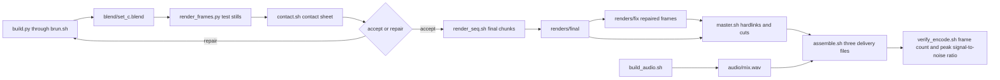
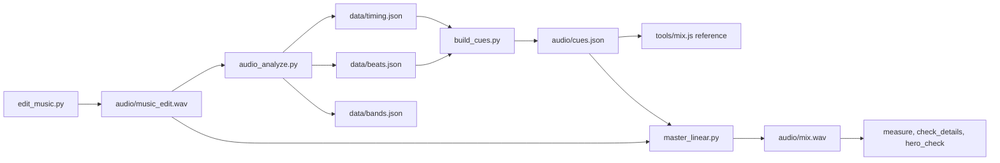

# 03 Workflow and Quality: From a Set C Build to an Accepted Frame and the Film

Needle Drop is a 30 second film. Set C is the desert record scene. It owns shots S3 to S6, frames
289 to 708. The labels S1 to S6 are the six shot identifiers in `data/timing.json`. This document
follows the production path. It starts with a Set C build and a test still. It ends with an
encoded film and an audio check. It names every tool and every check. It also states what each
check can and cannot catch. [Document 02](02-core-mechanism.md) traces the drop frame that this
path must deliver.

The path has seven picture steps. Build the scene. Make a test still. Put the stills on a contact
sheet. Render the final frames in chunks. Repair selected frames and master the sequence. Encode
the film. Verify the encode. The sound path runs beside the picture path and meets it at the
encoder.

## The workflow at a glance



The loop is deliberate. A build is cheap compared with a final render. A test still is cheap
compared with a 24-frame chunk. A contact sheet is cheap compared with a full review. The tools
push the cheap checks early.

## Step 1: build the scene

Every scene build and render launch goes through `tools/brun.sh`. The audio scripts use Blender
Python for NumPy and do not open a scene. The runner starts Blender 5.2.2 headless. The builder
brief is `docs/BUILDERS.md`, the build instruction. The production bible is `docs/bible.md`, the
long design document. The builder brief gives two examples. The first is a test render. The second
is a build. The brief also states that it overrides the bible where the two disagree.

```text
# docs/BUILDERS.md:13-16
- NEVER run `blender.exe` directly. ALWAYS use `tools/brun.sh` (one pipeline Blender at a time via a lock, RAM gate,
  BelowNormal priority, RAM watchdog, yields to the user's own Blender jobs). Add `--render` for any job that renders.
  `tools/brun.sh --threads 8 --render -- <file.blend> --python tools/render_frames.py -- --frames 130,200 --pct 50 --out renders/tests/set_b/r1_`
  `tools/brun.sh --threads 6 -- --python scenes/set_b/build.py`   (builds & saves the .blend)
```

A Set C build runs `tools/brun.sh --threads 6 -- --python scenes/set_c/build.py`. The runner
starts Blender 5.2.2 with `-b` (background), `--factory-startup` and `-noaudio`. The build script
prints a time-stamped log line for each stage. The stages are look, terrain, camera, live keys,
cull keys, props, effects and saved. The final line is `BUILD_DONE`.

The build writes `blend/set_c.blend` with compression off. It writes `data/layout_c.json` with the
record layout, the arm values and the final camera. No script in the checkout reads that layout
file. It is a record for a person and for comparison between builds. The build does not render a
frame. An uncaught error stops the script before the save.

What this step proves: the script ran to the end and saved a file. What it does not prove: the
scene looks correct, the render is fast, or the file opens in another Blender version.

## Step 2: make a test still

`tools/render_frames.py` opens an existing `.blend` and renders chosen frames. It takes a frame
list, a step, a resolution percentage, a sample count, a no-motion-blur flag, an output prefix and
a skip flag. It prints one line per frame with the frame number and the time in seconds.

```text
# tools/render_frames.py:4-13
  tools/brun.sh --render -- blend/set_b.blend --python tools/render_frames.py -- \
      --frames 121,200,288 --pct 50 --samples 16 --out renders/tests/set_b/v3_
  --frames  comma list and/or ranges: "121,130-140,288" (global frame numbers)
  --step N  with a range, render every Nth frame
  --pct     resolution percentage override (default: keep)
  --samples EEVEE TAA render samples override (default: keep)
  --nomb    disable motion blur for speed
  --out     output prefix; files are <out><frame:04d>.png
  --skip-existing  do not re-render frames whose file exists (final-render chunking)
Prints 'FRAME <n> <seconds>' per frame and 'RENDER_DONE'.
```

A typical drop test is a short strip around frame 433. The worked example below uses frames 424 to
444, which is 21 frames. The command uses 50 percent resolution, 16 samples and no motion blur.
The files go to `renders/tests/set_c/` with a round name. A round name is the `r<round>` prefix
that `docs/BUILDERS.md:37` asks for in a test still file name. The `--samples` flag overrides the EEVEE
temporal anti-aliasing (TAA) sample count for the test only.

The tool has one subtle rule. It removes keyed sample curves from the session. A sample curve is
an animation curve that keys the render sample count. The session is the running Blender process
in memory. Without this rule, a keyed `taa_render_samples` value would win at render time and the
override would do nothing. The removal is session-only. The `.blend` file is not saved.

```text
# tools/render_frames.py:49-58
if (opts['samples'] or ovr) and sc.animation_data is not None and sc.animation_data.action is not None:
    # keyed per-shot samples would be re-evaluated at render time and win; drop them in this session only (blend not saved)
    ad = sc.animation_data
    try:
        fcs = ad.action.fcurves
    except Exception:
        from bpy_extras import anim_utils
        fcs = anim_utils.action_get_channelbag_for_slot(ad.action, ad.action_slot).fcurves
    for fc in [fc for fc in fcs if 'taa_render_samples' in fc.data_path]:
        fcs.remove(fc)
```

The tool also reads `logs/render_override.json`. The file format is JavaScript Object Notation
(JSON). The file can give a sample count for a frame range. A director can lower the samples for a
heavy dust section without a rebuild. The command line sample value applies first. A matching
range then replaces it per frame, so the range file wins inside that range. This is a render
policy, not a scene change.

What a test still proves: framing, colour balance, silhouette and gross geometry at the tested
frame. What it does not prove: motion, flicker, temporal noise, or the look at full resolution.

## Step 3: make a contact sheet

`tools/contact.sh` tiles a set of portable network graphics (PNG) files into one image. Each tile carries the file name. The
script scales each tile to a given width, draws the name with a font, and uses ffmpeg `tile`.

```text
# tools/contact.sh:1-14
#!/usr/bin/env bash
# Contact sheet from PNGs (in the given order), each tile labelled with its filename.
# Usage: tools/contact.sh <out.png> <cols> <tile_width> <img1.png> [img2.png ...]
OUT="$(realpath -m "$1")"; COLS="$2"; TW="$3"; shift 3
N=$#; ROWS=$(( (N + COLS - 1) / COLS ))
TMP=$(mktemp -d)
cp /c/Windows/Fonts/arial.ttf "$TMP/f.ttf"
i=0
for f in "$@"; do
  src="$(realpath "$f")"; name=$(basename "$f" .png)
  ( cd "$TMP" && ffmpeg -y -hide_banner -loglevel error -i "$src" -vf "scale=${TW}:-2,drawtext=fontfile=f.ttf:text='${name}':x=8:y=8:fontsize=18:fontcolor=white:box=1:boxcolor=black@0.6" "$(printf %04d $i).png" )
  i=$((i+1))
done
ffmpeg -y -hide_banner -loglevel error -framerate 1 -i "$TMP/%04d.png" -vf "tile=${COLS}x${ROWS}:padding=4:color=black" -frames:v 1 "$OUT"
```

The font path is a Windows path under `/c/Windows/Fonts`. The script therefore has the same
platform limit as the safe runner. On macOS or Linux the font path fails and the sheet fails.

A contact sheet is a review tool, not a measurement. It catches a missing frame, a wrong camera
pose, a colour jump between rounds and an obvious lighting error. It cannot catch a one-frame
flash, a small temporal artifact, a bad motion blur or an audio sync error.

## Step 4: render the final frames

`tools/render_seq.sh` renders a frame range in chunks. The default chunk is 24 frames. Each chunk
is one Blender run through the safe runner. The script skips a whole chunk when every expected
frame exists. Inside a chunk, `--skip-existing` skips each frame that already exists. A crash costs
at most one chunk.

```text
# tools/render_seq.sh:14-27
for ((a=S; a<=E; a+=CH)); do
  b=$((a+CH-1)); [ $b -gt $E ] && b=$E
  missing=0
  for ((f=a; f<=b; f++)); do [ -s "${OUT}$(printf %04d $f).png" ] || { missing=1; break; }; done
  [ $missing = 0 ] && continue
  tools/brun.sh --threads 8 --render -- "$BLEND" --python tools/render_frames.py -- \
      --frames "$a-$b" --out "$OUT" --skip-existing "$@" 2>&1 \
    | grep --line-buffered -E "^FRAME|RENDER_DONE|Error|Traceback|brun" \
    | sed -u "s#^#[$(date +%H:%M:%S)] $(basename "$BLEND") #" >> "$LOG"
  sleep 8
done
n=0; for ((f=S; f<=E; f++)); do [ -s "${OUT}$(printf %04d $f).png" ] && n=$((n+1)); done
echo "[$(date +%H:%M:%S)] END $BLEND $S-$E: $n/$((E-S+1)) frames present" >> "$LOG"
echo "SEQ_DONE $BLEND $n/$((E-S+1))"
```

The log filter keeps only frame lines, the done line, errors and runner lines. The final line
counts the present frames and compares them with the expected count. The count is a report, not a
failing gate. The script prints `SEQ_DONE` and exits zero even when frames are missing. The first
gate that stops the pipeline is the master link step.

A full film needs several runs, one per scene or shot range. The master link step covers frames 1
to 708, so every frame must exist before `tools/master.sh` can pass. The worked example below
renders only frames 433 to 516 because it follows one shot.

The chunk size is a trade-off. A small chunk loses less work on a crash and releases the lock
sooner, so a person can use Blender between chunks. A large chunk has fewer Blender starts. The
script never runs two pipeline Blender jobs at once. The script uses 8 threads even though the
build uses 6, because the render step has a different memory profile. The memory profile is the
free random access memory (RAM) gate of 16 gigabytes and the watchdog that kills the job below 5
gigabytes, both in `tools/brun.sh`.

The safe runner gives the render five protections. It allows one pipeline Blender at a time. It
waits for at least 16 gigabytes of free RAM. It sets BelowNormal priority.
It kills only its own process if free memory falls below 5 gigabytes. It also checks for a
foreign Blender job and reduces the thread count or waits.

What the chunk render proves: that each expected frame file exists with a non-zero size at the
end of the run. What it does not prove: frame quality, frame time, memory use, or that the chunk
used the intended settings.

## Step 5: repair selected frames

A repair is a re-render of one frame or a short range at final settings. Final settings are the
stored scene values: full resolution, the scene sample count and motion blur on. The repair
command passes no override flag, so the scene values apply. The output goes to
`renders/fix/f_####.png`. The master script prefers a fix file over the final file. This rule
allows a local repair without a full re-render.

`tools/master.sh` builds `renders/master` from `renders/final` and `renders/fix`. It uses hard
links and not copies. It unlinks a frame before it writes a replacement, so it never writes
through a hard link into `renders/final`.

```text
# tools/master.sh:7-18
set -e
ROOT="$(cd "$(dirname "$0")/.." && pwd)"; cd "$ROOT"
M=renders/master
rm -rf "$M"; mkdir -p "$M"
n_fix=0
for f in $(seq 1 708); do
  n=$(printf %04d $f); src=renders/final/f_$n.png
  if [ -s renders/fix/f_$n.png ]; then src=renders/fix/f_$n.png; n_fix=$((n_fix+1)); fi
  [ -s "$src" ] || { echo "MISSING $src"; exit 1; }
  ln "$src" "$M/f_$n.png"
done
srcof() { local n=$(printf %04d $1); [ -s renders/fix/f_$n.png ] && echo renders/fix/f_$n.png || echo renders/final/f_$n.png; }
```

The loop covers exactly 708 frames. A missing frame stops the script with a `MISSING` message.
This is a hard check for completeness. It does not check that the frame is the right frame.

The master stage also makes two transition effects. The first is a whip smear on frames 119 to
122. The camera rises along the cantilever at the cut from Set A, the groove canyon, to Set B, the
turntable. A luma jump is a sudden change in brightness between two frames. A vertical blur and a
small brightness lift hide the hard luma jump at the cut.

```text
# tools/master.sh:19-25
# S1->S2 cut: vertical whip smear (camera rises along the cantilever) + slight lift, hides the hard luma jump
for p in "119 6 0.00" "120 22 0.03" "121 22 0.03" "122 8 0.00"; do
  set -- $p; n=$(printf %04d $1); src=$(srcof $1)
  rm -f "$M/f_$n.png"
  ffmpeg -y -hide_banner -loglevel error -i "$src" \
    -vf "format=gbrp16le,gblur=sigma=0.5:sigmaV=$2:steps=3,eq=brightness=$3,format=rgb48be" -frames:v 1 "$M/f_$n.png"
done
```

The blur is vertical only. The sigma values are 6, 22, 22 and 8 pixels. The brightness lift is
0.03 on the two middle frames. The filter works in 16-bit red, green and blue (RGB), so the master stays above 8-bit
precision at the cut.

The second effect is a colour dissolve across the match cut. A match cut joins two shots at one
shared shape or colour. Frames 289 to 305 blend from the colour of frame 288 into the Set C
frame. The weight is `(306 - k) / 18`. Frame 289 is 17/18 of the old colour. Frame 305 is 1/18.
A cross-fade is a gradual blend between two images. The geometry already matches, so the result
reads as a colour shift and not as a cross-fade.

```text
# tools/master.sh:26-36
# S2->S3 match cut: f289-305 are a static hold on the same marble, so a 17-frame dissolve from f288's grade
# reads as a slow colour shift (no visible pop on the downbeat)
A=$(srcof 288)
for k in $(seq 289 305); do
  n=$(printf %04d $k); w=$(awk "BEGIN{printf \"%.4f\", (306-$k)/18}")
  B=$( [ -s renders/fix/f_$n.png ] && echo renders/fix/f_$n.png || echo renders/final/f_$n.png )
  rm -f "$M/f_$n.png"
  ffmpeg -y -hide_banner -loglevel error -i "$A" -i "$B" -filter_complex \
    "[0]format=gbrp16le[a];[1]format=gbrp16le[b];[a][b]blend=all_expr='A*${w}+B*(1-${w})',format=rgb48be" \
    -frames:v 1 "$M/f_$n.png"
done
```

The master stage can catch a missing source frame. It cannot catch a wrong frame at an unsampled
index, a bad colour match after frame 305, or an error in the audio.

## Step 6: encode the film

`tools/assemble.sh` makes three delivery files. The main file is 2560 by 1440 Advanced Video
Coding (H.264) High at constant rate factor 16. The second is a 4K H.264 file at 3840 by 2160
with a Lanczos upscale and a mild unsharp mask. A Lanczos upscale is a resample with the Lanczos
kernel. An unsharp mask is a sharpening filter. The third is a 4K High Efficiency Video Coding
(H.265) 10-bit file. All three get film grain and the International Telecommunication Union
Radiocommunication Sector BT.709 colour tags for high-definition television.

```text
# tools/assemble.sh:16-22
# -reinit_filter 0: the sequence mixes 8-bit and 16-bit PNGs; without it ffmpeg rebuilds the graph at each
# pixel-format change, setpts restarts at 0 and the CFR output silently drops frames (lost 278 of 720 once).
IN=(-framerate 24 -start_number "$FIRST" -reinit_filter 0 -i "${FR}%04d.png" -i "$AUDIO")
nice -n 10 ffmpeg -y -hide_banner -loglevel error "${IN[@]}" \
  -filter_complex "[0:v]${PAD},${GRAIN},format=yuv420p[v]" -map "[v]" -map 1:a -t "$DUR" \
  -c:v libx264 -preset slow -crf 16 -tune film -profile:v high -threads 8 $TAGS -movflags +faststart \
  -c:a aac -b:a 320k -ar 48000 "$OUT/NEEDLE_DROP_1440p.mp4"
```

The comment records a real failure. Without `-reinit_filter 0`, ffmpeg rebuilt the filter graph
at each pixel-format change. The `setpts` filter, which rewrites presentation timestamps, restarted
at 0, and the constant-frame-rate output
dropped 278 of 720 frames. The flag is a correctness fix, not a performance tuning.

The script adds 12 black frames after frame 708. It also adds a 0.25 second fade in from black.
The total duration is `(COUNT+12)/24`, which is 30.0 seconds for 708 frames, or 720 frames. The
audio input is `audio/mix_final.wav` if it exists, else `audio/mix.wav`. No script in the
checkout writes `mix_final.wav`. The credits file says a director added a whoosh to that file.
The delivery mix from the audio script is `audio/mix.wav`.

The last step is a hard frame-count check. Every output file must have exactly 720 video frames.

```text
# tools/assemble.sh:35-41
# hard check: every file must have exactly COUNT+12 video frames
bad=0
for f in "$OUT"/NEEDLE_DROP_*.mp4; do
  nf=$(ffprobe -v error -count_frames -select_streams v:0 -show_entries stream=nb_read_frames -of csv=p=0 "$f" | tr -d '\r')
  echo "FRAMES $f $nf"; [ "$nf" = "$((COUNT+12))" ] || bad=1
done
[ $bad = 0 ] && echo FRAMECHECK_OK || { echo FRAMECHECK_FAILED; exit 1; }
```

This check catches a dropped frame, a duplicated frame and a wrong duration. It does not check
image quality, audio sync, loudness or colour. The next step covers part of that gap.

## Step 7: verify the encode

`tools/verify_encode.sh` checks the encoded file in two ways. First, it counts the video frames.
Second, it decodes 16 sample frames and compares each one with the master PNG at the same index.
It scales both to 640 by 360 and reports the peak signal-to-noise ratio (PSNR). A wrong frame or a
missing frame gives a low PSNR. The script also prints the luma average of frame 715 as a tail
check for black.

```text
# tools/verify_encode.sh:4-13
F="$1"; T=$(mktemp -d)
nf=$(ffprobe -v error -count_frames -select_streams v:0 -show_entries stream=nb_read_frames -of csv=p=0 "$F" | tr -d '\r')
echo "frames: $nf (expect 720)"
for k in 10 100 121 160 240 285 289 300 315 400 433 470 560 650 697 708; do
  ffmpeg -y -v error -i "$F" -vf "select=eq(n\,$((k-1))),scale=640:360" -frames:v 1 "$T/e.png"
  ffmpeg -y -v error -i renders/master/f_$(printf %04d $k).png -vf "scale=640:360" "$T/m.png"
  p=$(ffmpeg -hide_banner -i "$T/e.png" -i "$T/m.png" -lavfi psnr -f null - 2>&1 | grep -o "average:[0-9.inf]*" | cut -d: -f2)
  echo "frame $k psnr $p"
done
ffmpeg -y -v error -i "$F" -vf "select=eq(n\,714),signalstats,metadata=print:key=lavfi.signalstats.YAVG" -f null - 2>&1 | grep -o "YAVG=[0-9.]*" | sed 's/^/frame 715 (tail) /'
```

The sample list is 16 frames. It places at least one sample in every shot. It samples frame 121
immediately after the S1 to S2 cut and frame 289 immediately after the S2 to S3 cut. It does not
sample frames 120 and 288 immediately before those cuts. It includes frame 433, the drop, and
frame 708, the last rendered frame. It does not sample the black tail after frame 708. A low value
at one index points to a frame mismatch or a heavy compression error. The script prints each value
but defines no numeric pass threshold.

The check cannot prove that every frame is correct. It samples 16 of 708. It cannot check the
audio at all. It cannot check colour accuracy against a reference, because the master is the
reference. It cannot check motion, because each frame is compared alone.

## The audio path

The audio stage is one shell script with nine steps. It rebuilds every audio file from the
downloaded recordings. Those recordings are not in the checkout: the paths under `audio/music`
and `audio/sfx` are absent. The stage uses Blender's bundled Python in isolated mode (`-I`) for
NumPy. It uses ffmpeg, ffprobe and Node.js from the path.

```text
# audio/scripts/build_audio.sh:5-17
# THE DELIVERY MIX IS audio/mix.wav (bible 5.6). audio/_work/mixjs_reference.wav is a reference render only: never mux it.
set -e
PY="${ND_PY:-/e/experimentswithclaude/tools/blender/blender-5.2.2-windows-x64/5.2/python/bin/python.exe}"
"$PY" -I audio/scripts/edit_music.py          # -> audio/music_edit.wav, audio/_work/music_ducked.wav (+ _work/music_stem_mixjs.wav, music_edit_map.json)
"$PY" -I audio/scripts/audio_analyze.py       # -> data/beats.json, data/bands.json, data/timing.json (snapped from audio/_work/timing_orig.json)
"$PY" -I audio/scripts/build_cues.py          # -> audio/sfx/prep/*.wav, audio/cues.json (sand hiss reads the validated kicks; sub layers aligned to the kicks)
node tools/mix.js audio/cues.json audio/_work/mixjs_reference.wav   # literal tools/mix.js render: REFERENCE ONLY (its loudnorm is an AGC)
"$PY" -I audio/scripts/master_linear.py       # -> audio/mix.wav  (THE DELIVERY MIX)
"$PY" -I audio/scripts/write_credits.py > /dev/null   # -> audio/credits.txt
"$PY" -I audio/scripts/measure.py audio/mix.wav --arc --json audio/_work/measure_v3.json
"$PY" -I audio/scripts/check_details.py audio/mix.wav
"$PY" -I audio/scripts/hero_check.py audio/mix.wav --json audio/_work/hero_check.json
echo AUDIO_BUILD_OK
```

The chain has a strict order. The music edit makes the final music file. The analysis reads that
file and writes the beat grid, the band series and the snapped timing. The cue build reads the
kick list in `data/beats.json` and places the effects. The reference mix is a branch that does
not feed delivery. The delivery master reads the edited music and the cue sheet. The cue sheet is
`audio/cues.json`, written by `build_cues.py` and read by `tools/mix.js`. The credits,
measure and check scripts read the delivery mix.



The diagram shows the delivery path and the reference branch. The reference branch writes
`audio/_work/mixjs_reference.wav`. The encoder does not read that file.

`edit_music.py` uses a 30.0 second timeline at 48 kilohertz. It sets a 50 millisecond crossfade,
a 5 millisecond pre-roll and a 0.9972 end rate. A pre-roll is the short segment kept before an
event. The cue build keeps 1 millisecond before each hit's attack
(`audio/scripts/build_cues.py:170`); the music edit keeps 5 milliseconds. An end rate is the
playback rate used for pitch-down. It finds the drop transient and cuts the music into segments.
A transient is a short high-energy onset. The segments are an intro, a groove, a build, a silence,
a drop, a lift and a final hit. It writes `audio/music_edit.wav` and the map file
`audio/music_edit_map.json`, which `audio_analyze.py:82` reads.

`audio_analyze.py` measures the edit. It writes `data/beats.json` and `data/bands.json`. It then
snaps the event frames. The snap reads the original timing grid, finds the nearest detected beat
within plus or minus 2 frames, and rewrites the frame and time. It writes a note with every move.

```text
# audio/scripts/audio_analyze.py:314-330
# ---------------------------------------------------------------- timing.json snap (keep keys/structure; frames move by <= 2)
tm = json.load(open('audio/_work/timing_orig.json' if os.path.exists('audio/_work/timing_orig.json') else 'data/timing.json'))  # always snap from the director's original grid
det = [b for b in beats if b['detected']]
snaps = []
for name, ev in tm['events'].items():
    f0 = ev['frame']
    best = None
    for b in det + [dict(t=d_) for d_ in downbeats]:
        fb = int(round(b['t'] * FPS)) + 1
        if abs(fb - f0) <= 2 and (best is None or abs(fb - f0) < abs(best - f0)): best = fb
    if best is not None and best != f0:
        snaps.append((name, f0, best))
        ev['frame'] = best; ev['t'] = round((best - 1) / FPS, 4)
tm['note'] = ('Event frames snapped by the audio stage to detected beats of audio/music_edit.wav (120.000 BPM, drop downbeat measured at '
              f'{t_drop_att:.3f} s). frame = round(t*24)+1. Snapped: ' + (', '.join(f'{n} {a}->{b}' for n, a, b in snaps) or 'none') + '.')
json.dump(tm, open('data/timing.json', 'w'), indent=1)
print('timing snaps:', snaps)
```

The snap reads `audio/_work/timing_orig.json` if the file exists. No script in the checkout writes
that file. If it is absent, the script reads `data/timing.json`, which may already hold snapped
frames. A second run is therefore only guaranteed to start from the original grid when the
original file exists.

`build_cues.py` prepares each sound effect, levels it to a target, aligns the low layers and
writes `audio/cues.json`. A target level is the measured level that the script drives each cue to.
The low layers are the bass layers under the kick. The sand hiss is the filtered noise layer that
follows the kicks. It also writes an alignment log. The sand hiss reads the validated kick
list, so the sand and the sound share one event set. A validated kick is one entry in the `kicks`
list of `data/beats.json`.

`master_linear.py` makes the delivery mix. It folds the bass below 150 hertz to the centre
channel. A bass fold makes the low band mono: the side channel is high-passed at 150 hertz at
`audio/scripts/master_linear.py:9` and `:24`, so content below 150 hertz becomes mono. The header
gives mono safety and phone speakers as the reason and calls it a low-end safety net. It applies a
static gain and a peak limiter. It targets minus 14.3 loudness units
relative to full scale (LUFS). It iterates the gain and the limiter ceiling up to six times. It
accepts a result within 0.05 LUFS of the target and a true peak at or below minus 1.05 decibels
true peak (dBTP). If the sixth result misses a condition, the script does not fail. It prints
`MASTER_OK` and writes the last result.

```text
# audio/scripts/master_linear.py:89-100
TARGET_I = -14.3   # bible: -14 LUFS +-0.5; -14.3 buys 0.3 dB less limiting at the hits and keeps 0.2 LU margin
gain = TARGET_I - I0; lim = -1.4
tmp = 'audio/_work/master_tmp.wav'
for it in range(6):
    af = f'volume={gain:.3f}dB,alimiter=limit={10 ** (lim / 20):.5f}:attack=1:release=60:level=false:latency=1'
    subprocess.run(['ffmpeg', '-y', '-v', 'error', '-i', pre, '-af', af, '-ar', str(SR), '-c:a', 'pcm_f32le', tmp], check=True)
    I, TP, LRA = meas(tmp)
    print(f'  iter {it}: gain {gain:+.2f} dB, limit {lim:.2f} dBFS -> I {I:.2f} LUFS, TP {TP:.2f} dBTP, LRA {LRA:.1f} LU')
    ok_i = abs(I - TARGET_I) <= 0.05; ok_tp = TP <= -1.05
    if ok_i and ok_tp: break
    if not ok_tp: lim -= (TP + 1.05) + 0.1
    gain += TARGET_I - I
```

The master then forces digital zero from 17.500 to 17.998 seconds. A 2 millisecond cosine fade
ends at 17.500. The zone from 17.500 to 17.998 is exactly zero. The drop attack starts at 17.998.
The master also crossfades the last 2 milliseconds of the film toward the first sample. The loop
from 30.0 to 0.0 therefore has no click. The wrap is a design premise: a player may repeat the
film, so the last sample should approach the first. The script prints a seam jump value. A seam
jump is a level or phase discontinuity at the 30.0 to 0.0 second loop point. No
script plays the film through the wrap.

```text
# audio/scripts/master_linear.py:102-109
# ---- the stop: 17.500-17.998 is digital zero (2 ms cosine fade ending at 17.500; the drop attack starts at 17.998)
y = decode(tmp)
i_a, i_b, nf = int(17.5 * SR), int(17.998 * SR), int(0.002 * SR)
y[i_a - nf:i_a] *= (0.5 * (1 + np.cos(np.pi * np.arange(1, nf + 1) / nf)))[:, None]
y[i_a:i_b] = 0.0
# ---- loop seam: crossfade the last 2 ms towards the first sample (the wrap 30.0 -> 0.0 must not click)
n = int(0.002 * SR); w = (np.arange(n) / (n - 1)) ** 2
y[-n:] = y[-n:] * (1 - w)[:, None] + y[0][None, :] * w[:, None]
```

The measurement script `measure.py` reports four main values. It gives the integrated loudness,
the loudness range, the true peak and the momentary arc. The loudness range is the spread of
loudness over the film. The momentary arc is the momentary loudness, over a 400 millisecond
window, plotted across the film. It also gives section statistics, crest factor, low-end stereo
correlation, mono loss, the silence window and the loop seam. Crest factor is the peak divided by
the root mean square. Stereo correlation measures how alike the left and right channels are, from
minus 1 to 1. Mono loss is the level lost when the stereo mix is summed to mono. The silence
window is the span that must be digital zero. The `--arc` flag prints the momentary arc as a rise
and fall view.

`check_details.py` checks four production details. It compares the sand hiss with the music. It
checks crackle continuity. It checks the revolution ticks. A revolution tick is the click once per
record revolution. It checks the kick time accuracy and the kick-to-beat alignment.

`hero_check.py` checks four audio moments. The downbeat punch is the low-band energy immediately
after a downbeat. The build sub vacuum is the loss of sub energy from 17.0 to 17.5 seconds. The touchdown
is the needle contact at 29.0 seconds. The crackle phase is the stereo correlation and the mono
fold-down loss of a crackle-only window. Mono fold-down loss is the level lost in a mono sum. The
script writes a JSON report with an `accept` dictionary.

`verify_mix.py` is a short check. It checks the silence from 17.500 to 17.998. It checks that the
attack starts. It checks the 0.5 second root mean square (RMS) arc. It checks the loop seam.
`build_audio.sh` does not call it. A reader must run it separately.

The audio checks can catch a wrong level, a missing silence, a click at the seam, a missing cue
and a misplaced kick. They cannot judge taste, and they cannot prove that the mix matches the
picture. No script compares the audio waveform with a rendered frame.

## One worked workflow: the drop frame in Set C

This section reconstructs one path for frame 433. The commands follow the documented forms. The
steps are read from the scripts, not from a recorded session. The builder brief gives the command
form, not this exact sequence.

1. Build the scene. Run `tools/brun.sh --threads 6 -- --python scenes/set_c/build.py`. The script
   reads the handoff, the layout and the beat data. It builds the terrain, bakes the dunes, bakes
   the camera and keys the live group. It saves `blend/set_c.blend` and prints `BUILD_DONE`.
2. Make a test strip. Run `tools/brun.sh --threads 8 --render -- blend/set_c.blend --python
   tools/render_frames.py -- --frames 424-444 --pct 50 --samples 16 --nomb --out
   renders/tests/set_c/r4_drop_`. The strip covers the silence frames, the drop and the first
   ring growth.
3. Review the strip. A contact sheet gives the sequence in one image. The reviewer checks the
   label, the front, the flash and the camera kick. A wrong front radius or flash peak goes back
   to the build. The build is from scratch and deterministic.
4. Render the final range. Run `tools/render_seq.sh blend/set_c.blend 433 516
   renders/final/f_ 24`. The argument order is `<blend> <first> <last> <out_prefix> [chunk]
   [extra args]` (`tools/render_seq.sh:3`). The script makes about four chunks. Each chunk is one
   Blender run. A failed or missing frame is re-rendered by the next run.
5. Repair one frame if needed. Run `tools/brun.sh --render -- blend/set_c.blend --python
   tools/render_frames.py -- --frames 433 --out renders/fix/f_` at final settings. The output is
   `renders/fix/f_0433.png`. The master script prefers this file.
6. Master the sequence. Run `tools/master.sh`. The script hard-links frames 1 to 708. It applies
   the whip smear at 119 to 122 and the colour dissolve at 289 to 305. It stops on a missing
   frame.
7. Encode. Run `tools/assemble.sh renders/master/f_ delivery 1 708`. The argument order is
   `[frames_prefix] [outdir] [first] [count]` (`tools/assemble.sh:3`). The script makes the 1440p,
   4K and 4K H.265 files. It then checks that each file has 720 frames.
8. Verify. Run `tools/verify_encode.sh delivery/NEEDLE_DROP_1440p.mp4`. The script counts the
   frames and compares 16 sample frames with the master. Frame 433 is one of the samples.
9. Build and check the audio. Run `bash audio/scripts/build_audio.sh`. The chain writes
   `audio/mix.wav` and the data files. It then runs `measure.py`, `check_details.py` and
   `hero_check.py`.
10. Final check. The film is accepted when several conditions hold. The frame count is 720. The
    script prints 16 PSNR values; a person compares them, because the script defines no threshold.
    The audio report hits minus 14.3 LUFS and minus 1.05 dBTP.
    The silence window is zero. `hero_check.py` prints PASS on every condition. The seam jump is
    small. A person reads the values. No single script returns the final verdict.

Each step has a gate. A build gate is `BUILD_DONE`. A test gate is a human review. A render gate
is a full frame count. A master gate is no `MISSING` line. An encode gate is `FRAMECHECK_OK`. A
verify gate is the printed PSNR list, with no numeric threshold. An audio gate is the report from
`measure.py`, `check_details.py` and `hero_check.py`, plus `verify_mix.py` when a reader runs it.
A FAIL line in `hero_check.py` does not stop `build_audio.sh`, because the script exits zero. A
person must read the report.

## What each check can and cannot catch

| Check | Catches | Cannot catch |
|---|---|---|
| `BUILD_DONE` | A script that did not reach the save | A wrong image, a slow render, a broken look |
| Test still | Gross framing, colour and geometry | Motion, flicker, noise, full-resolution detail |
| Contact sheet | A missing frame, a pose jump, a colour jump | A one-frame flash, a subtle temporal artifact |
| `render_seq.sh` count | Missing or empty frame files | A wrong frame with the right name |
| `master.sh` `MISSING` | An absent source frame | A wrong frame, a bad cut, a colour error |
| `assemble.sh` frame count | A dropped or extra frame | Image quality, audio sync, loudness |
| `verify_encode.sh` PSNR | A wrong frame at 16 sample indices | The other 692 frames, the audio, motion |
| `measure.py` | Loudness, peak, range, silence, seam | Taste, picture sync, a weak cue |
| `check_details.py` | Sand, crackle, ticks, kick timing | A cue that is present but wrong in level |
| `hero_check.py` | The four hero moments | The rest of the film |
| `verify_mix.py` | Silence, attack, arc, seam | The full mix balance |

The table shows the shape of the quality system. The checks are strong on counts and time. They
are weak on appearance. The project has no test suite and no continuous integration. The probes
are one-purpose scripts. They record a measurement or a repair. They do not run as a suite.

The limit is not a defect in the scripts. A render is the only proof of a render. A static
reading can check the path and the arithmetic. It cannot check the image.

## Repairs recorded in the source

The source contains comments that name quality repairs. These comments are evidence of the
workflow. They show that the loop was used.

The Set C build records a fix for a ring flash. In the S3 skim, the lens is about 7 metres over
the sand with a pitch of minus 3 degrees. A kick ring born about 39 metres behind the lens crossed
the bottom third of the frame in one frame at 220 metres per second. The result was a washed-out
flash at frames 392, 404 and 416. The fix fades the ring amplitude from 16 to 48 metres from the
lens (`scenes/set_c/build.py:50-62`). It does not change the rings ahead or the descent rings.

```text
# scenes/set_c/build.py:52-56
# qafix (QA must-fix 1): in the S3 skim (t >= 16.0: lens ~7 m over the sand, pitch -3 deg) a kick ring born ~39 m behind
# the lens crossed the bottom third in ~1 frame (220 m/s) -> one-frame washed-out flash (f392/404/416). The ring amplitude
# now fades to zero within RING_NEAR[0] m (3D) of the lens and is untouched beyond RING_NEAR[1] m: rings rise ahead and
# travel out as before, the 17.5-18.0 hang ring (~50 m ahead) is unchanged, descent kicks (t < 16) are unchanged.
RING_NEAR = (16.0, 48.0)
```

The Set C camera records a fix for a zoom jump. The descent exponent is the exponent in the
descent curve. It had a slope of 0.45 at the start. The zoom rate jumped from 0 to about 2.3
percent per frame at frame 308. A quartic ease-in, a fourth-power start with zero slope, replaces
the start. The new curve matches value, slope and curvature at frame 330. Curvature is the rate of
change of the slope.

The Set C record split records a budget fix. The live Geometry Node graph runs through frame 516.
The morph is complete at frame 461, so the last 56 frames of that span are live without a move. A
static copy takes over at frame 517. The patch covers the close view to frame 541.

The encode records a frame-loss fix. The `-reinit_filter 0` flag prevents a silent loss of 278
frames when the input changes pixel format.

The audio records a loudness choice. The target is minus 14.3 LUFS and not minus 14.0. The
comment says the extra 0.3 decibels buy less limiting at the hits and keep a margin of 0.2
loudness units (LU).

These repairs are source claims. The exploration did not reproduce them. They are useful because
they name the failure mode and the frame range. They are not a measured quality report.

**Aha:** The quality system is built around cheap early gates and expensive late gates. A build
and a test still cost minutes. A final render costs hours. The tools push the frame count, the
missing file and the sample PSNR to the late gates because those checks are mechanical. They
leave appearance to a human review. The pipeline is honest about which part a script can prove.

## What this document does not claim

This document did not run a build, a render, a contact sheet, an encode or an audio script. It
did not measure a frame time. It did not listen to the mix. It did not inspect a delivered file.
The commands and the checks come from the source. The acceptance path is the intended path, not a
recorded session.

[The next document](04-limits-and-comparison.md) collects the limits, the rejected choices and the
comparisons with sibling packages. It also records the divergences between the bible and the code.
