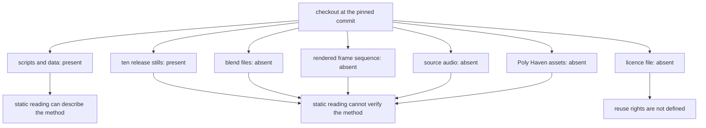

# 04 Limits and Comparison: What the Checkout Cannot Prove

This document records the limits of a static reading. It lists the rejected choices, the failure
modes, the licence limits and 14 divergence findings. It compares the mechanism of Needle Drop
with three sibling studies. It does not compare visual quality, because this reading made no
render of Needle Drop.

The reading used the source at commit `8982f09c1502b5f6c01b1aa7c1eee23e5139677b`, which has 100
tracked files. The writer ran no project code. No Blender process, Python script, ffmpeg command or
audio playback ran. Every statement below comes from the source or the package specification.

The film is a 30 second short with six shots and three scenes. Set A is the groove canyon, Set B
the turntable, and Set C the desert that becomes a record. The rendered picture runs from frame 1
to frame 708 at 24 frames per second (FPS). Frames 709 to 720 are black, and the encoder adds them.

| Term | Meaning |
|---|---|
| slug | short identifier that the Poly Haven interface uses for an asset |
| cymatics | visible vibration patterns in a material |
| phono connector | plug that carries a turntable signal |
| displacement | movement of surface points from a rest position |
| refraction | bending of light as it passes through a material |
| facing-ratio tint | colour set by the angle between the surface and the view |
| Puppeteer | browser control library |
| WebSocket | two-way network connection |
| three.js | Web Graphics Library (WebGL) scene library |
| jittered anti-aliasing | sample offsets that vary per sub-frame |
| YUV 4:2:0 | luminance and chrominance (YUV) format with chroma at half resolution |
| bar grid | time grid built from musical bars |
| seam | join between two scene programs |
| guzheng | Chinese plucked zither |
| xiao | Chinese end-blown flute |
| singing bowl | metal bowl that rings when struck |
| latency-compensated limiter | limiter whose look-ahead delay is added back to the cue times |

## 1. The evidence boundary

A static reading can prove the shape of a system. It can prove the file layout, the constants, the
data contracts, the control flow and the checks that the authors wrote. It can prove that a value
appears in a script and that another script reads it. It cannot prove that the script runs. It
cannot prove that a downloaded asset exists. It cannot prove that a rendered frame is correct. It
cannot prove that the soundtrack is in sync with the picture.

This package therefore makes a limited claim. The source defines a complete production method,
but the method did not necessarily produce the published film. The checkout holds ten release
stills under `stills/`. Those stills are evidence of a published result. They are not evidence
that the current scripts reproduce that result.

Three absences limit the reading. The source audio is absent, so the writer cannot measure the beat
grid. The frame sequence is absent, so the writer cannot compare a frame with the code that should
make it. The external assets are absent, so the writer cannot inspect a mesh, a texture or a high
dynamic range image (HDRI).

## 2. What the checkout does not contain

The checkout is a source repository, not a release bundle. The ignore file excludes the build
products and the render products. The file has six lines. It ignores Python bytecode, Blender files,
render output and logs.

```text
# .gitignore:1-6
__pycache__/
*.pyc
*.blend
*.blend1
renders/
logs/
```

The absence is deliberate for the build products and the frame sequence. The blend products and the
frame sequence can be large, and the scripts recreate them. The repository holds the method, not
the result. The ignore file does not list the source audio, the `assets/` tree or the `delivery/`
folder. Those paths were never tracked.



The README states the reason for the missing audio. The Mixkit licence does not permit
redistribution of the source recordings. The README also states that the scene scripts download the
Poly Haven assets on the first run. A build therefore needs a network connection, even when the
reader has the full checkout.

```text
# README.md:58-60
Rebuilding needs Blender 5.2, ffmpeg and node. The scene scripts download their Poly Haven assets on first run.
The source audio files are not in this repo because the Mixkit licence does not allow redistributing them on their
own; every file is linked in `audio/CREDITS.txt`.
```

The download helper confirms the network dependency. `ph_files` calls the Poly Haven application
programming interface (API) for a slug. `ph_hdri` then downloads the selected resolution. The
helper has a timeout, but it has no content hash and no pinned asset version. A change at the asset
host can change the bytes that a later build receives.

```text
# tools/common.py:126-134
def ph_files(slug):
    req = urllib.request.Request(f'https://api.polyhaven.com/files/{slug}', headers=UA)
    return json.loads(urllib.request.urlopen(req, timeout=60).read())


def ph_hdri(slug, res='4k'):
    """Download a Poly Haven HDRI (.exr) -> local path."""
    f = ph_files(slug)['hdri'][res]['exr']
    return _get(f['url'], os.path.join(ASSETS, 'polyhaven', 'hdri', f'{slug}_{res}.exr'))
```

The checkout also has no package manifest. There is no `package.json`, no `requirements.txt` and no
lock file. The Node.js version is not defined. The ffmpeg version is not defined. No file pins the
Blender version for a portable host. The exact 5.2.2 string appears in the bible, the shared helper
docstring, the builder brief, the render runner and the audio build script. The runner and the
audio script hardcode Windows paths. Section 6.11 describes the runner.

## 3. The choices that the production rejected

The production bible contains a table of weaknesses and fixes. The table is a record of design
decisions, not a record of code. It is useful because each row removes a class of failure. The first
five rows set the scope and the visual language.

```text
# docs/bible.md:29-33
| Six unrelated sets, too much scope for one night | **3 sets** (Groove, Turntable, Desert). The tonearm is built once and reused at 8000× scale. Wire, EQ city, speaker cone and RCA jack are all cut. |
| Clichés (Tron wire tunnel, EQ-bar city, speaker-cone slam) | Removed. The music-reactive showpiece is now physical cymatics in sand (kick rings, a drop shockwave, ring pulses by frequency band), which nobody has seen as a skyline. |
| Box city looks procedural | No city at all. |
| Waveform walls read as wobbly candy | The walls are perfectly planar 45° facets. The music bends the whole V cross-section sideways like a rigid winding canyon (as a real cutting lathe does) and never makes the surface wobble. Kicks become crisp "chatter notches" that flash past the lens exactly on each kick. |
| Raytraced refraction on the diamond looks wrong in EEVEE | **No refraction anywhere in the film.** The diamond is a black, faceted, high-index dielectric whose facing ratio drives an ultramarine-to-magenta specular tint. |
```

The scope cut is the largest decision. Six sets became three. The tonearm is built once in Set B and
reused in Set C. The wire tunnel, the equaliser city, the speaker cone and the phono connector were
removed. The cut reduced assets, scenes and handoffs. It also made the tonearm a shared object and
created the `blend/tonearm_asset.blend` contract.

The second decision removed the music-visual clichés. Sand rings, a drop shock wave and
band-driven ring pulses carry the music. The music drives displacement, not a decorative overlay.
The third decision removed the city, because a procedural city can read as a generic pattern. The
fourth made the groove walls planar, because a wobbly wall reads as soft candy. The fifth removed
refraction, because EEVEE, the Blender real-time render engine, did not produce a convincing diamond refraction. The diamond uses a
facing-ratio tint instead.

Later rows set the ring pitch to 40 metres, the music to 120 beats per minute (BPM), three holds
and four transitions (`docs/bible.md:34-37`). Two holds are before the drop, at 7.5 to 10.0 seconds
and 12.0 to 12.75 seconds; one is after it, at 24.5 to 26.75 seconds. Half a beat of silence comes
before the drop. Music is build step 1, so a retime is
supposed to be a data change (`docs/bible.md:39`).

**Aha:** The rejected choices are not cosmetic. Each one removes a failure class. No city removes a
procedural look. No refraction removes a renderer limit. Planar walls remove a wobble artifact.
Three sets remove scope risk. The design record is therefore also a risk record.

## 4. Failure modes

The pipeline has failure modes at each boundary. Some are resource failures. Some are data failures.
Some are silent failures that a check does not catch. This section names them in the order that a
build meets them.

### 4.1 Resource and platform failures

Every scene build or render launch goes through `tools/brun.sh`. The runner uses a lock directory,
a free memory gate, a priority change, a foreign process check and a watchdog. The default free
memory gate is 16 gigabytes. The
watchdog kills the job when free memory drops below 5 gigabytes. The runner starts Blender at
BelowNormal priority.

```text
# tools/brun.sh:11-16
B="/e/experimentswithclaude/tools/blender/blender-5.2.2-windows-x64/blender.exe"
ROOT="$(cd "$(dirname "$0")/.." && pwd)"
LOCK="$ROOT/logs/.blender.lock"
OURS="$ROOT/logs/our_pids.txt"
LOG="$ROOT/logs/brun.log"
THREADS=8; MINFREE=${BRUN_MINFREE:-16}; RENDER=0
```

The free memory check has a platform dependency. `freegb` calls PowerShell. If PowerShell is
missing or fails, the function returns an empty string. The wait loop accepts only a non-empty value
that is greater than or equal to the gate. An empty value therefore makes the loop wait forever.
The same risk applies to the lock holder check, which also calls PowerShell.

The lock has a stale-lock recovery path. The runner removes the lock when the holder process is gone
and the lock is older than 60 seconds. If the process identifier cannot be read, the runner cannot
prove that the holder is gone. It then waits. A stale lock can therefore stop the pipeline.

The runner protects the laptop, not the film. It does not check a frame, a constant or a data file.
A successful launch can still produce a wrong image.

### 4.2 Asset and network failures

A build downloads meshes, textures and an HDRI from Poly Haven. The helper has a 120 second timeout
for each file and a 60 second timeout for the file list. A slow network can fail a build. A changed
asset can change the result. The helper does not compare a hash, so a silent content change is
possible. The build scripts do not pin an asset revision.

The source records the slugs, not the bytes. This is a reproducibility limit, not a coding error.

### 4.3 Render and resume failures

The sequence renderer splits a range into 24 frame chunks. Each chunk is one Blender process. The
runner releases the lock between chunks. The renderer skips a chunk when every expected portable
network graphics (PNG) file exists and has a non-zero size.

```text
# tools/render_seq.sh:14-20
for ((a=S; a<=E; a+=CH)); do
  b=$((a+CH-1)); [ $b -gt $E ] && b=$E
  missing=0
  for ((f=a; f<=b; f++)); do [ -s "${OUT}$(printf %04d $f).png" ] || { missing=1; break; }; done
  [ $missing = 0 ] && continue
  tools/brun.sh --threads 8 --render -- "$BLEND" --python tools/render_frames.py -- \
      --frames "$a-$b" --out "$OUT" --skip-existing "$@" 2>&1 \
```

The skip rule has a limit. A non-empty file is not necessarily a complete image. A truncated PNG
from a crash can pass the size test. The renderer then skips that frame on every later run. The
final count also tests only existence. A corrupt frame can survive the whole resume process.

The chunk comment says that a crash costs at most one chunk. That is true for process loss, not for
file corruption. A corrupt file persists until a person deletes it.

### 4.4 Encode and verification failures

The mastering script applies the transitions. The assembly script encodes three outputs and checks
the frame count. The verification script samples 16 frames and computes a peak signal-to-noise ratio
(PSNR) against the master. The sample frames are 10, 100, 121, 160, 240, 285, 289, 300, 315, 400,
433, 470, 560, 650, 697 and 708. The script prints each PSNR value and does not compare it with a
threshold. It also prints the average luminance of frame 715, which is a black tail frame. A sample
can miss a local defect. The check sees 16 frames from the 708 rendered frames, so it does not
prove that every frame is correct. It also does not prove audio and picture sync.

### 4.5 Audio mastering failures

The delivery master uses a static gain and a peak limiter. Static gain means one gain value for the
whole file, not a time-varying gain. The target is -14.3 loudness units relative to full scale
(LUFS). The limiter loop runs at most six times. It stops early when the integrated loudness is
within 0.05 LUFS of the target and the true peak is at or below -1.05 decibels true peak (dBTP).

```text
# audio/scripts/master_linear.py:89-100
TARGET_I = -14.3   # bible: -14 LUFS +-0.5; -14.3 buys 0.3 dB less limiting at the hits and keeps 0.2 LU margin
gain = TARGET_I - I0; lim = -1.4
tmp = 'audio/_work/master_tmp.wav'
for it in range(6):
    af = f'volume={gain:.3f}dB,alimiter=limit={10 ** (lim / 20):.5f}:attack=1:release=60:level=false:latency=1'
    subprocess.run(['ffmpeg', '-y', '-v', 'error', '-i', pre, '-af', af, '-ar', str(SR), '-c:a', 'pcm_f32le', tmp], check=True)
    I, TP, LRA = meas(tmp)
    print(f'  iter {it}: gain {gain:+.2f} dB, limit {lim:.2f} dBFS -> I {I:.2f} LUFS, TP {TP:.2f} dBTP, LRA {LRA:.1f} LU')
    ok_i = abs(I - TARGET_I) <= 0.05; ok_tp = TP <= -1.05
    if ok_i and ok_tp: break
    if not ok_tp: lim -= (TP + 1.05) + 0.1
    gain += TARGET_I - I
```

The loop has no failure exit. After six iterations it continues to the forced stop, the loop seam
and the 24 bit output. The output path clamps to 24-bit integers and writes `pcm_s24le`
(`audio/scripts/master_linear.py:113-115`). The script writes the result even when the tolerance is
not met. The report records the measured values, but the script does not raise an error. A reader
must inspect the report or the printed line. The `MASTER_OK` text says that the file was written,
not that the target was met.

The forced stop is another deliberate limit. Samples from 17.500 to 17.998 seconds are digital
zero. The last 2 milliseconds crossfade to the first sample, so the loop does not click. A spectral
measurement over the stop is therefore not a measurement of the music.

### 4.6 Data and rebuild failures

The sets share data through JavaScript Object Notation (JSON) files. Set A writes `S1_end` to
`data/handoff.json`. Set B writes `S2_start` and `S2_end` to the same file. Each builder loads the
existing file and keeps the blocks that it does not own. Set C reads `S2_end` for the marble
mapping. The build order matters. Set B must build before Set C. A later Set B change can make an
existing Set C blend stale.

The timing authority is split. The audio stage writes `data/timing.json`, `data/beats.json` and
`data/bands.json`. Set A reads all three files. Set C reads the beat list and the band series. Set
B reads no audio data.
Set B uses fixed frame constants from 121 to 288. Set C uses fixed frame constants for its camera
range and its events. The bible says that a retime is a data change (`docs/bible.md:39`). That
statement is not true for the full film. A retime can change Set A through the JSON files. A retime
that moves Set B or Set C needs a code edit in those sets.

**Aha:** The most important limit is not a missing file. It is the split timing authority. The
audio stage owns the beat grid, Set A reads it, Set C reads the kicks, and Set B reads nothing from
it. A retime is therefore a code change in two scenes, not only a data change.

## 5. Licence and asset limits

The checkout has no licence file. The reuse rights for the code and the film are not defined. The
README gives credit for the assets and the music. Credit is not a licence. A reader must not assume
that the code or the film is open source.

The asset licences are clearer. Poly Haven assets are Creative Commons Zero (CC0), as the README
states at line 64. The music and the sound effects come from Mixkit under the Mixkit free licences.
The vinyl crackle comes from freesound under CC0. The credit file repeats the terms and records the
local paths.

```text
# audio/CREDITS.txt:6-9
Mixkit Stock Music Free License: https://mixkit.co/license/#musicFree  (free for commercial and personal use, no attribution required)
Mixkit Sound Effects Free License: https://mixkit.co/license/#sfxFree   (free for commercial and personal use, no attribution required)
freesound.org CC0 sounds: Creative Commons 0 (public domain dedication, no attribution required): https://creativecommons.org/publicdomain/zero/1.0/
Credit is given below anyway as good practice. No CC-BY material is used, so no mandatory credit text applies.
```

The Mixkit licence allows use in a film. It does not allow redistribution of the source audio on its
own. That is why the repository links the files and does not store them. A reader who wants to
rebuild the audio must download the files from the listed links.

The bible names Archivo Black under the SIL Open Font License (OFL). The builder brief says that
the font is optional and that Arial Black is a fallback. A non-Windows build must provide its own
font.

The sibling studies have clearer licences. Golden Temple and Shanshui state the Massachusetts
Institute of Technology (MIT) licence.
Afterglow uses a split MIT licence with excluded performance tracks. Needle Drop states no licence.
This is a legal difference, not an artistic one. A reader who wants to reuse a mechanism from this
package must ask the author.

## 6. The 14 divergences

The package specification section 10 lists 14 known divergences. The 14 sections below cover
all of them. The writer checked each item against the source at the pinned commit. The rule
is simple. Where a README or a bible claim disagrees with the code, this package follows the code.
The planning documents remain useful, but they are not the build record.

### 6.1 External assets

The README says "Everything is code" and "No hand modelling" at lines 34 and 35. The same README
says that the scenes download Poly Haven assets on first run. The download helper fetches meshes,
textures and an HDRI. The claim is therefore true for the scene construction, not for the content.
The meshes and the textures are external assets, and the build needs a network.

### 6.2 One marble construction, three mappings

The README says "One marble, everywhere" and describes the exact swirl. The shared part is the node
construction in `tools/nd_lib.py`, not one set of numbers. Set A uses scale 0.05 and warp 1.3. Set B
uses record coordinates at scale 12 and band frequency 4.4. Set C uses the handoff mapping at scale
0.001578855 and frequency 4.4. The swirl matches where the mappings match. The claim of one visual
language is correct. The claim of one literal field is not.

### 6.3 The bible is not the build specification

The builder brief states that it overrides the bible. The bible plans a `scripts/` directory with
`probe.py`, `safe_launch.ps1`, `render_queue.ps1` and `assemble.ps1`. Those files do not exist. The
real tools are in `tools/`, and the real scene builders are in `scenes/`.

```text
# docs/BUILDERS.md:3-4
Project root = the current working directory. The film spec is `docs/bible.md` (read it; it is long but it is the
spec). This file OVERRIDES the bible wherever they disagree.
```

The layout also differs. The bible names `set_a_groove.blend`, `set_b_turntable.blend` and
`set_c_desert.blend`. The builders write `set_a.blend`, `set_b.blend` and `set_c.blend`. The builder
brief gives the real names.

```text
# docs/bible.md:337-342
needle_drop/
  scripts/  nd_lib.py  probe.py  audio_analyze.py  build_set_a.py  build_set_b.py  build_set_c.py
            cams.py  safe_launch.ps1  render_queue.ps1  assemble.ps1
  data/     timing.json  beats.json  bands.json  handoff.json  layout_c.json
  assets/_dl/polyhaven/...  assets/_dl/audio/...  assets/fonts/ArchivoBlack-Regular.ttf
  blend/    set_a_groove.blend  set_b_turntable.blend  set_c_desert.blend
```

A reader must use the builder brief and the code for file names. The bible is a design document.

### 6.4 Event drift

Three events in `data/timing.json` differ from the bible table. The fade-in ends at frame 7, not 6.
The lint pass is frame 49 at 2.0 seconds, not frame 46 at 1.90 seconds. The shadow enters at frame
613 at 25.5 seconds, not frame 615 at 25.60 seconds. The note in the file explains the beat snap.

```text
# data/timing.json:49-57
 "events": {
  "fade_in_end": {
   "t": 0.25,
   "frame": 7
  },
  "lint_pass": {
   "t": 2.0,
   "frame": 49
  },
```

```text
# data/timing.json:130-133
  "shadow_enters": {
   "t": 25.5,
   "frame": 613
  },
```

The note gives the snap history. It says that `lint_pass` moved from 47 to 49 and that
`shadow_enters` moved from 615 to 613. The note does not explain why the bible says 46 for the lint
pass. The frame formula in the note is `frame = round(t*24)+1`. For 1.9 seconds the formula gives
47. For 0.25 seconds the formula gives 7. The bible values 46 and 6 are one lower than the formula.
The lint pass then snapped from 47 to 49. The shadow value 615 agrees with the formula for 25.60
seconds, and 613 is the snapped value. The code and the note are consistent. The bible table is not.

```text
# data/timing.json:151-151
 "note": "Event frames snapped by the audio stage to detected beats of audio/music_edit.wav (120.000 BPM, drop downbeat measured at 17.999 s). frame = round(t*24)+1. Snapped: lint_pass 47->49, shadow_enters 615->613."
```

### 6.5 708 rendered frames and 720 delivered frames

The timeline has 720 frames. The rendered range is 1 to 708. Frames 709 to 720 are black and are
added at encode. The README says 720 frames. The builder brief says 709 to 720 are black. Both
statements describe the same 30 second deliverable at different stages.

```text
# data/timing.json:1-8
{
 "fps": 24,
 "bpm": 120,
 "total_frames": 720,
 "rendered_frames": [
  1,
  708
 ],
```

### 6.6 The loudness target is -14.3 LUFS

The README and the bible state -14 LUFS. The delivery script sets -14.3 LUFS. The comment explains
the margin. The lower target reduces limiting at the hits and keeps 0.2 loudness units (LU) of
margin. The script treats the bible value as a tolerance band, not as an exact target.

The exact target is in the mastering script, which section 4.5 quotes at lines 89 to 100. A reader
who reports loudness must use -14.3 LUFS. A reader who reports the design intent can say "about
-14 LUFS".

### 6.7 The delivery mix comes from the mastering script

`tools/mix.js` is not the delivery path. The audio build script uses it to write a reference file.
The comment marks that file as reference only. The delivery file is `audio/mix.wav`, written by
`master_linear.py`. The reason is in the comment. The `mix.js` loudness step is an automatic gain
control, not the linear master with a latency-compensated limiter. The limiter has a look-ahead
delay of 5 milliseconds (`audio/scripts/master_linear.py:8`, `:93`). The script reports that delay,
and the cue times use `latency_compensation_s`. The limiter lowers the high band, not the kick.

```text
# audio/scripts/build_audio.sh:5-12
# THE DELIVERY MIX IS audio/mix.wav (bible 5.6). audio/_work/mixjs_reference.wav is a reference render only: never mux it.
set -e
PY="${ND_PY:-/e/experimentswithclaude/tools/blender/blender-5.2.2-windows-x64/5.2/python/bin/python.exe}"
"$PY" -I audio/scripts/edit_music.py          # -> audio/music_edit.wav, audio/_work/music_ducked.wav (+ _work/music_stem_mixjs.wav, music_edit_map.json)
"$PY" -I audio/scripts/audio_analyze.py       # -> data/beats.json, data/bands.json, data/timing.json (snapped from audio/_work/timing_orig.json)
"$PY" -I audio/scripts/build_cues.py          # -> audio/sfx/prep/*.wav, audio/cues.json (sand hiss reads the validated kicks; sub layers aligned to the kicks)
node tools/mix.js audio/cues.json audio/_work/mixjs_reference.wav   # literal tools/mix.js render: REFERENCE ONLY (its loudnorm is an AGC)
"$PY" -I audio/scripts/master_linear.py       # -> audio/mix.wav  (THE DELIVERY MIX)
```

### 6.8 Three record objects in Set C

Set C does not have one record object for the whole shot range. The live disc with the morph
modifier is visible from frame 289 to frame 516. A baked static copy is visible from frame 517. A
patch sector is visible from frame 289 to frame 541. The split removes the per-frame geometry node
cost from 3.6 million vertices after the morph completes.

```text
# scenes/set_c/build.py:209-211
c_fx.key_visibility(patch, [(F0, 541)])
c_fx.key_visibility(disc, [(F0, 516)])                     # adr2: live GN disc only while it morphs
c_fx.key_visibility(bpy.data.objects[disc['static']], [(517, F1)])
```

The three object ranges overlap. The patch is the close-view sector. The live disc carries the
morph. The static copy carries the finished surface.

### 6.9 The giant tonearm is the Set B asset at 8000 times scale

Set C appends `blend/tonearm_asset.blend` from Set B. It renames the collection, rotates the pivot
90 degrees about Z and sets the scale from `ARM_LEN / abs(tip.y)`. `ARM_LEN` is 1880 metres. The
value `tip.y` is the stylus tip distance from the pivot, 0.235 metres. The scale is therefore 8000.
A cheat table changes selected parts after the scale.

```text
# scenes/set_c/c_props.py:410-427
def _append_asset_arm(asset, coll, yaw, lift, parts):
    """Append the LATEST blend/tonearm_asset.blend 'TonearmAsset' as real objects (so per-part cheats are possible),
    hang its ArmPivot on our lift hinge, scale x8000 (ARM_LEN / effective length)."""
    with bpy.data.libraries.load(asset, link=False) as (src, dst):
        dst.collections = [c for c in src.collections if c == 'TonearmAsset']
    ta = dst.collections[0]
    ta.name = 'TonearmGiant'
    coll.children.link(ta)
    objs = list(ta.all_objects)
    piv = next(o for o in objs if 'stylus_tip_local' in o.keys())
    tip = Vector(piv['stylus_tip_local'])
    SCL = ARM_LEN / max(abs(tip.y), 1e-4)
    yaw.location.z = -tip.z * SCL               # the diamond touches the ground when lift = 0
    piv.parent = lift
    piv.matrix_parent_inverse = Matrix.Identity(4)
    piv.location = (0.0, 0.0, 0.0)
    piv.rotation_mode = 'XYZ'; piv.rotation_euler = (0.0, 0.0, math.radians(90.0))   # asset arm points -Y, rig points +X
    piv.scale = (SCL,) * 3
```

The asset is not rebuilt in Set C. It is loaded. A Set C build therefore depends on a Set B build
product.

The cheat table is `ARM_CHEAT` at `scenes/set_c/c_props.py:405-407`:
`{'Stylus': ((9.0, 9.0, 9.0), 'tip'), 'Cantilever': ((4.5, 4.5, 1.5), 'axis'), 'CantDamper': ((2.6, 2.6, 1.5), 'axis')}`.
The comment above it says the diamond is scaled by 6, and the cantilever by 3 and a little longer.
The table scales the Stylus by 9.0, so the comment and the table disagree; the table is the code
value. The cartridge is not scaled. At 8000 times scale a 6 times cartridge would be an 860
metre box, and the arm would stop reading as the Set B arm.

### 6.10 Half-frame camera keys at the cut

The Set C camera bakes one linear key per integer frame from 289 to 708. The constants `F0` and
`F1` are the first and last frame of the set, 289 and 708. The code also adds two keys at
`CUT - 0.01` and `CUT + 0.01`, where `CUT` is 432.5. These keys are at frames 432.49 and 432.51.
The extra keys stop motion blur from mixing the top-down frame before the cut with the low frame
after the cut. The camera list is sorted after the two keys are added.

```text
# scenes/set_c/c_cam.py:237-239
    path = Path(ground)
    frames = list(range(F0, F1 + 1)) + [CUT - 0.01, CUT + 0.01]
    frames.sort()
```

A reader who counts keys will find 422 keys, not 420.

### 6.11 The runner is Windows-only

The safe runner calls Windows tools. It uses a hardcoded `blender.exe` path under `/e/`. It reads
free memory through PowerShell. It converts paths with `cygpath`. The tool `cygpath` turns a Unix
path into a Windows path. The runner reads a Windows process identifier from
`/proc/<process>/winpid`. It kills a job with `taskkill`. It changes the priority through
PowerShell.

```text
# tools/brun.sh:11-16
B="/e/experimentswithclaude/tools/blender/blender-5.2.2-windows-x64/blender.exe"
ROOT="$(cd "$(dirname "$0")/.." && pwd)"
LOCK="$ROOT/logs/.blender.lock"
OURS="$ROOT/logs/our_pids.txt"
LOG="$ROOT/logs/brun.log"
THREADS=8; MINFREE=${BRUN_MINFREE:-16}; RENDER=0
```

The README says that the build needs Blender, ffmpeg and Node.js, but it does not say that the
runner needs Windows. A macOS or Linux reader must replace the path, the memory probe, the process
probe and the kill command. The lock check also calls PowerShell, at `tools/brun.sh:29`. The runner
reads its own Windows process identifier from `/proc/$$/winpid` at line 35. The watchdog reads the
same file at line 50, sets the priority through PowerShell at line 52 and kills with `taskkill` at
line 55. The audio script also hardcodes a Windows Python path. A port touches every one of these
calls.

### 6.12 No licence is stated

There is no licence file at the root and no licence statement in the README. Asset credit is not a
licence for the code or the film. The reuse rights are not defined. The sibling studies state MIT
or a split MIT, and Needle Drop does not.

### 6.13 Bible numbers are design intent

The bible gives sample counts, exposure values and vertex budgets as targets. The code contains the
values that the final builds use. The bible sets temporal anti-aliasing (TAA) samples to 48 for
S1, 64 for S2, 48 for S3, 64 for S4, 48 for S5 and 48 for S6. The code sets 32 for Set A, 24 for Set
B and 48 for Set C. The only vertex budget is at `docs/bible.md:597`: a 570k-vertex groove and
about 600 rock instances.

```text
# docs/bible.md:578-578
| Render samples (TAA) | S1 48 · **S2 64** · S3 48 · **S4 64** · S5 48 · S6 48 |
```

```text
# scenes/set_a/build.py:49-50
C.setup_render(sc, res=(2560, 1440), samples=32)
C.color(sc, 'AgX - Punchy', exposure=0.2)
```

```text
# scenes/set_b/build.py:44-46
C.setup_render(sc, res=(2560, 1440), samples=24)
sc.render.image_settings.color_depth = '16'   # QA: S2 frames were 8-bit (PNG RGB 16-bit like S1/S3)
C.color(sc, 'AgX - Punchy', exposure=-0.5)
```

The exposure also differs. The bible gives S1 as minus 0.3, S2 as 0.0 and S3 to S6 as plus 0.2. Set
A uses plus 0.2. Set B uses minus 0.5, with minus 0.56 at the end. The value minus 0.56 is `EXPO_END`
at `scenes/set_b/build.py:26`, keyed at `:1290` from frame 262 (minus 0.5) to frame 280 (minus
0.56), so it covers frames 280 to 288. Set C matches the bible. The code
values are the build values.

### 6.14 The film is not reproducible from the checkout alone

A rebuild needs Blender 5.2.2, ffmpeg, Node.js, a network connection for the Poly Haven assets, and
the source audio from Mixkit and freesound. The checkout holds none of the audio, assets, blend
files or rendered frames. The stills are not a substitute.

The runner is also Windows-specific. A reader on macOS or Linux cannot run the pipeline without a
port. The reproducibility limit is therefore both legal and technical. The source describes the
method. The source does not ship the method's inputs or its outputs.

## 7. Mechanism comparison with three sibling studies

This section compares mechanisms. It does not compare visual quality. The writer did not render
Needle Drop and did not compare its stills for visual quality. The writer has not measured a
sibling film. The comparison uses the source and the package documents of each study.

The four studies all turn a time value into a picture through a deterministic pipeline. That is the
comparison axis this study uses; each sibling package documents its own pipeline. They differ in
where time comes from, how geometry is made, how motion blur is sampled and how the picture is
captured. The table gives the high-level view.

| Project | Renderer | Time authority | Geometry | Motion blur | Capture |
|---|---|---|---|---|---|
| Needle Drop | Blender 5.2.2, EEVEE | Recorded music, beat snap, JSON events, fixed set constants | Meshes, geometry nodes and shaders in three scenes | EEVEE temporal anti-aliasing (TAA), per-frame keys, shutter 0.08 to 0.5 | Headless Blender, chunked PNG, ffmpeg |
| Golden Temple | three.js 0.186.1, Web Graphics Library (WebGL) 2 | Camera keys per shot, 10 shots of 7 seconds | Procedural site, no runtime model, texture, HDRI or photo | 8 sub-frames per film frame, jittered anti-aliasing, shutter, sun and ambient | Puppeteer browser capture |
| Shanshui | WebGL 2 and Canvas2D | 80 BPM bar grid, 10 paintings, 60 seconds | Two-and-a-half-dimensional (2.5D) card stacks at depths 1 to 1e5 | Graphics processing unit (GPU) sub-frame compositing for luminance and chrominance (YUV) 4:2:0 | WebSocket stream to ffmpeg |
| Afterglow | three.js offline | Score at 240 Hz, performance solver, 26 shots, 230.95 seconds | Animated three.js scene, no card stack | N sub-frames per shot, unweighted mean, N varies | Node.js driver asks for each frame |

The four clocks and capture paths are different. The diagram shows the chain for each study. The
chains meet at a frame, not at a shared engine.


### 7.1 Time authority

Needle Drop uses recorded music as the clock. The audio stage writes beats, bands and an event map,
and the event frames snap to detected beats within plus or minus 2 frames. Set A reads the map, Set
C reads the kicks, and Set B uses fixed constants. The camera is a pure function of the frame
number, baked to one key per frame.

Golden Temple uses shot keys. The film is ten shots of 7 seconds, each with camera keyframes. A
sub-frame samples inside the shutter interval. The clock is the shot and the frame.

Shanshui uses a bar grid. The film is 60 seconds at 80 BPM, with ten paintings and ten transition
programs over eleven seams. A scene draws any time value as a pure function.

Afterglow uses a score. A performance solver reads it at 240 hertz. Film time is `t = f / 60`
seconds at 60 frames per second, and music time is `m = t - 4.0` seconds. The renderer samples the
performance at each sub-frame.

The four clocks are different. Needle Drop snaps events to a measured beat grid. Shanshui uses a
constructed bar grid. Afterglow derives motion from a score. Golden Temple keys motion per shot.

### 7.2 Geometry and scale

Needle Drop uses real three-dimensional geometry. Set A builds a groove canyon, Set B a turntable,
and Set C a desert and a record. One marble construction appears in shader and geometry node trees.
The tonearm asset is reused at 8000 times scale, and the handoff is a JSON point, orientation and
width.

Golden Temple builds one procedural site. It loads no model, texture, HDRI or photograph at
runtime. The scale is architectural.

Shanshui builds no three-dimensional model. Each painting is a stack of flat cards at depths 1 to
1e5, and a 2.5D camera turns depth into parallax. The Shanshui depths are project depth units, not
metres.

Afterglow builds a three-dimensional three.js scene, and the performance solver drives it.

The three sibling studies build their geometry inside one runtime scene. Needle Drop is the one
that carries a mesh asset from one Blender file to another and scales it 8000 times. This claim
rests on the sibling packages and on `blend/tonearm_asset.blend`. The asset file and the handoff
file are the contracts that make the jump.

### 7.3 Sampling and motion blur

Needle Drop relies on the renderer for sampling. Set A uses 32 temporal anti-aliasing samples, Set B
24 and Set C 48. The motion blur shutter runs from 0.22 to 0.30 in Set A
(`scenes/set_a/build.py:79-80`), 0.08 to 0.25 in Set B (`scenes/set_b/build.py:1311`) and 0.25 to
0.5 in Set C (`scenes/set_c/build.py:250-251`).

Golden Temple owns the accumulation loop. It renders 8 sub-frames per film frame by default, each
with a different anti-aliasing offset, shutter time, sun position and ambient sample, and averages
them.

Shanshui composites sub-frames on the GPU and converts the result to YUV 4:2:0.

Afterglow owns the accumulation loop. N varies by shot, and one output frame is the unweighted
arithmetic mean of N sub-frames. The Afterglow study records 13,857 frames and a full-N plan of
473,760; the release total is 360,368, or 26.006 per frame
(`src.leonnix/afterglow/markdown/03-workflow-and-quality.md:284-286`).

**Aha:** Needle Drop does not accumulate sub-frames in its own code. The renderer owns the samples.
Golden Temple and Afterglow own the accumulation loop. That difference decides where determinism
and cost live.

### 7.4 Audio

Needle Drop uses recorded music and effects. The audio stage edits, analyses and masters the mix.
The target is -14.3 LUFS, the stop is digital zero, and the loop seam is a 2 millisecond crossfade.

Shanshui synthesises its audio. It generates a guzheng, a xiao, a singing bowl, a drum, wind and
water at 48 kilohertz and masters to -14 LUFS.

Golden Temple has a music edit and four metrics: `camcheck`, `lumaflicker`, `mcflicker` and
`flickercheck`. The audio is an input to the edit.

Afterglow uses a score. The performance solver reads it and drives the scene. Film time and music
time have a fixed 4.0 second offset.

Needle Drop snaps discrete events to beats. Afterglow solves continuous performance from a score.
Shanshui generates audio from a timeline. Golden Temple edits music to a shot list.

### 7.5 Capture and checks

Needle Drop renders in Blender and writes PNG frames in 24 frame chunks. It can resume after a
crash. It masters with ffmpeg and encodes three outputs. It checks a frame count and a 16-frame
PSNR sample.

Golden Temple captures from a browser with Puppeteer.

Shanshui streams frames over a WebSocket to ffmpeg.

Afterglow uses a Node.js driver that asks the page for each frame.

Needle Drop and Afterglow are offline and resumable. Golden Temple and Shanshui capture a browser.
The trade is control against portability.

### 7.6 Licence and reuse

Golden Temple and Shanshui state the MIT licence. Afterglow states a split MIT licence with
excluded performance tracks. Needle Drop states no licence. A reader can study the mechanism in all
four packages, but can reuse the code only where a licence permits it.

This comparison says nothing about which film looks better. The four studies solve the same
time-to-picture problem with different ownership boundaries. Needle Drop puts the clock in recorded
audio and the samples in Blender. Golden Temple and Afterglow put the clock in code and the samples
in a capture loop. Shanshui puts the clock in a bar grid and the depth in cards.

## 8. Conclusion

The pipeline has checks, but no unit tests and no continuous integration. The checks find absence,
not a wrong but present result. A frame can exist and be wrong. A mix can hit the target and be out
of sync.

Needle Drop is a complete method in source form. Its contracts are the event map, the beat grid,
the handoff record, the tonearm asset and the frame ranges. The code is the authority for the
values. The bible and the README are design records.

The package has real limits. The audio, the assets, the blend files and the rendered frames are
absent. The runner is Windows-only. The licence is not defined. The timing authority is split. The
delivery loudness is -14.3 LUFS, not -14. The rendered range is 708 frames, not 720. The giant arm
is 8000 times scale, not a new model. The Set C record is three objects, not one.

A reader who accepts those limits can still learn the whole machine. A beat becomes an event. An
event becomes a key. A key becomes a displaced height field. A height field becomes a frame. A frame
becomes a film. The static reading proves the chain of instructions. Only a render can prove the
picture.

[Document 02](02-core-mechanism.md) traces the mechanism in one frame.
[Document 03](03-workflow-and-quality.md) follows the workflow that accepts that frame.
