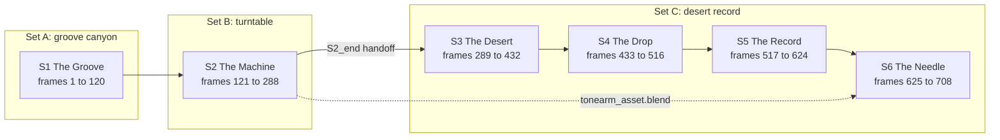

# Needle Drop: one record at four scales

Needle Drop is a 30 second film with a music track. It has six shots and three Blender scenes.
The film is 720 frames at 24 frames per second. Frames 1 to 708 are rendered. Frames 709 to 720
are black. `tools/assemble.sh` adds them at encode, so the picture ends with 0.5 seconds of
black. The music supplies a beat grid. A beat grid is the set of beat times in seconds.

| Term | Meaning |
|---|---|
| Blender scene | one three-dimensional scene that Blender opens |
| `.blend` file | the Blender file that holds a scene |
| record | the disc that carries the spiral groove |
| record groove | the spiral track cut into a vinyl record |
| tonearm | the arm that carries the stylus to the record |
| stylus, needle | the small tip that reads the groove |
| cantilever | the tube that carries the stylus |
| match cut | a cut that joins two shots at one shared shape or colour |
| production bible | the long design document `docs/bible.md` |
| builder brief | the build instruction `docs/BUILDERS.md` that overrides the bible |
| deep dive | one of the five detailed documents after this file |
| Geometry Nodes | the Blender node system that builds mesh geometry |
| shader | a material program that sets surface colour and light |
| node tree | a graph of nodes that computes a value or a mesh |
| collection | a named group of Blender objects |
| append | to import objects from another `.blend` file |
| handoff | data that one set writes for the next set |
| baked copy | a mesh whose vertex positions are written once |
| live node graph | a Geometry Nodes graph that runs each frame |
| marble field | the shared banded pattern built by `build_marble_field` |

The film has one visual motif. The record and its parts appear at four scales. A canyon is a
record groove. A turntable is the machine that plays it. A desert becomes a 2.4 kilometre
record. A mountain-sized tonearm lowers a needle onto that record. The transformation runs in
one direction: the world becomes the record. The package spec states this idea at
`spec.md:37-39`. The production bible names three of the scales at `docs/bible.md:15`. The
fourth scale is the tonearm. It is a machine part in shot S2 and a mountain-sized needle in shot
S6. The deep dives follow the code when the bible and the code disagree.

| Scale | Shot | Frames | Set | What the set shows |
|---|---|---:|---|---|
| Groove | S1 The Groove | 1 to 120 | A | A canyon that the camera flies through |
| Machine | S2 The Machine | 121 to 288 | B | A turntable with a 235 millimetre tonearm |
| Ground | S3 The Desert | 289 to 432 | C | A dune desert that carries the record pattern |
| Ground | S4 The Drop | 433 to 516 | C | The drop morph that turns the desert into a record |
| Ground | S5 The Record | 517 to 624 | C | A 2.4 kilometre record that turns |
| Needle | S6 The Needle | 625 to 708 | C | The same tonearm at 8000 times scale |

The four scales are not four copies of one scene. Each set is built at its own physical scale.
Each set is one Blender scene in its own `.blend` file. The sets are never combined into one
scene. The sets do not share scene objects, with one exception. Set B writes the tonearm
collection to an asset file. Set C appends that collection and scales it. Appending copies the
objects. The Set B scene is not opened by Set C. The tonearm is therefore the only shared
geometry. Set B also writes handoff values. Set C reads those values to rebuild the marble
mapping at desert scale. The table's Scale column uses the set label for each shot. The Ground
label covers S3 to S5 because those shots share the desert set.



## The shared object

The three sets do not share mesh objects, except for the tonearm asset. They share a look
library and a data contract. The look library is `tools/nd_lib.py`. Its first lines state the
rule. Every set imports the same marble field. The Set B to Set C match cut depends on the
node construction being identical. A match cut joins two shots at one shared shape or colour.

```text
# tools/nd_lib.py:1-5
"""NEEDLE DROP shared look library: palette, signature marble, shared materials.

Every set imports this so the vinyl (S2), the groove walls (S1) and the desert (S3) share
one marble. Do not fork NG_Marble per set: the S2->S3 match cut depends on it being identical.
"""
```

The function `build_marble_field` makes the field inside any node tree. It works in a shader
tree and in a Geometry Nodes tree. Geometry Nodes is the Blender node system that builds mesh
geometry. The same nodes build the vinyl sheen and the dune height. The excerpt shows the
signature and the default arguments. The body builds the node group. The argument `scale` sets
the field size. The argument `warp` sets how far the bands bend. The argument `freq` sets the
band frequency. The argument `scale_socket` lets a node input override the scale. The same
construction with different arguments keeps the pattern linked to the groove in every set.
This is why the desert dunes repeat the construction that the camera saw in the groove.

```text
# tools/nd_lib.py:38-43
def build_marble_field(nt, vec, scale=1.0, warp=None, freq=None, scale_socket=None):
    """Build the banded marble field inside ANY node tree (shader or geometry nodes).
    vec: input vector socket. Returns dict(m=fract band value 0..1, color=ramp colour, vein=0..1).
    Uses only nodes that exist in both tree types, so GN dunes follow the shader swirls exactly."""
    warp = MARBLE_WARP if warp is None else warp
    freq = MARBLE_FREQ if freq is None else freq
```

The docstring lists `m`, `color` and `vein`. The returned dictionary also has `raw`, the
continuous band coordinate that the dune bake uses for its gradient. The docstring is
incomplete. In the excerpt, `nt` is the node tree, and `fract` is the fractional part of a
number. The ramp colour is the colour looked up from the band value. The vein is a 0-to-1 mask
that peaks at the chalk stop at position 0.70.

The field is called at three mappings. A mapping is the position and size that the field uses.
Set A uses scale 0.05 and warp 1.3, with the default frequency. Set B uses record coordinates
at scale 12 and band frequency 4.4, with the default warp. Set C applies the handoff mapping
scale 0.001578855 to its coordinates, then calls the field with scale 1.0 and frequency 4.4. The
shared part is the node construction, not the numbers.
The word "identical" in the source comment means that no set forks the node group. It does not
mean that the arguments are equal. The default warp is 3.2 and the default frequency is 2.2
(`tools/nd_lib.py:27`). The value 0.001578855 is not free. Set B computes it at
`scenes/set_b/build.py:1767-1772`. The value is `MARBLE_SCALE` times the ratio of the Set B record
width to the 488.6 metre Set C frame width. Set B then rounds it to nine decimals.

## The six shots

`data/timing.json` fixes the six shot ranges. The same file fixes the three set ranges. The
`sets` object at `data/timing.json:9-22` gives Set A frames 1 to 120, Set B frames 121 to 288
and Set C frames 289 to 708. The shot ranges agree with the table above. The shot ranges are
data, not prose. A reader can check the cut frames without opening a scene file.

```text
# data/timing.json:9-22
 "sets": {
  "A": [
   1,
   120
  ],
  "B": [
   121,
   288
  ],
  "C": [
   289,
   708
  ]
 },
```

```text
# data/timing.json:23-48
 "shots": {
  "S1": [
   1,
   120
  ],
  "S2": [
   121,
   288
  ],
  "S3": [
   289,
   432
  ],
  "S4": [
   433,
   516
  ],
  "S5": [
   517,
   624
  ],
  "S6": [
   625,
   708
  ]
 },
```

Set C owns four of the six shots. It carries frames 289 to 708, which is 420 frames or 17.5
seconds. The drop morph starts at frame 433 and is complete by frame 461. Frame 461 is the first
frame where the 60 metre morph band has passed the 1200 metre rim. Frame 517 is the first
frame of shot S5. The object switch happens there because that is a shot boundary, not a morph
boundary. The live Geometry Nodes record serves frames 289 to 516. A live patch is a smaller
live mesh for the close sector. It covers the close view to frame 541. From frame 517 the full
record is a baked copy. A baked copy is a mesh whose vertex positions are written once. The copy
is named `RecordStatic`. It is parented to the disc. Parented means that the copy follows the
parent object's transform. The disc turns, so the copy turns with it. The static copy saves the
cost of a live node graph on the full record mesh.

Set A and Set B each write a block of one data file, `handoff.json`. A block is one JSON object
under a key. The dotted path `S2_end.set_c_marble_match` means the file `handoff.json`, key
`S2_end`, object `set_c_marble_match`. That object holds the scale, angle, offset and frequency
for the desert marble. Set C reads it in `scenes/set_c/c_common.py`. The blocks `S1_end` and
`S2_start` also exist in the file. They are notes for a person. No code reads them. Document 01
gives the full contract.

## What the checkout contains

The checkout is pinned at commit `8982f09c1502b5f6c01b1aa7c1eee23e5139677b`. It has 100
tracked files. It has no licence file and no package manifest. The code total is 11,075 lines
across Python, JavaScript, Shell and PowerShell files. The `scenes` tree holds 8,197 lines. The
`tools` tree holds 14 files and 787 lines, including the 18-line `tools/foreign.ps1`. The code
total is 8,197 scene lines, 787 tool lines and 2,091 audio lines.

The checkout does not contain the source audio. It does not contain the Poly Haven assets. It
does not contain the `.blend` files. It does not contain the rendered frame sequence. It does
contain ten release stills in `stills/`. The stills show frames from the released film. They
are not render output from this reading.

The production bible and the builder brief are both present. The builder brief says that it
overrides the bible.

```text
# docs/BUILDERS.md:3-4
Project root = the current working directory. The film spec is `docs/bible.md` (read it; it is long but it is the
spec). This file OVERRIDES the bible wherever they disagree.
```

The exploration treats the code as the evidence. The bible is a design document. The builder
brief is a build instruction. When a bible value and a code value differ, the deep dives report
the difference and follow the code. Document 04 lists 14 such differences.

## Documents

The table gives the measured size of each document. Prose words count whitespace-separated
tokens in paragraph and list text, including inline code and numbers. They exclude headings,
tables, fenced code blocks and Mermaid diagrams. Snippets are byte-exact source blocks.
Diagrams are Mermaid diagrams. An Aha line marks a mechanism insight.

| Document | Question it answers | Prose words | Snippets | Diagrams | Aha |
|---|---|---:|---:|---:|---:|
| [README.md](README.md) | What is the film and how do I read the package? | 1727 | 5 | 1 | 0 |
| [00-overview.md](00-overview.md) | What does the film show, and what does it ship? | 4427 | 15 | 2 | 1 |
| [01-architecture.md](01-architecture.md) | How do five process groups and three sets fit together? | 3953 | 17 | 2 | 1 |
| [02-core-mechanism.md](02-core-mechanism.md) | How does one beat become a rendered drop frame? | 4998 | 33 | 2 | 1 |
| [03-workflow-and-quality.md](03-workflow-and-quality.md) | How does a set build become an accepted film? | 4132 | 16 | 2 | 1 |
| [04-limits-and-comparison.md](04-limits-and-comparison.md) | What does the checkout not prove, and how do sibling films differ? | 4885 | 22 | 2 | 3 |

## Reading order

1. Read this file. It gives the thesis, the map and the non-claims.
2. Read [00-overview.md](00-overview.md). It describes the film, the six shots, the three sets
   and one frame from end to end.
3. Read [01-architecture.md](01-architecture.md). It describes the build, render and audio
   processes, the module boundaries, the data contracts and the Set A to Set B to Set C handoff.
4. Read [02-core-mechanism.md](02-core-mechanism.md). It traces the drop morph from the beat
   grid to the encoded frame. This is the centrepiece.
5. Read [03-workflow-and-quality.md](03-workflow-and-quality.md). It follows one real workflow
   from a Set C build to an accepted frame and then to the film. It states what each check can
   and cannot catch.
6. Read [04-limits-and-comparison.md](04-limits-and-comparison.md). It lists the limits, the
   rejected choices, the failure modes, the licence limits, the bible and code divergences and
   the mechanism comparisons.

Each deep dive repeats the terms it needs. A reader can start at document 02 and follow the
cited functions. The earlier documents give film context, not prerequisites.

## Non-claims

This package is a static reading. It does not build a scene. It does not render a frame. It
does not run Blender, Python project scripts, ffmpeg or Node.js. It does not download an asset.
It does not use the network.

No image was rendered or compared for visual quality. The ten release stills are evidence that
the film exists. They are not evidence that the scripts produce the film.

No audio was played. The audio chain is read from the scripts. The loudness target, the silence
window and the loop seam are code values. The loop seam is the join from the final frame back to
the first frame. These values were not measured on a delivered file.

The checkout has no licence file. The source repository has no licence file. Asset, music and
sound effect licences are separate. `audio/CREDITS.txt` lists them. This package does not give
legal advice and does not verify those licences.

The film is not reproducible from the checkout alone. The source audio, the Poly Haven assets,
the `.blend` files and the rendered frames are absent. The scripts document the missing inputs.
A rebuild needs those inputs, Blender 5.2.2, ffmpeg and Node.js.

The render runner is Windows-only. It uses PowerShell, the Windows command shell; `cygpath`, a
path converter between Windows and Unix forms; and `taskkill`, the Windows process terminator. A
macOS or Linux host needs wrapper changes. Document 04 gives the details.

Values that the source does not define are marked "not defined". The package does not invent a
value to fill a gap. A value that the source defines but this document does not quote is
described by its source line, not marked "not defined".
