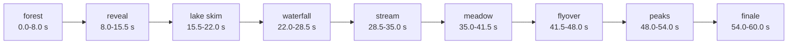
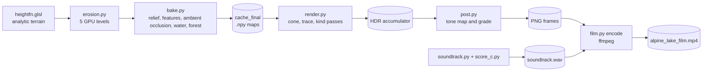

# 00 Overview: the film, the world and one finished frame

## The film

`procedural-alpine-lake` is a 60 second film. The renderer writes 2752 by 1152 pixels at 24 frames per second. The encode upscales to 3440 by 1440, the delivery size, with the Lanczos filter (`film.py:188`). The render takes about 14 hours on a Radeon 780M integrated graphics processing unit (GPU) (`README.md:9`). The four production modes are preview, final, stills and encode; the project README gives the command order (`README.md:72-92`).

The film has 9 shots. The order and the duration of each shot are fixed in `engine/shots_film.py`. The order is forest, reveal, lake skim, waterfall, stream, meadow, flyover, peaks and finale. The durations are 8.0, 7.5, 6.5, 6.5, 6.5, 6.5, 6.5, 6.0 and 6.0 seconds (`engine/shots_film.py:156-313`). The sum is 60.0 seconds. At 24 frames per second the film has 1,440 frames (`README.md:88`).

```text
# README.md:135-145
| # | Shot | Time |
|---|---|---|
| 1 | Forest | 0.0 to 8.0 s |
| 2 | Reveal | 8.0 to 15.5 s |
| 3 | Lake skim | 15.5 to 22.0 s |
| 4 | Waterfall | 22.0 to 28.5 s |
| 5 | Stream | 28.5 to 35.0 s |
| 6 | Meadow | 35.0 to 41.5 s |
| 7 | Flyover | 41.5 to 48.0 s |
| 8 | Peaks | 48.0 to 54.0 s |
| 9 | Finale | 54.0 to 60.0 s |
```



The diagram gives the same order and the same durations as the table.

The project README uses one-based shot numbers. The source uses zero-based indexes. Shot 1 in the table is `S[0]` in `engine/shots_film.py`. A reader who moves between the two files must keep this difference in mind.

The source builds the shots in a different order from the film order. It builds reveal first, then skim, waterfall, forest, stream, meadow, flyover, peaks and finale. At the end it moves the forest shot to the front.

```text
# engine/shots_film.py:318-322
    for k, tl in ((0, 118.0), (1, 118.0), (6, 112.0), (7, 122.0), (8, 106.0)):
        S[k]["target_luma"] = tl
    # (r5, user: open with the strongest scene - the forest dolly through the spruces onto the lake (was at ~25 s);
    # then the rising reveal from behind the rock and the rest in order. Durations: forest 8.0, reveal 7.5, total 60 s)
    S = [S[3]] + S[0:3] + S[4:]
```

The reorder is deliberate. The comment says that the film opens with the strongest scene, a dolly through the spruce trees onto the lake. The reveal follows. The remaining shots keep their order. Inside the snippet the luma loop runs before the reorder, so `S[0]` there is the reveal. The reorder moves complete shot entries, so each luma value stays with its shot.

The film is not a real-time program. A frame does not have a deadline. Each frame can take seconds or minutes, because the renderer sums several samples and the finishing step runs on the central processing unit (CPU). The source gives no live frame budget. It gives stage records: about 14 hours for the whole film, about 6 minutes for erosion and about 11 seconds for one finish (`README.md:9`, `engine/bake.py:82`, `film.py:132`).

## The world

The world is one valley. The main lake surface is at `y = 0`. Positive `x` is east and positive `z` is north (`engine/shaders/heightfn.glsl:3`). These terrain coordinates use the lake surface as the datum. The atmosphere model uses a separate planet-relative datum: it places the lake at 1,800 metres above the planet surface (`engine/shaders/sky.glsl:7`). The source does not state a derivation for that value. It uses the value only as a fixed offset in `toPlanet` (`:33`), not as a value computed from a terrain height. All other heights in this document are metres above the lake datum at `y = 0`. The main lake runs north and south in a glacial trough. The trough closes into a cirque at the north head and opens to a lower valley in the south (`engine/shaders/heightfn.glsl:4-6`).

The far height map covers 32 by 32 kilometres with 4 metre cells. The near height map covers 4 by 4 kilometres with 1 metre cells. A hanging valley on the west wall holds a tarn at 520 metres. The source gives no single north and south end for the lake. `lakeGuard` is a height-function helper. It returns 0 near the lake and the tarn and 1 far from them, and the renderer multiplies the macro relief by it (`engine/shaders/heightfn.glsl:369-371`, `:480`). The zero part is the no-relief zone. The guard clamps `z` to the range -1,700 to 2,300 when it measures distance to the lake axis. That range bounds the protected axis segment, not the waterline: past either end the guard measures from the endpoint, so the no-relief zone grows. The source comment notes that the inflow stream ends near `z = 2,270`, inside the north bound (`engine/shaders/heightfn.glsl:369-370`).

```text
# engine/bake.py:18-23
FAR_HALF = 16384.0
FAR_RES = 8192
NEAR_HALF = 2048.0
NEAR_RES = 4096
TARN_C = (-1680.0, -420.0)
TARN_LEVEL = 520.0
```

The lake axis moves with `z`. The function is `x = 150 sin(0.00105 z + 0.5) + 45 sin(0.0029 z + 2.1)` (`engine/shaders/heightfn.glsl:38`). The curve gives the lake its bend. The analytic terrain embeds the curve in the trough. `features.py` and the film shot file call the same function to place the waterfall, the stream and the camera (`engine/features.py:60`, `engine/shots_film.py:38`). The test still table also calls it (`engine/shots.py:39`).

The analytic terrain has a trough floor, a parabolic lower slope, a steep rock wall and a soft crest cap (`engine/shaders/heightfn.glsl:143-147`). It adds side valleys, a hanging valley and a head cirque. It also places 19 named peaks.

```text
# engine/shaders/heightfn.glsl:393-398
#define NPK 19
// x, z, summit height, radius | faces N, rotation (rad), profile power, drop A | east-west stretch
// (session 4: the down-valley range read as a row of 4-5 equal pyramids (shot 6): now ONE dominant
// glaciated massif (3300 m, broad, x2 east-west) with neighbours ~1000 m lower, saddles at the plinth
// level (<= ~1950 m), N varied 3..5, and a lower ~1900 m layer at z ~ -13 km for depth, either side of
// the lower valley so the view down it stays open)
```

The peak table has three parts. `PKA` gives summit position, summit height and radius (`engine/shaders/heightfn.glsl:405-424`). `PKB` gives the number of faces, the rotation, the profile power and the drop (`:425-445`). `PKS` gives the east-west stretch of each massif (`:446-447`). The highest summit entry is 3100 metres at the head (`:406`). The head has three unequal summits: 3100, 2550 and 2650 metres (`:399-401`). The quoted 3300 metres is the earlier value of the same down-valley massif; review round 4 reduced it to 2500 (`:402`), the live table entry (`:410`). The 3100 metre head summit and the 2500 metre massif are different mountains.

The world has three hand-placed features. A twin waterfall falls over a dark rock step on the east shore at `z = -550`. A boulder-choked inflow stream enters the north end of the lake. The forest trail is the third. The waterfall and the stream are carved into the terrain after erosion. The trail is not carved; it is a shading feature on the terrain.

```text
# engine/features.py:14-17
WF_Z = -550.0         # waterfall position along the east shore (steep hillside behind)
WF_HEIGHT = 29.0      # cliff height above the lake
WF_HALF = 22.0        # along-shore half width of the cliff block
NOTCH = (-8.0, 12.0, 3.2, 1.6)  # lip offsets (vA, vB), notch width, notch depth
```

The cliff is 29 metres high and 22 metres wide on each side of its centre. The two lips sit at along-shore offsets -8 and +12 metres. The notch is 3.2 metres wide and 1.6 metres deep. These values are the input to both the carving shader and the water shader (`engine/features.py:18`).

The forest trail runs along the east shore from `z = 300` to `z = 600` (`engine/features.py:107-114`). The trail is not a separate mesh. It is a polyline. The shader receives up to 32 points in `uTrail` and a count in `uTrailN` (`engine/shaders/world.glsl:22-29`). The ground-cover and terrain shaders measure the distance to that polyline; near it they suppress ground cover and select the trail material (`:22-29`).

## The six systems

The repository has six systems. Each one has a separate document section below.

1. The **world bake** turns the analytic function into maps. It runs erosion, relief, feature carving, ambient occlusion, water levels, forest density and a 3D noise volume. It writes `.npy` files into a cache directory (`engine/bake.py:769-774`).
2. The **renderer** uploads the cache and ray marches the scene. It uses one trace pass and one pass for each hit kind (`engine/render.py:278-303`).
3. The **finishing** step maps high dynamic range (HDR) radiance to display values. It uses local tone mapping, a filmic curve, chroma shaping, vignette and grain (`engine/post.py:28-70`).
4. The **camera system** builds a smooth path from keyframes. It checks the path against the ground, the trees and the placed boulders (`engine/camera_path.py:65-97`, `engine/shots_film.py:48-64`).
5. The **sound system** synthesises a nature bed and an orchestral score. It mixes the two to a loudness target (`audio/soundtrack.py:37-64`, `audio/score_c.py:1-17`).
6. The **encode** step joins the frames and the audio into one Moving Picture Experts Group 4 Part 14 (MP4) file with ffmpeg (`film.py:171-196`).

The dependency between the systems is one way. The bake writes the cache. The renderer reads the cache. The finisher reads the rendered HDR frame. The encoder reads the finished portable network graphics (PNG) frames and the WAV file.



The bake is a prerequisite. `World.__init__` raises an error when the four required maps are absent. The four maps are `h_far.npy`, `h_near.npy`, `water_level.npy` and `forest.npy` (`engine/render.py:121-125`). The error message tells the user to run `tools/bake_final.py`.

## The world in numbers

The table collects the values that a reader needs to follow the rest of the package. Every value has a citation.

| Property | Value | Source |
|---|---|---|
| Far map | 8192 by 8192 texels, 4 metre cells, plus or minus 16,384 metres | `engine/bake.py:18-19` |
| Near map | 4096 by 4096 texels, 1 metre cells, plus or minus 2,048 metres | `engine/bake.py:20-21` |
| Tarn centre and level | `(-1680, -420)`, 520 metres | `engine/bake.py:22-23` |
| Main lake level | 0 metres | `engine/shaders/heightfn.glsl:3` |
| Tree cell | 4 metres | `engine/shaders/world.glsl:8` |
| Rock cell | 5 metres, 6 main slots | `engine/shaders/rocks.glsl:16,29` |
| Ground cover fine cell | 0.22 metres | `engine/shaders/ground.glsl:41` |
| Ground cover coarse cell | 1.76 metres | `engine/shaders/ground.glsl:42` |
| Terrain trace ceiling | 4200 metres; a ray above it that points up stops | `engine/shaders/lighting.glsl:33`, `engine/shaders/scene.frag:57` |
| Tree draw distance | 7000 metres | `engine/shaders/lighting.glsl:34` |
| Boulder draw distance | 380 metres | `engine/shaders/lighting.glsl:35` |
| 3D noise volume | 128 cubed, 4 channels, 8 bits per channel | `engine/bake.py:725-726` |
| Render tile | 192 pixels | `engine/render.py:279` |
| Accumulator format | 32 bit float, 4 channels | `engine/render.py:295` |
| Film rate and length | 24 frames per second, 60.0 seconds | `tools/render_final.py:24`, `engine/shots_film.py:156-313` |

The table shows the scale difference between the map layers. No summit in the peak table exceeds 3100 metres. The 4200 metre value is not a summit; it is the height above which the terrain trace stops. One far texel covers 16 square metres. One near texel covers 1 square metre. The renderer chooses between the maps by the larger absolute coordinate. It is fully on the near map inside 88 percent of the near half width, fully on the far map past 97 percent, and blends in between (`engine/shaders/world.glsl:56-58`). Past the near map it reads the far map alone. The source does not state why two maps exist beyond the resolution difference.

## One finished frame

This section follows frame 240 from the frame index to the encoded file. Frame 240 is at 10.0 seconds, inside the reveal shot. The reveal starts at 8.0 seconds, so the local shot time is 2.0 seconds.

### Step 1: choose the sample times

`film.py` computes the sample times from the frame index. The function `frame_samples` returns the shot index, the shot, one camera for each sample and the sample times. Each sample lies inside the shutter interval.

```text
# film.py:68-84
def frame_samples(f, spp):
    """camera/look/time for each sample of frame f (motion blur within the shot)."""
    T = f / FPS
    i = int(np.searchsorted(starts, T, side="right") - 1)
    i = min(max(i, 0), len(SHOTS) - 1)
    shot = SHOTS[i]
    t0 = T - starts[i]
    cams, times = [], []
    shut = args.shutter / FPS
    for s in range(spp):
        off = ((s + 0.5) / spp - 0.5) * shut if spp > 1 else 0.0
        tl = float(np.clip(t0 + off, 0.0, shot["dur"] - 1e-4))
        c = shot_camera(shot, tl)
        c.fov = c.fov * VFOV_SCALE
        cams.append(c)
        times.append(float(starts[i] + tl + shot.get("time_offset", 0.0)))
    return i, shot, cams, times
```

The shutter is 0.5 of the frame time by default, which is a 180 degree shutter (`film.py:36`). One sample sits at the centre of its sub-interval. The `final` mode default is 12 samples per pixel (`film.py:45`). The final driver passes a group value, 6 or 8, as `--spp` to `film.py`; its own `--spp` default of 8 applies only when no group string is given (`tools/render_final.py:19-25`). The group string maps zero-based shot indices to sample counts. The exploration states both values because they are different stages.

### Step 2: build each camera

`shot_camera` takes the shot and the local time. It applies an easing curve to the normalised time, then evaluates a non-uniform Hermite spline through the keys. The position is interpolated. The viewing direction is also interpolated, not the target point.

```text
# engine/camera_path.py:65-80
def shot_camera(shot, t):
    keys = shot["keys"]
    us = np.array([k["u"] for k in keys], np.float64)
    u = _ease(t / shot["dur"], shot.get("ease", "soft"))
    u = us[0] + u * (us[-1] - us[0])
    pos = _hermite(us, [k["pos"] for k in keys], u)
    # interpolate the viewing DIRECTION (not the target point): a near target followed by a far one
    # would otherwise make the camera dip toward the ground between the keys
    dirs = []
    for k in keys:
        d = np.subtract(k["target"], k["pos"]).astype(np.float64)
        dirs.append(d / (np.linalg.norm(d) + 1e-9))
    dv = _hermite(us, dirs, u)
    dv = dv / (np.linalg.norm(dv) + 1e-9)
    tgt = np.asarray(pos) + dv * 1000.0
    fov = float(_hermite(us, [k.get("fov", 55.0) for k in keys], u))
```

The comment gives the reason for the direction interpolation. A near target followed by a far target would make the camera dip toward the ground between keys if the target points were interpolated (`engine/camera_path.py:71-73`). The direction interpolation keeps the view smooth.

The frame applies the vertical field of view (FOV) scale after the camera is built. A 16:9 frame uses 1.0. A wider frame uses 0.86 (`film.py:49-50`, `film.py:81`).

### Step 3: render the samples

`Renderer.render` receives one camera for each sample and one time for each sample (`engine/render.py:430-436`). It first probes the light at the camera. The probe renders a small 3 by 1 target and reads the sun colour, the sky ambient and the horizon colour (`engine/render.py:420-426`). These three values go into every shading pass.

The renderer draws into a float accumulator. The blend function is additive: one plus one (`engine/render.py:451-453`). Each sample adds its radiance. At the end the code divides by the sample count.

```text
# engine/render.py:499-506
            if verbose:
                print(f"  sample {s+1}/{n} {time.time()-t0:.1f}s", flush=True)
            if getattr(self, "_first", False):
                self._first = False
                print(f"  first sample (incl. any lazy driver compile) {time.time()-t0:.1f}s", flush=True)
        c.disable(moderngl.BLEND)
        img = gl.read_tex(self.acc, 3)[::-1] / n
        return img, dict(sun=sun_col, sky=sky_amb, horizon=horizon, seconds=time.time() - t0)
```

The divide is the sample average. The image is also flipped vertically, because the framebuffer origin is at the bottom and the PNG writer expects the first row at the top.

### Step 4: walk the tiles

The renderer does not draw the frame in one call. It walks the frame in 192 pixel tiles. The sample loop encloses the tile loop: the renderer walks every tile for sample 0, then every tile for sample 1, and so on. For each tile it runs three stages.

```text
# engine/render.py:469-483
            for y in range(0, self.h, self.tile):
                for x in range(0, self.w, self.tile):
                    rect = (x, y, min(self.tile, self.w - x), min(self.tile, self.h - y))
                    c.disable(moderngl.BLEND)
                    tp = time.time()
                    self.cone.draw(self.cfbo, (x // 4, y // 4, (rect[2] + 3) // 4, (rect[3] + 3) // 4))
                    if prof is not None:
                        c.finish()
                        prof["cone"] = prof.get("cone", 0.0) + time.time() - tp
                        tp = time.time()
                    self.trace.draw(self.gfbo, rect)
                    # (perf4) the hit kinds present in this tile (G-buffer readback = the tile's one sync point): a kind
                    # pass with no pixel here is skipped (it would only discard every pixel), the others are queued
                    # back to back without a c.finish() each (under GPU sharing every finish waited for other
                    # processes' work: ~7 % of the frame per empty pass)
```

The cone pre-pass writes one start distance for each 4 by 4 pixel block. The trace pass reads that distance and begins its march there (`engine/render.py:288-289`). It writes the G-buffer for the tile: two targets that record the first surface each ray meets. The second channel of the first target holds the hit kind, called the kind word here. The code reads back that channel for each pixel in the tile. The readback is the one sync point in the tile loop. A histogram of the kind word shows which hit kinds exist in the tile.

The code then draws only those kind passes. A kind pass with no pixel in the tile is skipped. The comment gives the measured reason: under GPU sharing, each empty pass cost about 7 percent of the frame (`engine/render.py:480-483`).

### Step 5: shade each hit kind

The scene shader has one entry point for each hit kind. The kind pass reads the G-buffer, rejects a pixel whose kind does not match, and shades the rest.

```text
# engine/shaders/scene.frag:283-295
void main() {
    ivec2 px = ivec2(gl_FragCoord.xy);
    vec4 g0 = texelFetch(uGBuf0, px, 0);
    if (int(g0.y + 0.5) != SCENE_PASS) discard;
    vec3 ro, rd;
    cameraRay(ro, rd);
    Hit h;
    h.t = g0.x; h.kind = SCENE_PASS; h.cell = ivec2(g0.zw); h.info = texelFetch(uGBuf1, px, 0);
    vec3 col = render(h, ro, rd);
    col = max(col, vec3(0.0));
    if (any(isnan(col)) || any(isinf(col))) col = vec3(0.0);
    fragColor = vec4(col, 1.0);
}
```

The G-buffer stores the hit distance in the first channel and the hit kind in the second channel. The cell index is in the third and fourth channels. The second target holds the surface info vector (`engine/shaders/scene.frag:137-138`).

The shading branch covers water, falls flora, tree, rock, cover, hero and terrain. Sky is kind 0 and has its own shading program. Inside that program the sky path returns before the surface switch (`engine/shaders/scene.frag:250-251`). Inside the shared switch the final default branch is terrain, not sky (`:274-275`). Falls flora is one hit kind, the shrubs and ferns on the waterfall step (`engine/shaders/scene.frag:232-236`). The hero kind is the placed boulder material (`:272-273`). The falls volume is an additive effect applied after every hit kind, not another hit kind (`:277-279`). Every shading result then receives the aerial perspective (`:277-279`).

### Step 6: finish the frame

The finisher is `post.finish`. It takes the HDR frame, the grade and a seed. The grade is a dataclass that holds the tone, colour, detail, black point and grain controls (`engine/post.py:28-70`). The default values include a base compression of 0.90, a detail boost of 1.35, a contrast of 1.30, a saturation of 1.12 and a highlight compression of 0.85 (`engine/post.py:28-41`). In plain terms, the base compression lowers the contrast between large light and dark masses. The detail boost raises local texture contrast. The contrast value expands the middle tones around a mid grey pivot. Saturation raises colour strength by 12 percent. Highlight compression holds back the brightest sky, cloud and snow values (`engine/post.py:188-232`).

```text
# engine/post.py:28-33
    base_compress: float = 0.90     # (r5: 0.8 -> 0.9) local tone mapping: scale of the large-scale log-luminance (r4: 0.5 -> 0.8 with the edge-aware base: dark masses kept dark, p2 ~12)
    detail_boost: float = 1.35      # local contrast, texture band (fine_sigma .. struct_sigma) (r4 L1: 1.6 -> 1.35)
    local_sigma: float = 0.04       # base blur, fraction of image width
    contrast: float = 1.30          # (r5: 1.24 -> 1.3)
    saturation: float = 1.12        # global chroma scale (r5: 1.07 -> 1.12)
    chroma_boost: float = 0.15      # extra chroma in mid-tones (r5: 0.05 -> 0.15)
```

The finisher applies the exposure, the local tone map, the filmic curve, the chroma shaping, the vignette and the grain. It then applies the sRGB (standard red, green and blue) display transfer curve (`engine/post.py:334-344`). The output is an 8 bit unsigned integer image.

Each shot has one exposure. The exposure is measured on the middle frame of the shot and cached in `out/exposures.json`. The cache key contains the shot index, the shot name, the frame size, the quality, the FOV scale and the frame rate. The key prevents a preview from setting the exposure of the final (`film.py:99-113`).

```text
# film.py:99-113
def expo_for(i):
    """per-shot exposure measured once on the shot's middle frame (cached in out/exposures.json, keyed by the
    render settings so a preview never sets the exposure of the final)."""
    table = json.loads(EXPO.read_text()) if EXPO.exists() else {}
    key = f"{i}:{SHOTS[i]['name']}:{W}x{H}:q{Q}:v{VFOV_SCALE:.3f}:fps{FPS}"
    if key in table:
        return table[key]
    f = int((starts[i] + SHOTS[i]["dur"] * 0.5) * FPS)
    _, shot, cams, times = frame_samples(f, 2)
    R.heroes = shot.get("heroes", [])
    hdr, _ = R.render(cams, shot["look"], times)
    e = post.suggest_exposure(hdr, target_luma=shot.get("target_luma", 112.0), g=shot["grade"])
    table[key] = e
    EXPO.write_text(json.dumps(table, indent=1))
    return e
```

`suggest_exposure` bisects for 14 iterations. It targets the median luma of the finished frame. It also caps the median luma of the clear sky at 158 (`engine/post.py:356-389`).

### Step 7: save and later encode

The final mode grades and saves on one worker thread while the GPU renders the next frame. It writes a temporary file and renames it. The rename makes a killed render safe: a half-written frame never appears under the final name (`film.py:130-139`).

```text
# film.py:130-139
    def finish_save(hdr, g, f, fn, fade_a):
        # grade + save; in final mode this runs on a worker thread while the GPU renders the next frame
        # (post.finish ~11 s at 2752x1152 - numpy releases the GIL); written to a temp file and renamed so a
        # killed render never leaves a half-written frame that the resume would skip
        img = post.finish(hdr, g, seed=f)
        if fade_a < 1.0:
            img = (img.astype(np.float32) * fade_a + 0.5).astype(np.uint8)
        tmp = fn.with_name(fn.stem + ".tmp.png")
        Image.fromarray(img).save(tmp)
        tmp.replace(fn)
```

The fade multiplies the finished image. The fade is 1.6 seconds at the start and 2.2 seconds at the end (`film.py:87-93`). The picture fade and the audio fades are separate code paths. The picture fade is in `film.py`; the score fade is in `audio/score_c.py` (`:1405-1409`). The picture starts its final fade at 57.8 seconds. The score starts its fade at 56.8 seconds. The source does not state that the two are aligned. The encode step writes a concat list and calls ffmpeg with the H.264 codec. The final preset is `slow`, the constant rate factor is 14, the pixel format is `yuv420p` and the colour tags are Rec. BT.709 (`film.py:189-192`).

## The soundtrack in one paragraph

The soundtrack has two synthesis stages and a final mix. The nature bed synthesises wind, foliage, lake water, birds, the waterfall, the stream and meadow insects at 48,000 samples per second (`audio/soundtrack.py:37`). It targets -17 loudness units relative to full scale (LUFS) and a true-peak ceiling of -1.2 decibels true peak (`audio/soundtrack.py:42-43`). The score synthesises strings, horns, choir, piano, celesta, harp, timpani and percussion (`audio/score_c.py:3-9`). It targets -14 LUFS (`audio/score_c.py:9`). The final mix is mastered to -14 LUFS with a -1.15 decibel true-peak ceiling (`audio/score_c.py:1393`). The score uses 2 bars of 4/4 for each shot, and every cut is a downbeat. The header gives four nominal tempos: 60, 64, 73.85 and 80 beats per minute (`audio/score_c.py:15`), while the grid sets each shot tempo from its duration (`:71-84`). No code reads the four header values. They are prose. The grid tempo controls the beat positions, so it replaces the header values in practice.

```text
# audio/score_c.py:15-16
Form: 2 bars of 4/4 per shot, every cut is a downbeat (60 / 64 / 73.85 / 80 BPM).
Theme (D major): F#4 D5 | C#5 B4 A4 - the rising sixth that falls back by step.
```

The theme is in D major. The notes are F sharp 4, D 5, C sharp 5, B 4 and A 4. The description says it is a rising sixth that falls back by step (`audio/score_c.py:16`).

## Aha: picture and sound meet through a file, not a call

**Aha:** The renderer never calls the audio code. `film.py` writes the shot timings to `out/film_shots.json` on every run, with index, name, start, end and environment for each shot (`film.py:61-65`). The score reads a shot table from `audio/film_shots.json` (`audio/score_c.py:11`). The two programs agree because they read the same structure, not because one drives the other.

This design has a clear benefit. A composer can regenerate the score without a GPU. A render can change its frame rate without re-encoding the music. It also has a clear risk. The exploration does not prove that the two shot files stay identical. The render writes `out/film_shots.json`. The score reads the tracked `audio/film_shots.json`. If the shot durations change, a person must copy the first file to the second, or update the audio file. Running the render alone writes only the first file. No hash or version check connects them. The source states no such check.

## What the film does not contain

The film has no dialogue, no titles, no cuts inside a shot and no lens flare. The source has no text overlay pass. The fade is a global multiplier on the finished frame (`film.py:87-93`). The encode has no colour management beyond the three Rec. BT.709 tags (`film.py:190-192`).

The film also has no real-time mode. The renderer is a standalone OpenGL 4.3 context, not a window (`engine/gl.py:18-25`). The program renders to a framebuffer and reads it back. A viewer sees the result through the PNG frames or the encoded MP4 file.

## The limits of this overview

This document gives the shape and one frame. It does not explain how the erosion cuts a valley or how the ray marcher finds a tree. Document [02](02-core-mechanism.md) gives those mechanisms. It does not explain the cache keys or the shader reduction. Document [01](01-architecture.md) gives those details.

The exploration did not render frame 240. The path above comes from the source functions and their order. The source states the order in the function bodies and in the comments. The exploration did not measure the time of any step.
