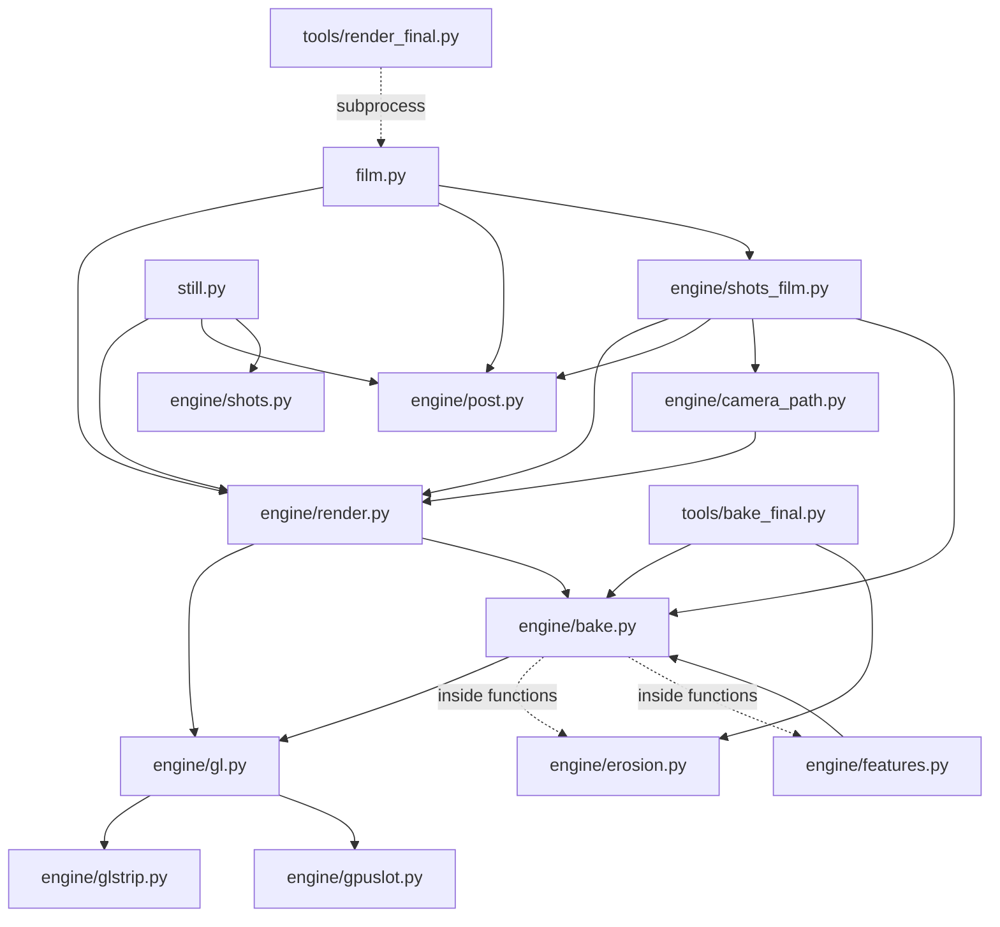
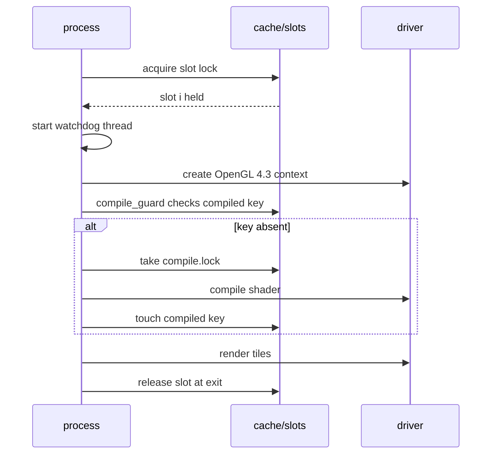

# 01 Architecture: modules, shaders, cache and process model

`procedural-alpine-lake` is a Python and OpenGL Shading Language (GLSL) program. It renders a 60 second alpine-lake film offline. A graphics processing unit (GPU) does the render. `film.py` drives a film mode. `engine/` holds the library. `tools/` holds the bake and final-render drivers. Every world map and every frame comes from these files.

## The source tree in numbers

The checkout has 79 tracked files (`spec.md:25`). The code divides into five groups.

| Group | Files | Lines | Role |
|---|---:|---:|---|
| `engine/*.py` | 12 | 5,042 | renderer, bake, erosion, features, camera, finishing, GPU helpers |
| `engine/shaders/` | 28 | 14,444 | scene passes, materials, bake and erosion shaders |
| `audio/*.py` | 6 | 8,221 | nature bed, three scores, one shared score library, analysis |
| `tools/*.py` | 7 | 293 | final bake, final render, path check, map, memory and pass profiles |
| root Python | 2 | 234 | `film.py` and `still.py` |

Measured totals are 13,790 Python lines and 14,444 GLSL lines. `spec.md:75` gives 26 shader files. The directory holds 28 files with a `.frag`, `.comp` or `.glsl` suffix. The line total is the same. The difference is a file count. The exploration uses the measured count and records the difference.

The inventory rows in `spec.md:74-78` also differ from the measured tree in three places. The spec gives `engine/*.py` as 6,208 lines; the 12 files sum to 5,042. The spec gives `audio/*.py` as 7 files and 6,468 lines; the tree holds 6 files and 8,221 lines. The spec gives `tools/*.py` as 343 lines; the 7 files sum to 293. The measured rows add to the stated 13,790 line total: 5,042 + 8,221 + 293 + 234. The exploration therefore uses the measured rows and quotes the spec total as the checked fact. It does not repeat the three stale sub-totals.

The table covers the 55 code files. The other 24 tracked files are `.gitignore`, `PROMPT.md`, the project `README.md`, `requirements.txt`, `audio/film_shots.json` and the 19 images under `docs/`.

The 12 engine modules are `render.py` (506 lines), `bake.py` (783), `erosion.py` (1,687), `features.py` (396), `camera_path.py` (97), `post.py` (389), `gl.py` (135), `glstrip.py` (168), `gpuslot.py` (228) and `shots.py` (91). The last two are `shots_film.py` (422) and `treemap_port.py` (140). The audio modules are `soundtrack.py` (1,884), `score_a.py` (1,139), `score_b.py` (1,493), `score_c.py` (1,659), `music.py` (1,372) and `analysis.py` (674). `score_a.py` and `score_b.py` are alternate score candidates. `music.py` is a shared synthesis library and a music-only score; `score_a.py` imports it (`audio/score_a.py:39`). All four audio programs have a `__main__` block; the final path uses `score_c.py`. The tools are `bake_final.py` (57), `render_final.py` (66), `check_paths.py` (39), `worldmap.py` (53), `memwrap.py` (27), `passprof.py` (37) and `rebake_maps.py` (14).

## The modules

Each module has one job. The table gives the job and the main entry point.

| Module | Job | Entry point |
|---|---|---|
| `film.py` | run a film mode and encode the result | `frame_samples`, `finish_save` |
| `still.py` | render named stills from a small test shot table | top-level loop |
| `engine/render.py` | own the GPU context objects, the camera and the look, and render tiled frames | `World`, `Renderer.render` |
| `engine/bake.py` | build and cache the world maps | `bake_all` |
| `engine/erosion.py` | run the multi-level GPU erosion simulation | `erode` |
| `engine/features.py` | place and carve the waterfall and stream; place the trail polyline | `place`, `carve` |
| `engine/camera_path.py` | evaluate a smooth camera path | `shot_camera` |
| `engine/shots_film.py` | build the 9 shots, their looks and their grades | `build` |
| `engine/post.py` | tone map, grade and write the display image | `finish`, `suggest_exposure` |
| `engine/gl.py` | create the context, load includes and compile passes | `ctx`, `Pass` |
| `engine/glstrip.py` | remove functions that a pass cannot reach | `reduce` |
| `engine/gpuslot.py` | guard slots, commit memory, compiles and process size | `acquire`, `compile_guard` |
| `engine/treemap_port.py` | reproduce the tree placement on the central processing unit (CPU) | `tree_final` |
| `engine/shots.py` | small test shots and the lake axis helper | `stills`, `axis_x` |
| `audio/soundtrack.py` | synthesise and mix the nature bed | module body |
| `audio/score_c.py` | synthesise the film score and the final mix | module body |
| `audio/analysis.py` | measure loudness, peaks, clicks and loops | `integrated_lufs` |

`still.py` imports `shots`, not `shots_film` (`still.py:14`). `shots.py` is a small table for tests. The film uses `shots_film.py`. A reader must not confuse the two shot tables.

## The import graph

The dependencies point in one direction. The film layer imports the renderer, the finisher and the shot table. The renderer imports the OpenGL helpers and the bake constants. The bake imports the erosion and feature modules inside functions, not at module load (`engine/bake.py:85`).



The dotted edges are late or indirect. `bake.py` imports `features` inside `bake_heights` (`engine/bake.py:85`). `features.py` imports `bake` at the top (`engine/features.py:11`). The late import avoids a circular import at module load. `tools/render_final.py` does not import `film.py`. It starts `film.py` as a child process (`tools/render_final.py:51-52`).

## Entry points

There are six picture-pipeline entry points. Each one is a command that runs from the repository root.

1. `tools/bake_final.py` builds the final world. It writes the cache. It can reuse a previous erosion result or run a new one (`tools/bake_final.py:33-51`).
2. `still.py` renders the named test stills from `engine/shots.py` (`still.py:18-21`).
3. `film.py stills` renders one middle frame for each shot (`film.py:121-122`).
4. `film.py preview` renders a 480 by 270 animatic at 1 sample per pixel (`film.py:45`).
5. `film.py final` renders the final frames and is resumable (`film.py:146-149`).
6. `tools/render_final.py` runs `film.py final` in a loop and then encodes (`tools/render_final.py:43-64`).

The audio has its own entry points. `audio/soundtrack.py` writes the nature bed. `audio/score_c.py` reads the bed and writes the final mix. They are not part of the six above. The project README gives the order: nature bed first, then the score (`README.md:84-86`).

## Process model

Each process that opens a GPU context takes one machine-wide slot. The context is a standalone OpenGL 4.3 context, not a window.

```text
# engine/gl.py:18-25
def ctx():
    global _ctx, _vbo
    if _ctx is None:
        import gpuslot
        gpuslot.acquire()      # machine-wide render slot + free-memory guard (see gpuslot.py)
        _ctx = moderngl.create_standalone_context(require=430)
        _vbo = _ctx.buffer(np.array([-1, -1, 3, -1, -1, 3], dtype="f4").tobytes())
    return _ctx
```

`gpuslot.acquire` blocks until a slot is free and the free commit memory is at least the minimum. The default maximum is 3 slots and the default minimum is 6 gigabytes.

```text
# engine/gpuslot.py:107-129
def acquire():
    """block until a GPU slot is free and enough commit memory is available."""
    global _held
    if _held is not None or os.environ.get("ALPINE_NO_SLOT") == "1":
        return
    n = int(os.environ.get("ALPINE_MAX_GPU", "3"))
    need = float(os.environ.get("ALPINE_MIN_COMMIT_GB", "6"))
    SLOTS.mkdir(parents=True, exist_ok=True)
    t0 = time.time(); last = 0.0
    while True:
        if free_commit_gb() >= need:
            for i in range(n):
                f = SLOTS / f"slot{i}.lock"
                try:
                    fd = os.open(f, os.O_CREAT | os.O_EXCL | os.O_WRONLY)
                    os.write(fd, str(os.getpid()).encode()); os.close(fd)
                    _held = f
                    atexit.register(_release)
                    import threading
                    threading.Thread(target=_watchdog, daemon=True).start()
                    if time.time() - t0 > 5:
                        print(f"[gpuslot] got slot {i} after {time.time() - t0:.0f}s", file=sys.stderr, flush=True)
                    return
```

The slot files live in `<repo>/cache/slots` (`engine/gpuslot.py:26`). The guard is machine-wide for one checkout; `ALPINE_SLOTS` can point several checkouts at one directory. A slot file holds the process identifier. If the process is dead, the next process reclaims the slot (`engine/gpuslot.py:130-139`). The guard starts a watchdog thread with the slot. The watchdog reads the process commit size every 5 seconds.

```text
# engine/gpuslot.py:85-94
        time.sleep(5)
        if _compiling[0]:
            continue
        mine = proc_gb()
        if mine > lim or (mine > 6.0 and free_commit_gb() < 2.5):
            print(f"[gpuslot] WATCHDOG: this process uses {mine:.1f} GB (limit {lim:.0f} GB, machine free commit "
                  f"{free_commit_gb():.1f} GB) - exiting to protect the machine. Restart it (memory is freed on exit); "
                  f"long-lived processes that rebuild Renderers/shaders leak GPU memory.", file=sys.stderr, flush=True)
            _release()
            os._exit(3)
```

The default limit is 16 gigabytes. The final render driver raises it to 30 gigabytes with `ALPINE_MAX_PROC_GB` (`tools/render_final.py:30`). The watchdog also stops a process that uses more than 6 gigabytes while the machine has less than 2.5 gigabytes of commit memory free (`engine/gpuslot.py:89`). The comment gives the reason: a long-lived render server leaked GPU objects, reached 35 gigabytes and left the machine with 3 gigabytes (`engine/gpuslot.py:13-16`).

The memory functions use Windows system calls. On a system where the call fails, `free_commit_gb` returns 1e9 gigabytes (`engine/gpuslot.py:39-45`). `_alive` returns true on failure (`engine/gpuslot.py:48-59`). `proc_gb` returns zero on failure (`:70-79`). The watchdog still runs, but it sees zero use and stops nothing. The memory part of the guard is therefore a Windows feature. The slot part still works on any system with a writable cache directory.



The compile guard is the third part of the model. A fresh compile of the full scene shader peaked at 45 to 50 gigabytes, so the guard runs a large new compile one at a time on the machine.

```text
# engine/gpuslot.py:160-180
    def __enter__(self):
        if os.environ.get("ALPINE_NO_SLOT") == "1":
            return self
        COMPILED.mkdir(parents=True, exist_ok=True)
        if (COMPILED / self.key).exists() or len(self.key) < 8:
            return self
        # the cost grows with the source: ~50 GB for the full ~535 KB scene shader, a few GB for the bake passes
        big = float(os.environ.get("ALPINE_COMPILE_GB", "50"))
        need0 = max(6.0, big * min(1.0, (self.size / 535000.0)) ** 1.3)
        if self.need_gb is not None:          # (split scene passes: each < 1 GB, tools/split_probe.py)
            need0 = float(self.need_gb)
        if self.need_gb is not None and self.need_gb <= 8.0:
            # small measured compiles (split scene passes, < 1 GB each): no machine-wide lock, only wait
            # for the free commit
            t0 = time.time()
            while free_commit_gb() < need0:
                if time.time() - t0 > 60:
                    print(f"[gpuslot] waiting for {need0:.0f} GB free commit to compile", file=sys.stderr, flush=True); t0 = time.time()
                time.sleep(3)
            _compiling[0] = True
            return self
```

The guard estimates the need from the source size. The full 535 kilobyte scene source maps to 50 gigabytes by default. A pass that declares a measured cost of 8 gigabytes or less skips the machine-wide lock and only waits for free commit (`engine/gpuslot.py:169-180`). The renderer declares 6 gigabytes for each scene pass (`engine/render.py:286-289`).

`self.key` is the hexadecimal SHA-1 digest of the source text, encoded as UTF-8 with replacement (`engine/gpuslot.py:153-155`). `COMPILED` is the directory `cache/slots/compiled` (`:147`). After a successful compile, `__exit__` creates a zero-length file with the key as its name (`:223-225`). On later runs that file makes the guard a no-op (`:164-165`). A SHA-1 digest is always 40 characters, so the `len(self.key) < 8` condition cannot trigger for a normal string source. The source does not state why that condition exists.

For a large compile, the guard waits until the free commit reaches the estimate. It then creates `cache/slots/compile.lock` with an exclusive create and writes its process identifier into the file (`engine/gpuslot.py:181-190`). On exit it deletes the lock file (`:218-222`). If the lock exists, the guard reads the identifier. It deletes the lock when the process is dead, or when the file is empty and older than 30 seconds (`:195-209`).

## Shader assembly

The shader source is assembled in three steps. First, `gl._preprocess` replaces each `#include` with the named file, once (`engine/gl.py:28-38`). Second, `glstrip` removes the functions that the pass cannot reach. Third, moderngl compiles the result.

```text
# engine/gl.py:44-66
    def __init__(self, frag, defines=None, compile_gb=None, targets=1):
        import os
        c = ctx()
        header = "#version 430\n" + "".join(f"#define {k} {v}\n" for k, v in (defines or {}).items())
        if os.environ.get("ALPINE_NONCE"):           # force a fresh driver compile (compile-cost tests)
            header += f"#define ALPINE_NONCE {os.environ['ALPINE_NONCE']}\n"
        full = header + _preprocess(frag, set())
        self.source = full
        if os.environ.get("ALPINE_NO_STRIP") != "1":
            # only the code this pass runs (glstrip.py): a smaller compile, and edits elsewhere keep its
            # driver cache entry valid
            try:
                import glstrip
                self.source = glstrip.reduce(full)
            except ValueError as e:
                print(f"[gl] {frag}: no source reduction ({e})", flush=True)
        import gpuslot

        def build():
            # (the monolithic scene shader peaked at ~45-50 GB per fresh compile, see gpuslot.py; compile_gb =
            # free commit to wait for, for passes measured to compile small)
            with gpuslot.compile_guard(self.source, compile_gb):
                self.prog = c.program(vertex_shader=VS, fragment_shader=self.source)
```

The reduction is optional. `ALPINE_NO_STRIP=1` skips it. If the reduced source fails to compile, the code prints a message and compiles the full source (`engine/gl.py:75-83`). The fallback protects a correct render when the reducer makes a mistake.

The reducer starts from `main`. It adds every function named outside a function body and every function named in a `#define`. It then follows function names through the definitions, starting from those roots.

```text
# engine/glstrip.py:128-151
    # roots: main, anything named outside function bodies (prototypes, global initialisers) and in #defines
    outside, last = [], 0
    for _, s, e in sorted(funcs, key=lambda f: f[1]):
        outside.append(mk[last:s])
        last = e
    outside.append(mk[last:])
    ids = set(_ID.findall("".join(outside)))
    ids |= set(_ID.findall("\n".join(l for l in src.split("\n") if l.lstrip().startswith("#define"))))
    reach = {"main"} | (ids & defs.keys())
    todo = list(reach)
    while todo:
        n = todo.pop()
        for _, s, e in defs[n]:
            for k in set(_ID.findall(mk[s:e])) & defs.keys():
                if k not in reach:
                    reach.add(k)
                    todo.append(k)
    drop = sorted((f for f in funcs if f[0] not in reach), key=lambda f: f[1])
    out, last = [], 0
    for _, s, e in drop:
        out.append(src[last:s])
        last = e
    out.append(src[last:])
    return "".join(out)
```

The reducer raises an error when the braces do not balance or when the source has no `main` (`engine/glstrip.py:121-127`). A pass with an unparseable source therefore prints a message and uses the full source.

The compiler may compile a shader lazily at the first draw. `Pass` forces the compile inside the guard. It draws a dummy 1 by 1 triangle into a framebuffer with the real target layout (`engine/gl.py:62-74`). The comment says the AMD driver often compiles at the first draw. The forced draw makes the compile happen inside the memory guard, not later during a tile.

If the compile fails, `Pass` writes a numbered copy of the source to `cache/failed_<name>.glsl` (`engine/gl.py:84-88`). The error message gives the path. The code does not try to recover from a real compile error.

## The shader set

The 28 shader files divide into five groups.

| Group | Files | Job |
|---|---|---|
| Scene | `scene.frag`, `probe.frag` | the ten scene programs and the light probe |
| World and light | `world.glsl`, `heightfn.glsl`, `common.glsl`, `lighting.glsl`, `sky.glsl` | map access, analytic terrain, shared helpers, shadows and atmosphere |
| Materials | `terrain_shade.glsl`, `shade_rocks.glsl`, `shade_trees.glsl`, `trees.glsl`, `rocks.glsl`, `hero.glsl`, `ground.glsl` | terrain, rock, tree, placed boulder and ground-cover shading |
| Water and falls | `water.glsl`, `water_shade.glsl`, `falls.glsl` | lake waves, lake optics and the waterfall volume |
| Bake and erosion | `bake_height.frag`, `bake_near.frag`, `bake_features.frag`, `bake_forest.frag`, `bake_trees.frag`, `bake_ao.frag`, `bake_shadow.frag`, `erosion_fill.comp`, `erosion_accum.comp`, `erosion_hill.comp`, `erosion_common.glsl` | the world bake and the erosion compute kernels |

`engine/shaders/scene.frag` is one source with three roles. It is compiled with `SCENE_PASS 98` for the cone pre-pass. It is compiled with `SCENE_PASS 99` for the primary trace. It is compiled eight more times with `SCENE_PASS 0` to `SCENE_PASS 7` for the hit kinds (`engine/render.py:272-289`). The renderer therefore creates ten programs from one file: cone, trace and eight kinds.

`shade_rocks.glsl` and `shade_trees.glsl` are the largest files. They hold the material detail for the rocks and the trees. `water_shade.glsl` holds the lake optics and reads the trace functions, so it must be included after them (`engine/shaders/scene.frag:131`).

## The cache layer

The bake writes named arrays into the cache directory. The default is `cache_final` (`engine/bake.py:15`). `ALPINE_CACHE` changes it. The renderer reads the cache at `World` construction.

```text
# engine/render.py:121-139
class World:
    def __init__(self):
        if not all((bake.CACHE / f).exists() for f in ("h_far.npy", "h_near.npy", "water_level.npy", "forest.npy")):
            raise RuntimeError(f"world not baked in {bake.CACHE}: run python tools/bake_final.py first")
        m = bake.bake_all()
        self.t = {
            "uHFar": gl.tex2d(m["hfar"]),
            "uHNear": gl.tex2d(m["hnear"]),
            "uAOFar": gl.tex2d(m["aof"].astype(np.float32)),
            "uAONear": gl.tex2d(m["aon"].astype(np.float32)),
            "uForest": gl.tex2d(m["forest"]),
            "uWaterLvl": gl.tex2d(m["level"], filt="nearest"),
        }
        n3 = m["noise3"]
        c = gl.ctx()
        t3 = c.texture3d(n3.shape[:3][::-1], 4, np.ascontiguousarray(n3.transpose(2, 1, 0, 3)).tobytes(), dtype="f1")
        t3.filter = (moderngl.LINEAR, moderngl.LINEAR)
        t3.repeat_x = t3.repeat_y = t3.repeat_z = True
        self.t["uNoise3"] = t3
```

The four required files are `h_far.npy`, `h_near.npy`, `water_level.npy` and `forest.npy`. The other maps are optional. The renderer substitutes a small neutral array when an optional map is absent (`engine/render.py:140-151`). The near water level map becomes a 4 by 4 array of -1e4, so no near water surface is drawn. The near stream map becomes zeros, so no stream water or foam is drawn. The stream corridor map becomes 99, so rock placement sees no nearby stream. The check gives a clear error before the load. `bake_all()` runs with `force=False`, so each bake function returns its existing cache (`engine/bake.py:769-774`).

The named producers are functions in `engine/bake.py`: `bake_heights`, `bake_near_from_far`, `talus_cones`, `river_post` and `bake_world_maps`. The stream corridor is `engine/features.py:_stream_corridor`. The shader producers are the bake passes in `engine/shaders/`.

| Cache file | Shape and type | Producer | Consumer |
|---|---|---|---|
| `h_far_raw.npy` | 8192 squared, 32 bit float | `bake_height.frag` | `bake_heights` |
| `h_far.npy` | 8192 squared, 32 bit float | `bake_heights` | `uHFar` |
| `h_near.npy` | 4096 squared, 32 bit float | `bake_near_from_far` | `uHNear` |
| `h_eroded.npy` | 8192 squared, 32 bit float | `bake_heights` | shore-shaped height for offline re-runs |
| `erosion_height.npy` | 8192 squared, 32 bit float | `bake_heights` | raw erosion output for later bakes |
| `flow.npy` | 8192 squared, 32 bit float | `bake_heights`, from the erosion output | forest and talus |
| `talus.npy` | 8192 squared, 32 bit float | `talus_cones` | forest and boulders |
| `sediment.npy` | 8192 squared, 32 bit float | `bake_heights`, from the erosion output | later bake runs |
| `ao_far.npy`, `ao_near.npy` | far and near grids, 32 bit float | `bake_ao` | `uAOFar`, `uAONear` |
| `water_level.npy` | far grid, 32 bit float | `bake_world_maps` | `uWaterLvl` |
| `water_level_near.npy` | near grid, 32 bit float | `bake_world_maps` | `uWaterLvlNear` |
| `forest.npy` | far grid, 4 by 8 bit channels | `bake_forest.frag` | `uForest` |
| `noise3d.npy` | 128 cubed, 4 by 8 bit channels | `bake_noise3d` | `uNoise3` |
| `trees.npy` | 4096 squared, 4 by 32 bit float | `bake_trees.frag` | `uTrees` |
| `stream_near.npy` | near grid, 4 by 16 bit float | `features.carve` | `uStreamNear` |
| `stream_corr.npy` | near crop, 4 by 16 bit float | `features._stream_corridor` | `uStreamCorr` |
| `river.npz` | four float arrays | `river_post` | `bake_world_maps` |
| `cones.npy` | far grid, 16 bit float | `talus_cones` | `bake_forest.frag` |
| `features.json` | text | `features.save_meta` | `World.features` |

`erosion_height.npy` holds the raw erosion output (`engine/bake.py:64`). `h_eroded.npy` holds that surface after the shore shaping (`:83`). A later bake reuses the raw file; an offline re-run reads the shaped file.

The types come from the save call and the shader uniform comment. `trees.npy` is 4096 by 4096 with 4 float channels (`engine/render.py:172`). The per-cell record is base height, signed height, crown radius and crown base (`engine/shaders/world.glsl:19`). A negative signed height marks a larch. The tree map covers plus or minus 8192 metres, so one texel is one 4 metre cell.

`features.json` is the link between the bake and the renderer. It holds the waterfall record, the stream polyline and the trail polyline. It also holds the 24 water knots for each fall. `World.features` loads it without a GPU call (`engine/render.py:149-150`). The renderer copies the knots into `uFallK`, `uFallInfo` and `uFallBox` (`engine/render.py:329-350`).

## World load and CPU helpers

`World` uploads the maps as textures. It creates the 3D noise texture with repeat on all three axes (`engine/render.py:134-139`). The load then checks the tree cell map, bakes it on the GPU if it is absent, uploads it, and builds a small CPU-side tree bound map.

```text
# engine/render.py:151-160
        trees_p = bake.CACHE / "trees.npy"
        if not trees_p.exists():
            self._bake_trees(trees_p)
        trees_a = np.load(trees_p)
        self.t["uTrees"] = gl.tex2d(trees_a, filt="nearest")
        # (perf4) tree-free space for the march / the tree shadows (trees.glsl treeTopAt): per 16 m block (4 x 4 tree cells)
        # R = upper bound of the tree tops over the block and its 8 neighbours, G = clearance (m) to the crowns of the
        # trees further out
        self.t["uTreeTop"] = gl.tex2d(tree_tops(trees_a), filt="nearest")
        del trees_a
```

`tree_tops` is not the tree geometry. It is a conservative bound. For each block of 4 by 4 tree cells, it stores the highest possible tree top over the block and its eight neighbours. It also stores the horizontal clearance to the crowns of trees outside the 3 by 3 block group (`engine/render.py:233-243`).

```text
# engine/render.py:233-243
def tree_tops(a, blk=4, cell=4.0, reach=12.0):   # (r4 merge: trees4 skirt x1.15 + treeLowWiden x1.2 -> treeReach up to ~11.6 m)
    """(perf4) tree-free space per block of blk x blk tree cells (uTrees texel layout: [row = z cell, col = x cell],
    (baseY, signed H, crown R, crown base)): R = max over the block and its 8 neighbours of the highest possible
    point of any tree (trees.glsl treeFinish: H <= min(1.6 |H0|, 34), a broken top's snag <= 2.4 m above it; -1e4 = none),
    G = horizontal clearance (m) from any point of the block to the crowns (reach <= 12 m, treeReach) of the trees
    outside those 3 x 3 blocks (>= 7.4 m)."""
    n = a.shape[0] // blk
    occ = a[..., 1] != 0.0
    top = np.where(occ, a[..., 0] + np.minimum(1.6 * np.abs(a[..., 1]), 34.0) + 2.4, -1e4).astype(np.float32)
    top = top.reshape(n, blk, n, blk).max(axis=(1, 3))
    ob = occ.reshape(n, blk, n, blk).any(axis=(1, 3))
```

The trace uses this map to skip empty space (`engine/shaders/scene.frag:190-197`). A reader must not treat `tree_tops` as the tree shape. It is a bound for a march step.

`World.height` gives a CPU bilinear height. It uses the near map when the point is inside 95 percent of the near half width, and the far map otherwise (`engine/render.py:211-224`). The camera search and the shot builders call this function. The GPU never calls it.

## The renderer object graph

`Renderer.__init__` creates the ten programs, the probe, the accumulator, the two G-buffer (geometry buffer) textures and the cone texture. The probe reads sky light. The accumulator sums the samples. The G-buffer holds the trace result. The cone texture holds one start distance per 4 by 4 pixel block.

```text
# engine/render.py:278-303
class Renderer:
    def __init__(self, width, height, quality=1, world=None, tile=192):
        self.w, self.h = width, height
        self.world = world or World()
        self.tile = tile
        t0 = time.time()
        # split renderer (scene.frag): the primary trace writes a G-buffer, then one program per hit kind
        # shades its pixels into the accumulator (one program cost ~45-50 GB / 13-36 min to compile)
        self.trace = gl.Pass("scene.frag", {"QUALITY": quality, "SCENE_PASS": 99}, compile_gb=6, targets=2)
        self.kpass = [gl.Pass("scene.frag", {"QUALITY": quality, "SCENE_PASS": k}, compile_gb=6) for k in SCENE_KINDS]
        # (perf4) cone pre-pass (scene.frag SCENE_PASS 98): per 4 x 4 pixel block the distance the primary rays start at
        self.cone = gl.Pass("scene.frag", {"QUALITY": quality, "SCENE_PASS": 98}, compile_gb=6)
        self.scene = self.trace
        self.probe = gl.Pass("probe.frag")
        print(f"shaders compiled in {time.time()-t0:.1f}s", flush=True)
        self._first = True
        c = gl.ctx()
        self.acc = c.texture((width, height), 4, dtype="f4")
        self.fbo = c.framebuffer([self.acc])
        self.gtex = [c.texture((width, height), 4, dtype="f4") for _ in range(2)]
        for g in self.gtex:
            g.filter = (moderngl.NEAREST, moderngl.NEAREST)
        self.gfbo = c.framebuffer(self.gtex)
        self.ctex = c.texture(((width + 3) // 4, (height + 3) // 4), 1, dtype="f4")
        self.ctex.filter = (moderngl.NEAREST, moderngl.NEAREST)
        self.cfbo = c.framebuffer([self.ctex])
```

The accumulator is a float texture with four channels. The G-buffer is two float textures with nearest filtering (`engine/render.py:295-300`). The cone texture is quarter size in each axis, because one cone covers each 4 by 4 pixel block (`engine/render.py:301-303`). The G-buffer is not quarter size: the trace writes one record for each pixel.

The renderer sets `compile_gb=6` for each scene pass. The comment states the measured cost of the unsplit program again (`engine/render.py:284-286`). The `probe` pass has no declared cost, so the guard estimates from its source size.

## Tile and kind loop

`Renderer.render` loops over samples, then over tiles. The tile order is row by row, left to right (`engine/render.py:469-470`). The tile loop draws the cone pre-pass at quarter scale, then the trace, and then reads back the kind channel.

```text
# engine/render.py:479-498
                    self.trace.draw(self.gfbo, rect)
                    # (perf4) the hit kinds present in this tile (G-buffer readback = the tile's one sync point): a kind
                    # pass with no pixel here is skipped (it would only discard every pixel), the others are queued
                    # back to back without a c.finish() each (under GPU sharing every finish waited for other
                    # processes' work: ~7 % of the frame per empty pass)
                    kb = np.frombuffer(self.gfbo.read(viewport=rect, components=2, attachment=0, dtype="f4"), np.float32)[1::2]
                    kin = np.bincount(np.clip(kb.astype(np.int32), 0, 15), minlength=16)
                    if prof is not None:
                        prof["trace"] = prof.get("trace", 0.0) + time.time() - tp
                    c.enable(moderngl.BLEND)
                    for k, p in zip(SCENE_KINDS, self.kpass):
                        if kin[k] == 0:
                            continue
                        tp = time.time()
                        p.draw(self.fbo, rect)
                        if prof is not None:
                            c.finish()
                        if prof is not None:
                            nm = KIND_NAMES[k]
                            prof[nm] = prof.get(nm, 0.0) + time.time() - tp
```

The readback is the only place where the CPU waits for the GPU inside the tile loop when profiling is off. With `prof` set, the code also calls `c.finish()` after each kind pass (`engine/render.py:494-495`). The kind histogram uses `np.bincount` with 16 bins, though only 8 kinds exist (`engine/render.py:484-485`). The extra bins are unused headroom; the clip keeps a stray value inside the array. The loop skips an empty kind pass. The alternative is to draw the pass and let every pixel discard. The comment gives the measured cost of the alternative under GPU sharing.

The accumulator is additive across samples and across kind passes. Each pixel receives exactly one kind contribution per sample. The kind pass discards every pixel whose stored kind does not equal the pass number (`engine/shaders/scene.frag:286`). The additive blend then makes an empty pass harmless, but not free.

## The final render driver

`tools/render_final.py` does not implement rendering. It runs `film.py` in a restart loop. Each attempt counts the finished frames and stops when the count reaches the expected total.

```text
# tools/render_final.py:43-53
for attempt in range(40):
    done = len(list(outdir.glob("[0-9]" * 5 + ".png")))
    log.write(f"[{time.strftime('%H:%M:%S')}] attempt {attempt}: {done}/{expected()} frames present\n"); log.flush()
    if done >= expected():
        break
    groups = [g.split(":") for g in args.spp_groups.split(";") if g] or [("", str(args.spp))]
    ok = True
    for shots, spp in groups:
        r = subprocess.run([PY, str(ROOT / "film.py"), "final", "--w", str(args.w), "--h", str(args.h),
                            "--spp", spp] + (["--shots", shots] if shots else []) + common, cwd=ROOT, env=env, stdout=log, stderr=log)
        ok = ok and r.returncode == 0
```

The expected count comes from the last shot end time in `out/film_shots.json` (`tools/render_final.py:38-40`). The loop makes at most 40 attempts. A killed attempt keeps every finished frame, because `film.py final` skips a frame whose file already exists (`film.py:148-149`).

The sample groups are per shot. Shots 1, 2, 6 and 7 use 6 samples per pixel. Shots 0, 3, 4, 5 and 8 use 8 samples (`tools/render_final.py:19-21`). The comment says the 6 sample shots are calm moves, and the 8 sample shots have crowns or rocks that move fast through the frame.

## Aha: source reduction protects the driver cache, not only the memory

**Aha:** The split renderer solves a memory limit, but the split alone would have a second cost. Every pass is a separate driver program with its own cache key. A naive build would recompile all ten programs after any edit to the huge shared source. `glstrip` prevents that. It reduces each pass to the functions that `main` can reach, so a change to a function used only by the tree pass leaves the terrain pass source byte-identical.

The mechanism has three parts. `Pass` preprocesses the includes, then calls `glstrip.reduce` before the compile (`engine/gl.py:50-59`). The reducer builds the reachable set from `main`, from global names, and from names in `#define` lines (`engine/glstrip.py:128-145`). It deletes only whole function bodies that are unreachable. The header and the global declarations stay. A pass that does not use the terrain material therefore does not carry the 1,520 line terrain shader into its compile.

The reason is measured, not stylistic. The full program cost 45 to 50 gigabytes and 13 to 36 minutes per fresh compile. Each reduced pass costs less than 1 gigabyte and 1 to 210 seconds (`engine/shaders/scene.frag:134-136`). The reduction also keeps the cache key of an unrelated pass valid after an edit. The source comment states both effects (`engine/gl.py:52-54`).

The cost is a build-time risk. The reducer parses C-like source with a brace counter and a function-header pattern. It does not parse the full language. A macro that expands to a function call is covered only when the name appears in a `#define` line. The fallback to full source is the safety net (`engine/gl.py:75-83`).

## What the architecture does not have

The source has no plugin system, no scene file format and no asset loader. A change to the world means a change to a function or a constant and a new bake. A change to a shot means a change to `engine/shots_film.py`.

The source has no unit tests. The `tools/` directory holds checks, maps and profiles, not a test suite. `tools/check_paths.py` checks the camera paths (`tools/check_paths.py:1-39`). `tools/passprof.py` measures pass time. No file asserts a golden image or a hash of the cache.

The source has no package metadata. There is no `pyproject.toml` and no `setup.py`. The program runs as scripts from the repository root (`README.md:74`). The dependencies are listed in `requirements.txt` and include moderngl, numpy, scipy and Pillow (`spec.md:30`).

The exploration did not run any module. The function names, the line numbers and the call order come from the source text.
