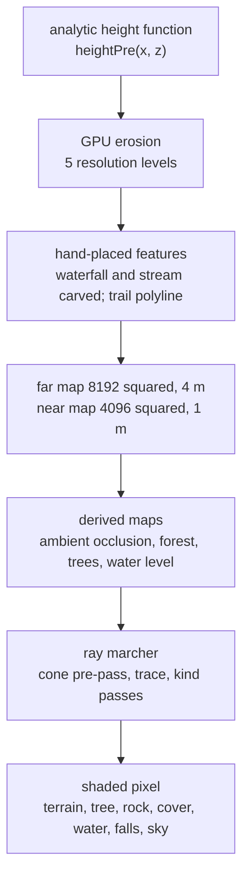
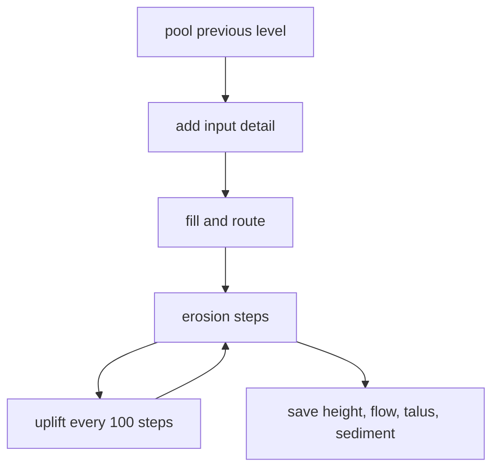

# 02 Core mechanism: terrain, erosion, tracing and shading

This document follows one ray from camera to shaded pixel.

## The chain in one view

The world is built in five stages. Each stage reads the output of the previous stage. A cache is a saved `.npy` array. The renderer reads only the caches and `features.json` at the end. The erosion simulation runs on the graphics processing unit (GPU).



The renderer never evaluates `heightPre` for a visible surface; it samples the baked height maps (`engine/shaders/world.glsl:10-11`). The analytic function runs at bake time only, and its header states that its cost is irrelevant (`engine/shaders/heightfn.glsl:2`).

## The analytic world

`heightPre` is a closed-form function of two coordinates that returns a height in metres. The coordinate frame is `y = 0` at the main lake, `x` east and `z` north (`engine/shaders/heightfn.glsl:3`).

The lake axis is the sum of two sine waves.

```text
# engine/shaders/heightfn.glsl:38-38
float axisX(float z) { return 150.0 * sin(z * 0.00105 + 0.5) + 45.0 * sin(z * 0.0029 + 2.1); }
```

The trough half width is about 440 metres at the lake and grows by 300 metres toward the south (`engine/shaders/heightfn.glsl:125-126`). The north head closes at `HEAD_Z = 1550` metres (`:9`). A hanging valley holds a tarn at 520 metres (`:6-7`).

It applies a low-frequency warp `q = warp(p)` and measures distance from the axis in a stretched metric. The metric multiplies the distance north of `HEAD_Z`, `dzh`, by 1.05; the stretch closes the trough sooner along `z`. The cross-section is a parabola near the floor, with a soft-limited rock term above it (`engine/shaders/heightfn.glsl:119-150`).

The floor and walls carry two ridged multifractal parts. `ridged2d` splits octaves into low massif and high crag parts (`engine/shaders/heightfn.glsl:42-60`). Detail is suppressed in the previous octave's valleys, so the two decays are controlled separately.

Summits are explicit data, not noise. A table holds 19 peaks: centre, summit height, radius, face count, rotation, profile power, drop and east-west stretch (`engine/shaders/heightfn.glsl:393`, `:405-447`). Heights are 1,700 to 3,100 metres, radii 1,000 to 6,500 metres and face counts 3 to 5. Each pyramid drops by its drop value over its radius through the profile power; the stretch scales it east-west (`:385-391`). Noise bends each polygon. A smooth maximum blends massifs with base terrain, so saddles stay near the old crest (`:360-364`).

The tarn appears twice: the height function places its shape at `(-1640, -430)` (`engine/shaders/heightfn.glsl:27`); the bake constant is `(-1680, -420)` (`engine/bake.py:22`). The erosion module uses the height-function point and its comment states that the bake constant lies in the same tarn, checked (`engine/erosion.py:102`). The points are 40 metres apart; the first is the body centre and the second is a label.

## Why the analytic world is not enough

The analytic terrain has no drainage history: its valleys are smooth curves with no alluvial fans, gullies, cirque headwalls or talus at the repose angle. Erosion adds them.

The erosion uses three compute programs: a depression fill, a flow accumulation and erosion step, and a fused hillslope step (`engine/shaders/erosion_fill.comp:1-3`, `engine/shaders/erosion_accum.comp:1-9`, `engine/shaders/erosion_hill.comp:1-17`).

### The five levels

| Level | Grid | Cell | Steps | Job |
|---:|---:|---:|---:|---|
| 1 | 512 squared | 64 metres | 700 | long-range drainage, breached basins, dendritic network |
| 2 | 1,024 squared | 32 metres | 600 | valleys, ridges, cirque heads |
| 3 | 2,048 squared | 16 metres | 800 | side valleys, couloirs, first talus |
| 4 | 4,096 squared | 8 metres | 400 | gullies, debris cones, scree aprons |
| 5 | 8,192 squared | 4 metres | 0 | hillslope only, plus the full flow map |

The parameters are in one table (`engine/erosion.py:119-148`). `pre_Tb` is a critical-slope tangent; `maxEro` and `maxDep` cap one step (`:109`, `:121-122`).

Field names repeat across levels. `Kloose` multiplies loose-material erodibility; `HardK` lowers erodibility as hardness rises; `LakeTrap` is the settled load fraction per lake cell and step. `pre` is the pre-fluvial hillslope pass count; `pre_TbLow` is its lower critical slope. `fill_passes` and `acc_passes` are fill and accumulation pass counts; `fill_inner` and `acc_inner` are their inner Jacobi sweeps (`engine/erosion.py:257-285`). `reinit` is the fresh-fill interval in steps. `uplift_every` is the anchoring interval; `uplift_sigma` is its Gaussian width in metres (`:1342-1352`). `thermal_per_step` is the hillslope calls per fluvial step (`:299-305`). `Creep` is the soil creep fraction; `Debris` is the bedrock-failure share that becomes loose; `T1` is the rockfall onset slope; `R1` its rate; `Cover` the shielding loose depth. `detail_wet` is the input-detail fraction removed where water collects (`:1290-1293`).



```text
# engine/erosion.py:119-123
STAGES = [
    # 64 m: long-range drainage organisation (basins breached, dendritic valley network)
    dict(_COMMON, res=512, pre=100, pre_Tb=_deg(62), pre_TbLow=_deg(54), steps=700, thermal_per_step=1,
         K=1.8e-3, m=0.4, n=1.0, G=1.0, Kloose=4.0, HardK=2.0, p=4.0, eps=1e-4, maxDep=4.0, maxEro=4.0, LakeTrap=0.25,
         fill_passes=1, fill_inner=8, acc_passes=1, acc_inner=8, reinit=300, uplift_every=100, uplift_sigma=1500.0,
```

Level 5 runs 30 hillslope passes and builds the full flow map, with no fluvial loop.

```text
# engine/erosion.py:145-147
    dict(_COMMON, res=8192, pre=20, pre_Tb=_deg(68), pre_TbLow=_deg(58), steps=0, post=30,
         Creep=0.03, Tb=_deg(60), TbLow=_deg(44), seed=4, Debris=0.2, T1=_deg(50), R1=0.03, Cover=1.0,
         flow_fill=48, flow_acc=64, p=4.0, eps=5e-4, detail_wet=0.5),
```

The levels are not independent. Each starts from the previous result, upsampled, plus input detail at the finer scale. The detail is `h0l - up(previous pooled input, 3)`, a high-pass of the analytic input, not noise. It is added to the upsampled eroded surface. It is reduced where specific catchment area is 3,000 to 30,000 metres, because channels must replace the input gullies (`engine/erosion.py:1296-1312`).

### The three kernels

The fill kernel is Planchon-Darboux (`engine/shaders/erosion_fill.comp:1-6`). It computes a water surface `W` that drains to the map border with a minimum slope. A per-cell route cap lowers the routing surface along a narrow breach cut through the basin rim, so the protected lake and tarn drain at their real spill level.

The flow kernel routes water by multiple flow direction (MFD). The weight to a downslope neighbour is `(s_k / s_max)^p / n`; `n` is the local weight sum, not the stream-power exponent. The code forms `pe = mix(1.1, uP, smoothstep(1e4, 1e6, A))`: 1.1 below 10,000 square metres and `uP` above 1,000,000 (`engine/shaders/erosion_accum.comp:1-6`, `:22`, `:61`). Every stage sets `p=4.0` (`engine/erosion.py:121-147`). The comment names 1.1 as the hillslope value (`:22`). The kernel then applies stream power: detachment is `E = K A^m S^n`, deposition is `D = G Qs / A`, from Davy and Lague (`:5-8`). `A` is drainage area, `S` slope and `Qs` sediment flux; the net change is `E - D`. Common values are `m = 0.4` and `n = 1.0` (`engine/erosion.py:122`).

The hillslope kernel applies the net fluvial change and then relaxes the slope with a Scharr gradient. Rock steeper than the critical slope fails and spreads downslope. The comment gives about 38 degrees for forested lower walls. The actual slope is a mix of `TbLow * hardness^HardExpLow` and `Tb * hardness^HardExp`, with per-cell jitter (`engine/shaders/erosion_hill.comp:6-7`, `:88-90`). The stage table sets `TbLow` to 42 to 50 degrees and `pre_TbLow` to 52 to 58 (`engine/erosion.py:121-147`). `HardExpLow` is 0.2 and `HardExp` is 0.6 (`:116`). The source does not reconcile 38 with the table. Loose material above the repose angle slides into talus. Loose layers over 40 metres consolidate into bedrock, so no sediment tower grows without limit (`:117-118`).

The dispatch is banded: one dispatch handles 128 tile rows of 16 cells, or 2,048 cells. The source states this keeps every dispatch far below the 2 second timeout detection and recovery limit (`engine/erosion.py:201`).

```text
# engine/erosion.py:201-201
BAND_TILES = 128  # tile rows per dispatch (2048 cells): every dispatch stays far below the 2 s TDR limit
```

### Protection before erosion

The simulation must not erode the lake, the tarn or the waterfall cliff. `build_protection` runs before the first level (`engine/erosion.py:515`). It flood-fills each body from a seed and level, finds the spill point, and computes a breach path. It tries radii of 250, 500 and 1,000 far-map cells of 4 metres, up to 4 kilometres (`engine/erosion.py:536-548`). The loop keeps the first success; a `RuntimeError` retries the next radius. If all fail, it raises. The source gives no reason for the radii.

The masks have three effects. The erodibility `K` falls to zero on the breach path and stays low near the water. The preserve mask `Pw` blocks lowering in a thin shore band and the corridor. The deposition cap `Rw` stops a bathtub ring at the shore and lets fans build farther out (`engine/erosion.py:575-588`).

The waterfall receives its own protected site. The code finds the shore at `z = -550`, moves inland to the first dry cell, and protects a disc of radius 150 to 250 metres (`engine/erosion.py:590-600`). Inside it, erodibility falls by 80 percent and deposition is capped at 0.5 metres, so the hillside the cliff carve needs survives.

### Anchoring the large scale

Without a constraint, erosion can let the trough and massifs drift. Every 100 steps the code filters the terrain with a 1,500 metre Gaussian and pulls it back to the level's starting surface (`engine/erosion.py:1344-1352`).

It is uplift only. The mask fades at the map border and over protected water. The comment gives the reason: a hardness-weighted uplift would sink low-erodibility valley floors and create closed basins (`engine/erosion.py:1353-1356`).

## The hand-placed features

The erosion cannot know where the film needs a waterfall. `features.place` puts the waterfall, inflow stream and trail from the eroded map. Placement uses the height map, so features survive a terrain change (`engine/features.py:1-5`).

The waterfall is a 29 metre step on the east shore at `z = -550`. Its along-shore half width is 22 metres. The two lips have offsets of -8 and +12 metres. The lip notch is 3.2 metres wide and 1.6 metres deep.

```text
# engine/features.py:14-19
WF_Z = -550.0         # waterfall position along the east shore (steep hillside behind)
WF_HEIGHT = 29.0      # cliff height above the lake
WF_HALF = 22.0        # along-shore half width of the cliff block
NOTCH = (-8.0, 12.0, 3.2, 1.6)  # lip offsets (vA, vB), notch width, notch depth
# keep in sync with falls.glsl (WF_LIPB, WF_DRIFT_A, wfFaceW, wfChuteV, wfChuteHW)
LIPB = 0.50
```

`LIPB = 0.50` is the fraction of the step height where fall B leaves its cleft. The falls shader defines the same value as `WF_LIPB` and uses it as `hs * WF_LIPB` (`engine/shaders/falls.glsl:14`, `:48`). The features comment requires the two files to stay in sync (`engine/features.py:18`).

The stream runs from the north end to the lake, with floodplain half width 9 metres at the lake and 3.4 metres upstream. The bed always falls downstream by at least 0.08 metres per step (`engine/features.py:90-100`). The trail follows the east shore from `z = 300` to `z = 600` at a 2.2 metre width (`engine/features.py:102-108`).

`features.carve` runs the feature shader for the waterfall and stream and writes height, stream level, foam and flow angle (`engine/features.py:246-277`). The far map is carved at 4 metres, then the near map at 1 metre (`engine/bake.py:91`, `engine/bake.py:220`).

### The falling water path

The water sheet must follow the carved rock. `falls_paths` simulates one parcel down each chute on the near map: it slides with friction, leaves a convex edge ballistically and records each landing (`engine/features.py:150-153`).

```text
# engine/features.py:169-178
        pts = []
        imp_acc = 0.0
        for _ in range(60000):
            vy -= 9.81 * dt
            u += vu * dt; y += vy * dt
            v = chute_v(k, u, wf)
            hs = hl(u, v)
            imp = 0.0
            if y < hs + 0.12:
                e = 0.25
```

The time step is 0.004 seconds; 60,000 steps allow 240 seconds. The loop also stops at `y < -0.6`. Gravity is 9.81 metres per second squared, friction 2.5 per second and air drag 1.6 per second. Tangential speed on rock is capped at 5 metres per second; a ballistic segment is not capped (`engine/features.py:34`, `engine/features.py:168-184`). The simulation writes 24 knots per fall, each with local coordinates, half width and impact strength (`engine/features.py:186-205`).

The contact test `y < hs + 0.12` puts the parcel within 12 centimetres of rock. On contact, `e = 0.25` is the finite-difference step for the local slope, not restitution. The code reflects velocity about that slope. The source does not state why the budget much exceeds the 29 metre fall.

The renderer reads the 24 knots from `features.json` and passes them to the falls shader (`engine/render.py:329-350`).

### The near map

The near map is not a second erosion run. A shader upsamples the far map and adds fine detail; then a shore pass and the same feature carve run (`engine/bake.py:208-221`). One large-scale form is shared, so water level, stream bed and cliff foot cannot drift. The falls path uses the near map, so knots match the visible cliff within 1 metre; a far-map path would be up to 2 metres off (`engine/features.py:270-274`).
```text
# engine/bake.py:208-213
def bake_near_from_far(hfar, feat):
    """near map (1 m, +-2 km): upsampled far map + fine detail, features carved; saves the near caches."""
    import features
    far_res = hfar.shape[0]
    near_res = NEAR_RES
    np_ = CACHE / "h_near.npy"
```

The near map adds fine detail and a second 1 metre feature carve (`engine/bake.py:208-221`).

## The world bake order

The bake has a fixed order (`engine/bake.py:46-95`). Analytic far heights are baked first, and erosion replaces them. Lake bathymetry and beaches shape the shore. The raw result is `erosion_height.npy`; the shore-shaped map is `h_eroded.npy` (`:64`, `:83`). Features are placed, granite relief is added, the river pass cuts the main channel, and the features are carved into the far map. The near map is built from it and carved again. Ambient occlusion, forest, water level, noise and trees come last.

The relief pass exists because hillslope erosion planes away vertical rock; it adds ribs, couloirs and cliff bands (`engine/bake.py:88`). The river pass runs after it so the relief cannot dam the river.

## The ray marcher

The renderer casts one primary ray per sample and pixel; it does not rasterise a mesh. The trace finds terrain, water, a tree, rock or cover cell, and returns a hit kind.

### The cone pre-pass

A primary ray can cross many kilometres of empty air, where a full march spends many steps, so the renderer runs a cone pre-pass. One program computes one cone for each 4 by 4 pixel block (`engine/shaders/scene.frag:165-170`).

```text
# engine/shaders/scene.frag:165-173
#if SCENE_PASS == 98
// (perf4) cone pre-pass (render.py, before the primary trace of each tile): one cone per 4 x 4 pixel block, wide
// enough for every primary ray of the block (any jitter, the lens), marched through empty space with the trace's own
// distance bounds (terrain / water x 0.42, the boulder / cover zone <= 4.5 m above the ground counted as surface, the
// trees' and hero blocks' SDFs) until a surface comes within ~2 cone radii; the block's primary rays start there
// (the empty spheres along the cone hold every one of them). Output: that distance.
float coneTrace(vec3 ro, vec3 rd, float th) {
    float t = 0.05, tSafe = 0.05;     // (qa5 fix) last cone position known to be outside
    const float sk = 2.0;      // stop: a surface within sk cone radii
```

The cone starts at 0.05 metres and uses the primary bounds. It stops when a surface is within 2 cone radii. The radius `r` grows with distance and aperture. `D` is the smallest surface distance; the step is `(D - r) / (1 + th)`, where `th` is the tangent of the cone half angle (`engine/shaders/scene.frag:177-201`). The output is one distance per block; primary rays start there. The cone is a conservative cover for empty space, not a hit test; the main trace corrects an early start.

```text
# engine/shaders/scene.frag:218-226
void main() {
    vec3 ro, rd;
    cameraRay(ro, rd);
    float t0 = max(texelFetch(uCone, ivec2(gl_FragCoord.xy) >> 2, 0).r, 0.05);
    // (qa5 fix) the cone bound (terrain dy x 0.42) is not conservative on the steep falls cliff: never start inside the
    // terrain (trace() would bisect [t0, t0] and return the block-constant t0), and start 2 cone radii early so a ray
    // grazing a tree crown is not counted as a hit at its first step (4-px dashes on branch tops)
    t0 = max(t0 * (1.0 - 6.0 * gPixAng), 0.05);
    for (int k = 0; k < 6 && t0 > 0.05; k++) {
```

The correction has three parts: the start is pulled back by 6 pixel angles, tested against the terrain, and moved back by a factor of 0.75 up to six times. The comment states the reason directly: the cone bound `dyT * 0.42` is not conservative on the steep falls cliff (`engine/shaders/scene.frag:220-222`).

### The primary trace

The trace is a sphere-tracing loop with special cases for each surface type (`engine/shaders/scene.frag:51-120`).

```text
# engine/shaders/scene.frag:51-60
Hit trace(vec3 ro, vec3 rd, float tmin, float tmax, bool withWater, bool withTrees, bool withRocks, int maxSteps, float pixScale) {
    Hit h; h.t = tmax; h.kind = K_SKY; h.cell = ivec2(0); h.info = vec4(0.0);
    float t = tmin, tPrev = tmin;
    bool escaped = false;
    for (int i = 0; i < maxSteps; i++) {
        vec3 p = ro + rd * t;
        if (p.y > MAX_TERRAIN_H && rd.y >= 0.0) { escaped = true; break; }
        float det = detailWeight(t);
        float th = terrainHD(p.xz, det);
        float wl = withWater ? waterLevel(p.xz) : -1e4;
```

Quality 1 allows 700 steps. Other quality levels allow 380 (`engine/shaders/scene.frag:231`). The ray ends at 60,000 metres. The far map is 32.768 kilometres wide, so the limit is about 1.8 times the map width. Past the map edge `farUV` mirrors the coordinate, so the ray can still read a far-map height (`engine/shaders/world.glsl:34`).

Two distances control the step. `terrainHD` combines the baked height with the rock relief and adds the sub-metre relief scaled by `detailWeight` (`engine/shaders/world.glsl:259-264`). `detailWeight` is 1 inside 120 metres and falls to 0 at 260 metres, so the march is fine near the camera and smooth far away (`engine/shaders/lighting.glsl:47`). `dyT` is the height above ground or lake bed; `dy` is the height above their higher value, the visible surface. A negative `dy` means the ray crossed the surface. The code bisects the last interval nine times, dividing it by 512, and returns the crossing (`engine/shaders/scene.frag:61-70`). The source gives no reason for nine.

For the terrain, the step is `dyT * 0.42`.

```text
# engine/shaders/scene.frag:74-84
            return h;
        }
        float eps = max(0.002, (t + gTraceT0) * gPixAng * pixScale);
        float d = dyT * 0.42;
        // the lake surface is a plane: step exactly onto it (no creeping along grazing rays)
        if (wl > -1000.0 && wl > th) d = rd.y < -1e-5 ? min(d, (p.y - wl) / -rd.y + 0.01) : d;
        if (withTrees && dyT < 36.0 && t < TREE_MAX_DIST) {
            // (perf4) in tree-free space (trees.glsl treeFreeDist) treesSDF would only return its "no tree near" cap
            float tf = treeFreeDist(p);
            if (tf > TREE_CELL * 0.55 + length(p - uCamPos) * 0.0012) d = min(d, tf);
            else {
```

The factor 0.42 is fixed. It is not a Lipschitz bound from the steepest slope. The source gives no derivation; the exploration treats it as a tuned heuristic.

The lake surface is a plane, so the code steps exactly onto it when the ray looks down, avoiding many small steps along a grazing ray (`engine/shaders/scene.frag:77-79`).

The tree bound runs before the tree signed distance function (SDF). `treeFreeDist` reads the bound map: it caps the step when the bound exceeds it, and inside the bound the code evaluates the full tree SDF. A hit returns the kind `K_TREE` and the cell coordinates (`engine/shaders/scene.frag:80-89`).

The object tests run in this order: trees, ground cover, hero boulders, rocks. Each can return a hit or reduce the step. The source does not state why this order. All four run in the same march step with the same `eps`. A test that finds a surface returns at once. If two surfaces lie within `eps`, the earlier test wins; the code does not choose the nearer. Trees are tested only below 36 metres above ground and within 7,000 metres. Rocks are tested below 4.5 metres and within 380 metres (`engine/shaders/scene.frag:80-110`).

### The hit kinds

A hit carries a distance, a kind, a cell and a four-component info value (`engine/shaders/lighting.glsl:45`). The kinds are fixed numbers.

| Kind | Number | Shading path |
|---|---:|---|
| sky | 0 | atmosphere and clouds |
| terrain | 1 | terrain material |
| tree | 2 | tree material |
| rock | 3 | rock material |
| water | 4 | lake optics |
| cover | 5 | ground cover |
| hero | 6 | placed boulder |
| flora | 7 | shrubs and ferns at the falls |

The primary pass compiles with `SCENE_PASS 99`. It writes distance, kind and cell to one target, and info to a second. It does not shade; each kind then has its own program (`engine/shaders/scene.frag:214-240`).


The kind program reads the G-buffer, discards every pixel of another kind, and shades the rest. The waterfall volume is not a hit kind. `fallsVolume` is applied in every non-sky kind pass after the surface colour (`engine/shaders/scene.frag:276-279`). Kind 7 is vegetation at the falls; `K_FALLSV` names that flora, not the water volume.

## Shading

Each material has its own file and level-of-detail (LOD) path, so the compiler reduces each program to the functions it uses.

### Terrain

`shadeTerrain` computes a normal from the height map with a footprint-scaled offset (`engine/shaders/terrain_shade.glsl:1210-1216`).

```text
# engine/shaders/terrain_shade.glsl:1210-1216
vec3 shadeTerrain(vec3 p, vec3 rd, float t, bool cheap) {
    gFallsMoss = 0.0;
    gRkFine = true;                                            // (world3) all relief octaves for the shading
    float det = detailWeight(t);
    float e = max(0.03, t * gPixAng * 1.2);
    vec3 n = terrainNormal(p.xz, e, det);
    // (world3) joint-block relief at this point: its weight steers the shading, its depth lifts the point
```

`terrainAlbedo` blends the ground types from forest density, rock relief, wetness, snow mask and trail distance (`engine/shaders/terrain_shade.glsl:483`). The shore, stream bed, falls banks and trail each override the base material.

The rock relief is a jointed slab model with lit faces, dark joint lines and cavities. The shading normal keeps finer facets than the march, so walls read as planes at distance (`engine/shaders/terrain_shade.glsl:1218-1245`). The source gives facet sizes of 42, 15, 5.4 and 1.9 metres (`:1221-1239`).

### Trees

A tree is not a mesh. The tree map stores base height, signed height, crown radius and crown base per 4 metre cell (`engine/shaders/world.glsl:19`). A negative height marks a larch; a non-negative height marks a spruce or fir (`engine/shaders/trees.glsl:126`). The shader builds a tiered spire, and branch whorls come from a periodic function (`:897-920`).

```text
# engine/shaders/trees.glsl:897-906
// cheap version for shadow rays: shrunken tiered spire (outer sun-facing sprays stay lit);
// distances are scaled up so that the soft-shadow penumbra stays narrow
float treesSDFShadow(vec3 p) {
    ivec2 c0 = treeCellOf(p.xz);
    float dmin = TREE_CELL * 0.55;
    int z0 = treeZero();
    for (int j = z0 - 1; j <= 1; j++)
    for (int i = z0 - 1; i <= 1; i++) {
        ivec2 c = c0 + ivec2(i, j);
        if (c == gTreeSkip) continue;
```

The shadow path uses a cheaper SDF. The crown envelope is shrunk to 80 percent, and the distances are scaled up. The outer sun-facing sprays therefore stay lit and the penumbra stays narrow (`engine/shaders/trees.glsl:897-925`).

### Rocks

A slot is one candidate rock record in a cell. The main layer has 5 metre cells: six rock slots (0-5) plus two separate outcrop slots (6-7) for blocks within 180 metres. The small layer uses 2.5 metre cells and 20 slots: 0 to 2 hold small stones, and 3 to 19 hold beach cobbles within about 15 metres (`engine/shaders/rocks.glsl:16-34`). The largest has nominal radius 2.05 metres and can reach 1.45 metres beyond its cell. Placement is camera independent; only the small stones shrink with distance (`engine/shaders/rocks.glsl:11-13`).

### Ground cover

Ground cover fills the first 22 metres (`engine/shaders/ground.glsl:36-37`). Fine cells are 0.22 metres and hold grass or a shore tussock; coarse cells are 1.76 metres and hold a shrub or a stone (`engine/shaders/ground.glsl:39-43`). Each primitive stays inside its cell, so a two-dimensional digital differential analyser tests only entered cells (`:15-20`). The cover fades between 9.5 and 20 metres by count. `gcKeep` starts at 1.12 and falls by 0.87 (`:105`); a record is drawn only when its hash is below the value (`:1097-1099`). That removes whole records; it does not shrink each plant. Ground material shows where they stop.

### Water

The lake normal has 22 waves, from 5 metres to 4 centimetres. Dispersion includes gravity and surface tension. Absolute amplitude falls as wavelength falls; relative steepness rises because the mix raises the per-wavelength factor (`engine/shaders/water.glsl:32-45`).

Each wavelength is `lambda = 5.0 * 0.80^i` metres, for `i = 0` to 21 (`engine/shaders/water.glsl:35`). The angular frequency is `sqrt(9.81 k + 7.28e-5 k^3)` (`:37`). The amplitude is `lambda * mix(0.0035, 0.0075, smoothstep(1.5, 0.15, lambda)) * (0.55 + 0.9 hash)` (`:41`); the mix raises relative amplitude as wavelength falls. The source comment calls long waves gentle and short ripples steeper (`:40`). A gust factor scales the slope field (`:74`, `:111-112`).

The absorption and scattering coefficients are explicit vectors. Red absorbs 0.225 per metre, green 0.030 and blue 0.038. The scattering vector is almost neutral (`engine/shaders/water.glsl:13-14`). The comment states that the values suit the camera's broad red, green and blue bands (`:10-12`).

### Waterfalls

The waterfall is a volumetric sheet along the 24 knots. The shader marches each fall inside its own box and accumulates colour and transmittance (`engine/shaders/falls.glsl:603-640`). The march allows 128 steps: fine inside the sheet and coarser in the mist. Sun visibility is sampled on entry and then every four steps (`:608-630`).

```text
# engine/shaders/falls.glsl:1209-1211
#define K_FALLSV 7
#define FF_CELL 3.6
#define FF_JIT 0.2
```

The falls flora uses kind 7: a real 3D SDF of shrubs and ferns, one instance per 3.6 metre cell, anchored on the near height map (`engine/shaders/falls.glsl:1209-1218`).

### Sky and air

The sky is a single-scattering atmosphere with Rayleigh, Mie and ozone terms. The planet radius is 6,360 kilometres and the atmosphere radius is 6,420 kilometres. The model places the lake at 1,800 metres above the planet surface (`engine/shaders/sky.glsl:7`). The source does not state a derivation; the value appears only as the offset in `toPlanet` (`:33`). This datum is separate from the terrain's `y = 0` lake surface (`engine/shaders/heightfn.glsl:3`). The Rayleigh scale height is 8,000 metres and the Mie scale height is 1,200 metres (`engine/shaders/sky.glsl:5-11`).

The shader draws cumulus clouds as a volumetric density field (`engine/shaders/sky.glsl:136-180`) and provides aerial perspective; the kind pass applies it to every surface colour at a 12 kilometre scale (`engine/shaders/scene.frag:280`).

## Aha: the 0.42 step is tuned

**Aha:** The terrain march does not use a conservative step. It uses `d = dyT * 0.42`. A conservative heightfield bound would use the maximum slope and ray direction. The source does not derive 0.42. The cone comment admits the bound "is not conservative on the steep falls cliff" (`engine/shaders/scene.frag:220-222`).

Three mechanisms catch the failure. The trace bisects the last interval when `dy` turns negative. The cone start is tested against the terrain and pulled back up to six times (`engine/shaders/scene.frag:221-228`). Thin objects use their own SDFs (`:80-110`). The remaining failure is a thin ridge crossed in one step; a ray that jumps it can see the surface behind. The factor trades that risk for speed: a 60 kilometre ray must finish in 700 steps or fewer.

## Aha: protection couples the waterfall

**Aha:** The waterfall is a protected input, not a later addition. `build_protection` finds the shore at `z = -550`, protects a 150 to 250 metre disc, cuts erodibility by 80 percent and caps deposition at 0.5 metres (`engine/erosion.py:590-600`). The carve pass then cuts the cliff inside that site.

If the cliff were carved into an eroded hillside, the erosion could lose the steep face or fill its foot with talus. The cliff would then sit on a mismatched slope. Protection keeps a steep, hard, non-depositing patch where the film needs it. The stream uses the same coupling: the mask includes a corridor and a breach path with zero erodibility (`engine/erosion.py:575-585`), and the carve deepens that line. The cost is that protection is data, not a rule. The waterfall z, lake seed and tarn seed are function defaults (`:1240-1243`). A new feature needs a new site and carve.

## What the mechanism does not guarantee

The trace is a heightfield marcher, not a full ray tracer. It has no global illumination and no stochastic transparency. The water reflection casts a second trace ray at 320 or 160 steps and a 25 kilometre limit (`engine/shaders/water_shade.glsl:403`). Clouds are a density field, not a simulation.

Erosion is deterministic only if GPU arithmetic is. The source uses fixed seeds per level (`engine/erosion.py:121-147`). The exploration did not run the kernels, so it cannot state whether two GPUs produce the same map. The cache makes the question moot for a checkout.

The 0.42 step and tree bound are approximations. The tree height value is an upper bound on the top. The clearance value is a lower bound on the distance to a crown, and that is the conservative one. An upper height bound is safe only for a test that rejects points above it. A rock slot is a placement rule, not a surveyed boulder.
