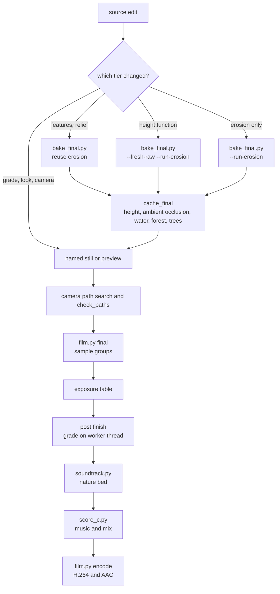
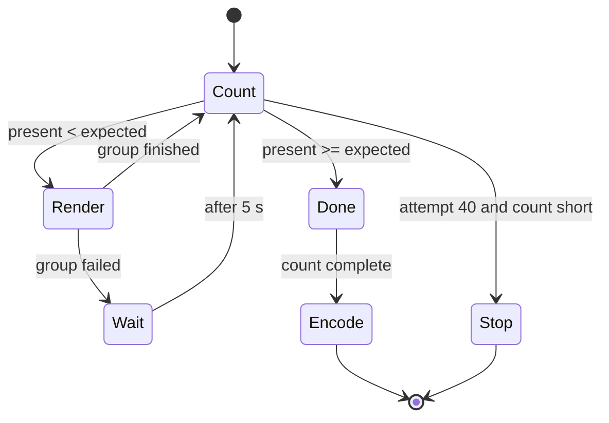

# 03 Workflow and quality: from a source edit to a finished film

This document follows the production loop from a source change to a Moving Picture Experts Group 4 Part 14 (MP4) file and a 24-bit audio file. It states what each stage reads, writes and refuses to recompute, cites the source, and does not judge the image or the sound.

The workflow uses seven Python programs: `tools/bake_final.py`, `still.py`, `film.py` (frames, final render and encode), `tools/render_final.py`, `tools/check_paths.py` (path check), `audio/soundtrack.py` and `audio/score_c.py`. The audio stages read no frame cache.

Abbreviations: graphics processing unit (GPU), central processing unit (CPU), high dynamic range (HDR), portable network graphics (PNG). Also expanded: field of view (FOV), loudness units relative to full scale (LUFS), decibels true peak (dBTP) and integrated graphics processing unit (iGPU).

## The loop in one view



The source edit selects the rebuild tier. A grade change needs no bake; a feature change bakes but keeps erosion. A height change needs the analytic map and erosion; an erosion change needs the second flag.

## Stage 1: bake the world, once per change tier

`tools/bake_final.py` is the entry point for the final world. Its header gives the order: analytic terrain, GPU erosion, features, near map, ambient occlusion, water and forest maps (`tools/bake_final.py:1-5`).

```text
# tools/bake_final.py:20-28
t0 = time.time()
bake.bake_noise3d()                             # tileable 3D noise volume (cached)
if "--fresh-raw" in sys.argv and (FINAL / "h_far_raw.npy").exists():
    (FINAL / "h_far_raw.npy").unlink()          # re-evaluate the analytic heightfn (after heightfn edits)
for f in ("h_far.npy", "h_near.npy", "ao_far.npy", "ao_near.npy", "water_level.npy", "forest.npy", "trees.npy",
          "flow.npy", "talus.npy", "sediment.npy"):
    p = FINAL / f
    if p.exists():
        p.unlink()
```
The list removes the derived maps and keeps `h_far_raw.npy` and `erosion_height.npy`, the expensive inputs. Only `--fresh-raw` removes the first (`tools/bake_final.py:22-25`).

Erosion reads the world cache, then `cache_erosion/v2_*.npy`, and runs only when neither exists or `--run-erosion` is given. The source gives the cost avoided: a relief change can run without the "~6 min erosion" (`engine/bake.py:63`). The raw erosion result is saved as `erosion_height.npy` (`:64`). The map after shore shaping is saved as `h_eroded.npy` before relief and features (`:83`).

The height bake returns early when both final maps exist and `force` is false; it loads them without work. A look change therefore never calls the bake. A still or frame render calls `World()` to load these caches (`engine/render.py:121-124`).

`bake_all` runs heights, ambient occlusion, world maps, then noise (`engine/bake.py:769-774`). `tools/bake_final.py` runs noise first, because that call has its own cache test (`tools/bake_final.py:21`, `engine/bake.py:725-733`), then heights, ambient occlusion and world maps with `force=True` (`tools/bake_final.py:54-56`). The cache directory is `cache_final` unless `ALPINE_CACHE` sets another (`engine/bake.py:15`).

## Stage 2: look development without the film

The first look tool, `still.py`, renders a named camera from `engine/shots.py` at 960 by 540 pixels with 4 samples per pixel and quality 1 (`still.py:18-21`). It saves the HDR frame as a float16 `.npy` file and the graded frame as a PNG (`still.py:34-37`). The HDR file lets a later grade reuse the same radiance.

The named stills cover the main materials (`engine/shots.py:35-88`). The `falls` and `stream` views need feature metadata (`:82-88`).

The second look tool, `tools/worldmap.py`, writes a top-down map with hillshade, water, forest and grid labels for shot planning (`tools/worldmap.py:1-3`). It uses the near map inside 95 percent of its half width, 1,945.6 metres, and the far map outside (`tools/worldmap.py:22-24`).

The third control is quality. The shader uses 700 trace steps and 72 sky samples at quality 1, and 380 and 36 otherwise (`engine/shaders/scene.frag:231`, `:251`). The mode table sets quality 1 for `final`, `stills` and `encode`, and 0 for `preview` (`film.py:45-46`); the driver passes no `--q`, so the final keeps quality 1.

The fourth control is `Renderer.debug`, copied to `uDebug` on every pass (`engine/render.py:428`, `engine/render.py:450`). The waterfall shader uses it to show the water volume, the rock and bank, or the flora separately (`engine/shaders/falls.glsl:207-214`). It is a look-dev switch, not a film setting.

Two tools measure cost. `tools/passprof.py` reports each pass time share at 1376 by 576 with 2 samples (`tools/passprof.py:5-6`, `:26-28`). `tools/memwrap.py` logs private memory and free commit each second (`tools/memwrap.py:1-3`, `:22-25`). Neither measures image quality.

## Stage 3: camera paths built and checked

The shot keys are placed relative to the baked terrain and features. The header states the rule: every ground-level path searches for a variant clear of terrain, trees and hero rocks on every frame, so it stays valid after a re-bake (`engine/shots_film.py:1-4`). `P(x, z, agl)` returns a point `agl` metres (above ground level) over the higher of terrain and water (`:24-25`). `toward` converts azimuth, pitch and distance to a target (`:27-29`), and `shore_south` and `shore_x` walk to the waterline (`:31-40`). A shot follows the actual shore, not a stored coordinate.

The camera path uses a non-uniform cubic Hermite curve. The tangent at an interior key mixes the two adjacent slopes, each weighted by the other segment's duration and divided by the total (`engine/camera_path.py:91-93`).

```text
# engine/camera_path.py:25-50
def _hermite(us, vals, u):
    vals = np.asarray(vals, np.float64)
    n = len(us)
    if n == 1:
        return vals[0]
    k = int(np.clip(np.searchsorted(us, u, side="right") - 1, 0, n - 2))
    u0, u1 = us[k], us[k + 1]
    p0, p1 = vals[k], vals[k + 1]

    def tangent(j):
        if j == 0:
            return (vals[1] - vals[0]) / (us[1] - us[0]) * 0.5
        if j == n - 1:
            return (vals[-1] - vals[-2]) / (us[-1] - us[-2]) * 0.5
        a = (vals[j] - vals[j - 1]) / (us[j] - us[j - 1])
        b = (vals[j + 1] - vals[j]) / (us[j + 1] - us[j])
        return (a * (us[j + 1] - us[j]) + b * (us[j] - us[j - 1])) / (us[j + 1] - us[j - 1])

    m0, m1 = tangent(k), tangent(k + 1)
    h = u1 - u0
    s = (u - u0) / h
    h00 = 2 * s ** 3 - 3 * s ** 2 + 1
    h10 = s ** 3 - 2 * s ** 2 + s
    h01 = -2 * s ** 3 + 3 * s ** 2
    h11 = s ** 3 - s ** 2
    return h00 * p0 + h10 * h * m0 + h01 * p1 + h11 * h * m1
```
The source converts each key target to a unit direction, interpolates the directions and puts the target 1000 metres along the result (`engine/camera_path.py:65-81`). It does not interpolate the target point.

```text
# engine/camera_path.py:65-81
def shot_camera(shot, t):
    keys = shot["keys"]
    us = np.array([k["u"] for k in keys], np.float64)
    u = _ease(t / shot["dur"], shot.get("ease", "soft"))
    u = us[0] + u * (us[-1] - us[0])
    pos = _hermite(us, [k["pos"] for k in keys], u)
    # interpolate the viewing DIRECTION (not the target point): a near target followed by a far one
    # would otherwise make the camera dip toward the ground between the keys
    dirs = []
    for k in keys:
        d = np.subtract(k["target"], k["pos"]).astype(np.float64)
        dirs.append(d / (np.linalg.norm(d) + 1e-9))
    dv = _hermite(us, dirs, u)
    dv = dv / (np.linalg.norm(dv) + 1e-9)
    tgt = np.asarray(pos) + dv * 1000.0
    fov = float(_hermite(us, [k.get("fov", 55.0) for k in keys], u))
    roll = float(_hermite(us, [k.get("roll", 0.0) for k in keys], u))
```
The comment gives the reason: a near then far target would dip the camera toward the ground (`engine/camera_path.py:71-72`). The same curve interpolates FOV, roll, focus distance and aperture (`engine/camera_path.py:82-86`). An easing function shapes the time input: `linear`, `inout` (smootherstep), `soft` (a mix of the two), `in` or `out` (`engine/camera_path.py:9-22`).

The path check samples at 15 frames per second by default. It rejects a path on three conditions: ground clearance below 0.6 metres, tree clearance below 1.0 metre while ground clearance is under 45 metres, or a hero rock intersection.

```text
# engine/shots_film.py:48-64
    def path_ok(shot, min_ground=0.6, min_tree=1.0, fps=15):
        n = int(shot["dur"] * fps)
        worst = 1e9
        for f in range(n + 1):
            c = shot_camera(shot, min(f / fps, shot["dur"] - 1e-3))
            x, y, z = c.pos
            cg = y - ground(x, z)
            if cg < min_ground:
                return False, -1.0
            ct = T.clearance(x, y, z) if cg < 45 else 99.0
            if ct < min_tree:
                return False, -1.0
            for hr in shot.get("heroes", []):
                if np.linalg.norm(np.subtract(c.pos, hr[:3])) < hr[3] * max(hr[4:7]) * 1.05 + 0.3:
                    return False, -1.0
            worst = min(worst, ct)
        return True, worst
```
The tree clearance uses the CPU tree map. `TreeMap` loads `trees.npy` and runs the same `treeFinish()` logic as the tree shader through `treemap_port` (`engine/shots_film.py:329-343`). The crown radius is multiplied by 1.25 to cover branch reach (`:339-341`). In the hero test, `hr[:3]` is the centre, `hr[3]` the base radius and `hr[4:7]` three axis scales.

A framing score counts trunks in a 32 degree cone, sampled five times on a 4 metre grid out to 18 metres (`engine/shots_film.py:66-83`). The forest shot uses it to keep the most trunks in the near view (`:207`). The score is a proxy for parallax, not an image measure.

The search stops at the first valid path without a score function; with one it keeps the best score. It falls back to the nominal path with a warning (`engine/shots_film.py:85-105`). The offset sets differ: the reveal uses a 15 metre line (`:161`); the stream a 30 metre ring (`:232`). The meadow uses a 40 metre ring with 4 metres of tree clearance (`:245`); the peaks use 100 metres of ground clearance (`:273`).

A second validator samples one frame in two at 30 frames per second, or 15 per second, and reports the minimum ground, tree and hero clearance (`tools/check_paths.py:15`, `:23`). It marks a shot bad below 0.6 metres of ground, 0.8 metres of tree, or 0.3 metres of hero clearance (`:34`), and exits 1 on any bad shot (`:38`). It needs the bake and does not render.

The head peak is found again after every bake by scoring height minus 0.35 times distance to the valley head (`engine/shots_film.py:128-138`). A peak camera still points at a summit after a terrain change. The search and check respond to a framing change.

## Stage 4: frames, sampling and the final render

`film.py` has four modes. The table gives default width, height, samples and quality.

```text
# film.py:45-48
defaults = {"preview": (480, 270, 1, 0), "final": (1920, 1080, 12, 1), "stills": (960, 540, 6, 1), "encode": (1920, 1080, 1, 1)}
W, H, SPP, Q = defaults[args.mode]
W = args.w or W; H = args.h or H; SPP = args.spp or SPP; Q = args.q if args.q is not None else Q
FPS = args.fps
```
The mode table gives 12 samples for `final`, but the driver overrides it to 6 or 8 with the sample groups (`film.py:45`, `tools/render_final.py:18-25`). Each group sets its shot count. The driver also sets 2752 by 1152 pixels.

The shutter is half a frame, a 180 degree shutter (`film.py:36`). `frame_samples` maps a frame number to one shot and one camera per sample. The offsets span the shutter and are clamped to the shot duration.

```text
# film.py:68-84
def frame_samples(f, spp):
    """camera/look/time for each sample of frame f (motion blur within the shot)."""
    T = f / FPS
    i = int(np.searchsorted(starts, T, side="right") - 1)
    i = min(max(i, 0), len(SHOTS) - 1)
    shot = SHOTS[i]
    t0 = T - starts[i]
    cams, times = [], []
    shut = args.shutter / FPS
    for s in range(spp):
        off = ((s + 0.5) / spp - 0.5) * shut if spp > 1 else 0.0
        tl = float(np.clip(t0 + off, 0.0, shot["dur"] - 1e-4))
        c = shot_camera(shot, tl)
        c.fov = c.fov * VFOV_SCALE
        cams.append(c)
        times.append(float(starts[i] + tl + shot.get("time_offset", 0.0)))
    return i, shot, cams, times
```
A sample is a camera position and a time inside the shutter. The renderer jitters the sample in the pixel and accumulates it in a float red, green, blue and alpha (RGBA) target. The frame index selects time. No animation is stored.

The final render skips a frame whose PNG exists. Still and preview modes overwrite their output instead.

```text
# film.py:130-139
    def finish_save(hdr, g, f, fn, fade_a):
        # grade + save; in final mode this runs on a worker thread while the GPU renders the next frame
        # (post.finish ~11 s at 2752x1152 - numpy releases the GIL); written to a temp file and renamed so a
        # killed render never leaves a half-written frame that the resume would skip
        img = post.finish(hdr, g, seed=f)
        if fade_a < 1.0:
            img = (img.astype(np.float32) * fade_a + 0.5).astype(np.uint8)
        tmp = fn.with_name(fn.stem + ".tmp.png")
        Image.fromarray(img).save(tmp)
        tmp.replace(fn)
```
The save writes a temporary file and then renames it. The comment gives the reason: a killed render must not leave a frame that the resume would skip (`film.py:131-133`). The rename is atomic on one file system.

In final mode, the grade runs on one worker thread while the GPU renders the next frame (`film.py:137`, `film.py:141`). The loop renders the next frame, then waits for the previous save before starting the next (`film.py:158-161`). This bounds memory to one frame in flight and surfaces an error at the next frame.

The final driver wraps `film.py` in a restart loop. The loop counts completed frames, runs the sample groups, and stops at the expected count.

```text
# tools/render_final.py:43-53
for attempt in range(40):
    done = len(list(outdir.glob("[0-9]" * 5 + ".png")))
    log.write(f"[{time.strftime('%H:%M:%S')}] attempt {attempt}: {done}/{expected()} frames present\n"); log.flush()
    if done >= expected():
        break
    groups = [g.split(":") for g in args.spp_groups.split(";") if g] or [("", str(args.spp))]
    ok = True
    for shots, spp in groups:
        r = subprocess.run([PY, str(ROOT / "film.py"), "final", "--w", str(args.w), "--h", str(args.h),
                            "--spp", spp] + (["--shots", shots] if shots else []) + common, cwd=ROOT, env=env, stdout=log, stderr=log)
        ok = ok and r.returncode == 0
```
The loop has 40 attempts (`tools/render_final.py:43`). The expected count comes from the last shot end in `out/film_shots.json` times the frame rate (`:38-40`). The sample groups give 6 samples per pixel to zero-based shot indices 1, 2, 6 and 7, and 8 to indices 0, 3, 4, 5 and 8 (`:19-21`). The comment gives the reason: 6 and 8 are equal on calm moves, and 8 helps where crowns or rocks move fast (`:19-20`). The driver sets a 30 gigabyte process limit because full-resolution frames peak near 17 gigabytes (`:30`).

A restart re-enters the same loop. A group whose frames are all present does no work; a group with some missing renders each missing frame and skips the present ones. The driver encodes only at the expected count. If the count is short, it logs it and exits without encoding (`:56-60`).

## Stage 5: exposure

The exposure is measured once per shot, on the middle frame at 2 samples. The result is stored in `out/exposures.json` under a key with the shot index, name, resolution, quality, vertical FOV scale and frame rate.

```text
# film.py:99-113
def expo_for(i):
    """per-shot exposure measured once on the shot's middle frame (cached in out/exposures.json, keyed by the
    render settings so a preview never sets the exposure of the final)."""
    table = json.loads(EXPO.read_text()) if EXPO.exists() else {}
    key = f"{i}:{SHOTS[i]['name']}:{W}x{H}:q{Q}:v{VFOV_SCALE:.3f}:fps{FPS}"
    if key in table:
        return table[key]
    f = int((starts[i] + SHOTS[i]["dur"] * 0.5) * FPS)
    _, shot, cams, times = frame_samples(f, 2)
    R.heroes = shot.get("heroes", [])
    hdr, _ = R.render(cams, shot["look"], times)
    e = post.suggest_exposure(hdr, target_luma=shot.get("target_luma", 112.0), g=shot["grade"])
    table[key] = e
    EXPO.write_text(json.dumps(table, indent=1))
    return e
```
The key prevents a preview from setting the final exposure: a 480 by 270 preview and a 2752 by 1152 final write different entries. The key omits the grade and the target luma, so a change to either keeps the entry valid.

`post.suggest_exposure` bisects on the median luma of the finished frame, not the HDR mean. It runs the full `finish()` path at quarter resolution with grain, vignette and bloom off.

```text
# engine/post.py:356-368
def suggest_exposure(hdr, target_luma=112.0, g=None, lo_cap=0.25, hi_cap=2.6, sky_max=158.0, sky_cut=0.8):
    """exposure that puts the median luma of the finished frame near target (bisection); (r2b) capped so the
    clear sky's median stays at or below sky_max (target: zenith ~164, sky median luma ~158), by at most a
    factor sky_cut (forest / finale frames with a bright sky patch keep their exposure)."""
    g = g or Grade()
    small = hdr[::4, ::4]
    L = np.array([0.2126, 0.7152, 0.0722])

    def fin(e):
        gg = Grade(**{**g.__dict__, "exposure": e, "grain": 0.0, "vignette": 0.0, "bloom": 0.0})
        return finish(small, gg)

    lo, hi = 0.1, 10.0
```
The search runs 14 geometric bisections between 0.1 and 10.0 (`engine/post.py:369-376`), clips to 0.25 through 2.6 (`:377`), then checks the sky median. Above 158 code values, it runs 8 more bisections with an upper bound reduced by 0.8 (`:378-389`). The target is a zenith near 164 and a sky median near 158 (`:357-359`).

The target luma varies: forest 88, meadow 122, flyover and finale 100 (`engine/shots_film.py:205`, `:243`, `:267`, `:301`). A later block overrides shots 0, 1, 6, 7 and 8 to 118, 118, 112, 122 and 106 (`:316-319`). The grade applies the product of shot grade exposure and measured exposure (`film.py:156`).

The sky cap can bind: the finale comment says its exposure sits on the cap at 2.08 (`engine/shots_film.py:308-309`). A bright sky then limits land exposure. The function reports no failure and returns the capped value.

## Stage 6: grade

The grade is a data object; its defaults result from documented look rounds. The main values are base compression 0.90, detail boost 1.35, contrast 1.30, saturation 1.12, bloom 0.03, vignette 0.18 and grain 0.005 (`engine/post.py:28-39`). In plain terms, base compression flattens large light and dark masses. Detail boost raises local texture contrast. Contrast expands middle tones about a mid grey pivot. Saturation raises colour strength. Highlight compression holds back the brightest sky and snow (`engine/post.py:188-232`). The black point has level 8 and maximum offset 0.10 (`:62-63`). The detail layer splits into a fine band with gain 1.4 and a structure band with gain 1.0 (`:50`, `:56`).

The comments record the loop. One cites a fit on 10 targets and 9 shots with a loss from 2.52 to 1.99, then two manual changes (`engine/post.py:15-16`). Another cites 1.84 to 1.27 (`:17-21`), and a third 3.38 to 2.42 (`:22-24`). These are the author's records. The exploration did not see the target images.

The fit tool named there, `tools/l2_fit.py`, is not in the checkout. The same is true for `tools/split_probe.py` and `out/s6/rerelief.py` (`engine/post.py:15`, `engine/shaders/scene.frag:136`, `engine/bake.py:82`). The exact procedure cannot be rerun from this tree.

The grade has per-shot variants. The lake vistas use a firmer black point and 6 percent more contrast (`engine/shots_film.py:120-123`). The high views reduce structure gain to 0.85 (`:124-127`). The forest uses lower base compression, more shadow lift, less saturation and less contrast (`:208-210`). The finale uses a lighter base, more shadow lift, saturation 0.92 and chroma boost 0.08 (`:311-312`).

The tone map works on log2 luminance: an edge-aware base, fine and structure bands with separate gains, a Hable filmic curve, OKLab chroma, then vignette and grain (`engine/post.py:174-344`). The grain seed is the frame number (`film.py:134`), so the pattern changes every frame.

## Stage 7: sound

The soundtrack has two stages: `audio/soundtrack.py` builds the nature bed, and `audio/score_c.py` builds the music, mixes the bed and writes the final 24-bit file. Both programs can write `out/audio/soundtrack.wav`, so the last one run sets the file that the encode reads (`audio/soundtrack.py:1857`, `audio/score_c.py:1615`). The score does not read that file. Its bed input defaults to `out/audio/nature/stems/nature.wav`, and its output defaults to `out/audio/soundtrack.wav` (`audio/score_c.py:1614-1615`). The safe order is bed first, then score; the score fails if the bed file is absent. The checkout contains no producer for that exact default path; `soundtrack.py --stems` writes to `<out directory>/stems/` (`audio/soundtrack.py:1873-1877`). `film.py` exports the shot list before frames (`film.py:57-60`), so bed and picture share cut times. The bed has fixed timing and loudness constants.

```text
# audio/soundtrack.py:37-43
SR = 48000
OFF = -120.0          # "layer off" in dB tables
CTRL_HOP = 240        # control-rate step for gain curves (5 ms)
LEAD = 0.45           # J-cut: sound changes this many seconds before the picture
XFADE = 1.2           # ambience crossfade length around each (lead-shifted) cut
TARGET_LUFS = -17.0   # integrated loudness target of the master
CEILING_DBTP = -1.2   # limiter ceiling (true-peak, 4x oversampled check)
```
The sample rate is 48000 hertz, the lead 0.45 seconds, the crossfade 1.2 seconds, and the bed master targets -17 LUFS with a -1.2 dBTP ceiling (`audio/soundtrack.py:37-43`). The lead is a J-cut: the incoming ambience starts before the visual cut, and lead and crossfade are equal-sum (`:15-16`).

The bed is built per environment: the table maps `forest`, `waterfall` and `high_view` to wind, water, bird and event parameters (`audio/soundtrack.py:63-75`). The render writes a full mix and optional stems (`:1859-1873`). The analysis checks the loudest stem per shot (`audio/analysis.py:380-399`), loudness -18 to -16.5 LUFS, and true peak at or below -1.2 dBTP (`:374-376`).

The score is a separate program. Its header states that all sound is synthesised with numpy and scipy. The sounds are strings, horns, choir, piano, timpani, cymbals, a hall impulse response, the nature mix and a -14 LUFS master with a true-peak limiter (`audio/score_c.py:1-10`). The form is two bars of 4/4 per shot, and every cut is a downbeat (`:15`).

The grid maps 8 beats per shot, linearly in time (`audio/score_c.py:71-84`). The header names four nominal tempos: 60, 64, 73.85 and 80 beats per minute (`:15`). No code reads those four values; they are a prose note. The grid sets the exact tempo: each shot holds 8 beats over its own duration, so a cut is a downbeat by construction.

The nature level is relative to the music, from -6 decibels for the waterfall to -15 for the peaks (`audio/score_c.py:1342-1344`). The gain function measures K-weighted loudness of bed and music in the shot interior. It sets the bed to the music level plus the relative value (`:1347-1355`), clipped to -30 through +12 decibels.

The master is an iterative loudness match with a limiter.

```text
# audio/score_c.py:1393-1403
def master(mix, target=-14.0, ceiling=-1.15):
    g = target - AN.integrated_lufs(mix)
    y, gr = mix, 0.0
    for it in range(6):
        y, gr = limiter(mix * dbg(g), ceiling)
        lu = AN.integrated_lufs(y)
        if abs(lu - target) < 0.03:
            break
        g += target - lu
    return y, g, gr

```
The target is -14 LUFS and the ceiling -1.15 decibels true peak. The loop runs at most 6 times and stops within 0.03 LUFS (`audio/score_c.py:1393-1401`). A fade runs from 56.8 to 59.9 seconds, and a second from 59.0 to 59.9 (`:1405-1409`, `:1632`). The picture fade is a separate code path in `film.py`. It starts at 57.8 seconds and ends at 60.0 (`film.py:87-93`). The source does not state that the picture and audio fades are aligned. The output is 24-bit PCM with dither (`:1633`).

The final mix reads the bed, asserts 48000 hertz, pads to 60 seconds, applies nature gain, adds the music, high-passes at 10 hertz and masters (`audio/score_c.py:1626-1634`). The film length is fixed at 60.0 seconds in the score (`:35`).

## Stage 8: encode

The encode uses the concat demuxer. It reads the five-digit frames in sorted order, writes a list with one duration per frame, and passes the list to ffmpeg (`film.py:176-181`). The `-shortest` flag stops the output at the end of the shorter stream (`:183`).

```text
# film.py:186-194
    if args.upscale:
        uw, uh = args.upscale.lower().split("x")
        cmd += ["-vf", f"scale={uw}:{uh}:flags=lanczos"]     # (r5 qa5 B09: no extra unsharp - post already sharpens)
    cmd += ["-c:v", "libx264", "-preset", "slow" if args.mode != "preview" else "fast",
            "-crf", "14" if args.mode != "preview" else "20", "-pix_fmt", "yuv420p",
            "-colorspace", "bt709", "-color_primaries", "bt709", "-color_trc", "bt709",
            "-movflags", "+faststart", str(vid)]
    if frames_list:
        cmd = cmd[:-1] + ["-r", str(FPS), cmd[-1]]
```
The final uses the `slow` preset and constant rate factor (CRF) 14; the preview uses `fast` and 20. Both use `yuv420p`, BT.709 colour, primaries and transfer, and `+faststart` (`film.py:189-192`). The upscale uses Lanczos (`:188`), and audio is Advanced Audio Coding at 320 kilobits per second (`:183`). The rate is the driver value, 24 (`tools/render_final.py:24`, `:35`).

The `film.py` default rate is 30 (`film.py:32`); the driver passes 24. A reader must not take the module default as the final rate; the encode uses `args.fps`.

If `out/audio/soundtrack.wav` is absent, the encode prints a note and writes a video-only MP4 with no audio stream (`film.py:184-185`). The source does not treat that as an error.

## Failure model and resumability

The pipeline treats an interruption as normal. Each stage has a recovery rule.

| Stage | Durable output | Recovery rule |
|---|---|---|
| analytic height | `h_far_raw.npy` | reused unless `--fresh-raw` |
| erosion | `erosion_height.npy` | reused unless `--run-erosion` |
| derived maps | `h_far.npy`, `h_near.npy`, ambient occlusion, water, forest, trees, flow, talus, sediment | deleted and recomputed on every `bake_final` run |
| exposure | `out/exposures.json` | one entry per render key |
| frames | `out/frames/00000.png` and so on | a frame is complete when its final name exists |
| encode | `out/alpine_lake_film.mp4` | no resume; the file is written in one ffmpeg call |

The driver adds a bounded retry: each attempt reruns all groups, at most 40, 5 seconds after a failure (`tools/render_final.py:43-53`, `:55`). A shader compile crash or driver reset does not lose completed frames. A corrupted frame is not detected: the file exists, so the driver skips it. The source has no checksum or size test.



Only frame files survive a restart.

## Aha: the bake has three rebuild tiers, and the delete list is the switch

**Aha:** The workflow has no single force flag; three tiers follow from the delete list. `tools/bake_final.py` always deletes the derived maps, so a default run rebuilds shore shaping, features, relief, the near map, ambient occlusion, water and forest. It keeps `h_far_raw.npy` and `erosion_height.npy`, so that run reuses the analytic map and erosion. `--fresh-raw` removes the first input, and `--run-erosion` the second (`tools/bake_final.py:22-45`).

The reason is cost: erosion is recorded at about 6 minutes (`engine/bake.py:63`); the source gives no cost for the derived maps. A look change needs no bake, a feature change needs the default bake, and a height change needs both flags. The delete list encodes this policy; the flags are exceptions.

The cost is that the policy is implicit. A new cache file must be added to the delete list, or it survives a bake that should invalidate it. The exploration found no dependency graph for the list.

## Aha: the atomic rename is what makes the frame count a completion test

**Aha:** The resume logic is one line: skip a final frame when its PNG exists (`film.py:148-149`). That line is correct only because the save writes `name.tmp.png` and then renames it (`film.py:137-139`). A killed process can leave a temporary file, but not a final name with partial contents, on one file system.

The final render takes about 14 hours on the reference iGPU (`tools/render_final.py:5`), so interruption is expected. Without the rename, the driver would skip the frame being written at the crash, and no later run would repair it. With it, every surviving final name is complete, so a count is a valid stop condition.

The expected count comes from `out/film_shots.json`, not the files (`tools/render_final.py:38-40`). A missing frame cannot hide by lowering the target.

## Aha: camera validation is a second implementation of the tree placement

**Aha:** The path check does not render to see whether the camera hits a tree. It runs a CPU copy of tree placement and finish logic (`engine/shots_film.py:329-343`). `TreeMap` loads the baked rows, calls `treeFinish()` through `treemap_port`, and uses a crown radius of 1.25 times the rendered radius (`:339-341`). The in-search check samples at 15 frames per second and asks for 1 metre of clearance (`:48-64`).

This decouples path safety from the GPU. A search can try many offsets without a render, and the check can run after a bake and before a 14 hour render. The cost is a second implementation that can drift. The source acknowledges the risk with `TREE_JIT = 0.6`, copied from the shader with a "keep in sync" comment (`engine/shots_film.py:326`). If the shader changes and the Python copy does not, the check can pass a path that the renderer clips.

The separate `check_paths.py` is also looser: 0.8 metres of tree clearance against the search's 1.0 (`:48`, `tools/check_paths.py:34`). It is a second opinion, not a duplicate. A path can pass the check and fail the search, but not the reverse.

## What the workflow does not guarantee

The workflow has no automated visual quality test. Target luma, grade constants and per-shot variants are manual. The comments record the rounds, but the target images are not in the tree. A reader can rerun the code and measure the same numbers, but cannot reproduce the judgement.

The checks are scripts: `check_paths.py` for camera clearance and `analysis.py` for loudness and sync. The exploration found no unit tests for the bake, the trace or the grade.

The workflow depends on the platform. The README states that the renderer needs OpenGL 4.3, and macOS offers only 4.1 (`README.md:64`). The bake also uses the GPU, so the exploration cannot state which stages work without the reference driver.

The workflow depends on files outside the checkout. The grade comments name `tools/l2_fit.py`, `tools/split_probe.py` and `out/s6/rerelief.py`, and none exist in the tree. They are evidence of the process, not a runnable record.

The encode has no audio check. A missing soundtrack produces a silent film with a note (`film.py:184-185`), and the driver does not stop. A reader can get a complete MP4 with no sound.

These are workflow limits, not image faults. The exploration describes the source and did not render, bake or play a sample.
