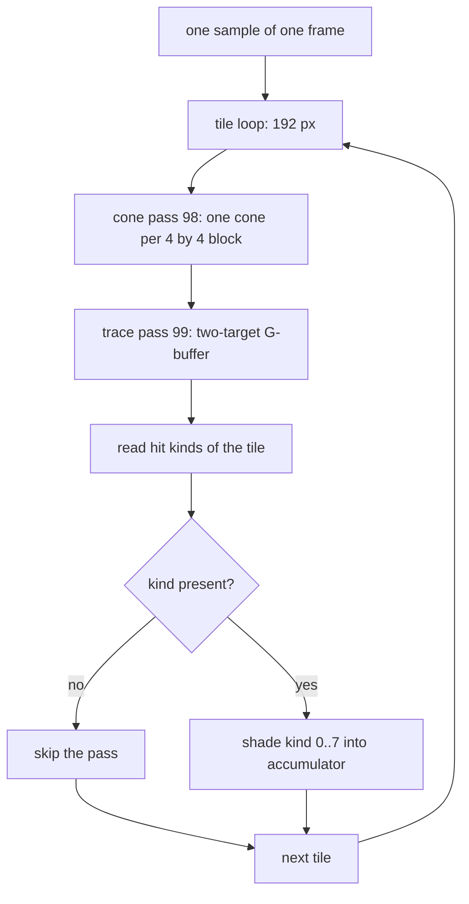
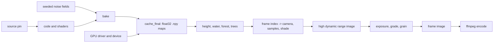

# 04 Limits and comparison: where the design stops

This document states the bounds of `procedural-alpine-lake`; each bound follows from a design decision. It covers the platform, memory guard, split renderer, bounded surfaces, determinism and three siblings. The comparison is at mechanism level and does not rank visual quality.

## The platform bound

The project needs Python 3.11 or newer, a graphics processing unit (GPU) with OpenGL 4.3, and ffmpeg on the path (`README.md:59-61`). It was developed and tested on Windows 11 with an AMD Radeon 780M integrated GPU (`README.md:64`). An integrated GPU shares system random access memory (RAM) with the central processing unit (CPU). The README states that other OpenGL 4.3 drivers on Windows or Linux should work but are untested (`README.md:64`).

```text
# README.md:57-64
## Requirements

- Python 3.11 or newer
- A GPU with OpenGL 4.3
- ffmpeg on `PATH`
- Plenty of RAM. On the AMD driver full-resolution final frames peak at about 17 GB of commit (`tools/render_final.py` raises the watchdog limit to 30 GB), and a render process that cold-compiles all shader passes peaks at about 6 GB. The scene shader is split into those passes because, compiled as a single program, it committed 45 to 50 GB.

Developed and tested on Windows 11 with an AMD Radeon 780M. Other OpenGL 4.3 drivers (Windows or Linux) should work but are untested. macOS only offers OpenGL 4.1 and cannot run it.
```
The erosion step uses moderngl compute shaders in `engine/shaders/erosion_*.comp` (`engine/erosion.py:3-4`), general GPU programs, not pixel programs. The stated floor is OpenGL 4.3. macOS offers 4.1 only and cannot run the project (`README.md:64`); the exploration could not run it for this reason.

The performance values are author records. Commit memory is virtual memory the operating system promises, including memory not yet in physical RAM. The README states about 14 hours for the film, 17 gigabytes for a full-resolution final frame, and 6 gigabytes for a process that cold-compiles passes one at a time. It also states 45 to 50 gigabytes for the scene as one program (`README.md:9`, `:62`). The exploration repeated none of these measurements and started neither `tools/passprof.py` nor `tools/memwrap.py`. The source gives no benchmark table or variance estimate.

The source refers to `tools/memprobe.py` (`engine/gpuslot.py:10`). That file is absent from the checkout. The measurement script is not in the tree.

## Memory is the first design constraint

The guard exists because several look-dev agents rendered in parallel on one integrated GPU until the machine ran out of commit memory and the session died (`engine/gpuslot.py:1-6`). They are separate render processes with their own GPU contexts. The quoted text uses iGPU for integrated graphics processing unit.

```text
# engine/gpuslot.py:1-17
"""Machine-wide guard for GPU render / bake processes of this project.

Several look-dev agents render in parallel on one iGPU that shares system RAM. Overnight the
machine ran out of commit memory (Windows "virtual memory insufficient", python.exe the largest
consumer) and the session died. Every process that opens a GPU context now:
  1. takes one of ALPINE_MAX_GPU (default 3; split renderer processes peak at ~5.6 GB) slots - lock files in <repo>/cache/slots,
     stale locks of dead processes are reclaimed;
  2. waits while the free commit memory is below ALPINE_MIN_COMMIT_GB (default 6 GB).
  3. (compile_guard) a FRESH compile of the big scene shader makes the AMD driver peak at ~30 GB of
     commit for ~1-3 min (measured with tools/memprobe.py; cached compiles cost nothing). Sources the
     driver has not compiled before are therefore compiled one at a time machine-wide, and only when
     enough commit memory is free (ALPINE_COMPILE_GB, default 50 GB; a fresh compile of the full scene peaks at 45-50 GB, often at the first draw).
  4. a watchdog thread stops a slot-holding process (exit code 3, message on stderr) whose own commit
     grows past ALPINE_MAX_PROC_GB (default 16 GB) outside of a shader compile, or past 6 GB while the
     machine has < 2.5 GB commit left (a long-lived render server that leaked GPU objects reached 35 GB
     and left the machine with 3 GB). Restarting the process frees everything.
Set ALPINE_NO_SLOT=1 to bypass (single interactive use)."""
```
The guard has four parts: three slots by default, a 6 gigabyte commit floor and a 50 gigabyte compile floor. It also has a watchdog at 16 gigabytes, or 6 gigabytes under 2.5 gigabytes free (`engine/gpuslot.py:6`, `:8`, `:12`, `:13-16`).

```text
# engine/gpuslot.py:82-94
def _watchdog():
    lim = float(os.environ.get("ALPINE_MAX_PROC_GB", "16"))
    while True:
        time.sleep(5)
        if _compiling[0]:
            continue
        mine = proc_gb()
        if mine > lim or (mine > 6.0 and free_commit_gb() < 2.5):
            print(f"[gpuslot] WATCHDOG: this process uses {mine:.1f} GB (limit {lim:.0f} GB, machine free commit "
                  f"{free_commit_gb():.1f} GB) - exiting to protect the machine. Restart it (memory is freed on exit); "
                  f"long-lived processes that rebuild Renderers/shaders leak GPU memory.", file=sys.stderr, flush=True)
            _release()
            os._exit(3)
```
Four figures describe different compiles (`README.md:62`, `engine/gpuslot.py:9-12`, `:212`, `engine/render.py:285`).

| Operation or pass type | Reported compile peak |
|---|---|
| Unsplit scene source, one program | 45 to 50 gigabytes |
| Fresh compile in the guard log | about 30 gigabytes |
| One split scene pass | under 1 gigabyte |
| Process that compiles reduced passes one at a time | about 6 gigabytes |

The guard reserves 50 for the unsplit fallback; the source does not reconcile 30 with 45 to 50. The final driver raises its watchdog to 30 because a full-resolution frame peaks near 17 (`tools/render_final.py:30`, `README.md:62`); the source does not explain that gap.

The guard is Windows-specific. `free_commit_gb()` reads `kernel32.GlobalMemoryStatusEx` and returns one billion on any exception (`engine/gpuslot.py:39-45`). `_alive()` returns true on any exception (`:48-59`). `proc_gb()` returns zero on any exception (`:70-79`). On a Linux machine the slot files still limit concurrency, but the memory floor and the watchdog do nothing. The source lists Linux as expected to work but untested (`README.md:64`).

The fixed texture set explains part of the memory cost, but not the largest part. An 8192 by 8192 float32 channel is 256 mebibytes; a 4096 by 4096 float32 channel is 64 mebibytes. The far and near height and water level maps are single-channel float32 (`engine/bake.py:19-21`, `:640`, `:686`). The far forest map is four-channel uint8 (`:713-714`). The tree texture is 4096 by 4096 with four channels (`engine/render.py:172`), and the two shadow maps are 4096 by 4096 with four channels each (`:190-196`). The 128 cubed red, green, blue, alpha (RGBA) noise volume is 8 mebibytes (`engine/bake.py:730`, `:763-764`). The accumulator and the two geometry buffer (G-buffer) targets at 2752 by 1152 cost about 51 megabytes each.

The exploration estimates about 1.8 gibibytes of map and target memory for a final frame, in binary units; the megabyte figure above is decimal. The source states no total. The 5.6 gigabytes per split process (`engine/gpuslot.py:6`) and the 17 gigabyte final peak (`README.md:62`) exceed the maps. The rest is driver state and compiled programs, which the source does not break down.

## The split-shader trade-off

The renderer compiles the scene source into ten programs: a cone pre-pass, a primary trace and eight kind programs (`engine/render.py:286-289`).

```text
# engine/render.py:279-289
    def __init__(self, width, height, quality=1, world=None, tile=192):
        self.w, self.h = width, height
        self.world = world or World()
        self.tile = tile
        t0 = time.time()
        # split renderer (scene.frag): the primary trace writes a G-buffer, then one program per hit kind
        # shades its pixels into the accumulator (one program cost ~45-50 GB / 13-36 min to compile)
        self.trace = gl.Pass("scene.frag", {"QUALITY": quality, "SCENE_PASS": 99}, compile_gb=6, targets=2)
        self.kpass = [gl.Pass("scene.frag", {"QUALITY": quality, "SCENE_PASS": k}, compile_gb=6) for k in SCENE_KINDS]
        # (perf4) cone pre-pass (scene.frag SCENE_PASS 98): per 4 x 4 pixel block the distance the primary rays start at
        self.cone = gl.Pass("scene.frag", {"QUALITY": quality, "SCENE_PASS": 98}, compile_gb=6)
```
The split answers a measured compiler failure. As one program, the scene cost 45 to 50 gigabytes and 13 to 36 minutes per fresh compile. Each part alone compiles in 1 to 210 seconds under 1 gigabyte (`engine/shaders/scene.frag:133-136`). The split removes a compiler limit, not a visual feature.

The trace writes a two-target G-buffer. Each kind program reads the G-buffer, shades the pixels of its kind and discards the others (`engine/shaders/scene.frag:137-140`). The accumulator adds every contribution with `ONE, ONE` blending (`engine/render.py:453`). A pixel therefore gets exactly one contribution per sample.

The first cost is a readback per tile. The renderer reads the hit-kind channel of the G-buffer to learn which kinds are present.

```text
# engine/render.py:480-491
                    # (perf4) the hit kinds present in this tile (G-buffer readback = the tile's one sync point): a kind
                    # pass with no pixel here is skipped (it would only discard every pixel), the others are queued
                    # back to back without a c.finish() each (under GPU sharing every finish waited for other
                    # processes' work: ~7 % of the frame per empty pass)
                    kb = np.frombuffer(self.gfbo.read(viewport=rect, components=2, attachment=0, dtype="f4"), np.float32)[1::2]
                    kin = np.bincount(np.clip(kb.astype(np.int32), 0, 15), minlength=16)
                    if prof is not None:
                        prof["trace"] = prof.get("trace", 0.0) + time.time() - tp
                    c.enable(moderngl.BLEND)
                    for k, p in zip(SCENE_KINDS, self.kpass):
                        if kin[k] == 0:
                            continue
```
The source comment names the readback as the tile's one sync point (`engine/render.py:480`); the CPU waits for that tile's trace before queueing kind passes. A 2752 by 1152 frame with 192 pixel tiles has 15 columns and 6 rows, so 90 readbacks occur per sample. The exploration derived the counts from the tile and frame sizes (`:279`, `tools/render_final.py:22-23`).

The readback buys a large saving. A kind pass with no pixel in the tile would discard every pixel, so the skip avoids it. The source states that an empty pass cost about 7 percent of a frame under GPU sharing, because every `finish()` waited for other processes (`engine/render.py:482-483`).

The second cost is source duplication. Ten programs could compile ten copies of the whole scene. `glstrip.py` reduces each pass to the code that its `main()` can reach.

```text
# engine/glstrip.py:1-10
"""Per-pass shader source reduction for the split renderer (scene.frag is compiled 9 times).

reduce(src) resolves the #if / #ifdef / #ifndef / #elif / #else / #endif blocks for the defines in the
source itself, then drops every function definition that main() cannot reach. Each pass's source - and so
the driver's compile-cache key - then holds only the code that pass runs: an edit to the grass code no
longer recompiles the sky or the tree-shading pass, and the compiler parses less. Anything it cannot
parse raises ValueError; gl.Pass then compiles the full source instead (and also retries with the full
source if a reduced one fails to compile).
    python engine/glstrip.py            -> sizes of the 9 scene passes, full vs reduced
"""
```
The reduction serves the driver compile cache: an edit to grass code no longer changes the sky pass cache key (`engine/glstrip.py:4-6`). A parse failure falls back to full source, and a failed reduced compile retries it (`:7-8`). The pass stays correct when the reducer cannot handle it.

The report counts nine passes, the trace and eight kinds (`engine/glstrip.py:165`); the renderer also compiles the cone (`engine/render.py:288-289`). The cone still goes through `glstrip.reduce` in `gl.Pass`; only the report omits it (`engine/gl.py:53-57`). Ten scene programs exist.

The third cost is a fixed kind set. The kinds are the integers 0 to 7: sky, terrain, tree, rock, water, cover, hero and falls flora (`engine/render.py:272-274`, `engine/shaders/falls.glsl:1209`). Sky is a kind with its own program, not a default in the primary pass. A new surface kind needs a new enum value, a new shading program and a new strip result. The design has no run-time kind registry.

The fourth cost is a correctness hazard in the cone bound.

```text
# engine/shaders/scene.frag:222-230
    // (qa5 fix) the cone bound (terrain dy x 0.42) is not conservative on the steep falls cliff: never start inside the
    // terrain (trace() would bisect [t0, t0] and return the block-constant t0), and start 2 cone radii early so a ray
    // grazing a tree crown is not counted as a hit at its first step (4-px dashes on branch tops)
    t0 = max(t0 * (1.0 - 6.0 * gPixAng), 0.05);
    for (int k = 0; k < 6 && t0 > 0.05; k++) {
        vec3 q0 = ro + rd * t0;
        if (q0.y > terrainHD(q0.xz, detailWeight(t0))) break;
        t0 = k == 5 ? 0.05 : max(t0 * 0.75, 0.05);
    }
```
The cone pre-pass multiplies terrain clearance by 0.42 (`engine/shaders/scene.frag:181`). The factor is an assumed slope bound, not a conservative Lipschitz bound; the comment states that it fails on the steep waterfall cliff (`:222`). A primary ray that starts inside terrain can make the trace bisect a zero-length interval and return the block's shared start distance as a hit. The fix backs the start up by 0.75 up to six times and never starts below 0.05 metres (`:226-230`). The patch costs at most six height samples per pixel.



The split changes production. A split render process peaks at about 5.6 gigabytes (`engine/gpuslot.py:6`), so three fit only with the slot guard and memory floor. A slot holds any project GPU process, including a bake or final render; the final raises only its per-process limit to 30 (`tools/render_final.py:30`). The guard is part of the operating envelope, not an optional utility.

## Bounded surfaces

The world is a set of approximations with explicit distances; a few constants set most of the boundary.

```text
# engine/shaders/lighting.glsl:33-47
#define MAX_TERRAIN_H 4200.0
#define TREE_MAX_DIST 7000.0
#define ROCK_MAX_DIST 380.0

float gPixAng;   // radians per pixel
float gRand;     // per-pixel-per-sample random
uniform int uDebug;
bool gPrimary = true;
vec3 gShadeP = vec3(1e9);  // (r2d) point being shaded: set by terrainShadow / cloudShadow, which every shading path
                           // calls before skyLight (default: far away = the unscaled sky light)
float gTraceT0 = 0.0;    // distance already travelled before a secondary ray (footprint-based step size)   // false while tracing secondary (reflection / refraction) rays

struct Hit { float t; int kind; ivec2 cell; vec4 info; };

float detailWeight(float t) { return 1.0 - smoothstep(120.0, 260.0, t); }
```
The terrain height ceiling is 4200 metres (`engine/shaders/lighting.glsl:33`). A primary ray stops when it is above that height and points upward (`engine/shaders/scene.frag:176`). The baked shadow march also stops at that height (`engine/shaders/bake_shadow.frag:28`). A surface above 4200 metres would be outside the trace.

Trees are traced to 7000 metres (`engine/shaders/lighting.glsl:34`). Rocks are traced to 380 metres (`:35`). The rock code fades blocks before the limit instead of removing them at it (`engine/shaders/rocks.glsl:288-289`). Ground cover is counted as a surface only within 1.25 metres of the ground and 22 metres of the camera (`engine/shaders/ground.glsl:36-37`). Beyond 260 metres, the sub-metre relief weight is zero (`engine/shaders/lighting.glsl:47`). These limits are explicit.

The tree acceleration texture is a bound, not a height.

```text
# engine/render.py:233-238
def tree_tops(a, blk=4, cell=4.0, reach=12.0):   # (r4 merge: trees4 skirt x1.15 + treeLowWiden x1.2 -> treeReach up to ~11.6 m)
    """(perf4) tree-free space per block of blk x blk tree cells (uTrees texel layout: [row = z cell, col = x cell],
    (baseY, signed H, crown R, crown base)): R = max over the block and its 8 neighbours of the highest possible
    point of any tree (trees.glsl treeFinish: H <= min(1.6 |H0|, 34), a broken top's snag <= 2.4 m above it; -1e4 = none),
    G = horizontal clearance (m) from any point of the block to the crowns (reach <= 12 m, treeReach) of the trees
    outside those 3 x 3 blocks (>= 7.4 m)."""
```
The red channel is the highest possible point of any tree in a block and its eight neighbours. The height rule is `min(1.6 |H|, 34)` plus 2.4 metres for a broken top's snag (`engine/render.py:236`). The green channel is a horizontal clearance of at least 7.4 metres (`:237-238`). The renderer can skip the tree march when the bound says the space is free. The bound cannot answer whether a camera clears a specific crown, because it is not the crown surface. The camera validator instead reads the baked tree rows and crowns for that question (`engine/shots_film.py:329-343`).

The surface primitives are signed distance functions (SDFs). It returns a lower bound on distance to a shape. The tree bound has two parts: an upper bound on the tree top and a lower bound on crown clearance. The lower bound is the conservative one for sphere tracing (`engine/shaders/trees.glsl:91`). A rock bound is a lower bound (`engine/shaders/rocks.glsl:116`). Sphere tracing needs only a lower bound for safety. The rendered surface is the zero set of the function, not a triangle mesh; the checkout has no mesh file for a tree or a rock.

The baked shadow map is a height-field map: it reads the far and near height maps, not the tree or rock maps (`engine/shaders/bake_shadow.frag:4-15`). Terrain casts the baked shadow. Tree crowns cast a procedural shadow by an 18-step march through the tree SDF, with a noise-perturbed crown edge (`engine/shaders/lighting.glsl:71-95`). Within 260 metres, the shader marches the height field toward the sun instead of reading the map (`:52-59`). The source says the 1 metre map shows stair steps on steep ground close to the camera.

The atmosphere is single scattering. The sky function returns a sum of Rayleigh and Mie single-scatter terms (`engine/shaders/sky.glsl:92`). Aerial perspective reuses that calibration with a gain and a mid-distance lift (`:95-103`). The source does not contain a multiple-scattering pass. The exploration did not compare it with a measured sky.

Water has two secondary rays. A reflection ray and a refraction ray call the same trace function (`engine/shaders/water_shade.glsl:403`, `:449`). The reflection is smeared by unresolved wave slopes. `sv` is the slope variance of the waves that the pixel footprint filters out, projected on the view direction (`engine/shaders/water.glsl:67-68`, `:89-91`). The shader turns that variance into a normal tilt of `sqrt(sv) * uTune[6] * g` (`engine/shaders/water_shade.glsl:326`, `:367`). The vertical smear width grows with the slope spread and the `uTune[6]` multiplier. `uTune[7]` sets the share carried by the resolved ripple pattern (`:318-323`). This is a variance blur, not a roughness convolution over samples. The pass list has no path-traced global-illumination stage (`engine/render.py:286-289`). Light transport is direct sun, analytic sky ambient, baked terrain shadow, procedural tree and cloud shadows, and those two secondary rays.

The source also refers to three files that the checkout does not contain: `tools/l2_fit.py`, `tools/split_probe.py` and `out/s6/rerelief.py` (`engine/post.py:15`, `engine/bake.py:82`, `engine/shaders/scene.frag:136`). The last file is named in a comment as a fast relief re-run. The exploration could not inspect the tools behind those measurements.

## Deterministic and non-deterministic parts

The film path is deterministic in its code. Every random-looking value is a hash or a seeded stream. The world caches are the exception, because they hold float results.

The frame index selects the time. The shot table gives the camera, look and grade. The sample pattern is the Halton sequence in bases 2 and 3, indexed by the sample number (`engine/render.py:457`). The exploration found no unseeded random call in the film path. It searched `film.py`, `engine/camera_path.py`, `engine/shots_film.py`, `engine/post.py`, `audio/soundtrack.py` and `audio/score_c.py`. In the audio path, every `default_rng` call takes a fixed seed or a seed derived from a fixed seed and a name (`audio/score_c.py:44-45`, `audio/soundtrack.py:220-221`). The post grain uses the frame index as its seed (`film.py:134`, `engine/post.py:339`). The shader noise value is a hash of the pixel coordinate, the sample number and a frame term (`engine/shaders/scene.frag:150`).

```text
# engine/render.py:455-460
        for s in range(n):
            cam = cams[s]
            jx, jy = (halton(s + 1, 2) - 0.5, halton(s + 1, 3) - 0.5) if n > 1 else (0.0, 0.0)
            for p in progs:
                self._look_uniforms(p, look, times[s])
                p.set("uJitter", (jx, jy))
```
The frame term is `floor(uTime * 24.0 + 0.5)` (`engine/shaders/scene.frag:149`). It seeds the hash that drives the sub-pixel jitter and the per-sample noise (`:150-151`). It assumes 24 frames per second. The final driver uses 24 (`tools/render_final.py:24`). The `film.py` default is 30 (`film.py:32`). At the default rate the term advances by 0.8 per frame. Some consecutive frames then keep the same term, so the noise field does not change on every frame. The term is not a clock for the simulation; the camera and effects read `uTime` directly. The source does not state that the default is unsupported. The final path avoids the mismatch.

The three-dimensional noise volume is seeded. The 128 cubed RGBA volume is built from seeded value noise and seeded Worley noise (`engine/bake.py:725-762`). The peak fan radii use a seeded generator (`engine/bake.py:381`). The rock hardness field uses seed 11 and the joint field uses seed 18 (`engine/erosion.py:672`, `:697`). The two cache directories, `cache_final` and `cache_erosion`, have fixed names and no version field (`engine/bake.py:15`, `engine/erosion.py:89`).

```text
# engine/bake.py:725-732
def bake_noise3d(force=False):
    fp = CACHE / "noise3d.npy"
    if fp.exists() and not force:
        return np.load(fp)
    print("baking 3D noise ...", flush=True)
    N = 128
    rng = np.random.default_rng(5)

```
The height maps are cached, not recomputed. If the two files exist, `bake_heights` returns them without a run (`engine/bake.py:46-50`).

```text
# engine/bake.py:46-50
def bake_heights(far_res=FAR_RES, near_res=NEAR_RES, force=False, erode=None):
    """far map: analytic (+ optional erosion); near map: upsampled far map + fine detail."""
    fp, np_ = CACHE / "h_far.npy", CACHE / "h_near.npy"
    if fp.exists() and np_.exists() and not force:
        return np.load(fp), np.load(np_)
```
The eroded surface is a GPU compute result, stored as float32 in `erosion_height.npy` and `h_eroded.npy`, the raw and shore-shaped maps (`engine/bake.py:64`, `:83`). The source gives the cost as about 6 minutes for erosion (`:82`); the layout avoids it on every later bake.

This is the narrow determinism claim: the same checkout, cache and driver should give the same frames. The source does not claim bit-identical results across GPUs or drivers, nor show that a float32 compute pass gives the same bits on another compiler or device. If a developer deletes the cache and re-runs erosion elsewhere, the height map is not guaranteed to match. The cache is the practical source of truth, not the code alone.

**Aha:** The cache, not the seed, is what makes the film repeatable. The seeds are fixed, but the eroded height is a floating-point result from a GPU simulation. A fresh erosion on a different driver is not shown to give the same bits, and every later stage reads that result. `tools/bake_final.py` deletes a fixed cache list before a bake (`:24-28`). A file outside that list survives, and no hash or version stamp says that the maps belong together. The project is deterministic because one working tree reuses one cache, not because the code can rebuild the same world on any machine.

The absence of a cache stamp is a real failure mode. A height map can be newer than the water level map, or older than the forest map. The source has no check for this. The guard is the delete list in `tools/bake_final.py`, and a developer must keep it complete.



The GPU driver writes the cache, and the cache fixes the world. A reader who wants a portable rebuild must build the cache once and treat it as an input, not a derived file.

The soundtrack has the same shape. The nature bed uses seed 7 by default (`audio/soundtrack.py:1858`). The score uses seed 3 by default (`audio/score_c.py:1617`). The dither is seeded (`audio/soundtrack.py:1729`). The limiter acts on the whole mix, so its gain depends on every stem. The exploration did not run the mix and did not measure loudness.

## Comparison with three siblings

All four packages make images from code but differ in target, world model and frame construction. The table compares mechanisms, not quality.

| Package | Target | World source | Frame construction | Main bound |
|---|---|---|---|---|
| `procedural-alpine-lake` | Offline film, 60 seconds, 24 frames per second final | Analytic height, GPU erosion, hand-carved features, baked maps | Ray march of height-field terrain, SDF trees and rocks, then kind shading | Driver memory, OpenGL 4.3, distance cut-offs |
| `feed-backrooms` | Browser game, real-time, plus a recorded trailer | One seed, macro graph, walls and 144 light panels | Rasterised three.js scene with a baked light grid | One 98 metre building, browser, split determinism |
| `shanshui` | Browser film, 60 seconds, 60 frames per second target | Ten authored paintings of procedural cards | Flat cards at depth, card-stack camera, 10 transition programs | Card depth, no true three-dimensional orbit |
| `unsung-vale` | Browser third-person role-playing game | Analytic height, Node world builder, 16-bit maps | Rasterised meshes and terrain | Height field, browser, stale bake without a stamp |

`feed-backrooms` shares one bake across two consumers. The baked light value sets the visual light and how far a person can see the monster (`../feed-backrooms/markdown/README.md:9-10`). The level is one 98 metre square with 49 cells each side of 2 metres (`:204`). It has 144 ceiling panels over a 12 by 12 macro graph, one per macro cell (`:213`). The light grid is one texture for the look and for the gameplay rule (`:262`). Alpine shares its bake similarly: the height and tree maps feed the pixels and the camera path check. The difference is the second consumer. In `feed-backrooms` it is a visibility test inside the game; in alpine it is an offline safety check on a camera move. Both remove one class of drift and create one coupling: a bake must satisfy two rules.

`feed-backrooms` also splits determinism. The seed controls the building and the people. Direct `Math.random` calls control the sound choice, the blood and the flicker interval (`../feed-backrooms/markdown/04-limits-and-comparison.md:327`). Alpine has no such split in its film path. Its random values are hashes or seeded streams. The price is no cheap variation. A different take needs a code change, not a fresh random call.

`shanshui` is the closest sibling in output. It is a 60 second code-only film with synthesized sound. Its frame is a stack of flat cards at depth values from 1 to 1e5 (`../shanshui/markdown/README.md:25`). A two-and-a-half-dimensional (2.5D) camera pans, dollies and zooms the cards, so near cards move more than far cards (`../shanshui/markdown/README.md:25`). The cards stay flat (`../shanshui/markdown/README.md:112`), so a large orbit would show them as flat planes. Alpine builds a three-dimensional field and marches a ray through it. The alpine camera can move through the valley because depth is computed per pixel; the shanshui camera stays in front of the stack. Shanshui targets 60 frames per second in a browser (`../shanshui/markdown/README.md:25`). Alpine renders offline at 24 (`tools/render_final.py:24`). Shanshui's bound is the card; alpine's bound is driver memory and the distance cut-off.

`unsung-vale` shares the one-source rule. One analytic height function defines the ground; a Node builder evaluates it and writes the height maps. The terrain mesh, collision floor, map image and note placement all read the result (`../unsung-vale/markdown/README.md:15`). The playable core is 2048 metres with one sample per metre, and the region is 16,384 metres with one sample per eight metres (`:38`). Alpine uses the same pattern at a different scale. Its far map is 32 kilometres across with 4 metre cells, and its near map is 4 kilometres across with 1 metre cells (`engine/bake.py:18-21`). Both risk a stale bake. `unsung-vale` has no version stamp or hash for its maps (`../unsung-vale/markdown/README.md:15`); alpine has no stamp either. The difference is the consumer: `unsung-vale` must keep a collision surface aligned with a visible surface, and alpine must keep a camera path clear of trees.

**Aha:** The split shader and the memory guard are one design, not two. A single scene program commits 45 to 50 gigabytes and takes 13 to 36 minutes per fresh compile. The split makes ten small programs and lowers each process to about 5.6 gigabytes, which makes parallel look-dev possible on one integrated GPU. Parallel processes then exhaust shared RAM, so the slot guard, commit floor and watchdog become necessary. `glstrip.py` keeps each of the nine reduced variants small, so the split does not repay the compile cost ten times. A reader who treats the guard as tooling misses the chain: the renderer's shape creates the need, and the guard makes production possible.

The four packages differ on three contrasts. `feed-backrooms` and `unsung-vale` are interactive browser programs with a recorder or a film path; `shanshui` and alpine are fixed-duration films. `shanshui` composites cards, while alpine, `unsung-vale` and `feed-backrooms` build a three-dimensional world from a function or a seed. Alpine is the only one that ray-marches a height field offline on an integrated laptop GPU. That position explains its freedom: a camera that can go anywhere the SDF world is valid. It also explains its cost: a driver memory budget that no browser project in the set pays.

## What this document does not claim

The exploration did not run the renderer, the erosion, the bake, the encoder or the audio tools. It did not measure frame time, commit memory, loudness or peak level. It did not open a rendered frame or hear a soundtrack. The performance and memory values are the author's records in the source and the README. The comparison uses the sibling explorations at their stated pins. It does not compare images, because no image was rendered or viewed.

The source does not state a licence. The checkout has no licence file (`spec.md:27`). This document gives no legal advice.

The design is coherent at its stated scope. The bounds are the price of a 60 second, code-only film that runs on one laptop GPU. The film is repeatable when the cache and the driver stay fixed. It is not portable to macOS, it is not bit-identical across GPUs, and it does not render an unbounded world. Those are the edges of the design.
