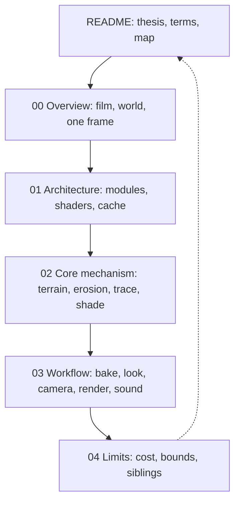

# procedural-alpine-lake: one minute of film from code

## Thesis

`procedural-alpine-lake` is an offline renderer that produces a 60 second cinematic flight through an alpine lake valley. Every visible surface and every audible sample comes from code in the checkout. The tree holds no texture, no mesh, no environment map and no audio recording. The images under `docs/` exist only for the project README page (`README.md:3`, `README.md:7`, `spec.md:32-34`). A citation to `spec.md` names the package specification beside this file. A citation to `README.md` names the project README inside the source checkout.

Two rules explain the design. The first rule is that the world is a function. An analytic height function describes the valley, a graphics processing unit (GPU) erosion simulation changes that surface, and a bake stores the result in maps before any frame. The second rule is that the film is a function of time. A shot table gives one camera path, one look and one grade for each shot. A frame index selects a sample time. No stored animation exists.

The checkout has 79 tracked files at pin `b84c254b3fa533b8c992eb685e1127a92702da21`, dated 2026-10-20, with commit subject `Add the prompt` (`spec.md:19-26`). It has 3 commits. The code is 13,790 lines of Python and 14,444 lines of OpenGL Shading Language (GLSL) (`spec.md:36-37`). The project was developed and tested on Windows 11 with an AMD Radeon 780M integrated GPU. The project needs OpenGL 4.3. macOS offers only OpenGL 4.1 and cannot run it (`README.md:62-64`).

## The frame of reference

The world uses metres. The main lake surface is at `y = 0`. Positive `x` is east and positive `z` is north (`engine/shaders/heightfn.glsl:3`). The far height map covers 32.768 by 32.768 kilometres with 4 metre cells. The near height map covers 4.096 by 4.096 kilometres with 1 metre cells. A hanging valley holds a tarn at 520 metres.

```text
# engine/bake.py:18-23
FAR_HALF = 16384.0
FAR_RES = 8192
NEAR_HALF = 2048.0
NEAR_RES = 4096
TARN_C = (-1680.0, -420.0)
TARN_LEVEL = 520.0
```

Those six constants set the geometry of the whole world: 8192 by 8192 texels for the far map and 4096 by 4096 for the near map. The bake constant `TARN_C` is `(-1680, -420)` at level 520 metres. It is a label for the tarn; the height function places the tarn shape at `(-1640, -430)` (`engine/shaders/heightfn.glsl:27`, `engine/erosion.py:102`). The lake level is 0 metres, which is the default water level in the height function. The main lake axis follows `x = 150 sin(0.00105 z + 0.5) + 45 sin(0.0029 z + 2.1)` (`engine/shaders/heightfn.glsl:38`).

## What the source states about the render

The scene shader is one source file. The renderer compiles ten programs from it. The ten are the cone pre-pass (`SCENE_PASS 98`, `engine/render.py:288-289`), the primary trace and eight kind programs (sky, terrain, tree, rock, water, cover, hero and falls flora; `engine/render.py:272`). The source comment gives the reason and the measured cost.

```text
# engine/shaders/scene.frag:133-141
// ---------------------------------------------------------------------------
// split renderer (engine/render.py Renderer): compiled as ONE program, the whole renderer cost the AMD
// compiler ~45-50 GB of commit memory and 13-36 min per fresh compile, while each part alone compiles in
// 1-210 s with < 1 GB (tools/split_probe.py, 2026-10-18). So every sample runs, per tile:
//   SCENE_PASS == 99 : the primary trace -> G-buffer: fragColor = (t, kind, cell), fragInfo = info
//   SCENE_PASS == K  : one program per hit kind K (K_SKY .. K_FALLSV): shades the pixels whose primary hit
//                      is of kind K (+ falls water volume, aerial perspective) into the accumulator and
//                      discards the others, so each pixel gets exactly one contribution per sample
// ---------------------------------------------------------------------------
```

This measurement is the centre of the architecture. A single program committed 45 to 50 gigabytes of memory on the AMD driver and took 13 to 36 minutes for a fresh compile. Each split pass compiles in 1 to 210 seconds under 1 gigabyte. The split removes a compiler limit, not a visual feature.

## The film

The film has 9 shots and lasts 60.0 seconds. The shot order is forest, reveal, lake skim, waterfall, stream, meadow, flyover, peaks and finale. The durations are 8.0, 7.5, 6.5, 6.5, 6.5, 6.5, 6.5, 6.0 and 6.0 seconds (`engine/shots_film.py:156-313`). The final render driver requests 2752 by 1152 pixels at 24 frames per second. It uses 6 or 8 samples per pixel depending on the shot, and upscales to 3440 by 1440 at encode (`tools/render_final.py:18-25`).

```text
# tools/render_final.py:18-25
ap.add_argument("--spp", type=int, default=8)
# per-shot sample counts (perf4, round 4): 6 spp where 6 vs 8 is invisible (calm moves), 8 spp where near
# crowns / rocks move fast through the frame
ap.add_argument("--spp-groups", default="1,2,6,7:6;0,3,4,5,8:8")   # (r5 order: 0 forest, 1 reveal, 2 skim, 3 waterfall, 4 stream, 5 meadow, 6 flyover, 7 peaks, 8 finale)
ap.add_argument("--w", type=int, default=2752)
ap.add_argument("--h", type=int, default=1152)
ap.add_argument("--fps", type=int, default=24)
ap.add_argument("--upscale", default="3440x1440")
```

`film.py` has a separate default of 30 frames per second (`film.py:32`). The final driver passes `--fps 24` to `film.py` (`tools/render_final.py:35,51`). A reader must not take the `film.py` default as the rate of the finished film.

The `final` mode default is 12 samples per pixel. The driver overrides it. The `--spp` default of 8 applies only when no group string is given. The group string uses zero-based indices: 6 samples for indices 1, 2, 6 and 7 (reveal, skim, flyover and peaks), and 8 for the other five (`film.py:45`, `tools/render_final.py:19-21`).

```text
# film.py:45-50
defaults = {"preview": (480, 270, 1, 0), "final": (1920, 1080, 12, 1), "stills": (960, 540, 6, 1), "encode": (1920, 1080, 1, 1)}
W, H, SPP, Q = defaults[args.mode]
W = args.w or W; H = args.h or H; SPP = args.spp or SPP; Q = args.q if args.q is not None else Q
FPS = args.fps
# default: 1.0 at 16:9, ~0.86 at 21:9 (horizontal view grows from ~95 to ~115 deg at a 60 deg shot)
VFOV_SCALE = args.vfov_scale if args.vfov_scale else (1.0 if W / H < 1.9 else 0.86)
```

The four modes produce an animatic, final frames, per-shot stills and the encoded file. The tuple fields are width, height, samples per pixel and quality level. The tuples give 480 by 270 with 1 sample, 1920 by 1080 with 12, 960 by 540 with 6, and 1920 by 1080 with 1. The driver replaces the final default with the group counts. The shot default vertical field of view (FOV) is 55 degrees (`engine/camera_path.py:80`), while the `film.py` comment uses 60 degrees as an example. The FOV scale is 1.0 at 16:9 and 0.86 for an aspect wider than 1.9.

## Package map



The dotted arrow sends the reader from the limits back to the claims at the top.

## Documents (five beside this file)

| Document | Question it answers |
|---|---|
| [00-overview.md](00-overview.md) | What is the film, what is the world, and how is one frame finished? |
| [01-architecture.md](01-architecture.md) | How do the Python modules, the shader files, the cache files and the GPU guard fit together? |
| [02-core-mechanism.md](02-core-mechanism.md) | How does a height function become an eroded valley, and how does a ray find and shade it? |
| [03-workflow-and-quality.md](03-workflow-and-quality.md) | How does a change reach a still, a preview, the final film and the soundtrack? |
| [04-limits-and-comparison.md](04-limits-and-comparison.md) | What does the design cost, what can it not do, and how does it compare with three siblings? |

The documents move from the whole film to the mechanism, the production loop and the limits.

## Terms

| Term | Meaning in this package |
|---|---|
| bake | a value or a map computed once and cached, not computed per frame |
| analytic height function | a closed-form function that returns terrain height from `x` and `z` |
| erosion | the GPU simulation that cuts channels, relaxes slopes and deposits sediment |
| far map | the 8192 by 8192 height map with 4 metre cells |
| near map | the 4096 by 4096 height map with 1 metre cells |
| tarn | the small lake in the hanging valley at 520 metres |
| shot | one continuous camera move with one duration, look and grade |
| look | the sun, haze, cloud, wind and water parameters of a shot |
| grade | the tone mapping and colour parameters of a shot |
| ray march | step along a ray until the ray meets a surface |
| signed distance function (SDF) | a function that returns a lower bound on the distance to a shape |
| level of detail (LOD) | a cheaper shape or shading path used at distance |
| G-buffer | the two float targets that hold hit distance, hit kind, cell and surface info |
| hit kind | the number that names what the primary ray hit, from sky to flora |
| cone pre-pass | a coarse march that gives each 4 by 4 pixel block a start distance for the primary rays |
| sample | one camera position and time inside the shutter interval |
| accumulator | the float red, green, blue and alpha (RGBA) target that sums all samples |
| high dynamic range (HDR) | the unclamped radiance image before tone mapping |
| tone mapping | the curve that maps HDR radiance into display values |
| RGB | red, green and blue, the three colour channels |
| field of view (FOV) | the vertical camera angle in degrees |
| LUFS | loudness units relative to full scale |
| JSON | JavaScript Object Notation |
| PNG | portable network graphics |
| MP4 | Moving Picture Experts Group 4 Part 14 |
| commit memory | the virtual memory that the operating system promises to a process |

## Reading order

1. Read this file. It gives the thesis, the constants and the map.
2. Read [00-overview.md](00-overview.md). It gives the film, the world and one frame end to end.
3. Read [01-architecture.md](01-architecture.md). It gives the modules, the shader set and the cache.
4. Read [02-core-mechanism.md](02-core-mechanism.md). It follows terrain, erosion, carving, tracing and shading.
5. Read [03-workflow-and-quality.md](03-workflow-and-quality.md). It follows the bake, the look, the camera search, the render and the sound.
6. Read [04-limits-and-comparison.md](04-limits-and-comparison.md). It gives the hardware bounds and the sibling comparison.

A reader who wants the evidence first can read document 04 and then document 01. A reader who wants to change the world can read document 02 and then document 03.

## Non-claims

This package is a static reading. It does not run the renderer, the bake, the erosion, the encoder or the soundtrack. It does not open a rendered still, the reference photographs or an audio file. It does not use the network. It does not install a dependency.

No frame was rendered for this package. Every statement about a surface comes from the source code or the project README. The exploration does not judge the visual result. It does not call the film beautiful. It describes what the code does.

No sound was heard. The audio description comes from `audio/soundtrack.py`, `audio/score_c.py`, `audio/analysis.py` and `audio/film_shots.json`. No loudness, peak or spectrum was measured.

The performance numbers are the author's records in the source. The 14 hour render time (`README.md:9`), the 17 gigabyte commit peak (`README.md:62`) and the 45 to 50 gigabyte single-program compile (`engine/shaders/scene.frag:134-136`) are code comments and README statements. The exploration did not repeat the measurements.

The source does not state a licence. The tree has no licence file (`spec.md:27`). This package gives no legal advice.
