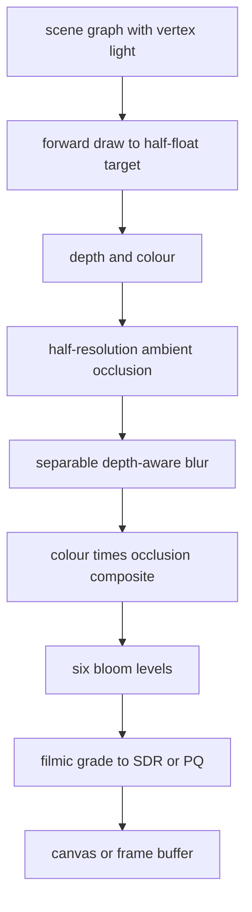

# The room, the film and the two ways to run it

## A bedroom at first light

At 6:51 the sun is still below the horizon. The room receives light from a bright sky, not from a
direct sun. One window faces the dawn. The sky outside is a procedural field of broken stratocumulus
cloud with a thin high veil, and it drifts slowly (`src/scene/sky.js:2-6`).

The sun stays out of frame, but its direction is in the data. The sky constants store a warm glow
near the horizon and a direction for it (`src/scene/sky.js:9-13`). The bake uses those constants for
the sky radiance. The window is the only opening that carries that radiance into the room.

The project is a three.js scene built from code. It has no model file, no image texture and no high
dynamic range image (HDRI). The code builds the room shell, the furniture, the plants and the view
through the window (`src/scene/index.js:9-32`). The page title is `6:51` (`index.html:6`).

The room is a place, not a test scene. The desk holds a laptop, books, postcards and crumbs
(`src/scene/parts/desk.js:1-2`). The duvet is a height field with folds, piping and a printed
pattern (`README.md:43`). The pothos vines hang on catenary curves (`README.md:43-44`).

Detail matters here for a mechanical reason. The bake stores light per unique position and normal
pair, not per mesh vertex. A detail that adds vertices adds sample points only when those vertices
land on a new position and a new normal. Welding shares the rest. The visual richness and the bake
cost still come from the same geometry, because most new detail adds new samples.

## Who the project serves

Three kinds of user read this project. A visitor walks the room in a browser. A viewer watches a
recorded film. A developer edits a part module and bakes the light again.

The first two users see only pixels. The third user sees a contract. The contract links three
things: a mesh key, a vertex count and a back flag. The payload of half-precision floats sits after
that record in the same file.

The walk and the film share one scene. They differ in camera control, frame size, sample count and
frame delivery. They do not differ in geometry, materials or light.

## What ships in the tree

The pinned tree holds 48 tracked files. Source files form the largest group. Seven part modules
build the furniture and the plants. Four core modules supply the bake and its helpers. Four render
modules make the image. One module runs the walk.

Three groups of binary files also ship.

| Path | Role | Size |
|---|---|---|
| `public/bake/gi.bin` | baked diffuse light for every global illumination (GI) mesh | 13,064,380 bytes |
| `public/audio/ambience.m4a` | recorded dawn birdsong | not stated in source |
| `public/audio/music.m4a` | piano piece | not stated in source |
| `docs/media/*.jpg` | seven Joint Photographic Experts Group (JPEG) frames | between 43,379 and 148,742 bytes |

The bake file header records 302 meshes, 1,157,291 sample points and 1,742,198 occluder triangles.
It also records 160 samples per point and 1,808 seconds of bake time. The file is the largest
generated artifact in the tree.

The audio licence is separate from the code licence. `CREDITS.md` names the music, the birdsong and
the leaf sound, and it gives the licence of each (`CREDITS.md:3-13`).

The modules divide into four layers. `src/core/` holds the seeded random number generator (RNG), the
geometry helpers, the texture helpers and the baked-light plumbing (`src/core/rng.js`,
`src/core/geo.js`, `src/core/tex.js`, `src/core/gi.js`). `src/scene/` holds the layout, the room
shell, the sky, the material library and the loader. `src/bake/` holds the driver and the worker.
`src/render/` holds the pipeline, the film timeline, the look values and the camera table.
`src/game/` holds the walk.

## The two run modes

The boot code reads the uniform resource locator (URL) and decides which mode to start. A plain URL starts the walk. A URL with
`shot`, `bake` or `film` sets a flag and skips the walk (`src/main.js:9-12`). The offline tools use
that flag.

### The live walk

The walk starts after the scene and the bake are ready.

```text
# src/main.js:132-135
  if (!SHOT) {
    const { startGame } = await import('./game/game.js');
    startGame(api);
  }
```

`startGame` receives the public application programming interface (API) object. It takes the
renderer, the camera, the pipeline, the resize function, the context and the state from that object
(`src/game/game.js:8-9`). The walk adds pointer lock, key handling, audio, collisions and an idle
camera loop on top of the same scene.

The player clicks the canvas to lock the pointer. The mouse then turns the view (`src/game/game.js:45-49`).

The player starts at x 3.95 and z 3.15, with an eye height of 1.62 metres (`src/game/game.js:22`).
The first view faces into the room. A yaw of 0.72 radians and a small downward pitch set the
initial direction.
Movement uses a velocity with damping, and a collision test rejects a step into a box
(`src/game/game.js:25-32`, `src/game/game.js:65-113`). The boxes come from the part modules. The
desk adds two of them (`src/scene/parts/desk.js:1655-1656`).

Resolution adapts to hold a steady frame rate. The first scale is the smaller of full size and
1,600 pixels wide, and the floor is half scale (`src/game/game.js:13`).

```text
# src/game/game.js:13-18
  let scale = Math.min(1, 1600 / window.innerWidth), lastFit = 0, acc = 0, frames = 0;
  const fit = () => {
    const w = Math.max(320, Math.round(window.innerWidth * scale)), h = Math.max(180, Math.round(window.innerHeight * scale));
    resize(w, h, { msaa: 4 });
  };
  window.addEventListener('resize', fit); fit();
```

The loop measures the frame time and changes the scale at most once every 1.5 seconds. It averages
the frames of about one second. An average longer than 24 milliseconds lowers the scale by 12
percent. An average shorter than 12.5 milliseconds raises it by 8 percent
(`src/game/game.js:102-110`).

Exposure also adapts in the walk. The code measures how closely the view direction points at the
window, and it pulls the exposure down when the window fills the view (`src/game/game.js:94-98`).
The intent is to imitate an eye that adapts to a bright opening. The mechanism is a smooth step on
`pipe.look.exposure`.

Three keys change the mode or the interface. `C` plays the film camera moves live, `M` mutes the
audio and `H` toggles a hint (`src/game/game.js:54-60`).

Audio starts with the walk. The code loads `ambience.m4a` at volume 0.85 and `music.m4a` at volume
0.5, and it starts both on the first click (`src/game/game.js:39-43`). Nothing is synthesised. `M`
mutes both tracks, and the credits file names their authors and licences.

### The offline render

An offline run uses the same scene, materials and pipeline. It replaces the walk camera with a named
camera or a film camera. It also replaces the single forward draw with an average of many sub-frames.

`window.__api.shot` renders one still. Its defaults are the `bed` camera at 1,280 by 720 pixels, with
8 sub-frames at time 2.0 seconds (`src/main.js:113`). The function resizes the pipeline, sets the
camera, calls `renderAccum` and restores the camera. It returns the draw call count and the triangle
count (`src/main.js:113-121`).

The tools drive the page through `puppeteer-core` (`tools/shot.mjs:1-10`). They launch a local Chrome
or Edge, open the URL, wait for `window.__ready` and call the page function (`tools/shot.mjs:31-47`).
The browser is the renderer. No server-side image path exists.

`Window.__film` is installed only when the URL asks for the film (`src/main.js:130`). The film module
then drives the timeline, the sub-frame count and the frame transport. Document 01 traces that path
in full.

Three URL parameters are read at boot. `q` sets `state.quality` (`src/main.js:27`), but no renderer
code reads that field, so it does not change the image. `gi` selects another bake file under
`public/bake/` (`src/main.js:55`). `only` limits the scene to the named parts
(`src/scene/index.js:18-25`). The last one is the fastest way to inspect one part,
and the desk prints its triangle count under it (`src/scene/parts/desk.js:1658`).

## The room and its coordinates

Every part reads its position from one layout module. The module states the room size, the window
opening and the footprint of each large object.

```text
# src/scene/layout.js:1-6
// Room dimensions in metres. X = along the window wall, Z = into the room (window wall at z = 0), Y = up.
export const ROOM = {
  W: 4.8, D: 4.0, H: 2.5, wallT: 0.32,
  win: { x0: 0.55, x1: 2.45, y0: 0.86, y1: 2.26, mullion: 1.74, frameZ0: -0.205, frameZ1: -0.135, glassZ: -0.17 },
  door: { z0: 2.72, z1: 3.62, h: 2.02 },
};
```

The axes are fixed. X runs along the window wall from 0 to 4.8 metres. Z runs into the room from 0 to
4.0 metres, so the window wall is at z = 0. Y runs up from 0 to 2.5 metres. The wall is 0.32 metres
thick. The window opening spans x 0.55 to 2.45 and y 0.86 to 2.26, with a mullion at x 1.74 and
glass at z -0.17. The door spans z 2.72 to 3.62 and rises 2.02 metres (`src/scene/layout.js:2-5`).

The window is not a hole in a flat plane. The room builder cuts the opening with a holed plane
(`src/scene/room.js:17-30`). It then adds a reveal, a frame, a sill and a mullion around the
opening (`src/scene/room.js:86-279`). The bake cares about the opening rectangle. The camera sees
the layered construction, and the light catches the reveal and the sill.

The large objects have fixed footprints. The bed occupies x 0.12 to 1.56 and z 1.92 to 3.98, with a
mattress top at y 0.5. The desk occupies x 2.68 to 3.78 and z 0.02 to 0.64, with a top at y 0.74.
The wardrobe, radiator, curtain rod, nightstand, rug, wall shelves, postcard collage and plant shelf
have entries of the same kind (`src/scene/layout.js:8-16`).

Geometry alone does not make a surface. The material library returns a named map of shared materials,
and most parts draw from it (`src/scene/materials.js:320-349`). A part can also build a material for
one use, as the desk does with its atlases (`src/scene/parts/desk.js:1638`). Shared materials keep
the draw state stable. The batch helper turns that sharing into fewer meshes.

These numbers are not decoration. The bake takes the window rectangle as its portal
(`src/scene/room.js:274-277`). The fragment shader scales the light when the world z of the fragment
is below -0.33 (`src/core/gi.js:96`). The camera table, the collision boxes and seven part modules
all use the same metres.

## One frame, from geometry to pixels

The renderer is configured once.

```text
# src/main.js:15-18
const renderer = new THREE.WebGLRenderer({ canvas, antialias: false, powerPreference: 'high-performance', alpha: false, preserveDrawingBuffer: SHOT });
renderer.outputColorSpace = THREE.LinearSRGBColorSpace;
renderer.toneMapping = THREE.NoToneMapping;
renderer.setPixelRatio(1);
```

Three settings matter. Multisample anti-aliasing is off in the renderer, because the pipeline makes
its own multisample target. Tone mapping is off, because the final shader applies the tone map. The
pixel ratio is one, because the tools set an exact frame size.



The forward draw is cheap, because the materials carry the light. The passes after the draw do the
work. An ambient occlusion pass with 14 samples runs at half resolution. Its sample pattern rotates
with the frame number, so the average of several frames hides the pattern
(`src/render/pipeline.js:21-57`). Two blur passes then smooth the result in each axis.

The composite multiplies the colour by the occluded value. The accumulation path writes the room
into a 32-bit float target and the exterior into a half-float target, because the two regions use
different exposure scales (`src/render/pipeline.js:301-320`). Six down-sampled levels then collect
the bright areas for bloom (`src/render/pipeline.js:243-259`).

The final shader performs the tone map. It applies an Uchimura curve, mixes luminance and channel
compression, desaturates the highlights and adds a vignette, tints, contrast and grain
(`src/render/pipeline.js:114-174`). Mode 0 writes standard dynamic range (SDR) to the canvas. Mode 1
writes perceptual quantizer (PQ) values in the International Telecommunication Union Radiocommunication Sector BT.2020 colour space (BT.2020). Mode 2 writes an 8-bit SDR
target (`src/render/pipeline.js:288-300`).

Diffuse light is not the whole image. Glossy surfaces also need a reflection of the room. After the
bake is applied, `main.js` captures the lit scene twice with a cube camera at a probe point near the
room centre (`src/main.js:61-68`). The capture uses a box projection between the room bounds. The
second capture exists so that glossy surfaces reflect each other. The glass material receives the
result, and the two captures keep the reflections consistent with the baked room.

An offline frame repeats this path many times. `renderAccum` averages `n` sub-frames with a weight of
1/n into the float room target and the half-float exterior target, then grades the average
(`src/render/pipeline.js:278-288`). The average reduces noise, and the moving camera in each
sub-frame turns the pattern into a smooth image.

The sub-frame count is the main difference between the two outputs at one resolution. A live frame
at 1,280 by 720 pixels draws the scene once. A still of the same size draws it eight times by
default (`src/main.js:113`). A film frame at the same size draws it 32 to 96 times, because the shot
table supplies that count (`src/render/film.js:13-35`). All three draws read the same baked
attributes. Only the bake adds new light.

## The eight cameras

Stills use a fixed camera table.

```text
# src/render/cams.js:1-11
// Named still cameras used for look-dev screenshots. pos / target in metres, fov vertical degrees.
export const CAMS = {
  bed: { pos: [0.95, 0.80, 3.35], target: [1.95, 1.22, 0.0], fov: 46 },
  wide: { pos: [4.45, 1.5, 3.75], target: [1.5, 1.05, 0.2], fov: 58 },
  desk: { pos: [2.3, 1.25, 1.9], target: [3.45, 0.95, 0.15], fov: 42 },
  window: { pos: [1.55, 1.3, 1.6], target: [1.45, 1.45, 0.0], fov: 50 },
  sill: { pos: [1.0, 1.12, 0.62], target: [1.75, 0.98, -0.1], fov: 38 },
  back: { pos: [2.6, 1.45, 0.7], target: [1.0, 0.8, 3.6], fov: 58 },
  corner: { pos: [0.5, 1.55, 3.6], target: [3.4, 1.0, 0.3], fov: 58 },
  top: { pos: [2.4, 2.45, 2.0], target: [2.4, 0, 1.99], fov: 80 },
};
```

Eight cameras cover the room. The names are bed, wide, desk, window, sill, back, corner and top.
Each entry stores a position, a target and a vertical field of view (FOV) in degrees
(`src/render/cams.js:1`). `setCam` copies one entry into the camera and sets the lens focus and
aperture when the entry has them (`src/main.js:77-82`).

The still tool loops over the requested names, calls `shot` for each one and saves a JPEG from the
page (`tools/shot.mjs:39-47`). The default still is the bed view at 1,280 by 720 pixels with 8
sub-frames (`src/main.js:113`). The seven images in `docs/media` are frames from the film
(`README.md:12`). They do not map one to one onto the eight cameras.

## One part from export to pixels: the desk

The desk is the largest part module at 1,660 lines. It shows every step from authored geometry to a
lit pixel.

A part module exports two values and one function. The loader reads the values before it calls the
function.

```text
# src/scene/parts/desk.js:11-12
export const order = 30;
export const label = 'desk';
```

`order` places the module in the load sequence. `label` names the progress step. The loader imports
every part, sorts the modules by `order` and awaits each `build` call
(`src/scene/index.js:18-32`). A part that runs later sees the context changes of the parts before it,
and it can add its own colliders and callbacks.

The build function begins with its seeds, its atlases and its batch helper.

```text
# src/scene/parts/desk.js:1632-1642
export function build(ctx) {
  const t0 = performance.now();
  const root = group('desk'), rng = new RNG(30530), top = DESK.top;
  const books = defineBooks(rng.fork()), cards = defineCards();
  const bookAtlas = paintBooks(books.all, rng.fork()), cardAtlas = paintCards(cards, rng.fork());
  const rng2 = new RNG(77031), prints = paintPrints(rng2.fork());       // separate stream: the loose things don't reshuffle the rest
  const mats = makeMats(ctx.M, bookAtlas.tex, cardAtlas.tex, prints.tex, rng2.fork());
  const batch = makeBatch(root), noOcc = { bakeOccluder: false };
  // thin things lying flat must not carve a dark halo into the desk under them
  const flatThings = new Set(['postcards', 'tape', 'looseNote', 'ruler', 'clips', 'clipsCoated', 'coins', 'shavings', 'hairTie', 'usbCable']);
  const add = (name, key, geo, m4) => { if (m4) geo.applyMatrix4(m4); batch.add(name, mats[key], geo, flatThings.has(name) ? noOcc : null); return geo; };
```

Two seeds keep the layout repeatable. Seed 30,530 drives the main layout, and seed 77,031 drives the
loose objects. The second stream exists so that a change to the loose objects does not reshuffle the
rest of the desk (`src/scene/parts/desk.js:1637`). The material library receives the generated
book, card and print atlases. `makeBatch` collects geometry instead of adding one mesh per object.
`noOcc` marks the flat items.

The batch helper has two halves. The first half collects geometry under a name. The first call for a
name also fixes the material for that bucket. A later call with the same name adds geometry and
keeps the first material (`src/scene/parts/desk.js:192`).

```text
# src/scene/parts/desk.js:188-198
function makeBatch(root) {
  const map = new Map();
  return {
    add(name, mat, geo, ud) {
      let b = map.get(name); if (!b) map.set(name, (b = { mat, geos: [], ud }));
      const col = geo.attributes.color;
      if (mat.userData.vr) {
        if (!col) tintR(geo, [1, 1, 1], 0.5);
        else if (col.itemSize === 3) { const a = new Float32Array(col.count * 4); for (let i = 0; i < col.count; i++) a.set([col.getX(i), col.getY(i), col.getZ(i), 0.5], i * 4); geo.setAttribute('color', new THREE.BufferAttribute(a, 4)); }
      } else if (mat.vertexColors && !col) tint(geo, [1, 1, 1]);
      b.geos.push(geo);
```

The second half merges each bucket into one mesh.

```text
# src/scene/parts/desk.js:200-210
    flush() {
      let tris = 0;
      for (const [name, b] of map) {
        const g = merge(b.geos); tris += g.index.count / 3;
        const m = mesh(g, b.mat, name); if (b.ud) Object.assign(m.userData, b.ud);
        root.add(m);
      }
      return tris;
    },
  };
}
```

`add` keys the bucket by its name argument, not by the material. Two objects merge into one mesh
only when they pass the same name. `flush` merges the geometry of every bucket, names the resulting
mesh after the bucket and records the triangle count. The desk reports its triangle count at boot
when the URL asks for this part only (`src/scene/parts/desk.js:1658`).

Merge order follows the first insertion into the map. A change in call order can change the vertex
order inside a bucket. The bake check compares the vertex count, not the vertex order
(`src/core/gi.js:186`). A reordering that keeps the count passes the check and applies the wrong
light. Document 04 returns to this quiet failure mode.

A rename costs the whole mesh. Suppose the desk changes the name `books` to `bookA`. The old key is
`desk/books#0`, and the new key is `desk/bookA#0`. The manifest holds no entry for the new key, so
`applyBake` adds one to `stale` and calls `zeroGi` (`src/core/gi.js:185-186`). For a bucket with
12,000 vertices, `zeroGi` writes 36,000 values of 0.06 into `gi` and 36,000 zeros into `gd`
(`src/core/gi.js:198-204`). A two-sided bucket also receives 36,000 values of 0.06 in `giB`. The
vertex count does not change. The render still succeeds. The mesh shows flat fill light until a new
bake writes the new key.

`noOcc` has a precise effect. A mesh with `bakeOccluder` set to false is not added to the ray-tracing
structure, and it gets no cache entry (`src/bake/baker.js:26`, `src/bake/baker.js:187`). Rays pass
through it. A postcard that stayed in the structure would block the light that reaches the desk
under it, and the bake would leave a dark ring around the card. The author marks ten flat kinds of
object for this reason (`src/scene/parts/desk.js:1640-1641`).

Three canvases supply the printed surfaces. `paintBooks` draws a shelf of book spines. `paintCards`
draws the postcard images. `paintPrints` draws the loose prints (`src/scene/parts/desk.js:1635-1637`).
Each canvas becomes one texture. Many small objects then share one texture, so the desk can merge
its books and cards into a few meshes. The seed for the loose prints is separate, so a change to the
prints leaves the books and the desk layout in place.

The merge also sets the granularity of the bake. The desk produces one mesh for each bucket, and
each mesh carries one record per vertex. A bucket with many vertices costs more bake samples than a
bucket with few. The author controls that cost through geometry density and through the number of
buckets. The driver has no per-mesh sample option (`src/bake/baker.js:18`).

The part also registers collision boxes. The walk uses them, and the bake does not.

```text
# src/scene/parts/desk.js:1655-1657
  ctx.colliders.push({ min: [DESK.x0, 0, 0], max: [DESK.x1, top + 0.02, DESK.z1 + 0.02] });
  ctx.colliders.push({ min: [2.9, 0, 0.72], max: [3.46, 0.85, 1.31] });
  root.userData.tris = tris;
```

The first box covers the desk footprint. The second box covers the chair. The boxes are axis-aligned
and they live in the shared context (`src/scene/parts/desk.js:1655-1656`).

The desk lamp is geometry only. It is not a light object. The walk has no real-time lights, and the
bake traces the sky through the window (`src/bake/worker.js:34-43`). The lamp blocks sky light in
the bake, because it is an occluder. The light that it would make is not in the model.

The bake side identifies a mesh by a generated key. The key walks up the parent chain and appends an
index for repeated names.

```text
# src/core/gi.js:131-145
export function giMeshes(root) {
  const out = [], seen = new Map();
  root.updateMatrixWorld(true);
  root.traverse((o) => {
    if (!o.isMesh || o.userData.gi === false) return;
    const m = Array.isArray(o.material) ? o.material[0] : o.material;
    if (!m || !m.defines || m.defines.USE_GI === undefined) return;
    let path = o.name || 'mesh';
    for (let p = o.parent; p && p !== root; p = p.parent) path = (p.name || 'g') + '/' + path;
    const n = seen.get(path) || 0; seen.set(path, n + 1);
    const inst = !!(o.isInstancedMesh && o.userData.giInstanced);
    out.push({ mesh: o, key: path + '#' + n, inst, back: m.defines.GI_BACK !== undefined, count: inst ? o.count : o.geometry.attributes.position.count });
  });
  return out;
}
```

The key is the parent path plus `#n`. The mesh name comes from the material bucket name. The count is
the vertex count for a normal mesh, and the instance count for an instanced mesh. The `back` flag
comes from the material define `GI_BACK`. A mesh with `userData.gi === false`, or a material without
`USE_GI`, is not in the list (`src/core/gi.js:136-138`).

The shader side declares the same three attributes.

```text
# src/core/gi.js:47-55
const VERT_DECL = `
#ifdef USE_GI
attribute vec3 gi; attribute vec3 gd;
varying vec3 vGi; varying vec3 vGd; varying vec3 vGiW;
#ifdef GI_BACK
attribute vec3 giB; varying vec3 vGiB;
#endif
#endif
`;
```

Every GI material declares `gi` and `gd`. A two-sided translucent material also declares `giB`. The
vertex shader passes the world position and puts the mean direction into view space
(`src/core/gi.js:63`). The fragment shader then combines the value with the shading normal
(`src/core/gi.js:79-103`).

```mermaid
flowchart LR
  A["buildDesk add calls"] --> B["bucket by add name"]
  B --> C["merge one mesh per bucket"]
  C --> D["mesh name and parent path"]
  D --> E["bake key from path and index"]
  E --> F["worker samples each unique point"]
  F --> G["half floats in gi dot bin"]
  G --> H["applyBake sets attributes"]
  H --> I["vertex shader reads gi and gd"]
  I --> J["fragment shading"]
```



The path has one quiet consequence. The author writes objects, but the bake sees buckets. The bucket
name, the merge order and the vertex count form the identity of a lit surface. The code inside
`buildDesk` can change freely as long as those three values stay the same.

**Aha:** The bake has two different units, and the file joins them. The unit of light transport is
the welded sample: one unique position with one unique normal. The unit of file lookup is the mesh
key plus the vertex index. `makeBatch` keys each bucket by the `add` name for this reason. Every mesh
gets an explicit name for this reason. The file stores no positions and no normals. It stores two or
three vectors for each vertex, in traversal order, under a key that the scene must reproduce
exactly. The loader can apply a 13 megabyte file to a scene it has never seen, because the key, the
count and the back flag are all it needs. The light itself is shared across vertices that land on
the same sample.

## What this overview leaves to the other documents

This document describes the place, the users, the two run modes, the coordinates and one worked
part. It does not explain how the bake finds light. Document 02 covers the portal, the two passes,
the cache, the environment table and the buffer format. It does not explain how the code boots.
Document 01 covers the module map, the worker pool, the film transport and the development server.
It does not explain the checks in the loop, because document 03 does that.

One number deserves a warning here. The shipped bake took 1,808 seconds. The default driver uses 128
samples per point, and the README example asks for 256 (`src/bake/baker.js:18`, `README.md:67`). A
new bake is not a quick edit. Plan the work around a long run, and read document 03 before you start
one.
