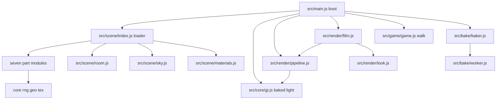
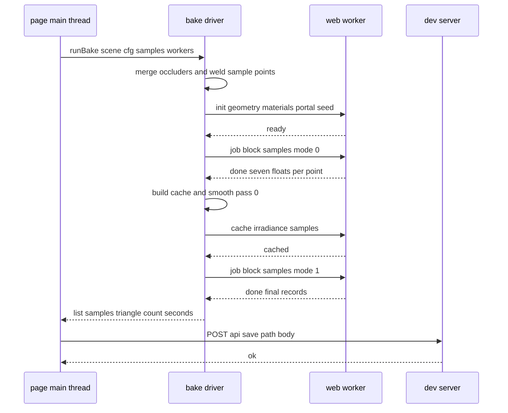

# Three processes and the contracts between them

## The shape of the system

The project runs in three processes. The first process is the page in a browser. The second process
is a pool of web workers. The third process is the development server, a Node.js program that also
starts `ffmpeg`. Each process owns different state, and each boundary passes bytes.

The page owns the scene graph, the cameras, the materials and the render targets. The workers own a
copy of the scene triangles, a copy of the material table and the irradiance cache. The server owns
the child encoders and a map of pending frame writes. No process shares an object with another. A
hand-off is a transferable buffer, a Blob or text.

The bake uses the page and the workers. The film uses the page and the server. The stills and the
live walk use the page alone. That split explains most of the file layout.

## The module map



The dependencies run one way. `main.js` imports the loader, the light module, the pipeline, the film
module and the walk. The loader imports the room, the sky, the material library and the part
modules. The parts import the core helpers. The bake driver imports only the worker constructor and
the light module. No part imports the pipeline or the film.

| Directory | Owns | Main exports |
|---|---|---|
| `src/core/` | random number generator (RNG), geometry, textures, baked-light plumbing (global illumination, GI) | `RNG`, `roundedBox`, `dataTex`, `GI`, `applyBake`, `packBake` |
| `src/bake/` | the central processing unit (CPU) path tracer | `runBake`, worker message handler |
| `src/scene/` | layout, room, sky, materials, assembly | `ROOM`, `buildRoom`, `buildSky`, `makeMaterials`, `buildScene` |
| `src/scene/parts/` | furniture, plants, exterior | `order`, `label`, `build` |
| `src/render/` | image pipeline, timeline, grade | `Pipeline`, `SHOTS`, `runFilm`, `LOOK`, `CAMS` |
| `src/game/` | first-person walk | `startGame` |

The loader uses a glob import, so the part list is not written by hand.

```text
# src/scene/index.js:9-9
const optional = import.meta.glob('./parts/*.js');
```

The import is lazy. Each part module becomes its own chunk, and the browser fetches it only when the
loader awaits it. The scene context is created before the first part runs.

```text
# src/scene/index.js:11-13
export async function buildScene(onProgress = () => {}) {
  const scene = new THREE.Scene();
  const ctx = { M: makeMaterials(), rng: new RNG(20261112), scene, colliders: [], animated: [] };
```

The context is the only object that the seven parts share. Each part receives it, adds geometry to
the scene and writes its collision boxes into `ctx.colliders`. The loader then calls the parts in a
fixed order.

```text
# src/scene/index.js:26-32
  mods.sort((a, b) => (a.order || 0) - (b.order || 0));
  for (const m of mods) {
    onProgress(m.label || 'things');
    const g = await m.build(ctx);
    if (g) scene.add(g);
    await new Promise((r) => setTimeout(r, 0));
  }
```

The order is part of the contract. The comment at the top of the file states the reason: the bake
matches light to meshes, so the scene must be reproducible (`src/scene/index.js:1-2`). A part that
moves earlier or later can change the traversal order and the generated names.

## The context contract

`ctx` has eight fields. Five come from the loader, two come from the room, and the room and the
loader both write `bake`. No field comes from the sky.

| Field | Writer | Reader | Meaning |
|---|---|---|---|
| `M` | loader | parts | shared material library |
| `rng` | loader | parts | seeded random number generator (RNG) for scene layout |
| `scene` | loader | parts | the three.js scene |
| `colliders` | parts | walk | axis-aligned boxes for collision |
| `animated` | loader, empty | walk, film prep | per-frame callbacks |
| `glass` | room | boot | the window glass material |
| `roomBox` | room | boot | inner bounds for the reflection probe |
| `bake` | room, loader | bake driver | portal rectangle, room bounds, sky constants, maximum depth |

One field deserves a warning. The architecture guide says each part may register per-frame callbacks
in `ctx.animated` (`docs/ARCHITECTURE.md:34`). No part writes to that array. The only writers are the
initial empty array in the loader (`src/scene/index.js:13`) and no other line in the source. The walk
and the film prep loop over it, so the array stays empty (`src/game/game.js:68`,
`src/main.js:91`). Wind motion in the parts is a pure function of the shader clock, not a callback.

The `bake` object is filled in two steps. The room writes the portal and the room bounds
(`src/scene/room.js:273-278`). The loader then adds the sky constants and the maximum path depth
(`src/scene/index.js:33`).

```text
# src/scene/room.js:273-278

  ctx.bake = {
    portal: { x0: win.x0, x1: win.x1, y0: win.y0, y1: win.y1, z: 0, area: ww * wh },
    room: [0.0005, 0.0005, 0.0005, W - 0.0005, H - 0.0005, D - 0.0005],
  };
  ctx.roomBox = { min: new THREE.Vector3(0, 0, 0), max: new THREE.Vector3(W, H, D) };
```

The portal rectangle is the window opening at z = 0. Its area is the product of the width and the
height. The bake uses the rectangle for next-event estimation. The room box is a smaller copy of the
room, inset by 0.0005 metres on each side (`src/scene/room.js:276`). The probe uses the box to
project reflections onto the walls.

## The boot sequence

The page starts from one script tag (`index.html:30`). `src/main.js` then runs these steps in order.

1. It reads the uniform resource locator (URL) parameters and sets the shot flag (`src/main.js:9-12`).
2. It creates the renderer with tone mapping off and a linear colour space (`src/main.js:15-20`).
3. It creates the camera with a 50 degree vertical field of view (FOV) and a 0.05 to 400 metre
   range (`src/main.js:26`).
4. It calls `buildScene`, which builds the room, the sky and the parts (`src/main.js:31`).
5. It creates the pipeline and applies the shared look values (`src/main.js:36-37`).
6. It either runs a bake or fetches `public/bake/gi.bin` (`src/main.js:40-59`).
7. It captures the room reflections twice (`src/main.js:61-68`).
8. It defines the resize helper, the camera helper and the public application programming interface (API) (`src/main.js:71-127`).
9. It installs the film entry point when the URL asks for it (`src/main.js:130`).
10. It starts the walk when the URL does not ask for a shot (`src/main.js:132-135`).

The bake branch and the load branch are one block.

```text
# src/main.js:40-51
  // ---- baked lighting
  let bakeInfo = null;
  if (Q.has('bake')) {
    placeholderGi(scene);
    const { runBake } = await import('./bake/baker.js');
    const spp = parseInt(Q.get('bake')) || 64, workers = parseInt(Q.get('workers')) || 6;
    const res = await runBake(scene, ctx.bake, { spp, workers, smooth: Q.has('smooth') ? parseInt(Q.get('smooth')) : 1 });
    const buf = packBake(res.list, { spp, secs: res.secs, samples: res.samples, tris: res.tris });
    const out = Q.get('out') || 'public/bake/gi.bin';
    await fetch('/api/save?path=' + encodeURIComponent(out), { method: 'POST', body: buf });
    bakeInfo = { spp, secs: res.secs, samples: res.samples, tris: res.tris, bytes: buf.byteLength };
    console.log('[bake] saved', out, (buf.byteLength / 1e6).toFixed(1) + ' MB');
```

A bake run does five things. It puts flat placeholder light on the scene. It imports the bake driver.
It runs the bake with the sample count and worker count from the URL. It packs the result and posts
it to the save endpoint. The default sample count in the URL branch is 64, and the default worker count is
6 (`src/main.js:45`). The driver default is 128 samples (`src/bake/baker.js:18`). A normal request
carries an explicit count, so the two defaults rarely meet.

A normal run does three things. It fetches the bake file with `cache: 'no-store'`, applies it and
keeps the result for the tools. A failed fetch or a bad magic number falls back to flat placeholder
light and a console warning (`src/main.js:52-59`).

The reflection capture comes next.

```text
# src/main.js:61-68
  // ---- reflections: capture the lit room once (twice so glossy surfaces reflect each other)
  const rb = ctx.roomBox, probe = new THREE.Vector3(2.35, 1.3, 2.0);
  const refreshEnv = () => {
    GI.uniforms.giExt.value = pipe.look.ext;   // reflections should show the window as bright as the grade shows it
    for (let i = 0; i < 2; i++) { const env = captureEnv(renderer, scene, probe, rb.min, rb.max, 256); if (ctx.glass) ctx.glass.uniforms.envMap.value = env; }
    GI.uniforms.giExt.value = 1;
  };
  refreshEnv();
```

The capture runs twice at a 256 pixel cube resolution. The probe sits at x 2.35, y 1.3, z 2.0
(`src/main.js:62`). The first capture fills the glass environment map, and the second capture
includes the first result, so glossy surfaces reflect each other. The code lowers the exterior scale
to the look value during the capture, then restores it to 1 (`src/main.js:63-66`).

The public API is the contract with the tools.

```text
# src/main.js:110-118
  // ---- public API (used by tools/*.mjs through puppeteer, and by the cinematic renderer)
  const api = {
    gpu: gpuName, bakeInfo, CAMS, state, pipe, camera, renderer, scene, ctx, resize, setCam, makePrep, restoreCam, refreshEnv,
    async shot({ cam = 'bed', w = 1280, h = 720, accum = 8, time = 2.0, look = null } = {}) {
      if (look) Object.assign(pipe.look, look);
      resize(w, h, { msaa: 0 }); setCam(cam);
      basePos.copy(camera.position);
      pipe.renderAccum(accum, makePrep(time, 0), 0);
      restoreCam();
```

The API exposes the scene, the context, the pipeline, the renderer, the camera, the bake metadata,
the camera table and six functions: `resize`, `setCam`, `makePrep`, `restoreCam`, `refreshEnv` and
`shot` (`src/main.js:111`). The still function resizes the target, sets a camera, renders
an average and returns the draw statistics (`src/main.js:113-121`). The tools call this object from
the page context, so they need no build step.

Resize is shared by the walk and the tools. `resize` sets the renderer size, updates the camera
aspect and calls `pipe.setSize` (`src/main.js:71-75`). The pipeline disposes the old targets and
builds new ones for the width and height (`src/render/pipeline.js:202-218`). A resize during a film
chunk would invalidate the readback size, so the film sets the size once before its loop
(`src/render/film.js:111`).

## The page and the workers

The worker file holds module-level state. The state is not per job. A worker keeps its bounding
volume hierarchy (BVH), its material table, its portal configuration and its irradiance cache until
the page closes the worker.

```text
# src/bake/worker.js:16-31
self.onmessage = (e) => {
  const d = e.data;
  if (d.type === 'init') {
    const g = new THREE.BufferGeometry();
    g.setAttribute('position', new THREE.BufferAttribute(d.pos, 3));
    g.setIndex(new THREE.BufferAttribute(d.idx, 1));
    bvh = new MeshBVH(g, { targetLeafSize: 6, indirect: true });
    POS = d.pos; IDX = d.idx; triMat = d.triMat; mats = d.mats; cfg = d.cfg; P = cfg.portal; seed = d.seed;
    self.postMessage({ type: 'ready' });
  } else if (d.type === 'cache') {
    CE = d.ce; CB = d.cb; buildEnvMap(); self.postMessage({ type: 'cached' });
  } else if (d.type === 'job') {
    const out = job(d.samples, d.spp, d.mode);
    self.postMessage({ type: 'done', id: d.id, out }, [out.buffer]);
  }
};
```

The protocol has six message types. The page sends `init`, `cache` and `job`. The worker sends
`ready`, `cached` and `done`. `init` builds the BVH and stores the scene tables. `cache`
stores the irradiance cache and builds the environment table. `job` runs one block of samples.
`done` returns the block with its buffer transferred. The page sends one `init`, one `cache` and
many `job` messages to each worker.
The worker has no scene object. `init` receives a flat position array, an index array, one row of
nine floats per material and the portal. The worker builds the BVH from those arrays
(`src/bake/worker.js:18-23`). A material row holds albedo, diffuse transmission probability,
transmission colour, a two-sided flag and a straight-through probability (`src/bake/worker.js:10`).

The driver creates the pool with a fixed seed per worker. The pool size is a run argument.

```text
# src/bake/baker.js:122-128
  const pool = [];
  await Promise.all(Array.from({ length: workers }, (_, w) => new Promise((res, rej) => {
    const wk = new Worker(new URL('./worker.js', import.meta.url), { type: 'module' });
    wk.onerror = rej; wk.onmessage = (ev) => { if (ev.data.type === 'ready') res(); };
    wk.postMessage({ type: 'init', pos, idx, triMat, mats: new Float32Array(mats), cfg, seed: 9001 + w * 7919 });
    pool.push(wk);
  })));
```

Each worker receives a different seed, 9,001 plus 7,919 times its index. The seed makes the sample
pattern reproducible, and the difference between workers decorrelates the noise. The driver waits
for every `ready` message before it sends work (`src/bake/baker.js:125`).

The job size is 3,000 sample points (`src/bake/baker.js:118`). The driver sorts the jobs into a
queue and gives the next job to the first free worker (`src/bake/baker.js:130-143`). Each job
carries a multiplier from `jobMult`. A job whose points are mostly outside the room gets 0.3,
a job near the window gets 3, and every other job gets 1 (`src/bake/baker.js:120-121`). The
multiplier changes the sample count of the job, not its size.

The log has a fixed shape. For the shipped scene, 1,157,291 sample points at 3,000 points per job
give 386 jobs. The progress line prints at jobs 64, 128, 192, 256, 320, 384 and 386, which is 17,
33, 50, 66, 83, 99 and 100 percent. Each pass prints its own set, under the label `paths` for pass 0
and `gather` for pass 1. The run therefore prints about 18 lines. Four fixed lines cover the
occluder count, the lit mesh count, the worker readiness and the final time. Seven progress lines
follow for each pass. The source prints elapsed seconds, not a per-job estimate. A reader who
watches the log sees the two passes advance at different rates. Pass 0 runs 32 samples per point and
pass 1 runs 160 (`src/bake/baker.js:50`, `src/bake/baker.js:115`, `src/bake/baker.js:129`,
`src/bake/baker.js:138`, `src/bake/baker.js:211`).

Each boundary also has a byte size. A worker job carries 3,000 sample points, or 18,000 floats, and
it returns 21,000 floats. One job result is 84,000 bytes, and the driver places it at a 7-float
offset for each point (`src/bake/baker.js:118`, `src/bake/baker.js:138`). A frame at 3,840 by 2,160
pixels (4K) is 66.4 megabytes (MB) in the page and crosses the server bridge as one Blob. The shipped
bake file is 13,064,380 bytes, with 302 mesh records and a half-float payload.

The worker returns seven floats for each sample point. The driver writes them into a result array at
the block offset (`src/bake/baker.js:137`). That array later becomes the three vertex attributes and
an `ok` flag.

The Vite configuration sets the worker format to `es`, so the driver can create a module worker
(`vite.config.js:66`). The worker imports three.js and `three-mesh-bvh` directly
(`src/bake/worker.js:6-7`).

## The bake path



The driver runs two passes. Pass 0 traces full paths with a reduced sample count. The driver then
builds a per-vertex cache from the points that lie on occluders, cleans the result and smooths it.
Pass 1 traces one bounce and reads the cache for the indirect part (`src/bake/baker.js:182-196`).
Document 02 explains the estimator. This document follows the data.

The driver writes three arrays by the end: `E` for irradiance, `D` for the mean direction and `ok`
for validity (`src/bake/baker.js:145`). It applies an edge-aware smoothing pass to the valid points
(`src/bake/baker.js:150-180`). It then writes the arrays back to the geometry as 32-bit float
attributes in the order that the packer expects (`src/bake/baker.js:200-209`). The packer converts
those attributes to half floats (`src/core/gi.js:168`).

`packBake` writes a small header and a JSON (JavaScript Object Notation) manifest, then the half
floats (`src/core/gi.js:152-172`). The manifest holds one entry for each mesh: key, vertex count, element offset and back flag. The page
posts the whole buffer to `/api/save`, and the server writes it
to `public/bake/gi.bin` (`src/main.js:48`).

The load path reverses the process. `applyBake` reads the magic number, parses the manifest and walks
the live scene (`src/core/gi.js:174-196`). A mesh whose key, count and back flag match receives its
three attributes. A mesh that does not match receives a flat value and counts as stale. The staleness
rule is the main failure mode of the design, and document 04 treats it as a limit.

## The scene graph contract

The bake keys depend on names. A mesh key is the parent path plus the mesh name plus an index for
repeated names.

```text
# src/core/gi.js:131-145
export function giMeshes(root) {
  const out = [], seen = new Map();
  root.updateMatrixWorld(true);
  root.traverse((o) => {
    if (!o.isMesh || o.userData.gi === false) return;
    const m = Array.isArray(o.material) ? o.material[0] : o.material;
    if (!m || !m.defines || m.defines.USE_GI === undefined) return;
    let path = o.name || 'mesh';
    for (let p = o.parent; p && p !== root; p = p.parent) path = (p.name || 'g') + '/' + path;
    const n = seen.get(path) || 0; seen.set(path, n + 1);
    const inst = !!(o.isInstancedMesh && o.userData.giInstanced);
    out.push({ mesh: o, key: path + '#' + n, inst, back: m.defines.GI_BACK !== undefined, count: inst ? o.count : o.geometry.attributes.position.count });
  });
  return out;
}
```

Three details in this function matter.

First, traversal order is the order of `scene.traverse`, which follows child insertion order. The
loader inserts the room, the sky and then the sorted parts (`src/scene/index.js:15-31`). A part that
adds groups in a different order changes the traversal order.

Second, the key uses the parent chain up to the root object that the caller passes. The call from
`applyBake` passes the whole scene, so the path starts below the scene (`src/core/gi.js:184`).

Third, the function does not test visibility. A hidden mesh with a global illumination (GI) material still enters the list, and it still needs a record. Nothing in the source hides a GI mesh, but a future part could.

A part controls its own place in this contract. The desk exports an order and a label, creates one
group named `desk`, and merges its geometry into named buckets (`src/scene/parts/desk.js:11-12`,
`src/scene/parts/desk.js:1634-1653`). Each bucket becomes one mesh with the bucket name. The key is
then `desk/<bucket>#0` unless another mesh already claimed that name.

The `back` flag is not set by the part. It comes from the material define `GI_BACK`, which the
material factory sets for a two-sided translucent material (`src/core/gi.js:143`). A part chooses
the material, and the material chooses the record shape.
Two flags remove a mesh from the bake. `userData.gi === false` removes the mesh from `giMeshes`.
`material.userData.bake.ignore` stops the lighting patch from installing the shader defines. The sky
uses both (`src/scene/sky.js:68-69`). A third flag, `userData.giInstanced`, tells the loader to read
an instance buffer instead of a vertex buffer (`src/core/gi.js:142`).

## The render path

The pipeline class owns the targets and the passes. One method draws a live frame, and one method
draws an average of sub-frames.

```text
# src/render/pipeline.js:270-300
  /** Live frame straight to the canvas. */
  render() {
    this._sync();
    this._sceneAndAO(this.rtComp, 1, false);
    const b = this._bloom(this.rtComp);
    this._final(this.rtComp, b, null, 0);
  }

  /** Offline quality: average `n` sub-frames. `prep(i, n)` jitters camera / time before each one.
   *  mode 0 -> draws SDR to the canvas, mode 1 -> returns PQ/BT.2020 half-float target for readback. */
  renderAccum(n, prep, mode = 0) {
    const r = this.r;
    if (!this.rtAccum) this.rtAccum = new THREE.WebGLRenderTarget(this.w, this.h, { type: THREE.FloatType, minFilter: THREE.LinearFilter, magFilter: THREE.LinearFilter, depthBuffer: false });
    if (!this.rtAccumExt) this.rtAccumExt = new THREE.WebGLRenderTarget(this.w, this.h, { type: THREE.HalfFloatType, minFilter: THREE.LinearFilter, magFilter: THREE.LinearFilter, depthBuffer: false });
    r.setClearColor(0x000000, 1);
    r.setRenderTarget(this.rtAccum); r.clear(); r.setRenderTarget(this.rtAccumExt); r.clear();
    this._sync();
    for (let i = 0; i < n; i++) { prep(i, n); this._sceneAndAOAccum(1 / n); }
    return this.present(mode);
  }
  /** Grade the accumulated frame. mode 0: to canvas (sRGB). 1: PQ/BT.2020 half-float target. 2: sRGB 8-bit target. */
  present(mode) {
    const src = this._combine(mode === 1 ? this.look.extHdr : this.look.ext), b = this._bloom(src);
    if (mode === 0) { this._final(src, b, null, 0); return null; }
    if (mode === 1) {
      if (!this.rtOut) this.rtOut = new THREE.WebGLRenderTarget(this.w, this.h, { type: THREE.HalfFloatType, minFilter: THREE.NearestFilter, magFilter: THREE.NearestFilter, depthBuffer: false });
      this._final(src, b, this.rtOut, 1); return this.rtOut;
    }
    if (!this.rtSdr) this.rtSdr = new THREE.WebGLRenderTarget(this.w, this.h, { type: THREE.UnsignedByteType, minFilter: THREE.NearestFilter, magFilter: THREE.NearestFilter, depthBuffer: false });
    this._final(src, b, this.rtSdr, 0); return this.rtSdr;
  }
```

`render` is the walk path. It draws the scene and the ambient occlusion (AO) into `rtComp`, builds
the bloom chain and grades the result to the canvas (`src/render/pipeline.js:271-276`). It never
allocates the float accumulators.

`renderAccum` is the still and film path. It allocates two accumulators on first use: a float target
for the room and a half-float target for the exterior (`src/render/pipeline.js:282-283`). It loops
`n` times, calls the prep function before each draw and adds each result with a weight of 1/n
(`src/render/pipeline.js:287`). It then calls `present`.

`present` grades the average in one of three modes. Mode 1 returns the high dynamic range 10 (HDR10)
target. Mode 2 returns an 8-bit standard dynamic range (SDR) target. Mode 0 draws to the canvas and
returns null (`src/render/pipeline.js:290-300`).

The pipeline does not own the look constants. `LOOK` holds them, and `applyLook` copies them onto
the pipeline at boot (`src/render/look.js:3-29`). The film changes the exposure, the fade and the
lens state per frame, and the walk changes the exposure per frame. The pipeline reads the values, and
it does not decide them.
The pipeline has two ways to combine the room and the exterior. The live path uses one composite
with a `uPart` switch. The accumulation path writes part 1 into the float target and part 2 into the
half-float target (`src/render/pipeline.js:310-319`).

## The film path

The film timeline has seven shots. Each shot stores a duration, a base sample count, an optional
exposure multiplier and two camera keys (`src/render/film.js:13-35`). The shot ranges come from the
durations, and a frame belongs to exactly one shot (`src/render/film.js:51-66`).

`runFilm` renders one contiguous range of one shot.

```text
# src/render/film.js:128-143
  for (let f = a; f < b; f++) {
    const t = f / fps, st = filmState(t + 1e-4);
    applyFilmCamera(api, st); tm = performance.now();
    pipe.renderAccum(n, api.makePrep(t, 0.5 / fps), hdr ? 1 : 2);
    api.restoreCam();
    if (hdr) renderer.readRenderTargetPixels(pipe.rtOut, 0, 0, w, h, hdrBuf);
    if (sdr) renderer.readRenderTargetPixels(hdr ? pipe.present(2) : pipe.rtSdr, 0, 0, w, h, sdrBuf);
    tick('render');
    if (hdr) for (let i = 0, m = hdrBuf.length; i < m; i++) hdrBuf[i] = L[hdrBuf[i]];
    tick('convert');
    await Promise.all([hdr ? postFrame('hdr', f, hdrBuf) : 0, sdr ? postFrame('sdr', f, sdrBuf) : 0]);
    if (window.gc) window.gc();
    tick('send');
    window.__filmProgress = { frame: f, at: Date.now() };
    if ((f - a) % 15 === 0) console.log(`[film] ${tag} frame ${f - a + 1}/${b - a}  ${((performance.now() - t0) / 1000 / (f - a + 1)).toFixed(2)} s/frame`);
  }
```

The loop does five things for each frame. It computes the film time, sets the camera, renders the
sub-frame average, reads the pixels and sends the two buffers. When the shot table supplies a count,
the sub-frame count is `max(4, round(shot.samples * base / 16))`, where `base` is the command-line
interface (CLI) sample value. Without a shot count the loop uses `base` directly
(`src/render/film.js:118`). The shutter argument is half a frame (`src/render/film.js:131`). The
readback is synchronous, and the page forces garbage collection when the browser exposes it
(`src/render/film.js:139`).

Two encoders run for the whole range. `/api/ff/start` starts one `ffmpeg` for the HDR10 stream and
one for the SDR stream (`src/render/film.js:119-125`). The high dynamic range (HDR) stream uses `libx265` with 10-bit
pixels and a perceptual quantizer (PQ) transfer function. The matrix is the International Telecommunication Union Radiocommunication Sector BT.2020 matrix (BT.2020). The SDR stream uses `libx264` with 8-bit
pixels and the BT.709 colour space (BT.709). Both encoders receive raw frames on standard input.

The frame transport has a guard against duplicate writes. The page sends a sequence number with each
frame, and the server writes a sequence number only once (`vite.config.js:41-48`). A failed upload
can therefore retry without duplicating a frame.

The Node.js tool owns the chunk loop, the resume markers and the watchdog.

```text
# tools/film.mjs:78-86
for (const c of chunks) {
  const tag = String(c.shot + 1).padStart(2, '0') + '_' + c.name + '_' + String(c.from).padStart(5, '0');
  const mark = `${o.out}_${tag}.done`;
  if (fs.existsSync(mark)) { done++; continue; }
  for (let attempt = 1; ; attempt++) {
    try {
      await page.evaluate(() => { window.__filmProgress = { frame: -1, at: Date.now() }; });
      const job = page.evaluate((o, c) => window.__film({ w: o.w, h: o.h, fps: o.fps, samples: o.samples, out: o.out, shot: c.shot, from: c.from, to: c.to, hdr: !!o.hdr, sdr: !!o.sdr }), o, c);
      let alive = true; job.then(() => (alive = false), () => (alive = false));
```

A chunk covers 60 frames by default (`tools/film.mjs:12`). The marker file name contains the output
prefix, the shot index, the shot name and the first frame (`tools/film.mjs:79-80`). A chunk with a
marker is skipped (`tools/film.mjs:81`). The marker does not contain the resolution, the sample count
or the encoder settings, so a rerun at a different size still skips that chunk. Document 03 treats
this gap as a quality issue.
The tool launches the browser with `puppeteer-core`, opens the page and disables the hot-module
socket, so a file change does not reload the page during a long chunk (`tools/film.mjs:44-52`). It
reads the shot ranges from the page, splits them into chunks and calls the film function once per
chunk (`tools/film.mjs:72-76`). On a failure it reopens the browser and tries the same chunk again,
up to four attempts (`tools/film.mjs:104-108`).

## The development server bridge

The server is a Vite plugin with four endpoints. It is not a renderer. It moves bytes and manages
child processes.

```text
# vite.config.js:37-49
          } else if (url.pathname === '/api/ff/frame') {
            const id = url.searchParams.get('id') || 'a', p = ff[id];
            const buf = await body(req);
            if (!p || p.done) throw new Error('ffmpeg not running: ' + (p ? p.errLog : ''));
            // Each frame number is written exactly once, so the client may safely retry a failed upload.
            const seq = url.searchParams.get('seq') || String(p.auto = (p.auto || 0) + 1);
            p.writes = p.writes || new Map();
            if (!p.writes.has(seq)) {
              p.writes.set(seq, (async () => { if (!p.stdin.write(buf)) await new Promise((r) => p.stdin.once('drain', r)); })());
              if (p.writes.size > 8) p.writes.delete(p.writes.keys().next().value);
            }
            await p.writes.get(seq);
            res.end('ok');
```

| Endpoint | Input | Output |
|---|---|---|
| `/api/save` | path query and body | writes a file below the project root |
| `/api/ff/start` | id query and JSON argument array | spawns `ffmpeg` and stores it in a map |
| `/api/ff/frame` | id, sequence and raw body | writes one frame to the encoder |
| `/api/ff/end` | id query | closes the input and returns the exit code |

The save endpoint resolves the path and rejects a target outside the project root
(`vite.config.js:19-25`). The frame endpoint keeps a map of up to eight pending writes per encoder.
An older entry is dropped when the map grows past eight (`vite.config.js:43-46`). The write promise
waits for a drain event when the encoder pipe is full (`vite.config.js:45`).

The server also raises the keep-alive timeout to 600 seconds (`vite.config.js:14`). A 4K frame is
large, and the default timeout is too short for a slow encoder.
The `ffmpeg` arguments come from the page, not from the server. The page builds the full argument
array and posts it as JSON (`src/render/film.js:119-125`). The server only parses the array and
spawns the process (`vite.config.js:26-36`). That choice keeps the codec settings next to the frame
code.

## Who owns which state

| State | Owner | Lifetime |
|---|---|---|
| scene graph and materials | page | until the tab closes |
| baked attributes | page, on the mesh geometry | until reload |
| bake buffer on disk | file system | until the next bake |
| worker BVH and tables | worker | until the worker closes |
| irradiance cache | worker | until the page closes the worker |
| render targets | pipeline | until resize or dispose |
| look values | `LOOK`, then pipeline | per frame |
| film timeline position | `filmState` call | per frame |
| encoder processes | server map | until `/api/ff/end` |
| chunk markers | file system | until a person deletes them |

This table answers most ownership questions. The scene exists only in the page. The workers never see
a three.js scene, only flat arrays. The server never sees a mesh or a camera. The film tool never
sees a pixel, because the page sends frames directly.

The ownership also sets the failure modes. A worker crash loses the cache, and the driver must start
again. A server restart loses the encoder map, and the page must restart the encoder. A page reload
loses the scene and the baked attributes, and the page must fetch the file again.

## Aha

**Aha:** The architecture is a chain of byte contracts, not a chain of function calls. The worker
receives positions, indices, material rows, a portal and a seed. It returns seven floats per point.
The packer turns those floats into a header, a manifest and half floats. The loader matches the
manifest to a scene by name and count. The film reads a render target and posts a Blob. Each
boundary has a format, and each format is small enough to describe in a few lines. That is why the
same baked file can serve a live walk, a still tool and a 4K film without a shared object.

## What this document leaves out

This document follows the data between modules and processes. It does not derive the estimator.
Document 02 covers the portal probability density, the multiple importance sampling weights, the
cache interpolation, the environment table and the buffer layout in detail. It does not cover the
operating loop, the checks or the encode settings. Document 03 covers those. It does not compare the
design with other renderers. Document 04 does that.
