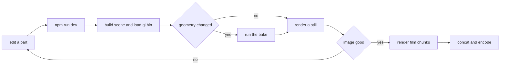
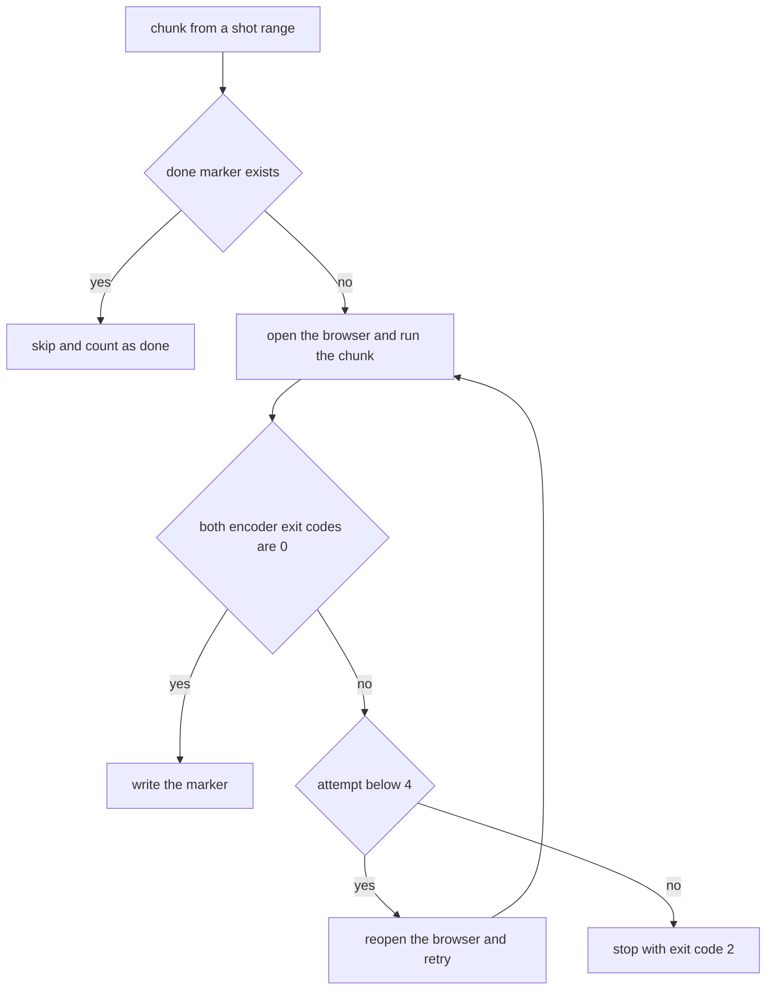

# The loop: edit, bake, look, render, encode

## The loop in one page

The project has one working loop. A developer edits a part module or the room. The developer starts
the development server and opens the page. The page builds the scene and loads the last bake. The
developer looks at a still or walks the room. If the geometry changed, the developer bakes the light
again. If the image is good, the developer renders the film and encodes it.



The loop has two long waits. A bake takes many minutes. A film render takes hours. The tools are
built around those waits: the bake writes one file, and the film writes resumable chunks.

The cost of a change depends on the change. A normal map or a texture edit needs no new bake, because
the bake reads only the average albedo and the geometry. A material colour change needs a new bake,
because the albedo controls the bounce light. A move needs a new bake, because every sample point
keeps its old light. A move changes positions but not the vertex count or the vertex order, so the
staleness check cannot detect it. A resize or a new mesh needs a new bake, and it usually changes the
vertex count or the vertex order that the file expects. A change to the scene random number
generator (RNG) affects every part after the change, so it needs a full bake even when the vertex
counts match.

A full bake on the shipped scene took 1,808 seconds at 160 samples. The default driver uses 128
samples, and the README example uses 256 (`src/bake/baker.js:18`, `README.md:67`). A developer should
plan the work around that cost and use the `only` filter for a single part.

A geometry change has a fixed order of work. First, edit the part and load a still with the old bake:
`node tools/shot.mjs desk`. The run succeeds when it prints `shot shots/desk.jpg ...` and the file
exists. The new geometry shows flat light or wrong light. Second, bake the part alone:
`node tools/shot.mjs --bake 96 --url "only=desk&out=public/bake/tmp_desk.bin"`. The run succeeds
when it prints `bake:` with a metadata object and `[bake] saved public/bake/tmp_desk.bin`. Third,
inspect the isolated still with that file: `node tools/shot.mjs --url "only=desk&gi=tmp_desk.bin"
desk`. The success signal is the same `shot` line. Fourth, bake the whole scene:
`node tools/shot.mjs --bake 160`. The success signal is `[bake] saved public/bake/gi.bin`. Fifth,
inspect a wide still and the changed part: `node tools/shot.mjs wide desk`. The success signal is one
`shot` line for each camera. Sixth, render one test chunk with `node tools/film.mjs --shots 0 --max
1`, which succeeds when it prints `chunk 1/1 ... ok`. Then render the full film with
`node tools/film.mjs`. The order keeps the expensive full bake after the cheap geometry checks.

## Writing a part

The architecture guide states the part contract in a code block (`docs/ARCHITECTURE.md:25-31`). The
loader applies that contract in a fixed sequence.

```text
# src/scene/index.js:26-32
  mods.sort((a, b) => (a.order || 0) - (b.order || 0));
  for (const m of mods) {
    onProgress(m.label || 'things');
    const g = await m.build(ctx);
    if (g) scene.add(g);
    await new Promise((r) => setTimeout(r, 0));
  }
```

A part is a module in `src/scene/parts/`. It exports an `order`, a `label` and a `build` function.
The loader imports every file in the directory, sorts by `order` and awaits `build` (`src/scene/index.js:9-31`).
The function receives the shared context and returns a group. The group must use world-space metres,
because the bake reads `matrixWorld`.

The context gives a part three shared resources. `ctx.M` is the material library. `ctx.rng` is the
scene random number generator (RNG). `ctx.colliders` is the collision list for the walk
(`docs/ARCHITECTURE.md:33-34`). A part may also write `ctx.glass`, but the room already owns that
field (`src/scene/room.js:155`).

The source shows the pattern well in the desk module. It creates a group with a fixed name, creates
its own seeded RNG, builds the geometry into named buckets and merges each bucket into one mesh
(`src/scene/parts/desk.js:1632-1653`). It also pushes two collision boxes
(`src/scene/parts/desk.js:1655-1656`). The triangle count goes into `root.userData.tris`
(`src/scene/parts/desk.js:1657`).

## The invariants

The guide lists eight rules that keep the baked light valid (`docs/ARCHITECTURE.md:36-59`). The
first two cover randomness and materials.

```text
# docs/ARCHITECTURE.md:36-42
Rules that keep the baked lighting valid:

1. **Deterministic**: all randomness through `new RNG(seed)` from `core/rng.js`. Never `Math.random()`.
2. **Materials** must come from `pbr(params, extra)` / `fabric(color, opts)` in `scene/materials.js`
   (or `ctx.M.*`). They are lit only by the bake; a plain three material renders black.
   Colours: `sc(r,g,b)` takes sRGB values. For textured materials pass
   `extra.bake = { albedo:[r,g,b] }` (linear average) so bounce light has the right colour.
```

The rules matter because the bake is a separate run. A random layout without a seed produces a
different scene on every load, and the bake cannot match it. A plain three.js material has no light
attribute and no patch, so it renders black. A textured material needs a `bake.albedo` value, because
the path tracer cannot read the texture map. The material library clamps that albedo to 0.92
(`src/bake/baker.js:11`).

The next two rules cover tessellation and flat decals.

```text
# docs/ARCHITECTURE.md:43-48
3. **Tessellate** — light is stored per vertex, so big flat faces need vertices:
   `roundedBox(w,h,d,{r, rs, maxEdge})`, `gridPlane(w,h,maxEdge)` from `core/geo.js`.
   Use `maxEdge` 0.015–0.02 where objects rest on a surface (table tops, shelves), 0.04–0.06 for large
   furniture faces, default for small props. Every box should have a bevel (`r` ≥ 1.5 mm).
4. Thin things lying flat on a wall/floor (posters, rug) set `mesh.userData.bakeOccluder = false`
   so they don't carve a dark halo into the surface behind them.
```

The tessellation rule follows from the data model. Light lives at vertices, so a large quad with four
vertices gets four light values. A wall that spans the room needs a grid. The resting-contact rule
adds vertices near a shelf or a table top, where the light changes quickly. The `maxEdge` values in
the quoted rule are metres.

The bevel rule is a style rule with a lighting reason. A sharp box edge has a normal jump, and the
smoothing pass refuses to average across a normal difference above the dot threshold. A bevel gives
the edge a small band of intermediate normals. The guide asks for a radius of at least 1.5
millimetres. The source does not always follow that value, and document 04 reports the exceptions.

The last four rules cover translucency, instancing, exclusion and wind.

```text
# docs/ARCHITECTURE.md:49-59
5. Translucent cloth / leaves: `fabric(color, { trans: 0.3, side: THREE.DoubleSide })` or
   `pbr(params, { back: true, trans: new THREE.Color(…) })` with
   `mat.userData.bake = { albedo, trans: 0.3, transColor, twoSided: true, thru: 0.0 }`
   (`trans` = diffuse transmission probability, `thru` = fraction of rays passing straight through,
   for sheers / leaf cards with holes).
6. Lots of small identical things (leaves): one `InstancedMesh` with `mesh.userData.giInstanced = true`
   → one light sample per instance (set `userData.giNormal` / `giAnchor` in the instance's local space).
7. Not lit by the bake (sky dome, glass, emissive): `mesh.userData.gi = false`; not a shadow caster:
   `material.userData.bake = { ignore: true }`.
8. Wind / motion happens in the vertex shader through `pbr(…, { onCompile(shader){…}, key:'unique' })`
   using the shared `uTime` uniform (`GI.uniforms.uTime`, seconds). Rest pose is what gets baked.
```

The translucency rule explains the optional `giB` attribute. A two-sided material needs a sample for
the flipped normal, and the material must declare `back: true` so the loader treats it as a back
mesh. The instancing rule explains the per-instance sample. The exclusion rule covers the sky, the
glass and any emissive object. The wind rule keeps motion in the vertex shader, so the rest pose is
what the bake sees.

One rule in the guide has no implementation. The guide says `ctx.animated.push` registers a
per-frame callback (`docs/ARCHITECTURE.md:34`). No part calls that method. The walk and the film prep
read the empty array (`src/game/game.js:68`, `src/main.js:91`). A developer who follows the guide
will add a callback that never runs.

## A bake run

A bake needs the development server. Start it with `npm run dev`; the server listens on port 5319
with a strict port (`vite.config.js:64`). The page does the work, and the server writes the result.

The shortest command is `node tools/shot.mjs --bake 256` (`README.md:67`).

The tool builds a uniform resource locator (URL) with `?shot=1&bake=256&workers=6` (`tools/shot.mjs:29`). The tool also installs a console filter and a ready wait.

```text
# tools/shot.mjs:26-36
const logs = [];
page.on('console', (m) => { const t = m.text(); logs.push(t); if (/^\[(bake|boot|gi|gpu|film)\]/.test(t) || m.type() === 'error' || m.type() === 'warn') console.log('  ' + t.slice(0, 400)); });
page.on('pageerror', (e) => console.log('  PAGEERROR ' + e.message));
const base = `http://127.0.0.1:${opt.port}/?shot=1` + (opt.bake ? `&bake=${opt.bake}&workers=${opt.workers}` : '') + (opt.url ? '&' + opt.url : '');
const t0 = Date.now();
await page.goto(base, { waitUntil: 'load', timeout: 120_000 });
await page.waitForFunction('window.__ready || window.__error', { timeout: 3600_000, polling: 500 });
const err = await page.evaluate('window.__error');
if (err) { console.log('ERROR', err); await browser.close(); process.exit(1); }
console.log(`ready in ${((Date.now() - t0) / 1000).toFixed(1)}s`, await page.evaluate('JSON.stringify(window.__api.stats())'));
if (opt.bake) console.log('bake:', await page.evaluate('JSON.stringify(window.__bakeDone)'));
```

 The page takes the
bake branch (`src/main.js:42-51`). It puts placeholder light on the scene, imports the driver, runs
the bake, packs the buffer and posts it to `/api/save`. The default output is
`public/bake/gi.bin` (`src/main.js:48`).

The tool forwards page console lines that start with `[bake]`, `[boot]`, `[gi]`, `[gpu]` or `[film]`
(`tools/shot.mjs:27`). The driver prints a line at start, at worker ready, every 64 finished jobs and
at the end (`src/bake/baker.js:115`, `src/bake/baker.js:129`, `src/bake/baker.js:138`,
`src/bake/baker.js:211`). The page also writes the fraction to `window.__bakeProgress`
(`src/bake/baker.js:138`). No tool reads that value during a bake.

The tool waits for `window.__ready` or `window.__error` with a one hour timeout
(`tools/shot.mjs:32`). A bake run sets `window.__bakeDone` with the metadata, and the tool prints it
(`tools/shot.mjs:36`). The metadata holds the sample count, the seconds, the sample points, the
triangle count and the byte size (`src/main.js:49`).

The shipped file records 160 samples, 1,808 seconds, 1,157,291 sample points and 1,742,198
triangles. The README says the 256 sample bake takes about 20 to 30 minutes (`README.md:67`). The
source states no duration for 256 samples, so that figure is a README claim, not a measured source
value.

A bake on one part is the fast path. The URL parameter `only` filters the part list by module file
name (`src/scene/index.js:18-25`). The room shell still builds, because it is added before the
filter. The full command is `node tools/shot.mjs --bake 96 --url
"only=bed&out=public/bake/tmp_bed.bin"` (`docs/ARCHITECTURE.md:68-69`). The desk prints its own
triangle count when `only` is present (`src/scene/parts/desk.js:1658`).

## Checking the bake

The bake has few automatic checks. The important one runs at load time.

`applyBake` compares each mesh key, vertex count and back flag. A mismatch calls `zeroGi`
(`src/core/gi.js:184-186`). The page logs the applied and stale counts, and the tools print that
line under the `[gi]` prefix (`src/main.js:56`, `tools/shot.mjs:27`). A stale count above zero is the
first warning sign after a geometry change.

```text
# src/core/gi.js:186-186
    if (!m || m.count !== e.count || m.back !== e.back) { stale++; zeroGi(e); continue; }
```

The check does not compare positions, normals or triangle order. A part that moves a vertex without
changing the count passes the check. The light then belongs to the old position. The check also does
not compare the seed. A change to the scene RNG that keeps the same counts passes.

The bake itself checks little. The `ok` flag marks samples that sit inside another surface, and the
clean step repairs them (`src/bake/baker.js:150-163`). The driver does not report how many samples
were invalid, and it does not print the minimum or maximum light value. A bake can finish with a
large black patch and still report success.

The still tool gives the fastest visual check. It sets a camera, renders an average and saves a Joint
Photographic Experts Group (JPEG) image (`tools/shot.mjs:39-47`). The tool prints the draw call count
and the triangle count, but not a timing breakdown.

## Stills

A still uses a named camera or an explicit camera tuple. The named form is `node tools/shot.mjs bed wide desk`. The numeric form is `node tools/shot.mjs 1.2,1.4,2.5,1.5,1.0,0,45`.

The first form looks up a name in `CAMS`. The second form builds a camera from position, target and
field of view (`tools/shot.mjs:42`). The default frame is 1,280 by 720 pixels with 8 accumulated
sub-frames at time 2.0 seconds (`tools/shot.mjs:10`). The `--look` option merges a JavaScript Object
Notation (JSON) object into the pipeline look values, so a test can change the exposure without a
code edit (`tools/shot.mjs:14`).

`window.__api.shot` resizes the pipeline, sets the camera, calls `renderAccum`, restores the camera
and returns the statistics (`src/main.js:113-121`). The tool then takes a browser screenshot of the
page (`tools/shot.mjs:46`). The still loop is short.

```text
# tools/shot.mjs:39-47
for (const cam of cams) {
  const t1 = Date.now();
  let camArg = cam;
  if (cam.includes(',')) { const n = cam.split(',').map(Number); camArg = { pos: n.slice(0, 3), target: n.slice(3, 6), fov: n[6] || 50 }; }
  const info = await page.evaluate((o) => window.__api.shot(o), { cam: camArg, w: opt.w, h: opt.h, accum: opt.accum, time: opt.time, look: opt.look });
  const name = (typeof camArg === 'string' ? cam : 'custom' + (ci++ ? ci : '')) + (opt.tag ? '_' + opt.tag : '');
  const file = path.join('shots', name + '.jpg');
  await page.screenshot({ path: file, type: 'jpeg', quality: opt.q });
  console.log(`shot ${file}  ${Date.now() - t1}ms  calls=${info.calls} tris=${info.tris}`);
```

The page function is the other half.

```text
# src/main.js:113-121
    async shot({ cam = 'bed', w = 1280, h = 720, accum = 8, time = 2.0, look = null } = {}) {
      if (look) Object.assign(pipe.look, look);
      resize(w, h, { msaa: 0 }); setCam(cam);
      basePos.copy(camera.position);
      pipe.renderAccum(accum, makePrep(time, 0), 0);
      restoreCam();
      gl.finish();
      return { w, h, calls: renderer.info.render.calls, tris: renderer.info.render.triangles };
    },
```

 The screenshot path goes through the browser compositor, not through a
direct pixel read. A screenshot is therefore a display-referred copy of the canvas.

The still mode has no check for a blank image. A black frame saves as a valid JPEG. A person must look
at the file, or compare its size against a known frame.

A useful inspection has a short list. Look at the brightest window pixel and check that the frame
shape is still visible. Look at a corner away from the window and check that the wall is dark but not
black. Look at a curtain edge and check that the cloth shows light through it. Look at a glossy desk
edge and check that the reflection carries the room rather than a flat colour. Look at a crease in
the duvet and check that the two sides differ. Each item maps to one mechanism in document 00, so a
failure points to a specific part of the bake.

The still tool cannot automate those checks. It has no reference image and no numeric threshold. The
person supplies the judgement, and the tool supplies a repeatable camera and a repeatable render.

## The film run

A film run renders one chunk at a time. The full command is `node tools/film.mjs`, which renders all
shots at 3,840 by 2,160 pixels, encodes both streams and then calls the concat step. A short test is
`node tools/film.mjs --shots 0 --max 1`, which renders the first chunk of the first shot. The tool
asks the page for the shot ranges, splits each range into chunks and loops.

```text
# tools/film.mjs:72-76
const ranges = await page.evaluate(async (fps) => (await import('/src/render/film.js')).shotRanges(fps), o.fps);
const want = o.shots === '' ? null : o.shots.split(',').map(Number);
const chunks = [];
for (const r of ranges) { if (want && !want.includes(r.shot)) continue; for (let a = r.from; a < r.to; a += o.chunk) chunks.push({ shot: r.shot, name: r.name, from: a, to: Math.min(r.to, a + o.chunk) }); }
if (o.max) chunks.length = Math.min(chunks.length, o.max);   // --max N: only the first N chunks (tests)
```

The default chunk is 60 frames (`tools/film.mjs:12`). A chunk carries a shot index, a frame range and
the base render settings. The page computes the shot boundaries from the durations and the frame
rate (`src/render/film.js:114-115`).

The loop writes a marker after a chunk whose encoders both exit with code 0.

```text
# tools/film.mjs:78-81
for (const c of chunks) {
  const tag = String(c.shot + 1).padStart(2, '0') + '_' + c.name + '_' + String(c.from).padStart(5, '0');
  const mark = `${o.out}_${tag}.done`;
  if (fs.existsSync(mark)) { done++; continue; }
```

The marker name is the output prefix plus the shot index, the shot name and the first frame. The loop
skips a chunk when the marker exists. This is the resume mechanism.



The marker has a weakness. It contains no resolution, encoder setting or source revision. A chunk
rendered at 1,920 by 1,080 is skipped when the run later asks for 3,840 by 2,160.
The concat step trusts the marker, so it accepts the mixed result (`tools/film.mjs:20`). The same
applies to a change in the source or the bake file.

The tool protects a long chunk with a watchdog.

```text
# tools/film.mjs:87-97
      const dog = (async () => { // watchdog: no new frame for 5 minutes -> give up on this attempt
        let lastSeen = Date.now(), lastFrame = -2;
        while (alive) {
          await new Promise((r) => setTimeout(r, 15000));
          if (!alive) return;
          // the page is busy rendering most of the time, so a slow answer here is normal
          const fr = await Promise.race([page.evaluate(() => window.__filmProgress.frame), new Promise((r) => setTimeout(() => r(null), 30000))]);
          if (fr !== null && fr !== lastFrame) { lastFrame = fr; lastSeen = Date.now(); }
          if (Date.now() - lastSeen > 300000) throw new Error('stalled');
        }
      })();
```

The watchdog reads `window.__filmProgress` every 15 seconds. A frame counter change resets the timer.
No change for 300 seconds throws a stall error. The page writes the counter after each frame
(`src/render/film.js:141`). A page that is busy rendering can answer the check slowly, so the read
has a 30 second race timeout.

A failed chunk is retried up to four times.

```text
# tools/film.mjs:104-109
    } catch (e) {
      console.log(stamp(), `chunk ${tag} attempt ${attempt} failed: ${String(e.message).slice(0, 200)}`);
      if (attempt >= 4) { console.log('giving up'); process.exit(2); }
      await open();
    }
  }
```

Each retry closes the browser and opens a new one. The same chunk starts again from its first frame.
The page does not keep partial frames, and the server kills the old encoder when a new `start`
message arrives with the same identifier (`vite.config.js:29`). A crash can therefore cost up to one
chunk of work, not the whole film.

The page side has its own limits. It renders both an HDR10 stream and a standard dynamic range (SDR)
stream by default (`src/render/film.js:109`). Each frame forces a garbage collection when the browser
exposes `window.gc`, and the launch flag `--expose-gc` makes that available (`src/render/film.js:139`,
`tools/film.mjs:47`). The readback is synchronous, so the page blocks while it copies the frame.

The page sends each frame with a sequence number. The server writes a sequence number once
(`vite.config.js:41-48`). A retry of the same frame is harmless, because the server drops the second
write. This is the only automatic check on frame delivery.

## The concat and the encode

A full run calls the concat step at the end (`tools/film.mjs:112`). The command
`node tools/film.mjs --concat` runs only that step from the existing chunks. A run with `--shots` or
`--noconcat` skips it.

```text
# tools/film.mjs:18-35
function concat(kind) {
  const base = o.out.split('/').pop();
  const files = fs.readdirSync('out').filter((f) => f.startsWith(base + '_') && f.endsWith(`_${kind}.mp4`) && fs.existsSync('out/' + f.replace(`_${kind}.mp4`, '.done'))).sort();
  if (!files.length) return console.log('no finished chunks for', kind);
  fs.writeFileSync(`out/list_${kind}.txt`, files.map((f) => `file '${f}'`).join('\n'));
  const snd = fs.existsSync('out/soundtrack.m4a');
  const src = ['-y', '-v', 'error', '-f', 'concat', '-safe', '0', '-i', `out/list_${kind}.txt`, ...(snd ? ['-i', 'out/soundtrack.m4a', '-map', '0:v:0', '-map', '1:a:0', '-c:a', 'copy', '-shortest'] : ['-an'])];
  const run = (args, dst) => { execFileSync('ffmpeg', [...src, ...args, '-movflags', '+faststart', dst], { stdio: ['ignore', 'ignore', 'inherit'] }); console.log(stamp(), 'wrote', dst, (fs.statSync(dst).size / 1e6).toFixed(1) + ' MB'); };
  if (kind === 'hdr') {
    run(['-c:v', 'libx265', '-preset', 'slow', '-crf', '12', '-pix_fmt', 'yuv420p10le', '-color_primaries', 'bt2020', '-color_trc', 'smpte2084', '-colorspace', 'bt2020nc', '-color_range', 'tv',
      '-x265-params', `pools=${o.threads}:aq-mode=3:hdr10=1:hdr10-opt=1:repeat-headers=1:colorprim=bt2020:transfer=smpte2084:colormatrix=bt2020nc:range=limited:master-display=G(13250,34500)B(7500,3000)R(34000,16000)WP(15635,16450)L(10000000,50):max-cll=1000,180:log-level=error`,
      '-tag:v', 'hvc1'], 'out/room-at-dawn_4k_hdr10.mp4');
  } else {
    const c709 = ['-color_primaries', 'bt709', '-color_trc', 'bt709', '-colorspace', 'bt709'];
    run(['-c:v', 'libx264', '-preset', 'slow', '-crf', '17', '-threads', String(o.threads), '-pix_fmt', 'yuv420p', ...c709], 'out/room-at-dawn_4k_sdr.mp4');
    run(['-vf', 'scale=1920:1080:flags=lanczos', '-c:v', 'libx264', '-preset', 'slow', '-crf', '19', '-threads', String(o.threads), '-pix_fmt', 'yuv420p', ...c709], 'out/room-at-dawn_1080p_sdr.mp4');
  }
}
```

The concat reads the output directory. It keeps a file only when the matching `.done` marker exists
(`tools/film.mjs:20`). It writes a list file and passes the list to the concat demuxer. If
`out/soundtrack.m4a` exists, it maps that audio stream and copies it without re-encoding
(`tools/film.mjs:23-24`). The `-shortest` flag trims the longer stream.

The encode settings differ by output. The high dynamic range (HDR) file uses `libx265` with 10-bit pixels and a perceptual quantizer (PQ) transfer function. Its colour matrix is the International Telecommunication Union Radiocommunication Sector BT.2020 matrix (BT.2020), and its tags are High Efficiency Video Coding (HEVC). The master display metadata declares 1,000 nits, and the content light metadata declares 1,000 and 180 (`tools/film.mjs:27-29`). The SDR file at 3,840 by 2,160 pixels (4K) uses `libx264` at constant rate factor 17. The file at 1,920 by 1,080 pixels (1080p) uses the same codec at 19 with a Lanczos scale (`tools/film.mjs:31-33`).

The concat has no check for a gap. It sorts the marked files by name and joins them. If a middle
chunk has no marker, the file set is one short, and the film is shorter than the timeline. The tool
prints the output size but does not compare the duration with `FILM_LENGTH`.

The encode also has no visual check. A wrong transfer function or a wrong matrix produces a file with
the right duration and the wrong colour. The source has no automated test for that case.

## The other tools

Three small tools support the loop.

`tools/profile.mjs` measures the graphics processing unit (GPU) cost of each top-level scene group
(`tools/profile.mjs:1-24`). It renders the scene four times, hides one group at a time and reports
the difference. It also times one accumulated sub-frame. It prints JSON to the console
(`tools/profile.mjs:24`).

```text
# tools/profile.mjs:11-24
const res = await page.evaluate(async (w, h) => {
  const api = window.__api, { renderer, scene, camera, pipe } = api, gl = renderer.getContext();
  api.resize(w, h, { msaa: 0 }); api.setCam('bed');
  const px = new Uint8Array(4);
  const sync = () => { gl.readPixels(0, 0, 1, 1, gl.RGBA, gl.UNSIGNED_BYTE, px); };
  const time = (fn, n = 4) => { fn(); sync(); const t = performance.now(); for (let i = 0; i < n; i++) fn(); sync(); return +((performance.now() - t) / n).toFixed(1); };
  const sceneOnly = () => { renderer.info.reset(); renderer.setRenderTarget(pipe.rtMain); renderer.clear(); renderer.render(scene, camera); };
  const out = {};
  out.sceneAll = time(sceneOnly); out.tris = renderer.info.render.triangles; out.calls = renderer.info.render.calls;
  for (const g of scene.children) { g.visible = false; out['without_' + (g.name || g.type)] = time(sceneOnly); g.visible = true; }
  out.fullSubframe = time(() => pipe._sceneAndAOAccum(1 / 16));
  return out;
}, w, h);
console.log(JSON.stringify(res, null, 1));
```


`tools/eval.mjs` evaluates one JavaScript expression in the page and prints the result
(`tools/eval.mjs:12`). It is the general escape hatch for a check that no other tool provides.
```text
# tools/eval.mjs:10-13
await page.goto('http://127.0.0.1:5319/?shot=1' + (process.argv[3] ? '&' + process.argv[3] : ''), { waitUntil: 'load' });
await page.waitForFunction('window.__ready || window.__error', { timeout: 600000, polling: 300 });
console.log(await page.evaluate(`(async()=>{ const r = await (${process.argv[2]}); return typeof r === 'string' ? r : JSON.stringify(r); })()`));
await browser.close();
```


`tools/sys.ps1` prints one line with central processing unit (CPU) load, free memory and graphics
processing unit (GPU) load on Windows (`tools/sys.ps1:1-14`). Its purpose is to let a person decide
whether a heavy step can start.

## Common failures

Four failures appear in the loop, and each has a clear symptom.

A stale count above zero means the bake file does not match the scene. The page still runs, and the
affected mesh shows a flat value of 0.06. The fix is a new bake, or a return to the geometry that
produced the file (`src/core/gi.js:186`). A stale count of zero does not prove a match, because
positions and vertex order are not compared.

A black patch on a still usually means an invalid sample that the fill could not reach. The fill
needs a valid neighbour along an edge, and a whole island of invalid samples has none. The source does
not report the invalid count, so the patch is the only signal. A second cause is a material without
the light patch. A plain three.js material renders black by design (`docs/ARCHITECTURE.md:39-40`).

A chunk that never writes a marker is a failed chunk. The tool prints the attempt number and the
error, then reopens the browser. Four failed attempts stop the run with exit code 2
(`tools/film.mjs:104-109`). The earlier chunks stay on disk, so a later run resumes after the last
marker.

A missing browser stops every tool before the page loads. `shot.mjs` searches two Windows paths for
Chrome and Edge (`tools/shot.mjs:17`). `profile.mjs` and `eval.mjs` hard-code one Chrome path
(`tools/profile.mjs:5`, `tools/eval.mjs:3`). On another operating system the launch fails with a
generic puppeteer error, and no tool explains the expected path. Document 04 treats this as a
portability limit.

## What is not checked

The project has no test suite, no continuous integration (CI) directory and no `engines` field in
`package.json`. The checks in the loop are process checks, not correctness checks. The complete list
is short.

- The page reports ready or error through `window.__ready` and `window.__error`
  (`src/main.js:136`).
- The bake reports its metadata once, and the load path reports applied and stale counts.
- A chunk writes a marker only when both encoder exit codes are 0. The marker holds
  `JSON.stringify(res)`, and `res` contains the tag, the frame count, the sample count, the stage
  times and both exit codes (`tools/film.mjs:99-100`, `src/render/film.js:150`).
- The watchdog stops a chunk after five minutes without a new frame.
- The concat throws when `ffmpeg` exits with a nonzero code, because the tool uses `execFileSync`.

The list does not include an image comparison, a light value range, a stale bake gate, a chunk
settings check, a duration check or an audio sync check. A person supplies those checks by looking at
a still and at the encoded film.

## Aha

**Aha:** The quality system is built from observability, not from assertions. The page publishes
`__ready`, `__error`, `__bakeDone` and `__filmProgress`. The tools watch those values, and the file
system holds the resume state. Nothing in the project decides that an image is correct. The design
assumes a person will look, and it spends its effort on making the long runs safe to stop and safe to
repeat. That is a reasonable choice for a visual project with one author. It is also the reason a
silent mismatch, such as a moved vertex with an unchanged count, can survive a full bake and a full
film render.

## What this document leaves out

This document covers the operating loop and the checks. It does not derive the estimator, because
document 02 does that. It does not compare the project with other renderers, because document 04 does
that. It does not cover the browser walk controls beyond the collision boxes, because document 00
does that.
