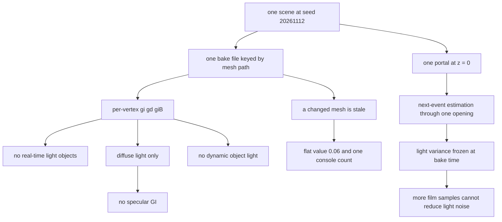
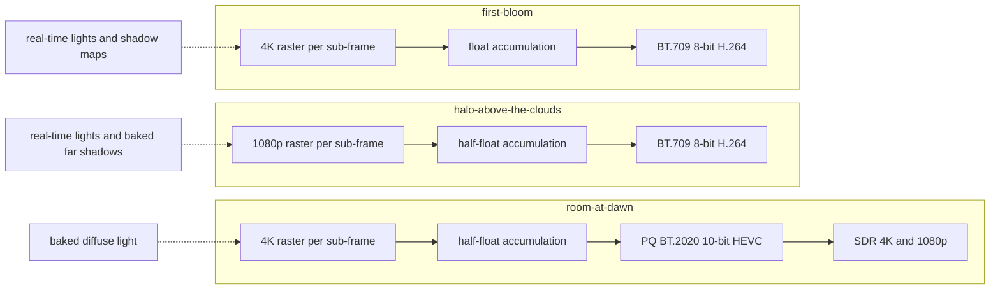

# Limits and comparison

This document asks what the project cannot do, and what a comparison with two sibling packages can show. The limits follow from one contract. Light is computed once, for one static room, and stored on vertices. Every other limit is a consequence of that choice. The comparison follows the mechanism, not the released image. The three packages share a frame idea. They do not share a light model.

## Three kinds of limit

A limit can be a stated default, a silent assumption, or an absent feature. A stated default is a number in the source, such as six workers (`src/bake/baker.js:18`). A silent assumption is a property that the code needs but does not record, such as one window. An absent feature is work that the code never attempts, such as a real-time shadow. The first kind is easy to find. The second kind needs a reading of the whole path. The third kind needs a reading of what is missing. This document separates the three, because a reader who mixes them will mistake a tuning choice for a hard boundary.

## The limits the source states

The bake driver takes a base sample count (`spp`) of 128 for each sample point, six workers and one
smoothing step (`src/bake/baker.js:18`). The npm script `bake` passes 256 instead
(`package.json:10`). The page reads that value from the query string (`src/main.js:45`). The film
driver takes 16 as its sample scale (`tools/film.mjs:12`) and multiplies it by the per-shot count
(`src/render/film.js:118`). The walk adapts its resolution between 0.5 and 1.0 of the fitted size
(`src/game/game.js:108-109`). The development server holds an idle connection for 600 seconds
(`vite.config.js:14`). The film loop uses 60-frame chunks (`tools/film.mjs:12`), a five-minute stall
window (`tools/film.mjs:95`) and four attempts (`tools/film.mjs:106`). Each value is a choice, and
each choice has a cost.

```text
# package.json:5-12
  "scripts": {
    "dev": "vite",
    "build": "vite build",
    "preview": "vite preview",
    "shot": "node tools/shot.mjs",
    "bake": "node tools/shot.mjs --bake 256",
    "film": "node tools/film.mjs"
  },
```

The dependency list includes `n8ao` (`package.json:17`). No module in `src`, no tool and no page imports it. The ambient occlusion (AO) pass is a hand-written shader with 14 samples (`src/render/pipeline.js:21-57`), not the library. A reader who installs the tree pays for a package that the renderer never calls. The source does not state why the package remains. The package file is not a reliable map of the renderer.

```text
# package.json:16-20
  "dependencies": {
    "n8ao": "^2.0.1",
    "three": "^0.187.0",
    "three-mesh-bvh": "^0.9.18"
  },
```

The architecture guide also asks every box bevel to have a radius of at least 1.5 millimetres
(`docs/ARCHITECTURE.md:46`). The source does not always follow that rule. Measured exceptions
include `src/scene/room.js:231` (0.0003 metre), `src/scene/room.js:265` (0.0004),
`src/scene/room.js:270` (0.0003), `src/scene/parts/desk.js:1138` (0.0004),
`src/scene/parts/desk.js:1150` (0.00006), `src/scene/parts/desk.js:1121` (0.00035),
`src/scene/parts/desk.js:1211` (0.00015), `src/scene/parts/fixtures.js:926` (0.00015) and
`src/scene/parts/plants.js:501-502` (0.001). The rule is a guide, not an enforced invariant.

The bake file states its own format. The magic number is `0x47494231`. The header holds the length of
a JavaScript Object Notation (JSON) manifest. Each manifest entry holds a key, a count, an element
offset and a back flag (`src/core/gi.js:154-160`). The key is the mesh path. The format therefore
binds the file to the scene graph. A rename, a vertex count change or a change to the back flag
breaks the match. The loader does not store a geometry hash, a seed, a source revision or a timestamp. The file cannot prove that it belongs to the tree that loads it.

```text
# src/core/gi.js:152-160
/** Serialise baked attributes (half floats) -> ArrayBuffer. */
export function packBake(list, meta = {}) {
  const man = { version: 1, meta, meshes: [] };
  let total = 0;
  for (const e of list) { const per = e.back ? 9 : 6; man.meshes.push({ key: e.key, count: e.count, off: total, back: e.back }); total += e.count * per; }
  const json = new TextEncoder().encode(JSON.stringify(man));
  const pad = (4 - ((8 + json.length) % 4)) % 4;
  const buf = new ArrayBuffer(8 + json.length + pad + total * 2);
  const dv = new DataView(buf); dv.setUint32(0, 0x47494231, true); dv.setUint32(4, json.length, true);
```

The loader reports a stale mesh with one number. A mesh that does not match gets the flat value 0.06 on `gi` and zero on `gd` (`src/core/gi.js:198-204`). The scene still runs. The image still appears. The only signal is a console count (`src/main.js:56`). A reader who does not watch the console will not see the change.

```text
# src/core/gi.js:198-204
function zeroGi(e) {
  for (const name of e.back ? ['gi', 'gd', 'giB'] : ['gi', 'gd']) {
    const arr = new Float32Array(e.count * 3);
    if (name !== 'gd') arr.fill(0.06);
    setAttr(e, name, arr);
  }
}
```

## The limits the source leaves unstated

The package file has no `engines` field (`package.json:1-27`), so the source states no Node version. The sibling `first-bloom` states Node 20 or later (`first-bloom/README.md:32`), and `halo-above-the-clouds` states Node 22.12 or later (`halo-above-the-clouds/README.md:21`). This project states neither. The script block lists six commands and none runs a test (`package.json:5-12`). The tree has no test directory and no continuous integration (CI) workflow. A change is checked by eye, by a still, or by a film frame.

The source states no graphics processing unit (GPU) minimum and no memory budget. The renderer logs the GPU name at boot (`src/main.js:22-24`), and the note goes no further. The project README says the resolution was "tuned on an integrated GPU (Radeon 780M)" (`README.md:38`). No source line states that device. The bake header records spp, seconds, sample points and triangles (`src/main.js:47`), and it records no hardware. A reader cannot tell which machine produced the shipped 1,808 seconds.

The source states no film render time. The tools report seconds per frame and an estimate (`src/render/film.js:142`), but no file records a completed run. The project README states a bake estimate of 20 to 30 minutes for 256 spp (`README.md:67`). The shipped file records 1,808 seconds at 160 spp. Linear scaling predicts about 45 to 48 minutes at 256 spp on the same machine. Pass 0 rises from 32 to 48 samples, and pass 1 rises from 160 to 256 (`src/bake/baker.js:182-196`). The two numbers can both be true on different machines. The source does not reconcile them. A reader must not treat the README figure as a property of the code.

The README states about 118,000 leaf cards (`README.md:44-45`). The number appears in the source only as a boot log (`src/scene/parts/exterior.js:910`). No constant states it, so the count depends on the seed and the growth code. The same README key table lists six keys (`README.md:28-36`) and omits the hint toggle on `H` (`src/game/game.js:57`). These are documentation limits, not renderer limits. They matter because the README is the only operating guide in the tree.

## The cost ladder

Three jobs pay for light in three places. The bake pays on the central processing unit (CPU). The film pays on the GPU. The walk pays on the GPU. The same bake answers all three, and only the bake traces light.

The bake has two passes. Pass 0 traces full paths at a reduced count. Pass 1 gathers one bounce and
reads a cache. The source states the reduction. The reduced count is `round(spp / 5)` clamped to the
range 12 to 48 (`src/bake/baker.js:182`). The first pass is cleaned three times
(`src/bake/baker.js:183`). The second pass uses the full `spp` (`src/bake/baker.js:196`). The per-job
multiplier changes the count again: jobs mostly outside the room use 0.3, jobs near the window use 3
and other jobs use 1 (`src/bake/baker.js:120-121`, `src/bake/baker.js:133`). The header value is
therefore a base, not a uniform count. The file records sample points, not rays. The pass-0 count is
`round(spp / 5)` per point, and the pass-1 count is `spp` per point. Both counts are scaled per job
by 0.3, 1 or 3. A reader who multiplies the sample point count by `spp` still misses the pass-0
paths and the job multipliers. The exact total is not in the file.

```text
# src/bake/baker.js:182-196
  const spp1 = Math.max(12, Math.min(48, Math.round(spp / 5)));
  clean(await runPass(0, spp1, 'paths'), 3);
  // cache: irradiance/PI per occluder vertex (front and back side)
  const ce = new Float32Array(nV * 3), cb = new Float32Array(nV * 3);
  for (const e of list) {
    const base = occBase.get(e.mesh); if (base === undefined) continue;
    const vc = e.mesh.geometry.attributes.position.count;
    const n = e.inst ? e.count * vc : vc;
    for (let i = 0; i < n; i++) {
      const q = e.inst ? Math.floor(i / vc) : i, sF = e.ids[q], sB = e.back ? e.idsB[q] : sF, o = (base + i) * 3;
      ce[o] = E[sF * 3]; ce[o + 1] = E[sF * 3 + 1]; ce[o + 2] = E[sF * 3 + 2]; cb[o] = E[sB * 3]; cb[o + 1] = E[sB * 3 + 1]; cb[o + 2] = E[sB * 3 + 2];
    }
  }
  await Promise.all(pool.map((wk) => new Promise((res) => { wk.onmessage = (ev) => { if (ev.data.type === 'cached') res(); }; wk.postMessage({ type: 'cache', ce, cb }); })));
  clean(await runPass(1, spp, 'gather'), smooth);
```

The shipped file holds 1,157,291 sample points, 1,742,198 triangles and 1,808.007 seconds, at a base of 160 spp (`public/bake/gi.bin` header; fields written at `src/main.js:47`). The source does not state a ray count. Each sample point in pass 0 traces up to nine bounces (`src/scene/index.js:33`, used at `src/bake/worker.js:122-164`), and each pass-1 sample traces one gather path (`src/bake/worker.js:226-252`). The exact total is not in the file. The file records points, not paths.

The bake is a CPU job. Six module workers each receive the position and index arrays and build a bounding volume hierarchy (BVH) (`src/bake/worker.js:22`, `src/bake/baker.js:126`). The arrays are cloned into each worker, so six copies of the geometry and six acceleration structures exist at once. The source states no memory budget for this step. A large scene multiplies both the bake time and the worker memory.

```text
# src/bake/baker.js:118-128
  const CH = 3000, jobs = [];
  for (let s = 0; s < nS; s += CH) jobs.push([s, Math.min(nS, s + CH)]);
  const jobMult = jobs.map(([a, b]) => { let out = 0; for (let i = a; i < b; i++) if (SA[i * 6 + 2] < -0.4) out++; let win = 0; for (let i = a; i < b; i++) { const z = SA[i * 6 + 2]; if (z >= -0.4 && z < 0.08) win++; }
    return out > (b - a) * 0.5 ? 0.3 : win > (b - a) * 0.4 ? 3 : 1; });
  const pool = [];
  await Promise.all(Array.from({ length: workers }, (_, w) => new Promise((res, rej) => {
    const wk = new Worker(new URL('./worker.js', import.meta.url), { type: 'module' });
    wk.onerror = rej; wk.onmessage = (ev) => { if (ev.data.type === 'ready') res(); };
    wk.postMessage({ type: 'init', pos, idx, triMat, mats: new Float32Array(mats), cfg, seed: 9001 + w * 7919 });
    pool.push(wk);
  })));
```

The film is a GPU job. Each of the 1,350 frames averages a number of sub-frames. The default scale is 16 (`tools/film.mjs:12`), and the shot table sets 32 to 96 samples (`src/render/film.js:14-34`). At that scale the seven shots sum to 78,000 sub-frames. Each sub-frame draws the whole scene, runs the AO pass, combines the room and the exterior, applies six bloom levels and grades the result (`src/render/pipeline.js:280-300`). The film re-reads the baked attributes for every sub-frame, and it traces no light. Its cost is raster cost, not path cost.

| Shot | Duration (s) | Frames | Sub-frames per frame | Sub-frames |
|---|---:|---:|---:|---:|
| `wake` | 8.5 | 255 | 48 | 12,240 |
| `sill` | 7.0 | 210 | 64 | 13,440 |
| `leaves` | 5.5 | 165 | 96 | 15,840 |
| `duvet` | 6.0 | 180 | 64 | 11,520 |
| `macro` | 5.5 | 165 | 64 | 10,560 |
| `desk` | 5.0 | 150 | 48 | 7,200 |
| `room` | 7.5 | 225 | 32 | 7,200 |
| **Total** | **45.0** | **1,350** | | **78,000** |

```text
# src/render/film.js:113-118
  const hdrBuf = hdr ? new Uint16Array(w * h * 4) : null, sdrBuf = sdr ? new Uint8Array(w * h * 4) : null;
  const starts = []; { let a = 0; for (const s of SHOTS) { starts.push(a); a += s.dur; } }
  const si = opts.shot, sh = SHOTS[si], f0 = Math.round(starts[si] * fps), f1 = Math.round((starts[si] + sh.dur) * fps);
  const a = Math.max(f0, opts.from ?? f0), b = Math.min(f1, opts.to ?? f1);
  const tag = String(si + 1).padStart(2, '0') + '_' + sh.name + '_' + String(a).padStart(5, '0');
  const n = perShot && sh.samples ? Math.max(4, Math.round((sh.samples * samples) / 16)) : samples;
```

The walk targets a frame between 12.5 and 24 milliseconds (ms). It checks the average about once a
second and changes the scale at most once every 1.5 seconds. If the average is above 24 ms, the
scale drops by 12 percent. If it is below 12.5 ms, the scale rises by 8 percent
(`src/game/game.js:102-110`). The floor is 0.5 and the ceiling is 1.0. The initial scale caps the
internal width at 1,600 pixels (`src/game/game.js:13`). The source states no lower frame bound. On a
slow device the scale reaches 0.5 and the frame time can still exceed 24 ms.

```text
# src/game/game.js:102-110
    // adapt resolution once a second
    acc += dt; frames++;
    if (acc > 1) {
      const ms = (acc / frames) * 1000; acc = 0; frames = 0;
      const now = performance.now();
      if (now - lastFit > 1500) {
        if (ms > 24 && scale > 0.5) { scale = Math.max(0.5, scale * 0.88); lastFit = now; fit(); }
        else if (ms < 12.5 && scale < 1) { scale = Math.min(1, scale * 1.08); lastFit = now; fit(); }
      }
```

The ladder is asymmetric. A bake costs minutes once and is shared by both outputs. A film frame costs seconds and is paid 78,000 times. A walk frame costs milliseconds and is paid every refresh. The bake is the only step that can be amortised. The film and the walk cannot.

## Memory and the 4K frame

At 3,840 by 2,160 pixels (4K), one red, green, blue and alpha (RGBA) half-float target holds 66.4 megabytes (MB). The pipeline allocates several. The film calls resize with multisample anti-aliasing (MSAA) off (`src/render/film.js:111`). The size function allocates a half-float main target with a depth texture, two half-resolution AO targets, a half-float composite target and six bloom mipmap levels (`src/render/pipeline.js:202-218`). The accumulator adds one 32-bit float target and one half-float exterior target (`src/render/pipeline.js:282-283`). The combine step adds a half-float target (`src/render/pipeline.js:238`). The present step adds a half-float output and an 8-bit standard dynamic range (SDR) target (`src/render/pipeline.js:295`, `:298`).

```text
# src/render/pipeline.js:202-218
  setSize(w, h, { msaa = 4 } = {}) {
    if (w === this.w && h === this.h && msaa === this.msaa) return;
    this.dispose();
    this.w = w; this.h = h; this.msaa = msaa;
    const opt = { type: THREE.HalfFloatType, minFilter: THREE.LinearFilter, magFilter: THREE.LinearFilter, depthBuffer: false };
    this.rtMain = new THREE.WebGLRenderTarget(w, h, { ...opt, depthBuffer: true, samples: msaa });
    this.rtMain.depthTexture = new THREE.DepthTexture(w, h, THREE.UnsignedIntType);
    this.rtMain.depthTexture.minFilter = this.rtMain.depthTexture.magFilter = THREE.NearestFilter;
    const aw = Math.ceil(w / 2), ah = Math.ceil(h / 2);
    const aoOpt = { ...opt, minFilter: THREE.LinearFilter };
    this.rtAO = new THREE.WebGLRenderTarget(aw, ah, aoOpt); this.rtAO2 = new THREE.WebGLRenderTarget(aw, ah, aoOpt);
    this.rtComp = new THREE.WebGLRenderTarget(w, h, opt);
    this.mips = [];
    let mw = w, mh = h;
    for (let i = 0; i < 6; i++) { mw = Math.max(2, Math.ceil(mw / 2)); mh = Math.max(2, Math.ceil(mh / 2)); this.mips.push(new THREE.WebGLRenderTarget(mw, mh, opt)); }
    this.rtAccum = null; this.rtOut = null;
  }
```

The arithmetic is about 590 MB of render targets at 4K, before driver overhead. The film also allocates a 16-bit readback buffer and an 8-bit readback buffer, which add about 100 MB (`src/render/film.js:113`). The source states no memory budget and no minimum GPU memory. A 4K film run therefore needs a device with at least the sum of these targets, plus the scene, the textures, the bake attributes and the driver. The exact figure depends on the driver and is not in the source.

The walk does not run at 4K by default. The initial scale caps the width at 1,600 pixels (`src/game/game.js:13`), and the adaptation can lower it to half of the fitted size (`src/game/game.js:108`). The walk uses the main, AO, composite and bloom targets, not the film readback targets. Each target is smaller at the fitted size. The bake's main-thread cache is two float arrays of three components per occluder vertex (`src/bake/baker.js:185`). The source does not state the vertex total, so the cache size is unstated. The six worker BVHs are the larger unknown.

The film reads pixels back to the page. `readRenderTargetPixels` copies the 4K target into a typed
array (`src/render/film.js:133-134`). The readback stalls the pipeline for the copy. The source does
not measure the stall. The `Blob` object, a browser handle for an immutable byte sequence, then hands
the buffer to the browser network process by reference (`src/render/film.js:93-97`). The comment
states that a raw typed array is about nine times slower than a Blob for a 66 MB frame
(`src/render/film.js:93-94`). That measurement is in the source, and it is the only transport
measurement in the tree.

## One window, one bake, one seed

The bake takes one portal. `ctx.bake` holds a single rectangle with x and y bounds, a z plane and an area (`src/scene/room.js:274-277`). The room bounds are a second box (`src/scene/room.js:276`). The worker stores the portal in `P` and uses it in `portalPdf` (`src/bake/worker.js:56-61`) and in the next-event estimation (NEE) step. The estimator can importance-sample one opening. A second window would not receive NEE, because no second portal exists in the context. Its light would arrive only by cosine sampling, so the variance would rise and the image would show more noise near that window.

```text
# src/scene/room.js:274-277
  ctx.bake = {
    portal: { x0: win.x0, x1: win.x1, y0: win.y0, y1: win.y1, z: 0, area: ww * wh },
    room: [0.0005, 0.0005, 0.0005, W - 0.0005, H - 0.0005, D - 0.0005],
  };
```

The environment table has the same assumption. It is a 128 by 96 grid built once per worker, at a fixed exterior plane `EXT_Z = -0.45` (`src/bake/worker.js:188-192`). It averages the light over the opening and blurs the result (`src/bake/worker.js:184-187`). The table assumes that the view through the window changes slowly with position. That holds for sky, distant trees and houses. It would not hold for a second opening with a different view, or for a large near object that moves across the window.

```text
# src/bake/worker.js:184-188
// Light arriving through the window from far away (sky, trees, houses) barely depends on where in the
// opening you stand, and a diffuse wall integrates it over a wide angle anyway. So it is tabulated
// once per direction (averaged over the opening, lightly blurred): that removes the leaf/sky
// salt-and-pepper from the direct light without changing its value.
let EM = null; const EMW = 128, EMH = 96, EXT_Z = -0.45;
```

The sky is outside the bake by explicit flags. The sky mesh sets `userData.gi = false` and `userData.bakeOccluder = false` (`src/scene/sky.js:68`), and its material sets `userData.bake = { ignore: true }` (`src/scene/sky.js:69`). The bake uses its own analytic sky function (`src/bake/worker.js:34-43`) and does not trace the visible dome. The dome is a display object. A change to the dome shader does not change the baked light. A change to the worker sky function does.

The seed is the third fixed input. The scene uses a random number generator (RNG) seeded with 20,261,112 (`src/scene/index.js:13`). The bake uses worker seeds `9001 + w * 7919` (`src/bake/baker.js:126`) and the environment table temporarily uses 424,242 (`src/bake/worker.js:190`). The baked values depend on the geometry that the scene seed produces. A change to the scene seed changes the vertex order, the sample welding and the light. The scene builder states that its order is deterministic, so the bake can match the meshes (`src/scene/index.js:1-2`). The bake file carries no seed field.



## No specular global illumination and no shadow map

The bake stores diffuse light only. It carries no specular global illumination (GI). The three
attributes are irradiance over pi for the normal, a mean direction and a flipped value
(`src/core/gi.js:1-7`). The material patch adds that diffuse term to the standard lighting term
(`src/core/gi.js:79-103`). Specular reflection comes from the environment map. The map is captured at
boot by a cube camera at 256 pixels, twice, so glossy surfaces reflect each other
(`src/main.js:61-68`). The function `refreshEnv` exists and is exposed on the public API. Boot calls
it once, so the capture changes only when a caller invokes it (`src/main.js:63-68`,
`src/main.js:111`). A moving object, a time-of-day change or a new light would not appear in the
reflection until a new call. The source states that the capture is once (`src/main.js:61`).

```text
# src/main.js:61-68
  // ---- reflections: capture the lit room once (twice so glossy surfaces reflect each other)
  const rb = ctx.roomBox, probe = new THREE.Vector3(2.35, 1.3, 2.0);
  const refreshEnv = () => {
    GI.uniforms.giExt.value = pipe.look.ext;   // reflections should show the window as bright as the grade shows it
    for (let i = 0; i < 2; i++) { const env = captureEnv(renderer, scene, probe, rb.min, rb.max, 256); if (ctx.glass) ctx.glass.uniforms.envMap.value = env; }
    GI.uniforms.giExt.value = 1;
  };
  refreshEnv();
```

There is no shadow map in the tree. No renderer flag enables one (`src/main.js:14-20`), and no
object sets `castShadow` or `receiveShadow`. Shadows therefore come from two places. The bake stores
the occlusion of the sky and the window. The screen-space AO pass adds contact darkening from the
depth buffer (`src/render/pipeline.js:21-57`). Screen-space AO cannot see geometry outside the frame,
so an object slightly off screen casts no contact shadow. The bake cannot see an object that it did
not include as an occluder. A mesh with `userData.bakeOccluder = false` casts no baked shadow, but it
still appears in the depth buffer and can occlude in screen space.

The absence of a shadow map is a deliberate trade. A shadow map would add a real-time light and a per-frame depth pass. The project has no real-time light, so it has no shadow map. The trade is consistent. The cost is that a change after the bake has no correct shadow, and a moving object cannot cast one.

## Two exposure controls

Exposure lives in two places. The shared look object sets a linear exposure scale factor of 19
(`src/render/look.js:4-7`). The shot table sets a multiplier between 0.62 and 1.5 for six of the
seven shots (`src/render/film.js:14-34`). The film applies the product each frame
(`src/render/film.js:76-77`). The walk changes the same look object toward a value between 1.0 and
1.5 times the base, depending on where the camera looks (`src/game/game.js:94-98`). The two controls
act on one number.

```text
# src/render/look.js:4-7
export const LOOK = {
  exposure: 19,
  ext: 0.21,        // how much of the outside's true brightness the SDR grade shows
  extHdr: 0.55,     // …and the HDR10 grade (brighter window, same room)
```

```text
# src/render/film.js:68-77
export function applyFilmCamera(api, st) {
  const { camera, state } = api;
  camera.position.fromArray(st.pos); camera.fov = st.fov; camera.up.set(0, 1, 0);
  camera.lookAt(V(st.target)); camera.updateProjectionMatrix(); camera.updateMatrixWorld(true);
  // focus distance measured along the view axis
  const fwd = new THREE.Vector3(); camera.getWorldDirection(fwd);
  state.lens.focus = Math.max(0.15, V(st.focus).sub(camera.position).dot(fwd));
  state.lens.aperture = st.ap / 1000;
  api.pipe.look.fade = st.fade;
  api.pipe.look.exposure = LOOK.exposure * (st.exp || 1);   // the camera opens up for the dim corners
```

```text
# src/game/game.js:94-98
    if (mode === 'walk') {
      camera.getWorldDirection(fwd); wish.set(1.5, 1.55, -0.2).sub(camera.position).normalize();
      const see = Math.max(0, Math.min(1, (fwd.dot(wish) - 0.15) / 0.65)), want = LOOK.exposure * (1.5 - 0.5 * see * see * (3 - 2 * see));
      pipe.look.exposure += (want - pipe.look.exposure) * (1 - Math.exp(-dt * 1.6));
    }
```

The walk and the film do not run in the same page mode (`src/main.js:132-135`), so the two controls do not fight at run time. They can still disagree. The film sets a fixed multiplier per shot (`src/render/film.js:77`). The walk derives the multiplier from the view direction (`src/game/game.js:96`). A film shot that looks at the window keeps its hand-set exposure, while a walk at the same position would stop down. The film table is therefore an artistic decision, not a simulation of the walk. A reader who compares a film frame with a live frame at the same camera must expect a different exposure.

The still tool adds a third path. It opens a fresh page in shot mode (`tools/shot.mjs:29`), so the game does not start (`src/main.js:132-135`). The still uses the base exposure unless the caller passes a look object (`src/main.js:113-117`). The look object is merged without validation (`src/main.js:114`). A typo in a field name creates a new field and leaves the grade unchanged. The source states no schema for the override.

## Windows tools and server coupling

Every browser tool hard-codes Windows paths. `shot.mjs` searches two paths (`tools/shot.mjs:17`). `profile.mjs` names one (`tools/profile.mjs:5`). `eval.mjs` names one (`tools/eval.mjs:3`). `film.mjs` searches two (`tools/film.mjs:38`). The bake script uses `shot.mjs` (`package.json:10`), so `npm run bake` needs Chrome or Edge at one of those paths. On another operating system the `exe` value is `undefined` and the launch fails. The sibling `halo-above-the-clouds` documents a `CHROME` environment variable for other systems (`halo-above-the-clouds/README.md:75-76`). This project documents none.

```text
# tools/shot.mjs:17-20
const exe = ['C:/Program Files/Google/Chrome/Application/chrome.exe', 'C:/Program Files (x86)/Microsoft/Edge/Application/msedge.exe'].find((p) => fs.existsSync(p));
const browser = await puppeteer.launch({
  executablePath: exe, headless: true,
  args: ['--use-angle=d3d11', '--enable-gpu', '--ignore-gpu-blocklist', '--enable-webgl', '--disable-background-timer-throttling', '--disable-renderer-backgrounding', `--window-size=${opt.w},${opt.h}`, '--hide-scrollbars', '--mute-audio'],
```

```text
# tools/profile.mjs:5-5
const browser = await puppeteer.launch({ executablePath: 'C:/Program Files/Google/Chrome/Application/chrome.exe', headless: true, args: ['--use-angle=d3d11', '--enable-gpu', '--ignore-gpu-blocklist'], defaultViewport: { width: 960, height: 540 }, protocolTimeout: 0 });
```

The film tool also needs `ffmpeg` on the PATH (`README.md:63`). The server starts the encoders (`vite.config.js:26-36`). The page sends frames to `/api/ff/frame` (`src/render/film.js:96`). The server deduplicates by sequence number (`vite.config.js:37-49`). The film cannot run without the development server. The bake needs the save endpoint (`src/main.js:49`), and the stills need the page. The project is a set of browser tools, not a command-line renderer.

```text
# vite.config.js:11-14
  return {
    name: 'room-dev-api',
    configureServer(server) {
      if (server.httpServer) { server.httpServer.keepAliveTimeout = 600000; server.httpServer.headersTimeout = 610000; }
```

The server keeps a connection for 600 seconds (`vite.config.js:14`). The watchdog gives a chunk 300 seconds (`tools/film.mjs:95`). The watchdog resets when `window.__filmProgress.frame` changes (`tools/film.mjs:93-95`), and the page updates that value after each frame (`src/render/film.js:141`). The window therefore measures frame completion, not the whole chunk. A single frame that takes more than five minutes would still trip it. The source states no maximum frame time. The 300-second window is an implicit performance floor.

## Quiet mismatches

The staleness signal is a console count, not an error (`src/main.js:56`). The film marker is a
`.done` file. It holds `JSON.stringify(res)`, where `res` contains the tag, the frame count, the
sample count, the stage times and both encoder exit codes. The tool writes the marker only when both
codes are 0 (`tools/film.mjs:99-100`, `src/render/film.js:150`). The marker records no resolution, no
encoder setting and no source revision. The concat step accepts every chunk whose name matches and
whose marker exists (`tools/film.mjs:20`). A run with different settings can mix chunks. A missing
chunk is not detected, because concat reads the files that exist. A film can therefore pass every
check and still contain a resolution change or an encoder change at a chunk boundary.

The bake has a related quiet path. The loaded manifest is logged (`src/main.js:56`), and a stale mesh only lowers a count. The scene does not stop, and the shot tool does not fail. A still can show a flat patch and still exit with code zero. The source states no validation step between the bake and the render.

The server watch list excludes the bake directory, the still directory and the output directory (`vite.config.js:64`). A new bake file does not reload the page. The page must be opened again to load the new file. The shot tool opens a new page for each run, so this is safe there. A person who bakes in one tab and renders in another can keep the old file.

## A fair comparison

A fair comparison needs a rule set. The rules below follow from the source of the three packages.

1. Compare equal output sizes and equal sub-frame counts.
2. Compare light transport separately from frame transport.
3. Do not compare file size across codecs, sizes and durations.
4. Do not compare times on different machines.
5. Read the defaults in the code, not only the prose in a README.

The three packages sit side by side under
`/Users/darkvoid/GitSources/src.aidesign/src.leonnix/`: `room-at-dawn`, `halo-above-the-clouds` and
`first-bloom`. All three are three.js scenes. All three render offline frames in a headless browser.
All three average jittered sub-frames to get anti-aliasing and motion blur. That shared frame idea is
real, and it makes a comparison useful. The differences are in what each sub-frame computes.

`room-at-dawn` runs for 45 seconds at 30 frames per second (fps), which gives 1,350 frames. It renders at 4K with 32 to 96 sub-frames per frame. It writes a 10-bit High Efficiency Video Coding (HEVC) master with perceptual quantizer (PQ) transfer in the International Telecommunication Union Radiocommunication Sector BT.2020 colour space (BT.2020), plus an SDR master. Its light is a baked diffuse solution per vertex. It has no real-time light and no shadow map.

`halo-above-the-clouds` also runs for 45 seconds at 30 fps, which gives 1,350 frames. It renders at 1,920 by 1,080 pixels (1080p). Its render tool defaults to four sub-frames (`halo-above-the-clouds/tools/render.mjs:9`), and its documented run uses eight (`halo-above-the-clouds/README.md:80`). It accumulates in a half-float target (`halo-above-the-clouds/src/post.js:150`) and encodes 8-bit H.264/Advanced Video Coding (H.264/AVC) in the BT.709 colour space (BT.709) (`halo-above-the-clouds/tools/encode.ps1:4-7`). Its scene is a real-time raster with a volumetric cloud raymarch, analytic lights and baked far shadows. It downloads about 0.3 gigabytes (GB) of scene data (`halo-above-the-clouds/README.md:25`).

`first-bloom` runs for 30 seconds at 30 fps, which gives 900 frames. It renders at 4K. Its render tool defaults to four sub-frames (`first-bloom/render.mjs:26`), and its engine defaults to eight (`first-bloom/src/engine.js:371`). It accumulates in a 32-bit float target (`first-bloom/src/engine.js:389`) and encodes 8-bit H.264/AVC with BT.709 tags (`first-bloom/finalize.mjs:47-48`); its README states BT.709 and constant rate factor (CRF) 16 (`first-bloom/README.md:14`). Its scene uses shadow maps (`first-bloom/src/engine.js:381-383`) and a painterly post chain. It has no path-traced GI.

## Mechanism comparison

The three pipelines agree on accumulation and disagree on light. The diagram shows the parts that differ.



The first difference is the light model. A room sub-frame re-reads a fixed diffuse solution. A halo sub-frame or a bloom sub-frame shades the scene with real-time lights. Bloom also uses a shadow map, and halo uses baked far shadows. The sub-frame average in the siblings reduces cloud noise, shadow noise and edge noise. The sub-frame average in the room reduces edge noise, focus noise and shutter noise. It cannot reduce light noise, because the light was fixed at bake time. This is the largest difference between the three packages, and it changes what a sample count means.

The second difference is the frame transport. The room streams raw frames to `ffmpeg` through the development server (`src/render/film.js:95-103`). Halo and bloom write image files to disk and encode them later (`halo-above-the-clouds/tools/render.mjs:32-33`, `first-bloom/render.mjs:1`). The room path avoids a frame-image directory and writes intermediate video. It also couples the render to a server and an encoder. Halo and bloom can resume at the frame level because the file name is the frame index (`halo-above-the-clouds/tools/render.mjs:29`, `first-bloom/render.mjs:32`). The room resumes at a 60-frame chunk, and a failed chunk is rendered again from its first frame (`tools/film.mjs:78-81`, `:106-107`).

The third difference is colour. The room is the only package with a high dynamic range 10 (HDR10) master. It grades once into PQ values in BT.2020 and once into SDR (`src/render/pipeline.js:290-300`). The other two write 8-bit BT.709 only. The room's 10-bit output carries more code values in the dark. The source does not measure a visible gain. A reader must not treat the presence of an HDR master as proof of a better image.

The fourth difference is the environment. The runtime scene ships as one 13.06 MB bake file and two
audio files. The geometry and the textures come from code. Halo downloads about 0.3 GB of scene data
and needs two 8k high dynamic range images (HDRIs) to rebuild its sky
(`halo-above-the-clouds/README.md:113-116`). First-bloom downloads audio
(`first-bloom/README.md:36`) and builds world data with `bake.mjs` (`first-bloom/README.md:35`). The
room is the most self-contained of the three after `npm install`. It is also the only one whose light
data ships in the tree.

The fifth difference is the shadow model. First-bloom enables a shadow map (`first-bloom/src/engine.js:381`). Halo bakes sky visibility, horizon AO and key-light shadows for the far ranges (`halo-above-the-clouds/README.md:48`). The room has neither. Its shadow is a diffuse occlusion term in the bake, plus screen-space contact darkening. A comparison of shadow quality across the three would compare three different mechanisms. It would not isolate the renderer.

The sixth difference is the sample budget. The room's default film run renders 78,000 sub-frames. Halo's default renders 5,400, and its documented run renders 10,800. Bloom's default renders 3,600, and its engine default renders 7,200. The room count is about seven to twenty-two times larger. Each room sub-frame does less light work, so the counts are not comparable. A raw count comparison would favour the room for the wrong reason.

## What the comparison does not show

The comparison does not show which image looks better. The tree holds stills, not the released films. The release files are outside the tree (`README.md:16-17`). A reader cannot judge the delivered image from the source alone.

The comparison does not show that baked GI is faster or slower than real-time raster. The jobs differ. The room bake spends 1,808 seconds once. Halo's documented run spends about 5 seconds per frame at 1080p with eight sub-frames, which is about 6,750 seconds for 1,350 frames (`halo-above-the-clouds/README.md:88`). Bloom states no film time. The room states no film time. A total cost comparison would need both the bake and the film for each package, on one machine. Those numbers do not exist in the source.

The comparison does not show that one transport is better. The room comment states that a Blob is about nine times faster than a raw typed array for one 66 MB frame (`src/render/film.js:93-94`). It does not compare a Blob with a file write. The sibling tools write files and say nothing about the cost. The comparison of transport would need a measurement that no package provides.

## Aha

**Aha:** More samples in the room film cannot improve the light. The bake already fixed the diffuse light per vertex, and the film sub-frames vary only the camera, the lens and the clock (`src/main.js:87-107`). The sample count reduces edge aliasing, depth-of-field noise and shutter noise. It does not reduce GI noise, because every sub-frame reads the same `gi`, `gd` and `giB` values (`src/core/gi.js:174-196`). The only way to reduce light noise is a new bake with more samples or more smoothing. This changes how a reader should read the film sample table. The 96 samples in the leaves shot are an anti-aliasing, focus and shutter setting, not a light-quality setting. A reader who wants a cleaner wall must re-bake, not re-render.

## What would change the envelope

A second window would need an array of portals and a new probability density function. The current estimator samples one rectangle (`src/scene/room.js:274-277`, `src/bake/worker.js:56-61`). The change is in the estimator, not in the configuration.

Moving geometry would need a per-frame update or a different light representation. The per-vertex attributes are static (`src/core/gi.js:174-196`). A moving object cannot carry correct light unless it is baked again or shaded by another method.

Specular GI would need a new channel or a new pass. The three attributes carry diffuse irradiance and one mean direction (`src/core/gi.js:1-7`). The environment map is a box-projected capture, not a light solution (`src/main.js:61-68`).

A content hash in the manifest would turn a quiet stale mesh into a hard error. The manifest currently holds only the key, the count, the offset and the back flag (`src/core/gi.js:156`). A hash of the position array would close the gap.

A settings record in the `.done` marker would make a mixed film detectable. The marker holds the
tag, the frame count, the sample count, the stage times and both exit codes. It holds no resolution,
no encoder setting and no source revision (`tools/film.mjs:100`). A small record with those fields
would let concat refuse a mismatch.

A portable browser lookup would remove the Windows path list. The sibling package documents a `CHROME` variable (`halo-above-the-clouds/README.md:77-78`). The same pattern would fit the three tools here (`tools/shot.mjs:17`, `tools/profile.mjs:5`, `tools/eval.mjs:3`).

A per-frame resume would remove the chunk floor. The film marker is per chunk (`tools/film.mjs:80`). A frame index in the marker would let a run resume at the frame that failed.

A test would catch the stale mesh and the mixed chunk. The package has no test script (`package.json:5-12`). A check that every GI mesh has the expected attribute and that every manifest entry matches the scene would cover the first gap. A check that every chunk marker has the same settings would cover the second.

Each item changes the contract. None is a tuning change. That is the closing point of this exploration. The project is coherent because it accepts one room, one window, one seed and one bake. A reader who wants a different room must pay for a new bake. A reader who wants a different light model must change the contract.
