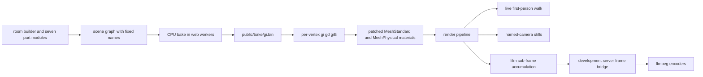

# 6:51, a room at dawn

`room-at-dawn` is a photoreal bedroom at first light, built from code alone. Every mesh, every
texture and every light value is generated. The tree holds no model file, no image texture and no
high dynamic range image (HDRI). The page title is `6:51` (`index.html:6`).

This exploration reads the source at commit `aab8be218aa051bbb2e22b82916962619c951747`. The tree
holds 48 tracked files and uses the Massachusetts Institute of Technology (MIT) licence
(`LICENSE:1-3`).

The code divides by job. Seven part modules under `src/scene/parts/` build the furniture, the plants
and the view outside the window. They join the scene through a glob import, so a new file in that
directory needs no change to the loader (`src/scene/index.js:9`). One module builds the room shell
and the window opening (`src/scene/room.js:86`). One module supplies the material library
(`src/scene/materials.js:320`). Two modules hold the bake, one on the main thread and one in each
web worker (`src/bake/baker.js`, `src/bake/worker.js`). Four modules make the image
(`src/render/pipeline.js`, `src/render/film.js`, `src/render/look.js`, `src/render/cams.js`). One
module runs the walk (`src/game/game.js`).

The project serves three kinds of user. A visitor walks the room with a mouse and a keyboard. A
viewer watches the recorded film. A developer edits one part module and bakes the scene again. All
three read the same source, the same geometry and the same light file.

Three groups of binary files ship. `public/bake/gi.bin` holds the light. `public/audio` holds
`ambience.m4a` and `music.m4a`. `docs/media` holds seven JPEG (Joint Photographic Experts Group)
stills. No file in the tree stores geometry or a texture bitmap. The code makes both at load time
from formulas and from a seeded random number generator (RNG). The repository stays small, and every
shape remains editable as source.

## The thesis

The project makes one large decision, and then it obeys that decision everywhere. Light is computed
once, on the central processing unit (CPU), and stored on the vertices of the meshes. At run time
no light object exists. The materials read the stored values and shade themselves.

The header of the global illumination (GI) module states the three stored values.

```text
# src/core/gi.js:1-7
// Baked global illumination plumbing.
// Lighting is path traced once on the CPU (src/bake) and stored per vertex as:
//   gi  : irradiance / PI for the surface normal        (vec3)
//   gd  : cosine-weighted mean direction of that light  (vec3, world space) -> lets normal maps shade
//   giB : irradiance / PI for the flipped normal        (vec3, only translucent two-sided things)
// Materials are regular MeshStandard/Physical materials patched to read those attributes instead of lights.
// The environment map is kept for specular only and is box-projected onto the room so reflections line up.
```

`gi` is irradiance divided by pi for the surface normal. `gd` is a mean light direction. `giB` is
the same irradiance for the flipped normal of a translucent two-sided material. A normal map can
bend the shading normal, so one irradiance value per vertex would lose the direction of the light.
The mean direction keeps it.

Two consumers read that stored fact. A browser walk reads it every frame at a chosen resolution. A
45 second film reads it at 3,840 by 2,160 pixels with many averaged sub-frames per frame. Both
consumers share the scene, the bake file, the materials and the render pipeline. They differ in the
frame source and in the number of samples.

## The package map



The left side of the map runs once per bake. The right side runs once per frame. The file in the
middle is the contract between them. Its manifest is keyed by mesh path, so the scene graph is also
part of the file format.

## The bake and the film in one view

The scene is built in a fixed order. `src/scene/index.js` creates a context object with a fixed
seed, and the seven part modules register themselves into it.

```text
# src/scene/index.js:11-13
export async function buildScene(onProgress = () => {}) {
  const scene = new THREE.Scene();
  const ctx = { M: makeMaterials(), rng: new RNG(20261112), scene, colliders: [], animated: [] };
```

The seed 20,261,112 drives the scene random number generator (RNG). The lighting bake depends on
the exact geometry that this seed produces, so a change to the seed is a change to the bake input.

The bake driver has these defaults.

```text
# src/bake/baker.js:18-18
export async function runBake(root, cfg, { spp = 128, workers = 6, smooth = 1, log = console.log } = {}) {
```

Six workers trace the scene through a single window opening. The opening is a rectangle at z = 0
(`src/scene/room.js:274-277`). The workers treat the rectangle as a portal for next-event
estimation, and they combine that estimate with cosine sampling by multiple importance sampling
(MIS). The shipped file records a base sample count (`spp`) of 160 for each sample point, 1,157,291 sample
points, 1,742,198 occluder triangles and 1,808 seconds. The value `spp` is the target count for pass
1; pass 0 uses a reduced count. The file measures 13.06 megabytes (MB).

The film is a separate consumer of the same data. Its length is the sum of seven shot durations.

```text
# src/render/film.js:36-36
export const FILM_LENGTH = SHOTS.reduce((s, x) => s + x.dur, 0);
```

At 30 frames per second the film has 1,350 frames. Each frame averages between 32 and 96 sub-frames,
depending on the shot (`src/render/film.js:13-35`). Each sub-frame moves the camera by a Halton
offset, opens the lens by a thin-lens disc sample and advances the scene clock inside a 180 degree
shutter (`src/main.js:84-107`). The frames leave the page as Blobs, and the development server
writes them into `ffmpeg` (`src/render/film.js:95-103`, `vite.config.js:37-49`).

The render pipeline grades both outputs once. It has three output modes
(`src/render/pipeline.js:288-300`). Mode 0 writes 8-bit standard dynamic range (SDR) to the canvas.
Mode 1 writes perceptual quantizer (PQ) values in the International Telecommunication Union Radiocommunication Sector BT.2020 colour space (BT.2020) to a half-float target
for the high dynamic range 10 (HDR10) master. Mode 2 writes to an 8-bit SDR target for the SDR
master. The film encoder receives raw 16-bit half-float frames and
writes 10-bit High Efficiency Video Coding (HEVC) with a PQ transfer function
(`src/render/film.js:113`, `src/render/film.js:119-122`).

## Why the bake exists

The live walk cannot afford a path tracer. A path tracer casts many rays for each pixel. The walk
adjusts its render scale when the average frame time rises above 24 milliseconds (ms) or falls below
12.5 ms (`src/game/game.js:102-110`). The project splits
the cost in two. The bake spends minutes once, outside the frame loop, and writes its answer to a
file. Every later frame reads that answer at no ray cost.

The price is staleness. The file describes one geometry at one seed. `applyBake` matches each mesh
by key, vertex count and back flag. A mesh that does not match receives a flat value of 0.06,
and the loader counts it as stale (`src/core/gi.js:185-195`). The scene still runs, but the light on
that mesh is wrong. A change to the geometry or to an average albedo therefore needs a new bake
before the image is correct. A pure move keeps the vertex count and the vertex order. The loader
cannot detect a move, because the file holds no positions. A moved mesh keeps the light of its old
place until a new bake replaces the file.

Inside the frame, no light object exists. The patched material reads `gi` and `gd` from the vertex
attributes and adds the result to the standard three.js lighting term (`src/core/gi.js:79-103`).
The sky dome is a shader with a procedural cloud field, and it is excluded from the bake
(`src/scene/sky.js:66-68`). The real-time renderer adds the visible sky dome, the screen-space
ambient occlusion, the six bloom levels and the final grade. It also captures a reflection
environment once at boot (`src/main.js:61-68`). The diffuse light on each surface still comes from
the bake. The frame adds no new diffuse light and no real-time light object.

## One frame as a preview

The order is fixed, and document 00 walks the same path with real values.

1. `src/main.js` builds the scene and applies the bake file (`src/main.js:29-39`).
2. The camera comes from the walk, from a named camera, or from the film timeline.
3. The patched materials read `gi`, `gd` and `giB` from the vertex attributes.
4. The renderer draws colour and depth into a half-float multisample target
   (`src/render/pipeline.js:202-210`).
5. A 14-sample ambient occlusion pass runs at half resolution, then a depth-aware blur
   (`src/render/pipeline.js:21-69`).
6. The colour and the occluded result combine into the accumulator.
7. Six bloom levels add the spread of the bright areas (`src/render/pipeline.js:243-259`).
8. The grade maps to SDR or to PQ and adds vignette, tint, grain and a fade
   (`src/render/pipeline.js:261-300`).

## The six documents

| File | What it carries |
|---|---|
| [00-overview.md](00-overview.md) | The room, the two run modes, what ships, one frame end to end, the coordinates, the stills and one part from export to pixels |
| [01-architecture.md](01-architecture.md) | The module map, the boot sequence, the context contract, the three processes, the bake path, the render path, the film path and the development server bridge |
| [02-core-mechanism.md](02-core-mechanism.md) | The bake in depth: the geometry soup, sample welding, the portal and its probability density function, the two passes, the cache, the environment table, the buffer and the shader patch |
| [03-workflow-and-quality.md](03-workflow-and-quality.md) | Writing a part, the invariants, a real bake run, a stills pass, the film chunk loop, the encode and every check in the loop |
| [04-limits-and-comparison.md](04-limits-and-comparison.md) | The stated and unstated limits, the recorded costs, the single-window assumption, the exposure controls and a mechanism comparison with two sibling packages |

## Reading order

Start with 00 for the place and the two outputs. Read 01 for the shape of the code. Read 02 slowly,
because it is the centre of the package. Read 03 if you intend to change a part or run a bake. Read
04 last, when you know what the system does and can judge what it does not do.

A reader who only wants the central idea can read the thesis above, then 02. A reader who wants to
operate the project can read 03, then the tools section of 01.

## What this exploration does not claim

- It does not run the development server, the bake, the film render or the encoder. Every statement
  comes from reading the pinned source.
- It does not judge the visual result. It explains the mechanism that produces the result.
- It does not measure frame rate, memory use or bake time on any machine. It quotes the costs that
  the shipped bake file records.
- It does not verify that the released film matches the source. The release is outside the tree.
- It does not accept the project README as correct. It checks each claim against a source line and
  reports the places where the two disagree.
- It does not analyse the recorded audio beyond the licence record in `CREDITS.md`.
- It does not claim physical accuracy. The bake is an estimator with a fixed sample budget, a clamp
  and a smoothing step. Document 02 names each of those choices.

Each deep dive carries its own load. No document repeats the main argument of another. The
**Aha:** paragraphs mark the place where a design choice becomes visible only after the surrounding
code is read together.
