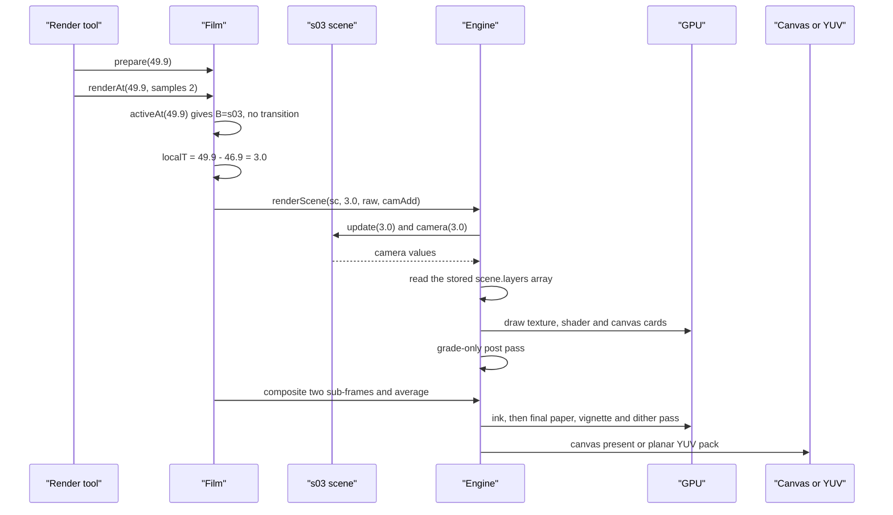

# Overview: ten paintings, one film, one frame

## 1. What shanshui is

shanshui means "mountains and water". The package paints ten Chinese ink-wash landscapes in code and joins them into one 60-second film (`README.md:3-9`). The checkout holds 146 tracked files. The source tree holds 127 files and 24,027 JavaScript lines (`spec.md:22`, `spec.md:49-55`). Ten scene modules produce the paintings. One film module orders them. One engine draws them. One clock drives the picture and the sound.

This document gives the whole system at one level of detail: the ten paintings, the clock, the parts and one frame from film time to a finished picture. The later documents open the architecture, the mechanisms, the method and the limits.

## 2. Terms in this document

A bare path such as `README.md:64` or `src/timeline.js:5` means the file and line in the pinned package root. It does not mean this exploration file.

| Term | Meaning |
|---|---|
| WebGL 2 | Web Graphics Library, version 2, the browser graphics interface (`src/engine/gl.js:3-25`) |
| GLSL | Graphics Library Shading Language, the shader language (`src/engine/glsl.js:4-121`) |
| GPU | graphics processing unit, the device that runs shaders |
| CPU | central processing unit, the device that runs builds and tools |
| API | application programming interface, here the scene build object and the capture surface (`src/engine/engine.js:380-394`, `src/main.js:22-159`) |
| Canvas2D | the two-dimensional canvas drawing interface of the browser |
| HTML | HyperText Markup Language, the page format |
| CSS | Cascading Style Sheets, the viewer styling format |
| JSON | JavaScript Object Notation, the options format |
| RGB | red, green, blue, the colour channels |
| sRGB | standard red, green, blue, the display colour space |
| YUV | luminance and two colour differences, the film frame format |
| BT.709 | International Telecommunication Union Radiocommunication Sector BT.709, the high-definition colour standard |
| MP4 | MPEG-4 Part 14, the film file format |
| FPS | frames per second |
| BPM | beats per minute |
| RNG | random number generator |
| HUD | heads-up display, the viewer status line |
| 2.5D | two-and-a-half-dimensional, a flat-card scene with depth |

The design space is 1920 by 1080 pixels, with the origin at the top left and y increasing downward (`docs/ENGINE.md:21`). Depth `z = 1` is the picture plane. A larger `z` is farther away. The value `1e5` is the sky and paper depth, which never moves (`docs/ENGINE.md:22`).

## 3. The clock

One clock controls the film and the score. The tempo is 80 BPM. A beat is 0.75 seconds, a bar is 3 seconds and the film is 60 seconds, or 20 bars (`src/timeline.js:5-9`). `bt(bar, beat)` converts a one-based bar number and a beat number into seconds (`src/timeline.js:10`). `around(bar, dur)` places a transition centre on a bar line (`src/timeline.js:13`).

```text
# src/timeline.js:5-13
export const BPM = 80;
export const FPS = 60;
export const BEAT = 60 / BPM;          // 0.75 s
export const BAR = 4 * BEAT;           // 3 s
export const DURATION = 60;            // 20 bars
export const bt = (bar, beat = 0) => (bar - 1) * BAR + beat * BEAT;   // bar is 1-based

// A transition of `dur` seconds centred on the downbeat of `bar`.
const around = (bar, dur) => bt(bar) - dur / 2;
```

Three named cues hang on the same clock. The leaf gust starts at 28.65 seconds, shortly before the wind wipe. The seal is pressed at 56.7 seconds. The painting starts to evaporate at 58.0 seconds (`src/timeline.js:33-36`).

```text
# src/timeline.js:32-37
// Named moments the sound design hangs on.
export const CUE = {
  gust: bt(11) - 1.35,      // the leaf gust starts just before the wind wipe (28.65 s)
  seal: bt(19, 3.6),        // the seal is pressed onto the snow painting (56.7 s)
  evaporate: 58.0,
};
```

The timeline is the executable truth. The guide is a description. Where the two differ, this document follows the timeline. Section 6 of the limits document records the three known differences (`docs/FILM.md:17`, `docs/FILM.md:37-38`, `src/timeline.js:23-26`).

## 4. The ten paintings

The film order is not the scene number order. The first painting is `s07`, the bamboo valley. The second is `s01`, the cranes over the falls. The reason is compositional. The bamboo valley has the darkest large masses, so it carries the opening ink bloom (`src/scenes/s07-bamboo-valley.js:1-9`, `src/timeline.js:19`). The snow temple has the quietest close, so it carries the seal and the evaporate (`src/timeline.js:28-29`, `README.md:27`).

| Order | Bars | Start | Scene | Main cards and depths | Generators | Camera move | In |
|---:|---|---:|---|---|---|---|---|
| 1 | 1-2 | 0.0 | s07 bamboo valley | Far peaks 11, river shader 2.4, bamboo 1.0 (`src/scenes/s07-bamboo-valley.js:76-347`) | `makeSky`, `makePeaks`, `makeMist`, `makeBamboo`, `inkify` (`:10-17`) | Pan right 4 px/s, dolly 0.0035/s | Bloom 3.0 |
| 2 | 3-4 | 5.1 | s01 cranes over the falls | Far 8, lake 2, waterfall 1.2, pine 1 (`src/scenes/s01-cranes-falls.js:51-230`) | `makeSky`, `makeMountains`, `makeWaterfall`, `makeLake`, `makeCraneFlock`, `inkify` (`:6-17`) | Pan right 16 px/s, down 1.5 px/s | Mist 1.8 |
| 3 | 5-6 | 11.1 | s04 rope bridges | Far 6, mid 2.5, bridge 1, near cliff 1 (`src/scenes/s04-rope-bridges.js:79-263`) | `makeSky`, `makeMist`, `makeRange`, `paintRopeBridge`, `makeCraneFlock`, `makeWaterfall` (`:9-18`) | Tilt up 7.5 px/s | Mist 1.8 |
| 4 | 7-8 | 17.0 | s09 floating peaks | Far 8, billows 7, near 1.5, cranes 1 (`src/scenes/s09-floating-peaks.js:99-215`) | `makeSky`, `makeBillows`, `makePeaks`, `bakeArch`, `makeCraneFlock` (`:4-14`) | Drift right 9 px/s; cloud rise adds y | Cloud rise 2.0 |
| 5 | 9-10 | 23.2 | s08 red cascade | Far 9, ridge 3.4, cascade 1.6, front 1.08 (`src/scenes/s08-red-cascade.js:44-371`) | `makeSky`, `makePeaks`, `makeWaterfall`, `makeSpray`, `makeFallingLeaves` (`:3-11`) | x -1.8 px/s, y -1.0 px/s, dolly 0.018 to 0.024 | Spray 1.6 |
| 6 | 11-12 | 29.0 | s10 autumn ruins | Far 10, crag 4.2, lake 2.4, pine 1.1 (`src/scenes/s10-autumn-ruins.js:50-299`) | `makeSky`, `makePeaks`, `makeCraterLake`, `paintTower`, `makeMaple`, `makePine` (`:5-17`) | Pan right 8 px/s | Wind 2.0 |
| 7 | 13-14 | 34.9 | s02 golden river | Gold clouds 40, peaks 8, river 2.5, pine 1 (`src/scenes/s02-golden-river.js:44-251`) | `makeSky`, `makeSun`, `makeGoldClouds`, `makeGoldRiver`, `makeCrags`, `makePine` (`:9-19`) | Pan right 8 px/s | Scroll 2.2 |
| 8 | 15-16 | 41.0 | s05 stone bridge | Far 9, lake 2.4, bridge 1.6, pine 1 (`src/scenes/s05-arch-bridge.js:59-342`) | `makeSky`, `makeSkyStreaks`, `makeLake`, `paintArchBridge`, `makeMaple`, `makePine` (`:6-15`) | Dolly 0.0065/s | Sun match 2.0 |
| 9 | 17-18 | 46.9 | s03 moon over the lake | Far 10, peaks 5.5, lake 2.4, pine 1.15 (`src/scenes/s03-moon-lake.js:72-257`) | `makeNightSky`, `makeMoon03`, `makeNightClouds`, `makeLake`, `makeMaple`, `makePine` (`:6-17`) | Pan 7 px/s, up 3.5 px/s, dolly 0.0045/s | Dusk 2.2 |
| 10 | 19-20 | 52.9 | s06 snow temple | Far 7.5, massif 5, cloud sea 4.6, temple 1.15 (`src/scenes/s06-snow-temple.js:45-217`) | `makeSky`, `makeCloudSea`, `makePeaks`, `makeSnowPine`, `paintTemple`, `makeSnow` (`:3-13`) | Pull back 0.0045/s | Snow 2.2 |
| close | 20 | 58.0 | `@paper` | Bare paper | None | None | Evaporate 1.8 |

The In column gives the program and its duration. The shot start is the start of the incoming transition, and the transition centre is the bar line. For example, `s03` starts at 46.9 seconds because `bt(17)` is 48.0 and dusk lasts 2.2 seconds (`src/timeline.js:13`, `src/timeline.js:27`). Each camera move is a rate per second from the scene rest time 3 (`src/scenes/s07-bamboo-valley.js:354`, `src/scenes/s03-moon-lake.js:33`). The style guide gives the reference map (`docs/STYLE.md:49-67`).

## 5. The film

The shot list is one array. Each shot has a scene id, a start time, a scene-local offset `t0` and an optional incoming transition (`src/timeline.js:15-30`). A special scene id, `@paper`, means bare paper. The first shot is paper at -1 second. The last shot is paper at 58.0 seconds with an evaporate transition.

```text
# src/timeline.js:15-30
// '@paper' is bare paper. in = transition from the previous shot (start..start+dur).
// t0 = scene-local time at the shot's start (scenes are valid for local t in [-3, 14]).
export const SHOTS = [
  { scene: '@paper', start: -1 },
  { scene: 's07', start: 0.0, t0: 0, in: { type: 'bloom', dur: 3.0, c: [185, 330], c2: [1485, 465] } },                    // bars 1-2   bamboo valley, painted in from bare paper
  { scene: 's01', start: around(3, 1.8), t0: 0, in: { type: 'mist', dur: 1.8 } },          // bars 3-4   cranes over the falls
  { scene: 's04', start: around(5, 1.8), t0: 0, in: { type: 'mist', dur: 1.8, k: [0.74, 0.0, 1.2, 1.8], k2: [1, 0, 0, 0] } }, // bars 5-6 rope bridges (mist sweeps across)
  { scene: 's09', start: around(7, 2.0), t0: 0, in: { type: 'cloudrise', dur: 2.0 } },     // bars 7-8   floating peaks
  { scene: 's08', start: around(9, 1.6), t0: 0, in: { type: 'spray', dur: 1.6, c: [308, 672], c2: [640, 270] } },         // bars 9-10  red cascade
  { scene: 's10', start: around(11, 2.0), t0: 0, in: { type: 'wind', dur: 2.0, ease: 'sine' } }, // bars 11-12 autumn ruins (a leaf gust carries the seam)
  { scene: 's02', start: around(13, 2.2), t0: 0, in: { type: 'scroll', dur: 2.2 } },       // bars 13-14 golden river
  { scene: 's05', start: around(15, 2.0), t0: 0, in: { type: 'sunmatch', dur: 2.0, c: [1349, 308], c2: [1742, 353] } },     // bars 15-16 stone bridge, red sun
  { scene: 's03', start: around(17, 2.2), t0: 0, in: { type: 'dusk', dur: 2.2 } },         // bars 17-18 moon over the lake
  { scene: 's06', start: around(19, 2.2), t0: 0, in: { type: 'snow', dur: 2.2 } },         // bars 19-20 snow temple
  { scene: '@paper', start: 58.0, in: { type: 'evaporate', dur: 1.8 } },                    // the painting returns to paper
];
```

The film layer adds two overlays. A gust of 115 maple leaves crosses the wind seam from 28.65 seconds for 2.8 seconds. The seal is pressed from 56.7 seconds and held to the end (`src/film.js:16-22`, `src/lib/gust.js:7`, `src/lib/seal.js:73-89`).

Ten transition programs, in definition order, are keyed in `TRANSITIONS` (`src/transitions/index.js:49-318`). The shot list uses them over eleven seam instances: paper to `s07` bloom, nine painting seams, and `s06` to paper evaporate (`src/timeline.js:17-30`). The mist program serves both the `s01` and `s04` seams (`src/timeline.js:18-19`). A transition program is one shader with an ease, default parameters and optional camera offset. A seam instance is one use in the shot list.

The parameters have fixed forms. `k` and `k2` are four-vectors, and each program comment defines their parts (`src/transitions/index.js:52`, `src/transitions/index.js:79`). `c` and `c2` are design-space pixel points. `paper` overrides the bare paper colour (`src/film.js:387`). The available eases are linear, smooth, in-out, sine, out and in (`src/transitions/index.js:40-45`).

| Program | Ease | Key parameters | Visual rule | Source |
|---|---|---|---|---|
| bloom | linear | `k`: edge softness, wet front, warp, dark weight; `c`, `c2`: seeds | Dark ink blooms from two seeds over paper | `src/transitions/index.js:53-75` |
| mist | sine | `k`: density, rise, feature scale, speed; `k2.x`: direction | Drifting mist hides the change | `src/transitions/index.js:81-104` |
| cloudrise | smooth | `k`: band height, billow scale, fold shade; camera y plus or minus 260 | A cloud bank sweeps as the camera rises | `src/transitions/index.js:108-157` |
| scroll | inOut | `k`: seam width, mist density, waviness; camera x plus or minus 220 | A handscroll pan with a mist seam | `src/transitions/index.js:161-182` |
| sunmatch | sine | `c`, `c2`: sun points; `k`: haze, edge noise, breathe zoom | Two suns slide onto one point | `src/transitions/index.js:187-206` |
| dusk | inOut | `k`: front softness, dimming, irregularity | Night soaks down from the sky | `src/transitions/index.js:211-230` |
| snow | sine | `k`: flake density, haze, wind | Snow thickens into a white veil | `src/transitions/index.js:234-267` |
| spray | inOut | `k`: zoom-in, zoom-out, spray density; `c`, `c2`: falls | The camera pushes through falling water | `src/transitions/index.js:272-294` |
| wind | inOut | `k`: angle, edge softness, raggedness | A ragged directional wipe | `src/transitions/index.js:298-314` |
| evaporate | linear | `k`: softness, edge-first bias, warp; `c`: centre | Pale washes return to paper first | `src/transitions/index.js:318-333` |


The diagram intervals are shot starts and outgoing transition ends. The scene contract range is wider than any overlap, for camera moves and sub-frame samples (`docs/ENGINE.md:49`).

## 6. The parts

The package has six parts.

**The engine.** Four files. `gl.js` creates the context, compiles programs, manages textures and targets and draws the unit quad (`src/engine/gl.js:1-159`). `glsl.js` holds the shared shader header, noise and ink constants (`src/engine/glsl.js:4-132`). `rng.js` holds the seeded random generator and simplex noise (`src/engine/rng.js:4-119`). `engine.js` bakes, builds scenes, draws layers, grades, posts and packs YUV (`src/engine/engine.js:1-573`).

**The library.** Twelve top-level modules plus three fauna helpers. `brush.js` holds the palette and the Canvas2D mark vocabulary. `inkfx.js` holds the ink pass. The other ten build pines, rocks, peaks, atmosphere, water, architecture, fauna, flora, the seal and the leaf gust (`src/lib/brush.js:1-222`, `src/lib/inkfx.js:1-36`, `docs/LIBRARY.md:1-325`).

**The scenes.** Ten modules and 50 helpers, plus the registry (`src/scenes/index.js:1-16`). Each module exports a default object with an `id`, a `title`, a `ref` and a `build(api)` function (`src/scenes/s01-cranes-falls.js:37-39`). The build returns a back-to-front layer list and optional `camera`, `grade`, `update`, `dispose` and `meta` fields (`docs/ENGINE.md:33-47`). The engine stores `dispose` and calls it when the shot is no longer needed (`src/engine/engine.js:371-376`, `src/film.js:83-98`).

```text
# src/scenes/index.js:1-16
// Scene registry: id -> module loader. Order here is reference order (ref/01..10).
export const SCENES = {
  s01: () => import('./s01-cranes-falls.js'),
  s02: () => import('./s02-golden-river.js'),
  s03: () => import('./s03-moon-lake.js'),
  s04: () => import('./s04-rope-bridges.js'),
  s05: () => import('./s05-arch-bridge.js'),
  s06: () => import('./s06-snow-temple.js'),
  s07: () => import('./s07-bamboo-valley.js'),
  s08: () => import('./s08-red-cascade.js'),
  s09: () => import('./s09-floating-peaks.js'),
  s10: () => import('./s10-autumn-ruins.js'),
};

export const REF = { s01: '01', s02: '02', s03: '03', s04: '04', s05: '05', s06: '06', s07: '07', s08: '08', s09: '09', s10: '10' };

```

**The transitions.** One file with ten programs. Each program has an easing name, default uniforms, an optional camera offset function and a GLSL `transition` function (`src/transitions/index.js:49-318`).

**The film layer.** `src/film.js` selects the active shot, builds and disposes scenes, renders graded images, composites transitions, adds overlays, applies motion blur and runs the final pass (`src/film.js:30-186`).

**The tools.** Eight modules under `tools`. They are a static server, a still tool, a warm daemon, a film renderer, an audio synthesizer, frame forensics, a library documenter and a shared helper module (`spec.md:50`, `src/main.js:164-227`). The browser side exposes the capture API that the tools call (`src/main.js:22-159`).

The layer stack is the central data structure. A scene returns an array of cards in back-to-front order (`docs/ENGINE.md:37`). A card has a kind, a rest rectangle, a depth, an opacity, a blend mode and optional sway or reflection data (`src/engine/engine.js:348-368`). The engine draws the array in order and does not sort it (`src/engine/engine.js:432-490`). The scene author owns the order.

## 7. One frame from a time value to a finished picture

This section follows one frame at film time `T = 49.9` seconds with two motion-blur samples. The time is inside the `s03` painting, after the dusk transition has finished (`src/timeline.js:27`). The frame is a useful trace because the composition is at rest at scene time 3.0 (`src/scenes/s03-moon-lake.js:20`).



### 7.1 The film selects the shot

`activeAt(T)` scans the shot list for the last shot whose start is at or before `T`. It then checks whether `T` is still inside that shot's incoming transition (`src/film.js:60-66`). At `T = 49.9`, the last start is `s03` at 46.9. The dusk transition ends at 49.1, so there is no transition. The function returns shot `B = s03`, outgoing shot `A = null`, transition `tr = null` and progress `p = 1`. The film calls `prepare(T)` before a render; that call builds the current scene and the next scene (`src/film.js:83-98`). `renderAt` is not standalone, because `renderShot` throws when the scene is not prepared (`src/film.js:113-115`).

```text
# src/film.js:60-66
  activeAt(T) {
    let i = 0;
    for (let k = 0; k < this.shots.length; k++) if (this.shots[k].start <= T) i = k;
    const B = this.shots[i];
    const tr = B.in && T < B.start + B.in.dur ? B.in : null;
    return { B, A: tr ? this.shots[i - 1] : null, tr, p: tr ? (T - B.start) / tr.dur : 1 };
  }
```

The film computes scene-local time as `T - shot.start + (shot.t0 || 0)` (`src/film.js:111`). The `t0` value is zero for all ten paintings (`src/timeline.js:19-28`). The local time is therefore 3.0 seconds.

### 7.2 The camera resolves

The scene camera function returns a camera object. `cameraAt` fills any missing field with a default value (`src/engine/engine.js:407-410`). At scene time 3.0, the `s03` camera returns `x = 7 * 0`, `y = -3.5 * 0` and `dolly = 0.0045 * 0`. All values are zero, and zoom is 1 (`src/scenes/s03-moon-lake.js:24-33`).

```text
# src/scenes/s03-moon-lake.js:24-33
export const FACTS = {
  camera: { T0, pan: [7, -3.5], dolly: 0.0045 },
  moon: MOON, moonR: MOON_R,        // sky (does not move with the camera)
  glitter: [1330, 740],             // head of the moon-glitter column on the lake (z 2.4)
  pavilion: [320, 410],             // z 1.2
  lakeY: LAKE_Y,
  bloomSeeds: [[120, 300], [300, 700]],
};

const cam = (t) => ({ x: 7 * (t - T0), y: -3.5 * (t - T0), dolly: 0.0045 * (t - T0), zoom: 1, roll: 0 });
```

A zero camera means the frame is at rest. The painting is at its reference composition at scene time 3.0 (`src/scenes/s03-moon-lake.js:5`, `src/scenes/s03-moon-lake.js:20`). This is why the still tool uses `--t 3` when the goal is a reference comparison.

### 7.3 The scene renders its cards

`renderScene` calls the optional `update(t)` hook, resolves the camera and calls `renderLayers` with the scene's clear colour (`src/engine/engine.js:414-423`). The clear colour is the paper colour of the scene (`src/scenes/s03-moon-lake.js:259-263`).

```text
# src/engine/engine.js:407-423
  cameraAt(scene, t) {
    const c = scene.camera ? scene.camera(t) : null;
    return { x: 0, y: 0, dolly: 0, zoom: 1, roll: 0, ...(c || {}) };
  }

  // Render one scene at local time t into a target (float). Clears to the scene's paper.
  // camAdd (optional) offsets the scene camera: x, y, dolly, roll add; zoom multiplies.
  renderScene(scene, t, target, camAdd) {
    if (scene.update) scene.update(t);
    const base = this.cameraAt(scene, t);
    const cam = camAdd ? {
      x: base.x + (camAdd.x || 0), y: base.y + (camAdd.y || 0), dolly: base.dolly + (camAdd.dolly || 0),
      zoom: base.zoom * (camAdd.zoom ?? 1), roll: base.roll + (camAdd.roll || 0),
    } : base;
    this.renderLayers(scene.layers, t, target, cam, { clear: scene.meta.clear || [0.92, 0.89, 0.83] });
    return cam;
  }
```

`renderLayers` binds the target, optionally clears it and walks the layers in array order (`src/engine/engine.js:426-431`). For each layer it resolves `visible`, `opacity`, `z` and `rect` if those values are functions of time. It skips invisible layers and layers with an opacity of 0.0005 or less (`src/engine/engine.js:432-438`). It then draws by kind.

Canvas cards redraw into their own 2D context and upload to a texture before the draw (`src/engine/engine.js:440-448`). Texture and canvas cards then draw through the texture program. A card with a `reflect` option first draws a mirrored, rippled copy below its waterline (`src/engine/engine.js:452-466`). Shader cards draw through their own compiled program and can set per-frame uniforms and textures (`src/engine/engine.js:476-488`).

The card count is a scene property, not a film property. The `s03` build calls `layers.push` 22 times, and `s01` calls it 26 times (`src/scenes/s03-moon-lake.js:39-257`, `src/scenes/s01-cranes-falls.js:39-231`). Several calls push a group of layers, so the push count is a lower bound on the layer count, not the card count. The engine does not cap the count. The guide asks for fewer than about 30 cards per scene unless there is a reason (`docs/ENGINE.md:130`).

### 7.4 The grade stage

`renderShot` renders the scene into a raw target and then runs the post pass with grading on and the final stage off (`src/film.js:113-127`). The grade combines the engine default grade with the scene grade and any tool override (`src/engine/engine.js:494-497`). The default grade has a paper texture amount of 0.045, a vignette of 0.10, dither of 1.0 and an ink tuple of `[0.32, 0.42, 1.4, 0]` (`src/engine/engine.js:286`). In that tuple, x is pigment wicking strength, y is edge wobble in pixels, z is wick radius in pixels, and w is unused (`src/engine/engine.js:156-182`).

```text
# src/film.js:111-127
  localT(shot, T) { return T - shot.start + (shot.t0 || 0); }

  // Render the scene of `shot` at film time T into raw target, then grade into `graded`.
  renderShot(shot, T, raw, graded, camAdd) {
    const eng = this.engine;
    if (!shot || shot.scene === '@paper') {
      eng.clear(graded, [...PAPER_RGB, 1]);
      return eng.defaultGrade;
    }
    const sc = this.built.get(shot.index);
    if (!sc) throw new Error('scene not prepared: ' + shot.scene + ' at T=' + T);
    const t = this.localT(shot, T);
    eng.renderScene(sc, t, raw, camAdd);
    const g = eng.gradeAt(sc, t);
    eng.postPass(raw, graded, g, { doGrade: true, doFinal: false });
    return g;
  }
```

The post shader has three gated blocks (`src/engine/engine.js:146-199`). The ink block wobbles edges along paper fibres and lets dark pigment creep into light paper. It runs when `uDoFinal` and `uInk` are set (`src/engine/engine.js:162-182`). The grade block applies exposure, contrast, saturation, tint and lift when `uDoGrade` is on (`src/engine/engine.js:184-190`). The final block adds paper fibre, vignette and dither when `uDoFinal` is on (`src/engine/engine.js:192-200`). Ink is separate from final, but both read `uDoFinal`; `postPass` sets the flags independently (`src/engine/engine.js:500-513`).

```text
# src/engine/engine.js:500-513
  postPass(src, dst, grade, { doGrade = true, doFinal = true } = {}) {
    const gl = this.gl;
    const g = { ...this.defaultGrade, ...(grade || {}) };
    bindTarget(gl, dst);
    gl.disable(gl.BLEND);
    gl.useProgram(this.post.prog);
    setUniforms(gl, this.post, {
      uDesign: [W, H], uSrc: src.tex, uPaper: this.paperTex.tex,
      uGrade: [g.exposure, g.contrast, g.saturation, g.paper],
      uTintMul: g.tint, uLift: g.lift, uVignette: g.vignette, uDither: g.dither,
      uDoGrade: doGrade ? 1 : 0, uDoFinal: doFinal ? 1 : 0, uInk: g.ink || [0, 0, 1.6, 0],
    });
    drawQuad(gl);
  }
```

### 7.5 The composite and the motion blur

With no transition, `composite(T)` calls `renderShot` for the active shot and writes the graded image into the composite target (`src/film.js:130-136`). With a transition, it renders both scenes into separate graded targets, sets the transition uniforms and draws one full-screen transition program (`src/film.js:137-157`). It then draws any active overlays on top (`src/film.js:158-165`).

```text
# src/film.js:129-166
  // Composite one instant into engine.targets.comp; returns the final-pass params to use.
  composite(T) {
    const eng = this.engine, gl = eng.gl;
    const { A, B, tr, p } = this.activeAt(T);
    let finalG;
    if (!tr) {
      finalG = this.renderShot(B, T, eng.targets.sceneB, eng.targets.comp);
    } else {
      const def = TRANSITIONS[tr.type];
      if (!def) throw new Error('unknown transition ' + tr.type);
      const e = (EASE[tr.ease || def.ease] || EASE.smooth)(Math.min(1, Math.max(0, p)));
      const cams = def.cam ? def.cam(e, tr) : { a: null, b: null };
      const gA = this.renderShot(A, T, eng.targets.sceneA, this.gA, cams.a);
      const gB = this.renderShot(B, T, eng.targets.sceneB, this.gB, cams.b);
      const prog = this.progs[tr.type];
      bindTarget(gl, eng.targets.comp);
      gl.disable(gl.BLEND);
      gl.useProgram(prog.prog);
      const d = def.defaults || {};
      setUniforms(gl, prog, {
        uA: this.gA.tex, uB: this.gB.tex, uP: p, uE: e, uT: T,
        uK: tr.k || d.k || [0, 0, 0, 0], uK2: tr.k2 || d.k2 || [0, 0, 0, 0],
        uC: tr.c || d.c || [960, 540], uC2: tr.c2 || d.c2 || [960, 540],
        uPaperC: tr.paper || PAPER_RGB,
      });
      drawQuad(gl);
      // final-pass params blend across the seam
      finalG = { ...gB, paper: gA.paper + (gB.paper - gA.paper) * e, vignette: gA.vignette + (gB.vignette - gA.vignette) * e, dither: 1 };
    }
    // overlays on top of the graded composite
    for (const [ov, built] of this.overlayBuilt) {
      if (T < ov.from || T > ov.to) continue;
      const lt = T - ov.from;
      const cam = built.camera ? built.camera(lt, T) : null;
      eng.renderLayers(built.layers, lt, eng.targets.comp, cam, { clear: null });
    }
    return finalG;
  }
```

`renderAt` is the outer loop. With one sample, it composites once and runs the final pass with grading off and the final stage on (`src/film.js:170-176`). With more samples, it clears an accumulation target. It composites each sub-frame at `T + ((i + 0.5) / samples - 0.5) * (shutter / fps)`. It adds the result with a weight of `1 / samples` and runs the final pass on the average (`src/film.js:178-184`). The default shutter is 0.5 and the default rate is 60 FPS, so two samples at `T = 49.9` use 49.8979 and 49.9021 seconds.

```text
# src/film.js:170-185
  renderAt(T, { samples = 1, shutter = 0.5, fps = FPS, target = null } = {}) {
    const eng = this.engine;
    let g;
    if (samples <= 1) {
      g = this.composite(T);
      eng.postPass(eng.targets.comp, target, g, { doGrade: false, doFinal: true });
      return;
    }
    eng.clear(eng.targets.accum);
    for (let i = 0; i < samples; i++) {
      const ts = T + ((i + 0.5) / samples - 0.5) * (shutter / fps);
      g = this.composite(ts);
      eng.blit(eng.targets.comp, eng.targets.accum, 1 / samples, true);
    }
    eng.postPass(eng.targets.accum, target, g, { doGrade: false, doFinal: true });
  }
```

This is the key design result. Motion blur does not need velocity data, history buffers or a simulation. The scene is a pure function of time, so the film evaluates it at slightly different times and averages the results (`docs/ENGINE.md:49`, `src/film.js:179-184`).

### 7.6 The output stage

For a still, `present` runs the final post pass directly to the canvas (`src/engine/engine.js:516`). For a film frame, `renderAt` writes the final image to the temporary float target. `readYUV` packs that target into planar YUV 4:2:0 on the GPU, with BT.709 limited range, and reads the bytes back (`src/engine/engine.js:519-533`). The output texture is `W/4` by `1.5 H`, or 1.5 bytes per source pixel (`src/engine/engine.js:205-236`, `src/engine/engine.js:522-523`).

The browser waits for an acknowledgement before the next frame and keeps at most two in flight (`src/main.js:132-148`). The film renderer writes each buffer into the standard input of ffmpeg. It acknowledges the frame
only after ffmpeg accepts it (`tools/render.mjs:51-60`). It encodes H.264 with yuv420p input,
BT.709 tags and the `slow` preset for a master (`tools/render.mjs:44-50`).

The still path calls `renderSceneFrame` instead. That function renders one scene, optionally averages sub-frames and presents the result with the scene grade (`src/engine/engine.js:552-566`). The browser capture API measures the call time (`src/main.js:42-47`).

## 8. What holds the system together

**Time.** A scene must draw correctly for local time in `[-3, 14]` and must not keep state between frames. It must not call `Math.random`, `Date.now` or `performance.now` (`docs/ENGINE.md:49`, `docs/ENGINE.md:136`). All randomness comes from a seeded object created at build time (`src/engine/engine.js:380-394`).

**Alpha.** Every shader returns premultiplied colour. Canvas bakes are premultiplied on upload (`docs/ENGINE.md:95`, `docs/ENGINE.md:134`, `src/engine/gl.js:91-100`). One blend equation then serves texture, shader and canvas cards (`src/engine/engine.js:248-254`).

**Ownership.** The scene owns the layers it returns. The engine owns the context and the targets. The film owns the scenes it builds. `disposeScene` deletes each distinct layer texture once and calls the optional scene hook (`src/engine/engine.js:396-405`). `prepare(T)` builds what the current and next moments need and disposes the rest (`src/film.js:80-109`).

```text
# src/film.js:80-109
  // Build what is needed at T (and shortly after), dispose what is no longer needed.
  async prepare(T, lookahead = 0.6) {
    const need = new Set();
    // motion-blur sub-frames sample slightly before T, so keep a short tail behind it
    const back = 0.05;
    for (const s of this.shots) {
      const from = s.start - lookahead, to = this.shotEnd(s.index);
      if (T + 0 >= from && T - back <= to) need.add(s.index);
    }
    for (const i of need) await this.buildShot(this.shots[i]);
    const keepScenes = new Set([...need].map((i) => this.shots[i].scene));
    for (const [k, sc] of [...this.built]) {
      if (!need.has(k)) {
        this.built.delete(k);
        const stillUsed = [...this.built.values()].includes(sc);
        if (!stillUsed && !keepScenes.has(this.shots[k].scene)) this.engine.disposeScene(sc);
      }
    }
    for (const ov of this.overlays) {
      const on = T >= ov.from - lookahead && T <= ov.to;
      if (on && !this.overlayBuilt.has(ov)) {
        const api = this.engine.api('overlay');
        this.overlayBuilt.set(ov, await ov.make(api));
      } else if (!on && this.overlayBuilt.has(ov)) {
        const built = this.overlayBuilt.get(ov);
        this.engine.disposeScene({ layers: built.layers, dispose: built.dispose });
        this.overlayBuilt.delete(ov);
      }
    }
  }
```

## 9. Aha

**Aha:** The film does not animate a scene. It samples a scene. A scene is a pure function from local time to a card list and a camera. The film can evaluate it at the cut, before the cut and at several sub-frame offsets. That one property gives deterministic stills, contact sheets, transitions with overlapping scene time and motion blur, all from the same `renderScene` call (`docs/ENGINE.md:49`, `src/engine/engine.js:414-423`, `src/film.js:179-184`).

## 10. What this document does not claim

This overview does not prove that the paintings match their references. The reference images are absent (`README.md:64`). It does not prove a frame rate or a build time. The guide gives budgets, but this reading did not measure them (`docs/ENGINE.md:126-130`). It does not prove that the film or the soundtrack exists. The film is not tracked, and the soundtrack is written into an ignored folder (`README.md:9`, `README.md:41`, `.gitignore:2`).

The next document, [Architecture](01-architecture.md), opens the layer boundaries and the ownership rules behind this overview.
