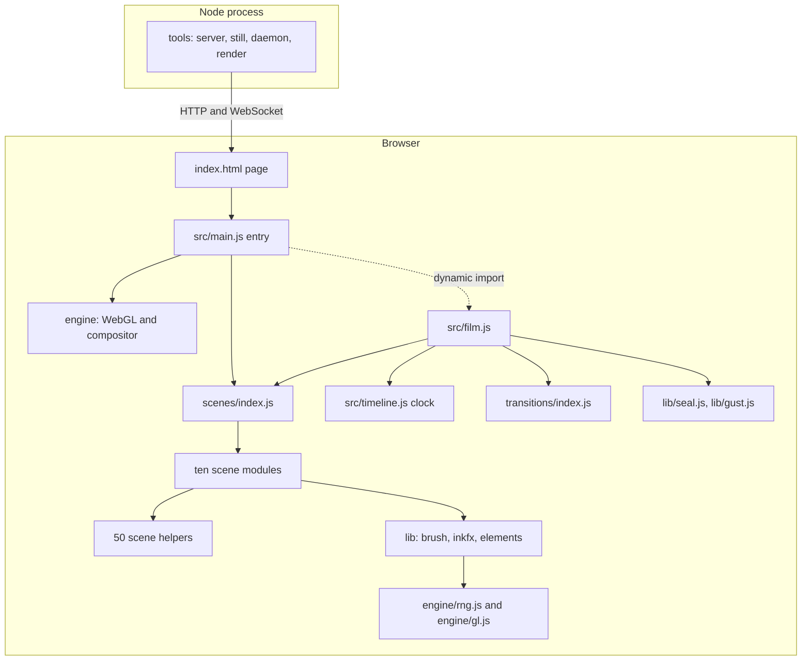
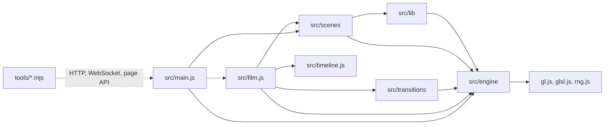
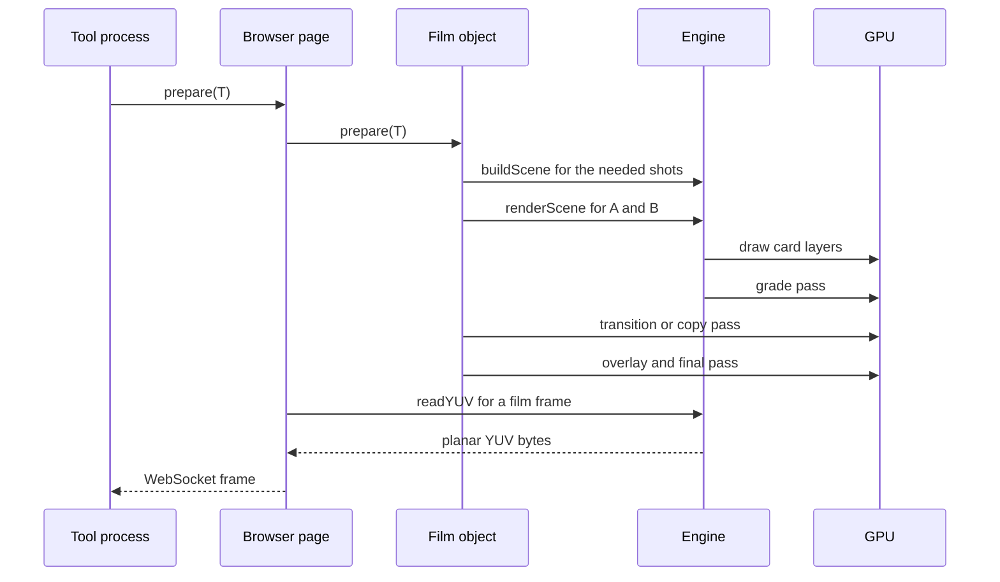

# 01 Architecture: layers, contracts and ownership

shanshui paints ten Chinese ink-wash landscapes in code and joins them into a one-minute film. This document opens its static structure: the layers, the module contracts, the data flow and the failure boundaries. It reads the source only. No scene is built and no frame is drawn.

### Terms in this document

A bare path such as `README.md:64` or `src/film.js:113` means the file and line in the pinned package root. It does not mean this exploration file.

| Short form | Expansion |
|---|---|
| API | application programming interface |
| WebGL | Web Graphics Library |
| GLSL | Graphics Library Shading Language |
| GPU | graphics processing unit |
| CPU | central processing unit |
| HTTP | HyperText Transfer Protocol |
| PNG | Portable Network Graphics |
| WAV | Waveform Audio File Format |
| RNG | random number generator |
| FPS | frames per second |
| BPM | beats per minute |
| YUV | luma and chrominance |
| BT.709 | Recommendation ITU-R BT.709 |

Canvas2D is the two-dimensional drawing interface of the browser. WebSocket is a two-way browser
socket protocol. ffmpeg is an external command line video encoder.

The plan for this exploration is the package-root `spec.md`. The engine guide is `docs/ENGINE.md`.

## 1. The shape of the repository

A card is a flat rectangle of pixels at one depth. The engine draws cards in list order.

The tracked tree holds 146 files. The `src` tree holds 127 files and 24,027 JavaScript lines.
The `tools` tree holds 8 files and 1,140 JavaScript lines. The `docs` tree holds 5 files. The
root holds 6 files. The plan records these totals (`spec.md:45-64`).

| Area | Files | Role | Ownership |
|---|---:|---|---|
| `src/engine` | 4 | WebGL helpers, shared GLSL, seeded noise, compositor | The GPU context and its objects |
| `src/lib` | 15 | Brush, ink pass and element generators | No runtime state |
| `src/scenes` | 61 | Ten paintings, one registry and 50 helpers | The card lists they build |
| `src/transitions` | 1 | Ten seam programs | Transition shader source |
| `src/lab` | 43 | Small element tests, loaded by path | Nothing that ships |
| `src` root | 3 | Entry, film, clock | The browser session and the film |
| `tools` | 8 | Server, capture, render, sound and checks | Output files and processes |
| `docs` | 5 | Four guides and one contact sheet | Documentation only |
| root | 6 | Entry page, package files, licence, readme, ignore file | No runtime state |

The scene count needs one note. The tree holds ten main scene modules, one registry module and 50 per-scene helper modules. That is 61 scene files. The document set uses this split for every count. The ten scenes are `s01` to `s10` (`src/scenes/index.js:2-13`).

The design space is a fixed 1920 by 1080 pixel coordinate system (`src/engine/engine.js:10`).
Render scale is the pixel density multiplier for the canvas and the bakes. The clock is fixed at
80 BPM and 60 FPS for 60 seconds (`src/timeline.js:5-9`).

Arrows mean imports or calls, from left or top to right or bottom.



The diagram shows one browser session and one Node process. `window.__api` is the page's
JavaScript object for rendering and save commands. The tool process drives that object over a
local HTTP server and a WebSocket (`src/main.js:160`).

## 2. The rule of one direction

Dependencies point toward the engine. The engine imports only its own siblings
(`src/engine/engine.js:6-8`). The library imports engine utilities and the brush module
(`src/lib/brush.js:4`, `src/lib/rock.js:3-4`). The scenes import the library
(`src/scenes/s01-cranes-falls.js:6-17`). The film imports the engine, registry, transitions,
clock and two overlays (`src/film.js:5-13`). The entry imports the engine and registry, then
loads the film on demand (`src/main.js:4-5`, `:115-119`). The tools import Node modules, the
shared helper and selected source constants; the audio tool imports the clock
(`tools/audio.mjs:13`).



One local exception exists. `src/lib/rock.js:4` imports `texFromSource` from `src/engine/gl.js`
to bake a texture without a second pass. No library module imports a scene or the film.

The engine also passes raw handles to scene code. The `api` object includes `engine` and `gl`
(`src/engine/engine.js:383`). A scene can therefore call WebGL directly. The boundary is a
convention, not a language rule. The guide asks scene authors to work around engine defects
locally (`docs/ENGINE.md:138`).

## 3. The engine layer

The `Engine` class owns the WebGL context. A program is a compiled pair of vertex and fragment
shaders. A target is an offscreen texture used as a render destination. The constructor sets the
canvas size from the design space and render scale, compiles the card, reflection, post and copy
programs and creates five full-size targets (`src/engine/engine.js:258-276`). `sceneA` and
`sceneB` hold raw scenes, `comp` holds the composite, `accum` holds motion-blur samples and `tmp`
receives a film frame before readback. It bakes a static paper fibre texture and stores the
default grade fields: exposure, contrast, saturation, paper, tint, lift, vignette, dither and ink
(`src/engine/engine.js:278-286`).

Programs are cached by the pair of shader source strings (`src/engine/engine.js:290-295`). The
same card shader is therefore compiled once for many layers. A shader error throws with the
nearby source lines (`src/engine/gl.js:36-45`). There is no catch inside the engine.

| Engine resource | Created at | Released at |
|---|---|---|
| WebGL context | Constructor | Page close |
| Programs | `program` cache | Page close |
| Five targets | Constructor | Page close |
| Paper texture | Constructor | Page close |
| Scene textures | `bakeCanvas`, `bakeShader`, `texture` | `disposeScene` |

The context destruction at page close releases the context-owned objects as one group. Scene
textures have an earlier explicit release site.

The texture methods are `bakeCanvas` (`src/engine/engine.js:299-308`), `texture`
(`src/engine/engine.js:311-314`), `bakeShader` (`src/engine/engine.js:318-341`) and `processTex`
(`src/engine/engine.js:338-344`). Each returns a texture source record with a handle and a design
size. The layer constructors wrap a source in a card (`src/engine/engine.js:350-368`).

The scene contract enters through `buildScene`. The engine supplies an API, calls `build` once,
and stores the returned object (`src/engine/engine.js:371-378`).

```text
# src/engine/engine.js:371-378
  async buildScene(mod, opts = {}) {
    const def = mod.default || mod;
    const api = this.api(def.id || 'scene');
    const t0 = performance.now();
    const built = await def.build(api, opts);
    const scene = { def, id: def.id, layers: built.layers, camera: built.camera, grade: built.grade, update: built.update, dispose: built.dispose, api, buildMs: performance.now() - t0, meta: built.meta || {} };
    return scene;
  }
```

The API object is a set of bound closures. It gives the scene the design size, the context, the
render scale, two seeded generators, four texture and bake methods and three layer constructors
(`src/engine/engine.js:380-394`).

The random seed includes the scene id. Two calls with the same salt return the same stream
(`src/engine/engine.js:384`). The seed base is the scene id or the string `overlay`
(`src/engine/engine.js:373`, `src/film.js:101`). This detail makes a painting repeatable across
sessions and across render scales.

The engine does not own the layers. It only owns the texture handles that the layers point to.
`disposeScene` walks the layer list, deletes each distinct texture once, and calls the optional
scene hook (`src/engine/engine.js:396-405`).

```text
# src/engine/engine.js:396-405
  disposeScene(scene) {
    if (!scene) return;
    const gl = this.gl;
    const seen = new Set();
    for (const L of scene.layers) {
      if (L.src && L.src.tex && !seen.has(L.src.tex)) { seen.add(L.src.tex); gl.deleteTexture(L.src.tex); }
      if (L.textures) for (const k in L.textures) { const t = L.textures[k]; const tx = t && (t.tex || t); if (tx && !seen.has(tx)) { seen.add(tx); gl.deleteTexture(tx); } }
    }
    if (scene.dispose) scene.dispose();
  }
```

A layer can also carry a `textures` map. The disposal loop handles that case and uses a `Set` to
avoid a double delete (`src/engine/engine.js:399-403`). An overlay is shaped like a scene, with a
layer list and an optional dispose hook, so it uses the same function (`src/film.js:105`).

Rendering takes a scene, a local time, a target and an optional camera offset. The engine calls
the optional `update` hook, resolves the camera, and draws the layers back to front, which is
painter order (`src/engine/engine.js:414-423`).

```text
# src/engine/engine.js:414-423
  renderScene(scene, t, target, camAdd) {
    if (scene.update) scene.update(t);
    const base = this.cameraAt(scene, t);
    const cam = camAdd ? {
      x: base.x + (camAdd.x || 0), y: base.y + (camAdd.y || 0), dolly: base.dolly + (camAdd.dolly || 0),
      zoom: base.zoom * (camAdd.zoom ?? 1), roll: base.roll + (camAdd.roll || 0),
    } : base;
    this.renderLayers(scene.layers, t, target, cam, { clear: scene.meta.clear || [0.92, 0.89, 0.83] });
    return cam;
  }
```

The camera contract is small. `cameraAt` supplies defaults for five fields (`src/engine/engine.js:407-410`).
`renderLayers` applies the projection, the sway, the reflection and the blend mode
(`src/engine/engine.js:426-492`). The frame path is the subject of document 02.

The engine owns the post pass. `gradeAt` resolves a grade object or a function of time (`src/engine/engine.js:494-497`). `postPass` runs one fragment shader with three gated blocks (`src/engine/engine.js:500-513`). The ink block runs when `uDoFinal` is on and `uInk` is nonzero, separately from the final block (`src/engine/engine.js:162-182`). The grade block runs when `uDoGrade` is on (`src/engine/engine.js:184-190`). The final block adds paper fibre, vignette and dither when `uDoFinal` is on (`src/engine/engine.js:192-200`). The engine can force grade values through `gradeOverride` (`src/engine/engine.js:287`).

## 4. The scene layer

A scene module is a default export with an id, a title, a comparison reference id from `01` to
`10`, and a `build` function (`src/scenes/s01-cranes-falls.js:37-39`). The build returns layers,
optional camera and grade fields, and optional update, dispose and meta-clear fields. The engine
stores the dispose hook (`src/engine/engine.js:371-376`). `disposeScene` calls it when the film no
longer needs the shot (`src/engine/engine.js:396-405`, `src/film.js:83-98`).

```text
# src/scenes/s01-cranes-falls.js:233-237
    return {
      layers,
      camera: (t) => ({ x: PAN * (t - T0), y: -1.5 * (t - T0), dolly: 0, zoom: 1, roll: 0 }),
      meta: { clear: PAPER.map((v) => v / 255) },
    };
```

The scene time is local. The film adds a per-shot offset `t0` before the call
(`src/film.js:111`). The guide requires correct output for local time in the range -3 to 14
seconds (`docs/ENGINE.md:49`). The overlap exists because a transition draws the outgoing scene
and the incoming scene at the same film time.

The contract also bans state between frames. Scene code must not call `Math.random`, `Date.now`
or `performance.now` (`docs/ENGINE.md:49`, `:136`). The only random source is the seeded API.
This rule gives deterministic stills, repeatable contact sheets, sub-frame motion blur and A/B
comparison of two times.

The registry maps an id to a dynamic import (`src/scenes/index.js:2-13`).

```text
# src/scenes/index.js:2-13
export const SCENES = {
  s01: () => import('./s01-cranes-falls.js'),
  s02: () => import('./s02-golden-river.js'),
  s03: () => import('./s03-moon-lake.js'),
  s04: () => import('./s04-rope-bridges.js'),
  s05: () => import('./s05-arch-bridge.js'),
  s06: () => import('./s06-snow-temple.js'),
  s07: () => import('./s07-bamboo-valley.js'),
  s08: () => import('./s08-red-cascade.js'),
  s09: () => import('./s09-floating-peaks.js'),
  s10: () => import('./s10-autumn-ruins.js'),
};
```

The registry order is reference order, not film order (`src/scenes/index.js:1`). The film order
is in the shot list (`src/timeline.js:15-30`). This separation lets a scene keep a stable id and
reference number while the cut changes.

The scene folder is the largest layer. The ten main modules hold composition, layers, camera and
animation. The 50 helpers hold local painting routines and do not enter the registry
(`src/scenes/s01-cranes-falls.js:7`, `:14-17`). Shared elements live in `src/lib`; one-off
composition lives in `src/scenes/sNN/`.

The lab folder is a third entry path, after the registry and a fallback dynamic import
(`src/main.js:33-35`). A lab scene is never registered. A tool loads it by module path, for
example `lab/pine` (`docs/ENGINE.md:122`). The load is still a `buildScene` call, so a lab scene
obeys the same contract.

## 5. The library layer

The library holds 15 files and 8,624 JavaScript lines. It has twelve top-level modules and three
fauna helpers (`spec.md:61-62`). It is the second largest source area by line count, after
`src/scenes` at 12,176 lines.

| Module | Main exports | Kind |
|---|---|---|
| `brush.js` | Palette, tone, stroke, dry stroke, blob, wash, granulate | Canvas2D drawing |
| `inkfx.js` | `inkify` | GPU pass over a bake |
| `pine.js` | `buildPine`, `paintPine`, `makePine`, conifers | Generator |
| `rock.js` | `cliff`, `bakeRocks`, `makeCliff`, `paintMoss` | Generator |
| `peaks.js` | `makePeaks`, `makeRange`, `wetInk`, conifers | Generator |
| `atmos.js` | Sky, cloud sea, mist, water fog, moon, sun | Shader and canvas |
| `water.js` | Lake, glitter, reflection, waterfall, river, foam | Shader and canvas |
| `architecture.js` | Pavilion, hall, gate, temple, tower, bridge | Canvas bake |
| `fauna.js` | Crane flock, falling leaves, snow | Animated cards |
| `flora.js` | Bamboo, maple, maple leaf | Canvas bake |
| `seal.js` | `paintSeal`, `makeSealOverlay` | Overlay card |
| `gust.js` | `makeLeafGust` | Overlay card |

The brush module is the common mark vocabulary for every scene (`src/lib/brush.js`). The table
gives the main tools, their main parameters and one call site.

| Tool | Purpose | Parameters | Source |
|---|---|---|---|
| `palette` | Named ink tones | Fixed colour records | `:8-14` |
| `tone` | Convert a palette entry to a colour string | Entry, alpha | `:17-19` |
| `stroke` | Tapered line along points | Points, width, profile, colour, alpha, roughness, random stream, smoothing, step | `:77-99` |
| `dryStroke` | Broken line with bristle gaps | Width, bristle count, colour, alpha, dryness, random stream, noise, profile, step | `:102-129` |
| `blob` | Irregular filled shape | Centre, radius, colour, alpha, random stream, irregularity, squash, rotation, sides | `:132-151` |
| `wash` | Soft field with a rim | Shape, colour, alpha, blur, rim, rim width | `:163-175` |
| `granulate` | Grain overlay | Amount, cell size, seed, contrast | `:206-213` |

Scenes use these tools directly. `s10` calls `stroke`, `blob` and `tone`
(`src/scenes/s10-autumn-ruins.js:175-178`). `s05` calls `dryStroke` for rock texture
(`src/scenes/s05/rocks.js:64`, `:104`). `s06` calls `wash` on the massif
(`src/scenes/s06/massif.js:250`). `granulate` has no direct scene call. The seal overlay calls it
(`src/lib/seal.js:64-65`).

The library contract is not written as a formal interface. The source shows two shapes. A paint
function draws into a Canvas2D context that the caller supplies. A make function takes the scene
API and returns a layer or a small object with a layer method. For example, the brush palette is
plain data (`src/lib/brush.js:8-14`). The ink pass takes an API, a texture source and three
strengths (`src/lib/inkfx.js:5`).

The library is stateless at runtime. A generator may close over its own random stream and paint
buffers. It does not read the clock. It does not hold a global cache. This property lets the film
build and dispose a scene without a library reset.

The library depends on the engine in two ways. It imports the seeded RNG for repeatable
placement (`src/lib/pine.js:24`, `src/lib/water.js:2`). It imports the texture upload helper in
one place (`src/lib/rock.js:4`). It does not import the compositor class. A generator cannot
create a target or change the grade.

The atmosphere module is a special case. It holds GLSL source strings for the sky, the cloud
lobes and the mist (`src/lib/atmos.js:26-43`, `src/lib/atmos.js:84-118`). It also holds paint
functions and card builders. This mix is deliberate. A cloud bank must share one noise field
between the shader card and the canvas texture, so the source strings live with the generator.

## 6. The film layer

The film layer has three source files. `src/timeline.js` owns the clock, the shots and the sound
cues. `src/film.js` owns the scene instances, the transition programs, the grading of two
scenes and the final frame. `src/transitions/index.js` owns ten transition shaders.

The clock is five constants and two helpers (`src/timeline.js:5-13`).

```text
# src/timeline.js:5-9
export const BPM = 80;
export const FPS = 60;
export const BEAT = 60 / BPM;          // 0.75 s
export const BAR = 4 * BEAT;           // 3 s
export const DURATION = 60;            // 20 bars
```

`bt(bar, beat)` converts a bar and a beat to seconds (`src/timeline.js:10`). `around(bar, dur)`
centres a transition on a bar line (`src/timeline.js:13`). The shot list uses both helpers to set
the start times (`src/timeline.js:15-30`).

The `Film` class owns the scene instances. It copies the shot list and adds an index
(`src/film.js:33`). It holds two maps: one for built scenes and one for built overlays
(`src/film.js:36-37`). It creates two grading targets and compiles one program per transition
type (`src/film.js:38-47`). The class owns these resources for its whole life; the page close
releases the context.

A scene instance can serve two shots. The film reuses a built scene with the same id
(`src/film.js:68-78`).

```text
# src/film.js:68-78
  async buildShot(shot) {
    if (shot.scene === '@paper') return null;
    if (this.built.has(shot.index)) return this.built.get(shot.index);
    // reuse a scene already built for another shot with the same id
    for (const [k, sc] of this.built) if (this.shots[k].scene === shot.scene) { this.built.set(shot.index, sc); return sc; }
    const loader = SCENES[shot.scene] || (() => import('./' + shot.scene + '.js'));
    const mod = await loader();
    const sc = await this.engine.buildScene(mod, {});
    this.built.set(shot.index, sc);
    return sc;
  }
```

This reuse matters when a scene enters twice, for example in a loop or a repeated painting. The
shot index stays unique; the scene object does not.

The film owns the lifetime of each scene. `prepare` finds the shots that can appear at the current
time, plus a short look-ahead and a short motion-blur tail. It builds missing scenes and disposes
the rest (`src/film.js:80-109`). `stillUsed` prevents a dispose while another shot index points
to the same scene (`src/film.js:90-96`). The overlay map follows the same rule.

The film also owns the time conversion. `localT` subtracts the shot start and adds the scene
offset (`src/film.js:111`). `renderShot` checks that the scene is prepared, renders it, resolves
the grade and applies the grade pass into a separate target (`src/film.js:113-127`). The film
grades each scene before the composite, so a transition blends two finished paintings. The post
shader supports a grade-only pass and a final-only pass for this reason
(`src/engine/engine.js:500-513`).

```text
# src/film.js:111-127
  localT(shot, T) { return T - shot.start + (shot.t0 || 0); }

  // Render the scene of `shot` at film time T into raw target, then grade into `graded`.
  renderShot(shot, T, raw, graded, camAdd) {
    const eng = this.engine;
    if (!shot || shot.scene === '@paper') {
      eng.clear(graded, [...PAPER_RGB, 1]);
      return eng.defaultGrade;
    }
    const sc = this.built.get(shot.index);
    if (!sc) throw new Error('scene not prepared: ' + shot.scene + ' at T=' + T);
    const t = this.localT(shot, T);
    eng.renderScene(sc, t, raw, camAdd);
    const g = eng.gradeAt(sc, t);
    eng.postPass(raw, graded, g, { doGrade: true, doFinal: false });
    return g;
  }
```

The error at `src/film.js:121` is the main runtime guard in the film. A missing scene is a
programming error, not a recoverable state. The film does not build a scene on demand inside the
draw call. The caller must call `prepare` first. The render tool and the viewer both respect this
order (`src/main.js:141`, `src/main.js:223`).

The overlay list lives in the film file (`src/film.js:17-22`). An overlay has a start, an end and
a make function. The leaf gust and the seal cross painting seams, so they cannot belong to one
scene. They are drawn after the graded composite (`src/film.js:159-164`). The overlay pass does
not grade them again, so they keep their own colours across a cut.

The ten transition programs are compiled at film construction (`src/film.js:42-47`). A
transition program is one fragment shader built from a common header, the noise library, the ink
library and a type-specific body (`src/transitions/index.js:9-37`). A seam instance is one use of a program
between two neighbouring shots. Ten programs give eleven seam instances, because mist runs twice
(`src/timeline.js:14-27`; `src/transitions/index.js:49-318`).

The film passes two graded textures,
a progress value, an eased value, the centre points and the paper colour (`src/film.js:148-153`).
A transition is therefore a pure function of two pictures and a small parameter set.

## 7. The tool layer

The tool layer has 8 files and 1,140 JavaScript lines (`spec.md:54-55`). It runs in Node, not in
the browser. Most tools are short command line wrappers over the shared helper. Three exceptions
exist. `serve.mjs` and `daemon.mjs` are long-running servers. `libdoc.mjs` is a source scanner and
Markdown generator.

| File | Role | Runtime boundary |
|---|---|---|
| `serve.mjs` | Static server for the live viewer | Node HTTP |
| `lib.mjs` | Server, browser launch, page setup, job runner | Node and Chrome |
| `still.mjs` | One still, comparison, crop or sheet | Daemon or own page |
| `daemon.mjs` | Warm Chrome with a job queue | HTTP on port 7781 |
| `render.mjs` | Film frames to ffmpeg | WebSocket and child process |
| `audio.mjs` | Soundtrack synthesis | Node CPU and file write |
| `forensics.mjs` | Frame difference report over a video | ffmpeg and decode |
| `libdoc.mjs` | Library index generator | Source scan and Markdown |

The server is small. It serves static files with a no-store header and accepts POST bodies for
`/save`, `/frame` and `/log` (`tools/lib.mjs:49-72`). It answers `/ping` with `pong`
(`tools/lib.mjs:64`, `tools/still.mjs:27-30`) and binds to 127.0.0.1 only
(`tools/lib.mjs:75`).

The save sink enforces the output boundary. A path outside `out/` is refused
(`tools/lib.mjs:29-35`).

```text
# tools/lib.mjs:29-35
function safeOut(p) {
  const abs = path.resolve(ROOT, p);
  const outDir = path.join(ROOT, 'out');
  if (!abs.startsWith(outDir)) throw new Error('refusing to write outside out/: ' + p);
  fs.mkdirSync(path.dirname(abs), { recursive: true });
  return abs;
}
```

The boundary keeps a render or a comparison from writing into the source tree. It applies to
every browser-side save call, because all of them use the same POST route (`src/main.js:52-56`,
`src/main.js:59-74`, `src/main.js:77-93`, `src/main.js:96-112`).

The page setup is the tool contract. A tool opens `index.html?tool=1`, waits for
`window.__api`, and calls `init` with a render scale (`tools/lib.mjs:108-116`). It also attaches
console and page-error listeners.

The `tool=1` query stops the live viewer (`src/main.js:229`). The page exposes the same API that
a person uses. The still tool calls `loadScene`, `renderScene`, `savePNG`, `saveCompare`,
`saveCrop` and `saveSheet` on that API (`tools/lib.mjs:136-154`). The film tool calls
`loadFilm`, `prepareFilm`, `renderFilm`, `saveSheet` and `streamFilm` (`tools/render.mjs:28-38`,
`tools/render.mjs:62`). No tool imports a scene or an engine module.

The daemon is a process-level cache. One Chrome stays open with its shader cache. Each job gets a
fresh page, so edited modules reload (`tools/daemon.mjs:1-7`). The daemon limits concurrent
pages (`tools/daemon.mjs:9-13`).

```text
# tools/daemon.mjs:9-13
const MAX_PAGES = +(process.env.SHANSHUI_MAX_PAGES || 6);
let active = 0;
const queue = [];
const acquire = () => new Promise((r) => { if (active < MAX_PAGES) { active++; r(); } else queue.push(r); });
const release = () => { const n = queue.shift(); if (n) n(); else active--; };
```

The default limit is 6 pages; a job queues when all pages are busy. `release` runs in a `finally`
block, so a failed job cannot hold a slot (`tools/daemon.mjs:49-52`).

The film renderer is a pipeline, not a file loop. It reads the frame size from the page
(`tools/render.mjs:42`), starts ffmpeg with raw YUV input and BT.709 tags
(`tools/render.mjs:44-50`), and opens a WebSocket server on the same HTTP server
(`tools/render.mjs:54-60`). The page sends one frame per message and keeps at most two frames in
flight (`src/main.js:147`). The server acknowledges a frame after ffmpeg accepts it. Frames never
touch the disk (`tools/render.mjs:1-2`).

The audio tool has no browser dependency. It synthesizes the soundtrack sample by sample at
48 kHz (`tools/audio.mjs:1-7`, `tools/audio.mjs:16-19`). The output is a WAV file under `out/`.
The renderer can mux that file into the film (`tools/render.mjs:45-49`). The architecture keeps
sound and picture on one clock by convention, not by a shared runtime. Both read the same BPM
and bar values (`src/timeline.js:5-9`, `tools/audio.mjs:320-344`).

## 8. Data flow

There are two data flows: the build flow runs once per scene, and the frame flow runs for every
still or film frame.

The build flow has these steps:

1. A tool opens the page and calls `loadScene` or `loadFilm` (`tools/lib.mjs:139`,
   `tools/render.mjs:28`).
2. The entry module resolves the loader from the registry or from a path (`src/main.js:33-35`).
3. The engine creates the API and calls the module `build` once (`src/engine/engine.js:371-376`).
4. The scene calls library generators. The generators bake Canvas2D textures or GLSL textures.
5. The scene returns a back-to-front layer list and optional camera and grade (`src/scenes/s01-cranes-falls.js:233-237`).
6. The film stores the scene in its built map (`src/film.js:76`).

The frame flow has these steps:

1. The tool or viewer picks a film time `T` and calls `prepare(T)` (`src/film.js:81`).
2. `activeAt(T)` selects the incoming shot and the outgoing shot when a transition is active
   (`src/film.js:60-66`).
3. `renderShot` converts `T` to scene-local time and renders each scene into a raw target
   (`src/film.js:113-127`).
4. The grade pass writes each scene into a graded target (`src/film.js:124-125`).
5. The transition program, or a plain copy, writes the composite (`src/film.js:134-157`).
6. Overlays draw on the composite (`src/film.js:159-164`).
7. The final post pass writes to the canvas or to a target (`src/film.js:173-184`).
8. For the film, the YUV pack and readback send a frame to the tool (`src/main.js:143-148`).



A still stops after the final pass and encodes a PNG in the page (`src/main.js:52-56`). A film
frame continues through the YUV readback (`src/main.js:145`). Both paths share steps 1 to 7. This
shared path is the reason a still can predict a film frame.

## 9. Failure isolation

The failure boundaries follow the process and job structure, not the module structure.

| Boundary | Guard | Result |
|---|---|---|
| Output path | `safeOut` | Rejects writes outside `out/` (`tools/lib.mjs:29-35`) |
| Tool job | `try` and `catch` in the daemon | Returns `ok: false` with logs (`tools/daemon.mjs:34-48`) |
| Job slot | `release` in `finally` | A failed job frees its page (`tools/daemon.mjs:49-52`) |
| Standalone still | `try` and `finally` | Closes the page and sets exit code 1 (`tools/still.mjs:40-44`) |
| Film render | `try`, `finally`, `process.exit` | Closes the page and returns the ffmpeg code (`tools/render.mjs:27-74`) |
| Live viewer | Promise `catch` | Writes the error stack into the page and stops that run (`src/main.js:229`) |
| Shader compile | Throw with source context | Stops the build (`src/engine/gl.js:36-45`) |
| Missing scene | Throw in `renderShot` | Stops the frame (`src/film.js:121`) |
| Unknown transition | Throw in `composite` | Stops the frame (`src/film.js:138`) |

Inside the engine and the film there is no catch. A scene build error propagates through
`buildShot` to `prepare` and stops the job. This design is intentional for a render tool. A
partial film is worse than a failed job with a stack trace. The daemon returns the logs and the
error to the caller (`tools/daemon.mjs:46-48`).

The isolation has three weak points. First, `prepare` builds scenes in a loop without a per-scene
catch (`src/film.js:89`), so one bad painting stops the film. Second, there is no
`webglcontextlost` handler, so a lost context has no recovery path. Third, the standalone still
path has no timeout; only the daemon wraps a job (`tools/daemon.mjs:40-43`).

The tool layer does isolate one job from another. A fresh page per job gives a clean module
graph (`tools/daemon.mjs:1-3`). A failed page is closed in `finally` (`tools/daemon.mjs:49-52`).
The next job starts on a new page. This is the strongest isolation in the system.

## 10. Ownership and the Aha

**Aha:** The architecture is an ownership graph keyed by lifetime, not a call graph keyed by
folder. The engine owns everything that lives as long as the WebGL context. The film owns
everything that lives as long as a shot set. The scene owns the layers it returns. The tool owns
only files and processes. Each object has one owner. Scene textures release in `disposeScene`
(`src/engine/engine.js:396-405`). Film scene instances release in `prepare`
(`src/film.js:80-109`). Context-owned objects release together at page close. The tool release
site is a `finally` block (`tools/daemon.mjs:49-52`). This rule explains why a scene is built
once per id, reused by several shots, graded and disposed without a leak. It also explains why
the film can sample a scene at several times: the scene holds no state that a sample could
change.

## 11. The counts this document uses

| Count | Value | Source |
|---|---:|---|
| Tracked files | 146 | `spec.md:47-52` |
| `src` files | 127 | `spec.md:49` |
| `src` JavaScript lines | 24,027 | `spec.md:54` |
| Tool files | 8 | `spec.md:50` |
| Tool JavaScript lines | 1,140 | `spec.md:54-55` |
| Documentation files | 5 | `spec.md:51` |
| Root files | 6 | `spec.md:52` |
| Scenes | 10 | `src/scenes/index.js:2-13` |
| Scene files | 61 | Ten main, one registry, 50 helpers |
| Lab files | 43 | `spec.md:64` |
| Transition programs | 10 | `src/film.js:42-47` |
| Seam instances | 11 | Ten programs, mist runs twice (`src/timeline.js:14-27`) |
| Design space | 1920 by 1080 | `src/engine/engine.js:10` |
| Film duration | 60 seconds | `src/timeline.js:9` |
| Frame rate | 60 FPS | `src/timeline.js:6` |
| Tempo | 80 BPM | `src/timeline.js:5` |
| Bars | 20 | `src/timeline.js:9` |
| Seconds per bar | 3 | `src/timeline.js:8` |

The next document follows one painting from build to cards, and one frame from a camera to a
picture.
