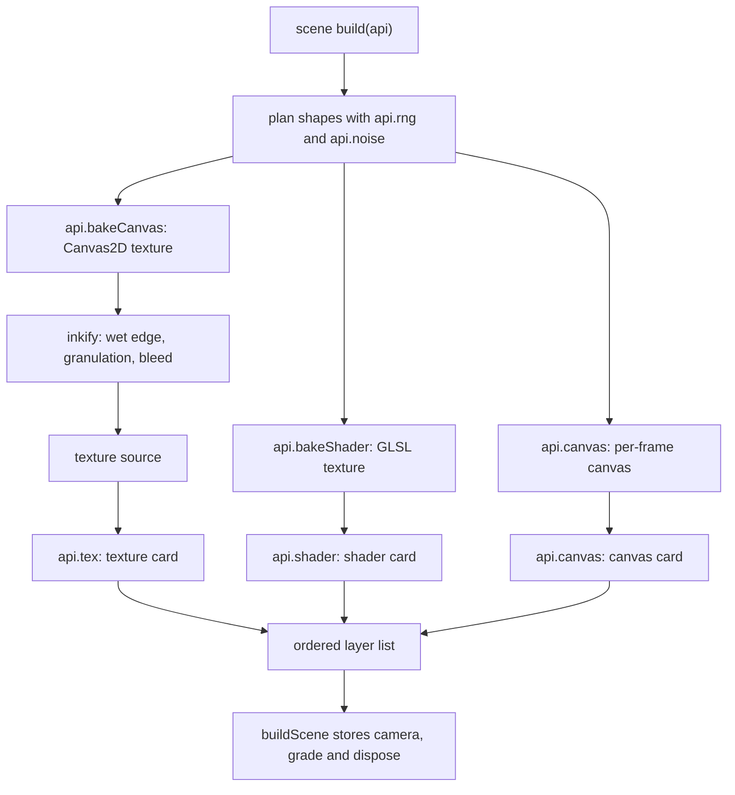
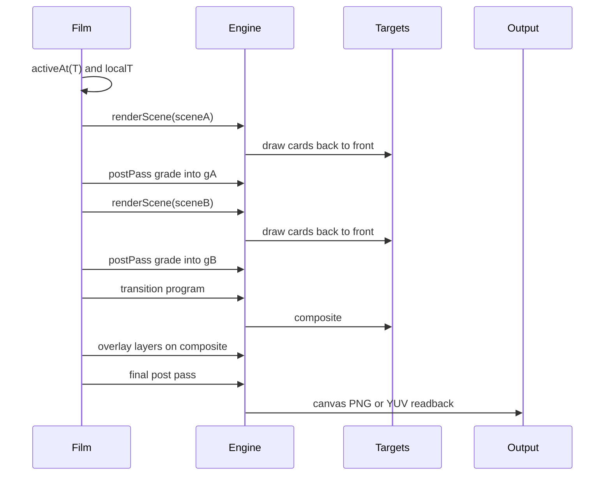

# 02 Core mechanism: two halves that meet

shanshui paints ten Chinese ink-wash landscapes in code and joins them into a one-minute film.
This document traces one painting from build to card list, and one frame from camera to YUV
bytes. The two halves meet at an ordered array of layers, each with a texture or a shader, a
rectangle and a depth. It cites the source for every step.

### Terms in this document

| Short form | Expansion |
|---|---|
| API | application programming interface |
| WebGL | Web Graphics Library |
| GLSL | Graphics Library Shading Language |
| GPU | graphics processing unit |
| CPU | central processing unit |
| PNG | Portable Network Graphics |
| FPS | frames per second |
| BPM | beats per minute |
| YUV | luma and chrominance |
| BT.709 | Recommendation ITU-R BT.709 |

Canvas2D is the two-dimensional drawing interface of the browser. A bare path such as
`src/film.js:113` means the file and line in the package root, not in this exploration.

## 1. The split

| Half | When it runs | Work done | Output |
|---|---|---|---|
| Build | Once per scene | Canvas2D paint, shader bakes, CPU planning | A layer list and a camera function |
| Frame | Once per still or film frame | Card draws, grade, composite, output | A picture |

The build runs once per scene. The frame runs again for every output picture. A 60 second film
at 60 FPS holds 3,600 frames, so a build cannot run for each frame (`src/timeline.js:6`,
`src/timeline.js:9`).

The only changing input is scene-local time. The layer list is fixed after the build. A layer
can change opacity, rectangle or visibility as a function of time, but the list does not grow or
shrink (`docs/ENGINE.md:66-72`).

## 2. Half A: a painting is built

### 2.1 The build call

The engine creates an API object and calls the scene `build` function once
(`src/engine/engine.js:371-376`). The API carries the design size, the WebGL context, the render
scale, two seeded generators, four bake methods and three card constructors
(`src/engine/engine.js:380-394`). The scene uses only this object. It does not receive a target
or a frame time.

The build may be asynchronous: `buildScene` awaits the result (`src/engine/engine.js:375`). A
scene can load a module or wait for a texture, but current scenes do not need this. The build time is measured and stored on the scene object (`src/engine/engine.js:376`).
The build may also return a `dispose` hook. The engine stores it, and `disposeScene` calls it
when the film no longer needs the shot (`src/engine/engine.js:371-376`, `:396-405`;
`src/film.js:83-98`).

The seed base is the scene id. `api.rng(salt)` hashes the scene id and the salt
(`src/engine/engine.js:384`). Two builds of `s03` with the same salt produce the same plan. A
comparison still and a film frame therefore show the same cliff, the same pine and the same
crane path.

### 2.2 Canvas2D bakes

A common brushwork path is a Canvas2D bake. `bakeCanvas` creates an offscreen canvas at the design size
times the render scale (`src/engine/engine.js:299-308`).

```text
# src/engine/engine.js:299-308
  bakeCanvas(w, h, draw, { scale = 1, mipmap = true, keepCanvas = false } = {}) {
    const k = scale * this.scale;
    const pw = Math.max(1, Math.round(w * k)), ph = Math.max(1, Math.round(h * k));
    const cv = new OffscreenCanvas(pw, ph);
    const ctx = cv.getContext('2d');
    ctx.setTransform(pw / w, 0, 0, ph / h, 0, 0);
    draw(ctx, { w, h, pw, ph, k: pw / w });
    const tex = texFromSource(this.gl, cv, { mipmap });
    return { tex, w, h, pw, ph, canvas: keepCanvas ? cv : null };
  }
```

Three details matter. The canvas transform maps design pixels to device pixels
(`src/engine/engine.js:304`), so the draw function works in design space and does not know the
render scale. The `scale` option can bake extra pixels, so a card that the camera pushes into
gets a sharper bake (`docs/ENGINE.md:58`). The texture upload premultiplies alpha by default
(`src/engine/gl.js:91-100`); a semi-transparent pixel stores colour times alpha, and the blend
equation assumes this form.

A bake returns a texture source record: handle, design size and pixel size
(`src/engine/engine.js:307`). The record is not a layer; it becomes one when the scene calls
`api.tex` or a generator wraps it.

### 2.3 GLSL bakes

Some elements are better as a shader. A sky gradient, a cloud field, a rock field or a paper
grain is a pure function of position. `bakeShader` renders that function once into a float
target, then keeps the texture (`src/engine/engine.js:318-334`).

The bake shares the card vertex shader and uses a fragment shader that defines `shade(p, uv)`
(`src/engine/engine.js:323`). Position `p` is in bake pixels. The output must be premultiplied
(`docs/ENGINE.md:59`). The bake clears to transparent black, draws one quad and returns the
texture (`src/engine/engine.js:325-333`).

The sky is the clearest example. `makeSky` bakes a vertical gradient, a low-frequency mottle and
an optional sun glow into a texture at half resolution (`src/lib/atmos.js:48-78`). It returns a
texture card at depth `1e5`, so the sky never moves with the camera (`src/lib/atmos.js:78`).

### 2.4 The ink pass

The ink pass gives a bake the wet edge, granulation and bleed of pigment in paper. `inkify` runs
a GLSL pass over a bake (`src/lib/inkfx.js:5-36`). It has three effects: wet-edge pooling,
granulation and bleed.

The brush module supplies the mark vocabulary before the ink pass runs (`src/lib/brush.js`).
`stroke` draws a tapered line along points with width, profile, colour, alpha, roughness and a
random stream (`:77-99`). `dryStroke` adds bristle gaps and noise (`:102-129`). `blob` fills an
irregular shape with squash, rotation and a side count (`:132-151`). `wash` lays a soft field
with an optional rim (`:163-175`). `granulate` adds grain with amount, cell size, seed and
contrast (`:206-213`). The seal overlay is the only caller of `granulate`
(`src/lib/seal.js:64-65`). Scenes call the other tools. `s10` uses `stroke` and `blob`
(`src/scenes/s10-autumn-ruins.js:175-178`). `s05` uses `dryStroke` on rock
(`src/scenes/s05/rocks.js:64`, `:104`).

The wet edge works on alpha. The shader samples two rings of twelve neighbours around each pixel
(`src/lib/inkfx.js:11-19`). The ring average is a local blur of alpha. A pixel above its
neighbourhood alpha is an interior edge. The shader darkens that pixel
(`src/lib/inkfx.js:21-23`). This produces the dark rim of a drying wet stroke.

Granulation works on the paper tooth. The shader builds a three-octave noise field at the design
position (`src/lib/inkfx.js:25-26`). It applies the noise most strongly in mid alpha, where the
pigment is thin (`src/lib/inkfx.js:27-28`). The result is intended to read as a broken, settled
texture, not a flat wash. Bleed adds a faint halo outside the stroke from the same ring average (`src/lib/inkfx.js:30-33`).

The pass runs once. A pine bake calls it at build time and frees the clean texture
(`src/lib/pine.js:882-886`). The final texture is the inked one.

### 2.5 Cards

The build returns cards, not a scene graph. A card is a flat quad with a rectangle, a depth and a
draw source. The engine has three card kinds (`src/engine/engine.js:350-368`).

```text
# src/engine/engine.js:350-368
  texLayer(src, opts = {}) {
    const rect = opts.rect || [0, 0, src.w, src.h];
    return { kind: 'tex', src, rect, z: 1, opacity: 1, blend: 'normal', ...opts };
  }
  // Procedural card drawn every frame. frag defines vec4 shade(vec2 p, vec2 uv) -> premultiplied rgba.
  shaderLayer(frag, opts = {}) {
    const p = this.program(CARD_VS, SHADER_HEAD + frag + SHADER_FOOT, opts.name || 'shader-layer');
    return { kind: 'shader', prog: p, rect: [-W * 0.25, -H * 0.25, W * 1.5, H * 1.5], z: 1, opacity: 1, blend: 'normal', uniforms: {}, ...opts };
  }
  // Canvas2D card redrawn every frame: draw(ctx, t, layer) in rest-space design px.
  canvasLayer(draw, opts = {}) {
    const rect = opts.rect || [-W * 0.1, -H * 0.1, W * 1.2, H * 1.2];
    const res = (opts.res ?? 1) * this.scale;
    const pw = Math.max(1, Math.round(rect[2] * res)), ph = Math.max(1, Math.round(rect[3] * res));
    const cv = new OffscreenCanvas(pw, ph);
    const ctx = cv.getContext('2d');
    const tex = texFromSource(this.gl, cv, { mipmap: false });
    return { kind: 'canvas', draw, rect, z: 1, opacity: 1, blend: 'normal', cv, ctx, src: { tex, w: rect[2], h: rect[3], pw, ph }, ...opts };
  }
```

A texture card holds a baked texture; a shader card holds a compiled program; a canvas card holds
an offscreen canvas and a draw function. The last two redraw every frame. All three share `rect`,
`z`, `opacity`, `blend` and `visible` (`docs/ENGINE.md:66-72`).

The rectangle is in rest space, before the camera moves (`docs/ENGINE.md:23`). A shader card
defaults to a 25 percent margin on each side (`src/engine/engine.js:357`). A canvas card
defaults to a 10 percent margin (`src/engine/engine.js:361`). The margin is overscan for camera
movement (`docs/ENGINE.md:29`).

Depth `z` is a scalar. `z = 1` is the picture plane, and larger values are farther away. Sky and
paper sit at `1e5` (`src/engine/engine.js:11`, `src/lib/atmos.js:78`). The engine does not sort
by `z`; the scene must return the list back to front (`docs/ENGINE.md:37`). Draw order is layer
order.

A texture or canvas card can carry two motion modifiers. `sway` displaces pixels with a wind
field that grows with distance from an anchor (`docs/ENGINE.md:76`). `reflect` draws a mirrored,
rippled copy below a waterline before the card (`docs/ENGINE.md:77`). Both are draw-time shader
effects and do not change the baked texture.

A shader card carries uniforms and textures (`docs/ENGINE.md:80`). A uniform can be constant or a
function of time, so the water and glitter cards move a highlight without a rebake
(`src/lib/water.js:252-267`).

### 2.6 The element generators

The library turns plans into cards. Each generator mixes Canvas2D, GLSL and JavaScript planning.
The pine shows the general shape.

`makePine` first calls `buildPine`, which plans the trunk, the branches and the needle pads. It
computes the bounding box with a margin, then bakes the tree into a canvas at that size
(`src/lib/pine.js:873-881`). It runs the ink pass, frees the clean texture, and builds a sway
record from the trunk base and the crown reach (`src/lib/pine.js:882-889`).

```text
# src/lib/pine.js:873-890
export function makePine(api, o = {}) {
  const T = buildPine(o);
  const m = o.margin ?? 40;
  const [bx1, by1, bx2, by2] = T.anchor.bbox;
  const rect = [Math.floor(bx1 - m), Math.floor(by1 - m), Math.ceil(bx2 - bx1 + 2 * m), Math.ceil(by2 - by1 + 2 * m)];
  let src = api.bakeCanvas(rect[2], rect[3], (ctx) => {
    ctx.translate(-rect[0], -rect[1]);
    paintPine(ctx, { ...o, tree: T });
  }, { scale: o.scale ?? 1 });
  if (o.ink !== false) {
    const inked = inkify(api, src, { edge: 0.4, granulation: 0.1, bleed: 0.8, seed: (o.seed ?? 1) % 17, ...(o.ink || {}) });
    api.engine?.freeTex?.(src);
    src = inked;
  }
  const a = T.anchor;
  const sway = { amp: o.swayAmp ?? 4, freq: o.swayFreq ?? 0.22, scale: 380, power: 1.8, anchor: a.base, radius: a.reach, bias: 0 };
  return { src, rect, anchor: a, tree: T, sway, layer: (lo = {}) => api.tex(src, { rect, sway, name: 'pine', ...lo }) };
}
```

The optional chain at `src/lib/pine.js:884` guards the call without changing the normal path. `api.engine` is always set (`src/engine/engine.js:383`) and `freeTex` exists
(`src/engine/engine.js:346`). The call frees the clean bake after the ink pass.

The returned object's `layer` function lets a scene call `pine.layer({ z: 1.15 })` and get a
texture card (`src/scenes/s03-moon-lake.js:257`). The anchor is the trunk base, so the sway
displacement is zero at the root and largest at the branch tips (`src/lib/pine.js:888`).

The other generators share this contract. Each takes the scene API and options and returns a
card or an object with a `layer` function. A bake generator paints once; a card generator redraws
every frame; an overlay generator returns a layer list.

| Generator | Inputs: API and options | Planning | Execution | Output | Source |
|---|---|---|---|---|---|
| Pine | `api`; tree plan, sway | Trunk, branches, needle pads and bounding box | Canvas2D bake and ink pass | Texture card with a sway record | `src/lib/pine.js:873-890` |
| Rock | `api`; profile, seed | Cliff profile, cun strokes (Chinese painting texture strokes made with a tilted brush), moss | Canvas2D bake and ink pass | Texture card or cards | `src/lib/rock.js:1038-1085` |
| Peaks | `api`; peak list, rectangle, seed | Peak columns, mist dissolve and union rectangle | Canvas2D bake and wet ink pass | Texture card | `src/lib/peaks.js:935-958` |
| Sky and clouds | `api`; gradient, sun, seed | Gradient, mottle and lobed cloud rows | GLSL bake | Texture card | `src/lib/atmos.js:48-79` |
| Water | `api`; box, mask, glitter | Perspective ripples, mask and glitter path | GLSL shader; reflection uses a bake | Shader card or texture card | `src/lib/water.js:224-269` |
| Architecture | `api`; building kind, scale | Pavilion, hall, gate, temple, tower or bridge layout | Canvas2D bake and light ink pass | Texture card | `src/lib/architecture.js:811-900` |
| Fauna | `api`; pose, seed | Crane pose for the current time | Per-frame Canvas2D | Canvas card | `src/lib/fauna.js:550` |
| Flora | `api`; bamboo or maple, seed | Culm, branch and leaf placement | Canvas2D bake and ink pass | Texture card | `src/lib/flora.js:577`, `:952` |
| Seal | `api`; glyphs, placement | Carved glyph layout | Canvas2D bake | Overlay layer list | `src/lib/seal.js:27-70` |
| Gust | `api`; leaf count, seed | 115 leaf paths and drift | Per-frame Canvas2D | Overlay layer list | `src/lib/gust.js:7-47` |

`makePeaks` expands `opts.peaks` into a list, shares paper and ink, and computes a union rectangle
when the caller gives none (`src/lib/peaks.js:935-947`). One `api.bakeCanvas` call translates to
that rectangle and paints every cluster with `paintPeak`, collecting summit and ledge anchors
(`src/lib/peaks.js:948-953`). The clusters paint back to front, so a near column covers a far one.
`finish` runs the wet ink pass once and returns a texture card whose `layer` method accepts a
depth (`src/lib/peaks.js:920-932`). The union rectangle adds a 30 pixel side margin and a 6 pixel
base margin around the peak bounds (`src/lib/peaks.js:938-945`).

`makeLake` resolves the water box, perspective, density and texture uniforms, then returns one
`api.shader` card from `LAKE_FS`; an optional mask multiplies the surface alpha inside that shader
(`src/lib/water.js:224-236`, `:193-200`). `makeGlitter` builds a second shader card from
`OVERLAY_FS` for sheen and the glitter path (`:240-269`). `makeReflection` bakes a smeared texture
and wraps it in a shader card, so the reflection is a separate card drawn behind the reflected
object (`:335-361`). The mask is sampled in design space, so the surface ends at a painted
shoreline rather than a rectangular edge (`:195-200`).

The architecture generator shows the bake helper pattern. `bakeArch` draws a building at twice
the design scale, then runs a light ink pass (`src/lib/architecture.js:1410-1427`). The doubled
scale is intended to keep thin roof lines sharp when the camera pushes in.

### 2.7 The order of the stack

A scene builds back to front. The moon lake scene starts with the night sky, the moon and the
night clouds (`src/scenes/s03-moon-lake.js:40-42`). It then adds the far range at depth 10 and a
mist card at depth 9 (`src/scenes/s03-moon-lake.js:72-73`). It continues with the middle peaks
at depth 5 and 5.5. The lake sits at depth 2.4 with its reflection. The near cliff is at depth
1.2 and the pine at depth 1.15 (`src/scenes/s03-moon-lake.js:90-98`, `src/scenes/s03-moon-lake.js:123-124`,
`src/scenes/s03-moon-lake.js:222-257`).

List order and depth order agree here. The engine depends on list order; depth controls parallax.
A card drawn late can still sit far away, but then it covers a near card (`docs/STYLE.md:18-27`).



## 3. Half B: one frame is drawn

### 3.1 The film selects the scene and the local time

A film frame starts with a film time `T`. The caller first calls `prepare(T)`, which builds the
shots near `T` and disposes the rest (`src/film.js:80-109`). `activeAt` then finds the last shot
whose start is at or before `T` (`src/film.js:60-66`).

```text
# src/film.js:60-66
  activeAt(T) {
    let i = 0;
    for (let k = 0; k < this.shots.length; k++) if (this.shots[k].start <= T) i = k;
    const B = this.shots[i];
    const tr = B.in && T < B.start + B.in.dur ? B.in : null;
    return { B, A: tr ? this.shots[i - 1] : null, tr, p: tr ? (T - B.start) / tr.dur : 1 };
  }
```

The function returns base shot `B`, previous shot `A`, incoming transition `tr` and raw progress
`p`. Inside the transition window both shots are active; outside it, `A` is null and `p` is 1.

`localT` converts film time to scene time (`src/film.js:111`). It subtracts the shot start and
adds the per-shot offset `t0`. The offset lets a scene start at a chosen moment in its own
animation.

At `T = 49.9` seconds, the active moon lake shot started at 46.9 (`src/timeline.js:27`). The 2.2 second
dusk transition ends at 49.1, so no transition is active. The local time is 3.0 seconds, when the moon lake camera is at rest. Its offset `T0` is 3, and
every camera term is multiplied by `t - T0` (`src/scenes/s03-moon-lake.js:20`,
`src/scenes/s03-moon-lake.js:33`).

### 3.2 The camera projection

The vertex shader defines the whole projection (`src/engine/engine.js:23-33`).

```text
# src/engine/engine.js:23-33
void main() {
  vec2 P = uDrawRect.xy + aPos * uDrawRect.zw;
  vUV = aPos; vP = P;
  vec2 C = uDesign * 0.5;
  float zz = max(uZ - uCam.z, 1e-3);
  vec2 S = C + ((P - C) * uZ - uCam.xy) / zz * uCam.w;
  vec2 d = S - C; float c = cos(uRoll), s = sin(uRoll);
  S = C + vec2(c * d.x - s * d.y, s * d.x + c * d.y);
  vec2 ndc = S / uDesign * 2.0 - 1.0; ndc.y = -ndc.y;
  gl_Position = vec4(ndc, 0.0, 1.0);
}`;
```

For a rest point `P` on a card at depth `z`, the screen point `S` is:

```
S = C + ((P - C) * z - [x, y]) / (z - dolly) * zoom
```

`C` is the design centre, (960, 540). `x` and `y` are the camera pan. `dolly` moves the camera
forward. `zoom` scales the lens. The result is then rotated by `roll` around the centre
(`src/engine/engine.js:27-31`).

The equation gives three behaviours. A pan of `x` moves a card at `z = 1` by about `-x` and a
card at `z = 4` by about `-x/4`, which is parallax (`docs/ENGINE.md:26`). A dolly of 0.02 scales
a near card by `1/(1 - 0.02)` and a far card by almost nothing (`docs/ENGINE.md:27`). A zoom
scales every card equally.

The shader projects the four card corners. The texture is sampled with `vUV`, so the rectangle
moves as one plane. There is no per-pixel depth test or perspective divide inside the card; the
card is a rigid plane, not a mesh.

### 3.3 The card loop

`renderLayers` binds the target, clears to the scene paper, and loops over the list
(`src/engine/engine.js:426-492`). Five checks skip or change a card:

1. `visible` may be a function of time. A false result skips the card
   (`src/engine/engine.js:433`).
2. `opacity` may be a function of time. A value near zero skips the card
   (`src/engine/engine.js:434-435`).
3. `update` may mutate the card, for example its rectangle (`src/engine/engine.js:436`).
4. `z` and `rect` may be functions of time. The engine resolves them each frame
   (`src/engine/engine.js:437-438`).
5. A `reflect` block draws a second, mirrored card before the main card
   (`src/engine/engine.js:452-466`).

Common uniforms are time, camera, roll, design size, render scale, depth and opacity
(`src/engine/engine.js:439`). Each card kind adds its own uniforms.

For a texture card, the fragment shader applies the optional sway, samples the texture, clips
out-of-range samples, applies a tint and multiplies by opacity (`src/engine/engine.js:64-81`).

The sway weight is the distance from the anchor divided by the radius, raised to a falloff power
(`src/engine/engine.js:67`). The displacement combines a sine wave, low-frequency simplex noise
and high-frequency flutter (`src/engine/engine.js:69-73`). The `uv` shifts by the displacement
divided by card size (`src/engine/engine.js:74`), so a pine branch tip moves more than its trunk
base and the texture does not tear.

A reflection card uses a separate shader (`src/engine/engine.js:97-121`). It discards pixels above
the waterline, mirrors the sample position across the waterline, adds a ripple offset, and
averages nine samples along a vertical smear (`src/engine/engine.js:98-114`). A fade with depth
and a noise-driven streak mask control the strength (`src/engine/engine.js:115-120`). The effect
is a reflection of the baked card, not a second bake.

A shader card uses its own program. The engine resolves every uniform, including time functions,
then binds named textures (`src/engine/engine.js:476-488`). The shader card's `shade(p, uv)`
receives the rest-space position, so a noise field stays fixed in the world and parallaxes with
the card (`docs/ENGINE.md:63`).

Blending is one function for all card kinds (`src/engine/engine.js:248-254`).

```text
# src/engine/engine.js:248-254
function blendFor(gl, mode) {
  gl.enable(gl.BLEND);
  if (mode === 'multiply') gl.blendFunc(gl.DST_COLOR, gl.ONE_MINUS_SRC_ALPHA);
  else if (mode === 'screen') gl.blendFunc(gl.ONE, gl.ONE_MINUS_SRC_COLOR);
  else if (mode === 'add') gl.blendFunc(gl.ONE, gl.ONE);
  else gl.blendFunc(gl.ONE, gl.ONE_MINUS_SRC_ALPHA);
}
```

The normal mode uses premultiplied source over. The multiply mode sets factors `DST_COLOR` and
`ONE_MINUS_SRC_ALPHA`, so the result is `src * dstColor + dst * (1 - srcAlpha)` with a
premultiplied source. The `src * dstColor` term darkens the destination and creates the multiply.
Screen and add modes serve light effects. The blend mode is a layer option (`docs/ENGINE.md:70`).

### 3.4 Canvas cards

A canvas card is the only card that changes its texture every frame. The engine resets the
transform, clears the canvas, sets a design-space transform, calls the scene draw function and
uploads the canvas (`src/engine/engine.js:440-447`).

```text
# src/engine/engine.js:440-447
      if (L.kind === 'canvas') {
        const ctx = L.ctx;
        ctx.setTransform(1, 0, 0, 1, 0, 0);
        ctx.clearRect(0, 0, L.cv.width, L.cv.height);
        ctx.setTransform(L.cv.width / rect[2], 0, 0, L.cv.height / rect[3], -rect[0] * L.cv.width / rect[2], -rect[1] * L.cv.height / rect[3]);
        L.draw(ctx, t, L);
        updateTexFromSource(gl, L.src.tex, L.cv, { mipmap: false });
        bindTarget(gl, target);
```

The transform maps the card rectangle to the canvas. The draw function can use design pixels and
does not need to know the pixel size. The upload in `updateTexFromSource` premultiplies alpha
(`src/engine/gl.js:102-108`). The card is then drawn by the texture path.

This card kind runs Canvas2D and a texture upload every frame. The guide tells authors to keep
the rectangle tight (`docs/ENGINE.md:64`, `:135`). The crane flock and the falling leaves use
this kind because their poses change every frame (`src/lib/fauna.js:550`, `src/lib/gust.js:7`).

### 3.5 The grade

A scene can supply a grade object or a grade function. The engine merges it over the default
grade (`src/engine/engine.js:494-497`). The pass multiplies by exposure, mixes toward luma for
saturation, applies contrast around a pivot of 0.62, multiplies by tint and mixes toward the lift
colour (`src/engine/engine.js:184-191`).

```text
# src/engine/engine.js:184-202
  if (uDoGrade > 0.5) {
    c *= uGrade.x;
    float L = luma(c);
    c = mix(vec3(L), c, uGrade.z);
    c = (c - 0.62) * uGrade.y + 0.62;
    c *= uTintMul;
    c = mix(c, uLift.rgb, uLift.a);
  }
  if (uDoFinal > 0.5) {
    float pf = texture(uPaper, vec2(vUV.x, 1.0 - vUV.y)).r * 2.0 - 1.0;
    float dark = 1.0 - luma(c);
    c *= 1.0 + uGrade.w * pf * (0.45 + 1.1 * dark);
    vec2 d = (vUV - 0.5) * vec2(1.0, 0.82);
    float v = smoothstep(0.30, 0.92, length(d) * 1.3);
    c *= 1.0 - uVignette * v;
    float n = hash12(gl_FragCoord.xy + 0.37) + hash12(gl_FragCoord.xy * 1.37 + 11.1) - 1.0;
    c += n * uDither / 255.0;
  }
  o = vec4(clamp(c, 0.0, 1.0), 1.0);
```

The post shader has three gated blocks in source order. The ink block runs when `uDoFinal` is on
and `uInk` is nonzero (`src/engine/engine.js:162-182`). The grade block runs when `uDoGrade` is on
(`src/engine/engine.js:184-190`). The final block adds paper fibre, vignette and dither when
`uDoFinal` is on (`src/engine/engine.js:192-200`). The ink block is separate from the final block.
It wobbles the sample position along the paper grain (`:162-169`) and lets dark pigment creep into
lighter paper around a stroke (`:171-183`). It applies after the composite, so it treats all cards
as one painting. The paper fibre is a static screen-space texture, stronger in dark areas
(`src/engine/engine.js:278-285`, `:194-195`). The dither prevents banding in soft mist gradients
(`:199-200`).

### 3.6 The composite and the transition

For a shot with no transition, the film renders the scene and grades it directly into the
composite target (`src/film.js:134-135`). For a transition, it renders the outgoing scene into
`gA` and the incoming scene into `gB`, then runs the transition program (`src/film.js:139-154`).

```text
# src/film.js:139-154
      const e = (EASE[tr.ease || def.ease] || EASE.smooth)(Math.min(1, Math.max(0, p)));
      const cams = def.cam ? def.cam(e, tr) : { a: null, b: null };
      const gA = this.renderShot(A, T, eng.targets.sceneA, this.gA, cams.a);
      const gB = this.renderShot(B, T, eng.targets.sceneB, this.gB, cams.b);
      const prog = this.progs[tr.type];
      bindTarget(gl, eng.targets.comp);
      gl.disable(gl.BLEND);
      gl.useProgram(prog.prog);
      const d = def.defaults || {};
      setUniforms(gl, prog, {
        uA: this.gA.tex, uB: this.gB.tex, uP: p, uE: e, uT: T,
        uK: tr.k || d.k || [0, 0, 0, 0], uK2: tr.k2 || d.k2 || [0, 0, 0, 0],
        uC: tr.c || d.c || [960, 540], uC2: tr.c2 || d.c2 || [960, 540],
        uPaperC: tr.paper || PAPER_RGB,
      });
      drawQuad(gl);
```

The transition receives two graded pictures, raw and eased progress, film time, four parameters,
two centre points and paper colour (`src/film.js:148-153`). It can offset both scene cameras
(`src/film.js:140`): cloud rise lifts the incoming scene, and spray pushes into a waterfall
(`docs/FILM.md:31-38`).

`sA` and `sB` mix the sample with paper outside the frame, so a camera offset does not smear edge
pixels (`src/transitions/index.js:23-25`). The bloom shader uses luma to find dark ink, noise to
warp the front and a sweeping threshold (`src/transitions/index.js:57-73`), so the incoming
painting appears from its dark masses first.

After the transition, the film draws overlays on the graded composite (`src/film.js:159-164`). The
leaf gust and seal are ordinary layer lists with their own camera and are not graded again.

### 3.7 Motion blur and the output

`renderAt` can draw one sample or several sub-frames (`src/film.js:170-185`).

```text
# src/film.js:170-185
  renderAt(T, { samples = 1, shutter = 0.5, fps = FPS, target = null } = {}) {
    const eng = this.engine;
    let g;
    if (samples <= 1) {
      g = this.composite(T);
      eng.postPass(eng.targets.comp, target, g, { doGrade: false, doFinal: true });
      return;
    }
    eng.clear(eng.targets.accum);
    for (let i = 0; i < samples; i++) {
      const ts = T + ((i + 0.5) / samples - 0.5) * (shutter / fps);
      g = this.composite(ts);
      eng.blit(eng.targets.comp, eng.targets.accum, 1 / samples, true);
    }
    eng.postPass(eng.targets.accum, target, g, { doGrade: false, doFinal: true });
  }
```

With more than one sample, the film clears an accumulation target. It computes each sample time
around `T` with a half-frame shutter (`src/film.js:179-181`). It composites each sample and adds
it with a gain of one over the sample count (`src/film.js:182`).

The sample times straddle `T`. The scene contract covers this, because scene time is pure and is
valid over a wide window (`docs/ENGINE.md:49`). Motion blur is a property of the render call,
not a special scene mode.

For a still, the final pass writes to the canvas and the page encodes a PNG
(`src/main.js:52-56`). For a film frame, the engine packs the float target into planar YUV 4:2:0
with BT.709 limited range (`src/engine/engine.js:519-533`). The pack shader averages each 2 by 2
block for chroma (`src/engine/engine.js:212-235`). The page reads the buffer and sends it over
the WebSocket (a two-way browser socket) (`src/main.js:145-148`).



## 4. Where the two halves meet

The layer list is the meeting point: the build produces it and the frame consumes it. Four
properties follow.

First, time is the only changing input. The camera and layer options can be functions of time,
and the scene has no other state (`docs/ENGINE.md:49`). A frame is a sample, not a step.

Second, baking is amortized. A pine is painted once, and 3,600 frames reuse the texture. A shader
card runs its fragment shader every frame, but it can move without a rebake.

Third, memory follows the scene, not the film. The film keeps only the scenes near the current
time (`src/film.js:81-97`). A scene keeps its cards until `disposeScene` deletes them
(`src/engine/engine.js:396-405`).

Fourth, composition is data. The engine loops over the array and draws each card; it does not
traverse a graph or resolve transforms. Depth is one scalar per card.

The costs divide as follows:

| Card kind | Build cost | Frame cost | Good for |
|---|---|---|---|
| Texture | Canvas2D bake plus ink pass | One textured quad | Rock, pine, architecture, still parts |
| Shader | One bake or none | Fragment shader over the rect | Sky, water, mist, glitter |
| Canvas | Small setup | Full Canvas2D redraw and upload | Cranes, leaves, snow |

## 5. Aha

**Aha:** The engine has no depth buffer and no scene graph, yet it produces parallax and
occlusion. Depth is a scalar in a projection formula, and occlusion is list order. The scene
author encodes both in one array. The model is one flat card, one depth, one draw order. It
makes a painting reproducible. Composition is data, not a traversal with hidden state. A build
produces the same array, and a still frame samples it at one time.

## 6. Counts

| Count | Value |
|---|---:|
| Frames in the timeline | 3,600 |
| Design space | 1920 by 1080 |
| Film duration | 60 seconds |
| Frame rate | 60 FPS |
| Tempo | 80 BPM |
| Bars | 20 |
| Seconds per bar | 3 |

The next document follows one painting from reference to accepted still, then the film.
