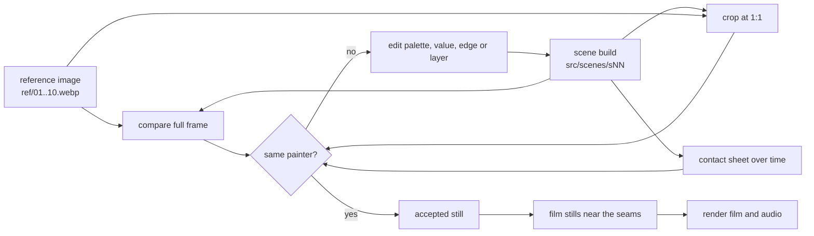
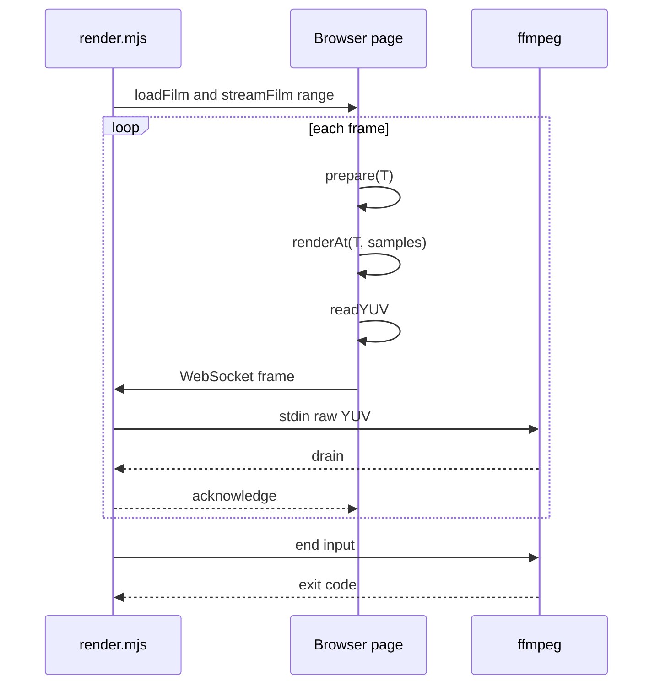

# 03 Workflow and quality: from reference to accepted still, then the film

shanshui paints ten Chinese ink-wash landscapes in code and joins them into a one-minute film.
This document follows the working method. It starts with one painting and a reference image. It
ends with a film file and a sound file. It covers the capture tools, the comparison loop, the
warm daemon, the film renderer, the audio synthesizer, the frame checks and the quality gates.

The source does not contain a written procedure for the painter. The method below comes from the
tools, the guides and the project statement (`README.md:64`, `docs/ENGINE.md:106-138`). No step
was run for this document. No browser was opened and no output was measured.

### Terms in this document

| Short form | Expansion |
|---|---|
| GPU | graphics processing unit |
| JSON | JavaScript Object Notation |
| PNG | Portable Network Graphics |
| MP4 | MPEG-4 Part 14 |
| WAV | Waveform Audio File Format |
| MIDI | Musical Instrument Digital Interface |
| YUV | luma and chrominance |
| FPS | frames per second |
| BPM | beats per minute |
| BT.709 | Recommendation ITU-R BT.709 |
| LUFS | loudness units relative to full scale |
| dBTP | decibels true peak |

A bare path such as `src/film.js:113` means the file and line in the package root, not in this
exploration.

## 1. The loop in one page

The project describes the method in one sentence. Each painting was built by matching one
region at a time against a reference painting (`README.md:64`). The style guide gives the bar:
a still frame from the code painting must sit next to its reference and read as the same painter
(`docs/STYLE.md:3`).

Local time is seconds from a scene's shot start. Design space is the 1920 by 1080 coordinate
space. Render scale is the drawing buffer width divided by 1920. Samples is the number of
sub-frame renders averaged into one frame. A grade is a colour transform applied to a rendered
scene before the transition composite. A contact sheet tiles frames at several times. A seam is
the overlap where one painting becomes the next. Coordinates are design pixels with the origin at
the top left and y down (`docs/ENGINE.md:21-23`). Negative local time is the pre-roll before the
shot starts. The film is ten scenes in a fixed order, joined by ten transition programs in eleven
seam instances; mist is used twice (`src/timeline.js:14-27`).

The loop has six steps:

1. Select the scene id and the reference id. The registry maps `s01` to reference `01`, and so on
   (`src/scenes/index.js:15`).
2. Build the scene with a still capture at a chosen local time (`tools/still.mjs:18-24`).
3. Compare the full frame with the reference. Use a stacked image or a side-by-side image
   (`src/main.js:59-74`).
4. Compare regions at 1:1 with crops. This is where brush quality is visible
   (`docs/ENGINE.md:124`).
5. Move through time with a contact sheet. Check that the composition holds while the camera and
   the elements move (`src/main.js:96-112`).
6. Repeat with a warm daemon so each iteration takes seconds, not a browser launch
   (`docs/ENGINE.md:108`).



The loop is not linear in practice. A crop can reveal a weak edge that sends the author back to
the brush library. A contact sheet can reveal a camera move that sends the author back to the
scene. The tools are designed for these small returns.

The commands below show the main tools and their defaults (`tools/still.mjs:3-10`,
`tools/daemon.mjs:5`, `tools/render.mjs:5-6`, `tools/audio.mjs:7`, `tools/forensics.mjs:4`,
`tools/libdoc.mjs:4`).

```text
node tools/still.mjs --scene s03 --t 2 --out out/s03/a.png   # scale 1, samples 1
node tools/daemon.mjs                                        # port 7781, 240 s timeout
node tools/render.mjs --out out/film.mp4                     # 0 to 60 s, 60 FPS, rate factor 16
node tools/audio.mjs                                         # 48 kHz, 24-bit
node tools/forensics.mjs out/preview.mp4                     # 160 by 90 decode
node tools/libdoc.mjs                                        # writes docs/LIBRARY.md
```

The film tool defaults are from 0 seconds, to the film duration, 60 FPS, scale 1 and 1 sample
(`tools/render.mjs:6`, `tools/render.mjs:20-29`).

## 2. The still tool

`tools/still.mjs` is the main entry point for one painting. It parses a small job description and
sends it to the warm daemon or to its own browser page (`tools/still.mjs:18-24`).

The job holds the scene id, the reference id, the local time, the render scale, the sample count,
an optional grade override, the output width and the output paths. The crop list and the sheet
list are parsed from strings of the form `x,y,w,h:path` and `t1,t2,...:path`
(`tools/still.mjs:22-23`). An example is
`node tools/still.mjs --scene s03 --t 3 --out out/s03/a.png --compare out/s03/cmp.png`
(`tools/still.mjs:3-5`).

The tool first tests for a daemon. It sends a ping with an 800 millisecond timeout
(`tools/still.mjs:26-30`). A running daemon answers `pong` (`tools/lib.mjs:64`).

```text
# tools/still.mjs:26-30
let viaDaemon = false;
try {
  const r = await fetch(`http://127.0.0.1:${DAEMON_PORT}/ping`, { signal: AbortSignal.timeout(800) });
  viaDaemon = r.ok;
} catch {}
```

If the daemon answers, the tool sends the job as JSON to the `/job` route (`tools/still.mjs:33-37`).
If it does not, the tool opens its own server and browser (`tools/still.mjs:38-44`).

```text
# tools/still.mjs:38-44
} else {
  const { page, info, close } = await openPage({ scale: job.scale, quiet: !a.verbose });
  try {
    if (a.info) console.log('gpu:', JSON.stringify(info));
    await runJob(page, job);
  } catch (e) { console.error('ERROR:', e.message); code = 1; } finally { await close(); }
}
```

The standalone path launches Chrome, runs the job and closes the browser in a `finally` block.
The difference is time. The guide gives 2 to 3 seconds per call with the daemon and about 20
seconds without it (`docs/ENGINE.md:108`). The daemon keeps the browser process and the shader
cache warm. The fresh page still reloads edited modules (`tools/daemon.mjs:1-3`).

## 3. The job runner

Both the still tool and the daemon call `runJob` (`tools/lib.mjs:136-154`).

```text
# tools/lib.mjs:136-154
export async function runJob(page, job, log = console.log) {
  const samples = job.samples || 1;
  const t = job.t || 0;
  const b = await page.evaluate((id, ref) => window.__api.loadScene(id, ref ? { ref } : {}), job.scene, job.ref || null);
  if (job.grade) await page.evaluate((g) => window.__api.setGrade(g), job.grade);
  log(`built ${b.id} "${b.title}" in ${b.buildMs} ms, ${b.layers} layers`);
  const ms = await page.evaluate((tt, s) => window.__api.renderScene(tt, { samples: s }), t, samples);
  log(`rendered t=${t} in ${ms} ms`);
  if (job.out) log('wrote ' + (await page.evaluate((p) => window.__api.savePNG(p), job.out)));
  if (job.compare) log('wrote ' + (await page.evaluate((p, w) => window.__api.saveCompare(p, { layout: 'stack', width: w }), job.compare, job.width || 960)));
  if (job.side) log('wrote ' + (await page.evaluate((p, w) => window.__api.saveCompare(p, { layout: 'side', width: w }), job.side, job.width || 960)));
  for (const c of job.crops || []) {
    log('wrote ' + (await page.evaluate((p, r) => window.__api.saveCrop(p, r), c.path, { x: c.x, y: c.y, w: c.w, h: c.h, width: job.width || 900 })));
  }
  for (const s of job.sheets || []) {
    const tile = Math.round((job.width || 960) / 2);
    log('wrote ' + (await page.evaluate((p, times, smp, tw) => window.__api.saveSheet(p, { times, cols: Math.min(4, times.length), width: tw, samples: smp }), s.path, s.times, samples, tile)));
  }
}
```

The runner calls `loadScene` and logs the build time and the layer count (`tools/lib.mjs:139-141`).
It then calls `renderScene` with the time and the sample count, and logs the render time
(`tools/lib.mjs:142-143`). Each requested output follows:

| Request | Page call | Output |
|---|---|---|
| `out` | `savePNG` | One frame at the render scale |
| `compare` | `saveCompare` with `stack` | Reference above, render below |
| `side` | `saveCompare` with `side` | Reference left, render right |
| `crops` | `saveCrop` | One region, reference left, render right |
| `sheets` | `saveSheet` | A grid over time |

The page owns the image composition. The tool only asks for a path. This keeps the Node process
free of image decoding and keeps the reference comparison on the same canvas as the render.

## 4. Comparison, crop and sheet

The comparison function loads the reference image from `/ref/NN.webp`
(`src/main.js:59-63`). It creates an offscreen canvas, fills a dark background, draws the
reference and the render at the same width, and posts the result to `/save`
(`src/main.js:64-73`). The stack layout doubles the height. The side layout doubles the width.

```text
# src/main.js:59-74
  async saveCompare(path, { width = 960, layout = 'stack', refId } = {}) {
    const ref = refId || state.refId;
    const img = new Image();
    img.src = '/ref/' + ref + '.webp';
    await img.decode();
    const c = canvasEl();
    const h = Math.round(width * 9 / 16);
    const out = new OffscreenCanvas(layout === 'stack' ? width : width * 2 + 8, layout === 'stack' ? h * 2 + 8 : h);
    const x = out.getContext('2d');
    x.fillStyle = '#222'; x.fillRect(0, 0, out.width, out.height);
    x.imageSmoothingQuality = 'high';
    x.drawImage(img, 0, 0, width, h);
    if (layout === 'stack') x.drawImage(c, 0, h + 8, width, h); else x.drawImage(c, width + 8, 0, width, h);
    const blob = await out.convertToBlob({ type: 'image/png' });
    return post('/save?path=' + encodeURIComponent(path), blob);
  },
```

The reference image is scaled to the requested width. The render is the live canvas. The dark
background separates the two images and shows the paper edge. The default width is 960 pixels.

The crop function is the closest look. It maps a design-space rectangle into both images
(`src/main.js:77-93`). The reference scale is `naturalWidth / 1920`. The canvas scale is
`canvas.width / 1920`. The function then draws the same region from each image at the requested
output width. A crop at 900 pixels wide is a strong magnifier of brush edges.

The sheet function renders the scene at each requested time and tiles the frames
(`src/main.js:96-112`). It uses four columns by default. It draws a dark label with the time in
the top-left of each tile (`src/main.js:107-108`). If a film is loaded, it calls `prepare` and
`renderFilm` for each time (`src/main.js:104`). If a scene is loaded, it calls
`renderSceneFrame` directly.

```text
# src/main.js:96-112
  async saveSheet(path, { times, cols = 4, width = 480, samples = 1 } = {}) {
    const c = canvasEl();
    const h = Math.round(width * 9 / 16);
    const rows = Math.ceil(times.length / cols);
    const out = new OffscreenCanvas(cols * width + (cols - 1) * 4, rows * h + (rows - 1) * 4);
    const g = out.getContext('2d');
    g.fillStyle = '#222'; g.fillRect(0, 0, out.width, out.height);
    for (let i = 0; i < times.length; i++) {
      if (state.film) { await state.film.prepare(times[i]); api.renderFilm(times[i], { samples }); } else state.engine.renderSceneFrame(state.scene, times[i], { samples });
      const x = (i % cols) * (width + 4), y = Math.floor(i / cols) * (h + 4);
      g.drawImage(c, x, y, width, h);
      g.fillStyle = 'rgba(0,0,0,0.6)'; g.fillRect(x, y, 74, 20);
      g.fillStyle = '#fff'; g.font = '13px monospace'; g.fillText('t=' + times[i].toFixed(2), x + 4, y + 14);
    }
    const blob = await out.convertToBlob({ type: 'image/png' });
    return post('/save?path=' + encodeURIComponent(path), blob);
  },
```

The sheet is the motion check. A still can look correct and a move can still break. The sheet
shows the camera path, the mist drift, the crane positions and the water at several times.

## 5. The reference loop in practice

The moon lake scene is a useful example. The style guide gives its reference map
(`docs/STYLE.md:53`). The map lists a full moon at about (1325, 225). It lists a pine at the top
left, a pavilion on the left cliff, red maples, two groups of peaks and two islands. It also
lists a lake with a glitter column (`docs/STYLE.md:53`). The scene uses a
moon at (1338, 198) with radius 78 and a lake line at 655 (`src/scenes/s03-moon-lake.js:21-22`).

The first check is the value ladder. The ladder is the rule that near ink is darkest and far ink
is palest. The near cliff must reach near black, the middle peaks must
stay in mid greys, and the far range must be pale (`docs/STYLE.md:21`). A compare stack shows
whether the code painting has the same light and dark balance as the reference.

The second check is the edge. A crop of a cliff top shows whether the edge is a clean vector line
or a dry brush contour (`docs/STYLE.md:22`). The ink pass adds a wet rim and granulation, but it
cannot invent a bad contour (`src/lib/inkfx.js:5-36`).

The third check is the paper. The reference has large light areas and true blacks
(`docs/STYLE.md:13`, `docs/STYLE.md:32`). A code painting that fills the frame with mid grey
fails even if the shapes are correct.

The fourth check is the animation. A sheet at local times -2, 0, 2, 4, 6 and 8 shows the camera
move and the moving elements. The scene must stay valid over this range (`docs/ENGINE.md:49`).
The moon lake camera starts at rest at local time 3 (`src/scenes/s03-moon-lake.js:20`). It moves
7 pixels per second in x and -3.5 pixels per second in y. It adds a small dolly
(`src/scenes/s03-moon-lake.js:33`).
The sheet shows whether that motion keeps the composition.

The loop ends when the full frame and the crops read as the same painter. The project bar is
visual, not numeric. The palette table gives measured targets, but no script asserts them
(`docs/STYLE.md:5-15`).

## 6. The warm daemon

The daemon is one Chrome process with a job queue (`tools/daemon.mjs:1-7`). Warm means the
browser and shader cache stay loaded between jobs. It serves `/job` on
port 7781 by default (`tools/lib.mjs:12`, `tools/daemon.mjs:24-25`). Each job gets a new page, so
a module edit is visible on the next run (`tools/daemon.mjs:34-38`).

```text
# tools/daemon.mjs:24-43
server = await startServer({
  port: DAEMON_PORT,
  extra: async (req, res, u, body) => {
    if (u.pathname !== '/job') return false;
    const job = JSON.parse(body.toString());
    const logs = [];
    const t0 = performance.now();
    const log = (s) => logs.push(`[${((performance.now() - t0) / 1000).toFixed(1)}s] ${s}`);
    await acquire();
    let page;
    try {
      const b = await ensureBrowser();
      const tp = await newToolPage(b, server.port, job.scale || 1, log, !job.verbose);
      page = tp.page;
      log('page ready');
      if (job.info) log('gpu: ' + JSON.stringify(tp.info));
      await Promise.race([
        runJob(page, job, log),
        new Promise((_, rej) => setTimeout(() => rej(new Error('job timeout after ' + (job.timeout || 240) + ' s')), (job.timeout || 240) * 1000)),
      ]);
```

The daemon limits active pages (`tools/daemon.mjs:9-13`). The default is 6. A job waits in a
queue when the limit is reached. Each job has a timeout, 240 seconds by default
(`tools/daemon.mjs:40-43`). The job response is JSON with `ok`, `logs` and an optional `error`
(`tools/daemon.mjs:44-48`). The slot is released in a `finally` block
(`tools/daemon.mjs:49-52`).

The warm cache is the shader cache of the browser. A fresh page reloads JavaScript modules but
does not pay the full GPU driver start cost. This is why the daemon avoids a full browser launch
for each iteration. The daemon does not change the render. It only removes startup work.

## 7. The film path

The film path starts after the ten paintings pass their still checks. The renderer is
`tools/render.mjs`. It supports three modes: a film range to a video, one film still, and a film
contact sheet (`tools/render.mjs:1-9`).

```text
# tools/render.mjs:43-50
    const f0 = Math.round(from * fps), f1 = Math.round(to * fps);
    const args = ['-y', '-loglevel', 'error', '-f', 'rawvideo', '-pix_fmt', 'yuv420p', '-color_range', 'tv', '-colorspace', 'bt709', '-color_primaries', 'bt709', '-color_trc', 'bt709', '-s', `${info.w}x${info.h}`, '-r', String(fps), '-i', '-'];
    if (a.audio) args.push('-ss', String(from), '-i', path.resolve(ROOT, a.audio));
    args.push('-vf', 'setparams=color_primaries=bt709:color_trc=bt709:colorspace=bt709:range=tv',
      '-c:v', 'libx264', '-preset', preview ? 'veryfast' : 'slow', '-crf', String(crf), '-tune', 'film',
      '-colorspace', 'bt709', '-color_primaries', 'bt709', '-color_trc', 'bt709', '-color_range', 'tv');
    if (a.audio) args.push('-map', '0:v:0', '-map', '1:a:0', '-af', 'apad', '-c:a', 'aac', '-b:a', '320k', '-ar', '48000', '-ac', '2', '-t', String((f1 - f0) / fps));
    args.push('-movflags', '+faststart', out);
```

For a video, the tool starts ffmpeg with raw YUV input at the page size and frame rate
(`tools/render.mjs:43-44`). It tags the input and output as BT.709 limited range
(`tools/render.mjs:44-48`). It uses x264, an H.264 video encoder, with a slow preset and a
constant rate factor of 16 for the master, or veryfast and 22 for a preview
(`tools/render.mjs:18-21`, `tools/render.mjs:47`).
It adds fast start for web playback (`tools/render.mjs:50`).

If an audio file is given, the tool seeks to the start time. It maps one video stream and one
audio stream. It pads the audio. It encodes Advanced Audio Coding at 320 kilobits per second and
48 kilohertz (`tools/render.mjs:45-49`).

Frames arrive over a WebSocket (`tools/render.mjs:54-60`).

```text
# tools/render.mjs:54-60
    const wss = new WebSocketServer({ server: server.srv, path: '/frames', maxPayload: 64 * 1024 * 1024 });
    wss.on('connection', (sock) => {
      let chain = Promise.resolve();
      sock.on('message', (data) => {
        chain = chain.then(() => new Promise((res) => { if (ff.stdin.write(data)) res(); else ff.stdin.once('drain', res); })).then(() => sock.send('k'));
      });
    });
```

The server writes each frame to the ffmpeg standard input and acknowledges it only after ffmpeg
accepts the data (`tools/render.mjs:57-59`). The frame producer keeps at most two frames in
flight, so the GPU work overlaps the transfer without a large memory queue
(`src/main.js:127-148`).

```text
# src/main.js:127-148
  async streamFilm({ from = 0, to, fps = 60, samples = 1 } = {}) {
    const eng = state.engine;
    const ws = new WebSocket('ws://' + location.host + '/frames');
    ws.binaryType = 'arraybuffer';
    await new Promise((res, rej) => { ws.onopen = res; ws.onerror = () => rej(new Error('frame socket failed')); });
    let acked = from;
    const waiters = [];
    ws.onmessage = () => { acked++; while (waiters.length && waiters[0].n <= acked) waiters.shift().r(); };
    const waitAck = (n) => (acked >= n ? Promise.resolve() : new Promise((r) => waiters.push({ n, r })));
    const t0 = performance.now();
    const acc = { prep: 0, render: 0, read: 0, send: 0 };
    for (let f = from; f < to; f++) {
      const T = f / fps;
      let a = performance.now();
      await state.film.prepare(T);
      let b = performance.now(); acc.prep += b - a;
      state.film.renderAt(T, { samples, fps, target: eng.targets.tmp });
      a = performance.now(); acc.render += a - b;
      const buf = eng.readYUV(eng.targets.tmp);
      b = performance.now(); acc.read += b - a;
      await waitAck(f - 1);            // keep at most 2 frames in flight
      ws.send(buf);
```

The producer calls `prepare`, renders to the temporary target, reads the YUV bytes and sends
them. It waits for the acknowledgement of the previous frame before the next send
(`src/main.js:141-148`). The loop reports preparation, render, read and send times every 60
frames (`src/main.js:150-153`).

The film still mode is the seam check. It loads the film, prepares one time, renders it and
saves a PNG (`tools/render.mjs:30-34`). The contact sheet mode uses the same sheet function as
the still tool (`tools/render.mjs:35-38`).



For a video render, the renderer never writes a frame to disk (`tools/render.mjs:1-2`). The final
MP4 is the only output. Film still mode also writes a PNG (`tools/render.mjs:9`). A failed
ffmpeg exit sets the process exit code to 1 (`tools/render.mjs:64-74`).

## 8. Motion blur samples

The film render call takes a sample count (`tools/render.mjs:20`). The tool default is 1 sample.
The README master command passes 2 samples (`README.md:42`). `renderAt` divides the shutter
interval into that many sub-frame times and averages them (`src/film.js:170-185`). The default
shutter is half a frame (`src/film.js:170`). Two samples therefore sit at plus and minus one
eighth of a frame from `T` (`src/film.js:180`). The total covered interval is one quarter frame.

This is a render-time effect. The scene has no motion-blur state. The scene is sampled at several
times and the engine averages the results. A higher sample count gives a smoother blur and costs
more time. The tool passes the count without change (`src/main.js:120-122`).

## 9. The soundtrack

The audio tool is a separate program. It imports the clock from the timeline (`tools/audio.mjs:13`).
It synthesizes 48 kilohertz samples for the full duration (`tools/audio.mjs:16-17`). It writes a
24-bit WAV under `out/audio` (`tools/audio.mjs:18-19`, `tools/audio.mjs:673-674`).

The score uses the same bars as the picture. The helper `N(bar, beat, midi, beats)` builds a note
at a bar and beat (`tools/audio.mjs:344`). The guzheng, xiao, bowl, drum and effects are
synthesized, not sampled (`tools/audio.mjs:1-7`). A guzheng is a plucked Chinese zither. A xiao
is a vertical bamboo flute. A singing bowl is a struck metal bowl.

`guzheng` uses Karplus-Strong string synthesis with bends, vibrato, tremolo, glissandi and
harmonics (`tools/audio.mjs:112-168`). `xiao` shapes a breath tone (`:183-233`). `bowl` sums
modal partials at 1, 2.71, 5.12, 8.21 and 11.9 times the fundamental (`:235-255`). `drum`,
`knock` and `whoosh` cover the effects (`:257-308`).

The score has ten bar groups, starting at bars 1, 3, 5, 7, 9, 11, 13, 15, 17 and 19
(`tools/audio.mjs:350-453`). The gust cue at 28.65 seconds, the seal cue at 56.7 seconds and the
evaporate cue at 58.0 seconds come from `CUE` (`src/timeline.js:33-36`,
`tools/audio.mjs:444-453`). The drone and the ambience beds follow the picture
(`tools/audio.mjs:455-488`, `:490`).

The mix has six buses: music, hall, pads, ambience, effects and room (`tools/audio.mjs:578-586`).
The low end below 120 hertz is made mono, and a high-pass filter removes rumble below 28 hertz
(`tools/audio.mjs:587-595`). The last 1.1 seconds fade to digital silence
(`tools/audio.mjs:596-602`).

The master is a measured loop (`tools/audio.mjs:662-680`).

The loop measures the raw mix, computes a gain to reach -14 LUFS, applies a limiter and writes a
24-bit file (`tools/audio.mjs:663-675`). The limiter ceiling is -1.7 dBTP
(`tools/audio.mjs:672`). The loop repeats up to four times or stops when the measured loudness is
within 0.2 LUFS of the target (`tools/audio.mjs:668-679`). The final measurement uses ffmpeg
`loudnorm` in analysis mode (`tools/audio.mjs:621-625`).

The limiter is true-peak aware. It estimates peaks with four times oversampling, looks 4
milliseconds ahead, and releases over 0.12 seconds (`tools/audio.mjs:628-659`). This is why the
file can sit at -14 LUFS without clipping.

The audio and the picture meet by the clock, not by a render call. The tool imports bar and cue
values from `src/timeline.js` (`tools/audio.mjs:13`). The same ffmpeg command encodes the video
and muxes the WAV (`tools/render.mjs:45-49`).

## 10. Frame forensics

`tools/forensics.mjs` checks a rendered video at low resolution. It decodes the file at 160 by 90
pixels in grayscale and stores every frame (`tools/forensics.mjs:14`, `tools/forensics.mjs:24-33`).
It reads the frame rate with ffprobe (`tools/forensics.mjs:17-23`).

```text
# tools/forensics.mjs:44-62
// pops: a frame that differs from both neighbours much more than they differ from each other
for (let i = 1; i < frames.length - 1; i++) {
  const t = T0 + i / fps;
  const around = mad(frames[i - 1], frames[i + 1]);
  const spike = Math.min(diffs[i], diffs[i + 1]);
  if (spike > 1.2 && spike > 3 * around + 0.5) report.pops.push({ frame: i, t: +t.toFixed(3), spike: +spike.toFixed(2), neighbours: +around.toFixed(2), inTransition: inTransition(t) });
}
// jumps: step much larger than the local median (motion lurch), outside transitions
for (let i = 3; i < frames.length - 3; i++) {
  const t = T0 + i / fps;
  if (inTransition(t)) continue;
  const local = med(diffs.slice(Math.max(1, i - 15), i + 15));
  if (diffs[i] > Math.max(1.0, local * 4)) report.jumps.push({ frame: i, t: +t.toFixed(3), step: +diffs[i].toFixed(2), local: +local.toFixed(2) });
}
// holds: stretches longer than 0.8 s where nothing changes
let run = 0;
for (let i = 1; i < frames.length; i++) {
  if (diffs[i] < 0.02) run++; else { if (run > fps * 0.8) report.holds.push({ from: +((i - run) / fps).toFixed(2), to: +(i / fps).toFixed(2) }); run = 0; }
}
```

The report holds four checks:

| Check | Rule | What it finds |
|---|---|---|
| Pop | A frame differs from both neighbours more than three times their difference | A bad frame or a texture upload glitch |
| Jump | A step is four times the local median, outside a transition | A camera lurch or a broken move |
| Hold | More than 0.8 seconds with almost no change | A frozen element or a stopped clock |
| Dip | Luminance falls below 75 percent of the local maximum within one second on either side (`tools/forensics.mjs:63-67`) | A crossfade through dark |

The transition windows are excluded from the jump check (`tools/forensics.mjs:35`,
`tools/forensics.mjs:54`). A pop is reported with an `inTransition` flag, so a reviewer can
separate a seam effect from a defect (`tools/forensics.mjs:45-50`). The report can be written as
JSON (`tools/forensics.mjs:69-70`).

The tool is a detector, not a gate. It prints counts and the first 20 events
(`tools/forensics.mjs:71-77`). The author decides which events are real.

## 11. Documentation generation

`tools/libdoc.mjs` generates `docs/LIBRARY.md` from the library source (`tools/libdoc.mjs:1-3`).
It reads each module in a fixed order, takes the leading comment block and scans every top-level
export (`tools/libdoc.mjs:8-34`).

```text
# tools/libdoc.mjs:8-23
const dir = path.join(ROOT, 'src', 'lib');
const order = ['brush', 'inkfx', 'pine', 'rock', 'peaks', 'atmos', 'water', 'architecture', 'fauna', 'flora', 'seal'];
const files = fs.readdirSync(dir).filter((f) => f.endsWith('.js')).sort((a, b) => order.indexOf(a.slice(0, -3)) - order.indexOf(b.slice(0, -3)));
let md = '# Element library\n\nGenerated by `node tools/libdoc.mjs` from the modules in `src/lib/`. Read the module itself for details; the lab scenes in `src/lab/<module>-*.js` show each element in use.\n';
for (const f of files) {
  const src = fs.readFileSync(path.join(dir, f), 'utf8');
  const lines = src.split('\n');
  const head = [];
  for (const l of lines) {
    if (/^\s*(\/\/|\/\*|\*)/.test(l) || (head.length && l.trim() === '')) head.push(l.replace(/^\s*(\/\/ ?|\/\*\*? ?|\*\/|\* ?)/, '')); else break;
    if (head.length > 120) break;
  }
  const exps = [];
  lines.forEach((l, i) => {
    const m = /^export\s+(async\s+)?(function\*?|const|let|class)\s+([A-Za-z0-9_$]+)\s*(\([^)]*\)|=\s*\([^)]*\)\s*=>|=)?/.exec(l);
    if (m) exps.push(`- \`${m[3]}${m[2] === 'function' ? (m[4] || '()') : ''}\` (line ${i + 1})`);
```

The tool also finds lab scenes with a matching prefix and lists them under each module
(`tools/libdoc.mjs:35-37`). This keeps the element index close to the code. The current
`docs/LIBRARY.md` has eleven sections and does not list `gust.js` (`docs/LIBRARY.md:1-325`). The
generator reads every `.js` file, so the omission is a document revision gap, not a missing
module.

## 12. The checks

The project has two kinds of checks: numeric budgets and visual gates. The exploration adds its
own document checks.

| Check | Target | Where |
|---|---|---|
| Scene build | Less than 4 seconds at scale 1 | `docs/ENGINE.md:128` |
| Element bake | Less than 1.5 seconds | `docs/ENGINE.md:128` |
| Frame render | 40 millisecond budget aim at 1920 by 1080 on Radeon 780M, not measured | `docs/ENGINE.md:129` |
| Procedural layers | About 6 full-screen layers or fewer | `docs/ENGINE.md:129` |
| Texture cards | About 30 cards per scene or fewer | `docs/ENGINE.md:130` |
| Reference match | Same painter at full size | `docs/STYLE.md:3` |
| Motion | No jitter, no pop, no hold | `tools/forensics.mjs:44-68` |
| Loudness | -14 LUFS, -1.5 dBTP target | `tools/audio.mjs:621-622` |
| Limiter | -1.7 dBTP ceiling | `tools/audio.mjs:672` |
| Output path | Only under `out/` | `tools/lib.mjs:29-35` |
| Time purity | No `Math.random`, `Date.now` or `performance.now` in scenes | `docs/ENGINE.md:136` |
| Alpha | Premultiplied everywhere | `docs/ENGINE.md:134` |
| Assets | No image, font or audio sample at render time | `docs/ENGINE.md:3` |
| Still snippets | 10 or more byte-exact per deep dive | Exploration rule |
| Words | 3,000 to 5,000 per deep dive | Exploration rule |
| Mermaid | 2 or more per deep dive | Exploration rule |
| Fresh reader | Gaps reported and repaired | Exploration rule |

The 40 millisecond aim equals 25 frames per second if met, and it is a separate aim from the 60
frame per second timeline target (`docs/ENGINE.md:129`, `src/timeline.js:6`).

The loudness target is -14 LUFS integrated. The true-peak target ceiling is -1.5 dBTP. The
limiter ceiling is set to -1.7 dBTP, so it leaves 0.2 dB of margin below the target
(`tools/audio.mjs:5`, `:622`, `:672`).

The numeric budgets are aims, not enforced limits (`docs/ENGINE.md:126-130`). The source has no
performance test, no image difference test and no assertion on the palette. The visual gates are
human judgements. This is a limitation of the project, not a defect in the tools.

The exploration checks are separate. They check the documents, not the paintings. The snippet
checker compares every quoted block with the source file and line range. The word count checks
the depth. The fresh reader checks that a new reader can follow the mechanism. These checks do
not prove the film. They prove the explanation.

## 13. Aha

**Aha:** The workflow is built around one reusable render surface. The still tool, the film
renderer, the contact sheet and the page viewer all call the same `window.__api` object. The
engine renders the same scene graph at a time value. A comparison is not a special mode. It is a
still plus a reference image drawn under it. A film is not a special mode. It is a sequence of
stills plus a transition pass. The only new path is the YUV pack and the WebSocket stream. That
is why one warm browser can serve a crop, a still, a sheet and a film frame without a second
renderer (`src/main.js:22-159`, `src/film.js:170-185`).

## 14. Counts

| Count | Value |
|---|---:|
| Scenes | 10 |
| Scene files | 61 |
| Transition programs | 10 |
| Seam instances | 11 |
| Tool files | 8 |
| Frames per film | 3,600 |
| Film duration | 60 seconds |
| Frame rate | 60 FPS timeline target |
| Tempo | 80 BPM |
| Bars | 20 |
| Seconds per bar | 3 |

The next document sets the limits of the package and compares it with two neighbouring
explorations.
