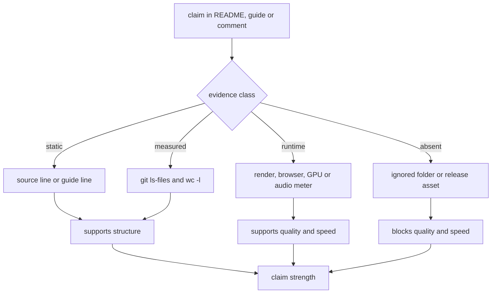
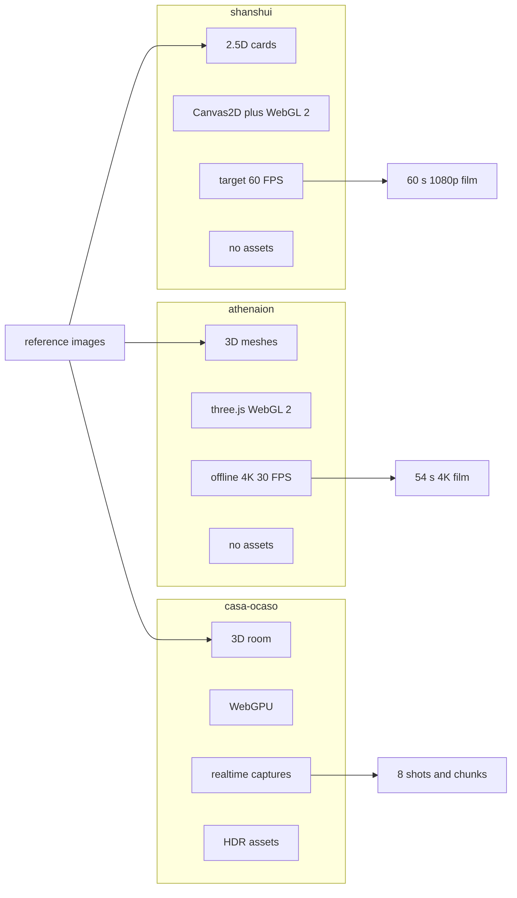

# 04 Limits and comparison: what the repository proves and what it cannot

shanshui paints ten Chinese ink-wash landscapes and joins them into a one-minute film. This
document tests the claims. It separates static facts from runtime values. It lists failure
modes, internal inconsistencies and break-first risks. It then compares shanshui
with athenaion and casa-ocaso, two sibling projects.

### Terms in this document

| Short form | Expansion |
|---|---|
| WebGL 2 | Web Graphics Library 2 |
| WebGPU | web graphics application programming interface |
| GPU | graphics processing unit |
| CPU | central processing unit |
| HDR | high dynamic range |
| YUV | luma and chrominance |
| FPS | frames per second |
| BPM | beats per minute |
| BT.709 | Recommendation ITU-R BT.709 |
| JSON | JavaScript Object Notation |
| WAV | Waveform Audio File Format |

A bare path such as `src/film.js:113` means the file and line in the shanshui package root, not
in this exploration. Paths in the comparison section are relative to
`/Users/darkvoid/GitSources/src.aidesign/src.leonnix`. All other paths are relative to the
shanshui package root unless stated.

Static, aim, target, rule and unenforced are subtypes of the static class. A runtime row needs a
runtime measurement. A static target states intent, not outcome. The time rule applies to the `t`
argument and forbids a second clock.

## 1. Evidence classes

A claim can rest on four kinds of evidence:

| Class | Meaning | Example |
|---|---|---|
| Static | A line of source or a guide states it | The clock is 80 BPM (`src/timeline.js:5`) |
| Measured | A command counts it in this checkout | 146 tracked files (`spec.md:50-56`) |
| Runtime | Only a render, a browser or a measurement can produce it | Frame time, peak texture memory |
| Absent | The repository excludes it | Reference images, the film file |

The static class is strongest for structure and weakest for quality. A line proves intent, not the
screen result.



The reference paintings are not part of the repository (`README.md:64`). The film is attached to
the releases and is not in the tree (`README.md:9`, `spec.md:214-223`).

## 2. Claim ledger

Each row gives a claim, the evidence and the class. The ledger is the basis for the rest of this
document.

| Claim | Evidence | Class |
|---|---|---|
| Ten paintings form one film | `src/scenes/index.js:2-13`, `src/timeline.js:17-30` | Static |
| There are 146 tracked files | `spec.md:50-56` | Measured |
| There are 127 source files | `spec.md:50-56` | Measured |
| The source holds 24,027 JavaScript lines | `spec.md:58-59` | Measured |
| There are 8 tool files, 5 documentation files and 6 root files | `spec.md:50-56` | Measured |
| There are 61 scene files: 10 main, 1 registry and 50 helpers | `spec.md:64-66` | Measured |
| There are 43 lab files and 10 transition programs in 11 seam instances | `spec.md:64-73`, `src/timeline.js:14-27` | Measured |
| The design space is 1920 by 1080 | `src/engine/engine.js:10-11` | Static |
| The film is 60 seconds at a 60 FPS timeline target | `src/timeline.js:5-9` | Static |
| The tempo is 80 BPM, 20 bars, 3 seconds per bar | `src/timeline.js:5-9` | Static |
| No image, font or audio sample loads at runtime | `README.md:7`, `docs/ENGINE.md:3` | Static |
| The reference images are absent | `README.md:64`, `.gitignore:3-4` | Absent |
| The film and soundtrack are absent | `README.md:9`, `.gitignore:2` | Absent |
| Every frame is a pure function of time | `docs/ENGINE.md:46-49` | Static rule |
| The scene contract is `build` plus optional fields | `docs/ENGINE.md:33-49` | Static |
| The frame render aim is 40 milliseconds at 1920 by 1080 on Radeon 780M, unmeasured | `docs/ENGINE.md:129` | Static aim |
| The build budget is 4 seconds per scene | `docs/ENGINE.md:128` | Static aim |
| The soundtrack target is -14 loudness units relative to full scale | `tools/audio.mjs:621-622` | Static target |
| The limiter ceiling is -1.7 decibels true peak | `tools/audio.mjs:672` | Static |
| The film image path uses YUV 4:2:0 and BT.709 | `tools/render.mjs:44-48` | Static |
| The project needs Node 20 or later | `README.md:45` | Unenforced |
| The project has no build step | `spec.md:221` | Measured |
| The project has no test suite | No test path in `git ls-files` | Absent |
| The actual picture matches the references | No references in the tree | Runtime |
| The film renders at 60 FPS | No film in the tree | Runtime |
| The soundtrack meets the loudness target | No WAV in the tree | Runtime |

The measured counts come from `git ls-files` and `wc -l`, recorded in `spec.md`. This document
does not run them again. The ledger shows a clear split: strong evidence for structure, weak
evidence for quality outcomes.

## 3. Static limits

### 3.1 The comparison loop has no fixed input

The style guide sets the bar: a still must read as the same painter as its reference
(`docs/STYLE.md:3`). The ignore file excludes the whole `ref/` folder (`README.md:64`,
`.gitignore:3-4`).

```text
# .gitignore:1-5
node_modules/
out/
# reference paintings are used only for side-by-side comparison and are not part of the code
ref/
*.log
```

A fresh clone holds the code for every tool. It can run a still or a film only with Chrome or
Edge, and the film path also needs ffmpeg. It cannot run `tools/still.mjs --compare`, `--side` or
`--crop` with the original images. These flags make stacked, side-by-side and crop images
(`tools/still.mjs:5-7`). The user must supply `ref/01.webp` to `ref/10.webp` (`README.md:64`). Any
reference supplied later can differ in crop, colour or compression. The comparison is therefore
not reproducible from the repository alone.
### 3.2 The film is a release asset

The README links to the releases for the film (`README.md:9`). The `out/` folder is ignored
(`.gitignore:2`). No MP4, WAV or frame sequence is tracked. The source can rebuild the film. The
repository cannot prove that the released film came from this commit.

### 3.3 No runtime assets means no asset checks

The project states that no image, texture, font or audio sample loads at runtime
(`README.md:7`). This removes a class of failures: a missing file, a bad path or a licence
problem. Every visual element must therefore come from code. A regression can change a brush or a
shader and leave no asset diff to review.

### 3.4 No build, no test, no pinned engine

The package file has three scripts and two development dependencies (`package.json:1-17`).

```text
# package.json:1-17
{
  "name": "shanshui",
  "version": "1.0.0",
  "private": true,
  "type": "module",
  "description": "Ten Chinese ink-wash landscapes painted and animated entirely in code (WebGL2 + Canvas2D), rendered to a 60s film.",
  "scripts": {
    "serve": "node tools/serve.mjs",
    "still": "node tools/still.mjs",
    "render": "node tools/render.mjs"
  },
  "license": "MIT",
  "devDependencies": {
    "puppeteer-core": "^24.43.1",
    "ws": "^8.22.0"
  }
}
```

There is no `engines` field. The README asks for Node 20 or later (`README.md:45`), but nothing
enforces that version. No test script or test folder appears in `git ls-files`. No linter,
formatter or continuous integration file is tracked (`spec.md:50-56`). The project uses direct
modules with no build step (`spec.md:221`), so a broken import appears only when a browser loads
the page.

The dependencies are `puppeteer-core` and `ws` (`package.json:14-17`). The first controls a
browser; the second carries film frames. Both are development tools. The browser page itself has
no package dependency.

### 3.5 The tools need a browser and ffmpeg

The still and film tools look for Chrome or Edge in fixed paths (`tools/lib.mjs:79-84`).

```text
# tools/lib.mjs:79-84
const CHROME = [
  process.env.CHROME_PATH,
  'C:/Program Files/Google/Chrome/Application/chrome.exe',
  'C:/Program Files (x86)/Microsoft/Edge/Application/msedge.exe',
  '/usr/bin/google-chrome', '/usr/bin/chromium', '/Applications/Google Chrome.app/Contents/MacOS/Google Chrome',
].filter(Boolean).find((p) => fs.existsSync(p));
```

If no path exists, the launch has no executable. `CHROME_PATH` is the only override; a Chromium
from another package location is not found.

The film tool also needs ffmpeg on the path (`README.md:45`, `tools/render.mjs:51`). The audio
tool calls ffmpeg to measure loudness (`tools/audio.mjs:621-625`). The forensics tool calls
ffmpeg and ffprobe (`tools/forensics.mjs:14-23`). These external programs have no version check.

## 4. Values that exist only at runtime

The following values cannot be read from the source. A bake is a one-time texture render. A card
is a flat painted layer at a depth. A grade is a colour transform applied to a rendered scene
before the transition composite (`src/film.js:113-127`). A pop is a one-frame jump. The forensics
tool checks a finished video for these events. The scene grade runs after `renderScene` and
before the transition composite. `renderAt` runs a final pass with `doGrade: false`, so it does
not grade twice (`src/film.js:113-127`, `:170-176`).

| Value | Why it is runtime only | Where it would appear |
|---|---|---|
| Renderer name | The context reports a string | `src/engine/engine.js:568-572` |
| Maximum texture size | The driver reports it | `src/engine/engine.js:568-572` |
| Float target flag | The context reports a flag | `src/engine/engine.js:568-572` |
| Scene build time | Texture bakes depend on the GPU and CPU | `tools/lib.mjs:139-141` |
| Frame time | Depends on the GPU and the layer count | `docs/ENGINE.md:129` |
| Peak texture memory | Depends on texture bake sizes and card count | `docs/ENGINE.md:130` |
| Actual output colours | Depend on the grade, the display and YUV conversion | `tools/render.mjs:44-48` |
| Film file size | Depends on the encoder and the content | `tools/render.mjs:47` |
| Audio loudness | Depends on the synthesized score | `tools/audio.mjs:663-675` |
| True peak | Depends on the limiter | `tools/audio.mjs:672` |
| Slow frames and pops | Depend on the final video | `tools/forensics.mjs:44-68` |

The engine has an information call for the first three values (`src/engine/engine.js:568-572`).

```text
# src/engine/engine.js:568-572
  info() {
    const gl = this.gl;
    const dbg = gl.getExtension('WEBGL_debug_renderer_info');
    return { renderer: dbg ? gl.getParameter(dbg.UNMASKED_RENDERER_WEBGL) : gl.getParameter(gl.RENDERER), float: gl.__floatOK, maxTex: gl.getParameter(gl.MAX_TEXTURE_SIZE), size: [this.pw, this.ph] };
  }
```

It returns the renderer name, the float support, the
maximum texture size and the buffer size. The still tool prints it with `--info`
(`tools/still.mjs:9`); it does not measure frame time or memory.

The viewer scale is also a runtime choice. The default is 0.5 (`src/main.js:166-167`).

```text
# src/main.js:166-167
  const scale = +(params.get('scale') || 0.5);
  await api.init({ scale });
```

A live viewer at the default scale renders half the design width. The film path sets scale 1
(`tools/render.mjs:19`). A live observation at the default scale therefore says little about film
cost.

## 5. Failure modes

The table lists each failure and its blast radius.

| Failure | Trigger | Detection | Blast radius |
|---|---|---|---|
| Shader compile error | Bad GLSL in a scene or library | Exception with source lines | Page or scene load aborts |
| Module import error | Missing file or bad export | Browser console or job error | Scene load aborts |
| Missing browser | No Chrome or Edge path | Launch error | Every capture tool fails |
| Missing ffmpeg | Not on the path | Spawn error | Film and audio measurement fail |
| Daemon timeout | A job runs longer than 240 seconds | JSON error for that job | One job fails, daemon stays up |
| Losing the WebGL context | Driver reset or memory pressure | No handler in source | Page stops drawing |
| Frame queue growth | The encoder is slower than the GPU | Acknowledgments limit the queue | The render waits |
| Texture overrun | A card exceeds the texture limit | Compile or frame error | The scene or frame fails |
| Scene time leak | A scene reads a clock or an unseeded random source | Visual reproducibility failure | Frames differ between runs |
| Transition seam | A camera offset goes past the painted area | A card edge or a pop | The illusion breaks |
| Loudness miss | The limiter cannot reach the target | The four-pass loop exits | The file is louder or quieter |
| Reference mismatch | The supplied image differs from the original | The comparison looks wrong | The quality judgement is invalid |

### 5.1 Shader errors stop the page

The compiler throws on a failed shader (`src/engine/gl.js:31-45`).

```text
# src/engine/gl.js:31-45
export function compile(gl, vsSrc, fsSrc, label = 'program') {
  const mk = (type, src) => {
    const s = gl.createShader(type);
    gl.shaderSource(s, src);
    gl.compileShader(s);
    if (!gl.getShaderParameter(s, gl.COMPILE_STATUS)) {
      const log = gl.getShaderInfoLog(s);
      // show only the lines around the error for readability
      const m = /ERROR: \d+:(\d+)/.exec(log);
      let ctx = '';
      if (m) {
        const ln = +m[1]; const lines = src.split('\n');
        ctx = lines.slice(Math.max(0, ln - 6), ln + 3).map((l, i) => String(Math.max(1, ln - 5) + i).padStart(4) + ': ' + l).join('\n');
      } else ctx = numbered(src).slice(0, 4000);
      throw new Error(`[${label}] ${type === gl.VERTEX_SHADER ? 'vertex' : 'fragment'} shader error:\n${log}\n${ctx}`);
```

The error includes the driver log and nearby source lines. The throw is not caught, so a scene
shader error stops that scene load. In the still tool, the job returns an error. In the live
viewer, the catch writes the error stack into the page and stops that run (`src/main.js:229`).

### 5.2 Frame cost is not bounded by the engine

The sub-frame renderer loops over the sample count and blends each result
(`src/engine/engine.js:553-566`).

```text
# src/engine/engine.js:553-566
  renderSceneFrame(scene, t, { samples = 1, shutter = 0.5, fps = 60 } = {}) {
    if (samples <= 1) {
      this.renderScene(scene, t, this.targets.sceneA);
      this.present(this.targets.sceneA, this.gradeAt(scene, t));
      return;
    }
    this.clear(this.targets.accum);
    for (let i = 0; i < samples; i++) {
      const ts = t + ((i + 0.5) / samples - 0.5) * (shutter / fps);
      this.renderScene(scene, ts, this.targets.sceneA);
      this.blit(this.targets.sceneA, this.targets.accum, 1 / samples, true);
    }
    this.present(this.targets.accum, this.gradeAt(scene, t));
  }
```

The cost is linear in the sample count. The film command uses two samples (`README.md:42`); the
tool default is one (`tools/render.mjs:20`). The engine has no time budget and no automatic
quality fallback, so a slow scene makes the film take longer.

The frame readback and send loop keeps at most two frames in flight (`src/main.js:127-148`). This
bounds memory, not time.

### 5.3 A lost context has no recovery

The engine creates the WebGL 2 context once (`src/engine/gl.js:3-25`). No source file listens for
`webglcontextlost` or `webglcontextrestored`. A driver reset or a memory event stops drawing. A
long film render on a small GPU can hit this. The tool would see no more frames or a failed
acknowledgment.

### 5.4 The daemon protects itself

The daemon is a warm browser server for still jobs. It has a 240 second default timeout and a page limit (`tools/daemon.mjs:9-13`,
`tools/daemon.mjs:40-43`). A timed-out job releases its slot in a `finally` block
(`tools/daemon.mjs:49-52`). One bad scene does not block later jobs. A browser crash is different.
The daemon would need a restart.

## 6. Internal inconsistencies

The first five rows are documentation drift. The Node row is an unenforced requirement. The film
row is an absence, not a conflict. None is a runtime conflict in the code.

| Topic | One statement | Other statement | Effect |
|---|---|---|---|
| Wind duration | 1.6 seconds (`docs/FILM.md:17`) | 2.0 seconds (`src/timeline.js:24`) | The guide underestimates the seam |
| Spray centres | Assumed (330, 560) and (700, 420) (`docs/FILM.md:37`) | (308, 672) and (640, 270) (`src/timeline.js:23`) | The guide asks for positions that the code already has |
| Sun centres | Assumed (1520, 330) and (1700, 345) (`docs/FILM.md:38`) | (1349, 308) and (1742, 353) (`src/timeline.js:26`) | Same, with a large x shift |
| Element index (`docs/LIBRARY.md`) | Eleven sections (`docs/LIBRARY.md:5-315`) | Twelve top-level modules (`spec.md:64-66`) | `gust.js` is missing |
| Render stream | "raw RGBA" (red, green, blue, alpha) (`tools/render.mjs:2`) | YUV 4:2:0 (`tools/render.mjs:44-48`) | The comment is stale |
| Node version | Node 20 or later (`README.md:45`) | No `engines` field (`package.json:1-17`) | Nothing checks it |
| Film presence | Attached to releases (`README.md:9`) | Not tracked (`README.md:9`, `.gitignore:2`) | No local proof |

### 6.1 The wind seam is longer in code

The film guide gives 1.6 seconds (`docs/FILM.md:15-19`).

```text
# docs/FILM.md:15-19
| 7-8 | 18 | s09 floating peaks | cloud rise (2.0 s): camera rises through a cloud bank | above the clouds |
| 9-10 | 24 | s08 red cascade | zoom through spray (1.6 s): push into s09's waterfall, emerge in the cascade | strongest moment |
| 11-12 | 30 | s10 autumn ruins | wind wipe (1.6 s), leaves carried across | autumn |
| 13-14 | 36 | s02 golden river | handscroll pan (2.2 s): the painting continues to the right | golden hour |
| 15-16 | 42 | s05 stone bridge, red sun | sun match (2.0 s): the gold sun slides onto the red sun | sunset |
```

The shot list gives 2.0 seconds (`src/timeline.js:22-26`).

```text
# src/timeline.js:22-26
  { scene: 's09', start: around(7, 2.0), t0: 0, in: { type: 'cloudrise', dur: 2.0 } },     // bars 7-8   floating peaks
  { scene: 's08', start: around(9, 1.6), t0: 0, in: { type: 'spray', dur: 1.6, c: [308, 672], c2: [640, 270] } },         // bars 9-10  red cascade
  { scene: 's10', start: around(11, 2.0), t0: 0, in: { type: 'wind', dur: 2.0, ease: 'sine' } }, // bars 11-12 autumn ruins (a leaf gust carries the seam)
  { scene: 's02', start: around(13, 2.2), t0: 0, in: { type: 'scroll', dur: 2.2 } },       // bars 13-14 golden river
  { scene: 's05', start: around(15, 2.0), t0: 0, in: { type: 'sunmatch', dur: 2.0, c: [1349, 308], c2: [1742, 353] } },     // bars 15-16 stone bridge, red sun
```

The extra 0.4 seconds moves the seam and the leaf gust overlap. The guide is stale.

### 6.2 The assumed positions are already measured

The guide asks the author to report the spray and sun centres (`docs/FILM.md:37-38`).

```text
# docs/FILM.md:37-39
- **s09 -> s08 spray**: the transition zooms into s09's waterfall (currently assumed at (330, 560)) and out of s08's cascade (assumed (700, 420)). Report the actual positions.
- **s02 -> s05 sun match**: report the sun centres (assumed s02 (1520, 330), s05 (1700, 345)).
- **s07 bloom**: report two seed points where the darkest ink mass sits (e.g. the bamboo culms and the right cliff).
```

The shot list already holds exact centres (`src/timeline.js:23`, `src/timeline.js:26`). The spray
centres differ by 22 pixels in x and 112 in y. The sun centres differ by 171 pixels in x. These
are not rounding errors. The guide and the shot list disagree.

### 6.3 The element index is stale

The generated index has eleven sections (`docs/LIBRARY.md:5-315`). The library has twelve
top-level modules (`spec.md:64-66`). `src/lib/gust.js` is not in the index. The generator reads
every `.js` file but sorts by a fixed order list (`tools/libdoc.mjs:8-10`).

```text
# tools/libdoc.mjs:8-10
const dir = path.join(ROOT, 'src', 'lib');
const order = ['brush', 'inkfx', 'pine', 'rock', 'peaks', 'atmos', 'water', 'architecture', 'fauna', 'flora', 'seal'];
const files = fs.readdirSync(dir).filter((f) => f.endsWith('.js')).sort((a, b) => order.indexOf(a.slice(0, -3)) - order.indexOf(b.slice(0, -3)));
```

The list omits `gust`. A regenerated index would put `gust.js` first, because its order index is
-1 (`tools/libdoc.mjs:9`). The checked-in index omits `gust.js`. This is documentation drift.

### 6.4 The render header is stale

The render tool header says frames stream as raw RGBA (`tools/render.mjs:2`). The encoder
asks for YUV 4:2:0 (`tools/render.mjs:44-48`). The engine packs YUV on the GPU
(`src/engine/engine.js:207-236`). The header can mislead.

## 7. Comparison with athenaion

Athenaion is an ancient Greek world in code (`athenaion/README.md:3`).

| Property | shanshui | athenaion |
|---|---|---|
| Form | Ten 2.5D ink paintings | One large 3D world |
| Renderer | WebGL 2 plus Canvas2D | three.js on WebGL 2 (`athenaion/README.md:3`) |
| Reference count | 10 | 9 (`athenaion/README.md:3`) |
| Output | 60 seconds, 1920 by 1080, 60 FPS target | 54 seconds, 4K, 30 FPS (`athenaion/README.md:33`) |
| Render mode | Interactive GPU viewer target, two motion samples | Offline accumulation (`athenaion/README.md:19`) |
| Render cost | Not recorded in the source | About 13 hours of GPU (`athenaion/README.md:33`) |
| Source size | 24,027 JavaScript lines (`spec.md:58-59`) | About 45,000 lines in 168 modules (`athenaion/README.md:34`) |
| Assets | None at runtime | None at runtime (`athenaion/README.md:3`) |
| Style target | Ink on paper, judged by eye | 4K realism, judged by eye |
| Shots | Ten paintings | Nine shots (`athenaion/README.md:60`) |

Since athenaion uses offline accumulation, it can spend many samples per frame
(`athenaion/README.md:19`). Shanshui uses two samples for motion blur (`README.md:42`). The
live viewer targets real time. The film has a looser documented aim: 40 milliseconds per frame at
1920 by 1080 on Radeon 780M (`docs/ENGINE.md:129`). The source records no measurement of that
aim.

Both projects use reference-driven loops. Athenaion ran specialist agents that compared their own
work with the references (`athenaion/README.md:49-50`). Shanshui uses the still tool for the same
loop (`README.md:64`). Athenaion delivers stills and a slow 4K video. Shanshui delivers a
browser piece intended to run in real time and a 1080p film.

Source size is not a direct quality measure. Shanshui spends lines on brush marks; athenaion
spends them on meshes, terrain and water.

## 8. Comparison with casa-ocaso

Casa Ocaso is a real-time room at golden hour (`casa-ocaso/README.md:3-5`). It uses three.js with
the WebGPU renderer, six sky panoramas and five reference renders.

| Property | shanshui | casa-ocaso |
|---|---|---|
| Subject | Ten outdoor ink paintings | One interior room |
| Renderer | WebGL 2 plus Canvas2D | WebGPU (`casa-ocaso/README.md:4`) |
| Reference count | 10 | 5 (`casa-ocaso/README.md:5`) |
| Runtime assets | None | Panoramas, textures and models |
| Light | Painted values | Baked probes and real HDR |
| Source size | 24,027 JavaScript lines | 9,531 JavaScript lines (`casa-ocaso/spec.md:54`) |
| Tracked files | 146 | 193 (`casa-ocaso/spec.md:22`) |
| Tools | 8 | 30 (`casa-ocaso/spec.md:49`) |
| Output | One 60 second film | Eight camera shots and video chunks |
| Comparison | Visual still stacks | Numeric colour fit (`casa-ocaso/README.md:50`) |

Casa Ocaso uses real HDR panoramas from Poly Haven (`casa-ocaso/README.md:40-41`). It fits colour
and grade to the references with a numeric tool (`casa-ocaso/README.md:50`). Shanshui uses
measured palette targets but no numeric image fit (`docs/STYLE.md:5-15`). Casa Ocaso can optimize a
distance to a reference image. Shanshui depends on judgement.

Casa Ocaso has 193 tracked files and 30 tools. Most of its files are assets: 122 under `public`
(`casa-ocaso/spec.md:50`). Shanshui has no public asset tree, and its 146 files are almost all
code. A direct file count comparison therefore says little.

The two projects share a capture method. Casa Ocaso uses headless WebGPU captures and a compare
script (`casa-ocaso/README.md:65-68`). Shanshui uses headless Chrome and `saveCompare`. Both
divide a film into shots. Casa Ocaso writes video chunks (`casa-ocaso/README.md:77`). Shanshui
streams every frame to one encoder.

## 9. Three-way view



The three projects differ. Shanshui uses flat cards, Canvas2D and a streaming film path;
athenaion uses 3D meshes and offline accumulation; casa-ocaso uses captured HDR light and a
numeric colour fit. No source records a measured render cost for shanshui. Athenaion
records about 13 hours of graphics processing unit time for its 54 second film
(`athenaion/README.md:33`). No source in the three trees records measured visual quality for the
outputs.

Shanshui alone has no asset tree. Athenaion also avoids runtime assets but tracks reference and
media images (`athenaion/README.md:3`, `:40-42`). Shanshui alone uses a Canvas2D brush layer as a
first-class renderer. The Canvas2D layer carries most of the per-frame painting work.

## 10. Break-first risk map

The map ranks risks by chance of failure and damage to the claim. The ratings are
qualitative author judgements, not measurements. Chance uses the values Certain, Likely, Medium
and Low. Damage uses Blocking, High, Medium and Low. Each Certain row rests on a concrete fact:
ignored references, a release-only film, and the seven rows in section 6.

| Rank | Risk | Chance | Damage | Why |
|---:|---|---|---|---|
| 1 | Reference agreement cannot be tested | Certain | Blocking | The references are absent (`README.md:64`) |
| 2 | The film and soundtrack cannot be checked | Certain | High | Both are release assets (`README.md:9`) |
| 3 | Frame budget misses on another GPU | Likely | High | 40 ms is an aim (`docs/ENGINE.md:129`) |
| 4 | Transition seams show a painted layer edge | Medium | High | Camera offsets are large (`docs/FILM.md:31-36`) |
| 5 | A Canvas2D card is too slow | Medium | Medium | Cards upload every frame (`docs/ENGINE.md:134`) |
| 6 | Texture memory exceeds the GPU | Medium | Medium | 30 cards is an aim (`docs/ENGINE.md:130`) |
| 7 | Shader or module error stops a page | Medium | Medium | Errors throw (`src/engine/gl.js:36-45`) |
| 8 | Browser or ffmpeg is missing | Medium | Medium | Fixed paths (`tools/lib.mjs:79-84`) |
| 9 | Loudness or true peak misses | Low | Medium | Four-pass loop (`tools/audio.mjs:662-680`) |
| 10 | Stale documentation misleads a reader | Certain | Low | Seven rows in section 6 |

Risk 1 blocks the main claim; risk 2 blocks the deliverable. Risks 3 to 6 need a running system.
Risks 7 and 8 are environment failures. Risk 9 is measurable, and risk 10 affects trust. The test
order follows: references, one still, one full-size frame, one seam, the film, then the audio.

## 11. Design logic

**No runtime assets.** The project wants every mark to come from code (`README.md:7`). This
removes asset loading, atlas packing and licence files. It also removes the fastest way to add
detail: a photograph.

**2.5D cards.** An ink painting reads as flat planes at different distances (`docs/STYLE.md:18`).
Flat cards at depth give parallax with a simple projection (`docs/ENGINE.md:23-29`). The cost is
that a camera move can show a card edge. The film guide turns that cost into an overscan rule
(`docs/FILM.md:31-36`).

**Two renderers.** WebGL 2 draws shaders, mist, water and composites. Canvas2D draws brush marks
at bake time and moving cranes, leaves and snow at frame time. The cost is two memory paths and a
premultiplied alpha contract (`docs/ENGINE.md:132-134`).

**Streaming film.** The renderer never writes a frame to disk (`tools/render.mjs:1-2`). A 60
second 1080p film at 60 FPS is 3,600 frames. Streaming raw YUV to ffmpeg keeps at most two frames
in flight (`tools/render.mjs:54-66`). The cost is a strict handshake: a slow encoder slows the
render.

**Synthesized audio.** The soundtrack follows the same bars as the picture (`tools/audio.mjs:13`).
A sample library would add assets and licences. Synthesis gives exact control of timing. The cost
is code complexity and a mastering loop that depends on ffmpeg.

**No test suite.** The target is visual. A pixel test against a reference would need the absent
references. A unit test would not catch a wrong brush. The project uses visual review instead
(`docs/ENGINE.md:124`). A refactor can therefore break a scene without a failing check.

## 12. Limits of this exploration

This document is a static reading. It does not render a frame, open a browser, run a tool or
measure audio. It does not compare a still with a reference (`spec.md:214-223`).

The counts come from this checkout at commit `b5357c0` (`spec.md:50-73`). A GPU driver may show a
defect that the source hides. The film may stutter even when every budget is met. The comparison
sections use the other projects' README files and specs; the numbers are their numbers.

The document cannot judge beauty. It can show the intended value ladder and paper ground, not the
effect on a viewer (`docs/STYLE.md:18-27`).

## 13. Aha

**Aha:** The largest risk in shanshui is not a code defect. It is missing evidence. The project
excludes the two things that would prove its central claim: the reference paintings and the
rendered film (`README.md:9`, `:64`). The source can prove the clock, layers, transitions and
render path. It cannot prove that a frame reads as the same painter, or that 3,600 frames hold
together. Athenaion records a 4K render and ships a reference comparison image
(`athenaion/README.md:33`, `:40-42`). Casa Ocaso uses numeric colour fitting and checked-in atlas
data (`casa-ocaso/README.md:50`). Shanshui leaves the proof to the release page and the viewer,
so the quality claim sits outside the repository.

## 14. Counts

| Count | Value |
|---|---:|
| Tracked files | 146 |
| Source files | 127 |
| Source JavaScript lines | 24,027 |
| Tool files | 8 |
| Documentation files | 5 |
| Root files | 6 |
| Scenes | 10 |
| Scene files | 61 |
| Lab files | 43 |
| Transition programs | 10 |
| Seam instances | 11 |
| Design space | 1920 by 1080 |
| Film duration | 60 seconds |
| Frame rate | 60 FPS timeline target |
| Tempo | 80 BPM |
| Bars | 20 |
| Seconds per bar | 3 |

This is the last deep dive. Return to the [README](README.md) for the document map and the shared
counts.
