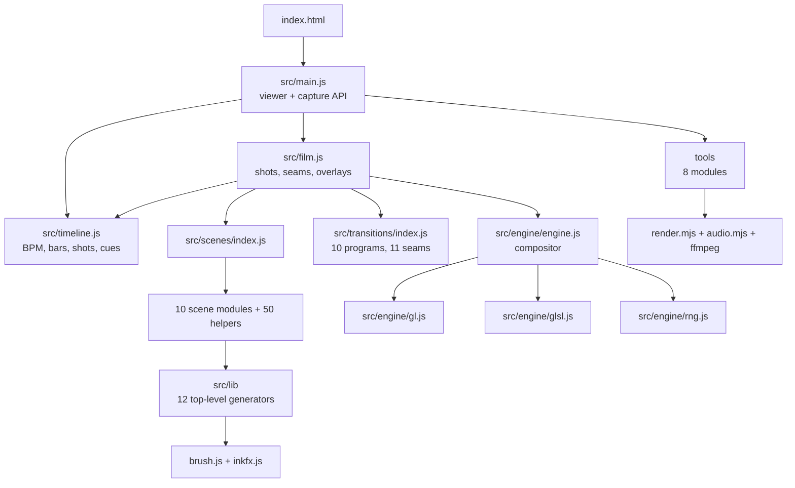

# shanshui: ten ink-wash landscapes and one minute of film

## Thesis

shanshui is a graphics system that paints ten Chinese ink-wash landscapes and animates them as one 60-second film. The checkout holds 146 tracked files, and 127 of them are source files under `src` (`spec.md:22`, `spec.md:49`). The `src` tree holds 24,027 JavaScript lines, and the `tools` tree holds 1,140 module lines (`spec.md:54-55`, measured with `wc -l`).

The first claim of the package is that every visible mark is generated at run time. Web Graphics Library (WebGL) 2 shaders and the Canvas2D (two-dimensional canvas) interface produce every cliff, pine, mist bank, crane, ripple and snowflake (`README.md:7`, `docs/ENGINE.md:3`). No image, font or audio sample is an input to the renderer (`docs/ENGINE.md:3-4`). The ten reference paintings are comparison targets only, and they are not tracked (`README.md:64`).

The second claim is that time is the only animation state. A scene builds once and returns a back-to-front list of flat cards. The scene then draws any time value as a pure function (`docs/ENGINE.md:33-49`). This rule lets a still, a contact sheet and a motion-blurred film frame share one path (`src/engine/engine.js:553-566`, `src/film.js:170-185`).

The third claim is that picture and sound share one clock. The film runs at 80 beats per minute (BPM), with four beats in a bar and two bars for each painting (`src/timeline.js:5-13`, `README.md:13`). The soundtrack synthesizes its samples against the same bar and beat functions (`tools/audio.mjs:13`, `tools/audio.mjs:344-357`).

## One-paragraph summary

The film timeline is 60 seconds long at a 60 frames per second (FPS) target and 1920 by 1080 pixels (`docs/FILM.md:5`). Ten paintings appear in film order. The order is bamboo valley, cranes over the falls, rope bridges, floating peaks, red cascade, autumn ruins, golden river, stone bridge, moon over the lake and snow temple (`docs/FILM.md:10-23`). Each painting is a stack of texture cards, shader cards and Canvas2D cards at depth values from 1 to 1e5 (`docs/ENGINE.md:21-23`). A two-and-a-half-dimensional (2.5D) camera pans, dollies and zooms those cards, so near cards move more than far cards (`docs/ENGINE.md:24-28`). Ten transition programs cover the eleven seam instances in the film, and the mist program serves two of them (`src/timeline.js:17-30`, `src/transitions/index.js:49-334`). A film layer adds a leaf gust and a seal. It grades each rendered scene. It composites sub-frames for motion blur and converts the result to planar luminance and chrominance (YUV) 4:2:0 on the graphics processing unit (GPU) (`src/film.js:17-22`, `src/engine/engine.js:205-236`). The render tool streams those frames over a WebSocket (a two-way browser socket) to ffmpeg and writes one MPEG-4 Part 14 (MP4) file (`tools/render.mjs:53-66`). The audio tool synthesizes a guzheng (plucked zither), a xiao (end-blown flute), a singing bowl, a drum, wind and water at 48 kilohertz. It masters the result to -14 loudness units relative to full scale (LUFS) (`tools/audio.mjs:1-5`, `tools/audio.mjs:662-680`).

## What the package contains

The counts below are the shared inventory for all six documents. They come from `git ls-files` and `wc -l` on the pin.

| Part | Count | Detail |
|---|---:|---|
| Tracked files | 146 | All files in the checkout |
| Source files | 127 | Files under `src` |
| JavaScript lines in `src` | 24,027 | All `.js` files under `src` |
| Tool files | 8 | Modules under `tools` |
| Tool module lines | 1,140 | All `.mjs` files under `tools` |
| Documentation files | 5 | Four guides and one contact sheet image under `docs` |
| Root files | 6 | Entry page, package files, licence, readme and ignore file |
| Scenes | 10 | `s01` to `s10`, one painting each |
| Scene files | 61 | Ten main modules, the registry and 50 per-scene helpers |
| Lab files | 43 | Small element test scenes under `src/lab` |
| Transition programs | 10 | Definition order: bloom, mist, cloud rise, scroll, sun match, dusk, snow, spray, wind and evaporate (`src/transitions/index.js:49-318`) |
| Seam instances | 11 | Ten programs over eleven seams; mist is used twice (`src/timeline.js:17-30`) |
| Design space | 1920 by 1080 | Fixed pixels, origin top-left, y down (`docs/ENGINE.md:21`) |
| Film duration | 60 seconds | 20 bars at 3 seconds per bar (`src/timeline.js:9`) |
| Film rate | 60 FPS timeline target | Fixed in the timeline and the render tool (`src/timeline.js:6`) |
| Tempo | 80 BPM | Four beats per bar, two bars per painting (`src/timeline.js:5-8`) |

The `src` tree divides into six groups (`spec.md:57-64`). It has 3 root files with 452 lines. It
has 4 engine files with 983 lines. The library has 15 files with 8,624 lines. The scenes have 61
files with 12,176 lines. The transitions have 1 file with 334 lines. The lab has 43 files with
1,458 lines. The library holds 12 top-level generators plus three fauna helpers (`spec.md:66-67`).
The twelve are `brush.js`, `inkfx.js`, `pine.js`, `rock.js`, `peaks.js`, `atmos.js`, `water.js`,
`architecture.js`, `fauna.js`, `flora.js`, `seal.js` and `gust.js`. The `docs/LIBRARY.md` index
documents 11 sections and does not list `gust.js` (`docs/LIBRARY.md:1-324`, `src/lib/gust.js:1-47`).

## System map

The page loads one module, and that module owns the viewer and the capture application programming interface (API). The timeline defines the shot list. The film copies that list and owns the built scene instances, the transitions and the overlays. The scene layer owns composition. The engine owns the GPU state. The library owns the painting vocabulary.



The map is a dependency view, not a call order. A scene imports library generators. The film imports the scene registry and the transitions. The engine imports no scene (`src/engine/engine.js:6-8`, `src/scenes/s01-cranes-falls.js:6-17`).

## Documents

| Document | Role | Words | Snippets | Mermaid | Aha |
|---|---|---:|---:|---:|---:|
| [README](README.md) | Index, thesis, map and reading orders | 3,069 | 5 | 1 | 0 |
| [Overview](00-overview.md) | Ten paintings, one film, the parts and one frame | 4,997 | 12 | 2 | 1 |
| [Architecture](01-architecture.md) | Layers, contracts, data flow and ownership | 4,998 | 10 | 3 | 1 |
| [Core mechanism](02-core-mechanism.md) | The build half and the draw half | 4,997 | 10 | 2 | 1 |
| [Workflow and quality](03-workflow-and-quality.md) | Reference to accepted still, then the film | 4,926 | 11 | 2 | 1 |
| [Limits and comparison](04-limits-and-comparison.md) | Claims, failure modes, inconsistencies and peers | 4,999 | 11 | 2 | 1 |

The word and structure counts come from the verification pass. Each deep dive cites the source at the sentence level. A citation such as `src/film.js:60-66` means the file and line range in the pinned checkout. A bare path such as `README.md:64` or `docs/ENGINE.md:129` refers to the package root, not to this exploration file. A link such as [README](README.md) refers to this file.

## Three reading orders

**First read, the system in one pass.** Start with [Overview](00-overview.md). It gives the ten paintings, the clock, the parts and one frame traced from a time value to a finished picture. Then read [Architecture](01-architecture.md) for the ownership boundaries. Then read [Core mechanism](02-core-mechanism.md) for the build and draw paths. Then read [Workflow and quality](03-workflow-and-quality.md) for the reference loop and the checks. Then read [Limits and comparison](04-limits-and-comparison.md) for what the static reading does not prove.

**Builder read, I need to paint a scene.** Start with [Architecture](01-architecture.md) for the scene contract and the `api` object (`docs/ENGINE.md:51-64`). Read [Core mechanism](02-core-mechanism.md) for the bake and card paths. Read [Workflow and quality](03-workflow-and-quality.md) for the still tool and the comparison crop loop. Keep `docs/STYLE.md` open for the palette, the value ladder and the motion speeds.

**Reviewer read, I need to find the weak claims.** Start with [Limits and comparison](04-limits-and-comparison.md). It lists the claim ledger, the runtime-only values, the internal conflicts and the break-first risk map. Then read [Architecture](01-architecture.md) for the failure isolation. Then read [Workflow and quality](03-workflow-and-quality.md) for the checks that do exist.

## Who this is for

This set assumes that you can read JavaScript and GLSL (Graphics Library Shading Language) shader source. It assumes that you know basic Chinese painting terms such as ink wash, handscroll and cun texture strokes. It assumes that you have Node.js, Chrome or Edge, and ffmpeg for the tools (`README.md:31-45`). It is for a reader who wants to understand how the system builds a picture, not for a reader who wants a painting tutorial. Start with the [Overview](00-overview.md) if you want the system. Start with [Limits and comparison](04-limits-and-comparison.md) if you want the evidence. Do not start here if you need a measured frame rate, a visual quality verdict or a working soundtrack. This set records a static reading (`spec.md:214-219`).

## Glossary

Terms are in the sense used by this package.

- **2.5D**: a flat-card scene with depth. Cards stay flat. Depth changes their projection and parallax.
- **Card**: one drawable rectangle at a rest position and depth. A card is a texture card, a shader card or a Canvas2D card (`src/engine/engine.js:348-368`).
- **Rest space**: the design-pixel position of a card when the camera is at its default value (`docs/ENGINE.md:23`).
- **Picture plane**: depth `z = 1`. A card there moves one pixel for each pixel of camera pan.
- **Bake**: a build-time draw into a texture. A bake can use Canvas2D or a fragment shader (`src/engine/engine.js:297-334`).
- **Ink pass**: a GPU pass that adds wet-edge pooling, granulation and bleed to a Canvas2D bake (`src/lib/inkfx.js:5-36`).
- **Shot**: one painting in the film with a start time, an optional scene time offset and an incoming transition (`src/timeline.js:17-30`).
- **Transition program**: one shader program that composites two paintings. Ten programs exist (`src/transitions/index.js:49-318`).
- **Seam instance**: one use of a transition program in the shot list. Eleven seam instances exist, and the mist program is used twice (`src/timeline.js:17-30`).
- **Overlay**: a film-level card set that crosses a seam. The two overlays are a leaf gust and a seal (`src/film.js:17-22`).
- **Motion blur**: an average of sub-frames spread over a shutter interval (`src/film.js:179-184`).
- **API**: application programming interface. Here it means the object passed to a scene build and the browser capture surface (`src/engine/engine.js:380-394`, `src/main.js:22-159`).
- **WebGL**: Web Graphics Library. The browser GPU interface used here, version 2 (`src/engine/gl.js:1-25`).
- **GLSL**: Graphics Library Shading Language. The shader language used by WebGL (`src/engine/glsl.js:4-121`).
- **GPU**: graphics processing unit. The device that runs shaders, composites cards and packs YUV frames.
- **CPU**: central processing unit. The device that runs scene builds, Canvas2D and the tools.
- **HTML**: HyperText Markup Language. The entry page format (`index.html:1-13`).
- **CSS**: Cascading Style Sheets. The viewer styling format (`src/main.js:165-172`).
- **JSON**: JavaScript Object Notation. The options format for grades and shot overrides (`tools/still.mjs:20`, `tools/render.mjs:23`).
- **RGB**: red, green, blue. The colour channels used by the engine and by paper values (`docs/STYLE.md:5`).
- **sRGB**: standard red, green, blue. The display colour space for the measured palette (`docs/STYLE.md:5`).
- **YUV**: luminance and two colour differences. The planar 4:2:0 frame format used for streaming (`src/engine/engine.js:205-236`).
- **FPS**: frames per second. The film rate is 60 (`src/timeline.js:6`).
- **BPM**: beats per minute. The film tempo is 80 (`src/timeline.js:5`).
- **RNG**: random number generator. The package uses a seeded small fast counting 32-bit (sfc32) generator and seeded simplex noise (`src/engine/rng.js:13-45`).
- **BT.709**: International Telecommunication Union Radiocommunication Sector BT.709. The high-definition colour standard used for the YUV conversion and the encoder tags (`src/engine/engine.js:205`, `tools/render.mjs:44-48`).
- **HUD**: heads-up display. The viewer status line (`src/main.js:170-172`).
- **LUFS**: loudness units relative to full scale. The audio target is -14 (`tools/audio.mjs:665-679`).

## Entry snippets

The first entry is the camera projection. Every card kind uses this one vertex shader. Depth `z` divides the pan, and the dolly changes the divisor (`src/engine/engine.js:14-33`).

```text
# src/engine/engine.js:14-33
const CARD_VS = HEADER + /* glsl */ `
in vec2 aPos;
uniform vec4 uDrawRect;   // rest-space rect this card covers (x,y,w,h)
uniform float uZ;         // depth: 1 = picture plane, larger = farther
uniform vec4 uCam;        // pan x, pan y, dolly, zoom
uniform float uRoll;
uniform vec2 uDesign;
out vec2 vUV;             // 0..1 across the draw rect, y down
out vec2 vP;              // rest-space position in design px, y down
void main() {
  vec2 P = uDrawRect.xy + aPos * uDrawRect.zw;
  vUV = aPos; vP = P;
  vec2 C = uDesign * 0.5;
  float zz = max(uZ - uCam.z, 1e-3);
  vec2 S = C + ((P - C) * uZ - uCam.xy) / zz * uCam.w;
  vec2 d = S - C; float c = cos(uRoll), s = sin(uRoll);
  S = C + vec2(c * d.x - s * d.y, s * d.x + c * d.y);
  vec2 ndc = S / uDesign * 2.0 - 1.0; ndc.y = -ndc.y;
  gl_Position = vec4(ndc, 0.0, 1.0);
}`;
```

The second entry is the clock. Five constants produce the beat, the bar and the duration. Two helpers produce the bar-relative time and the transition centre (`src/timeline.js:5-13`).

```text
# src/timeline.js:5-13
export const BPM = 80;
export const FPS = 60;
export const BEAT = 60 / BPM;          // 0.75 s
export const BAR = 4 * BEAT;           // 3 s
export const DURATION = 60;            // 20 bars
export const bt = (bar, beat = 0) => (bar - 1) * BAR + beat * BEAT;   // bar is 1-based

// A transition of `dur` seconds centred on the downbeat of `bar`.
const around = (bar, dur) => bt(bar) - dur / 2;
```

The third entry is the scene build. The engine calls one `build` function, records the elapsed time and stores the returned layers, camera, grade and update and dispose hooks (`src/engine/engine.js:371-378`).

```text
# src/engine/engine.js:371-378
  async buildScene(mod, opts = {}) {
    const def = mod.default || mod;
    const api = this.api(def.id || 'scene');
    const t0 = performance.now();
    const built = await def.build(api, opts);
    const scene = { def, id: def.id, layers: built.layers, camera: built.camera, grade: built.grade, update: built.update, dispose: built.dispose, api, buildMs: performance.now() - t0, meta: built.meta || {} };
    return scene;
  }
```

The fourth entry is the film frame. `renderAt` composites one instant or averages several sub-frames and then applies the final paper pass (`src/film.js:170-185`).

```text
# src/film.js:170-185
  renderAt(T, { samples = 1, shutter = 0.5, fps = FPS, target = null } = {}) {
    const eng = this.engine;
    let g;
    if (samples <= 1) {
      g = this.composite(T);
      eng.postPass(eng.targets.comp, target, g, { doGrade: false, doFinal: true });
      return;
    }
    eng.clear(eng.targets.accum);
    for (let i = 0; i < samples; i++) {
      const ts = T + ((i + 0.5) / samples - 0.5) * (shutter / fps);
      g = this.composite(ts);
      eng.blit(eng.targets.comp, eng.targets.accum, 1 / samples, true);
    }
    eng.postPass(eng.targets.accum, target, g, { doGrade: false, doFinal: true });
  }
```

The fifth entry is the frame stream. The browser packs YUV on the GPU, reads the bytes back, waits for an acknowledgement and keeps at most two frames in flight (`src/main.js:125-158`).

```text
# src/main.js:125-158
  // Stream frames [from, to) as planar yuv420p (converted on the GPU) over a WebSocket to the render tool.
  // Up to 2 frames in flight so GPU work overlaps the transfer.
  async streamFilm({ from = 0, to, fps = 60, samples = 1 } = {}) {
    const eng = state.engine;
    const ws = new WebSocket('ws://' + location.host + '/frames');
    ws.binaryType = 'arraybuffer';
    await new Promise((res, rej) => { ws.onopen = res; ws.onerror = () => rej(new Error('frame socket failed')); });
    let acked = from;
    const waiters = [];
    ws.onmessage = () => { acked++; while (waiters.length && waiters[0].n <= acked) waiters.shift().r(); };
    const waitAck = (n) => (acked >= n ? Promise.resolve() : new Promise((r) => waiters.push({ n, r })));
    const t0 = performance.now();
    const acc = { prep: 0, render: 0, read: 0, send: 0 };
    for (let f = from; f < to; f++) {
      const T = f / fps;
      let a = performance.now();
      await state.film.prepare(T);
      let b = performance.now(); acc.prep += b - a;
      state.film.renderAt(T, { samples, fps, target: eng.targets.tmp });
      a = performance.now(); acc.render += a - b;
      const buf = eng.readYUV(eng.targets.tmp);
      b = performance.now(); acc.read += b - a;
      await waitAck(f - 1);            // keep at most 2 frames in flight
      ws.send(buf);
      a = performance.now(); acc.send += a - b;
      if ((f - from) % 60 === 59) {
        const n = f - from + 1;
        await post('/log', `frame ${f + 1}/${to} ${((performance.now() - t0) / n).toFixed(0)} ms/f  (prep ${(acc.prep / n).toFixed(0)}, render ${(acc.render / n).toFixed(0)}, yuv+read ${(acc.read / n).toFixed(0)}, wait+send ${(acc.send / n).toFixed(0)})`, 'text/plain');
      }
    }
    await waitAck(to);
    ws.close();
    return Math.round(performance.now() - t0);
  },
```

## Non-claims

This exploration does not prove the following points.

- It does not prove that the film looks correct. No frame was rendered and no film was viewed (`spec.md:214-219`).
- It does not prove a frame rate. The 60 FPS value is a timeline constant, not a measurement (`src/timeline.js:6`).
- It does not prove the GPU budget. The guide states 40 milliseconds per frame on a Radeon 780M integrated GPU, and this reading did not measure it (`docs/ENGINE.md:129`).
- It does not prove visual agreement with the ten references. The references are absent (`README.md:64`).
- It does not prove the soundtrack. The audio tool was not run, and the Waveform Audio File Format (WAV) file is absent (`README.md:41`, `.gitignore:2`).
- It does not prove the encoded film. The film is attached to releases and is not tracked (`README.md:9`).
- It does not prove that every helper is used. The reading records exports and call sites, not dead-code analysis.
- It does not prove that the shaders compile on a given driver. Shader compilation needs a browser and a GPU.

## Source and method

The source is a local Git checkout at pin `b5357c0` (`spec.md:19-22`). The reading used `git ls-files`, `wc -l` and direct file reads. The source was not modified. The project was not run. The server, browser, still tool, daemon, film renderer and audio synthesizer were not started. No network request was made. Every code block in this document set is copied from the pinned source by line range and checked byte for byte.
