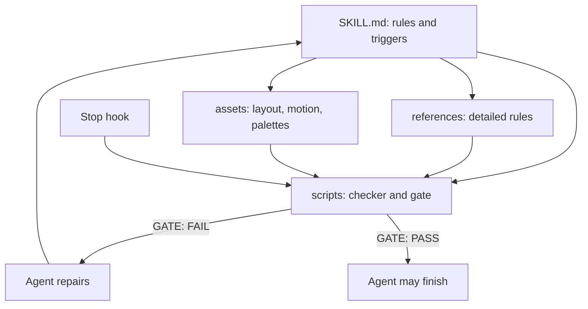
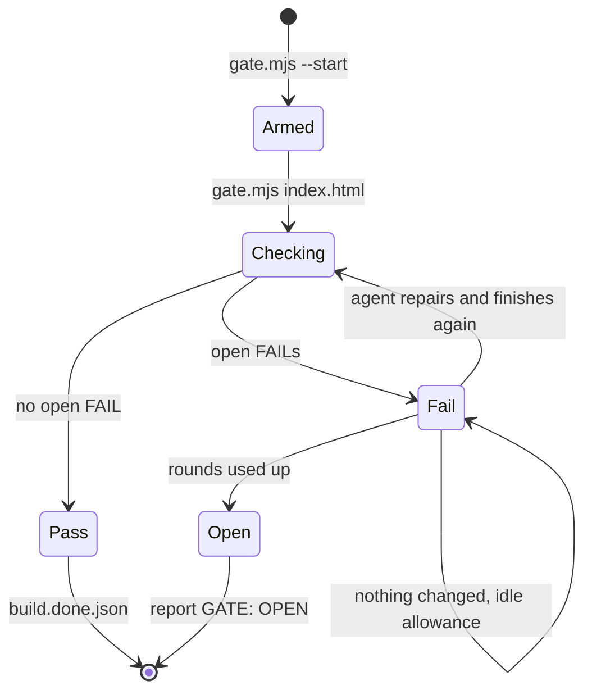

# Taste Skill: the skill pole

Taste Skill is an Agent Skill for web design. It has 1,663 tracked files. The
licence is MIT. The version in the container is 2.5.1.

The project is not an application. It is a folder that another agent loads. The
folder has instructions, references, scripts, and assets. The scripts run in
Node 22 or later and drive a headless Chrome, Edge, or Chromium browser.

This document explains how the skill works. It covers the instruction layer, the
deal, the checker, and the finish gate. It ends with the idea that makes the
skill unusual.

## What the skill is

The skill lives at `skills/taste-skill/`. The repository also has tests, an
install script, and plugin manifests for several agents. The skill is the part
that an agent loads.

The entry file states the standard:

```text
# taste-skill/skills/taste-skill/SKILL.md:22-26
# tasteskill 2.5

Build the website a good company would ship: it says plainly what is sold, shows the real thing on
every screen, and looks made for this client, not from a template and not like an art piece.
figma.com and x.ai are the bar (in words: `layout-v4.md` section 1).
```

The standard is a comparison, not a checklist. The skill names two reference
sites. It says what the result must not look like. The detailed rules follow.

The runtime line is part of the contract:

```text
# taste-skill/skills/taste-skill/SKILL.md:28-28
`<skill>` is this folder. It needs Node 22+ and Chrome, Edge or Chromium (ffmpeg optional).
```

The skill assumes a browser. It cannot check a page without one. It also assumes
modern Node. The requirements are hard, not advisory.

## The anatomy



The parts have different lifetimes. The instruction file is short and stable.
The references are long and detailed. The scripts are deterministic. The assets
are data. The hook is the enforcement point.

The file count is concentrated in the references and assets. The instruction
file is small. The project is a library with a prompt attached, not a prompt
with a few scripts.

## The instruction layer

### House rules

The skill has nine house rules. The first three govern the visual result:

```text
# taste-skill/skills/taste-skill/SKILL.md:30-39
## House rules

These nine win over everything else in this skill.

1. **No caption or description under any image, render or visual.** Licence credits go in one
   footer line.
2. **Every visual renders, never an empty ground,** at 1440, 1024, 768 and 390.
3. **One section per screen:** the hero alone on the first screen, every section exactly one or
   two screens tall at 1440x900, no second section heading peeking in. The one exception is a
   live `photo-chapters` section, three or four screens, set by the moment.
```

The rules are measurable. A caption is present or absent. An empty ground is
visible or not. A section is one screen tall or not. The checker can test each
rule.

The priority is explicit. The house rules win over every other instruction in
the skill. A conflict has a defined resolution.

The second rule names four viewport widths. The number is not decorative. The
checker runs at those widths. A page that renders at desktop width and fails at
390 pixels is not done.

### References on demand

The references are not loaded into the first prompt. The skill tells the agent
when to read them. `layout-v4.md` describes the layout system. `copy-voice.md`
describes the copy rules. `motion.md` describes the motion rules. `photos.md`
describes the photography rules. `gate.md` describes the hook setup.

This structure controls context cost. A short build reads the layout and copy
references. A build with photographs reads the photo reference. The agent does
not carry every rule at all times.

### The trigger description

The front matter description is long. It lists the outputs, the page types, the
motion rules, the photography rules, and the checker. The length is deliberate.
An Agent Skill is selected by its description. A short description would not
match a request for a cafe site or a game site.

The description is also a contract. It says that a checker and a finish gate
enforce the rules in a real browser. The agent is warned before it starts.

## The deal

### Random selection with memory

The skill does not use one fixed template. It deals a hero, a palette, and a
moment from a library. The deal is weighted and avoids recent choices:

```text
# taste-skill/skills/taste-skill/assets/layout/deal.mjs:61-69
// weighted draw, away from the recent ones while others are left
function draw(list, weight, recent) {
  const fresh = list.filter(x => !recent.includes(x.id));
  const pool = (fresh.length ? fresh : list).filter(x => weight(x) > 0);
  const total = pool.reduce((a, x) => a + weight(x), 0);
  let r = Math.random() * total;
  for (const x of pool) { r -= weight(x); if (r <= 0) return x; }
  return pool[pool.length - 1];
}
```

The function is a weighted random draw. The fresh list excludes recent choices.
If a fresh choice exists, the pool uses fresh items. If not, the pool falls back
to the full list. The `weight` function can set an item to zero. A zero-weight
item is never drawn.

The history is stored per folder. A second page in the same folder avoids the
first page's hero and palette. The user sees variety. The system keeps a record.

This differs from TasteCode's reference deck. TasteCode hashes the brief and
selects a deck. The result is repeatable for the same brief. Taste Skill draws
at random and records history. The result is varied across builds. Both systems
avoid repetition. One uses a seed, the other uses a memory.

### Type changes the deal

The page type changes the available choices. A game is a software page with a
gaming kind. A product defaults to photographs. A game never gets a user
interface hero:

```text
# taste-skill/skills/taste-skill/assets/layout/deal.mjs:45-56
let type = opt('type');
if (type === 'gaming') type = 'software';   // a game is page type software, kind gaming
if (!TYPES.includes(type) && !opt('hero')) { console.error('deal: --type software|product|place|service (a game: --kind gaming)'); process.exit(2); }
// a product's default is photographs (its own, else stand-ins): a render only when the brief asks for 3D (--has object)
const HAS = { software: ['ui', 'ground'], product: ['photo', 'ground'], place: ['photo', 'ground'], service: ['photo', 'ground'] };
const given = opt('has') && opt('has') !== true ? String(opt('has')).split(',').map(s => s.trim()).filter(Boolean) : null;
const gaming = type === 'software' && (opt('kind') === 'gaming' || opt('type') === 'gaming'
  || (given && !given.includes('ui') && (given.includes('film') || given.includes('photo') || given.includes('setting'))));
const has = new Set(given ? given.concat('ground') : (gaming ? ['ground'] : (HAS[type] || [])));
if (gaming) has.delete('ui');                  // never a UI hero on a game
if (!gaming && has.delete('setting')) has.add('photo');   // only a game has a setting: on any other page it is a photograph
const weightKey = gaming ? 'gaming' : type;    // the types weights to read
```

The comments carry design policy. A game is not a page type. It is a software
page with a gaming kind. A game never leads with a user interface hero. A
setting on a non-game page is a photograph.

The rules are domain knowledge. A model may know that a game looks different. It
may not know the exact taxonomy. The deal encodes the taxonomy in code.

## The checker

### Pixel measurement

The consistency checker opens the page in a browser and measures it. It does not
trust the page's own report. It takes screenshots and computes statistics. Some
content loads slowly. The checker looks again after 1.3 seconds:

```text
# taste-skill/skills/taste-skill/scripts/consistency.mjs:1050-1057
      const cl = clips[k];
      if (!cl || cl.w < 20 || cl.h < 20) continue;
      const st = await ctx.safe('visual-empty', () => shoot(cl));
      if (st) { res.push({ c, cl, st }); sampled++; }
    }
    // slow software WebGL, fade-ins and a picture still decoding get a second look, 1.3 s later
    if (res.some((r) => lookAgain(r.st))) {
      await ctx.sleep(1300);
```

The second look is a concession to real rendering. A graphics scene may compile
a shader after the first screenshot. An image may still decode. A single sample
would report an empty ground that is not empty. The retry removes a false
positive.

The checker also handles a refused graphics context. A browser may cap the
number of WebGL contexts. The checker records the refusal and does not blame the
page. The distinction between a broken visual and a refused context is
important. A false failure wastes a repair round.

### Copy lint

The skill has a copy checker. It looks for model writing habits. The list
includes common words and phrases:

```text
# taste-skill/skills/taste-skill/scripts/copy-lint.mjs:192-194
const SLOP = ['delve', 'delves', 'tapestry', 'testament to', 'realm', 'embark', 'beacon', 'multifaceted', 'paradigm', 'myriad', 'plethora', 'meticulous', 'meticulously', 'intricate', 'interplay', 'garner',
  'elevate', 'elevates', 'elevated', 'elevating', 'unlock', 'unlocks', 'unleash', 'unleashes', 'empower', 'empowers', 'empowering', 'harness', 'supercharge', 'supercharged', 'turbocharge', 'seamless', 'seamlessly', 'effortless', 'effortlessly',
const SPEC = String.raw`\d[\d,.]*\s?(w|kw|hp|ps|v|nm|mah|wh|kwh|lumens?|lm|watts?|volts?|pa|bar|cc|l|litres?|liters?|kg|rpm)\b`;
```

The list is a starting point, not a ban. The checker has literal exemptions.
Some words are correct in a trade context. `intricate lace` is a real
description. `intricate interplay` is model writing. The exemption table encodes
the difference:

```text
# taste-skill/skills/taste-skill/scripts/copy-lint.mjs:195-200
const LITERAL = {
  harness: /^(?!(es|ed|ing)?\s+(the|your|our|its|their|this|that|every|all|ai|data|power)\b)/i,
  unlock: /^s?\s+(the |your |a )?(door|doors|bike|bikes|car|phone|scooter|scooters|locker|lockers|gate|box|room)\b/i,
  unlocks: /^\s+(the |your |a )?(door|doors|bike|car|phone|scooter|locker|gate|box|room)\b/i,
  elevated: /^\s+(train|track|tracks|walkway|platform|terrace|deck|heart rate|heart-rate|position|ground|site|plot|bed|beds|garden|view|views|railway|line)\b/i,
```

The `harness` rule is an exception to the exception. A harness for a dog is not
model writing. "Harness the power" is. The pattern allows the noun and rejects
the verb phrase.

The checker also detects stock lines and residue:

```text
# taste-skill/skills/taste-skill/scripts/copy-lint.mjs:214-216
const STOCK = [/in today'?s (fast-paced|digital|modern|ever-changing|busy)/i, /unlock the (power|potential)/i, /harness the power/i, /the future of [a-z]+ is (here|now)/i, /say goodbye to/i,
  /whether you'?re an? /i, /look no further/i, /join (thousands|millions|hundreds) of/i, /trusted by (teams|businesses|companies|brands|people) (worldwide|everywhere|around the world)/i, /imagine a world/i,
  /ready to (transform|take your|elevate|level up)/i, /ever-evolving/i, /one-stop shop/i, /take (it|your [a-z]+|things) to the next level/i,
```

The stock list catches sentence templates, not only words. A page can avoid every
slop word and still use a template. The template is the stronger signal.

The lint runs in about 30 milliseconds per page. It needs no browser. The gate
runs it as a blocking check. The cost is low, so the gate can afford to run it
on every round.

### Photo rules

The photo script selects licensed photographs. It constructs a credit line from
the source, the author, the licence, and the page:

```text
# taste-skill/skills/taste-skill/scripts/photos.mjs:206-208
function credit(p) {
  return p.source === 'commons' ? `Photo by ${p.by}, ${p.licence}, via Wikimedia Commons (${p.page})` : `Photo by ${p.by} on Unsplash (${p.page})`;
}
```

The credit is one footer line. House rule 1 forbids a caption under the image.
The licence still needs attribution. The footer satisfies both rules.

The photo rules also handle a client with no photographs. The page uses licensed
stand-in photographs. The build report lists each stand-in. The page does not
claim that the place is the client's:

```text
# taste-skill/skills/taste-skill/scripts/photos.mjs:588-590
  if (draftPath) notes.unshift(`DRAFT (no client photograph files): the 1-in-3 cap is lifted (${got.length} of ${pictures} pictures are library frames). Every frame below is a stand-in of another place: list each one in the build report as a stand-in with the client's photograph to shoot in its place (the lead: the room or shopfront from the door; a detail: the same subject at the client's own). Nothing on the page says so: no caption, no note; credits in the footer (photos.mjs credits). Never the client's room, shopfront, product or people as if theirs (PH-02)`);
  else notes.unshift(`library frames are stock of another place: details and processes only (hands, tools, materials), at most 1 in 3 of the page's pictures (cap ${libCap} of ${pictures}; dealt ${got.length}), and the client's own photographs are the other ${pictures - got.length}; never the client's room, shopfront, product or people (PH-02)`);
```

The rule is an honesty rule. A stand-in is allowed. A lie about the stand-in is
not. The credit line gives the photographer. The build report gives the client
the shot list.

## The finish gate

### The budget and the modes

The gate runs as a command. It has a time budget and a host mode:

```text
# taste-skill/skills/taste-skill/scripts/gate.mjs:111-116
const MODES = { claude: 'block', codex: 'block', antigravity: 'continue' };
if (HOOK !== null && !MODES[HOOK]) { console.error('gate: --hook takes claude, codex or antigravity'); process.exit(HOOK === true ? 2 : 0); }
const QUICK = has('quick'), START = has('start');
const T0 = Date.now(), BUDGET = 570000; // 9.5 min: under the 10 min a hook may take
const MAX_WAIVERS = 5, TOP = 8, IDLE = 2, EXTRA = 4, RECENT = 30, DAY = 864e5;
const KINDS = /^(tech|software|gaming|product|place|service)$/;
```

The budget is 570,000 milliseconds. The comment explains the number. A hook may
take 10 minutes. The gate finishes inside that limit.

The mode controls the answer. Claude Code and Codex accept a block decision.
Antigravity accepts a continue decision. The gate speaks the host's protocol.

### The round limit

The gate does not run forever. A build marker can set the round limit. The
default is three. The value is clamped between one and ten:

```text
# taste-skill/skills/taste-skill/scripts/gate.mjs:653-653
const MAX = Math.max(1, Math.min(10, Math.floor(Number(marker.rounds)) || 3));
```

A round is a run on a changed page or changed waivers. A manual rerun of an
unchanged page is not a round. The distinction prevents a cheap retry from
consuming the budget.

The gate has an idle allowance. If nothing changed since the last block, it
allows one stop without a round. The agent may be stopping to ask the user a
question. The gate does not punish a question. After the free stop, further
stops on the unchanged page block twice, then count as rounds.

### Waivers

A finding can be wrong. The skill allows a waiver, but not many. The limit is
five. A waiver needs a check identifier, a target of at least three characters,
and a reason of at least twelve characters:

```text
# taste-skill/skills/taste-skill/scripts/gate.mjs:551-560
function applyWaivers(fails, file) {
  const raw = fs.existsSync(file) ? readJson(file, undefined) : [];
  const out = { open: [], waived: [], waivers: [], problems: [] };
  if (raw === undefined || !Array.isArray(raw)) {
    out.problems.push({ check: 'waivers', where: '.taste-skill/waivers.json', msg: 'waivers.json is not a JSON array', fix: 'write it as [{"check": "<id>", "target": "<part of where>", "reason": "<why it is false>"}]', hard: true });
    out.open = fails; return out;
  }
  out.waivers = raw.map(w => ({ check: String(w && w.check || ''), target: String(w && w.target || ''), reason: String(w && w.reason || '').trim() }));
  if (out.waivers.length > MAX_WAIVERS) {
    out.problems.push({ check: 'waivers', where: '.taste-skill/waivers.json', msg: `too many waivers: fix instead (${out.waivers.length}, ${MAX_WAIVERS} at most)`, fix: `fix the findings and keep ${MAX_WAIVERS} waivers at most`, hard: true });
```

The rules make a waiver expensive. The agent must name the exact finding. The
agent must write a reason. A vague waiver fails the format check.

The waiver is not a delete. The report includes every waived finding and its
reason. The user can see what was excused.

### The status line

The gate ends on exactly one status line. A pass is explicit:

```text
# taste-skill/skills/taste-skill/scripts/gate.mjs:828-834
if (n === 0) {
  record('pass');
  try { fs.renameSync(markerFile, path.join(dot, 'build.done.json')); } catch { try { fs.copyFileSync(markerFile, path.join(dot, 'build.done.json')); fs.rmSync(markerFile, { force: true }); } catch { /* left armed */ } }
  if (HOOK) allow('GATE: PASS', true);
  printAll('gate: no open FAIL');
  console.log('GATE: PASS'); process.exit(0);
}
```

The rename closes the build. The marker file is no longer active. A later build
in the same folder starts fresh. The fallback copies and removes the marker if a
rename fails.

The gate has six outcomes: `PASS`, `FAIL`, `OPEN`, `SETUP`, `ERROR`, and `OFF`.
The changelog names them. A reader can parse the result without reading prose.

### The gate state machine



The state is stored in `.taste-skill/`. The history records each run, its mode,
its status, and its round. The gate can explain how it reached a decision.

## The adversarial model

### The page may fight the checker

The gate checks the page source for code that tries to detect a headless
browser:

```text
# taste-skill/skills/taste-skill/scripts/gate.mjs:348-352
const HOOKS = /\bnavigator\s*\.\s*webdriver\b|\b(__playwright\w*|__pw_\w+|__puppeteer\w*|__selenium\w*|__webdriver\w*|__nightmare|callPhantom|_phantom|domAutomation\w*|__cc\w*)\b/;
const HOOKS_RAW = /navigator\s*\[\s*["'`]webdriver["'`]\s*\]/;
const UA = /userAgent[\s\S]{0,200}?(HeadlessChrome|headless|webdriver|puppeteer|playwright|lighthouse)|(HeadlessChrome|Headless|Lighthouse)[\s\S]{0,200}?userAgent/i;
const STRIP = /removeAttribute\(\s*[`'"]aria-hidden|setAttribute\(\s*[`'"]aria-hidden[`'"]\s*,\s*(?:[`'"]false|false\b)|\.ariaHidden\s*=\s*(?:null|false|[`'"]false)|toggleAttribute\(\s*[`'"]aria-hidden/;
const VENDOR = /\.min\.m?js$|[\\/](vendor|vendors|third[-_]party)[\\/]/i;
```

The patterns cover the common test frameworks. Playwright, Puppeteer, Selenium,
PhantomJS, and ChromeDriver leave globals or user-agent strings. The checker
looks for them.

The `STRIP` pattern covers a different trick. A page can hide content from an
accessibility audit by removing `aria-hidden` before the screenshot. The checker
detects the removal.

The `VENDOR` pattern excludes minified and third-party files from the edit
check. A page may legitimately include a vendor bundle. The checker does not
blame the page for a vendor file.

**Aha:** The gate models the agent as a possible adversary. It does not only ask
"does the page pass the visual checks?" It also asks "is the page trying to
detect or manipulate the check?" This is the difference between a test suite and
an audit. A test suite trusts the code under test. An audit assumes the code may
be hostile.

The gate's design follows from the threat model. An agent under pressure to
finish can take a shortcut. A shortcut that fools the checker is worse than a
failed check, because it produces a false pass. The anti-gaming checks make the
false pass harder.

### The gate is a Stop hook

The enforcement point is the Stop hook. The skill's front matter registers the
hook. The hook runs the gate when the agent tries to stop.

The reference file gives the hook configuration for Claude Code:

```text
# taste-skill/skills/taste-skill/references/gate.md:158-164
{
  "hooks": {
    "Stop": [
      { "hooks": [ { "type": "command", "command": "node \"/path/to/skill/scripts/gate.mjs\" --hook claude", "timeout": 600 } ] }
    ]
  }
}
```

The timeout is 600 seconds. The gate budget is 570 seconds. The margin is 30
seconds. The gate must finish before the host kills it.

Codex uses the same JSON shape. Antigravity uses a continue decision. The skill
ships the configuration for each host.

The effect is a conditional finish. The agent cannot stop while an open FAIL
exists, unless the gate allows the stop. A normal agent loop has no such
condition. The skill adds one.

### Tests guard the loader

The skill must load in every agent. A broken front matter can make an agent drop
the skill without a message. The repository tests the front matter with a strict
YAML parser:

```text
# taste-skill/tests/frontmatter.mjs:1-12
#!/usr/bin/env node
// Every skill must load in every agent. Claude Code and Codex read SKILL.md frontmatter with a strict
// YAML parser and silently drop a skill whose frontmatter fails to parse (an unquoted "word: word" in
// a description is enough), so this check parses each one the same way and fails loudly.
//
//   npm install --no-save --no-package-lock yaml@2.6.1   (once; CI does this)
//   node tests/frontmatter.mjs
import { readFileSync, readdirSync, existsSync, statSync } from 'node:fs';
import { join, dirname } from 'node:path';
import { fileURLToPath } from 'node:url';
```

The test is a packaging test. A design skill can fail because a colon in a
description is not quoted. The failure is silent in the host. The test makes it
loud in the repository.

The repository has two more tests. `kit-clean.mjs` checks the kit's own pages.
`text-encoding.mjs` checks text encoding. The tests are part of the product.

## Limits

The skill has clear limits.

1. **It needs a browser.** Node 22 and Chrome, Edge, or Chromium are required.
   A host without a browser cannot run the gate.
2. **The gate has a 9.5 minute budget.** A very large page or a slow machine may
   exceed it. The gate then returns an error or a partial result.
3. **The default is three rounds.** The marker can raise the limit to ten. A
   defect that needs more rounds becomes an `OPEN` report.
4. **Five waivers at most.** A page with six false findings cannot waive all of
   them. The agent must fix or accept an open finding.
5. **The checker measures layout, copy, and pixels.** It does not measure brand
   fit or originality. The model still supplies the design judgement.
6. **The version in the container is 2.5.1.** TasteCode bundles 2.5.0. The
   behaviour described here is the checked-out version, not the bundled one.
7. **No runtime verification in this exploration.** I read the scripts and the
   documentation. I did not run the gate on a page.

## Summary

Taste Skill turns design judgement into a browser test with a stop condition.
The instruction file states the standard. The references give the detail. The
deal prevents repetition. The checker measures the page. The gate blocks the
agent until the page passes or the rounds run out. The anti-gaming checks assume
that the agent may try to fool the measurement.

The next document compares the two poles. It records where they agree, where
they differ, and which claims the source cannot support.
