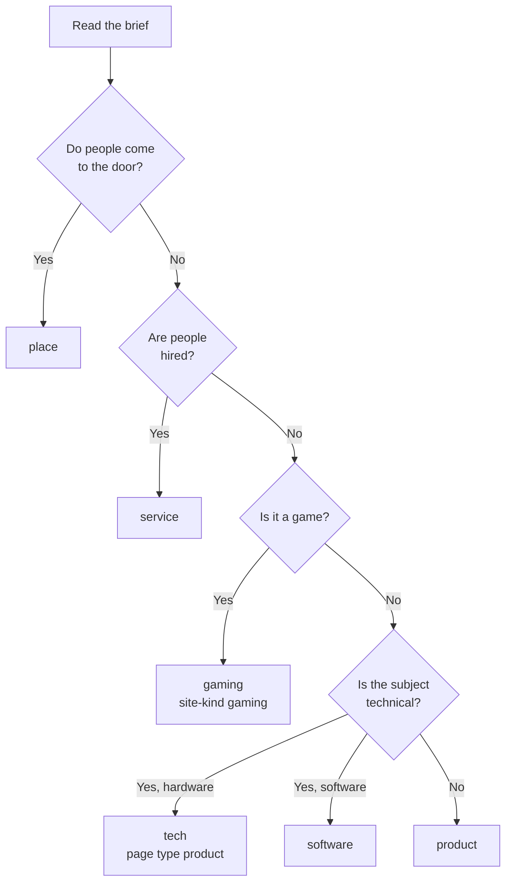
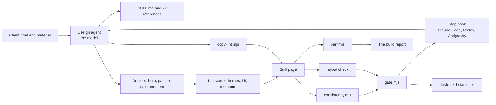

# Overview: the taste-skill product

Taste Skill is an Agent Skill for web design. It builds company pages that show a real product or
place. The source is a Git checkout at pin `f6b7657`. The version is `2.5.1`
(`skills/taste-skill/SKILL.md:4`). The skill folder holds 1,631 tracked files, and the repository
holds 1,663 (`spec.md`).

The product is not only a text prompt. It is a contract, a kit, and a set of measuring scripts.
The contract states what a good page must contain. The kit supplies the parts. The scripts measure
the built page in a real browser. A Stop hook makes the measurement a condition for finishing.

This document explains the product, the contract, the nine house rules, the kit, and the actors.
The reader needs no prior knowledge of the source.

## 1. The problem the product answers

A general model can write HyperText Markup Language (HTML) and Cascading Style Sheets (CSS) for a
page. The result often looks generic. The page repeats a small set of habits: a centred hero, a row
of three feature cards, a stock photograph, and a slogan. The model can also claim that the result
is good, because no external check contradicts the claim.

Taste Skill answers both problems. It fixes the visible habits with a kit of page parts and a set
of house rules. It fixes the unverified claim with scripts that fail a page on measured faults.
The finish gate then blocks the agent until the page passes or the agent records the open faults.

The skill also limits its own scope. It serves company websites, product pages, service pages, and
place pages. The bar is stated as `figma.com` and `x.ai` (`skills/taste-skill/SKILL.md:26`). The
bar is a reference for restraint and craft, not a source to copy.

## 2. The skill contract

An Agent Skill starts with a `SKILL.md` file. The front matter holds the skill name, a
description, and optional hooks. The name is `design-taste-frontend` (`skills/taste-skill/SKILL.md:2`).
The description names the trigger conditions: landing pages, company sites, product pages, shops,
cafes, hotels, studios, software as a service (SaaS), artificial intelligence (AI) products,
developer tools, and games (`skills/taste-skill/SKILL.md:4-12`).

```text
# skills/taste-skill/SKILL.md:1-3
---
name: design-taste-frontend
description: >-
```

The skill declares one hook. The hook runs on the Stop event. The command starts `gate.mjs` in
Claude Code mode (`skills/taste-skill/SKILL.md:14-19`).

```text
# skills/taste-skill/SKILL.md:14-17
hooks:
  Stop:
    - hooks:
        - type: command
```

The runtime requirement is Node.js 22 or later, and Chrome, Edge, or Chromium. The video tool
`ffmpeg` is optional (`skills/taste-skill/SKILL.md:28`). All measuring scripts use a headless
browser. The skill therefore needs a browser even when it builds a static page.

The contract has three layers:

| Layer | File | Function |
|---|---|---|
| Rules | `SKILL.md` | States the house rules, the kinds, the plans, the steps, and the report |
| Knowledge | `references/*.md` | 22 files that explain each design area and each rule |
| Enforcement | `scripts/*.mjs` | Deals, checks, measures, photographs, and gates the page |

`SKILL.md` is 381 lines. It is the entry point and the summary. The references hold the detail.

## 3. The nine house rules

The nine rules "win over everything else in this skill" (`skills/taste-skill/SKILL.md:32`). They
are short, absolute, and measurable in part. The first two rules protect the visual surface.

```text
# skills/taste-skill/SKILL.md:30-36
## House rules

These nine win over everything else in this skill.

1. **No caption or description under any image, render or visual.** Licence credits go in one
   footer line.
2. **Every visual renders, never an empty ground,** at 1440, 1024, 768 and 390.
```

Rule 1 removes explanatory text under pictures. A licence credit goes in one footer line. Rule 2
requires every visual to render at four widths: 1440, 1024, 768, and 390 pixels
(`skills/taste-skill/SKILL.md:36`). The checker tests this requirement with the `assets`,
`empty-visual`, `hidden-visual`, and `fold-card` checks.

Rules 3 to 5 control layout and motion.

```text
# skills/taste-skill/SKILL.md:37-45
3. **One section per screen:** the hero alone on the first screen, every section exactly one or
   two screens tall at 1440x900, no second section heading peeking in. The one exception is a
   live `photo-chapters` section, three or four screens, set by the moment.
4. **Equal left and right content edges.**
5. **Hover micro-animations:** a linked card lifts 2px, a photo zooms 1.02-1.03 inside its frame,
   buttons step on hover and press on click, underlines draw, card loops cycle in 2.5-4 s, repeat
   and restart on hover. The motion layer does it; never strip or override it. No tilt, carousels
   or timed tabs. Every hero enters once on load (`data-enter`), and every page carries one dealt
   moment, two on a long page (the gate holds both).
```

Rule 3 makes one screen the unit of section height. A screenshot at scroll position `k` times the
viewport height must show exactly one section (`skills/taste-skill/references/layout-v4.md`
section 2). Rule 4 keeps the left and right content edges equal. Rule 5 names the allowed motion:
small lifts, zooms, presses, and underlines. It forbids tilt, carousels, and timed tabs. It also
requires a hero entrance and one or two dealt moments on every page. A dealt moment is a finished
section that a weighted dealer chose from the kit, not a new animation by the agent.

Rules 6 to 9 protect the content and the ethics of the page.

```text
# skills/taste-skill/SKILL.md:46-56
6. **More and better real photographs where they fit;** nicer backgrounds; better heroes, layouts
   and fonts.
7. **Real full-colour icons** (a known product's real icon, never a drawn one); small diagram
   visuals in cards (a hub with branches; one input, a main processor, three parallel lanes;
   pulses running along the lines).
8. **The big award-site scenes and creative moments are part of the skill:** every page deals its
   moments (photo- and type-led off tech), but shader effects and scenes only where the trade has a
   technical subject (tech, AI, developer tools, gaming, fintech, hardware), never on a local cafe,
   bakery, guesthouse or shop: those get photographs.
9. **Addresses:** street and district only (no street given: the district), no house number, postcode or coordinates; no register
   or VAT numbers; no phone in a real format; contacts on `.example`.
```

Rule 6 asks for real photographs over drawings or renders. Rule 7 asks for real product icons and
small diagram visuals. Rule 8 limits shader effects and large scenes to technical trades. A local
cafe or guesthouse gets photographs instead. Rule 9 limits addresses to a street and a district. It
forbids house numbers, postcodes, coordinates, register numbers, value added tax (VAT) numbers, and
real phone formats. Contact addresses use `.example`.

The rules do not stand alone. Each rule has at least one checker identifier. Rule 1 maps to
`caption`. Rule 2 maps to `assets`, `empty-visual`, and `hidden-visual`. Rule 3 maps to
`one-screen`, `section-gaps`, and `fold-card`. Rule 4 maps to `col-edge`, `right-edge`, and
`split-align`. Rule 5 maps to `hover`, `hover-move`, and `reduced-motion`. Rule 6 maps to
`photo-set`, `photo-upscale`, and `photo-weight` for the photograph part. The layout and type part
lands in the layout check and the system checks. Rule 7 maps to `assets` and `photo-set`. Rule 8
maps to `effects-fit`. Rule 9 maps to `copy-fact` and `fact-agree`.

**Aha:** The nine rules work as a contract because the checker gives each one a name. A rule that
has no check is still text. A rule with a check becomes a failure that the gate can report.

## 4. The six kinds of business

The skill first classifies the brief. The classification decides the page type, the allowed
assets, the heroes, the moments, and the length of the page. The six kinds are `software`,
`gaming`, `tech`, `product`, `service`, and `place` (`skills/taste-skill/SKILL.md:66-73`).

```text
# skills/taste-skill/SKILL.md:66-73
| Brief | page type | site-kind | kind |
|---|---|---|---|
| App, SaaS, AI, developer tool, fintech or banking app, a studio selling its own software | software | software | software |
| A game, a studio launching its game | software | gaming | gaming |
| Hardware or a tech device (a drone, a robot arm, a keyboard) | product | tech | tech |
| Any other physical product or brand (a chair, a bike, coffee beans sold online) | product | other | product |
| People are hired: clinic, law firm, agency, creative studio, trade | service | other | service |
| People come to it: cafe, bar, bakery, restaurant, guesthouse, small hotel, shop, florist, bike shop, gym, local studio | place | other | place |
```

The page declares its kind in two meta elements: `<meta name="page-type">` and
`<meta name="site-kind">`. A place page adds `<meta name="page-kind" content="place">`
(`skills/taste-skill/SKILL.md:60-64`). The dealers read the last column. The hero dealer reads the
page type. The checker reads the metas.



The distinction between `tech` and `product` matters. `tech` means a technical subject. Only
`tech` pages may use shader effects, large scenes, loops, counts, dark grounds, and dark heroes
(`skills/taste-skill/SKILL.md:78-81`). A chair, a bike, or a coffee brand is `product`. It gets
photographs, flat colour, type, real icons, a hero entrance, a dealt moment, and the hover layer.

The distinction between `place` and `product` also matters. A ceramics studio that teaches
classes is a `place`. A bakery with a web shop is a `place`, and the shop becomes the goods
section. The goods section is the part of the page that lists what the shop sells. A business is a
`product` only when nothing happens at the door
(`skills/taste-skill/SKILL.md:75-76`).

**Aha:** The kind is not a label for the report. It is a permission system. It decides which
assets the page may load and which checks apply.

## 5. The kit

The kit is the part that makes the output look designed. It lives in `skills/taste-skill/assets/`.
A build copies the kit into the project (`skills/taste-skill/SKILL.md:160-161`). The kit is not a
blank framework. It holds finished page parts that the agent assembles and rewrites for the client.

| Part | Location | Count | Role |
|---|---|---:|---|
| Starter page | `assets/starter.html` | 1 | The base document with the head, nav, sections, footer, and form |
| System | `assets/system.css`, `assets/system.js` | 2 | Tokens, grid, buttons, nav, footer, forms |
| Heroes | `assets/layout/hero-*.html` | 11 | Full-screen hero models |
| Hero dealer | `assets/layout/deal.mjs` | 1 | Weighted choice of a hero |
| Effects | `assets/effects/` | 25 | Shader and image effects for technical pages |
| Scenes | `assets/scenes/` | 11 | Large scenes for technical pages |
| Moments | `assets/moments/` | 18 | Creative moments for every kind |
| User interface fragments | `assets/ui/` | 19 | App windows, cards, and tool interfaces |
| Diagram presets | `assets/diagrams/presets.json` | 27 | Hub, lane, and pulse diagrams |
| Components | `assets/components/` | 20 | Creative parts such as a map or a photograph treatment |
| Objects | `assets/objects/` | 17 | Object and print effects |
| Photographs | `assets/photos/photos.json` | 413 | Licensed photograph library |
| Palettes | `library/palettes.json` | 64 | Colour sets, grouped by trade |
| Type pairings | `library/type.json` | 39 | Face, weight, tracking, and size sets |

The palettes and the type pairings live in `library/`. They are not part of the asset kit. The
start script reads them, and a build does not copy them into the page as kit parts.

The hero set has 11 models: `centred`, `collage`, `editorial`, `film`, `photo`, `place`,
`product`, `split`, `statement`, `triptych`, and `word` (`assets/layout/hero-*.html`). The agent
copies one hero and rewrites every word and picture. It never copies the hero's nav, footer, other
sections, or credit line (`skills/taste-skill/SKILL.md:233-235`).

The dealer chooses a hero by page type and available material. The command takes `--has` flags for
photographs, user interface, film, object, and setting (`skills/taste-skill/SKILL.md:203`). The
choice is weighted, and the dealer keeps a history. Two pages of the same kind do not get the same
hero.

```text
# skills/taste-skill/scripts/start.mjs:1-5
#!/usr/bin/env node
/*
  taste-skill start.mjs - deals colours and type, then prints the Google Fonts link, the six stylesheet links
  and the :root block. library/type.json is the one source of every face, weight, tracking and size.
```

The start script deals three palettes and three type pairings for the trade. The agent takes the
first. It takes the second only when the first clashes with the client's logo or photographs. The
reason goes on the plan (`skills/taste-skill/SKILL.md:200-228`). A history file prevents a repeat
of the current goods.

The moments script deals one or two creative moments by kind.

```text
# skills/taste-skill/scripts/moments.mjs:1-7
#!/usr/bin/env node
/*
  moments.mjs - the creative moments command line (taste-skill, references/moments.md).

    node scripts/moments.mjs index                      scan assets/moments/<id>/meta.json into index.json
    node scripts/moments.mjs list [--kind text] [--fits hero] [--page tech] [--json]
    node scripts/moments.mjs pick --page tech|gaming|software|place|product|service --count 1|2 --seed S --history .taste-skill/history.json
```

The moments set holds 18 items, such as `photo-chapters`, `word-highlight`, `pinned-chapters`,
`picture-develops`, `letters-assemble`, and `cursor-spotlight` (`assets/moments/`). A moment is a
finished section with its own markup and script. The agent mounts it in the page. It does not write
a new animation.

The photograph library holds 413 entries and 16 trade groups (`assets/photos/photos.json`). Each
entry has a licence, a source, a credit line, and slots such as `hero`, `use`, `place`, or
`portrait` (`skills/taste-skill/references/photos.md`). The photograph script can list, pick,
search, fetch, and print credits. It can also record a stand-in when the client supplies no
photograph.

## 6. The actors

The system has eight actors. Each one has a clear job.



The **client** supplies the brief and the real material: the name, the logo, the product, the
photographs, the prices, the address, and the hours. The skill forbids invented reviews, quotes,
customers, and figures (`skills/taste-skill/SKILL.md:372`). A claim that the brief does not support
must be marked as assumed.

The **agent** is the model that reads the skill. It classifies the brief, writes the copy, plans
the screens, deals the parts, builds the page, runs the checks, reads the screenshots, repairs the
faults, and writes the report.

The **dealers** are four command line programs. `assets/layout/deal.mjs` deals the hero.
`scripts/start.mjs` deals the palette and the type. `scripts/moments.mjs` deals the moments.
`scripts/effects.mjs` deals the effect on technical pages. Every dealer keeps a history, so a
series of pages varies.

The **kit** is the set of finished parts. It includes the starter document and the system. It also
includes the heroes, the user interface fragments, and the diagrams. The remaining parts are the
moments, the effects, the scenes, the objects, and the components. The kit also holds the
photographs. The palettes and the type are library data, not kit parts.

The **checker** is `scripts/consistency.mjs`. It opens the page in headless Chrome and measures
layout, text, navigation, buttons, motion, visuals, copy, wiring, and system rules. It reports each
identifier as PASS, WARN, FAIL, or not checked (`skills/taste-skill/scripts/consistency.mjs`).
Two other scripts measure layout stress and performance. The gate runs the checker and the layout
check. It does not run the performance script, which the agent runs by hand.

The **gate** is `scripts/gate.mjs`. It merges the checker results with static checks, applies
waivers, counts rounds, and writes the verdict (`skills/taste-skill/scripts/gate.mjs`). The gate has
eight verdicts: `PASS`, `FAIL`, `OPEN`, `QUICK`, `SETUP`, `ERROR`, `DONE`, and `OFF`
(`skills/taste-skill/references/gate.md:113-123`). `QUICK` is a look between rounds and never
closes a build. `DONE` follows the user's stop words.

The **hook** is the Stop event handler. In Claude Code and Codex, it can return a block decision.
The agent then continues the work instead of finishing. In Antigravity, the hook returns a
continue decision instead (`skills/taste-skill/scripts/gate.mjs:111`).

The **state files** are small documents in `.taste-skill/`. They record the build marker (the
`build.json` file), the gate result, the waivers, the block history, the build completion, the
unarmed note, the missing-hook note, and the checker crops. The `gate.json` file holds a `history`
array. The dealers also keep separate history files for the palettes, heroes, effects, grounds, and
scenes. The next round reads the gate state, so the gate is not stateless
(`skills/taste-skill/references/gate.md:113-150`).

## 7. What the product promises

The product promises five results:

1. A page that names what is sold and shows the real thing on every screen.
2. A page with a fixed system of space, type, colour, and edges.
3. A page with real photographs and real product icons.
4. A page with a measured pass on a fixed list of checks.
5. A report that states the gate line, the waivers, the open faults, and the missing client
   material (`skills/taste-skill/SKILL.md:291-296`).

The product also promises a limit on effort. The gate allows three rounds by default, with a
maximum of ten (`skills/taste-skill/scripts/gate.mjs:653`). It stops the agent from an endless
repair loop. It also allows the user to stop the build with `gate.mjs --done "<reason>"`
(`skills/taste-skill/SKILL.md:280-282`). The command needs the user's words, with 12 characters or
more. It does not run in hook mode (`skills/taste-skill/scripts/gate.mjs:668-670`).

## 8. What the product does not promise

The skill does not promise that the page is beautiful. The checker measures named properties:
overflow, overlap, contrast, spacing, tap size, image weight, and copy patterns. It does not
measure taste in the sense of a good composition. A page can pass every check and still be dull.
The separate performance script reports speed and weight. The gate does not run it.

The skill does not promise that the client material is true. The checker can read a fact and
compare its repeats. It cannot know whether the fact is correct. The skill marks assumed facts and
asks the agent to report them (`skills/taste-skill/SKILL.md:294-296`).

The skill does not promise that the hook works in every environment. It depends on the hook
support of Claude Code, Codex, or Antigravity. The hook command writes a missing-hook note when it
cannot find `gate.mjs` (`skills/taste-skill/SKILL.md:18`). This package did not test the hook
behaviour of those products.

The skill does not promise a good result on a page outside its scope. It targets company,
product, service, and place pages. It is not a tool for a large web application, a dashboard, or a
shop with a checkout flow.

## 9. The never list

`SKILL.md` ends with a short list of forbidden results. The list is a useful summary of the
product's ethics and its taste.

```text
# skills/taste-skill/SKILL.md:367-372
- A card, row or tile that fades in on scroll; a fade-in on every section; parallax on text;
  scroll-jacking; random blinking.
- Stock photographs passed off as the client's product, people or place (a stand-in is listed in
  the report as one, never shown with another maker's name or logo); a product page that never
  shows the product.
- A drawn look-alike of a real logo; invented reviews, quotes, customers or figures.
```

The list continues with violet or lavender in the page's own design, copying a reference site,
and editing the kit to clear a check (`skills/taste-skill/SKILL.md:373-377`). The violet rule is
unusual. It prevents a common model palette. It also prevents a page from looking like a default
output of the model.

The last item is the most important for this package.

```text
# skills/taste-skill/SKILL.md:376-377
- Deleting or editing the kit's own files (`assets/`, `scripts/`) to clear a check: a check that
  flags a kit file is reported, and the page is checked again after any change.
```

The agent must not edit or delete the kit's
own files to clear a check. A fault in a kit file is reported, and the page is checked again after
a change (`skills/taste-skill/SKILL.md:377`). The gate also detects kit edits with the
`kit-edited` static check (`skills/taste-skill/scripts/gate.mjs:365`).

## 10. Reading this package

This document is the first deep dive. It gives the product and the vocabulary. The next documents
move from structure to mechanism:

- `01-architecture.md` maps the folder layout, the 22 references, the 12 scripts, the kit, the
  library data, the plugin manifests, and the install paths.
- `02-core-mechanism.md` explains how the checker measures a page, how the gate merges results,
  how the Stop hook blocks, and how rounds and waivers work.
- `03-workflow-and-quality.md` follows one build from the brief to `GATE: PASS`.
- `04-limits-and-comparison.md` states the limits, the false positives, the unmeasurable
  qualities, the anti-trap rules, and the comparison with tastecode.

The documents use the same terms.

| Term | Meaning |
|---|---|
| Deal | A weighted random choice with a history |
| Gate | The script that decides the verdict |
| Round | One gate run that counts toward the limit |
| Waiver | A recorded decision to accept one finding |
| Held | A checker warning that the gate treats as a failure |

## 11. Facts not verified in this package

The package is a static reading of the source. No script was run. No browser was started. No page
was built. Runtime behaviour is therefore not verified.

The specific unverified points are:

- The actual visual result of a `GATE: PASS` page.
- The actual false-positive rate of the checker.
- The actual hook behaviour in Claude Code, Codex, and Antigravity.
- The actual speed of a check on a large page.
- The actual quality of the 413 photographs and their licences at the time of a build.

The source makes claims about each point. This package reports the claims and marks them as
claims. Where the source gives a number, this package repeats the number and cites the line.
Where the source gives no number, this package writes that the value is not defined.
