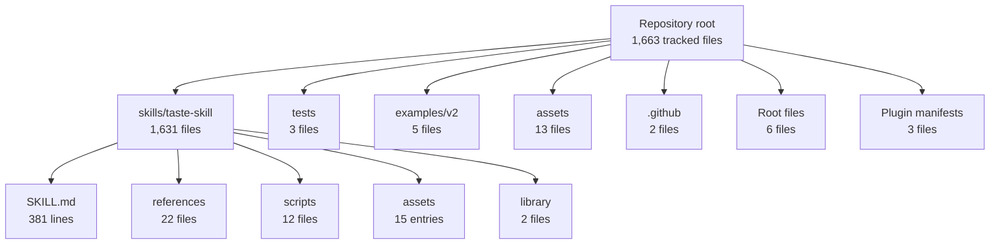
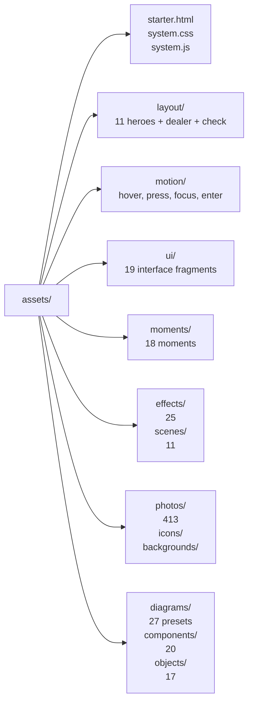
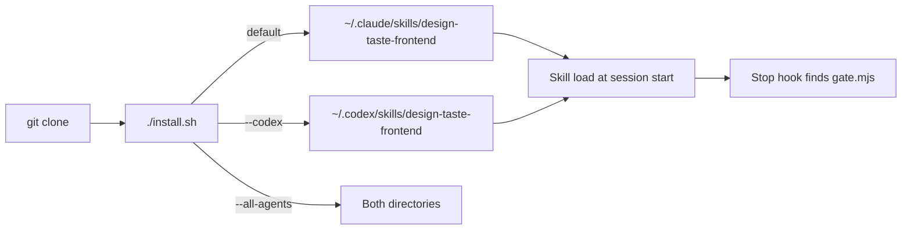

# Architecture: how the skill is packaged

This document maps the package. It covers the folder layout, the `SKILL.md` contract, the 22
references, the 12 scripts, the asset kit, the library data, the three plugin manifests, and the
install paths. Every count and every path comes from the checkout at pin `f6b7657`.

## 1. The repository at a glance

The repository has two roles. The folder `skills/taste-skill/` is the product. The rest of the
repository delivers that folder to an agent. The tracked file count is 1,663. Of these files,
1,631 are inside the skill folder (`spec.md`).



| Path | Files | Role |
|---|---:|---|
| `skills/taste-skill` | 1,631 | The skill itself |
| `assets` | 13 | Repository wordmark, badges, and sponsor images |
| `examples/v2` | 5 | Example outputs |
| `tests` | 3 | Front matter, kit cleanliness, and text encoding |
| `.github` | 2 | Funding file and workflow |
| Root files | 6 | `README.md`, `LICENSE`, `install.sh`, `CHANGELOG.md`, `.gitignore`, `.gitattributes` |
| Plugin manifests | 3 | `.claude-plugin`, `.codex-plugin`, `.agents` |

The skill folder is 39 MB on disk. The `assets` subfolder is 37 MB of that total. The size comes
from binary files: photographs, fonts, and page models. The file count and the disk size measure
different things.

## 2. The skill folder

The skill folder has five parts. Each part has a different load time.

| Part | Load time | Why |
|---|---|---|
| `SKILL.md` | Always, at skill load | The contract, the rules, the steps, and the checklist |
| `references/` | On demand, when a step names one | The detailed design knowledge |
| `scripts/` | On demand, as a command | The measuring and dealing tools |
| `assets/` | Copied into the project | The parts the page uses |
| `library/` | Read by the start script | The palette and type data |

The split keeps the context small. The model reads `SKILL.md` first. It reads only the reference
that the current step names. For example, step 4 names `cards.md` and the recipe of each section
identifier (`skills/taste-skill/SKILL.md:213-215`).

**Aha:** The package has a small always-loaded surface and a large on-demand surface. The design
knowledge is large, but the model pays for it only when a step needs it.

## 3. `SKILL.md`, the contract

`SKILL.md` is 381 lines. It has six numbered sections and a reference list:

| Section | Lines | Content |
|---|---:|---|
| Front matter | 1-20 | Name, description, and Stop hook |
| Heading and requirement | 22-28 | The bar, the folder, and the runtime |
| House rules | 30-56 | The nine rules |
| 1. The kind | 58-81 | The six kinds and the permission model |
| 2. The page plan | 83-129 | Plans by kind, product rules, tech rules, and client slots |
| 3. What serves which page | 131-155 | The asset table |
| 4. The run | 156-296 | Steps 0 to 7 |
| 5. Checklist | 298-363 | The check identifiers and the performance rows |
| 6. Never | 365-377 | The forbidden results |
| References | 379-381 | The list location |

The front matter is the part that every agent reads before anything else.

```text
# skills/taste-skill/SKILL.md:1-2
---
name: design-taste-frontend
```

The name is kebab-case and has no more than 64 characters. The description is non-empty and has no
more than 1,024 characters. The test `tests/frontmatter.mjs` enforces both limits
(`tests/frontmatter.mjs:38-40`).

The Stop hook is declared in the same file. The command tries several locations for `gate.mjs`.
The locations cover a Claude skill directory, a plugin root, a project skill directory, an agent
skill directory, and the home directory (`skills/taste-skill/SKILL.md:18`). This fallback chain
matters because the skill supports five install paths (section 9).

## 4. The 22 references

The references hold 22 Markdown files. They are the design knowledge. `SKILL.md` gives the rules
and the workflow. A reference explains how to apply one rule in detail.

| Reference | Area |
|---|---|
| `backgrounds.md` | Cascading Style Sheets (CSS) grounds |
| `cards.md` | Cards, user interface fragments, and icons |
| `copy.md` | Copy rules, contacts, and credits |
| `copy-moves.md` | Copy moves |
| `copy-registers.md` | Voice registers |
| `copy-tells.md` | The tells that the copy linter counts |
| `copy-voice.md` | The fact sheet, the voice card, and the device budget |
| `diagrams.md` | Diagram cards |
| `effects-creative.md` | Creative parts with the `fx-` prefix |
| `effects-objects.md` | Objects and prints |
| `effects-usage.md` | The one effect on a technical page |
| `gate.md` | The finish gate, the states, and the hook configuration |
| `icons.md` | Real icons and the violet rule |
| `layout-v4.md` | Heights, edges, heroes, and type |
| `moments.md` | Creative moments |
| `motion.md` | The motion layer |
| `perf.md` | The performance budgets |
| `photos.md` | The photograph library, search, licences, and stand-ins |
| `scenes.md` | Large scenes |
| `sections-library.md` | A recipe for every section identifier |
| `sections.md` | Plans, deals, and section order |
| `system.md` | Tokens, grid, buttons, navigation, footer, forms, and head tags |

Three of the references are large. `sections-library.md` is 66,041 bytes. `sections.md` is 53,916
bytes. `photos.md` is 27,704 bytes. A reference is not an introduction. It is a working manual.

The reference names also appear in the asset table. The table has one row for each need and names
the reference that explains it (`skills/taste-skill/SKILL.md:131-155`). A row with a dash in the
kind column means that the asset is never used for that kind.

## 5. The 12 scripts

`skills/taste-skill/scripts/` holds 12 files. Ten are Node.js modules with the `.mjs` extension.
Two are HyperText Markup Language (HTML) templates for the effect gallery and the effect lab.

| Script | Role | Browser |
|---|---|---|
| `consistency.mjs` | The main checker: ordered identifiers | Yes, headless Chrome |
| `gate.mjs` | Merge, waivers, rounds, verdict, and hook | Through the checks |
| `copy-lint.mjs` | Count copy tells with no browser | No |
| `photos.mjs` | List, pick, search, fetch, and credit photographs | No, except search |
| `start.mjs` | Deal palettes and type, print the CSS block | No |
| `shoot.mjs` | Full-page screenshot and one tile per section | Yes |
| `perf.mjs` | Performance budget check | Yes |
| `icons.mjs` | Resolve real icons into local SVG files | No |
| `effects.mjs` | Effect kit command line | Yes, for demos |
| `moments.mjs` | Moment kit command line | Yes, for shots |
| `fx-gallery.template.html` | Effect gallery template | Rendered by the gallery |
| `fx-lab.template.html` | Effect lab template | Rendered by the lab |

The scripts share a style. Each starts with a shebang and a block comment that shows the usage.
Each runs with Node.js 22 or later and uses no package manager dependency.

`consistency.mjs` is the largest file in the package. It is 1,015,117 bytes and 11,485 lines. Its
header states the purpose: "the faults a reviewer marks by eye, found in a real browser"
(`skills/taste-skill/scripts/consistency.mjs:2`).

```text
# skills/taste-skill/scripts/consistency.mjs:1-5
#!/usr/bin/env node
// consistency.mjs: the faults a reviewer marks by eye, found in a real browser.
//
// Usage (serve the page, or pass the file; use your own Chrome profile folder):
//   node consistency.mjs <url or file> [--widths 1440,1024,820,768,390] --profile <dir>
```

The copy linter is the smallest browser-free checker. It counts the tells of model-written copy.
Its rules live in `references/copy-tells.md` (`skills/taste-skill/scripts/copy-lint.mjs:3-4`).

```text
# skills/taste-skill/scripts/copy-lint.mjs:2-6
/*
  taste-skill copy-lint.mjs - counts the countable tells of model-written website copy. Node 22, no packages.
  The rules it counts are in references/copy-tells.md.

    node <skill>/scripts/copy-lint.mjs <page.html | folder | .md | .txt> [more files] [--kind <kind>] [--json] [--year 2026]
```

The photograph script reads the library at `assets/photos/photos.json`. It serves place pages and
any page that needs a real photograph (`skills/taste-skill/scripts/photos.mjs:3`).

```text
# skills/taste-skill/scripts/photos.mjs:1-6
#!/usr/bin/env node
/*
  taste-skill photos.mjs - vetted photographs for place pages (assets/photos/photos.json).

    node <skill>/scripts/photos.mjs list                          the trades, with how many photographs each holds
    node <skill>/scripts/photos.mjs list --trade hotel            every photograph a trade may be dealt
```

The screenshot script serves the page over HyperText Transfer Protocol (HTTP). It captures the
full page and one tile per section (`skills/taste-skill/scripts/shoot.mjs:3`).

```text
# skills/taste-skill/scripts/shoot.mjs:1-5
#!/usr/bin/env node
/*
  taste-skill shoot.mjs - a full-page screenshot of a page with live effects, and one tile per section.

    node <skill>/scripts/shoot.mjs --url <url or file> --w 1440 --out shots/1440.png --profile <own chrome dir>
```

The performance script checks a built page against the budgets in `references/perf.md`. It uses a
local HTTP server and a headless browser (`skills/taste-skill/scripts/perf.mjs:3-5`).

```text
# skills/taste-skill/scripts/perf.mjs:1-5
#!/usr/bin/env node
/*
  taste-skill perf.mjs - a performance check for a built page. Node 22 or later (global WebSocket and fetch), no packages.

    node <skill>/scripts/perf.mjs <page.html | folder | http(s) url> [--profile <own chrome dir>] [--json <file to write>] [--w 1440 --w 390] [--runs 3] [--port 5740] [--root <dir>]
```

The icon script is the one resolver for real brand, file-type, and interface icons. It downloads
an icon from a pinned source, caches it outside the site, and writes a local SVG file
(`skills/taste-skill/scripts/icons.mjs:3-6`).

```text
# skills/taste-skill/scripts/icons.mjs:2-6
/*
  taste-skill icons.mjs - the one resolver for real brand, file-type and interface icons, as local SVG files.
  Every icon comes from a pinned source on cdn.jsdelivr.net, is cached outside the site (the system temp folder) and is
  written into the site as a file (no runtime CDN, full colour kept) with an icons-credits.json beside it. diagram.js
  and every page read those files; nothing else resolves an icon, tints one or fetches one at runtime.
```

The effect script deals an effect only to `tech`, `gaming`, or `software` pages
(`skills/taste-skill/scripts/effects.mjs:7`).

```text
# skills/taste-skill/scripts/effects.mjs:1-5
#!/usr/bin/env node
/*
  effects.mjs - the effects kit command line (taste-skill).

    node scripts/effects.mjs index                 scan assets/effects/<id>/meta.json into index.json
```

## 6. The asset kit

The kit is the visual product. It lives in `skills/taste-skill/assets/`. The folder has 12
subfolders and three top-level files. The full build copies the folder into the project as
`assets` (`skills/taste-skill/SKILL.md:160-161`). The `library/` folder is not part of the kit.
Section 7 covers that folder.



| Folder | Content | Count |
|---|---|---:|
| `layout/` | Hero models, `deal.mjs`, `check.mjs`, `heroes.json`, CSS and JavaScript | 11 heroes |
| `motion/` | The motion layer | Declared in `motion.md` |
| `ui/` | User interface fragments, cards, and icons | 19 fragments |
| `moments/` | Creative moments | 18 |
| `effects/` | Shader and image effects | 25 |
| `scenes/` | Large scenes | 11 |
| `components/` | Creative parts | 20 |
| `objects/` | Objects and print treatments | 17 |
| `diagrams/` | Diagram engine and presets | 27 presets |
| `photos/` | Photograph library | 413 |
| `icons/` | Local icon output folder | Not counted |
| `backgrounds/` | CSS grounds | Declared in `backgrounds.md` |

The kit is checked by its own test. `tests/kit-clean.mjs` runs `consistency.mjs` and the layout
check on every page that the kit ships as a model. It checks the hero demos, the starter page, and
the in-page moments (`tests/kit-clean.mjs:2-8`).

```text
# tests/kit-clean.mjs:2-8
// The kit must pass its own checks. scripts/gate.mjs will not let a build end while consistency.mjs reports a FAIL or
// assets/layout/check.mjs reports any finding, so every page the kit ships as a model (the hero demos, the starter and
// the moments in a page) is checked the way the gate checks a builder's page: node
// skills/taste-skill/scripts/consistency.mjs --quick --widths 1440,390 --json, then node
// skills/taste-skill/assets/layout/check.mjs --sizes 1440x900,390x844 --json, one page at a time, each in its own
// headless Chrome (each script starts it with its own profile and stops it by its PID). It prints the FAIL ids of each
// page (a layout finding as "layout <rule>") and exits 1 when any page has one, 2 when a page could not be checked.
```

This test is the strongest statement of quality in the package. The kit must pass the same gate
that a client page must pass.

## 7. The library data

The `library/` folder holds two JavaScript Object Notation (JSON) files. They are the only data
that the start script reads.

| File | Entries | Content |
|---|---:|---|
| `library/palettes.json` | 64 | Palette sets, with trade groups |
| `library/type.json` | 39 | Face, weight, tracking, and size pairings |

A palette has a ground, an ink colour, an accent, a surface, and a muted colour. The start script
prints a `:root` block from the chosen palette. A type pairing has a display face and a text face.
It also has the weights, the tracking, and the sizes. `start.mjs` states that `type.json` is "the
one source of every face, weight, tracking and size" (`skills/taste-skill/scripts/start.mjs:4`).

The photograph library is separate. It lives in `assets/photos/photos.json` and has 413 entries in
16 trade groups (`assets/photos/photos.json`). Each entry has a source, a licence, a credit line,
and a set of usable slots. The library is data, not code.

The deal history is not in the library. It lives in the project at
`.taste-skill/history.json` (`skills/taste-skill/SKILL.md:202`). A shared recent file can be set
with the environment variable `TASTE_SKILL_RECENT` (`skills/taste-skill/scripts/start.mjs:17-18`).

## 8. The three plugin manifests

The repository ships three manifests. Each one targets a different agent host.

```text
# .claude-plugin/marketplace.json:1-25
{
  "name": "taste-skill",
  "description": "tasteskill 2.5.1: professional company websites at the figma.com and x.ai level, checked in a real browser.",
  "owner": {
    "name": "leonxlnx",
    "email": "hello@tasteskill.dev"
  },
  "plugins": [
    {
      "name": "taste-skill",
      "description": "tasteskill 2.5.1: professional company websites at the figma.com and x.ai level, with one section per screen, real photographs, real product UI, effects kept for tech and gaming pages, and a real-browser checker and finish gate.",
      "version": "2.5.1",
      "source": "./",
      "skills": ["./skills/taste-skill"],
      "author": {
        "name": "leonxlnx",
        "email": "hello@tasteskill.dev"
      },
      "homepage": "https://github.com/Leonxlnx/taste-skill",
      "repository": "https://github.com/Leonxlnx/taste-skill",
      "license": "MIT",
      "keywords": ["skills", "frontend", "design", "taste", "ui", "websites"]
    }
  ]
}
```

The Claude Code manifest names the plugin `taste-skill` and points its `skills` field at
`./skills/taste-skill`. The version is `2.5.1`. The licence is MIT
(`.claude-plugin/marketplace.json:12-21`).

```text
# .codex-plugin/plugin.json:1-20
{
  "name": "taste-skill",
  "version": "2.5.1",
  "description": "tasteskill 2.5.1: professional company websites at the figma.com and x.ai level, checked in a real browser.",
  "author": {
    "name": "leonxlnx",
    "url": "https://github.com/Leonxlnx"
  },
  "homepage": "https://github.com/Leonxlnx/taste-skill",
  "repository": "https://github.com/Leonxlnx/taste-skill",
  "license": "MIT",
  "keywords": [
    "skills",
    "frontend",
    "design",
    "taste",
    "ui",
    "websites"
  ],
  "skills": "./skills/",
```

The Codex manifest adds an `interface` block. The block holds a display name, a short
description, a long description, a category, and three default prompts
(`.codex-plugin/plugin.json:21-34`).

```text
# .codex-plugin/plugin.json:21-34
  "interface": {
    "displayName": "Taste Skill",
    "shortDescription": "Professional company websites, checked in a real browser.",
    "longDescription": "tasteskill 2.5.1 from Leonxlnx/taste-skill: professional company websites at the figma.com and x.ai level, with one section per screen, real photographs, real product UI, effects kept for tech and gaming pages, and a real-browser checker and finish gate.",
    "developerName": "leonxlnx",
    "category": "Design",
    "capabilities": [],
    "websiteURL": "https://github.com/Leonxlnx/taste-skill",
    "defaultPrompt": [
      "Design a professional company website without generic AI patterns.",
      "Redesign this landing page while preserving its brand and content.",
      "Build a product page with real UI cards and one section per screen."
    ]
  }
```

```text
# .agents/plugins/marketplace.json:1-21
{
  "name": "taste-skill",
  "interface": {
    "displayName": "Taste Skill"
  },
  "plugins": [
    {
      "name": "taste-skill",
      "source": {
        "source": "url",
        "url": "https://github.com/Leonxlnx/taste-skill.git",
        "ref": "main"
      },
      "policy": {
        "installation": "AVAILABLE",
        "authentication": "ON_INSTALL"
      },
      "category": "Design"
    }
  ]
}
```

The Antigravity manifest is the smallest. It points at the repository Uniform Resource Locator
(URL) and the `main` branch. It sets the installation policy to `AVAILABLE` and the
authentication policy to `ON_INSTALL`, with the category `Design`
(`.agents/plugins/marketplace.json:14-18`).

All three manifests use the same product name and version. The gate does not read the manifests.
They exist for installation, not for enforcement.

## 9. The install paths

The skill supports five install paths. The first four are commands. The fifth is a manual copy.

| Path | Command | Result |
|---|---|---|
| Skills command line interface (CLI) | `npx skills add https://github.com/Leonxlnx/taste-skill --skill "design-taste-frontend"` | A copy of the skill for the agent |
| Claude Code plugin | `/plugin marketplace add Leonxlnx/taste-skill` | A plugin with the `taste-skill:` namespace |
| Codex plugin | `codex plugin marketplace add Leonxlnx/taste-skill` | A Codex plugin |
| Clone and link | `./install.sh` | A symlink into `~/.claude/skills` |
| Manual | Copy `skills/taste-skill` | A folder in the skill directory |

The Skills CLI install is the simplest. The README gives the exact command
(`README.md:81`). It installs under the skill name `design-taste-frontend`.

The Claude Code plugin install is a marketplace install. The plugin name is `taste-skill`, and the
skill is namespaced under `taste-skill:` (`README.md:91-96`). The namespace prevents a collision
with another skill.

The Codex install uses the Codex plugin commands (`README.md:106-107`). A new session is needed
after the install.

The clone and link path uses `install.sh`. The script reads the install name from the front matter
of each `SKILL.md`. It creates a symlink in the target skill directory
(`install.sh:70-77`).

```text
# install.sh:8-13
#   ./install.sh                          # link all skills into Claude Code
#   ./install.sh --codex                  # ... into Codex instead
#   ./install.sh --all-agents             # ... into both
#   ./install.sh design-taste-frontend    # link only these (by install name)
#   ./install.sh --list                   # show install name -> folder
#   ./install.sh --uninstall              # remove links pointing at this repo
```

The default target is `~/.claude/skills`. The `--codex` flag changes the target to
`~/.codex/skills`. The `--all-agents` flag installs into both (`install.sh:38-40`). The script
removes only links that point into this repository. It leaves a copied folder in place and prints
a warning (`install.sh:106-120`).

On Windows, `ln -s` can copy a folder instead of linking it. The script asks for a real symbolic
link first. It falls back to a directory junction when a symbolic link is not allowed
(`install.sh:19-27`, `install.sh:85-94`).

**Aha:** The install script does not copy the skill. It links the working tree. A `git pull` then
updates every installed skill in place (`install.sh:4-6`). This design makes the checkout the
single source of truth.



## 10. The tests and continuous integration

The `tests/` folder holds three tests. Each test guards one property of the package.

| Test | Guards |
|---|---|
| `frontmatter.mjs` | Every `SKILL.md` front matter parses, and the name and description obey the limits |
| `kit-clean.mjs` | Every kit page passes the checker and the layout check |
| `text-encoding.mjs` | Text files are clean UTF-8 with no double encoding |

The front matter test exists because a strict YAML parser can drop a skill without an error. The
header of the test states that an unquoted `word: word` in a description is enough to fail
(`tests/frontmatter.mjs:2-4`).

```text
# tests/frontmatter.mjs:2-7
// Every skill must load in every agent. Claude Code and Codex read SKILL.md frontmatter with a strict
// YAML parser and silently drop a skill whose frontmatter fails to parse (an unquoted "word: word" in
// a description is enough), so this check parses each one the same way and fails loudly.
//
//   npm install --no-save --no-package-lock yaml@2.6.1   (once; CI does this)
//   node tests/frontmatter.mjs
```

The workflow `.github/workflows/check-skills.yml` runs on a push to `main` and on a pull request.
It installs Node.js 22, installs the YAML package without saving it, and runs the front matter
test and the text encoding test. It also runs `node --check` on every `.mjs` and `.js` file in
`scripts/` and `assets/` (`.github/workflows/check-skills.yml:16-32`).

The workflow does not run `kit-clean.mjs`. That test needs a browser and takes one to three minutes
per page (`tests/kit-clean.mjs:18-19`). It is a local or release-time test, not a continuous
integration test.

## 11. State files and their location

The runtime writes small files into the project under `.taste-skill/`. They are separate from
the skill folder. The skill itself stays read-only. The `build.json` file is the marker: the gate
treats a build as active while that file exists.

| File | Writer | Content |
|---|---|---|
| `build.json` | `gate.mjs --start` or `start.mjs deal` | The build marker: page, kind, category, primary action, and rounds |
| `gate.json` | `gate.mjs` | The current state: round count, idle count, status, `history` array, and last findings |
| `waivers.json` | The agent | The accepted findings and their reasons |
| `gate-blocks.json` | `gate.mjs --hook` | Every block, with its time and cause |
| `build.done.json` | `gate.mjs` on PASS, OPEN, or `--done` | The closed build marker |
| `unarmed.json` | `gate.mjs` | The gate told the agent to arm an unarmed page |
| `gate-hook-missing.txt` | The hook shell line | The hook could not find `gate.mjs` |

The gate writes the checker crops under `.taste-skill/gate/consistency/`
(`skills/taste-skill/scripts/gate.mjs:856`). The dealer histories are separate from the gate state.
The dealers write `history.json`, `layout-history.json`, `effects-history.json`, `bg-history.json`,
and `scenes-history.json` under `.taste-skill/` (`skills/taste-skill/SKILL.md:199-203`,
`skills/taste-skill/references/layout-v4.md:144`,
`skills/taste-skill/references/effects-usage.md:91`,
`skills/taste-skill/references/backgrounds.md:63`, `skills/taste-skill/references/scenes.md:21`).

The file names are fixed. `02-core-mechanism.md` explains how the gate state files change the
verdict.

## 12. What the architecture does not define

The source does not define a server, a database, a user account, a build service, or a hosting
target. The skill builds a static page or a static export. The checker serves the page on the
loopback address and reads it with headless Chrome. There is no cloud component.

The source does not define a version control policy for generated pages. It does define a version
for the skill. The version is `2.5.1` in `SKILL.md` and in the three manifests
(`skills/taste-skill/SKILL.md:4`, `.codex-plugin/plugin.json:3`).

The source does not define a licence for generated pages. The skill licence is MIT and covers the
skill code (`LICENSE:1`). The photograph library has its own licences per entry
(`skills/taste-skill/references/photos.md`).

The source does not define a limit on the page size. The performance reference defines budgets for
transfer, images, scripts, requests, fonts, and rendering (`skills/taste-skill/references/perf.md`).
Those budgets are checks, not hard platform limits.

## 13. Facts not verified in this package

- No install command was run. The resulting directory layout is taken from `install.sh` and the
  README, not from an install.
- No plugin was installed. The manifest fields are read from the files.
- No test was run. The test behaviour is read from the test source.
- The continuous integration workflow was not run.
- The exact load order of the 22 references in a live session is not measured. The order comes
  from the steps in `SKILL.md`.
- The disk size of 39 MB for the skill and 37 MB for the assets is a checkout measure at this pin.
