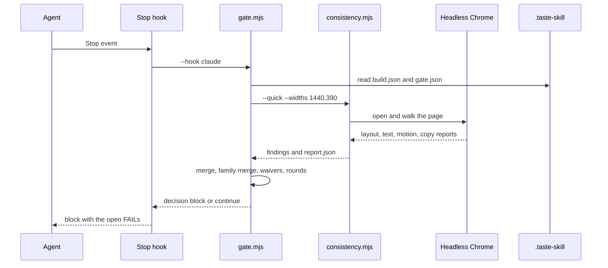
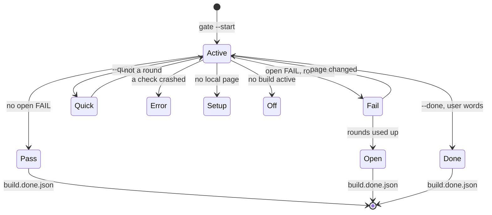

# Core mechanism: the checker and the finish gate

The skill has two enforcement machines. The checker, `consistency.mjs`, measures one page in a real
browser and reports named faults. The finish gate, `gate.mjs`, merges those faults with its own
static checks, applies waivers, counts rounds, and decides a verdict. A Stop hook connects the
verdict to the agent's ability to finish.

This document explains both machines. It covers the measurement, the merge, the hook, the rounds,
the waivers, and the state files.

## 1. The shape of the mechanism



The mechanism has one important property. The gate never accepts a pass claim from the agent. It
reads the page, runs the checks, and returns a decision. The agent can repair the page or record a
waiver. The agent cannot mark its own work as passed. A waiver is the agent's written claim that
one finding is false. The gate checks the form of the waiver, not its truth.

## 2. `consistency.mjs`: the main checker

`consistency.mjs` is 11,485 lines and about 1 MB. It has no package dependency. It starts its own
headless Chrome and stops it by process identifier (PID). It serves a local file over HTTP on a
free port in the range 5200 to 5299. Then it walks the page at each requested width.

```text
# skills/taste-skill/scripts/consistency.mjs:23-27
// It opens the page in its own headless Chrome (stopped by its own PID), serves a local file on a free port from
// 5200-5299 (or --port and the 9 after it), walks every screen at each width, and prints every finding as FAIL or
// WARN with the element, what is wrong, a crop (red: the element; dashed blue: what it is measured against) and a
// one-line fix, then a table of every check as PASS, WARN or FAIL. FAIL: the builder must fix it (or report why it is false). WARN: look at it.
// Exit 1 when anything FAILs, 0 when clean, 2 when the page could not be checked. Node 22+, no dependencies.
```

The default width set is 1440, 1024, 820, 768, and 390 (`skills/taste-skill/scripts/consistency.mjs:5`).
The checker maps each width to a height. For example, 1440 maps to 900, 820 to 1180, and 390 to
844 (`skills/taste-skill/scripts/consistency.mjs:4546`). The height matters because the checker
judges a page by screens, not by pixels.

### 2.1 What a walk does

A walk loads the page once at a width and scrolls through it screen by screen. At each screen it
runs a probe in the page. The probe reads the box of each element, the computed style, the text,
and the overlap between boxes. The checker then applies a set of rules to the probe result.

The rule set grows over time. The order list holds 98 identifiers
(`skills/taste-skill/scripts/consistency.mjs:10192`). Three insert calls add four more
(`skills/taste-skill/scripts/consistency.mjs:10193-10195`). The list starts with `assets`,
`shader-lint`, `gl-fallback`, `empty-visual`, and `hero-fill`. It ends with `product-shown`,
`same-object`, and `font-load`.

```text
# skills/taste-skill/scripts/consistency.mjs:10192-10193
const ORDER = ['assets', 'shader-lint', 'gl-fallback', 'empty-visual', 'hero-fill', 'flush', 'placeholder', 'sample-label', 'caption', 'credit-wall', 'nav', 'nav-covers', 'spill', 'off-viewport', 'fold-card', 'hover-spill', 'overlap-text', 'row-gap', 'cut-text', 'fold-cut', 'marquee', 'scroll-linked', 'scroll-reveal', 'pinned', 'loop-pause', 'reduced-motion', 'webgl', 'no-visual', 'text-only', 'card-visual', 'hidden-visual', 'card-family', 'card-layout', 'nesting', 'effect-repeat', 'ui-fit', 'ui-centre', 'dark-ground', 'button-styles', 'button-shape', 'same-action', 'button-picture', 'cta', 'pricing-tiers', 'copy-headline', 'copy-fact', 'copy-headings', 'copy-buttons', 'copy-actions', 'heading-scale', 'stagger', 'top-stagger', 'off-grid', 'col-edge', 'right-edge', 'centre-axis', 'tilt', 'contrast', 'text-contrast', 'body-size', 'busy-ground', 'section-gaps', 'proximity', 'hole', 'links', 'forms', 'photo-upscale', 'photo-set', 'photo-credit', 'nav-family', 'nav-labels', 'link-styles', 'heading-align', 'label-centre', 'fake-button', 'stranded-action', 'orphan', 'unit-break', 'tab-wrap', 'effects-fit', 'fade-cut', 'photo-weight', 'copy-length', 'nav-current', 'progress-bar', 'photo-repeat', 'button-contrast', 'photo-print', 'grounds', 'split-align', 'fact-agree', 'fold-action', 'action-count', 'one-screen', 'hover', 'product-shown', 'same-object', 'font-load'];
ORDER.splice(ORDER.indexOf('reduced-motion') + 1, 0, 'hidden-content');
```

The list has several purposes. It fixes the order of the report. It gives the gate a stable name
for each fault. It also gives a repair priority, because the report lists faults in this order.

The order is not the full fault set. After the three insert calls, the checker appends the checks
of each module (`skills/taste-skill/scripts/consistency.mjs:10196`). The checks in the `basics`
module are one example. That module is a block of checks inside the checker, with the identifier
`basics` (`skills/taste-skill/scripts/consistency.mjs:3980`). The order also does not hold the two
held warnings. `hero-enter` and `moment-none` are checker warnings that the gate treats as failures
(`skills/taste-skill/scripts/gate.mjs:482`).

### 2.2 The check families

The header of the file groups the checks by family. The groups are layout, containment, text, nav,
buttons, motion, visuals, copy, wiring, leftovers, system, ink, render, screens, pictures, chrome,
spacing, and the version 4 and 5 additions (`skills/taste-skill/scripts/consistency.mjs:29-120`).

| Family | Examples | Measured property |
|---|---|---|
| Layout | `off-grid`, `col-edge`, `right-edge`, `split-align` | Content edges and the grid |
| Containment | `spill`, `off-viewport`, `fold-card`, `collide` | A box outside its container or screen |
| Text | `cut-text`, `fold-cut`, `orphan`, `contrast` | Text that is cut, alone, or low contrast |
| Navigation | `nav`, `nav-covers`, `nav-family`, `nav-labels` | The bar against the content |
| Buttons | `button-styles`, `button-shape`, `cta`, `fake-button` | Action form and action count |
| Motion | `hover`, `hover-move`, `reduced-motion`, `loop-pause` | The motion layer and its limits |
| Visuals | `assets`, `empty-visual`, `hidden-visual`, `photo-upscale` | A visual that renders or does not |
| Copy | `copy-headline`, `copy-fact`, `copy-length` | The words the page shows |
| System | `heading-scale`, `body-size`, `button-contrast` | The type and colour system |
| Screens | `one-screen`, `section-gaps`, `empty-area` | Section height and empty space |

The names are not decorative. Each name describes the fault in plain words, and the report gives a
one-line fix for each finding.

### 2.3 How one check measures: `empty-area`

`empty-area` is a good example because it shows the level of detail. The checker divides a section
into rows. It finds the rows with no content. It also finds the rows where content covers less than
half the container, across a block of at least 25 percent of a screen.

```text
# skills/taste-skill/scripts/consistency.mjs:3745-3750
// empty-area: a section whose content leaves a large part of its screen empty (on most test sites the last third of a
// section showed only its ground), or holds its words on one side with nothing beside them.
//   screens    empty-area (per section at every width, the hero included: the rows of the section with no content at all,
//              above its first content as well as under its last, and the rows where content covers under half the
//              container across a block of 25% of a screen or taller, counted by the width no content covers; together
//              over 35% of the section's area inside its container lines WARN, over 50% FAIL)
```

The check defines content as what a visitor reads or sees: text lines, pictures, controls, drawn
mocks, effect mounts, diagram mounts, moment hosts, and cards (`skills/taste-skill/scripts/consistency.mjs:3752-3756`).
A background or a frame as large as the section is not content. The check measures what the frame
holds. Each box is grown by 20 pixels on each side, so the normal air between lines is not a hole.

The thresholds are 35 percent for a warning and 50 percent for a failure. The check also has
exemptions. A plain site footer is never judged. A statement hero with no picture is never judged,
because it is type on a ground by design (`skills/taste-skill/scripts/consistency.mjs:3761-3763`).

This design shows the general method. A rule has a plain definition, a threshold, a set of
exemptions, and a crop that shows the problem.

### 2.4 How one check measures: `collide` and `tap-size`

`collide` runs only at a phone width of 600 pixels or less. It looks for a line of text and another
thing in one place, where neither holds the other. Two lines over each other fail. A line over a
picture, button, or card of another section fails. A button with a picture or card over it fails
(`skills/taste-skill/scripts/consistency.mjs:6083-6088`).

`tap-size` also runs only at a phone width. It finds every link, button, input, select, textarea,
summary, and control role. A small target fails only when another target is close to it. The code
comment cites the Web Content Accessibility Guidelines (WCAG) 2.5.8 rule of 24 pixels of room
(`skills/taste-skill/scripts/consistency.mjs:6198-6200`). A small target with room is a warning.

These two checks need a narrow width. The checker therefore adds a narrow pass at 320 pixels by
default when any requested width is below 700 (`skills/taste-skill/scripts/consistency.mjs:4525-4527`).

```text
# skills/taste-skill/scripts/consistency.mjs:4525-4527
// the narrow pass: the page at 320 wide for collide, tap-size, the fold and what runs past the screen's edge (--narrow <w>;
// --no-narrow skips it); on by default whenever a width of the run is a phone
const NARROW = has('no-narrow') ? 0 : Number(opt('narrow', WIDTHS.some((w) => w.w < 700) ? '320' : '0')) || 0;
```

### 2.5 The report

The checker writes `report.json` and prints a table. The table has one row for each check. The
value is the worst result over all widths. A check is `FAIL` if any width fails it. It is `WARN`
if any width warns. It is `PASS` if no width reports it. It is `not checked` if the check was
skipped or if no width was walked.

```text
# skills/taste-skill/scripts/consistency.mjs:11449-11455
report.checks = {};
for (const c of ORDER) {
  const mine = lists.flat().filter((f) => f.check === c);
  const skipped = (report.notChecked || []).some((n) => n.startsWith(c) || (c === 'scroll-linked' && /scroll-linked/.test(n)) || (c === 'scroll-reveal' && /scroll-reveal/.test(n)) || (/^(hover-spill|hidden-visual|loop-pause|forms|reduced-motion)$/.test(c) && n === c));
  report.checks[c] = mine.some((f) => f.sev === 'FAIL') ? 'FAIL' : mine.length ? 'WARN' : skipped || missed.length === WIDTHS.length ? 'not checked' : 'PASS';
}
writeFileSync(join(outDir, 'report.json'), JSON.stringify(report, null, 1));
```

The exit code has three values. Exit 0 means no failure. Exit 1 means at least one failure. Exit 2
means the page could not be checked (`skills/taste-skill/scripts/consistency.mjs:27`). The gate
treats exit 2 and a missing width as a crash, not as a pass.

### 2.6 The quick mode

The gate runs the checker with `--quick` and the widths 1440 and 390. The quick mode leaves out
the checks that need a slow walk: `forms`, `reduced-motion`, `hover-move`, `hover-spill`,
`loop-pause`, `hidden-visual`, and the scroll walks (`skills/taste-skill/references/gate.md:35-38`).
It still reports IntersectionObserver reveals, held sections, and CSS scroll timelines. A held
section is a section that holds its position while the page scrolls, such as a sticky stage or a
pinned box inside a spacer (`skills/taste-skill/scripts/consistency.mjs:4976`).

The quick mode is a compromise. It keeps the two widths that show most layout faults and the phone
faults. It drops the slow checks so the hook can finish inside its time budget of 570,000
milliseconds (`skills/taste-skill/scripts/gate.mjs:114`). The agent runs the full checker by hand in
step 6. The `--quick` flag is a manual look between rounds. It is not a round, and it never closes
the build (`skills/taste-skill/scripts/gate.mjs:69`).

## 3. `gate.mjs`: the finish gate

`gate.mjs` is 891 lines. It has four jobs:

1. Find the active build and the page.
2. Run the checks and collect their findings.
3. Merge, apply waivers, and count rounds.
4. Return a verdict and, in hook mode, a block decision.

### 3.1 The active build

A build is active in a folder while `build.json` (the marker) exists, or while `gate.json` says the
build is active, failed, or in error. Deleting the marker does not end the build
(`skills/taste-skill/scripts/gate.mjs:180-185`).

```text
# skills/taste-skill/scripts/gate.mjs:180-185
// build.json, or a round state still open: deleting or renaming the marker mid-build does not end the build
function activeIn(d) {
  if (fs.existsSync(path.join(dotOf(d), 'build.json'))) return true;
  const s = readJson(path.join(dotOf(d), 'gate.json'), null);
  return !!(s && typeof s.start === 'string' && OPEN_STATES.test(s.status || ''));
}
```

The gate looks for a build in the folder of the page argument, then in the session folder, then one
folder below, then two folders below (`skills/taste-skill/scripts/gate.mjs:188-196`). The session
folder is the folder where the agent session runs. The gate stops at 400 folders and skips
`node_modules`, `.git`, `.taste-skill`, `.next`, `.astro`, `.svelte-kit`, and `.cache`
(`skills/taste-skill/scripts/gate.mjs:187`).

If several builds are active below the session, the gate does not hold the session. It reports that
it is an orchestrator for several builds and allows the stop
(`skills/taste-skill/scripts/gate.mjs:601-603`). An orchestrator is a session that manages several
builds in folders below it.

### 3.2 Static checks

Before the browser opens, the gate runs three static checks on the page's own files:

| Check | Severity | Trigger |
|---|---|---|
| `kit-edited` | Hard failure | A kit file differs from the skill's copy |
| `checker-gaming` | Hard failure | The page's code tests for an automation flag |
| `gaming-suspect` | Waivable failure | The code reads the user agent near "headless", or strips `aria-hidden` from pictures |

The `kit-edited` check compares a loaded file with the kit copy. It ignores whitespace, quotes,
semicolons, and commas, so a formatter is not an edit. A copy from an older skill version also
counts (`skills/taste-skill/scripts/gate.mjs:361-367`).

The `checker-gaming` check looks for `navigator.webdriver`, `window.__playwright`,
`window.__puppeteer`, `callPhantom`, `__cc`, and similar names. It reads code only. A code sample
inside a string is not a test (`skills/taste-skill/scripts/gate.mjs:348-352`,
`skills/taste-skill/scripts/gate.mjs:372-375`).

These checks are the anti-trap layer. They stop an agent from making the page behave one way for a
visitor and another way for the checker.

### 3.3 Copy checks

The gate runs `copy-lint.mjs` on the page file or on the rendered page. It uses the rendered page
when the file is a shell or a development server page
(`skills/taste-skill/scripts/gate.mjs:385-401`).

A copy failure blocks like a checker failure. A copy warning is listed and never blocks
(`skills/taste-skill/scripts/gate.mjs:386-389`). That distinction matters. The copy linter has
many low-confidence warnings, such as an over-budget device. A hard block for every warning would
make the gate too strict.

### 3.4 Browser checks and the held warnings

The browser checks run the checker at 1440 and 390 and the layout check at 1440x900 and 390x844.
The layout check runs only when more than 60 seconds remain in the budget
(`skills/taste-skill/scripts/gate.mjs:509-518`). If less time remains, the gate records a crash with
the text "no time left for check.mjs". That crash can produce a `GATE: ERROR`, not a pass.

Two checker warnings are held as gate failures. The set is `hero-enter` and `moment-none`
(`skills/taste-skill/scripts/gate.mjs:482`).

```text
# skills/taste-skill/scripts/gate.mjs:480-485
// two house rules the checker only WARNs (its own kit demos carry neither) and the gate holds: every hero enters
// once on load, and every page deals a moment (SKILL.md house rules 5 and 8)
const HELD = new Set(['hero-enter', 'moment-none']);
async function browserChecks(target, proj, opts, gateDir) {
  const res = { fails: [], warns: [], crashed: [], seconds: {} };
  // 390 always, the quick look too (the phone is where sections run into each other); the 320 pass (overflow, collide, tap-size) comes with it
```

The reason is in the comment. The checker's own kit demos do not carry a hero entrance or a
moment. A warning is therefore the right level for the checker. The gate still holds the two
warnings, because house rules 5 and 8 require the entrance and the moment.

### 3.5 The merge

The gate merges findings in two steps. The first step groups by check name and place. Every width
where the fault appears is added to one finding (`skills/taste-skill/scripts/gate.mjs:521-529`).

```text
# skills/taste-skill/scripts/gate.mjs:521-529
// one finding per check and place, with every width it showed at
function merge(list) {
  const m = new Map();
  for (const f of list) {
    const k = f.check + '|' + f.where;
    if (m.has(k)) { const g = m.get(k); for (const w of f.widths || []) if (!g.widths.includes(w)) g.widths.push(w); } else m.set(k, { ...f, widths: [...(f.widths || [])] });
  }
  return [...m.values()];
}
```

The second step merges related check names for one section. The family map groups
`section-height`, `screen-height`, and `screen-short` as `height`. It groups `one-section` and
`neighbour` as `neighbour` (`skills/taste-skill/scripts/gate.mjs:531-548`). The checker and the
layout check can report one fault twice. This step makes it one finding and one waiver.

### 3.6 Waivers

A waiver is a JSON object with a check name, a target, and a reason. The file is
`.taste-skill/waivers.json` (`skills/taste-skill/scripts/gate.mjs:551-558`).

```text
# skills/taste-skill/scripts/gate.mjs:567-573
    // a short target is taken only when it is the whole of a finding's where (a layout finding at "h1")
    if (w.target.length < 3 && !fails.some(f => ids(f).includes(w.check) && wheres(f).includes(w.target))) { w.invalid = 'target under 3 characters'; continue; }
    if (w.reason.length < 12) { w.invalid = 'reason under 12 characters'; continue; }
    // a copy tic (copy-lint's count and hits in its where) is waived only by its whole where
    const all = fails.filter(f => ids(f).includes(w.check) && wheres(f).some(x => (f.exact ? x === w.target : x.includes(w.target))));
    const hits = all.filter(f => !f.hard);
    if (!hits.length) { w.invalid = all.length ? `${w.check} cannot be waived` : fails.some(f => f.exact && ids(f).includes(w.check) && wheres(f).some(x => x.includes(w.target))) ? 'a copy tic is waived only by its whole where, as the gate prints it' : 'matches no open finding'; continue; }
```

The rules are strict on purpose:

- A target shorter than three characters works only when it is the whole place of a finding.
- A reason shorter than 12 characters is invalid.
- One waiver covers one finding. A target that matches several findings is invalid.
- At most five waivers are allowed (`skills/taste-skill/scripts/gate.mjs:115`).
- `kit-edited` and `checker-gaming` are never waivable (`skills/taste-skill/scripts/gate.mjs:572`).
- A copy device that is used as a tic is waived only by its whole place, as the gate prints it.

These rules stop a broad waiver from clearing a whole check. They also stop a waiver from covering
a fault that appears later.

## 4. Rounds

The gate allows three rounds by default. The marker can set one to ten
(`skills/taste-skill/scripts/gate.mjs:653`).

```text
# skills/taste-skill/scripts/gate.mjs:653
const MAX = Math.max(1, Math.min(10, Math.floor(Number(marker.rounds)) || 3));
```

A round is a run on a changed page, or a run on changed waivers. The round key is the page
fingerprint plus the waiver hash. A manual rerun of an unchanged page is not a new round. The gate
reuses the result (`skills/taste-skill/scripts/gate.mjs:836-846`).

The gate has three protections against a trap:

| Protection | Rule |
|---|---|
| Early hook stops | A hook stop before the first manual run is not a round |
| One free stop | After a block, one stop on the unchanged page is allowed without a round, for a question to the user |
| Idle limit | Two stops with nothing changed add no round, then each stop counts as one |

The code shows these protections. The `early` flag is true when the run is a hook run and the gate
has not been run by hand in this build (`skills/taste-skill/scripts/gate.mjs:662-663`). The `IDLE`
constant is 2 (`skills/taste-skill/scripts/gate.mjs:115`). The logic is in
`skills/taste-skill/scripts/gate.mjs:841-855`.

When the rounds are used up, the gate closes the build like a passed build. It renames the marker
to `build.done.json` (`skills/taste-skill/scripts/gate.mjs:859-871`). In hook mode, the gate calls
`block()` and stops, so the agent receives the OPEN instruction. The printed line `GATE: OPEN`
comes from a manual run, not from the hook path (`skills/taste-skill/scripts/gate.mjs:866-870`).

```text
# skills/taste-skill/scripts/gate.mjs:859-871
if (last && !idle) {
  const told = !!state.openTold;
  if (!record('open', { openTold: true })) { if (HOOK) allow('could not record the round; stop allowed'); }
  // a used-up build is closed like a passed one, so a later deal or a build one folder down is not tied to it
  try { fs.renameSync(markerFile, path.join(dot, 'build.done.json')); } catch { try { fs.copyFileSync(markerFile, path.join(dot, 'build.done.json')); fs.rmSync(markerFile, { force: true }); } catch { /* gate.json's status ends it */ } }
  if (HOOK) {
    if (told) allow('rounds used up, told before', true);
    block([`tasteskill gate: rounds used up (${MAX} of ${MAX}), ${n} FAIL${n > 1 ? 's' : ''} open${notChecked}:`, top, waivedText(), 'Rounds used up: stop fixing. Put "GATE: OPEN" and these open FAILs in your report (with any waivers and their reasons), then finish.'].filter(Boolean).join('\n'));
  }
  printAll(`gate: rounds used up; ${n} FAIL open${reused ? ' (page unchanged since the last run)' : ''}`);
  print('Stop fixing: put these open FAILs and the waivers in your report, then finish.');
  console.log(`GATE: OPEN ${n} (rounds used up)`); process.exit(1);
}
```

## 5. The Stop hook and the block ledger

The hook mode changes the mode and the output. The mode is `block` for Claude Code and Codex, and
`continue` for Antigravity (`skills/taste-skill/scripts/gate.mjs:111`). The output is a JSON object
with a `decision` field and a reason.

Every block goes into `gate-blocks.json`. The ledger is separate from `gate.json`, and `--start`
never clears it (`skills/taste-skill/scripts/gate.mjs:680-688`).

```text
# skills/taste-skill/scripts/gate.mjs:680-688
// every block counts here, outside gate.json, and --start never clears it
const readLedger = () => { const l = readJson(ledgerFile, []); return Array.isArray(l) ? l.filter(b => b && typeof b.at === 'string') : []; };
function block(reason) {
  const L = readLedger(); L.push({ at: new Date().toISOString(), start: marker.start, ...(early ? { early: true } : {}) });
  if (typeof input.session_id === 'string' && !state.session) state.session = input.session_id;
  traceEntry('block', reason.replace(/^tasteskill gate[:,]?\s*/, ''));
  try { writeJson(ledgerFile, L.slice(-100)); save(); } catch (e) { allow('could not record the block (' + e.message + '); stop allowed'); }
  process.stdout.write(JSON.stringify({ decision: MODES[HOOK], reason })); process.exit(0);
}
```

The ledger has two caps. A build is blocked at most `MAX + EXTRA` times, where `EXTRA` is 4. The
whole project is blocked at most 30 times in 6 hours, where `RECENT` is 30 (`skills/taste-skill/scripts/gate.mjs:115`,
`skills/taste-skill/scripts/gate.mjs:699-700`). After a cap, the gate allows the stop.

The hook also has session and idle safeguards:

- Another session in the same project is not held (`skills/taste-skill/scripts/gate.mjs:692`).
- A build idle for more than 24 hours is not held (`skills/taste-skill/scripts/gate.mjs:696`).
- A folder with several active builds below it is not held (`skills/taste-skill/scripts/gate.mjs:601-603`).

**Aha:** The gate's most important safety rule is that it always has a way to allow a stop. It caps
blocks, allows an idle stop, frees the user's stop, and closes the build at the round limit. A gate
that can block forever would be a trap, not a quality tool.

## 6. The verdicts

The gate has eight verdicts.



| Verdict | Meaning | Marker |
|---|---|---|
| `GATE: PASS` | No open failure | Renamed to `build.done.json` |
| `GATE: FAIL n` | n failures remain, and a round is left | Kept |
| `GATE: OPEN n` | Rounds used up, n failures remain | Renamed to `build.done.json` |
| `GATE: QUICK n` | A quick look, never a round | Kept |
| `GATE: ERROR` | A check could not run | Kept |
| `GATE: SETUP` | No local page, or a source shell | Kept |
| `GATE: OFF` | No build is active | None |
| `GATE: DONE (...)` | The user ended the build | Renamed to `build.done.json` |

The `PASS` path is short. The gate records the pass, renames the marker, and prints the line
(`skills/taste-skill/scripts/gate.mjs:828-834`).

```text
# skills/taste-skill/scripts/gate.mjs:828-834
if (n === 0) {
  record('pass');
  try { fs.renameSync(markerFile, path.join(dot, 'build.done.json')); } catch { try { fs.copyFileSync(markerFile, path.join(dot, 'build.done.json')); fs.rmSync(markerFile, { force: true }); } catch { /* left armed */ } }
  if (HOOK) allow('GATE: PASS', true);
  printAll('gate: no open FAIL');
  console.log('GATE: PASS'); process.exit(0);
}
```

The `ERROR` path is important. If no failure is found but a check crashed, the gate returns
`GATE: ERROR`. It does not return a pass. A missing result is never a pass
(`skills/taste-skill/scripts/gate.mjs:818-826`).

The `QUICK` path never blocks. The gate prints the count and exits, and the build stays open
(`skills/taste-skill/scripts/gate.mjs:811-816`). The agent gets this verdict when it runs the gate
with `--quick` for a look between rounds. It cannot end a build by that path.

## 7. The state files

The build keeps its state in seven files and one crops folder. Each file has one writer and one
purpose.

| File | Written by | Read by | Purpose |
|---|---|---|---|
| `build.json` | `--start` or `start.mjs deal` | `gate.mjs` | The marker: page, kind, category, primary action, and round limit |
| `gate.json` | Every gate run | `gate.mjs` | The round, idle count, status, `history` array, and last findings |
| `waivers.json` | The agent | `gate.mjs` | The accepted findings and their reasons |
| `gate-blocks.json` | Every block | The hook | The block count and time |
| `build.done.json` | `PASS`, `OPEN`, or `--done` | The next build | The build is finished |
| `unarmed.json` | `gate.mjs` | `gate.mjs` | The gate told the agent to arm an unarmed page |
| `gate-hook-missing.txt` | The hook shell line | A human | The hook could not find `gate.mjs` |

The checker crops are separate from the files. They go to `.taste-skill/gate/consistency/`
(`skills/taste-skill/scripts/gate.mjs:856`). The dealer histories are also separate. A dealer writes
its own history file, such as `.taste-skill/history.json` for the palette, type, and moment deals
(`skills/taste-skill/SKILL.md:200-203`). The `history` field inside `gate.json` is the gate's round
history, not a dealer history.

The `build.json` file is the anchor. It is written once at the start. It holds the random `start`
value that identifies the build. The `gate.json` file must have the same `start` value. If the
marker is missing or broken, the gate recovers the build from an open `gate.json`
(`skills/taste-skill/scripts/gate.mjs:640-649`).

This design makes the build resistant to a missing marker. It also makes a new build distinct from
an old build. The `start` value is the identity.

## 8. The time budget

The code comment assumes that a hook may take at most 10 minutes. The package did not verify that
host limit. The gate sets its own budget to 570,000 milliseconds, which is 9.5 minutes
(`skills/taste-skill/scripts/gate.mjs:114`). It reserves time for each step. The checker gets
420,000 milliseconds. The layout check runs only when more than 60 seconds remain
(`skills/taste-skill/scripts/gate.mjs:494`, `skills/taste-skill/scripts/gate.mjs:509`).

The budget explains the quick mode. A full walk at five widths and a layout stress test do not fit
inside the budget. The gate therefore uses two widths and the quick checker. The agent runs the
full check by hand. The skill tells the agent to run each step 6 script in the foreground with a
10-minute timeout (`skills/taste-skill/SKILL.md:250-252`). That instruction is a second limit, not
the hook budget.

## 9. What the mechanism cannot see

The checker measures geometry, computed style, text, and some runtime state. It cannot measure
intention. A page can satisfy every geometry rule and still make no sense. The following
properties are outside the measurement:

- Whether the product claim is true.
- Whether the photograph suits the brand.
- Whether the copy has a voice, beyond the counted tells.
- Whether the composition is pleasant.
- Whether the page works on a browser that was not tested.
- Whether the page works for a user with a disability that the automated rules do not cover.

The skill acknowledges this limit in its own report requirement. The report must state what the
agent could not check (`skills/taste-skill/SKILL.md:294`).

## 10. Facts not verified in this package

- No checker run was made. The line numbers and thresholds come from the source text.
- No hook was invoked. The block and continue behaviour comes from the source text.
- The 570-second budget is a setting, not a measured duration.
- The true false-positive rate of the checker is not measured here.
- The true effect of the quick mode on fault detection is not measured here.
- The Web Content Accessibility Guidelines (WCAG) reference is a source comment, not an external
  check.
