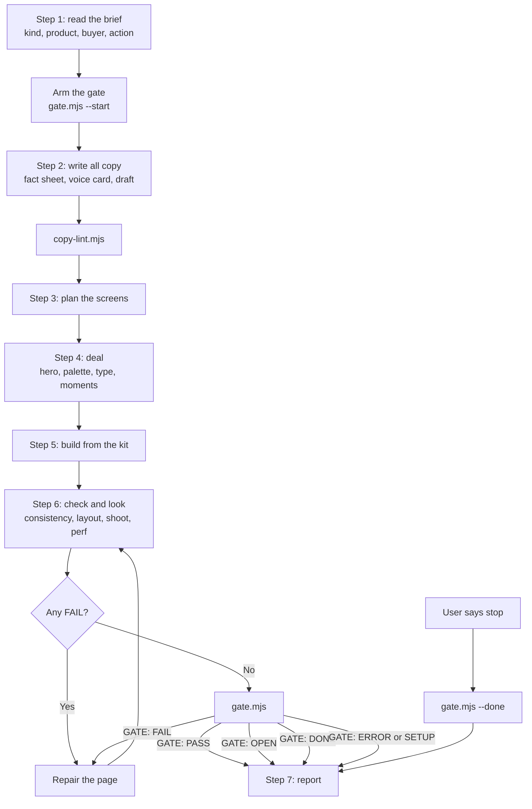
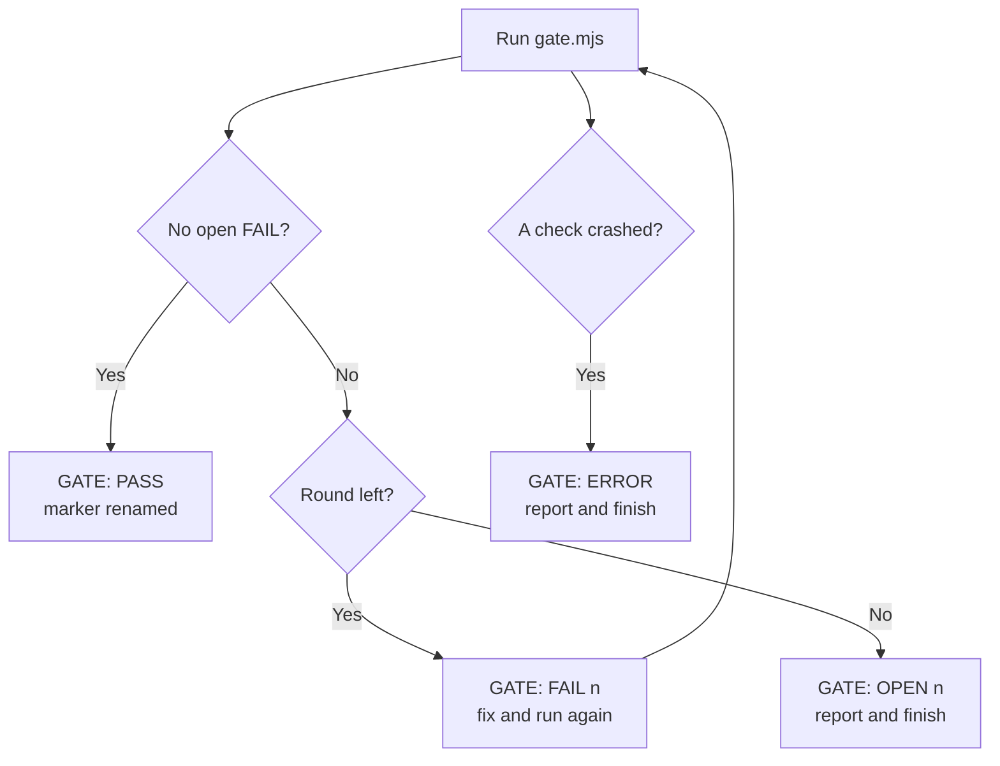

# Workflow and quality: one build from brief to GATE: PASS

This document follows one build. It starts with a client brief and ends with a gate verdict. It
covers the eight steps in `SKILL.md` (step 0 to step 7), the copy linter, the photograph path, the
repair loop, the Stop hook, and the `--done` exit.

The workflow is a sequence with a feedback loop. The steps before the build are linear. The check
and repair steps repeat until the gate passes, the rounds are used up, or the user stops the build.

## 1. The sequence



## 2. Step 0: the stack

An empty folder gets a static page. The build copies `assets` from the skill folder into the
project and starts from `assets/starter.html` (`skills/taste-skill/SKILL.md:160-161`).

An existing project keeps its own stack. The components take the starter's markup and classes. The
kit goes into the project's public folder as `public/assets`. A project
that asks for Next.js builds a static export with `output: 'export'`, and the gate checks the built
page with `--root out` (`skills/taste-skill/SKILL.md:161-164`).


## 3. Step 1: read the brief and arm the gate

The agent writes down the kind, what is sold, who buys it, the main action, and the real material:
logo, screens, photographs, prices, address, and hours (`skills/taste-skill/SKILL.md:166-169`).

The main action is the transaction, not a slogan. Examples in the source are "Book a room",
"Order a cake", and "Start a free trial". A place with no transaction uses "Get directions"
(`skills/taste-skill/SKILL.md:167-168`).

Then the agent arms the gate, before any page exists.

```text
# skills/taste-skill/references/gate.md:14-18
- A framework build names what a browser can open: its dev server's URL (`--start http://localhost:5173/`,
  with the server running when the gate runs) or its built page (`--start dist/index.html --root dist`).
  A built page is checked as built: rebuild before every gate run, or the round is spent on the old build.
  The gate opens only a local page: a file, or a URL on `localhost`, `127.0.0.1`, `[::1]`, `*.localhost`
  or `*.test`.
```

The arming command writes `build.json`. It records the page, the kind, the category, and the main
action. The gate then knows the build identity before the first line of markup exists
(`skills/taste-skill/references/gate.md:8-22`).

A framework build arms a target that a browser can open. The target is a local development server
Uniform Resource Locator (URL), or a built page with `--root dist`. A built page must be rebuilt
before every gate run, or the round is spent on the old build
(`skills/taste-skill/references/gate.md:14-16`).

The gate accepts only local targets. A local target is a file, `localhost`, `127.0.0.1`, `[::1]`,
a `*.localhost` name, or a `*.test` name (`skills/taste-skill/scripts/gate.mjs:107-109`).

## 4. Step 2: write all the copy first

The copy comes before the markup for a practical reason. A page section exists only when the
brief has true material for it (`skills/taste-skill/references/copy-voice.md:102-103`). Writing the
copy first shows which sections have material and which sections must shrink or go.

### 4.1 The fact sheet

The agent writes a fact sheet from the brief, word for word where possible. The sheet has 11 fields
(`skills/taste-skill/references/copy-voice.md:36-48`):

| Field | Use |
|---|---|
| What it is | The h1 and the sub-line |
| For whom, and not for whom | The h1, the sub-line, or one FAQ line |
| What they do today instead | The pain line and the comparison |
| The true difference | The claims worth a heading |
| Customer words | The pain line and headings |
| Numbers | Sentences and the facts strip |
| People | The about block or a quote |
| Odd true details | Texture that would otherwise be invented |
| A limit | One admission on the page |
| An enemy | The pain line, never the reader |
| The offer | Buttons and the close |

An empty field stays empty. The section shrinks or goes, and the report lists what the client must
supply. The skill forbids a `[NEED]`, a bracket, or a "coming soon" line on the page
(`skills/taste-skill/references/copy-voice.md:50-52`).

Nothing is invented beyond the two allowed cases in `copy.md`: a coined brand name, and plausible
hours and prices on a place page. An assumed fact carries `data-assumed`
(`skills/taste-skill/SKILL.md:181-187`).

### 4.2 The voice card

The default voice is out. The source describes it as warm, wry, modest, and slightly literary, with
a deadpan twist and the words honest, calm, or quiet about the business
(`skills/taste-skill/references/copy-voice.md:64-66`). That voice is a model habit, so the skill
asks for a different register.

The agent picks one register from `copy-registers.md`, by buyer, price, and the client's character.
The card goes on the plan, not on the page (`skills/taste-skill/references/copy-voice.md:68-70`).

```text
# skills/taste-skill/references/copy-voice.md:73-79
Voice: technical-dry (copy-registers.md 2)
Pairs: exact, not cold; sure, not loud; dry only in the empty state
Person: "you" for what the buyer gets, "we" for the work; the product is the subject in feature lines
Sentences: mostly 8 to 16 words; one long one a section, where it explains
Humour: none in the hero, the prices or the FAQ
House words: the brief's own nouns (shifts, rota, cover), the same word every time
Never: virtue words about ourselves, a pun on the name, a strip of claims
```

The card is a test. The agent pictures the voice on nine other businesses. If the
voice suits any of them, it is not specific enough, and the agent pushes it toward this client
(`skills/taste-skill/references/copy-voice.md:84-85`).

### 4.3 The device budget

Some copy devices work once. Used by default, they become a tic. The budget table sets a count for
each device (`skills/taste-skill/references/copy-voice.md:134-156`):

| Device | Budget |
|---|---:|
| Heading in two fragments "X. Y." | 1 |
| Number-pair heading "Four X, one Y" | 0 to 1 |
| Negation run "No X. No Y." | 1 |
| Contrast "X, not Y", "rather than", "instead of" | 2 in all |
| Dry closing line on a paragraph | 2, never in a row |
| Pun on the name | 1, never the h1 |
| Sign-off line in the footer | 0 |
| Virtue words about the business | 0 |
| Lists of three | When there are three things |
| Eyebrow labels | 1 or 2 a page |
| Response-time promise | 1, from the brief |
| "Since [year]" | 1, from the brief |

### 4.4 The copy linter

`copy-lint.mjs` counts the devices and the tells. It opens no browser, takes under a second, and
uses no packages (`skills/taste-skill/scripts/copy-lint.mjs:3`).

```text
# skills/taste-skill/scripts/copy-lint.mjs:20-24
  Levels:
    FAIL  fix it: chatbot residue, a left [NEED] or markdown, the old slop words and stock phrases, and any device
          used twice its budget plus one times or more (a tic, not a device). The gate blocks on these.
    WARN  over budget, or a weak spot: fix it, or keep it on purpose and say why in the report.
    INFO  look at it.
```

The linter reads the copy a visitor reads: headings, text, buttons, the footer, the title, and the
meta description. It skips scripts, styles, Scalable Vector Graphics (SVG), code, templates,
hidden parts, and user interface mocks. The words inside a mock are the product's screen, not the
page's copy (`skills/taste-skill/scripts/copy-lint.mjs:8-12`).

The linter has literal exemptions. A trade word that is literal passes: a climbing harness, a
bespoke tailor, leverage up to 1:30, a powerful 2,000 W motor. A literal virtue word passes: a
quiet room, calm water, genuine parts (`skills/taste-skill/scripts/copy-lint.mjs:13-14`).

```text
# skills/taste-skill/scripts/copy-lint.mjs:317-320
  const budget = (id, hits, max, msg, fix, failAt = max * 2 + 1) => {
    if (hits.length >= failAt) add('FAIL', id, hits, `${msg}: ${hits.length}, budget ${max} (a tic, not a device)`, fix, { budget: max });
    else if (hits.length > max) add('WARN', id, hits, `${msg}: ${hits.length}, budget ${max}`, fix, { budget: max });
    else if (hits.length) add('INFO', id, hits, `${msg}: ${hits.length} of ${max}`, '', { budget: max });
```

A count at the budget is an INFO. A count over the budget is a WARN. A count at
twice the budget plus one is a FAIL. The gate blocks on a FAIL and lists a WARN
(`skills/taste-skill/scripts/gate.mjs:386-389`).

**Aha:** The copy linter is a budget, not a ban. A device is allowed once. The fault is a device
used by default, and the budget makes the default visible as a count.

## 5. Step 3: plan the page as screens

The plan is a short text file or a working note. Line 1 is the kind. Line 2 is the
deal, with one sentence on why the palette fits the trade. Then each section gets one line.

A section line holds six things (`skills/taste-skill/SKILL.md:190-196`):

1. The section identifier.
2. Its one idea.
3. Its picture.
4. The picture kind: object, use, parts, world, slot, diagram, or type.
5. Its screen count: one or two.
6. The section that holds a moment, and why it moves. On technical pages, the effect or the scene
   also goes here.

The agent picks the photographs at this step. The count of photographs, stand-ins included, sets
the length of a place page (`skills/taste-skill/SKILL.md:196-198`).

The plan enforces two rules from `sections.md`. Every section shows the real thing. One object does
not carry the page, and the object appears whole in the hero and at most two more sections
(`skills/taste-skill/references/sections.md` section 1).

## 6. Step 4: deal, never choose by taste

Four dealers make the visual choices. Each command keeps a history, so two pages differ.

```text
# skills/taste-skill/SKILL.md:200-203
   node <skill>/scripts/start.mjs deal --page <kind> --trade <trade> --history .taste-skill/history.json    # three palettes made for the trade, three pairings: take the first; add --axis after a word or editorial hero
   node <skill>/scripts/start.mjs css --page <kind> --palette <id> --type <id> --radius soft --history .taste-skill/history.json
   node <skill>/scripts/start.mjs brand --page place --bg "#.." --ink "#.." --accent "#.." [--surface "#.."] [--muted "#.."] --type <id> --radius soft   # the client's own colours (a logo, a painted shopfront), in place of css
   node <skill>/scripts/moments.mjs pick --page <kind> --count 1|2 --fits section,statement --photo --history .taste-skill/history.json   # every kind
```

The deal has four parts:

| Part | Dealer | Choice |
|---|---|---|
| Hero | `assets/layout/deal.mjs` | One of 11 hero models, weighted by page type and material |
| Palette and type | `scripts/start.mjs deal` | Three palettes and three pairings, take the first |
| Moments | `scripts/moments.mjs pick` | One or two moments by kind |
| Effect | `scripts/effects.mjs pick` | One effect on a technical page |

The agent takes the first palette and the first pairing. It takes the next only when the first
clashes with the client's own logo or photographs. The reason goes on plan line 2
(`skills/taste-skill/SKILL.md:218-222`).

The dealer keeps a history file. The file is `.taste-skill/history.json`. A folder can also share
its recent choices with another folder through the environment variable `TASTE_SKILL_RECENT`
(`skills/taste-skill/scripts/start.mjs:17-18`).

The client's own colours are the exception. If the client has a logo or a painted shopfront, the
agent runs `start.mjs brand` with the real colours. It does not deal a palette
(`skills/taste-skill/SKILL.md:202`).

## 7. Step 5: build from the kit

The build starts from `starter.html`. The agent sets the `lang`, `data-type`, `data-radius`,
`data-buttons`, and `data-motion` attributes. It writes the two required metas, `page-type` and
`site-kind`, and adds the optional `page-kind` meta on a place page. It sets the head block, the
nav class, the skip link, and the `m-enter` line (`skills/taste-skill/SKILL.md:230-233`). The head
block is the content of the `<head>` element: title, description, Open Graph tags, icon, and theme
colour. The nav class is the class on the `nav` element. The `m-enter` line is a short script that
adds the `m-enter` class to the `<html>` element, which turns on the entrance motion.

The agent copies only the hero section from `assets/layout/hero-<id>.html`. It does not copy the
hero's nav, other sections, footer, or credit line. Every word and picture becomes the client's
(`skills/taste-skill/SKILL.md:233-235`).

Each section is `main > section` with one `.wrap`. Its h2 comes first. Its height is `--h: 1` or
`--h: 2` (`skills/taste-skill/SKILL.md:236-238`).

The build uses the system's classes and tokens. Page CSS goes only where a reference says it goes:
inside a visual, or with `--p-h`, `.wall`, `.rail`, or `.device`
(`skills/taste-skill/SKILL.md:238-239`).

User interface fragments come from `assets/ui/<name>/fragment.html`. Every name, number, and logo
is rewritten to the client's. A diagram card uses `data-diagram="<preset>"` with the client's
labels. The icon scan runs last, so every icon on the page is a local file
(`skills/taste-skill/SKILL.md:239-242`).

A moment section is copied from a page model, not from its demo. The place moments use
`in-page.html`; the service moments use `in-page-service.html`. The moment's own `demo.html` shows
the moment alone (`skills/taste-skill/SKILL.md:243-246`).

The last build action is the credit line. `photos.mjs credits` reads the page, so it runs after the
markup references the photographs. The script writes the one footer line and the credits list
(`skills/taste-skill/SKILL.md:247-248`).

## 8. Step 6: check and look

The agent runs five commands. Four of them run one headless Chrome with WebGL on the central
processing unit (CPU). Each script stops its browser by process identifier (PID) and runs in the
foreground with a 10-minute timeout (`skills/taste-skill/SKILL.md:250-252`). The copy linter is the
exception. It opens no browser and takes under a second (`skills/taste-skill/SKILL.md:268`).

```text
# skills/taste-skill/SKILL.md:260-264
   node <skill>/scripts/copy-lint.mjs index.html --kind <kind>
   node <skill>/scripts/consistency.mjs index.html --widths 1440,1024,820,768,390 --rhythm-widths 1440,820,768,390 --profile <dir> --page <kind> --category "<what is sold>" --primary "<main action>"
   node <skill>/assets/layout/check.mjs --url index.html --profile <dir> --sizes 1440x900,1024x768,820x1180,768x1024,390x844 --shots shots/layout
   node <skill>/scripts/shoot.mjs --url index.html --w 1440 --out shots/1440.png --profile <dir>
   node <skill>/scripts/perf.mjs index.html --profile <dir>
```

The agent also shoots 1024, 820x1180, 768x1024, and 390. Every layout check finding fails the page.
The agent fixes every FAIL and every copy WARN, or states why the WARN stays. A copy WARN does not
block the gate, but the report lists it, so the agent must answer it (`skills/taste-skill/SKILL.md:268-269`).
The agent reads the copy aloud and compares every screenshot with the checklist
(`skills/taste-skill/SKILL.md:267-270`).

```text
# skills/taste-skill/SKILL.md:267-272
   Shoot 1024, 820x1180, 768x1024 and 390 as well. Every `check.mjs` finding fails the page (no `--no-stress`).
   copy-lint opens no browser and takes under a second. Fix every FAIL (a copy-lint WARN too, or say
   why it stays) and read the copy aloud (`copy-voice.md` section 6); shoot again and read every
   screenshot against the checklist. In the fix rounds run `consistency.mjs --quick --widths
   1440,390`. Then the gate, which runs the checker at 1440 and 390 every time, walks the page at 320
   for overflow, collide and tap-size, and runs copy-lint, whose FAILs block like the checker's:
```

The checklist is the human-readable half of the quality system. It has one line for each area:

```text
# skills/taste-skill/SKILL.md:303-305
- **First screen:** says what is sold, for whom or where, with one hard fact [copy-headline,
  copy-fact]; the hero fills it alone at every width, its main button inside it [hero-screen,
  hero-fill, fold-action, fold-cut] {hero-fold}.
```

The checklist covers the first screen, section heights, equal edges, and visual rendering. It also
covers captions, kind rules, motion, contacts, and keyboard access. It covers head tags, one
system, copy, links, and performance. The last group is the phone widths
(`skills/taste-skill/SKILL.md:303-363`). The last line is for the agent's eyes:
the page must read as a professional company site beside the reference frames.

### 8.1 The performance check

`perf.mjs` measures a built page against the budgets in `references/perf.md`. It runs the page three
times and takes the median (`skills/taste-skill/scripts/perf.mjs`). The budgets cover transfer
size, image weight, script weight, request count, font weight, and WebGL context count. They also
cover long tasks, First Contentful Paint (FCP), Largest Contentful Paint (LCP), and Cumulative
Layout Shift (CLS) (`skills/taste-skill/references/perf.md`).

`perf.mjs` is a separate check. The gate does not run it (`skills/taste-skill/scripts/gate.mjs`).
The agent runs it in step 6, and the report carries its result (`skills/taste-skill/SKILL.md:293`).
A performance failure is therefore not a gate failure. It is a reported quality failure.

## 9. Step 7: the gate loop

```text
# skills/taste-skill/SKILL.md:278-282
   Fix what it lists and run it again until its last line is `GATE: PASS` or `GATE: OPEN`, three
   rounds at most (in Claude Code it also runs when you finish; a stop before your first gate run is
   no round, and to ask the user something after a block, just stop again). When the user tells you
   to stop, or to ship the page as it is, run `gate.mjs --done "<what they said>"` (`GATE: DONE`)
   and report the open FAILs.
```

The gate runs the checker at 1440 and 390, the 320 narrow walk, the layout check, copy-lint, and
the static checks.

The repair loop has a fixed shape. The agent fixes the listed failures and runs the gate again. It
stops when the last line is `GATE: PASS`, `GATE: OPEN`, `GATE: DONE`, or an error state that
prevents a run.



### 9.1 The Stop hook in practice

In Claude Code and Codex, the hook runs when the agent tries to finish. The hook calls the gate. If
open failures remain, the hook returns a block decision. The reason lists the top failures and the
fix rule (`skills/taste-skill/scripts/gate.mjs:875-887`). At the last round, the hook still returns a
block decision, and that decision tells the agent to report `GATE: OPEN`. The printed `GATE: OPEN`
line comes from a manual gate run (`skills/taste-skill/scripts/gate.mjs:864-870`).

The block message has a fixed structure:

- The round number and the number of failures.
- The first eight failures, with their place and fix.
- The waivers, with their reasons.
- The waiver rule.
- The next step.

The message repeats that the agent must not edit the kit or hide the page from the checker. It also
states that a failure that the agent judges false is waived, not gamed
(`skills/taste-skill/scripts/gate.mjs:875-887`).

After a block, one stop on the unchanged page is allowed without a round. This lets the
agent ask the user a question without spending a repair round
(`skills/taste-skill/scripts/gate.mjs:836-855`).

## 10. `--done`: the user's stop

The agent may not end a build on its own judgement. It can end a build only when the user says to
stop or to ship the page as it is. Then the agent runs `gate.mjs --done "<what they said>"`.

The command needs the user's words, with at least 12 characters. It runs only outside hook mode.
It records the words, sets the status to `done`, renames the marker, and prints
`GATE: DONE (words)`. Every later stop is allowed (`skills/taste-skill/scripts/gate.mjs:666-678`).

```text
# skills/taste-skill/scripts/gate.mjs:666-678
// --done: the user ended the build (stop now, or ship it as it is). Their words are recorded, the marker is renamed and
// every later stop is allowed. Never the agent's own call: an agent that wants to stop fixing has its rounds
if (has('done') && !HOOK) {
  const why = str('done');
  if (!why || why.length < 12) { console.error(`gate: --done needs the user's words, 12+ characters: ${GATE} --done "<what they said>"`); process.exit(2); }
  const left = Array.isArray(state.open) ? state.open.length : null;
  Object.assign(state, { status: 'done', doneReason: why });
  state.history = [...(state.history || []), { at: new Date().toISOString(), mode: 'done', status: 'done', reason: why.slice(0, 160), round: state.round || 0 }].slice(-20);
  try { save(); } catch (e) { console.error(`gate: could not write ${stateFile}: ${e.message}`); process.exit(2); }
  try { fs.renameSync(markerFile, path.join(dot, 'build.done.json')); } catch { try { fs.copyFileSync(markerFile, path.join(dot, 'build.done.json')); fs.rmSync(markerFile, { force: true }); } catch { /* gate.json's status ends it */ } }
  console.log(`gate: build closed at the user's word, after round ${state.round || 0} of ${MAX}${left ? `; ${left} FAIL${left > 1 ? 's were' : ' was'} open at the last run (in ${slash(path.relative(base, stateFile))})` : left === 0 ? '' : '; the gate never ran on it'}. Every later stop is allowed. Put this line, the user's words and any open FAILs in your report.`);
  console.log(`GATE: DONE (${why.replace(/\s+/g, ' ').slice(0, 100)})`); process.exit(0);
}
```

The report must state the open failures and the user's words. A `GATE: DONE` is not a pass. It is a
recorded stop.

## 11. The photograph path

Photographs are a separate workflow with its own rules. The path has three sources, and each
source has a different trust level.

### 11.1 Three sources

```text
# skills/taste-skill/references/photos.md:9-16
1. **The client's own**, shot for the page or on a phone, each file named in the brief. Every `` carries
   `data-source` (`client`, `commissioned`, `phone`, `supplier`, `illustration`, `library-057`, `stand-in`) and
   `data-subject`.
2. **The library** (`scripts/photos.mjs`): Wikimedia Commons and Unsplash frames, vetted one by one. They are
   stock of another place, so they fill **detail slots only**: hands, tools, materials, a process (an oven, dough, a
   roasting drum, stems, a hammer on a bar). Never the hero, a room, a shopfront, a product or a person, and never more
   than **1 in 3 of the page's pictures**. `pick` deals exactly that by default and prints the cap with the deal;
   the draft path below lifts both limits.
```

The client's own photographs are the best source. They carry the client's real room, product, and
people.

The library is stock of another place. It fills detail slots only. The cap is one library frame in
three page pictures (`skills/taste-skill/references/photos.md:12-16`).

A live search is the third source. It finds licensed Wikimedia Commons photographs of what the
library lacks. Every search result is a stand-in, looked at full size and listed in the report
(`skills/taste-skill/references/photos.md:23-26`).

### 11.2 The draft path

A place with no client photographs uses the draft path. The cap lifts, and the script deals one
frame per section word.

```text
# skills/taste-skill/references/photos.md:34-46
**The draft path (a place with no client photographs):** `pick --trade <trade> --sections <words> --draft-lead
--pictures 12` lifts the 1-in-3 cap. `pick` deals one frame per word, so repeat a word for each row or detail
(`bar,bar,coffee,coffee,beans,beans`, `rooms,rooms,rooms,breakfast,breakfast`) until it returns 8 or more: a cafe
reaches 8 to 12, a guesthouse 9 detail frames. The page stays a whole place page that leads with photographs (house
rule 6), the compact page at 8 to 12 frames. The hero is the lead `pick` returns (a
cafe's bar). A place whose trade leads with land (a guesthouse, a lodge, a remote inn) passes the region its brief
names as `--place "<region>"` (or the brief itself, `--brief BRIEF.md`, which reads the region from it) and leads with that region's landscape: a place hero always carries a photograph when
any frame fits, and the `statement` hero is left for a place the library holds no frame of (`sections.md` section 4). Every frame is listed in the report as a stand-in to replace; nothing on the page says so
(no caption, no note). **The count decides, not the trade:** when `pick`, with each word repeated until it says "no new
motif left", and a live search (`search --trade <trade>`, below) has added what passes the full-size look, still returns
under eight frames, the page is the short page (PH-07: 2,700 px at most at 1440; `sections.md`
section 4, The short page), whatever the trade: a bakery (4 in the library), florist, wellness, office, pottery or a restaurant are examples. No drawn box, grid
or effect takes the place of a photograph.
```

The draft path has two exceptions. A hero frame may be dealt with `--draft-lead`. The land around
a place may be dealt when the brief names its region with `--place`. Both frames are stand-ins,
and both are listed in the report (`skills/taste-skill/references/photos.md:48-55`). PH-07 is the
label of the short page. Its limit is 2,700 pixels at a width of 1440.

### 11.3 The commands

The `list` command shows the trades, their frame counts, and the place names that the library
knows. The `pick` command deals frames for named sections. The `search` command finds licensed
stand-ins. The `fetch` command writes the files. The `credits` command writes the footer line.

```text
# skills/taste-skill/references/photos.md:123-128
- **Order and places.** `pick` prints its follow-up `fetch` with the script's absolute path (forward slashes, quoted when it holds a
  space) and `--out .`, so it runs as printed from the site folder (from elsewhere, give `--out` the site's path). `fetch` writes the files into `assets/img/` under `--out` (the project's own folder, `--dir` changes it; `--out .` from the
  project root, so the markup says `assets/img/photo-<id>-1200.webp`), and prints the `` or `<picture>` to paste; if the
  folder it prints differs, use that one. `credits` reads the page, so run it last, after the markup references the
  photographs: before that it exits 1 with "none of the fetched photographs is on the page".
```

The photograph script does five jobs:

| Command | Job |
|---|---|
| `list` | Shows the trades, their frame counts, and the place names |
| `pick` | Deals frames for the named sections, with a history |
| `search` | Finds licensed stand-ins on Wikimedia Commons |
| `fetch` | Writes the image files and prints the markup |
| `credits` | Writes the one footer line and the credits list |

The `credits` command reads the page. It runs last, after the markup references the photographs.
Before that, it exits 1 with a message that no fetched photograph is on the page
(`skills/taste-skill/references/photos.md:126-127`).

### 11.4 The rights rules

The library holds Wikimedia Commons and Unsplash frames. Each frame has a licence, a source page,
and a credit. The search accepts only CC0, CC BY, CC BY-SA, and public domain files
(`skills/taste-skill/references/photos.md:23-26`).

The skill forbids several uses in `photos.md` section "Never":

- Another business's identifiable room, counter, sign, cup, bag, or product as the client's.
- A face as staff, guest, or customer.
- The trade's stock shot, such as latte art from above.
- Mood stock, an animal, a vehicle, a landmark, an AI image, a composite, or Street View.
- A live search result used without a full-size look.
- A stand-in left out of the report (`skills/taste-skill/references/photos.md:250-263`).

The credit line is one footer line, not a link under each picture. In testing, 18 and 20 credit
links read as a credit wall (`skills/taste-skill/references/photos.md:240-246`).

## 12. The report

The report is the last step. It starts with the `GATE:` line. Then it lists every waiver with its
reason and every open failure (`skills/taste-skill/SKILL.md:291-296`).

```text
# skills/taste-skill/SKILL.md:291-296
7. **Report:** the `GATE:` line first, then every waiver with its reason and every open FAIL; the
   kind, the deal (palette and why it fits, pairing, hero, grounds, effect, moments, scene); the
   voice card in one line and every copy-lint WARN kept, with why; the checker, layout and perf
   results; what you could not check; every assumed fact (the checker's `assumed` list) and the
   coined name's search; the form's `.example` stand-in and the canonical domain still to come; the photographs and art the client must supply, every
   stand-in frame among them (library and live search); every client slot, its file and its stand-in.
```

A good report answers five questions:

1. Did the page pass, and if not, what is open?
2. What did the dealer choose, and why does the palette fit?
3. What copy warnings remain, and why are they accepted?
4. What could the check not verify?
5. What must the client supply before the page ships?

A page with a hidden open failure is not a finished build.

## 13. A short worked example

A cafe brief has no photographs, a menu, an address, and no online booking. The main action is "Get
directions".

- Step 1: kind `place`. Arm the gate with `--kind place --category "coffee and bread" --primary
  "Get directions"`.
- Step 2: the fact sheet has the menu, the address, the hours, and the baker's name. The voice card
  is dry and local. The copy is a menu, a visit block, and one paragraph on the bread.
- Step 3: the plan has a hero, a menu section, a bread section, a room section, a visit block, and a
  close. The photographs set a compact page of 8 to 12 frames.
- Step 4: the palette dealer returns three sets. The agent takes the first and writes why it fits.
  The moment dealer returns `photo-chapters`.
- Step 5: the agent copies `hero-photo.html`, `assets/ui` fragments, and the moment page model.
- Step 6: the checker reports one `collide` fault at 390. The agent moves the address line. The
  second run is clean.
- Step 7: the gate returns `GATE: PASS`. The report lists the stand-in frames and the missing
  photographs.

This example is a composition, not a recorded build.

## 14. Facts not verified in this package

- No build was run. The sequence is read from `SKILL.md` and the references.
- No copy linter run was made. The budget behaviour comes from the source text.
- No photograph was fetched or credited. The library and search behaviour comes from
  `photos.mjs` and `photos.md`.
- No stop hook was invoked. The block behaviour comes from `gate.mjs`.
- The time for a real build is not measured.
- The quality of a `GATE: PASS` result is not evaluated.
- The photograph licences are not checked against the current Wikimedia Commons and Unsplash
  records. The package lists the rules, not the rights of each file.
