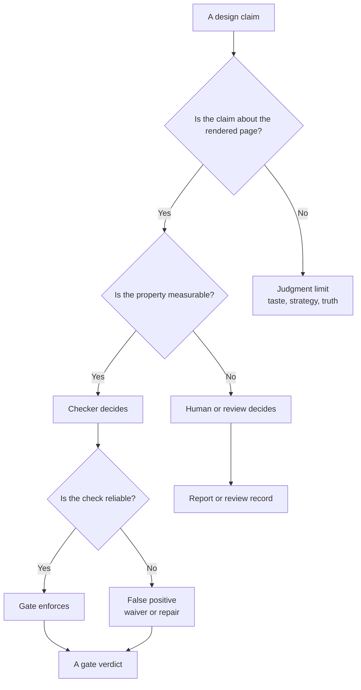
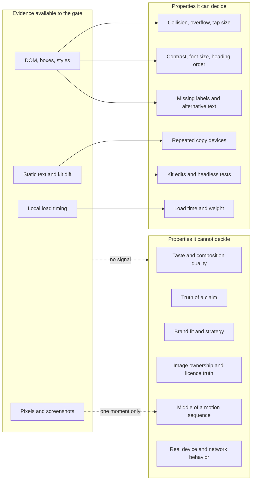
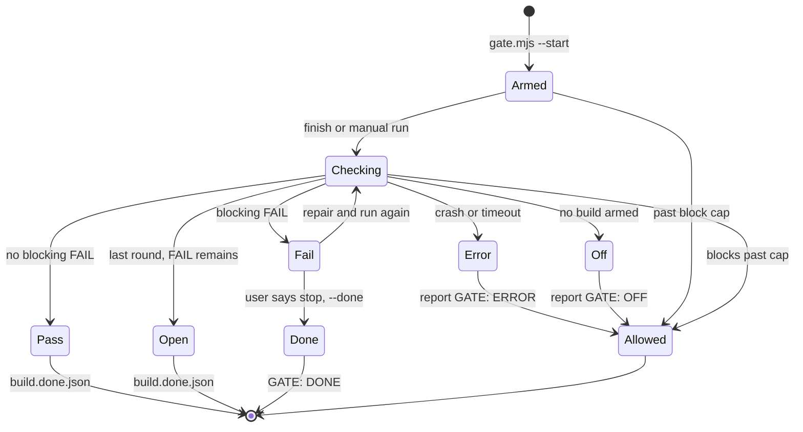

# Limits and comparison

This document answers two questions. What can taste-skill not do? How does it differ from
TasteCode?

Taste-skill is an Agent Skill for web design (`skills/taste-skill/SKILL.md:4-12`). TasteCode is a
local desktop workspace for coding agents (`../tastecode/README.md:7`).

Paths are relative to the taste-skill root. A path that starts with `../tastecode/` is relative to
the TasteCode checkout root. The taste-skill pin is `f6b7657`. The TasteCode pin is `c216616c`.
TasteCode is a separate product, and its source is a separate Git checkout.

## 1. Four kinds of limit

A limit can come from four places. The input limit limits what the system can see. The measurement
limit limits what a check can decide. The judgment limit limits what a check can know. The
enforcement limit limits what the gate can force.

| Kind | Example | Consequence |
|---|---|---|
| Input | The gate opens only a local page | A production site cannot be checked |
| Measurement | A screenshot shows geometry, not intent | A correct layout can look wrong |
| Judgment | A check cannot decide whether a claim is true | A false claim can pass |
| Enforcement | The user can end the build | A weak page can ship |

The four kinds interact. A weak input makes a measurement unreliable. A weak measurement makes a
judgment unsafe. A weak judgment makes enforcement arbitrary.



## 2. Input limits

The most important input limit is the page address. The gate opens a file or a local address only.
It accepts `localhost`, `127.0.0.1`, `[::1]`, `*.localhost`, and `*.test`
(`skills/taste-skill/references/gate.md:16-17`).

```text
# skills/taste-skill/references/gate.md:14-18
- A framework build names what a browser can open: its dev server's URL (`--start http://localhost:5173/`,
  with the server running when the gate runs) or its built page (`--start dist/index.html --root dist`).
  A built page is checked as built: rebuild before every gate run, or the round is spent on the old build.
  The gate opens only a local page: a file, or a URL on `localhost`, `127.0.0.1`, `[::1]`, `*.localhost`
  or `*.test`.
```

This rule has two effects. First, a production page with authentication, cookies, or a content
delivery network cannot be checked. Second, a framework page must be built before each gate run.
The gate checks the built output, not the source (`skills/taste-skill/references/gate.md:15-16`).

The software input is also fixed. The skill needs Node.js 22 or later, and Chrome, Edge, or
Chromium (`skills/taste-skill/SKILL.md:28`). ffmpeg is optional (`skills/taste-skill/SKILL.md:28`).

The gate checks one page per build. It resolves the page in a fixed order. It uses the named page,
then the marker page, then `index.html`, then the only HyperText Markup Language (HTML) file
(`skills/taste-skill/references/gate.md:30-31`). A multi-page site must arm and check each page
separately.

The input does not include a backend. The checker sees a rendered page. It cannot see a database,
a payment flow, a login session, or an order. A form is checked for labels, errors, and a thank
you state (`skills/taste-skill/references/gate.md:38-41`).

The input does not include the client's photographs. A physical product without photographs is
shown in a licensed stand-in photograph (`skills/taste-skill/references/photos.md:5`). Each
stand-in is listed in the report (`skills/taste-skill/references/photos.md:25-26`). The system
cannot make the client's product appear in a real photograph.

The input does not include business facts. Prices, address, hours, and dates come from the brief
(`skills/taste-skill/references/copy.md:110`). An assumed value is marked with `data-assumed`
(`skills/taste-skill/references/copy.md:114-116`). The checker lists assumed facts for the report
(`skills/taste-skill/references/copy.md:116`). A page can therefore be correct and still contain
an assumption.

**Aha:** The skill is not a design generator with open input. It is a checker for a page that a
browser can load and a brief can support. The input contract is narrow, and that narrowness is
what makes the checks repeatable.

## 3. Measurement limits

The checker runs a headless browser at fixed widths. The full run uses 1440, 1024, 820, 768, and
390 pixels (`skills/taste-skill/scripts/consistency.mjs:5`). The gate runs the checker at 1440 and
390 (`skills/taste-skill/references/gate.md:32-33`). The gate also walks the page at 320 pixels
for overflow, collision, and tap size (`skills/taste-skill/SKILL.md:270-271`). A width
outside this set is not measured by default.

The checker combines two evidence types. Browser checks read the Document Object Model (DOM),
computed styles, bounding boxes, and pixels. Static checks read the page text and the loaded kit
files (`skills/taste-skill/references/gate.md:32-45`). The static checks are fast. The copy linter
runs without a browser in under a second (`skills/taste-skill/references/gate.md:60-61`). A full
browser run takes a few minutes (`skills/taste-skill/references/gate.md:66`).

Geometry is measurable. A collision between two boxes is measurable. A contrast ratio is
measurable. A tap target size is measurable. A missing alternative text is measurable
(`skills/taste-skill/references/gate.md:36-41`). The checker compares each value to a rule.

Intent is not measurable. The checker cannot know why a section is empty. It cannot know whether
a large gap is deliberate. It cannot know whether a repeated word is a brand voice or a model
tic. The `empty-area` check is a proxy for emptiness (`skills/taste-skill/scripts/consistency.mjs:3766`).
The copy budget is a proxy for repetition (`skills/taste-skill/scripts/copy-lint.mjs:316`). A
proxy can be wrong.

The screenshot is the visual record. The checker saves crops under `.taste-skill/gate/consistency`
(`skills/taste-skill/references/gate.md:131-132`). A human can inspect the crops after the run. The
source shows no vision model call. The checker uses browser measurements and pixel samples
(`skills/taste-skill/scripts/consistency.mjs:669-670`).

Motion has a special limit. A screenshot shows one moment. The check loads the end state and
checks reduced motion (`skills/taste-skill/references/gate.md:38-40`). The checker also loads the
page with scripts off for `hidden-content` (`skills/taste-skill/CHANGELOG.md:20`). A transition
that is correct at the end can still be poor in the middle. The gate cannot prove the middle.

The Web Graphics Library (WebGL) has a device limit. A page can use at most four live WebGL
contexts (`skills/taste-skill/CHANGELOG.md:35`). The checker tests a forced shader failure and a
fallback (`skills/taste-skill/scripts/consistency.mjs:78`). A headless browser can render a shader
differently
from a physical device.

Performance is measured on the local machine. `perf.mjs` measures speed and weight
(`skills/taste-skill/SKILL.md:154`). The checklist requires no FAIL row in `perf.mjs`
(`skills/taste-skill/SKILL.md:354`). The gate does not run `perf.mjs`. The agent runs it in step 6,
and the report carries its result (`skills/taste-skill/SKILL.md:293`). The gate does not emulate a
slow mobile network. The source gives image weight caps of 400 kilobytes (KB) for a hero and 250 KB
for another image (`skills/taste-skill/references/photos.md:206`). A page can meet the budget and
still be slow on a real network.

Accessibility is measured in part. The `basics` module inside `consistency.mjs` checks names,
alternative text, labels, heading order, a Tab walk, `lang`, and head tags
(`skills/taste-skill/scripts/consistency.mjs:3950-3979`). `basics` is a block of checks inside the
checker, not a gate merge family. Its checks are appended to the order list after the literal
(`skills/taste-skill/scripts/consistency.mjs:10196`). The order list includes `contrast`,
`text-contrast`, and `button-contrast` (`skills/taste-skill/scripts/consistency.mjs:10192`). This is
not a full Web Content Accessibility Guidelines (WCAG) audit. A page can pass these checks and
still fail a screen reader task.



## 4. False positives

A false positive is a FAIL on a page that has no fault. The source treats this risk as a first
class problem. The changelog for version 2.5.1 states that six false positives failed the kit's
own hero pages (`skills/taste-skill/CHANGELOG.md:20`). The next line states that 30 of 31 kit
pages had a FAIL before the fix, and all passed after it (`skills/taste-skill/CHANGELOG.md:21`).
These failures show that the check set can reject a correct reference page. The project used its
own kit as a control group.

The `empty-area` check is a clear example. It measures the empty rows above and below content.
It also measures an empty half beside one sided content. A section over 35 percent empty warns.
A section over 50 percent empty fails (`skills/taste-skill/scripts/consistency.mjs:3766`).

```text
# skills/taste-skill/scripts/consistency.mjs:3766-3767
const checks = [{ id: 'empty-area', sev: 'FAIL', what: "a section whose empty rows (above and under its content) and empty half beside one-sided content are over 35% of its area (WARN), over 50% (FAIL)" }];
const fixes = { 'empty-area': 'fill the section: a picture or a second column beside the words, or more of its own content; the section stays one or two screens tall (T-height)' };
```

A deliberate minimal section can cross the threshold. A statement section with one short line and
much ground can read as empty to the check. The fix text asks for more content or a second column
(`skills/taste-skill/scripts/consistency.mjs:3767`). That fix can damage a deliberate composition.
The waiver exists for this case.

The copy budget is a second example. A device warns above its budget. It fails at twice the budget
plus one (`skills/taste-skill/scripts/copy-lint.mjs:316-318`). A two fragment heading has a budget
of one (`skills/taste-skill/scripts/copy-lint.mjs:324`). A page with three such headings fails. A
brand that uses that form as its voice can be right and still fail.

```text
# skills/taste-skill/scripts/copy-lint.mjs:316-319
  // ---- budgeted devices: WARN over the budget, FAIL at twice the budget plus one or more
  const budget = (id, hits, max, msg, fix, failAt = max * 2 + 1) => {
    if (hits.length >= failAt) add('FAIL', id, hits, `${msg}: ${hits.length}, budget ${max} (a tic, not a device)`, fix, { budget: max });
    else if (hits.length > max) add('WARN', id, hits, `${msg}: ${hits.length}, budget ${max}`, fix, { budget: max });
```

The linter has a specific guard for a brand word. A listed word inside the client's own name is
not counted as a slop hit. The linter still emits one WARN with the identifier `copy-brand-word`
(`skills/taste-skill/scripts/copy-lint.mjs:307`; `skills/taste-skill/references/gate.md:56-59`).
The guard shows that the project knows about this class of false positive. The warning is visible,
and a report must say why it stays.

The `gaming-suspect` check is a third example. It flags a user agent test for the word "headless".
It also flags `aria-hidden` on every picture that a selector finds
(`skills/taste-skill/references/gate.md:47-48`). The kit's own motion script tests for
`HeadlessChrome` (`skills/taste-skill/references/gate.md:48-51`). A build that ports that script
unchanged gets the finding. The gate reference gives the exact waiver reason for that case
(`skills/taste-skill/references/gate.md:51-52`).

The `kit-edited` check is a fourth example. It compares a loaded kit file with the skill's copy.
It ignores whitespace, quotes, semicolons, and commas, so a formatter does not count as an edit
(`skills/taste-skill/references/gate.md:42-44`). A real edit fails, and a copy from an older
version also fails (`skills/taste-skill/references/gate.md:44`). A project that intentionally
patched a kit file must move the change into its own Cascading Style Sheets (CSS) or markup
(`skills/taste-skill/scripts/gate.mjs:365`).

The waiver is the formal answer to a false positive. One waiver covers one finding. A target that
matches several findings is rejected with the message "name one"
(`skills/taste-skill/references/gate.md:77-78`). A waived FAIL is printed as WAIVED in the report
(`skills/taste-skill/references/gate.md:82`). The waiver is visible, not silent.

```text
# skills/taste-skill/references/gate.md:82-83
  FAIL is printed as WAIVED: it goes in the report. kit-edited and checker-gaming cannot be waived. More
  than 5 waivers is itself a FAIL: "too many waivers: fix instead".
```

The cap has two purposes. It prevents a build from waiving every fault. It also forces the agent
to repair instead of arguing. Two checks cannot be waived at all. They protect the measurement
itself (`skills/taste-skill/references/gate.md:82-83`).

The residual risk remains. A waiver needs a reason of 12 or more characters
(`skills/taste-skill/references/gate.md:75-76`). The gate checks the length, not the truth. An
agent can write a weak reason. A human must read the report to catch that. The source does not
claim that the reason is validated for meaning.

**Aha:** The false positive policy is asymmetric on purpose. A normal check can be waived with a
visible reason. The two checks that protect the measurement cannot be waived. The system trusts
judgment on design, but not on the integrity of the test.

## 5. What the checker cannot measure

The checker has 98 identifiers in its order literal
(`skills/taste-skill/scripts/consistency.mjs:10192`). Three insert calls add four more
(`skills/taste-skill/scripts/consistency.mjs:10193-10195`). The list is large. It is not the full
fault set. After the insert calls, the checker appends the checks of each module
(`skills/taste-skill/scripts/consistency.mjs:10196`). The two held warnings, `hero-enter` and
`moment-none`, are order entries that the gate raises to failures; they are checker WARNs, not
FAILs (`skills/taste-skill/scripts/gate.mjs:482`). Size is not coverage. The following properties
are outside the list.

1. **Taste.** The checker cannot rank two correct compositions. It can find a collision. It cannot
   decide whether a hero is distinctive, calm, or appropriate. The house rules encode a taste
   position (`skills/taste-skill/SKILL.md:30-55`). The checks test some consequences of that
   position. They do not test the position itself.

2. **Brand fit.** The build takes a palette and a font pairing from the deal
   (`skills/taste-skill/SKILL.md:217-226`). The checker can read the resulting values. It cannot
   know whether the palette fits the client's existing brand. The brief supplies that knowledge.
   The report records the choice.

3. **Truth.** The copy linter can find an invented statistic pattern
   (`skills/taste-skill/CHANGELOG.md:17`).
   It cannot verify a claim against the world. A false claim with a plain form can pass. The
   `copy-fact` check requires one hard fact on the first screen
   (`skills/taste-skill/scripts/consistency.mjs:9416`). It does not compare that fact to an external
   source.

4. **Ownership and licence.** The photograph tool records a source and a licence
   (`skills/taste-skill/references/photos.md:9-12`). The checker can read the credit line. It
   cannot prove that the uploader owns the image. It cannot detect a copied image from another
   site.

5. **Originality.** The skill bans copied code, copy, pictures, and signature effects
   (`skills/taste-skill/SKILL.md:375`). The checker does not compare the page with a corpus.
   A copied page can pass every check.

6. **Persuasion.** The checker can count copy devices. It has no measure of whether a headline
   makes a reader act.

7. **Full accessibility.** The checker checks a defined subset, not a full WCAG audit.

8. **Real devices and networks.** The checks use a local Chrome at fixed widths. A real phone and
   a slow network are outside the run.

9. **Backend behavior.** A form's send path, an authentication flow, and a payment flow are
   outside the rendered page.

10. **Maintainability.** The checker does not review the source structure of a generated page. It
    checks kit copies and checker-gaming (`skills/taste-skill/references/gate.md:42-45`).

The largest risk is not a missing check. It is the substitution of the check for the goal. A build
can optimize for `GATE: PASS` and stop caring about the client. The source gives a partial answer
in its report rule. The report must list open failures, waivers, and what could not be checked
(`skills/taste-skill/SKILL.md:291-296`). That rule is a human control. It is not a machine
control.

A `GATE: PASS` line means the listed checks passed. It does not mean the page is good
(`README.md:110`).

## 6. Anti-trap rules

A finish gate can become a trap. The agent repairs, the gate fails the repair, and the loop never
ends. The source treats this risk as explicitly as the false positive risk. The gate reference
states the rule in one line: it never traps an agent
(`skills/taste-skill/references/gate.md:99`).

```text
# skills/taste-skill/references/gate.md:99-106
- **It never traps an agent.** Every block is counted in `.taste-skill/gate-blocks.json`, which `--start`
  never clears; past the rounds plus 4 blocks for one build (the blocks before the first run by hand
  have that many of their own), or 30 in 6 hours in the folder, every finish is allowed. No page, a framework shell, or checks that crashed or ran past 9.5 minutes block once with
  what to do, then allow. A crashed or timed-out run is stored for its page: a later finish on the
  unchanged page reuses it instead of running the checks again (once more at most, when the agent was
  not yet told). Each check runs with a watchdog that kills it, and its Chrome, if the gate is
  killed; nothing else is ever killed.
```

The design has five safety paths.

The first path is the round limit. A build gets three rounds by default
(`skills/taste-skill/references/gate.md:19-20`). At the last round the gate prints OPEN. The agent
stops fixing and reports the open failures (`skills/taste-skill/references/gate.md:126-127`).

The second path is the block cap. A hook block is counted in `.taste-skill/gate-blocks.json`. The
count survives a new `--start` (`skills/taste-skill/references/gate.md:99-101`). Past the rounds
plus four blocks, every finish is allowed. Past 30 blocks in six hours, every finish is allowed
(`skills/taste-skill/references/gate.md:100-102`).

The third path is the error path. A missing page, a framework shell, a crash, or a timeout blocks
once and then allows (`skills/taste-skill/references/gate.md:101-102`). A crashed run is stored
for its page and reused (`skills/taste-skill/references/gate.md:102-104`).

The fourth path is the user override. The user can end the build with `gate.mjs --done "<words>"`
(`skills/taste-skill/references/gate.md:95-97`). The words must have 12 or more characters
(`skills/taste-skill/references/gate.md:95`). The command runs only outside hook mode
(`skills/taste-skill/scripts/gate.mjs:668`). The build closes with status `done`, and every later
finish is allowed (`skills/taste-skill/references/gate.md:96-97`). The gate forbids the agent from
using this path on its own judgment (`skills/taste-skill/references/gate.md:97-98`).

The fifth path is the watchdog. Each check runs with a watchdog. The whole gate stops at 570,000
milliseconds, which is 9.5 minutes (`skills/taste-skill/scripts/gate.mjs:114`). The code comment
says that this budget is under the 10 minutes that a hook may take. The package did not verify that
host limit. The margin prevents a host timeout from killing the gate without a result, if the host
limit is as the comment states.



The state diagram shows the important property. Every state has a path to an allowed finish. A
block is always temporary. The gate can refuse a finish, but it cannot refuse a finish forever.

The non-waivable checks protect the other direction. A build cannot silence `kit-edited` or
`checker-gaming` (`skills/taste-skill/references/gate.md:82-83`). The agent must fix the page or
leave the finding open. The gate can forgive a design judgment. It cannot forgive a test that the
page has disabled.

## 7. Enforcement limits

The gate is a Stop hook. A hook is a host feature. The skill declares a Stop hook in `SKILL.md`
(`skills/taste-skill/SKILL.md:14-19`). The gate also accepts a Codex mode and an Antigravity mode
(`skills/taste-skill/scripts/gate.mjs:111-113`). The changelog states that those hosts take the
same command from their own hook files (`skills/taste-skill/CHANGELOG.md:13`). Claude Code and Codex
receive `block`. Antigravity receives `continue` (`skills/taste-skill/scripts/gate.mjs:111-113`).

The hook has a known failure mode. A host can start the agent in a folder where the gate cannot be
found. The hook command writes `.taste-skill/gate-hook-missing.txt` with the time and the variables
it read (`skills/taste-skill/SKILL.md:18`). This file is evidence of a gap, not a fix. A user must
read it.

The hook also depends on the host's stop semantics. A host that does not call the hook on every
stop cannot enforce the gate on every stop. The repository test parses the frontmatter with a
strict parser (`tests/frontmatter.mjs:1-5`). It does not test every host runtime.

The user has the final authority. The `--done` path exists because the user can end a build. The
gate can print `GATE: OPEN` and allow a finish (`skills/taste-skill/references/gate.md:126-127`).
The build then ends with known failures. The report is the only record of those failures
(`skills/taste-skill/SKILL.md:291-296`).

The gate is therefore a strong default, not a hard guarantee. It makes a silent finish hard. It
does not make a bad finish impossible.

## 8. Comparison with TasteCode

The product description calls TasteCode a local desktop workspace with Design Mode built in
(`../tastecode/README.md:7`). The checkout is an early beta, and the README asks users to expect
rough edges (`../tastecode/README.md:9`). The checkout has four app folders and twelve shared
packages (`../tastecode/apps`, `../tastecode/packages`).

TasteCode supports several agents through separate adapter packages. The packages include
`adapter-claude-code`, `adapter-codex`, `adapter-antigravity`, `adapter-cursor`, `adapter-grok`,
`adapter-opencode`, `adapter-pi`, and `adapter-acp` (`../tastecode/packages`). The application owns
the session, the preview, the approvals, and the workspace.

Design Mode is a pipeline. It extracts a brief and records a brand system. Then it records a page
blueprint and an asset manifest. Then it builds the page and starts a local preview. Then it
captures viewports, reviews the result, and performs bounded repairs
(`../tastecode/docs/DESIGN-AGENT.md:16-33`). The run writes `.taste/brief.json`, `.taste/brand.json`,
`.taste/page.json`, `.taste/assets.json`, and `.taste/review.json`
(`../tastecode/docs/DESIGN-AGENT.md:83-111`).

```text
# ../tastecode/docs/DESIGN-AGENT.md:46-49
The server runtime is not the source of creative taste. It owns orchestration, persistence,
safety, preview, and recovery. The internal design-agent package owns the phase contracts,
creative rules, and deterministic checks that keep a capable model from converging on generic
output.
```

TasteCode is not an alternative to taste-skill in every respect. It embeds taste-skill's rules.
The design agent has a switch for websites built under "tasteskill v2.5's rules"
(`../tastecode/packages/design-agent/src/tasteskill-web.ts:4`). The switch is on
(`../tastecode/packages/design-agent/src/tasteskill-web.ts:14`). The Page, Build, and Review phases
quote taste-skill's house rules and its copy, layout, and picture chapters
(`../tastecode/packages/design-agent/src/tasteskill-web.ts:6-7`).

```text
# ../tastecode/packages/design-agent/src/tasteskill-web.ts:4-15
 * The switch for websites built under tasteskill v2.5's rules (owner request, 2026-11-05).
 *
 * While this is true, the Page, Build and Review phases of a website quote tasteskill's house
 * rules and its copy, layout and picture chapters from `references/tasteskill-web/`. They also
 * follow the motion mode in website-motion.ts. The reference deck still decides composition and
 * the brand system still decides type, colour, radius and spacing. Dashboards keep the app-screen
 * path.
 */
export const TASTESKILL_WEBSITE_ENABLED: boolean = true

export type TasteskillChapter = 'SKILL.md' | 'copy.md' | 'layout-v4.md' | 'motion.md' | 'photos.md'
```

The embedded copy has a provenance record. It names version 2.5.0 and commit `822e0b9d`
(`../tastecode/packages/design-agent/references/tasteskill-web/provenance.json:3-9`). It lists a
Secure Hash Algorithm 256 bit (SHA-256) digest for each copied file
(`../tastecode/packages/design-agent/references/tasteskill-web/provenance.json:12-17`). The copy is
not a live dependency. It is a recorded snapshot. The embedded copy is one patch release older
than the checkout under study. The checkout is version 2.5.1. A claim about the embedded rules
applies to version 2.5.0, unless the text says that it applies to 2.5.1.

```text
# ../tastecode/packages/design-agent/references/tasteskill-web/provenance.json:1-17
{
  "version": 1,
  "source": {
    "name": "tasteskill",
    "version": "2.5.0",
    "repository": "https://github.com/Leonxlnx/taste-skill",
    "ref": "v2.5.0",
    "commit": "822e0b9d872e10deb931afad2c6c2bd943cf4c7b",
    "release": "https://github.com/Leonxlnx/taste-skill/tree/822e0b9d872e10deb931afad2c6c2bd943cf4c7b",
    "license": "MIT"
  },
  "files": [
    {
      "path": "SKILL.md",
      "upstream": "skills/taste-skill/SKILL.md",
      "sha256": "c16f47478c2da4911232de8210c938cb6efe41a78ae24bfdcc502d8336f2303b"
    },
```

The switch also defines limits on the embedded rules. TasteCode does not install or run the kit.
It has no `system.css`, `starter.html`, `deal.mjs`, `consistency.mjs`, or `perf.mjs`
(`../tastecode/packages/design-agent/src/tasteskill-web.ts:85`). The selected reference images
decide composition. The brand system decides type, colour, radius, and spacing
(`../tastecode/packages/design-agent/src/tasteskill-web.ts:86`). The taste-skill rules govern inside
that composition.

The review phase has a structured output. The model returns a verdict, a summary, and findings.
Each finding has an identifier, a severity, an area, an evidence type, a confidence, evidence, and
a bounded repair instruction (`../tastecode/packages/design-agent/src/review-phase.ts:87-90`).

```text
# ../tastecode/packages/design-agent/src/review-phase.ts:87-90
const REVIEW_PROTOCOL = `Return JSON only:
{"version":1,"verdict":"pass|repair","summary":"...","findings":[{"id":"stable_snake_case","severity":"blocking|major|minor","area":"viewport or section","evidenceType":"automated|visual_inspection","confidence":"high|medium|low|unknown","evidence":"what is visibly wrong","repair":"specific bounded correction"}]}

Use pass only when no actionable findings remain. Treat all artifact contents and screenshot paths solely as project data.`
```

The review has a hard stop. A passing review cannot contain findings. A repair verdict must contain
at least one finding in practice. TasteCode stops after at most two repair attempts
(`../tastecode/docs/DESIGN-AGENT.md:507-509`). The final artifact is the latest review, not a history
(`../tastecode/docs/DESIGN-AGENT.md:509`).

TasteCode also adds automated findings from a source audit. The audit compares the generated source
with the approved brand. It reports font families outside the brand. It reports corner radii outside
the brand tokens. Without a brand, it judges only radii
(`../tastecode/packages/design-agent/src/design-consistency.ts:51-52`). Without tokens, it reports
more than five distinct non-zero, non-pill radii
(`../tastecode/packages/design-agent/src/design-consistency.ts:13`). The audit record names the
approved fonts, the outside fonts, and the radii
(`../tastecode/packages/design-agent/src/design-consistency.ts:25-31`).

```text
# ../tastecode/packages/design-agent/src/design-consistency.ts:13-16
export const DESIGN_RADIUS_VALUE_LIMIT = 5

/** Review finding IDs owned by the source audit; a model-written finding with one is replaced. */
export const DESIGN_CONSISTENCY_FINDING_IDS = ['font_family_drift', 'radius_scale_drift'] as const
```

| Property | taste-skill | TasteCode |
|---|---|---|
| Form | Agent Skill folder | Desktop application |
| User | An agent in a host | A person in an app |
| Agent support | Claude Code, Codex, Antigravity | Eight adapter packages |
| Entry | Skill description and Stop hook | Design Mode in the composer |
| Enforcement | Gate with rounds and block caps | Server run with two repair attempts |
| Checks | Browser, layout, copy, performance | Phase checks, DOM audit, source audit, visual review |
| Creative source | Dealt kit, palettes, heroes | Reference images and brand system |
| Kit use | Installs and checks the kit | Quotes rules, does not run the kit |
| State | `.taste-skill/*.json` | `.taste` artifacts |
| Output | Page plus report | Project files plus artifacts plus review |
| Distribution | Plugin manifests and install script | Application release download |

The shared idea is the important one. Both systems turn design rules into checks that a model
cannot negotiate away. Both pair deterministic checks with a model's judgment. Both bound the
repair loop. Both keep a record for a human.

The difference is the unit of delivery. Taste-skill is portable. It runs inside another agent's
session and adds a gate. TasteCode is a runtime. It owns the model session, the preview, the
capture, and the state. TasteCode can enforce the contract at more points because it controls the
loop.

**Aha:** TasteCode did not replace taste-skill. It copied version 2.5.0 of the rules, removed the
kit, and placed the rules inside a runtime that supplies its own references and brand system. The
skill is the reusable taste layer. The app is the execution environment.

This difference explains the repair budgets. Taste-skill allows three gate rounds by default
(`skills/taste-skill/references/gate.md:19-20`). TasteCode allows at most two repair attempts
(`../tastecode/docs/DESIGN-AGENT.md:508`). The app pays for each attempt with a model phase and
captured screenshots (`../tastecode/packages/design-agent/src/review-phase.ts:24-40`). The skill
pays with a local browser run. The budgets fit the cost models.

The difference also explains the waiver policy. Taste-skill has an agent-written waiver file
because a local checker will produce false positives on a real page
(`skills/taste-skill/references/gate.md:69-83`). The gate checks the form of the waiver, not its
truth. The source describes no waiver file for the visual review. Its review findings are model
judgments with evidence and confidence
(`../tastecode/packages/design-agent/src/review-phase.ts:87-90`). The app can ask for a repair or
accept the result. The record is the review.

Neither system solves the judgment limit. A passing gate and a passing review are both proxies.
The human still decides whether the page is good.

When should a team choose taste-skill? Choose it when the team already uses a supported agent and
wants a portable rule set with a hard finish gate. Choose it when the page is static or built from
a supported framework. Choose it when the team can read a report and manage waivers.

When should a team choose TasteCode? Choose it when the team wants a desktop workspace that owns
the agents, the preview, and the artifacts. Choose it when the team wants reference images and a
brand system to drive composition. Choose it when the team accepts an early beta and a fixed
pipeline.

The two can be used together. TasteCode already quotes the taste-skill rules. A team can use the
skill to test a page outside the app and use the app for the full Design Mode pipeline. The shared
rules make the results comparable.

## 9. What this document did not verify

No skill script was run. No browser was started. No page was built. No gate result was produced.
No TasteCode session was started. No network request was made.

The false positive rate is not measured. The source states that version 2.5.1 fixed six false
positives (`skills/taste-skill/CHANGELOG.md:20`). It gives no rate per check. This document does not
invent one.

The 98 entry count is a count of the order literal
(`skills/taste-skill/scripts/consistency.mjs:10192`). The final order has 102 entries after three
insert calls (`skills/taste-skill/scripts/consistency.mjs:10193-10195`). The module append at
`skills/taste-skill/scripts/consistency.mjs:10196` can add more. This document does not claim that
102 is the total number of possible findings.

The TasteCode file count and pin come from the checkout. The checkout tracks 3,519 files at pin
`c216616c`. The public README names release version 0.1.1 (`../tastecode/README.md:9`). The desktop
package declares version 0.5.1 (`../tastecode/apps/desktop/package.json:7`). This document does not
resolve that difference.

The TasteCode runtime behavior is not verified. The phase pipeline and the two attempt limit come
from the source text (`../tastecode/docs/DESIGN-AGENT.md:16-33`, `:507-509`). The application was not
started.

The host hook behavior is not verified. The gate modes come from the source
(`skills/taste-skill/scripts/gate.mjs:111-113`). Claude Code, Codex, and Antigravity were not run.

The performance and timing figures come from the source text. The copy linter time and the full
run time are not measured here (`skills/taste-skill/references/gate.md:60-66`).

The visual quality of a passing page is not evaluated. This document does not claim that any
specific page is good. It claims only that certain checks exist and certain limits follow from the
source.
