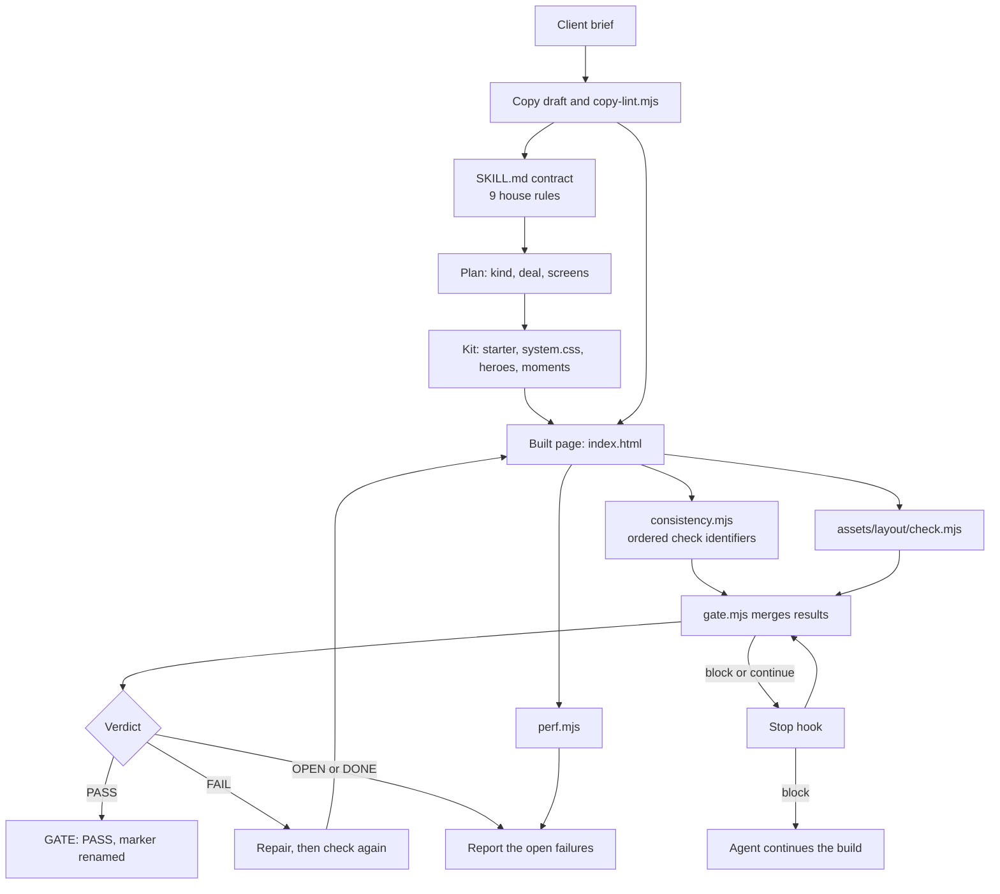

# taste-skill: a design skill with a finish gate

Taste Skill is an Agent Skill for web design. The source is a Git checkout at pin `f6b7657`. The
version is `2.5.1` (`skills/taste-skill/SKILL.md:4`). The licence is MIT (`LICENSE:1`). The skill
folder holds 1,631 tracked files, and the repository holds 1,663 (`spec.md`).

The thesis of this package is one sentence. The skill turns design taste into a set of checks that
a machine runs, and it makes the checks a condition for ending a build. The written rules in
`SKILL.md` tell the agent what to build. The scripts measure the result in a real browser. A Stop
hook stops the agent from declaring the work finished before the gate passes.

This package explains how that arrangement works. It also explains what the arrangement cannot do.
The reader needs no prior knowledge of the source.

## The map



## Source anchors

The skill declares its own name and version in the front matter of `SKILL.md`.

```text
# skills/taste-skill/SKILL.md:1-4
---
name: design-taste-frontend
description: >-
  tasteskill 2.5.1, the anti-slop frontend skill. Builds professional company websites at the level
```

The gate has three hook modes. Claude Code and Codex receive `block`. Antigravity receives
`continue` (`skills/taste-skill/scripts/gate.mjs:111`).

```text
# skills/taste-skill/scripts/gate.mjs:111-113
const MODES = { claude: 'block', codex: 'block', antigravity: 'continue' };
if (HOOK !== null && !MODES[HOOK]) { console.error('gate: --hook takes claude, codex or antigravity'); process.exit(HOOK === true ? 2 : 0); }
const QUICK = has('quick'), START = has('start');
```

The checker holds a fixed order of check identifiers. The order literal holds 98 entries, and
three insert calls add four more. The order gives stable report output and stable repair priority
(`skills/taste-skill/scripts/consistency.mjs:10192-10195`). The order is not the full fault set.
After the insert calls, the checker appends the checks of each module
(`skills/taste-skill/scripts/consistency.mjs:10196`). The two held warnings, `hero-enter` and
`moment-none`, are checker warnings that the gate treats as failures. They are not order entries
(`skills/taste-skill/scripts/gate.mjs:482`).

```text
# skills/taste-skill/scripts/consistency.mjs:10192-10195
const ORDER = ['assets', 'shader-lint', 'gl-fallback', 'empty-visual', 'hero-fill', 'flush', 'placeholder', 'sample-label', 'caption', 'credit-wall', 'nav', 'nav-covers', 'spill', 'off-viewport', 'fold-card', 'hover-spill', 'overlap-text', 'row-gap', 'cut-text', 'fold-cut', 'marquee', 'scroll-linked', 'scroll-reveal', 'pinned', 'loop-pause', 'reduced-motion', 'webgl', 'no-visual', 'text-only', 'card-visual', 'hidden-visual', 'card-family', 'card-layout', 'nesting', 'effect-repeat', 'ui-fit', 'ui-centre', 'dark-ground', 'button-styles', 'button-shape', 'same-action', 'button-picture', 'cta', 'pricing-tiers', 'copy-headline', 'copy-fact', 'copy-headings', 'copy-buttons', 'copy-actions', 'heading-scale', 'stagger', 'top-stagger', 'off-grid', 'col-edge', 'right-edge', 'centre-axis', 'tilt', 'contrast', 'text-contrast', 'body-size', 'busy-ground', 'section-gaps', 'proximity', 'hole', 'links', 'forms', 'photo-upscale', 'photo-set', 'photo-credit', 'nav-family', 'nav-labels', 'link-styles', 'heading-align', 'label-centre', 'fake-button', 'stranded-action', 'orphan', 'unit-break', 'tab-wrap', 'effects-fit', 'fade-cut', 'photo-weight', 'copy-length', 'nav-current', 'progress-bar', 'photo-repeat', 'button-contrast', 'photo-print', 'grounds', 'split-align', 'fact-agree', 'fold-action', 'action-count', 'one-screen', 'hover', 'product-shown', 'same-object', 'font-load'];
ORDER.splice(ORDER.indexOf('reduced-motion') + 1, 0, 'hidden-content');
ORDER.splice(ORDER.indexOf('hover') + 1, 0, 'hover-move');
ORDER.splice(ORDER.indexOf('overlap-text') + 1, 0, 'collide', 'tap-size');
```

The written gate reference states the first rule of build tracking. A build stays active while
its marker exists, and deleting the marker does not end the build
(`skills/taste-skill/references/gate.md:26-27`).

```text
# skills/taste-skill/references/gate.md:26-27
- **A build is active** while `.taste-skill/build.json` exists in the project folder (or one or two
  folders below), or while `.taste-skill/gate.json` says its rounds are still open: deleting the marker
```

## The six documents

| File | Question it answers | Words | Snippets |
|---|---|---:|---:|
| [`00-overview.md`](00-overview.md) | What is the product, and what does the skill promise? | 3,000 to 5,000 | 10 or more |
| [`01-architecture.md`](01-architecture.md) | How is the skill packaged, and where does each file go? | 3,000 to 5,000 | 10 or more |
| [`02-core-mechanism.md`](02-core-mechanism.md) | How do the checker and the finish gate measure and decide? | 3,000 to 5,000 | 10 or more |
| [`03-workflow-and-quality.md`](03-workflow-and-quality.md) | What happens in one build, step by step? | 3,000 to 5,000 | 10 or more |
| [`04-limits-and-comparison.md`](04-limits-and-comparison.md) | What can the system not do, and how does it differ from tastecode? | 3,000 to 5,000 | 10 or more |

## Reading order

1. Read this page for the thesis and the map.
2. Read `00-overview.md` for the product, the nine house rules, and the actors.
3. Read `01-architecture.md` for the folder layout and the install paths.
4. Read `02-core-mechanism.md` for the checker, the gate, the rounds, and the waivers.
5. Read `03-workflow-and-quality.md` for one complete build from brief to `GATE: PASS`.
6. Read `04-limits-and-comparison.md` for the failure modes and the comparison with tastecode.

A reader who wants only the enforcement story can start at `02-core-mechanism.md`. A reader who
wants only the practical sequence can start at `03-workflow-and-quality.md`.

## What this package does not claim

- No script was run. No browser was started. No page was built. The runtime behaviour is not
  verified here. Every runtime statement comes from the source text.
- The checker's false-positive rate is not measured here. The changelog states that version 2.5.1
  fixed six false positives (`CHANGELOG.md:20`).
- A `GATE: PASS` result is not evidence of good design. It is evidence that the listed checks
  passed.
- The hook behaviour of Claude Code, Codex, and Antigravity is not tested here.
- TasteCode embeds the rules of version 2.5.0. The checkout under study is version 2.5.1. The
  comparison in `04-limits-and-comparison.md` applies to 2.5.0 where the embedded copy is the
  subject (`../tastecode/packages/design-agent/references/tasteskill-web/provenance.json:3-9`).
- The 39 MB size of the skill folder and the 37 MB size of its `assets` folder are disk measures.
  A file count is a different measure, and the two numbers must not be compared as the same.
- The source is read only. This package does not modify the checkout.
