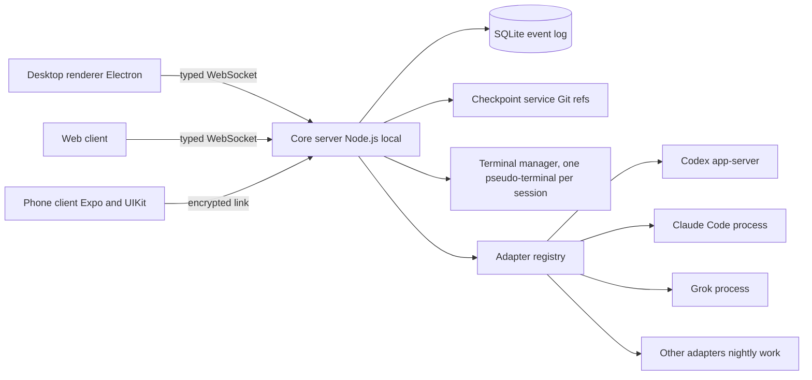
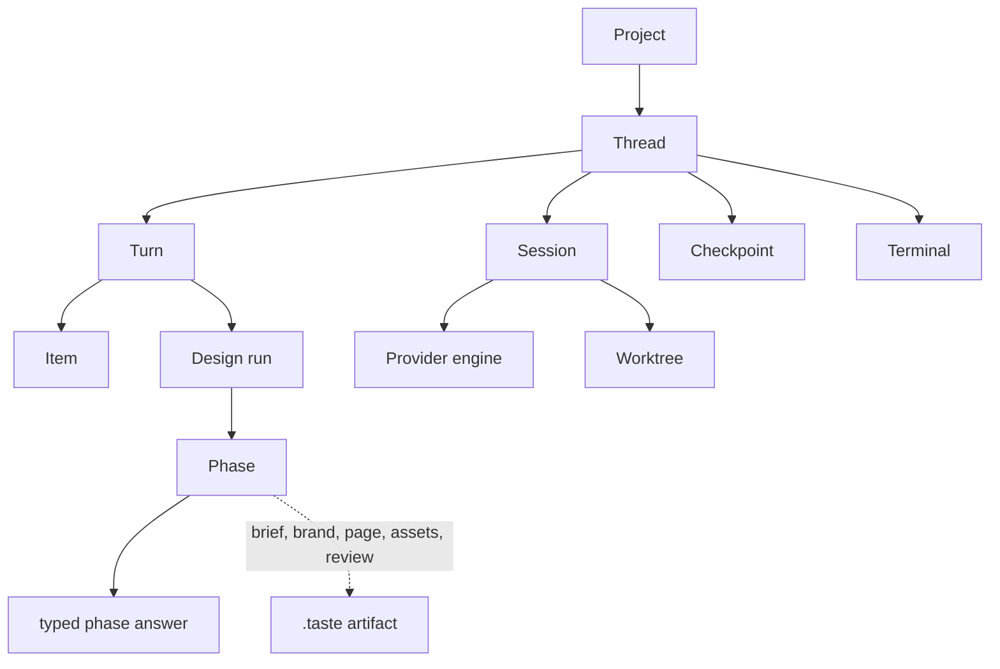

# TasteCode: product, workspaces, and vocabulary

TasteCode is a local desktop workspace for Artificial Intelligence (AI) coding agents.
It adds a Design Mode. The public beta is version 0.1.1. The licence is the Apache
License 2.0. The source is a Git checkout at pin `c216616` with 3,519 tracked files.

The product is not an agent. The product is a control surface above several agents.
A local Node.js server owns state and orchestration. Every client is a thin renderer
over a typed WebSocket protocol. The server keeps the event log, checkpoints,
worktrees, terminal sessions, and provider credentials out of the renderer.

This document describes the product, the workspace map, and the vocabulary that the
other five documents use. It also separates what `main` ships from what exists in the
tree as nightly work.

## The product claim

The README states the product in one line. It also states the beta status.

```text
# README.md:7-25
> A local desktop workspace for AI coding agents, with Design Mode built in.

**Early beta (`0.1.1`).** Expect bugs, rough edges, and changes as we keep working
on TasteCode. Please [report any issues](https://github.com/Leonxlnx/tastecode/issues) you find.

## What TasteCode does

TasteCode puts multiple coding agents in one desktop app while keeping orchestration,
project state, terminal access, diffs, checkpoints, and history local to your machine.

The public beta ships with:

- Codex
- Claude Code
- Grok
- provider-aware models, permissions, and session controls
- project and session search, rename, and pinning
- terminal, browser preview, attachments, git context, and readable diffs
- Design Mode for inspecting and editing web interfaces
```

The project does not claim that the first-party clients are poor. The vision document
names a different problem. Each good client is tied to one vendor. A user with several
subscriptions must use several applications with separate histories.

```text
# docs/VISION.md:3-20
## The problem

**It is not that the existing clients are bad.** They are good, and getting better fast.
Claude Code shipped a redesigned desktop app in April 2026 with parallel tasks, visual
diffs and server previews. Codex has a first-party app plus IDE extensions. Cursor is an
entire IDE built around an agent. Anyone claiming this field is a wasteland of ugly
terminal programs has not looked at it recently.

The problem is a different one, and it does not go away as those apps improve:

- **Every good client is locked to one vendor.** The Claude app runs Claude. The Codex app
  runs Codex. Cursor runs Cursor. None of them will ever run the others — it is not in
  their interest to. So the moment you use more than one engine, you are back to switching
  between three apps with three session models, three histories, and nothing shared.
- **Your subscriptions are stranded.** You may already pay for Claude Max, ChatGPT Plus,
  Cursor, Kimi Code, a GLM coding plan, and SuperGrok. Each one is usable only inside its
  own client. Nothing lets you point all of them at the same task in the same window.
- **Nothing adapts to you.** Every one of these apps is opinionated about how _they_ think
```

The response has three parts. TasteCode aggregates the agents that a user already pays
for. It keeps orchestration local. It adds a design agent with explicit creative rules.
`docs/VISION.md:39-67` records the three bets as aggregation, craft, and taste.

**Aha:** The central design choice is a server, not a window. The desktop application is
one client of that server. The web client, the phone client, and the Desktop shell all
use the same protocol. This choice is why agents survive a closed window.

## The architecture in one paragraph

The architecture document states the shape at the top. The claim is exact and short.

```text
# docs/ARCHITECTURE.md:11-12
**A local server owns all state and orchestration. Every client is a thin renderer over a
typed WebSocket protocol.**
```

The core server is a long-lived local Node.js process. It starts and stops provider
processes. It writes the event log. It creates checkpoints. It owns terminal sessions.
It serves the preview. It also decides which provider capability is available.

The server is headless. A test can start it without Electron. This is one reason the
server is not part of the Electron main process. The architecture document records two
rejected alternatives at `docs/ARCHITECTURE.md:48-49`. The first alternative put
everything in the Electron main process. The second alternative used a remote procedure
call framework on the wire. Both rejections protect the web client.

## The workspace map

The repository is a pnpm workspace. The package manager is pinned to pnpm 11.8.0.
The module system is ECMAScript modules. The Node.js engine must be at least 22.18.0.
The root package has no version field and no licence field.

```text
# package.json:1-8
{
  "name": "tastecode",
  "private": true,
  "type": "module",
  "packageManager": "pnpm@11.8.0",
  "engines": {
    "node": ">=22.18.0"
  },
```

The workspace has four applications and twelve packages. These are the file counts at
the pin:

| Workspace | Files | Role |
|---|---:|---|
| `apps/web` | 786 | Web client and shared renderer |
| `apps/server` | 254 | Core server, adapters, event log, checkpoints, terminal |
| `apps/desktop` | 140 | Electron desktop host |
| `apps/mobile` | 80 | Expo phone client |
| `packages/adapter-codex` | 672 | Codex app-server adapter |
| `packages/design-agent` | 548 | Design Mode phase contracts and checks |
| `packages/adapter-claude-code` | 51 | Claude Code adapter |
| `packages/adapter-opencode` | 36 | OpenCode adapter |
| `packages/adapter-grok` | 35 | Grok adapter |
| `packages/adapter-acp` | 29 | Agent Client Protocol (ACP) adapter |
| `packages/adapter-cursor` | 28 | Cursor adapter |
| `packages/proc` | 27 | Child-process helpers |
| `packages/adapter-antigravity` | 22 | Antigravity adapter |
| `packages/contracts` | 17 | Shared typed contracts |
| `packages/default-skills` | 9 | Bundled skill pins and patches |
| `packages/adapter-pi` | 6 | Pi adapter |

The total of these rows is 2,740 files. The other files are top-level configuration,
documentation, rules, plans, tools, patches, and verification records.

The map below shows the main processes and their direction of control. A client never
starts a provider directly.



## The domain vocabulary

The shared contracts define one provider-independent model. The model is Thread, then
Turn, then Item. The design comes from the Codex app-server. The comment is explicit.

```text
# packages/contracts/src/domain.ts:3-22
/**
 * The provider-agnostic model every adapter translates into.
 *
 * Thread -> Turn -> Item, borrowed from Codex's app-server because it is the
 * best-designed of the available models and maps straight onto the UI. Nothing
 * engine-specific may leak past an adapter.
 */

export const ProviderIdSchema = z.enum([
  'codex',
  'claude-code',
  'grok',
  'cursor',
  'opencode',
  'antigravity',
  'pi',
  'acp',
  'api',
])
export type ProviderId = z.infer<typeof ProviderIdSchema>
```

A **provider** is an identifier for one agent engine. The provider list in the schema
includes more values than the public beta ships. The provider plan explains the gap.
The plan says that `main` ships only Codex, Claude Code, and Grok since 2026-10-03.
Other adapters live on the `nightly` branch.

An **agent engine** owns a coding loop, tools, and a session. TasteCode adapts its
native protocol, software development kit (SDK), ACP surface, or structured command
output. A **model connection** exposes an inference Application Programming Interface
(API) but no coding loop. The project removed model connections on 2026-10-20.

```text
# docs/PROVIDERS.md:1-14
# Provider plan

TasteCode supports two different things that must not be conflated:

- **Agent engines** already own a coding loop, tools and sessions. TasteCode adapts their
  native protocol, SDK, ACP surface or structured CLI output.
- **Model connections** expose inference APIs but no complete coding agent. TasteCode
  removed them on 2026-10-20: a user's own API key goes into an agent engine that supports
  keys, today OpenCode's sign-in, and runs as that engine's session.

The UI presents both as ways to start a session, while the adapter boundary keeps their
implementation details out of shared contracts and components.

Since 2026-10-03 `main` ships only Codex, Claude Code and Grok. Everything else in this plan
```

A **thread** is one conversation. A **turn** is one user request and the agent work that
answers it. An **item** is one distinct output inside a turn. Items are not collapsed
into text. Each item type has a different renderer.

```text
# packages/contracts/src/domain.ts:24-43
/**
 * Every distinct thing an agent produces inside a turn. The UI renders each of
 * these differently — that is the whole point of not collapsing them to text.
 */
export const ItemTypeSchema = z.enum([
  'message',
  'reasoning',
  'command',
  'file_change',
  'tool_call',
  'plan',
  'error',
  /** An event an adapter did not recognise. Rendered as raw text, never dropped. */
  'unknown',
  /**
   * A line TasteCode adds to the conversation between turns, such as the chat
   * moving to another provider. Adapters never produce it; it belongs to no turn.
   */
  'notice',
])
```

A **project** is a folder that the user adds. A **session** is a running provider
process tied to a thread. A **checkpoint** is a Git commit object that records the
working tree before and after agent work. A **worktree** is a private checkout for one
session. A **terminal** is a pseudo-terminal (PTY) whose foreground job the server owns.

The vocabulary below links the terms to the mechanism documents.



## The protocol vocabulary

The protocol has two shapes. The first shape is a request/response exchange. A client
sends a request frame with an identifier, a method, and parameters. The server sends one
response frame that answers it. The second shape is a push frame. A push frame has a
channel, a sequence number, and data. The protocol version is 2. The error codes are a
fixed set.

```text
# packages/contracts/src/protocol.ts:60-70
export const PROTOCOL_VERSION = 2

/** Bumped whenever a client and server can no longer understand each other. */
export const ErrorCode = {
  BAD_REQUEST: 'bad_request',
  FORBIDDEN: 'forbidden',
  NOT_FOUND: 'not_found',
  PROVIDER_UNAVAILABLE: 'provider_unavailable',
  STALE_SNAPSHOT: 'stale_snapshot',
  INTERNAL: 'internal',
} as const
```

The `stale_snapshot` code is important. A client can act on a diff or a checkpoint only
if its view is current. The code lets the server refuse an old action without guessing.
The `provider_unavailable` code separates a missing provider from a bad request.

The client transport is a state machine. The four states are `connecting`, `open`,
`reconnecting`, and `closed`. Requests made while the socket is down are queued.

```text
# apps/web/src/transport.ts:93-100
/**
 * Client side of the wire protocol.
 *
 * An explicit state machine rather than a bare WebSocket: requests made while
 * disconnected are queued and flushed on reconnect, so the UI never has to know
 * whether the socket happens to be up right now.
 */
export type ConnectionState = 'connecting' | 'open' | 'reconnecting' | 'closed'
```

Each push carries a monotonic sequence number for one connection. A client detects a
gap and requests history after the last sequence number it applied. The mechanism is
the subject of `01-architecture.md`.

## Design Mode in one page

Design Mode is a sequence of phases. The phases are brief, brand, page, assets, build,
preview, review, repair, complete, and response. The server stores the phase state.
The internal design agent supplies the phase prompts, artifact contracts, and
deterministic checks.

The phase pipeline is the subject of `02-core-mechanism.md`. One quality run is the
subject of `03-workflow-and-quality.md`. The central mechanism is simple in shape.
Each model-driven phase returns typed JavaScript Object Notation (JSON). The server
validates the answer before it advances. A failed validation returns a bounded
correction prompt.

The design agent writes five artifacts under `.taste/`. The names are `brief.json`,
`brand.json`, `page.json`, `assets.json`, and `review.json`. One artifact can be at
most 2,000,000 bytes.

```text
# packages/design-agent/src/artifact-store.ts:6-14
const MAX_ARTIFACT_BYTES = 2_000_000
type ArtifactName = 'brief.json' | 'brand.json' | 'page.json' | 'assets.json' | 'review.json'

function artifactPath(workspacePath: string, name: ArtifactName, create: boolean): string {
  const root = realpathSync(workspacePath)
  const directory = path.join(root, '.taste')
  if (create) mkdirSync(directory, { recursive: true })
  if (!lstatSync(directory).isDirectory() || realpathSync(directory) !== directory) {
    throw new Error('Design artifact directory must be a real directory inside the workspace')
```

The artifacts are inspectable. A user can read them after the run. The server reads
them again after a restart. They are not hidden in a database.

## What ships, what does not, and what is bundled

The public beta ships three provider engines. The tree contains adapters for more
engines. The adapters are not a promise that the product supports them. The provider
plan draws the line at `main`.

The repository also bundles three Agent Skills. A skill is a folder with a `SKILL.md`
file and supporting files. The bundled skills are `cinetic`, `design-taste-frontend`,
and `cook`. The manifest records the exact commit and the file count for each skill.

```text
# packages/default-skills/skills.json:1-31
{
  "plugin": {
    "name": "tastecode",
    "description": "Agent Skills that ship with TasteCode.",
    "author": {
      "name": "TasteCode"
    }
  },
  "skills": [
    {
      "folder": "cinetic",
      "summary": "cinematic videos and motion design made in code",
      "repository": "Leonxlnx/cinetic",
      "ref": "main",
      "commit": "ecfa6605de1adb9345ce937724810dc32267d068",
      "path": "skills/cinetic",
      "license": "MIT",
      "licenseFile": "LICENSE",
      "archiveSha256": "c613676f9adbf163ff3cb1c88ab597eac7fd67c884e3d0fcc5348507f1ff0cca",
      "treeSha256": "f935393e436ca7bba81bd1b2da5de72a47236ee9b9e3e44129f271e3327cc82e",
      "files": 147,
      "bytes": 2749108
    },
    {
      "folder": "design-taste-frontend",
      "summary": "art direction for websites and app screens (tasteskill)",
      "repository": "Leonxlnx/taste-skill",
      "ref": "v2.5.0",
      "commit": "822e0b9d872e10deb931afad2c6c2bd943cf4c7b",
      "path": "skills/taste-skill",
      "license": "MIT",
```

The bundled `design-taste-frontend` skill pins taste-skill version 2.5.0. The container
checkout beside the project is version 2.5.1. The bundled `cinetic` pin is `ecfa6605`.
The container checkout is `f4bbfc8`. The bundled `cook` pin is `b23cac6`, and it
matches the container. The comparison document records these differences and their
consequences.

The project has a list of work that it will not do. The list is short and firm.

```text
# docs/FEATURES.md:134-137
## Not doing

Cloud execution of your code · team/multi-user features · reselling tokens · a full IDE ·
agents that dispatch agents (v3 at the earliest)
```

The list excludes cloud execution, team features, token resale, a full integrated
development environment, and agents that dispatch other agents. These exclusions shape
the architecture. For example, the server is local because cloud execution is out of
scope. The product does not proxy credentials because token resale is out of scope.

## State and recovery in one page

The append-only event log is the source of truth for transcripts and orchestration
history. The user interface state is a derived read model. The database is SQLite with
write-ahead logging and full-text search.

```text
# docs/ARCHITECTURE.md:594-602
## Storage

**SQLite in the server. The append-only event log is the source of truth for thread
transcripts and orchestration history; UI state is a derived read model. FTS5 for search.**

- Crash mid-turn → replay the log, lose nothing.
- Undo and checkpoints fall out naturally.
- Read-model migrations are cheap because they can always be rebuilt.
- **Rule: transcript and orchestration history changes by appending an event.** Project,
```

The event table at `apps/server/src/store.ts:463-468` has only four columns. They are
sequence, thread identifier, time, and payload. The design keeps the log small and
generic. Specialized tables project the log into usage, inbox, diff, and checkpoint
views.

A checkpoint is a real Git commit object. The object is protected by an application
owned reference. The reference is under `refs/harness/snapshots/` or under
`refs/harness/checkpoints/`. The commit does not appear in the user's branch, log, or
status output. Restoring a checkpoint takes a new snapshot first. This rule makes a
restore reversible.

A worktree gives each session a private checkout. The default root is a `trees`
directory beside the database. The environment variable `HARNESS_WORKTREE_DIR` can
change the root. The server creates the worktree with a branch named after the
session. A failed or dirty worktree is refused, not forced.

A terminal is a PTY. Closing a terminal ends its foreground job, not every process
that the shell ever started. The server reads the foreground process group before it
hangs up the shell. It then sends SIGHUP, SIGTERM, and SIGKILL in bounded stages. The
timings are three seconds, three seconds, and one second for a pane close. Server
shutdown uses one deadline for all jobs.

## The local-first security position

The server runs on the user's machine. Provider processes run on the same machine.
Credentials stay with the provider or with the operating-system credential store. The
renderer does not receive raw credentials. These claims are in the README and in the
architecture document.

The phone client uses an end-to-end encrypted link. The link is pinned to the computer.
The phone does not read or change provider executable paths. It cannot add a harness
source. A harness source is a registered protocol-compatible executable with fixed
arguments and an optional launch command (`docs/ARCHITECTURE.md:405-413`). These phone
limits are in `docs/ARCHITECTURE.md:109-180`.

The preview server is local. A command preview can run only an allowlisted command.
The allowlist is `bun`, `node`, `npm`, `pnpm`, and `yarn`. The command `npx` is absent
on purpose because it downloads and runs remote code. The static preview server serves
files from a workspace root and checks the path. The preview is not a general web
server.

## What this package does not claim

The exploration is a static reading of one Git pin. No build, test, server, adapter, or
desktop application was run. No design was generated. No provider was contacted.

These statements are not verified:

- The runtime behaviour of the protocol under a real network fault.
- The visual quality of a generated design.
- The actual success rate of a provider adapter.
- The behaviour of signed installers and auto-update.
- The behaviour of the phone client on a real phone.
- The exact contents of the hosted release artifacts.

The documents mark a source claim as a source claim. They do not turn a comment into
an observed fact. Where the source states a value, the value is cited. Where the source
does not define a value, the text says so.

## Reading order

Start with `01-architecture.md` to learn how state, protocol, storage, checkpoints,
worktrees, and terminals fit together. Then read `02-core-mechanism.md` for the Design
Mode phase pipeline. Then read `03-workflow-and-quality.md` for one end-to-end run and
the quality gates. Finish with `04-limits-and-comparison.md` for the limits, the
rejected decisions, and the comparison with the `taste-skill` package.

`README.md` is the index. It contains the thesis, the map, and the document table.
This document is the vocabulary and product overview. The four deep dives assume the
vocabulary in this document.

## Summary

TasteCode is a local control surface for several coding agents. A Node.js server owns
state and orchestration. Thin clients render a typed protocol. The event log is the
source of truth. Checkpoints are Git objects. Worktrees isolate sessions. The terminal
manager owns foreground jobs.

Design Mode adds a bounded phase pipeline. Each model-driven phase returns typed JSON.
Five phases store a `.taste` artifact. Build and Repair write project files instead.
The pipeline ends with a real preview, a visual review, and bounded repair.

The public beta ships Codex, Claude Code, and Grok. More adapters exist in the tree as
nightly work. The bundled skills are pinned versions, not container checkouts.

The next document, `01-architecture.md`, explains the process boundary and the
recovery path in detail.
