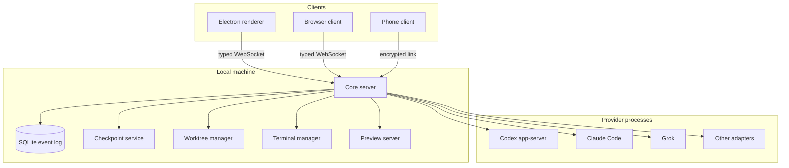
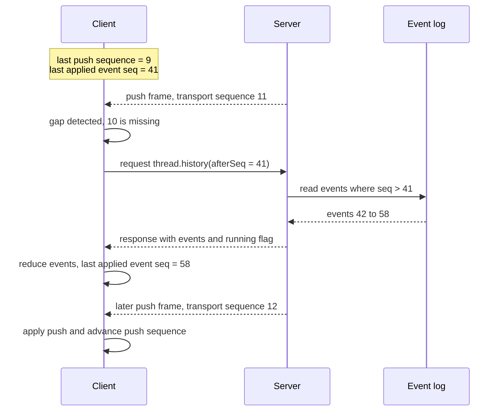

# Architecture: processes, protocol, state, and recovery

This document explains how TasteCode keeps one coherent state while several clients
and several agent engines operate at the same time. The source is static. No runtime
was observed.

The architecture has one central rule. A local server owns all state and orchestration.
Every client is a thin renderer over a typed WebSocket protocol. The rule is a decision,
not a slogan. It decides where a provider process starts, where a credential lives,
where a checkpoint is written, and how a client recovers after a network gap.

## The shape and the process boundary

The architecture document opens with the rule.

```text
# docs/ARCHITECTURE.md:11-12
**A local server owns all state and orchestration. Every client is a thin renderer over a
typed WebSocket protocol.**
```

The rule covers thread, project, and turn state. It does not cover renderer-only
interface preferences. The browser preview keeps its recently used pages in renderer
storage, per origin, capped at 50 (`docs/ARCHITECTURE.md:281-288`). That list is not
thread state, and no other client reads it.

The server is a long-lived local Node.js process. The desktop host is an Electron shell.
The web client is a browser application. The phone client is an Expo application. The
desktop and web clients open a WebSocket to the server. The phone uses an encrypted link.

The next diagram shows the main processes. Arrows show who starts whom. A client does
not start a provider. The server does.



The architecture document records two rejected alternatives at
`docs/ARCHITECTURE.md:48-49`. The first alternative put all orchestration in the
Electron main process. That choice would remove the web client. The second alternative
used tRPC on the wire. That choice would tie the protocol to a TypeScript client. The
project kept a plain typed WebSocket instead.

A normal turn starts in the orchestrator. The orchestrator is a large module in
`apps/server/src/orchestrator.ts`. It starts a provider session through the adapter
registry. It records events in the store. It takes a checkpoint before the agent writes.
It sends pushes to every connected client.

## The typed protocol

The protocol has two shapes. The first shape is a request/response exchange. A client
sends one request frame, and the server sends one response frame. A request frame has an
identifier, a method, and parameters. The second shape is a push frame, which the server
sends unprompted. Each frame is validated at the boundary in both directions.

The protocol version and error codes are fixed values.

```text
# packages/contracts/src/protocol.ts:60-70
export const PROTOCOL_VERSION = 2

/** Bumped whenever a client and server can no longer understand each other. */
export const ErrorCode = {
  BAD_REQUEST: 'bad_request',
  FORBIDDEN: 'forbidden',
  NOT_FOUND: 'not_found',
  PROVIDER_UNAVAILABLE: 'provider_unavailable',
  STALE_SNAPSHOT: 'stale_snapshot',
  INTERNAL: 'internal',
} as const
```

A request has an identifier, a method, and parameters. The identifier lets the client
match a response to a request. The method selects one schema in the contracts package.

```text
# packages/contracts/src/protocol.ts:85-90
export const RequestSchema = z.object({
  id: z.string(),
  method: z.string(),
  params: z.unknown(),
})
export type Request = z.infer<typeof RequestSchema>
```

The generic request shape is small. The real work is in the method table. Each method
declares its parameter schema and its result schema. For example, `thread.history` takes
a thread identifier, an optional `afterSeq`, and an optional page cursor. Its result
contains events, a running flag, a reset flag, and an optional page cursor.

The `stale_snapshot` error is part of the safety model. A diff review or a restore acts
on a specific snapshot. If the snapshot is old, the server refuses the action. The client
must refresh first. A silent action on stale data would be worse than a refusal.

The `provider_unavailable` error is part of the provider model. A missing executable, a
failed sign-in, or an unsupported capability is not a bad request. The distinction lets
the user interface show the right remedy.

## Pushes, sequence numbers, and resynchronisation

A push frame has a channel, a sequence number, and data. The sequence number is monotonic
for one connection. The protocol comment gives the reason.

```text
# packages/contracts/src/protocol.ts:2517-2527
/**
 * `sequence` is monotonic per connection. A client that sees a gap knows it
 * missed something and can resync, instead of silently diverging from the
 * server — which is the failure mode that is impossible to debug later.
 */
export const PushSchema = z.object({
  channel: z.string(),
  sequence: z.number(),
  data: z.unknown(),
})
export type Push = z.infer<typeof PushSchema>
```

The server sends all pushes through one ordered path. The `PushBus` class owns one
sequence counter per socket. It also bounds the buffer for each socket.

```text
# apps/server/src/push-bus.ts:12-18
export const MAX_PUSH_BUFFER_BYTES = 8 * 1024 * 1024
export const MAX_REPLY_FRAME_BYTES = 128 * 1024 * 1024
type PushSocketState = {
  sequence: number
  pushBytes: number
  replyBytes: number
}
```

The 8 MiB push buffer limit prevents one slow client from consuming unbounded memory.
The 128 MiB reply frame limit bounds a single large response. These are source constants.
The runtime effect was not observed.

The client side is an explicit state machine. It is not a bare socket with ad hoc flags.

```text
# apps/web/src/transport.ts:93-100
/**
 * Client side of the wire protocol.
 *
 * An explicit state machine rather than a bare WebSocket: requests made while
 * disconnected are queued and flushed on reconnect, so the UI never has to know
 * whether the socket happens to be up right now.
 */
export type ConnectionState = 'connecting' | 'open' | 'reconnecting' | 'closed'
```

The transport queues requests while it is disconnected. It flushes the queue after the
socket opens. It preserves request order. It rejects requests that were already on the
wire when the socket closed, because the reply died with the socket. Requests that were
still queued survive and flush on the next connection.

The transport has explicit limits and deadlines.

```text
# apps/web/src/transport.ts:124-133
export const TRANSPORT_LIMITS = {
  requests: 512,
  queuedBytes: 128 * 1024 * 1024,
  bufferedBytes: 128 * 1024 * 1024,
  validationFrames: 2_048,
  validationBytes: 16 * 1024 * 1024,
  responseValidationBytes: 128 * 1024 * 1024,
  connectTimeoutMs: 10_000,
  requestTimeoutMs: 120_000,
} as const
```

The 512 request limit bounds the number of pending calls. The 120 second request timeout
prevents a lost reply from waiting forever. The connect timeout is 10 seconds. A socket
that does not open in that time is replaced.

The reconnect delay starts small and grows. The source uses a delay between 100 and 1000
milliseconds. The delay resets only after the server actually speaks. This detail matters.
A rejected WebSocket can open briefly before an authentication close. Resetting the delay
on open caused a zero-delay reconnect loop.

Push sequence numbers are per connection. A new socket starts at sequence 1. The client
resets its last push sequence when it opens a new socket. If the client carried the old
counter, the gap detector would fire on every reconnect. A warning that fires every time
is a warning that users learn to ignore.

The push sequence is a transport counter. It is not the event log sequence. The event
log gives each event a global sequence number. The client tracks the last event sequence
it applied separately. On a forward push gap, the transport listener calls
`markHistoriesForRecovery()` and `resync()` (`apps/web/src/App.tsx:2534-2537`). The
history load sends `thread.history` with `afterSeq` set to the last applied event
sequence, not the push sequence (`apps/web/src/thread-controller.ts:498-528`). A push
with a sequence at or below the last push sequence is ignored as stale
(`apps/web/src/transport.ts:656-676`).

The next diagram shows the two counters and the recovery path.



The event log is the recovery source. A client does not need a full transcript in memory.
It needs a recent snapshot and a sequence number.

**Aha:** The sequence number is a per-connection cursor, not a global clock. The global
truth is the event log sequence. The client compares the two only when it detects a gap.
This separation lets a reconnect start a fresh push counter without losing the thread.

## The SQLite event log

The event log is append-only. The event table has four columns.

```text
# apps/server/src/store.ts:463-468
CREATE TABLE IF NOT EXISTS events (
  seq       INTEGER PRIMARY KEY AUTOINCREMENT,
  thread_id TEXT NOT NULL,
  at        INTEGER NOT NULL,
  payload   TEXT NOT NULL
);
```

The `seq` column is the global order. The `thread_id` column groups events by thread.
The `at` column records time. The `payload` column holds the domain event as text.

The architecture document states the storage rule. Transcript and orchestration history
change only by appending an event. Project, lifecycle, settings, and catalog metadata are
ordinary transactional records. Read models that derive from the event log must not be
written directly.

The database also holds projection tables. Examples are `usage_events`, `inbox_events`,
`turn_diff_events`, `checkpoints`, and `design_runs`. These tables can be rebuilt from the
log or from their own source. The event log remains the durable record.

SQLite runs with write-ahead logging. Search uses the SQLite Full-Text Search version 5 (FTS5)
module over message text and over the
first and last parts of command and tool output. The architecture document explains that
the first 12,000 and last 4,000 characters of output are indexed. This keeps long logs
from filling the index.

A design run has its own persisted table. The orchestrator stores a `DesignFlow` record
that includes the phase, the approved artifacts, the reference deck, the screenshots, the
repair attempt count, and correction state. The schema is `StoredDesignFlowSchema` in
`apps/server/src/orchestrator.ts`. This record lets a restart resume a design run.

## Checkpoints

A checkpoint is a point in both the conversation and the working tree. The comment in
the checkpoint module explains the problem.

```text
# apps/server/src/checkpoint.ts:16-31
/**
 * A point a session can be returned to.
 *
 * An agent that has gone the wrong way for five turns leaves the user undoing
 * it by hand. A checkpoint is a snapshot of the working tree taken before the
 * agent writes, plus the point in the conversation it belongs to, so going back
 * puts both halves right rather than only one.
 *
 * Snapshots are real git commit objects protected by app-owned refs — they do not
 * appear in the log, on a branch, or in `git status`. Nothing here changes what
 * the user would see in their own terminal until they ask to restore.
 *
 * The rule that makes this safe: **restoring takes a snapshot first**. Whatever
 * state is being replaced becomes a checkpoint of its own, so no sequence of
 * restores can reach a state nobody can get back to.
 */
```

A snapshot starts from the checkout index. The function copies the index into a temporary
file. It sets `GIT_INDEX_FILE` to that file. Then `git add -A` reads the working tree
without touching the user's index.

```text
# apps/server/src/checkpoint.ts:495-499
/** A short cache protects diff-only snapshots; durable metadata uses its own namespace. */
async function protectSnapshot(repoPath: string, commit: string, retainIn?: string): Promise<void> {
  assertCommit(commit)
  const refs = [`refs/harness/snapshots/${commit}`]
  if (retainIn !== undefined) refs.push(`refs/harness/checkpoints/${retainIn}/${commit}`)
```

The two references have different jobs. `refs/harness/snapshots/` protects a commit from
garbage collection. `refs/harness/checkpoints/<namespace>/` also makes the commit a named
checkpoint. The namespace must match `^[a-zA-Z0-9-]+$`. A bad namespace is an error.

The snapshot commit uses a fixed identity. The code sets `SNAPSHOT_IDENTITY` for the
`commit-tree` call. Hidden snapshot objects must not claim the user's identity. The code
also caches snapshots by repository, head, and tree. Identical state reuses one commit.
The cache holds at most 64 entries.

The clean path is fast. If the working tree matches HEAD, the snapshot returns the HEAD
commit and marks the snapshot clean. No commit object is created. The comment records the
reason. A snapshot used to take about ten Git runs and 23 seconds on a busy Windows
machine before the agent received the prompt.

A restore writes the snapshot tree back to the checkout. It records an undo record first.
The `restore_undos` table keeps the previous events and checkpoints. This makes the
restore itself reversible.

## Worktrees

A worktree is a private checkout for one session. The module comment states the problem
and the refusal rule.

```text
# apps/server/src/worktree.ts:15-25
/**
 * A private checkout per session.
 *
 * Two agents in one working directory overwrite each other's edits, and the
 * second one to write wins silently. A worktree gives each session its own
 * checkout of the same repository on its own branch, which is what makes
 * parallel work safe rather than merely concurrent.
 *
 * Everything here refuses rather than forces. An agent's work is the user's
 * work: losing it to a tidy-up is worse than leaving a directory behind.
 */
```

The default root is beside the database. The orchestrator computes it from
`HARNESS_WORKTREE_DIR`, or from a `trees` directory next to the store location. The
worktree branch name is `harness/<short thread id>`. The path uses the same short
identifier.

The creation function runs `git worktree prune` first. Stale metadata from a crash can
make Git believe a path is registered. Pruning forgets worktrees whose directory is gone.
Then the function runs `git worktree add -b <branch> <path> <base>`.

A project can be a subfolder of its repository. The function reads the repository prefix
and returns a `workPath` inside the checkout when that folder exists. This keeps the
project scope.

Uncommitted changes can be carried into a new worktree. The carry operation reads the
source checkout and applies one patch to the target. The patch is applied whole or not
at all. The source changes stay in place. The maximum patch size is 64 MiB.

Removal refuses a dirty worktree. The `WorktreeDirty` error tells the user to commit or
discard the changes. The module also exposes a prune function and a list function.

## Terminal process ownership

A terminal is a pseudo-terminal (PTY). The server owns the shell and the foreground job. Closing
a pane
does not kill every process that the shell ever started. It ends the foreground job with
a bounded sequence of signals.

```text
# apps/server/src/terminal.ts:10-20
// A pane or chat close: how long each step may take, counted from its start.
// After SIGHUP the shell gets `hangup` to exit before SIGKILL. Once it is gone
// its foreground job gets `hangup` to exit on its own, then `terminate` after
// SIGTERM and `kill` after SIGKILL before the close gives up and logs it.
const CLOSE_STEPS = { hangup: 3_000, terminate: 3_000, kill: 1_000 }
// Server shutdown: the latest each step may end, counted from closeAll(), so
// the last SIGKILL goes out about two seconds in, inside the desktop's
// three-second force stop. Most of it belongs to SIGTERM: servers such as
// gunicorn, nginx or postgres reload on SIGHUP and shut down cleanly only on
// SIGTERM.
const SHUTDOWN_STEP_ENDS = { hangup: 200, terminate: 2_000, kill: 2_300 }
```

The steps have three seconds, three seconds, and one second for a pane close. The total
is seven seconds, but the steps are counted from their own start. Server shutdown uses
one shared deadline. The last SIGKILL goes out at about 2.3 seconds. The desktop force
stop is three seconds.

The manager reads the foreground process group before it hangs up the shell. It needs a
shell that it forked as a session leader. The process inspection is synchronous for this
step. A close must learn which job holds the terminal before node-pty sends SIGHUP.

After the shell exits, the manager stops the foreground job in the background. The chat
can open a new terminal at once. The old job gets a grace period, then SIGTERM, then
SIGKILL. A job that still cannot be stopped is logged. The close does not fail.

The output path is also bounded. The terminal manager batches output. The default batch
delay is 4 milliseconds and the default batch size is 64 KiB. It retains 200,000 bytes of
output and up to 64 exit records. An exit record lives for one hour.

## The adapter boundary

The adapter layer hides provider details from the orchestrator. The orchestrator never
learns which provider it is talking to. One comment states the rule.

```text
# apps/server/src/adapters.ts:42-49
/**
 * One shape every engine is driven through.
 *
 * The orchestrator above this never learns which provider it is talking to.
 * That is the whole point of the layer: adding an engine is a new case here,
 * not a change to session handling, and capabilities tell the UI what to hide
 * rather than letting it guess.
 */
```

Every adapter exposes an `AgentSession`. The interface has a capability record, an
optional snapshot function, an optional prompt limit, and optional model context lookup.

```text
# apps/server/src/adapters.ts:89-98
export interface AgentSession {
  /** Credential-free adapter state persisted at completed-turn boundaries, never per delta. */
  snapshot?(): unknown
  readonly capabilities: Capabilities
  /**
   * The longest prompt, in UTF-16 code units, one turn can carry. Set by an
   * engine that passes its prompt on a command line, which the system limits;
   * absent when the prompt travels where length does not matter.
   */
  readonly promptLimit?: number
```

The snapshot is credential-free. The server persists it only at completed-turn
boundaries, not on every delta. This rule limits both storage writes and credential
exposure.

The prompt limit is a provider fact. An engine that passes the prompt on a command line
has an operating-system limit. An engine that sends the prompt over a stream does not.
The server can split or refuse a prompt only when the adapter declares a limit.

The `modelContextWindow` method handles a model-specific context size. An engine that
knows the window per model can answer it. An engine that declares one window in its
capabilities does not need the method.

## Failure and recovery summary

The architecture has four recovery layers. Each layer has one owner.

| Layer | Owner | Recovery action |
|---|---|---|
| Push stream | Client transport | Detect a sequence gap, request history after the last sequence |
| Transcript | Event log | Replay events, rebuild read models |
| Working tree | Checkpoint service | Restore a commit after taking a new snapshot |
| Provider session | Adapter registry | Resume, or start a new session with a snapshot |

The layers are independent. A missed push does not corrupt the log. A restore does not
change the log history. A provider restart does not lose the working tree.

The design run adds one more layer. The `DesignFlow` record is persisted after each
transition. A restart can resume the flow at the last saved phase. The record includes
the correction state and the repair attempt count. The phase pipeline is the subject of
the next document.

## What was not verified

No server was started. No WebSocket connection was opened. No push gap was induced.
No checkpoint was created. No worktree was added. No PTY was opened. The timings and
limits above come from source constants and comments. The runtime effect of those values
is not verified.

The next document, `02-core-mechanism.md`, explains how a design brief becomes a sequence
of typed phases and validated artifacts.
