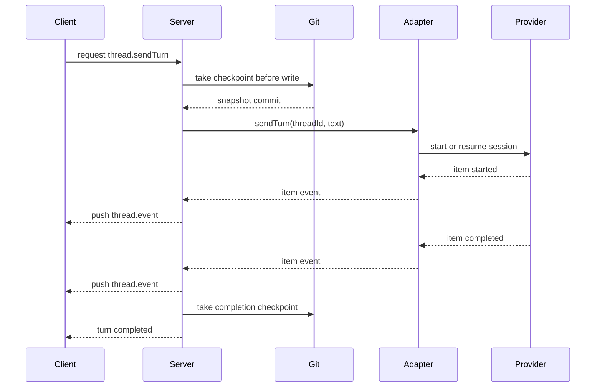
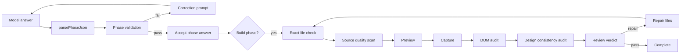

# Workflow and quality: one run from request to reviewed result

This document follows one request through the system. It starts with a normal agent
turn. It then follows a Design Mode run. It ends with the quality gates and the
verification tools that run around both paths.

The account is static. No turn was sent. No provider was started. No preview was
opened. The source states the order. The runtime timing is not verified.

## One normal turn

A user sends a message from a client. The client validates the request frame and sends
it over the typed WebSocket. The server validates the frame again at the boundary.
The orchestrator then starts or reuses a provider session for the thread.

The turn has a set of guards. A turn cannot start during a panic stop. A panic stop is
the orchestrator's global Stop all. It sets an internal flag and increments a generation
counter, so new work rejects and running work cancels (`orchestrator.ts:5415-5434`). A
turn also cannot start while a diff rejection is running. It cannot start while a
checkpoint restore is running. It cannot start while the thread is moving to another
provider. Each guard throws a specific error. The client can show the reason instead of
a generic failure.

After the guards, the orchestrator reserves the checkout for this turn. It takes a
checkpoint before the provider receives the prompt. The position is deliberate.

```text
# apps/server/src/orchestrator.ts:3196-3200
    try {
      this.#checkoutAccess.beginTurn(this.#repoPath(threadId), threadId)
      // Before the agent writes, not after. A checkpoint taken afterwards would
      // record the damage rather than the state worth returning to.
      await this.#checkpoint(threadId, text)
```

The checkpoint function is fast on a clean tree. It reads the snapshot base and the
clean status in parallel. If the tree matches HEAD, it protects the HEAD commit and
returns. It does not build a new tree.

```text
# apps/server/src/checkpoint.ts:81-90
  // Every turn starts with a snapshot, and building one took about ten git
  // runs in a row (23 s on a busy Windows machine) before the agent got the
  // prompt. A checkout that matches HEAD needs only a status.
  const [base, status] = await Promise.all([snapshotBase(repoPath), cleanStatus(repoPath, scope)])
  // Before the first commit there is no HEAD; snapshots then start from the empty tree.
  const head = base.head
  if (head && status === '' && (await indexTrustsWorkingTree(repoPath))) {
    await protectSnapshot(repoPath, head, retainIn)
    return { commit: head, clean: true }
  }
```

A dirty tree needs a snapshot commit. The function copies the checkout index to a
temporary file. It sets `GIT_INDEX_FILE` for the Git commands. The user's index is not
touched.

```text
# apps/server/src/checkpoint.ts:96-107
    const env = { ...process.env, GIT_INDEX_FILE: indexFile }
    // Timeouts throughout: a hung git here leaves every diff/review RPC above
    // this pending forever. Seed from HEAD so the snapshot is a diff against
    // it rather than a tree built from nothing.
    if (!head || !(await seedFromCheckoutIndex(repoPath, head, indexFile, env))) {
      await run('git', head ? ['read-tree', head] : ['read-tree', '--empty'], {
        cwd: repoPath,
        env,
        windowsHide: true,
        timeout: 60_000,
      })
    }
```

The snapshot is ready before the provider gets the prompt. If the turn fails, the
checkpoint still exists. The user can return to the state before the turn.

## The provider turn and the item stream

The orchestrator passes the prompt to the adapter. The adapter starts or resumes the
provider session. The session returns a turn identifier. The adapter reports items as
they start, change, and complete. The orchestrator records each item as an event.

The item types are a fixed union in the contracts. A message, a reasoning block, a
command, a file change, a tool call, a plan, and an error are different items. The user
interface renders them differently. An unknown item is rendered as raw text and is never
dropped.

Each event is appended to the log. A push sends the event to every connected client.
The push carries a per-connection sequence number. A client that detects a gap asks for
the tail of the history.

The history request can ask for events after a sequence number. It cannot combine a
backward page with a forward replay.

```text
# packages/contracts/src/protocol.ts:2075-2087
  'thread.history': {
    params: z
      .object({
        threadId: z.string(),
        afterSeq: z.number().optional(),
        /** Opt in to complete-turn pages. Omit before for the newest page. */
        page: z
          .object({
            before: z.string().min(1).max(512).optional(),
            turnLimit: z.number().int().min(1).max(100).optional(),
          })
          .optional(),
      })
```

This is the recovery path for a client that fell behind. The server does not replay the
whole thread unless the client asks for the whole thread.

The turn can run a command in a terminal. The terminal is a pseudo-terminal (PTY). The
server owns the shell and the foreground job. When the user closes the pane, the server
reads the foreground group first.

```text
# apps/server/src/terminal.ts:393-404
  #closeEntry(terminalId: string, entry: TerminalEntry, rows: ProcessRow[]): Promise<void> {
    // node-pty only sends SIGHUP, which a foreground job may ignore — a server
    // that treats it as "reload" outlives the pane. Read which job holds the
    // terminal now: once the shell exits, nothing records it.
    const shell = ownedShell(rows, entry.process.pid)
    const job =
      shell && shell.foreground > 1
        ? { group: shell.foreground, session: shell.session }
        : undefined
    // Kill first. If node-pty rejects the request synchronously, the terminal
    // remains attached and a later close can retry instead of losing it.
    entry.process.kill()
```

The close is not a single kill. The manager sends SIGHUP, then SIGTERM, then SIGKILL
in bounded stages. The shell and the job have separate grace periods. The details are
in `01-architecture.md`.

The sequence below shows the normal turn.



## The tool call

A tool call is one item in the stream. The adapter reports it. The server does not execute it.
The provider owns the coding loop and its tools (`docs/PROVIDERS.md:7-9`). The engine starts the
tool, reports `item.started`, and reports `item.completed` with the result. The orchestrator
records both events and pushes them to the clients.

This split is deliberate. Design Mode does not create a second agent framework
(`docs/DESIGN-AGENT.md:42-43`). A server-side tool runner would need its own permissions, its own
sandbox, and its own approval model. The engine already has them.

A command item is the engine's shell command. It is not the user's terminal. The user's
terminal is a separate PTY that the server owns. Its close bounds appear in the gate
table below.

## The diff review

When a turn changes files, the client can read a diff. The diff compares the working
tree with the repository HEAD commit tree. Before the first commit, it compares the
working tree with the empty tree (`apps/server/src/diff-review.ts:98-103`). It does not
use the turn checkpoint. A review action is per hunk or per file. A reject action
reverses that hunk in the working tree.

The server checks the diff version first. The version is a digest of the diff base value
and the current snapshot tree hash (`diff-review.ts:103`). A version mismatch raises
`StaleDiffSnapshotError`. The error message tells the user to refresh. The server does
not apply a decision to a diff that the user has not seen (`diff-review.ts:82-89`).

```text
# apps/server/src/diff-review.ts:43-60
export async function reviewDiffHunk(
  repoPath: string,
  threadId: string,
  version: string,
  filePath: string,
  hunkId: string,
  decision: DiffDecision,
  store: Store,
): Promise<SessionDiff> {
  const diff = await currentDiff(repoPath, threadId, version, store)
  const file = diff.files.find((entry) => entry.value.path === filePath)
  const hunk = file?.hunks.find((entry) => entry.value.id === hunkId)
  if (!file || !hunk) throw new Error('diff hunk not found')

  if (decision === 'reject') await reverseUnifiedDiff(repoPath, hunk.patch)
  store.setDiffDecision(threadId, hunkTarget(hunkId), decision)
  return readSessionDiff(repoPath, threadId, store)
}
```

The reject path applies the reverse patch to the checkout. It then records the decision
in the store. The next diff reads the new state. A rejected hunk is not hidden from the
event log. It is a recorded decision.

## One Design Mode run

A Design Mode run starts from a composer toggle. The attachment identifies the request
as a design brief. The server creates a design flow and records the phase as `brief`.
The brief turn is a normal provider turn with a special prompt.

The brief phase returns a `complete` or `not_design` answer. A `questions` answer is
rejected with a correction. A complete answer is validated field by field and written to
`.taste/brief.json`. A `not_design` answer ends the run with an explanation. The brief is
a hard gate. No build starts before it validates.

The server then selects typography candidates and a reference deck. It snapshots the
reference files. It moves to the Brand phase and starts the next turn automatically.

The Brand phase writes `.taste/brand.json`. The Page phase writes `.taste/page.json`.
The Asset phase writes `.taste/assets.json`. Each transition validates the answer and
stores the artifact. Build and Repair change project files. Preview records a plan and
screenshots. Complete and Response write no `.taste` artifact. A validation failure
produces a correction turn with a diagnostic.

The Build phase implements the page. The server checks the changed file set and the
source quality before it starts the preview. The Preview phase returns a plan. The
server starts the preview on a local port and captures the viewports.

The Review phase receives the screenshots. It returns a verdict and findings. The server
adds automated findings from the screenshot Document Object Model (DOM) audit. It also adds design consistency
findings. The final verdict can be `pass` or `repair`.

The transition code is the clearest summary of the loop.

```text
# apps/server/src/orchestrator.ts:7324-7358
    if (flow.phase === 'review') {
      this.#validateDesignBuild(flow, [])
      const review = designAgent().writeVisualReview(
        flow.workspacePath,
        this.#enforceDesignConsistency(
          flow,
          designAgent().enforceDomAuditFindings(
            designAgent().parseReviewPhaseOutput(text),
            flow.screenshots ?? [],
            flow.previewPlan?.viewports,
          ),
        ),
      )
      flow.correcting = false
      flow.review = review
      if (review.verdict === 'pass') {
        flow.phase = 'complete'
        const cropped = designAgent().croppedReviewScreenshots(flow.screenshots ?? [])
        flow.completion = `Preview ready at ${flow.previewUrl}. Visual review passed${
          flow.repairAttempt
            ? ` after ${flow.repairAttempt} repair attempt${flow.repairAttempt === 1 ? '' : 's'}`
            : ''
        }${
          cropped.length
            ? ` for the captured part of the page only; ${cropped.join(', ')} ended before the page did, so review the rest yourself`
            : ''
        }.`
      } else if (flow.repairAttempt >= DESIGN_REPAIR_LIMIT) {
        flow.phase = 'complete'
        flow.completion = `Preview ready at ${flow.previewUrl}. Visual review stopped after ${DESIGN_REPAIR_LIMIT} repair attempts with ${review.findings.length} finding${review.findings.length === 1 ? '' : 's'} remaining.`
      } else {
        flow.phase = 'repair'
        flow.repairAttempt += 1
        flow.pendingPrompt = this.#designPromptFor(flow)
      }
```

The completion message is honest. It names the preview Uniform Resource Locator (URL). It names the number of
repair attempts. It names the number of findings that remain. If a screenshot ended
before the page ended, the message says so. The user must review the rest.

## The quality gates in order

The gates below run at different times. Some run inside a phase. Some run after a
phase. Some run only in a local release check.

| Gate | When | Owner |
|---|---|---|
| Brief validation | Before any design work | `packages/design-agent/src/brief.ts` |
| Phase answer recovery and boundary checks | Every model answer | `packages/design-agent/src/phase-json.ts`, `parse.ts` |
| Palette contrast audit | Brand phase | `packages/design-agent/src/palette.ts` |
| Reference lock | Page phase | `packages/design-agent/src/page-phase.ts` |
| Asset resolution | Asset phase | `packages/design-agent/src/assets.ts` |
| Exact build file check | After Build and after Repair | `packages/design-agent/src/build-phase.ts` |
| Source quality scan | Before Preview and after Repair | `packages/design-agent/src/source-quality.ts` |
| Design consistency audit | Review | `packages/design-agent/src/design-consistency.ts` |
| DOM audit | Review | `packages/design-agent/src/review-phase.ts` |
| Preview command allowlist | Preview start | `apps/server/src/design-preview-runner.ts` |
| Diff freshness | Diff review | `apps/server/src/diff-review.ts` |
| Terminal close bounds | Pane close and server shutdown | `apps/server/src/terminal.ts` |
| Lint, typecheck, test, build | Local release check | `package.json` |
| Renderer performance gate | Local release check | `apps/desktop/scripts/verify-performance.js` |

The next diagram shows the design gates in order. Repair output passes the exact-file
and source-quality checks again. The running preview then serves the repaired files, and
capture repeats. A new Preview model turn does not run.



## Gate: palette contrast

The palette generator builds a set of role pairs. The audit checks each pair against a
minimum ratio. The ratio is computed from the foreground and background values.

```text
# packages/design-agent/src/palette.ts:207-220
export function auditPalette(roles: PaletteRoles): PaletteAudit {
  const checks = CONTRAST_PAIRS.map(({ foreground, background, minimum }) => {
    const ratio = contrast(roles[foreground], roles[background])
    return {
      foreground,
      background,
      ratio,
      minimum,
      criterion: minimum === 4.5 ? 'WCAG 2.2 1.4.3' : 'WCAG 2.2 1.4.11',
      pass: ratio >= minimum,
    } satisfies PaletteContrastCheck
  })
  return { pass: checks.every(({ pass }) => pass), checks }
}
```

A normal text pair needs a ratio of 4.5. A non-text pair needs a ratio of 3. The criterion
strings name the Web Content Accessibility Guidelines (WCAG) 2.2 success criteria. The
audit returns every check, not only the failures. A failed palette blocks the Brand
phase.

## Gate: exact build files

Some briefs define an exact output set. The function computes the expected set from the
brief. It adds parent directories to the expected set. It then compares the expected set
with the actual workspace entries.

```text
# packages/design-agent/src/build-phase.ts:241-247
export function validateExactBuildFiles(
  workspacePath: string,
  brief: DesignBrief,
  baseline: string[] = [],
): void {
  const expected = exactBuildFiles(brief)
  if (!expected) return
```

The comparison has three failure lists. A missing file was expected and is absent. A
removed file existed before the run and is gone. An unexpected file was created and is
not in the expected set. The error message lists each list. The Build or Repair turn
must correct the set.

## Gate: source quality

The source quality gate rejects recurring generated motifs. The comment names the card
rail. The scan also finds unmanifested scalable vector graphics (SVG) substitutes.

```text
# packages/design-agent/src/source-quality.ts:17-27
/** Reject the recurring generated card-rail motif before Preview and after Repair. */
export function validateDesignSourceQuality(
  workspacePath: string,
  reportedFiles: readonly string[] = [],
  baseline: readonly string[] = [],
  assets?: AssetManifest,
  page?: PageBlueprint,
): void {
  // Reported folders such as dist are informational; their files are scanned below.
  for (const file of reportedFiles)
    containedWorkspaceFile(workspacePath, file, 'reported Build file', true)
```

The function computes a baseline before the build. It filters out violations that were
already present. A pre-existing card rail does not fail a new run. A newly introduced
card rail does. This rule prevents the gate from blaming the model for the user's code.

The scan has limits. It reads at most 32,000,000 bytes of source. It scans source files,
not built output. A reference-bound page and a native dashboard have exceptions for
native SVG and simple dividers.

## Gate: design consistency

The design consistency audit checks the implemented page against the brand. It looks at
colour literals, font families, radius values, and the token block. The result is a list
of findings.

```text
# packages/design-agent/src/design-consistency.ts:162-176
export function enforceDesignConsistencyFindings(
  review: VisualReview,
  audit: DesignConsistencyAudit,
  options: DesignConsistencyOptions = {},
): VisualReview {
  const automated = designConsistencyFindings(audit, options)
  if (!automated.length) return review
  const owned = new Set<string>(DESIGN_CONSISTENCY_FINDING_IDS)
  return {
    ...review,
    verdict: 'repair',
    summary: `${review.summary} TasteCode source audit found ${automated.length} design-language finding${automated.length === 1 ? '' : 's'}.`,
    findings: [...review.findings.filter(({ id }) => !owned.has(id)), ...automated],
  }
}
```

The function replaces any model finding that uses a reserved identifier. It then appends
the automated findings. The verdict becomes `repair`. The model cannot pass the review
while an automated consistency finding remains.

## Gate: DOM audit

The screenshot capture runs a DOM audit for each viewport. The audit runs during every
capture, including the capture after a repair (`apps/desktop/src/preview-capture.ts:281`).
It counts `h1` elements, capped at 10,000. It records interactive elements whose own
border box is smaller than 44 by 44 pixels. A large associated label passes the element.
Each violation records the selector, label, width, height, and a `partiallyClipped` flag
when the control is clipped. The list stops at 200 violations. The audit also records a coverage value of `complete`
or `partial` (`apps/desktop/src/preview-dom-audit.ts:162-217`). The review enforcement
turns these records into blocking findings
(`packages/design-agent/src/review-phase.ts:264-287`).

```text
# packages/design-agent/src/review-phase.ts:264-287
const AUDIT_FINDING_IDS = new Set<string>([
  'document_h1_count',
  'interactive_target_size',
  'mobile_interactive_target_size',
  ...DESIGN_CONSISTENCY_FINDING_IDS,
])

export function enforceDomAuditFindings(
  review: VisualReview,
  screenshots: ReviewScreenshot[],
  expectedViewports?: readonly { width: number; height: number }[],
): VisualReview {
  validateReviewScreenshots(screenshots, expectedViewports)
  // A partial walk can miss the only h1 (closed shadow roots, the element bound),
  // so zero found is not evidence of zero present. More than one still is.
  const h1Failures = screenshots.filter(
    ({ domAudit }) =>
      domAudit &&
      (domAudit.h1Count > 1 || (domAudit.h1Count === 0 && domAudit.coverage !== 'partial')),
  )
  const targetFailures = screenshots.filter(
    (screenshot) => screenshot.domAudit?.interactiveTargetViolations.length,
  )
  const findings = review.findings.filter(({ id }) => !AUDIT_FINDING_IDS.has(id))
```

The `h1` rule has a careful exception. A partial DOM walk can miss the only `h1`. Zero
found is not proof that zero exists. More than one found is proof. The audit does not
raise a false blocking finding from an incomplete walk.

The interactive target rule requires a box of at least 44 by 44
pixels in Cascading Style Sheets (CSS). The app
screen build prompt explains the remedy. An app sheet is the layout set that the server
selects from the bundled tasteskill app library (`docs/ARCHITECTURE.md:852-857`). The
visible control can be smaller if the element's box is 44 pixels. The hit area passes and
the visual size follows the app sheet.

## Gate: preview safety

The preview runner starts a local server. A command preview can run only an allowlisted
command. The `npx` command is absent on purpose.

```text
# apps/server/src/design-preview-runner.ts:13-19
/**
 * `npx` is deliberately absent: it fetches and executes a package from the
 * network, which turns "the model chose a preview command" into arbitrary
 * remote code execution. Everything left here runs code that is already in
 * the workspace the user opened.
 */
const COMMANDS = new Set(['bun', 'node', 'npm', 'pnpm', 'yarn'])
```

The runner rejects shell metacharacters in arguments. It rejects package-manager
options that can change the script or the shell. It allows only `--if-present` and
`--silent`. It claims a port before it starts the child process. It refuses a port that
the application itself uses.

A static preview serves files from a workspace root. It resolves the real path and
asserts that the file is inside the root. It bounds markup size and node count. It sets
a content type per extension. It does not execute server-side code.

## Verification tooling

The root package defines the local checks. The commands are part of `package.json`.

```text
# package.json:9-20
  "scripts": {
    "dev": "node tools/scripts/dev.js",
    "harness": "tsc -b apps/server && node apps/server/dist/cli.js",
    "build": "pnpm -r build",
    "typecheck": "pnpm -r typecheck",
    "test": "node --test tools/scripts/release-licenses.test.js tools/scripts/release-tools.test.js tools/scripts/check-update-feed.test.js tools/scripts/dev-process-ownership.test.js tools/scripts/tracked-secrets.test.js && pnpm -r test",
    "licenses:verify": "node tools/scripts/release-licenses.js",
    "licenses:report": "node tools/scripts/release-licenses.js --output release/license-metadata.json",
    "release:check-updates": "node tools/scripts/check-update-feed.js",
    "lint": "oxlint . && prettier --check .",
    "format": "prettier --write ."
  },
```

The test command runs five release tool tests first. It then runs the workspace tests.
The five tests cover licence collection, release tools, the update feed, development
process ownership, and tracked secrets. The secret test is a guard against a committed
credential.

The repository keeps verification records under `docs/verification/`. The records are
historical evidence, not a live status. One record states its own limits.

```text
# docs/verification/pr-quality-2026-09-09.md:42-44
Local validation used Node 24.14.1 and pnpm 11.8.0: lint, typecheck, the complete test suite
(2,812 tests), build, and license verification (398 packages) passed. The server suite starts
real loopback previews and checks their shutdown and cleanup. This validates the source on
```

The record says the validation was on macOS arm64. It says the result is not a hosted
Windows run and not a signed-artifact run. The document does not claim more than it
observed.

The desktop performance gate is separate. It runs three renderer samples and three cold
starts. It uses temporary data folders and unused loopback ports.

```text
# docs/PERFORMANCE-CHECKS.md:10-18
The gate uses three independent renderer samples and three cold app starts. It opens
isolated test windows, chooses unused loopback ports, and uses temporary data folders.
It does not restart the shared development stack or run hosted CI. A custom report folder
can be passed as the last argument.

The visible fixture renders the real thread component at 1180 by 820 pixels, visits all
500 messages, applies at least 1,000 streamed deltas, and switches among five task stores.
The gate checks the first paint, frame times, delta batch work, session switches, cold
startup, and idle memory against [the architecture budgets](./ARCHITECTURE.md).
```

The performance gate is a local release check. It is not part of the normal unit test
command. The architecture budgets are acceptance criteria for a change. The code rules
state that a change which regresses a budget is a broken change.

## The order of trust

The gates have a deliberate order. A cheap structural check runs before an expensive
model call. A file set check runs before a preview. A DOM audit runs before the visual
review. A visual review runs before a repair.

The order saves time. It also makes the failure message specific. A wrong file set
fails before a browser opens. A missing `h1` fails with an audit identifier, not with a
vague visual comment.

**Aha:** The automated audits are not advisory. The server filters model findings that
reuse an audit identifier and appends its own finding. The model cannot talk its way
past a measured failure. The review verdict changes to `repair` when the source audit
finds a problem. This is the difference between a design suggestion and a design gate.

## What was not verified

No turn was sent. No checkpoint was created. No diff was reviewed. No terminal was
closed. No design run was started. No preview was captured. The gate order and the
constants come from source. The behaviour under a failure is not verified.

The next document, `04-limits-and-comparison.md`, records the limits, the rejected
decisions, the provider capability differences, and the comparison with the
`taste-skill` package.
