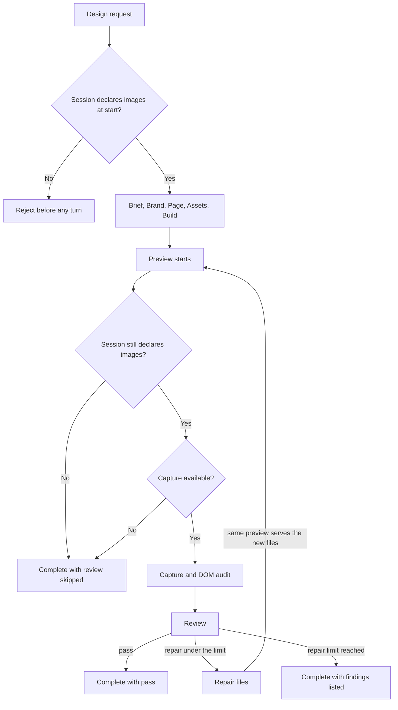
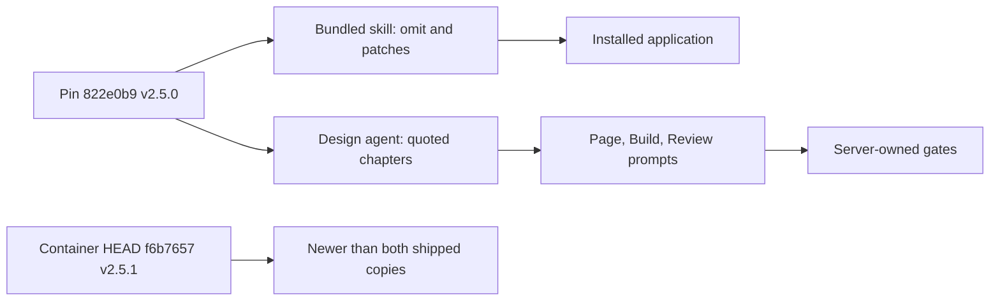

# Limits and comparison: what the system refuses and what it cannot prove

This document records three things. First, the limits that the beta states about itself. Second,
the decisions that the project rejected and the reasons. Third, the provider differences and the
relation to the `taste-skill` package.

The source is static. No provider was started. No design was built. No skill script was run.

## The beta states its own limits

The product is an early beta. The README says so without a softer word.

```text
# README.md:9-11
**Early beta (`0.1.1`).** Expect bugs, rough edges, and changes as we keep working
on TasteCode. Please [report any issues](https://github.com/Leonxlnx/tastecode/issues) you find.
```

The Windows build is unsigned and can show a SmartScreen warning. The macOS build is signed and
notarized (`README.md:36-37`). The two platforms do not have the same trust story. A user must not
read "signed" as a property of both installers.

The download page lists Windows x64 and macOS Apple Silicon only (`README.md:3-4`). No Intel macOS
build and no Linux build appear in that list. The source tree can run on other systems, but the
beta does not ship an installer for them.

## Limits inside Design Mode

The design pipeline has hard resource limits. A scan that passes a limit stops with an error. It
does not accept a partial result.

```text
# docs/DESIGN-AGENT.md:463-465
Filesystem work has explicit limits: 25,000 entries, 40 directory levels, 2 MB per source or JSON
artifact, 32 MB of scanned source, 32 MB per media file, and 128 MB per media snapshot. A scan that
exceeds a limit stops with an error instead of silently accepting unchecked files.
```

The quoted megabytes are decimal values. The source constants are 25,000 entries and 40
directory levels (`packages/design-agent/src/workspace-files.ts:12`, `:19`). The scanned
source limit is 32,000,000 bytes (`source-quality.ts:13`). A media file stops above
32,000,000 bytes, and a media snapshot stops above 128,000,000 bytes (`assets.ts:311`).
One `.taste` artifact stops above 2,000,000 bytes (`artifact-store.ts:6`).

The artifact writer uses an atomic rename and does not follow a file symlink
(`artifact-store.ts:12-15`).

The correction budgets are also finite. Brand, Page, and Assets get three corrections
(`apps/server/src/orchestrator.ts:352`). Asset acquisition gets six while each pass
reduces the unresolved set (`orchestrator.ts:354`). The remaining model phases get one
correction each (`orchestrator.ts:7612-7624`). Repair rounds get two (`orchestrator.ts:712`).
There is no separate budget for a malformed answer. A parse or validation error uses the
budget of its phase.

The bounds have a clear purpose. A model can loop on a failing check. A bounded loop turns a
possible infinite retry into a visible stop with a message. The user can then act.

Two feature switches are off or conditional. The app-screen path is behind `APP_SCREENS_ENABLED`
(`docs/ARCHITECTURE.md:855`). The dashboard image catalog is parked behind
`DASHBOARD_REFERENCES_ENABLED` (`docs/ARCHITECTURE.md:865-866`). The owner decided on 2026-10-16
that the dashboard asset set was not good enough to ship. A dashboard request becomes a normal
website run while that switch is off (`docs/ARCHITECTURE.md:872-873`).

Reference-driven Design needs an image input capability. A provider without that capability rejects
the run before inference and before any persisted Design state (`docs/ARCHITECTURE.md:916-917`).
The workflow does not replace an image-based build with a text-only build.

## What the visual review cannot prove

The Review phase reads screenshots and a Document Object Model (DOM) audit. It does not prove that
the page is factually correct or that its controls work.

```text
# docs/DESIGN-AGENT.md:521-524
This phase deliberately makes only claims supported by screenshots and attached DOM audits. It
does not infer factual accuracy, working interactions, conversion, user comprehension, loading
performance, or provenance. Those require source, runtime, user, analytics, or performance
evidence outside the visual-review artifact.
```

The design source audit has the same honesty rule. It checks fonts and corner radii against the
brand. A finding turns a pass into a repair, and the two-attempt limit bounds that repair
(`docs/DESIGN-AGENT.md:518-519`). A scan that cannot run is logged and skipped. It never fails the
run (`docs/DESIGN-AGENT.md:519`).

The provider runs the project checks. TasteCode validates the shape of the final report. It does
not independently prove that each reported command ran.

```text
# docs/DESIGN-AGENT.md:467-469
The provider is currently responsible for running the project's relevant checks through its
available tools. TasteCode validates the final report shape but does not independently prove that
every reported command ran. This distinction matters for future verification work.
```

This is a real limit. A model can report a test result that it did not obtain. The Build phase
checks the file set and the source patterns, but it does not rerun the project test suite. The
quality gates in `03-workflow-and-quality.md` reduce the space for a false report. They do not
close it.

## Decisions the project rejected

The architecture document keeps a rejection record. The record is useful because it stops the team
from arguing the same choice again (`docs/ARCHITECTURE.md:3`). The table below lists the choices
that shape this exploration.

Two terms recur in the table. An app sheet is a set of screen layouts, one shell, and the style
tokens for one product interface. The server deals the sheet: it selects one from the bundled
tasteskill app library and persists it with the run (`docs/ARCHITECTURE.md:852-857`).

| Area | Chosen path | Rejected path | Stated reason |
|---|---|---|---|
| State owner | Local server | All logic in the Electron main process | The web client would be impossible (`docs/ARCHITECTURE.md:48`) |
| Wire format | Typed WebSocket | tRPC | tRPC ties the client to TypeScript (`docs/ARCHITECTURE.md:48-49`) |
| Terminal close | Bounded signals to the foreground job | Sweep the whole pseudo-terminal (PTY) session | A sweep kills `nohup` jobs that a terminal leaves running (`docs/ARCHITECTURE.md:83-84`) |
| Feedback key | Server process only | Renderer `fetch` to the feedback service | A renderer call widens the Content Security Policy (CSP) and exposes the key (`docs/ARCHITECTURE.md:105`) |
| Phone link | End-to-end encrypted frames | Bearer token in a plaintext WebSocket address | A token is readable on a shared network (`docs/ARCHITECTURE.md:161-163`) |
| Desktop shell | Electron | Tauri, Wails, or Neutralino | The alternatives use divergent system webviews (`docs/ARCHITECTURE.md:210-211`) |
| Browser preview | Same guest, typed messages | Guest-to-host channels and persistent injected listeners | The rejected path adds a trust boundary and cleanup work (`docs/ARCHITECTURE.md:266-267`) |
| Browser history | Renderer storage | Server SQLite store | The data is per renderer origin and no other client reads it (`docs/ARCHITECTURE.md:287-290`) |
| Updater | Native installer plus release feed | Custom shell installer or a second repository | The alternatives duplicate signing work or split releases (`docs/ARCHITECTURE.md:342-344`) |
| Provider strategy | Multiple native adapters | Agent Client Protocol (ACP) only, native only, or one TasteCode loop | Each rejected path loses a provider surface (`docs/ARCHITECTURE.md:522-524`) |
| Model Context Protocol (MCP) config | Per-project definitions through the adapter | Repository-local config or vendor global files | An untrusted checkout must not authorize command execution (`docs/ARCHITECTURE.md:587-589`) |
| Snapshot index | Copy the checkout index, then stage | Plain `read-tree` on every snapshot | Every tracked file was hashed before each turn (`docs/ARCHITECTURE.md:639-641`) |
| Design scripts | Server selects the app sheet | Run tasteskill scripts inside the provider | The provider would need Node and Chrome, and the selection would not survive a resume (`docs/ARCHITECTURE.md:861-863`) |
| Reference choice | Anchor, same-site, then close sites | Style tags, one anchor for every section, or uniform draws | Each rejected path mixed languages or shrank the deck (`docs/ARCHITECTURE.md:972-976`) |

Three rejections need more than a table row. The first is the process boundary.

```text
# docs/ARCHITECTURE.md:48-49
_Rejected:_ everything in Electron main (forecloses the web client). tRPC on the wire (ties us
to a TypeScript client).
```

The second is the provider strategy. The project rejected a single integration path because no
single path exposes the best surface of every engine.

```text
# docs/ARCHITECTURE.md:522-524
_Rejected:_ ACP-only (gives up Codex's richest-in-class surface) · native-only (caps us at
4 engines) · a TasteCode agent loop as the only integration path (throws away richer vendor
agent features) · a `switch` on provider in the orchestrator.
```

The third is the design script boundary. The server selects the app sheet and writes it into the
workspace. Every provider reads the files with ordinary file tools. The server does not run the
skill's browser scripts inside a provider process.

```text
# docs/ARCHITECTURE.md:861-863
_Rejected:_ running tasteskill's `draw.mjs` and `inspect.mjs` inside the provider (needs Node,
Chrome and shell access in every provider, and the deal would not survive a resume) · inlining
`charts.js` into the Build prompt (the model would have to retype 60 KB).
```

The reasons are consistent. The server owns state. A provider owns inference and tools. A feature
that breaks this split is either moved into the server or rejected.

## Provider capability differences

The provider layer does not pretend that every engine is the same. An engine declares a capability
record. The user interface hides a control that the record does not support.

```text
# packages/contracts/src/domain.ts:391-418
/**
 * What an engine can actually do. The UI reads this and hides what is
 * unavailable rather than showing a button that fails — capability negotiation
 * is the difference between a wrapper that feels solid and one that lies.
 */
export const CapabilitiesSchema = z.object({
  steer: z.boolean(),
  fork: z.boolean(),
  interrupt: z.boolean(),
  reasoningItems: z.boolean(),
  approvals: z.boolean(),
  /**
   * False when Ask first cannot run: the engine has no way to ask before an
   * action and fails instead. Absent means Ask first works.
   */
  askFirst: z.boolean().optional(),
  /** Can pause a turn for structured questions and resume it with the user's answers. */
  userInput: z.boolean().optional(),
  /** Can route elevated approval requests through an automatic risk reviewer. */
  autoReview: z.boolean().optional(),
  /** The model receives attached images as pixels in the prompt itself. */
  images: z.boolean(),
  /**
   * Attached images can be handed to the agent as saved files it opens with
   * its own tools. Unlike `images`, nothing guarantees the model sees the
   * pixels, so features that depend on vision read `images` only.
   */
  imageFiles: z.boolean().optional(),
```

Five capabilities are required: steer, fork, interrupt, reasoning items, and approvals. Image
input is also required. The optional entries carry the differences. An absent optional entry has
a per-field meaning. For `askFirst`, absent means Ask first works. A present `false` means Ask
first cannot run and fails instead (`packages/contracts/src/domain.ts:403-406`). An absent
`context` entry means the engine decides its context on its own (`domain.ts:419-420`).

The `images` and `imageFiles` split is important. `imageFiles` means the agent can open a saved
image with a tool. `images` means the model receives the pixels. A feature that needs vision reads
`images` only (`packages/contracts/src/domain.ts:413-418`). A path that reads `imageFiles` would
claim a weaker property than it needs.

Visual review is the clearest capability difference. The product surface is provider-neutral for
briefing and capability-gated for review.

```text
# docs/DESIGN-AGENT.md:585-594
| Provider path    | Briefing UI today | Visual review today       | Important detail                                                               |
| ---------------- | ----------------- | ------------------------- | ------------------------------------------------------------------------------ |
| Codex app-server | Available         | Available                 | Accepts native screenshot attachments.                                         |
| Claude Code CLI  | Available         | Available                 | Accepts native image attachments.                                              |
| Grok CLI         | Available         | Available                 | Accepts native image attachments.                                              |
| Cursor CLI       | Available         | Skipped                   | Does not declare image input.                                                  |
| Native OpenCode  | Available         | Skipped                   | Does not declare image input.                                                  |
| Antigravity CLI  | Available         | Skipped                   | Does not declare image input.                                                  |
| Pi RPC           | Available         | Skipped                   | Does not declare image input.                                                  |
| ACP              | Available         | Available when negotiated | Sends ACP image blocks only when the agent advertised image prompt capability. |
```

The ACP case is a runtime negotiation, not a fixed property. The adapter
reads `promptCapabilities.image` at initialization. It sends image blocks only when the agent
advertised them (`docs/DESIGN-AGENT.md:599-602`).

The table describes the review capability. It does not describe the start gate. A normal Design
start with a provider that does not declare `images` is rejected earlier
(`apps/server/src/orchestrator.ts:3256-3260`).

The image check has two paths. At a normal start, the server rejects a session that does not
declare `images`. The turn never starts, and no Design state is persisted
(`orchestrator.ts:3256-3260`). The later path runs after the preview starts. If the active session
no longer declares `images`, the server calls `#finishWithoutVisualReview` and completes the run
with a review-skipped message (`orchestrator.ts:7461-7471`, `:7559-7570`). The same method runs
when desktop capture is unavailable (`orchestrator.ts:7479`). A capture failure with a client
disconnect, timeout, unavailable capture, or full queue also takes the skip path
(`orchestrator.ts:7519-7526`). The design-agent document describes the later path.

```text
# docs/DESIGN-AGENT.md:604-606
Providers without real image input currently finish after Preview with an explicit message that
visual review was skipped. This is honest degradation, but it does not satisfy M4's full definition
of done.
```

The document calls this honest degradation. The user sees that the review did not happen. The
system does not show a green pass that it did not earn. The quoted sentence does not describe a
normal start. The start guard rejects those providers before any turn. The state change that makes
the later image path reachable is not verified.

The shipping surface is narrower than the adapter tree. Since 2026-10-03, `main` ships Codex,
Claude Code, and Grok only.

```text
# docs/PROVIDERS.md:14-15
Since 2026-10-03 `main` ships only Codex, Claude Code and Grok. Everything else in this plan
lives on the `nightly` branch only.
```

The tree still contains adapters for OpenCode, Cursor, ACP, Antigravity, and Pi. A reader must not
count those as shipped features. The provider plan calls an option done only when it can start and
continue a real session. The option must also stream items, interrupt safely, report capabilities,
keep credentials out of logs, and pass contract tests on Windows and macOS
(`docs/PROVIDERS.md:59-63`).

Direct Application Programming Interface (API) connections were removed on 2026-10-20. A saved API
chat stays readable but cannot start again (`docs/PROVIDERS.md:34-40`). Image and file attachments
into a prompt are still a version 2 (`v2`) feature in the inventory (`docs/FEATURES.md:37`). The
capability record supports images, but the feature list does not mark general attachments as
shipped.

The next diagram shows the two image-capability paths.



## Bundled skills and the pin

TasteCode ships three Agent Skills. The manifest pins an exact commit for each one.

```text
# packages/default-skills/skills.json:25-35
      "folder": "design-taste-frontend",
      "summary": "art direction for websites and app screens (tasteskill)",
      "repository": "Leonxlnx/taste-skill",
      "ref": "v2.5.0",
      "commit": "822e0b9d872e10deb931afad2c6c2bd943cf4c7b",
      "path": "skills/taste-skill",
      "license": "MIT",
      "licenseFile": "LICENSE",
      "archiveSha256": "f7995b87905c1881e48fad6aa0c6ba4ad871bded5e673ecc455a085f922da2e5",
      "treeSha256": "68c80a9007a7d14fe435d373cf3f2eda245840dd96d8be424e44efba3915537a",
      "files": 496,
```

The other two skills are cinetic and cook. The manifest pins cinetic at commit `ecfa6605`
(`skills.json:15`) and cook at commit `b23cac6` (`skills.json:67`).

The container checkouts are not all at the same pins. The taste-skill checkout reports version
2.5.1 in its skill file (`../taste-skill/skills/taste-skill/SKILL.md:4`). Its Git HEAD is
`f6b7657`. The bundled copy is version 2.5.0 at `822e0b9`. The taste-skill changelog dates 2.5.0
to 2026-11-05 and 2.5.1 to 2026-11-07 (`../taste-skill/CHANGELOG.md:7`, `:28`). The bundled copy
is therefore one release behind the container.

The cinetic checkout is also ahead. Its Git HEAD is `f4bbfc8`, while the manifest pins `ecfa6605`.
Cook matches the checkout at `b23cac6`.

These differences matter for a reader. A feature that exists in the container checkout may not
exist in the installed application. A reader must check the pin, not the checkout.

The bundling script explains why only pins are stored in the repository. The bundle is about 13
megabytes (MB)
and is gitignored.

```text
# packages/default-skills/scripts/sync.js:11-15
// The bundle is gitignored: the skill files are about 13 MB, so only the pins
// and their hashes live in the repository. A skill's `omit` entry leaves files
// out of the bundle, and its `patch` entry swaps upstream files for TasteCode's
// copies in patches/<folder>/ (see the README there). Nothing else is fetched
// later: the bundle is all an installed app has.
```

The `omit` entry removes files from the bundle. The design-taste-frontend entry omits the photo
library, the demo images, the demo icon sets, and the sample product specifications
(`skills.json:37-52`). The patch replaces three upstream files with TasteCode versions
(`skills.json:53-60`).

The installed application gets the bundle in three steps. The desktop package scripts run
the sync command before they run the packager (`apps/desktop/package.json:22-24`). The
packager copies the bundle into the application resources as `default-skills`
(`apps/desktop/package.json:116-117`). The desktop passes that resource path to the server
as `HARNESS_DEFAULT_SKILLS_DIR` when the application is packaged (`apps/desktop/src/main.ts:490`,
`apps/desktop/src/owned-server-env.ts:61`). The server reads only the skill folders that
are on disk (`apps/server/src/default-skills.ts:34-44`). Whether a specific published
installer came from these scripts is not verified.

The patch README gives the owner decision. The bundled skill gives no default images.

```text
# packages/default-skills/patches/design-taste-frontend/README.md:1-8
# Local patch: design-taste-frontend (taste-skill)

TasteCode ships taste-skill without its picture library. Leon decided on 2026-11-05 that the
bundled skill gives no default images: no stock photographs and no sample pictures, nothing
template-like. Pictures come from the brief and the user's own files, or from the Asset phase of
TasteCode's Design mode.

Two parts in `packages/default-skills/skills.json` do this:
```

The patch changes `SKILL.md`, `references/photos.md`, and `scripts/photos.mjs`. The photo script
becomes a stub that prints where pictures come from and exits with code 1
(`patches/design-taste-frontend/README.md:23`). When a provider runs the stub, it prints
the guidance to standard error and sets `process.exitCode = 1`
(`patches/design-taste-frontend/scripts/photos.mjs:4-12`). The command fails and no
image is downloaded. The patched skill file also tells the model to use the user's
pictures or the Asset phase (`patches/design-taste-frontend/SKILL.md:23-37`).

The sync script refuses to build a bundle when a patched upstream file no longer matches its
recorded Secure Hash Algorithm 256-bit (SHA-256) hash (`scripts/sync.js:48-52`). A pin move
therefore cannot silently drop a
TasteCode change. A maintainer must carry the patch forward and record the new hashes.

## How TasteCode uses taste-skill

The relation is not a simple dependency. TasteCode uses the skill in three ways.

First, it ships the skill as an Agent Skill with pictures removed. Second, it copies six rule
files into the design agent and quotes sections of them into prompts
(`packages/design-agent/references/tasteskill-web/README.md:3-6`). Third, the Build and Review
phases implement their own checks in TypeScript.

The quoted chapters come from the same v2.5.0 commit. The provenance file records the commit and
a SHA-256 hash for each file (`references/tasteskill-web/provenance.json:5-8`). A test fails when a
copied file no longer matches its hash (`references/tasteskill-web/README.md:5-6`).

The `TASTESKILL_WEBSITE_ENABLED` switch is on by default. The Page, Build, and Review phases of a
website quote the house rules and the copy, layout, and picture chapters
(`packages/design-agent/src/tasteskill-web.ts:6-12`).
The design agent adds TasteCode rules in front of the quoted text
(`references/tasteskill-web/README.md:17-24`).

The additions change the result in four ways. The reference deck decides composition. The brand
system decides type, colour, radius, and spacing. There is no picture library. Motion follows a
TasteCode module, not the skill's browser scripts.

The design agent does not install or run the skill's kit (`references/tasteskill-web/README.md:21`).
It does not run the checker or the finish gate inside the provider. The server captures the page
and applies its own audits. The quote supplies design rules, not an executable pipeline.

The next diagram shows the three copies and their pins.



## The comparison in plain terms

The `taste-skill` package is one Agent Skill. Its skill file calls it "the anti-slop frontend
skill" and gives version 2.5.1 (`../taste-skill/skills/taste-skill/SKILL.md:4`). It targets company
websites. It needs Node.js 22 or later and Chrome, Edge, or Chromium
(`../taste-skill/skills/taste-skill/SKILL.md:28`).

The skill works inside an agent's own loop. The agent copies the kit into the project, selects a
palette and a hero layout, builds the page, and runs a checker in a headless browser
(`../taste-skill/README.md:125-131`). A finish gate holds the build until no fixable failure
remains, for at most three rounds (`../taste-skill/README.md:131`,
`../taste-skill/skills/taste-skill/references/gate.md:3`). In Claude Code, the gate is also a Stop
hook (`../taste-skill/skills/taste-skill/SKILL.md:15-24`).

TasteCode wraps that skill in a server-owned state machine. The state machine has typed phases,
persisted artifacts, correction budgets, screenshot capture, and capability negotiation. The skill
supplies rules and reference text. The server supplies order, state, and enforcement.

The two systems share several quality aims. Both reject generic layouts and template copy. Both
require one design language per page. Both check a real rendered page at several widths. Both use
44 by 44 pixel targets and visible focus states. The taste-skill gate checks contrast, collisions,
target sizes, copy tells, and empty areas (`../taste-skill/skills/taste-skill/references/gate.md:3-35`).
TasteCode implements its own versions of several of these checks.

The systems differ in where the gate runs. A taste-skill gate is a process in the project folder.
It needs Node.js and a browser. It keeps its state in `.taste-skill/`. A TasteCode gate is a
server transition. It keeps state in the TasteCode database and in `.taste/*.json` artifacts. It
does not need a Node.js runtime inside the provider.

The systems also differ in picture policy. Upstream taste-skill ships a large photo library and a
photo script that fetches and credits images. TasteCode removes the library and replaces the
script with a stub. Pictures come from the brief, the user's files, or the Asset phase
(`patches/design-taste-frontend/README.md:3-5`).

The systems differ in scope. Taste-skill builds company websites. TasteCode is a general coding
workspace with a Design Mode. Design Mode adds app screens and dashboards as separate paths, both
behind switches (`docs/ARCHITECTURE.md:855`, `:865`). The website path is the one that quotes
taste-skill rules.

The systems differ in evidence. The taste-skill checker reports a browser result for the page it
rendered. TasteCode stores the review, the screenshots, and the repair count in its own records.
TasteCode also states the limit of that evidence: the visual review does not prove facts, function,
or performance (`docs/DESIGN-AGENT.md:521-524`).

**Aha:** The bundled skill is not the design engine. TasteCode quotes its rules into prompts and
keeps the state machine, the artifacts, and the gates in the server. The skill is content. The
phase pipeline is the product. This is why the project can ship a skill with its photo library
removed and still claim a complete Design Mode. The photo library was never the mechanism that
made the pipeline work.

## What was not verified

No installer was run. No Windows or macOS build was inspected. No provider session was started. No
capability record was read from a live engine. No image-capable review was performed. No
taste-skill script was run. No taste-skill page was built.

The version strings and commit identifiers come from files and Git metadata. The container
checkout may contain uncommitted changes. It was not compared byte for byte with the pin.

The comparison with `taste-skill` uses its documentation and source. It does not measure which
system produces better pages. No page from either system was rendered or judged.

The next document, `README.md`, is the package index. It gives the thesis, the document map, and
the reading order.
