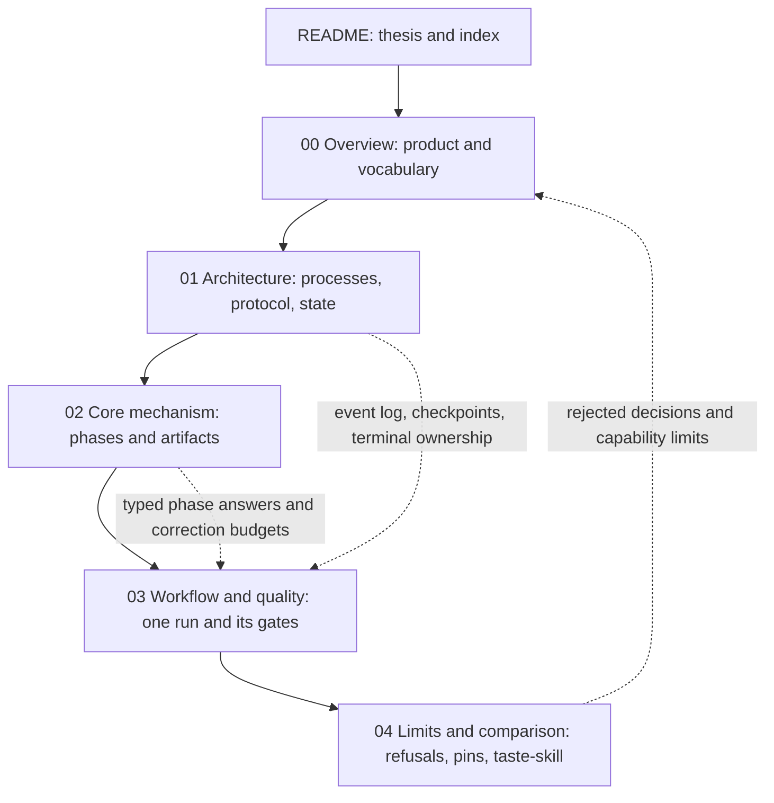

# TasteCode exploration: a server-owned workspace for coding agents

TasteCode is a local desktop workspace for Artificial Intelligence (AI) coding agents. It puts
several engines in one application and keeps orchestration, project state, terminals, diffs,
checkpoints, and history on the user's machine.

The product claim is direct.

```text
# README.md:7
> A local desktop workspace for AI coding agents, with Design Mode built in.
```

The exploration has one thesis. TasteCode is interesting because it puts one local server in
charge of state and wraps every agent engine in a typed protocol. The typing is not decoration.
It decides where a credential lives, when a checkpoint is written, how a client recovers, and
which design phase may run next.

The architecture rule states the shape.

```text
# docs/ARCHITECTURE.md:11-12
**A local server owns all state and orchestration. Every client is a thin renderer over a
typed WebSocket protocol.**
```

The first mechanism is the server-owned state and typed protocol. The second mechanism is
Design Mode. A brief becomes a sequence of ordered phases. Each model-driven phase returns
typed JavaScript Object Notation (JSON). The server validates the answer before it advances.
Five phases also write a `.taste` artifact.

```text
# apps/server/src/orchestrator.ts:327-337
type DesignFlowPhase =
  | 'brief'
  | 'brand'
  | 'page'
  | 'assets'
  | 'build'
  | 'preview'
  | 'review'
  | 'repair'
  | 'complete'
  | 'response'
```

The pipeline is in `packages/design-agent`. The orchestrator is in `apps/server/src`. The
separation matters. The package holds prompts and validators. The server holds order, state,
budgets, previews, and screenshots.

## The six documents

| Document | Question it answers | Depth |
|---|---|---|
| `README.md` | What is this package, what does it claim, and where do I start? | Index, 3 snippets |
| `00-overview.md` | What is the product, what ships, and what vocabulary does it use? | 3,282 words, 13 snippets, 2 diagrams |
| `01-architecture.md` | Which process owns state, and how do clients recover after a gap? | 3,345 words, 14 snippets, 2 diagrams |
| `02-core-mechanism.md` | How does a brief become ordered phases and typed artifacts? | 3,981 words, 17 snippets, 2 diagrams |
| `03-workflow-and-quality.md` | What happens in one run, and which gates can stop it? | 3,745 words, 16 snippets, 2 diagrams |
| `04-limits-and-comparison.md` | What does the project refuse, what can it not prove, and how does it relate to `taste-skill`? | 3,912 words, 14 snippets, 2 diagrams |

The word counts include code blocks. Every deep dive has at least two Mermaid diagrams and one
`**Aha:**` section.

## The map

The diagram shows the reading path. The side notes show which mechanism each document adds.



A reader can stop after `00-overview.md` and still understand the product. A reader who wants the
mechanism must continue through `02-core-mechanism.md` and `03-workflow-and-quality.md`.

## Reading order

1. Start with `00-overview.md` for the product, workspaces, vocabulary, shipping surface, and non-claims.
2. Read `01-architecture.md` for the process boundary, protocol, recovery, event log, checkpoints, worktrees, and terminal ownership.
3. Read `02-core-mechanism.md` for the Design Mode phases from brief to repair.
4. Read `03-workflow-and-quality.md` for one run, the quality gates, and the verification tools.
5. Read `04-limits-and-comparison.md` for limits, rejected decisions, capability differences, pins, and the taste-skill comparison.
6. Return to this file for the key facts and the non-claims.

A reader who wants only the design pipeline must still start with `00-overview.md`. The
`02-core-mechanism.md` document assumes that vocabulary.

## Key facts

| Property | Value |
|---|---|
| Source pin | `c216616` |
| Tracked files | 3,519 |
| Version | `0.1.1` (`README.md:9`) |
| Licence | Apache License 2.0 |
| Package manager | pnpm `11.8.0` (`package.json:5`) |
| Node.js engine | `>=22.18.0` (`package.json:7`) |
| Module system | ECMAScript modules (`package.json:4`) |
| Applications | 4: desktop, web, server, mobile |
| Package folders | 12 |
| Engines on `main` | Codex, Claude Code, Grok (`docs/PROVIDERS.md:14`) |

`package.json` has no version field and no licence field. The version and licence come from
`README.md` and `LICENSE`. A reader who needs machine-readable metadata must not assume those
fields exist.

The workspace file counts are in `00-overview.md`. The largest folders are `apps/web` with 786
files, `packages/adapter-codex` with 672, and `packages/design-agent` with 548.

## What this package does not claim

- No server was started. No WebSocket connection was opened. No push gap was induced.
- No provider session was started. No model turn was sent. No adapter was run.
- No build, test, lint, or type check was run. The verification record in
  `docs/verification/pr-quality-2026-09-09.md` is quoted as history, not reproduced.
- No design was generated. No page was rendered. The visual quality of Design Mode output is not
  judged.
- No installer was opened. The Windows and macOS installer behaviour is not verified.
- No web page was fetched. The hosted release, the update feed, and the provider services are
  outside this static reading.
- No skill script was run. The `taste-skill` comparison uses documentation and source only.
- Line numbers belong to pin `c216616`. A different checkout moves them.

The source calls the beta early and asks users to expect bugs (`README.md:9-11`). This package
takes that statement at face value. It does not present the system as complete.

One limit deserves a separate sentence. The visual review reads screenshots and a Document Object
Model (DOM) audit. It does not prove factual accuracy, working interactions, or performance
(`docs/DESIGN-AGENT.md:521-524`). A passing review is evidence about a captured page, not proof
that the page is correct.

## Related material

- The formal package specification is at `../spec.md`.
- The finished sibling package is at `../../../open-design/markdown/00-overview.md`.
- The `taste-skill` checkout used for the comparison is at
  `/Users/darkvoid/GitSources/src.aidesign/src.leonnix/taste-skill`.
- The bundled skill manifest is at `packages/default-skills/skills.json` in the source checkout.

The next step is `00-overview.md`.
