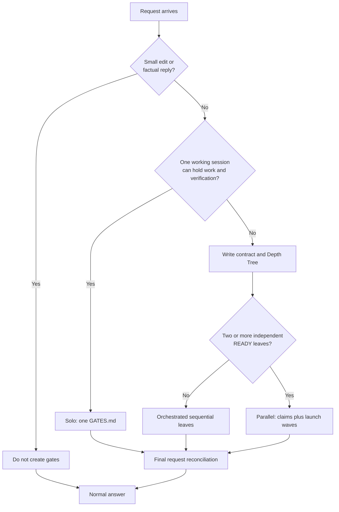
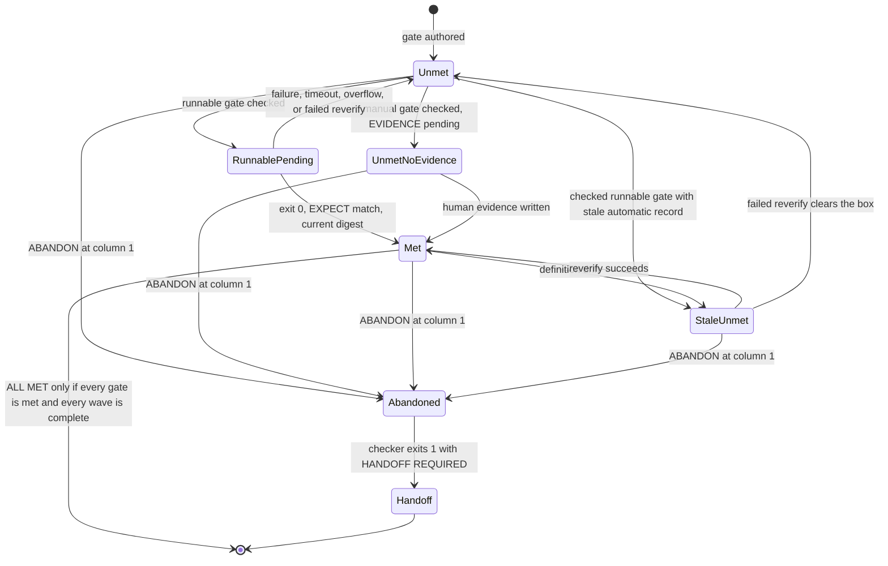

# Overview: from a confident claim to a checked outcome

This document explains the problem that `unlazy` names, the objects it uses, the modes it offers, and the path of one gate from authoring to a final report. It supplies the vocabulary for the other four deep dives. The source is the pinned checkout at commit `16671491f6679ad9378f52604d3bc2415b4120c7`, at `/Users/darkvoid/GitSources/src.aidesign/src.leonnix/unlazy`. A citation such as `README.md:216` names a file in that checkout, not in this document. The reading is static. No command runs during this exploration.

## The failure modes the project names

The project starts from a specific worry. An autonomous agent can produce a fluent completion report that overstates the work. The report can be sincere. It is still not evidence. The repository lists research that supports several failure modes (`README.md:210-217`).

Detailed multi-part prompts still show partial compliance and premature truncation in tested models (`README.md:212`). The model can answer the first part, summarize the middle, and omit the last part without an explicit failure. Reasoning can also stop exploration too early, or continue past the useful amount of compute, depending on the task and the model (`README.md:213`). A longer reasoning trace is not automatically a more complete result.

SlopCodeBench, a benchmark of long coding tasks, supplies a checkpoint number. No tested agent fully solved a problem end to end, and the best agent passed `14.8%` of checkpoints (`README.md:214`). A checkpoint is one scored milestone in that benchmark, and the source does not define the term. The project uses that number carefully. Checkpoint success is not task completion (`README.md:214`). A partial pass rate can look like progress while the end-to-end outcome remains absent.

METR (Model Evaluation and Threat Research) Time Horizon 1.1 is a research report that supplies a time-horizon fit. The report gives a `196.5` day overall median (P50) doubling time and `130.8` days for the post-2023 fit (`README.md:216`). The source does not define the fit or its method (`README.md:216`). A doubling time is the period in which the measured task length doubles. The project warns that the shorter figure must not be described as the all-years estimate (`README.md:216`). This is a good example of its documentation rule. Quote the exact metric and keep the subset separate from the whole.

Closed-book tasks supply no reference material. Test-time compute is the work that a model performs while it answers. Closed-book knowledge tasks can hallucinate more when test-time compute increases (`README.md:217`). Compute-only post-processing cannot add ground-truth information that was not present (`README.md:217`). More tokens do not guarantee a better answer when the needed fact is absent.

The repository is careful about the status of this material. It says research supports the failure modes, and it does not prove that `unlazy` produces a fixed improvement (`README.md:210`). An earlier internal comparison of six runs is not reproducible from the repository (`README.md:219`). The repository does not contain the raw artifacts, such as prompts and transcripts (`CHANGELOG.md:108`). The correct use of the research is motivational. The research explains why a completion claim needs a check. It does not supply a product guarantee.

```text
# README.md:212-217
- Detailed multi-part prompts still see partial compliance and premature truncation in tested models ([Quantifying Laziness](https://arxiv.org/abs/2512.20662)).
- Reasoning can stop exploration too early or continue beyond useful compute, depending on task and model ([Thoughts Are All Over the Place](https://arxiv.org/abs/2501.18585), [When More Thinking Hurts](https://arxiv.org/abs/2604.10739), [OptimalThinkingBench](https://arxiv.org/abs/2508.13141)).
- SlopCodeBench reports that no tested agent fully solved a problem end to end and that the best agent passed `14.8%` of checkpoints. Checkpoint success is not task completion ([SlopCodeBench](https://arxiv.org/abs/2603.24755)).
- s1's budget forcing lengthens reasoning by appending `Wait` multiple times when the model tries to stop; it is not a claim that one token always improves work ([s1](https://arxiv.org/abs/2501.19393)).
- METR's Time Horizon 1.1 reports a `196.5` day overall P50 doubling-time fit and `130.8` days for the post-2023 fit. The shorter figure must not be described as the all-years estimate ([METR Time Horizon 1.1](https://metr.org/blog/2026-1-29-time-horizon-1-1/)).
- Closed-book knowledge-intensive tasks can hallucinate more with additional test-time compute, and compute-only post-processing cannot add ground-truth information that was not present ([Test-Time Scaling in Reasoning Models Is Not Effective for Knowledge-Intensive Tasks Yet](https://arxiv.org/abs/2509.06861), COLM 2026).
```

In the last quoted line, COLM is the Conference on Language Modeling.

The source also cites the `s1` model result as a narrow case. Budget forcing appends `Wait` tokens when the model tries to stop, and the source says that one token does not always improve work (`README.md:215`).

The project also names a narrower failure that is internal to agent workflows. An agent can say "done" while a required outcome is still deferred (postponed without a gate or handoff), abandoned without notice, or replaced by a cheaper result. `unlazy` treats each of those cases as a visible non-completion. A deferred item, an abandoned gate, and an unmet gate all prevent a clean final report (`SKILL.md:86`). The design does not assume that an agent lies. It assumes that an agent can lose track of an outcome under context pressure.

The documentation applies the same standard to itself. It does not keep an old comparison as a product claim. Earlier README versions cited a six-run internal comparison. The raw artifacts for those runs are absent, so the ratios and counts cannot be reproduced (`README.md:219`). The validation protocol says the comparison is too small for broad model claims and must not be described as proof of a specific improvement or cost multiplier (`research/validation-protocol.md:14`).

```text
# README.md:219-219
Earlier README versions also cited a six-run internal comparison. The raw artifacts needed to reproduce those exact ratios and counts are not in this repository. Treat the results as historical design input, not a benchmark guarantee. The limitations and a protocol for a defensible rerun are in [research/validation-protocol.md](research/validation-protocol.md).
```

## The object model

The project uses a small set of named objects. Each object has one definition and one purpose. The names repeat across the checker, the Stop hook, the linter, the templates, and the references.

| Object | Definition | Source |
|---|---|---|
| Gate | One checkbox line with an identifier, a title, and attributes: `CHECK:` and `EXPECT:` as a pair for a runnable gate, optional `CWD:` (current working directory), and `EVIDENCE:` | `references/gates.md:35-38` |
| Ledger | A Markdown file that holds gates and an optional `OWNS:` header | `references/gates.md:3`, `references/gates.md:39` |
| Scope | A named pipeline directory under `.unlazy/` | `references/parallel.md:23-36` |
| Contract | The interfaces, formats, shared assumptions, error conventions, naming, and ownership fixed before fan-out | `references/method.md:11` |
| Leaf | One coherent deliverable with its own contract, ownership, and ledger | `references/method.md:10`, `templates/PLAN.md:50-56` |
| Branch | An integration ledger that joins named children | `references/orchestration.md:15` |
| Host | The agent runtime that starts sessions and returns launch handles | `references/dispatch.md:3` |
| Session | One agent conversation that the host runs and identifies by a session id | `references/parallel.md:32`, `references/parallel.md:117` |
| Wave | A group of host agent launches with an open, sealed, complete, or abandoned state | `scripts/lib/dispatch.mjs:10`, `references/dispatch.md:5` |
| Lease | A record of declared `OWNS:` paths for one scope and leaf | `references/parallel.md:49-65` |
| Approval | A record readable only by its owner that permits one exact oracle, defined below, to execute | `README.md:115` |
| Evidence | The `EVIDENCE:` line, classified as automatic, human, or pending | `scripts/lib/gates.mjs:464-483` |
| Digest | A hash of the parsed `CHECK:`, `EXPECT:`, and raw `CWD:` definition | `scripts/lib/gates.mjs:445-455` |
| Dispatch state | The authoritative `.unlazy/<scope>/dispatch.json` wave record | `scripts/lib/dispatch.mjs:170-172` |
| Hook state | A progress counter keyed by session and scope for the optional Stop hook | `scripts/stop-hook.mjs:85`, `scripts/lib/gates.mjs:680-682` |

An oracle is the resolved execution tuple. It contains the command, the expectation, the working directory, the shell, the timeout, the output limits, the platform, and `PATH`, the executable search path (`scripts/gate-check.mjs:355-371`). The checker uses the oracle for approval. The digest binds only three fields of the definition (`scripts/lib/gates.mjs:445-455`).

A gate is the unit of acceptance. It starts with a checkbox, an identifier, and a colon. The identifier must be explicit and unique within the file (`references/gates.md:35`). A gate with both `CHECK:` and `EXPECT:` is runnable. A gate with neither is manual. A gate with only one of the two is malformed (`references/gates.md:37`). The parser derives a line-based identifier only as a diagnostic fallback, and it still reports an error (`scripts/lib/gates.mjs:303-319`).

A ledger is the unit of parsing. It is a Markdown document with a loose header and a strict gate body (`references/gates.md:3`). A ledger can declare `OWNS:` paths before its first gate. `OWNS:` takes a comma-separated list of repository-relative globs, and it must come before the first gate (`references/gates.md:39`, `scripts/lib/gates.mjs:382-395`). The same parser reads a solo ledger, a leaf ledger, a branch ledger, and the ledger inside a scope. The checker and the Stop hook share that parser (`references/gates.md:3`, `tests/self-check.mjs:177-185`).

The leaf template shows the complete gate shape. A template placeholder is not a valid outcome, and the author must replace each one (`templates/gates-leaf.md:21-22`). The parser still accepts the copied line, because it does not interpret angle brackets (`scripts/lib/gates.mjs:299`).

```text
# templates/gates-leaf.md:7-19
- [ ] G1: <observable outcome measured directly from the artifact>
  CHECK: node scripts/verify-outcome.mjs
  EXPECT: outcome verification passed
  EVIDENCE: pending

- [ ] G2: <integration outcome in a subproject>
  CHECK: node scripts/verify-integration.mjs
  EXPECT: integration verification passed
  CWD: packages/example
  EVIDENCE: pending

- [ ] G3: <manual outcome that no command can decide>
  EVIDENCE: pending
```

As an illustration, the first gate could name the health endpoint, run `node tests/health-check.mjs`, and expect `health ready`. This example is not in the source.

A scope is the unit of discovery. A pipeline is one scoped set of ledgers, leases, and dispatch state. A scope is a directory under `.unlazy/` with a name that matches `[A-Za-z0-9][A-Za-z0-9._-]{0,63}` and is not `.` or `..` (`references/parallel.md:36`). A scope limits the checker's default gate discovery and status log target. It also limits Stop hook resolution, hook progress state, dispatch waves, and the lease label. The two source lists are not identical. `SECURITY.md:36` adds dispatch waves but omits hook progress state. `references/parallel.md:38-47` adds hook progress state but omits dispatch waves. A complete scope description needs both lists (`SECURITY.md:36`, `references/parallel.md:38-47`). A scope does not limit a `CHECK:` process (`references/parallel.md:47`).

A leaf is the unit of delegation. It must be one coherent deliverable with exact ownership, dependencies, and acceptance gates (`references/method.md:10`). Ownership means the declared paths that the leaf may modify (`references/parallel.md:57`). The contract records interfaces, formats, shared assumptions, error conventions, naming, and ownership (`references/method.md:11`). A branch is the unit of integration. It holds the interface compatibility, end-to-end behavior, and regression gates that a leaf must not duplicate (`references/gates.md:132-145`).

A wave is the unit of host concurrency. It records a set of leaves, an opaque start handle that the host returns for each one, and the return of each one (`references/dispatch.md:5`). The wave is not a process pool. It is an audited record of host launch calls (`references/dispatch.md:3`). A sealed wave proves that the host returned a distinct host handle for every declared leaf before the first return was accepted (`references/dispatch.md:82`). It does not prove exact central processing unit overlap, worker honesty, or integration success (`SECURITY.md:66`).

A reduction is the aggregate result that the checker prints after it combines the ledgers and the waves. The dispatch state file is the authority for a transition. The command takes a lock, validates the state, writes the new state atomically, and then appends an audit event (`scripts/lib/dispatch.mjs:222-292`). A later log append can fail after the state committed. In that case the command succeeds with a bounded warning, so the caller inspects the state instead of repeating a committed transition (`references/dispatch.md:44`).

```text
# references/dispatch.md:44-46
`status` exits `0` only after every declared leaf returned. Dispatch state and timestamps live in `.unlazy/<scope>/dispatch.json`; lifecycle events also append to the scope status log. The atomic state transition is authoritative: if the later audit-log append is refused, the transition command still succeeds and prints a bounded warning that the state was committed. Inspect state before deciding what to do next; do not blindly repeat the transition.

The state loader requires string ids, handles, and abandonment reasons plus a possible transition history: returns require an all-started sealed wave, terminal timestamps must exist and follow prior transitions, and a fully returned wave must be complete. Hand-editing an impossible terminal state fails closed. The primary `gate-check.mjs --scope <scope>` reduction includes this aggregate state and cannot print `ALL MET` while a wave is open, sealed, abandoned, or invalid.
```

The loader is strict. It accepts string identifiers and handles. A return needs an all-started sealed wave. A terminal timestamp must be later than each earlier record that it follows. A complete wave must return every started leaf. An impossible wave state is rejected with an error (`references/dispatch.md:46`, `scripts/lib/dispatch.mjs:62-142`).

A wave record stores `state`, `leaves`, `started`, `returned`, and `openedAt`. A sealed wave adds `sealedAt`, a complete wave adds `completedAt`, and an abandoned wave adds `abandonedAt` and `reason`. Each start stores a handle and a timestamp, and each return stores a timestamp (`scripts/lib/dispatch.mjs:62-142`).

A lease is the unit of ownership coordination. It records the scope, the leaf, and the declared glob paths (`references/parallel.md:49-65`). A claim is all-or-nothing under one global lease lock (`references/parallel.md:63`). A lease coordinates tools that honor the protocol. It is not write isolation (`references/parallel.md:80`).

Overlap detection is deliberately conservative. A glob is a path pattern with wildcard segments. The checker may reject two globs that a complete path-intersection calculation could prove disjoint. This happens most often with wildcards in the middle of a path segment (`references/parallel.md:69`). The table shows the intended reading.

```text
# references/parallel.md:71-79
Examples:

| First declaration | Second declaration | Result |
|---|---|---|
| `src/api/**` | `src/web/**` | disjoint |
| `src/shared/**` | `src/shared/util.mjs` | conflict |
| `src/a*.mjs` | `src/ab*.mjs` | conflict because intersection is possible |
| `**` | `docs/**` | conflict |
```

Approval, evidence, and the digest are three different objects. Approval is a runtime permission. Evidence is a stored result. The digest is a structural binding inside that result. The next sections separate them because the design depends on the separation.

## The three modes

`unlazy` offers three modes. Each mode has an entry condition, and the smallest fitting mode is the intended choice (`SKILL.md:36`).

```text
# SKILL.md:36-42
## Pick the smallest fitting mode

- **Solo:** Use one `GATES.md` for a focused task that fits one working session. For several independently required outcomes, reread the current request before completion and give each outcome or acceptance-changing constraint a gate or explicit handoff; a PLAN table is not required.
- **Orchestrated:** For a build or deep review, read the local `references/method.md`, `references/orchestration.md`, and `references/dispatch.md`. Write the contract and tree before fan-out. Give every leaf and branch its own gates file.
- **Parallel:** Before dispatching concurrent leaves or pipelines, also read the local `references/parallel.md`. Reconcile normalized set equality between each PLAN `Owns` planning mirror and the leaf ledger's command-time `OWNS:` authority before marking it `READY` and again before claiming it, then use a dispatch launch wave. Release the exact leaf lease after parent verification. Release the whole scope only after every leaf is settled and final scope verification has run. Treat scopes, leases, and wave state as coordination, never as filesystem isolation or a security boundary.

Keep check execution sequential by default. Use `--jobs <N>` only for independent runnable gates when deterministic parallel verification saves wall-clock time. Continue printing and recording results in gate order. `--jobs` never creates agent sessions; native agent concurrency follows the dispatch contract.
```

Solo mode uses one `GATES.md` for a focused task that fits one working session (`SKILL.md:38`). The agent rereads the current request before completion. It gives each independently required outcome, or each acceptance-changing constraint, a gate or an explicit handoff. A plan table is not required (`SKILL.md:38`). Solo mode has the lowest cost. It exists so that a small task does not need a decomposition tree, a scope, and a dispatch record.

Orchestrated mode is for a build or a deep review where one context cannot hold the task and its verification (`SKILL.md:39`, `references/orchestration.md:3`). The agent reads the method, orchestration, and dispatch references. It writes the contract and the tree before fan-out. Every leaf and every branch receives its own ledger (`SKILL.md:39`). The tree is the contract plus its leaves and branches, and the project calls it the Depth Tree (`references/method.md:9-12`). The driver, which is the agent that owns the tree, keeps planning, dispatch, independent verification, integration, and the final report for the whole task (`references/orchestration.md:3`).

Parallel mode is an extension of orchestrated mode. The agent reads the parallel reference before it dispatches concurrent leaves or pipelines (`SKILL.md:40`). It compares the normalized set of `Owns` paths in the plan with the ledger's `OWNS:` authority at the time the command runs. Normalization trims the value and converts backslashes to slashes. It removes a leading `./` and collapses empty and `.` segments. It rejects an absolute path, a `..` segment, and an empty claim (`scripts/lib/gates.mjs:509-521`). It does this before the leaf becomes `READY` and again before a claim, which records the lease. It uses a dispatch launch wave. It releases the exact leaf lease after parent verification, and it releases the whole scope only after every leaf is settled and final verification has run (`SKILL.md:40`). Scopes, leases, and wave state are coordination. They are not filesystem isolation or a security boundary (`SKILL.md:40`).

Check execution stays sequential by default (`SKILL.md:42`). `--jobs` is an opt-in rolling limit for independent runnable gates. It starts a new check when another finishes (`SKILL.md:42`, `scripts/gate-check.mjs:710-724`). It never creates agent sessions. Native agent concurrency follows the launch protocol, which the source calls a dispatch contract (`SKILL.md:42`). That term is not the Plan contract.

`READY` means that a leaf has verified dependencies and available ownership (`references/orchestration.md:7-13`).



## The four-pass leaf loop

Each leaf uses four passes (`SKILL.md:57-64`). The first pass implements the complete deliverable with no placeholder and no deferred remainder (`SKILL.md:59`). The second pass rereads the result as a domain expert and replaces the simple first version of each part (`SKILL.md:60`). The third pass hunts correctness, integration, portability, performance, and evidence defects, and fixes what it finds (`SKILL.md:61`). The fourth pass applies low-cost polish and repeats until a full improvement pass finds nothing (`SKILL.md:62`).

```text
# SKILL.md:57-64
## Work each leaf in four passes

1. Implement the complete deliverable. Leave no placeholders or deferred remainder.
2. Re-read it as a domain expert and replace the cheap version of each part.
3. Hunt correctness, integration, portability, performance, and evidence defects. Fix what you find.
4. Apply low-cost polish, then repeat until a full improvement pass finds nothing.

Finish a leaf only after the pass is clean and every gate is met with evidence. A visibly abandoned gate ends execution honestly but leaves the leaf in handoff state, not finished.
```

The loop ends only when the pass is clean and every gate is met with evidence (`SKILL.md:64`). A visibly abandoned gate ends execution honestly, but it leaves the leaf in handoff state (`SKILL.md:64`). The loop is not a fixed count of drafts. It is a stopping rule based on a clean pass and current evidence.

## One gate from authoring to report

A gate begins as an authoring act. The author writes one observable outcome and chooses a command or a manual review (`SKILL.md:12`). For a command, the author also writes a success-only token (`references/gates.md:99-104`). A success-only token is a marker that the script prints only after every assertion passes. The checker still requires exit zero and an `EXPECT:` match. The author then lints the ledger before working it, which means the author runs a quality review of the gates (`SKILL.md:76`). The linter never executes a check. It reads the ledger and judges the oracle (`references/gates.md:108`).

The parser turns the text into a gate object. It records the checkbox state, the identifier, the title, the attributes, and the evidence line (`scripts/lib/gates.mjs:270-433`). It rejects zero gates, duplicate identifiers, partial runnable gates, unindented attributes, an indented `ABANDON:`, a blank abandonment reason, an unknown abandonment identifier, and an invalid regular expression (`references/gates.md:35-44`). The checker rejects a malformed ledger with an error. The ledger does not become an empty completion certificate (`references/gates.md:3`).

The state function maps three values to one state: the checkbox, the evidence class, and the abandonment set. The function takes the gate and the abandonment set, and it derives the evidence class inside (`scripts/lib/gates.mjs:485-494`). It returns one of five states.

```text
# scripts/lib/gates.mjs:485-494
export function gateState(gate, abandoned) {
  if (abandoned.has(gate.id)) return "abandoned";
  if (!gate.checked) return "unmet";
  const evidence = classifyGateEvidence(gate);
  const runnable = gateDefinitionDigest(gate) !== null;
  if (runnable) return evidence === "automatic-current" ? "met" : "stale-unmet";
  if (evidence === "pending") return "unmet-no-evidence";
  if (evidence === "automatic-current" || evidence === "automatic-stale") return "stale-unmet";
  return "met";
}
```

The state function has one important asymmetry. A checked manual gate with pending evidence is `unmet-no-evidence` (`scripts/lib/gates.mjs:491`). A manual gate is `met` only when it carries ordinary human evidence (`scripts/lib/gates.mjs:493`). A runnable gate is `met` only when its evidence class is `automatic-current` (`scripts/lib/gates.mjs:490`). An automatic record cannot silently become a human attestation (`SKILL.md:32`, `scripts/lib/gates.mjs:492`).

The classifier returns four evidence classes (`scripts/lib/gates.mjs:464-483`). Empty or pending text is `pending`. A well-formed automatic record with the current digest is `automatic-current`. A reserved automatic record is a line that starts with `automatic-evidence=` or `exit=0; shell=`. A reserved record without a current binding is `automatic-stale`. The legacy `exit=0; shell=` transcript is also `automatic-stale`. Any other text is `human`. A runnable gate maps to `met` only through `automatic-current`, and every other class maps to `stale-unmet` (`scripts/lib/gates.mjs:490`). A manual gate maps a human record to `met` and a reserved automatic record to `stale-unmet` (`scripts/lib/gates.mjs:492`).

```text
# scripts/lib/gates.mjs:464-483
export function classifyGateEvidence(gate) {
  const evidence = gate && gate.evidence === null ? "" : String((gate && gate.evidence) || "");
  if (evidence === "" || /^pending$/i.test(evidence)) return "pending";
  const definitionDigest = gateDefinitionDigest(gate);
  if (definitionDigest !== null) {
    const prefix = automaticEvidencePrefix(definitionDigest);
    const decidingFields = evidence.slice(prefix.length);
    const success = decidingFields.match(
      /^ exit=0; EXPECT=matched; output-sha256=[a-f0-9]{64}; output-bytes=(0|[1-9][0-9]{0,6}); shell=./,
    );
    if (evidence.length <= MAX_AUTOMATIC_EVIDENCE_CHARS && evidence.startsWith(prefix) &&
        success && Number(success[1]) <= MAX_CHECK_OUTPUT_BYTES) {
      return "automatic-current";
    }
  }
  if (evidence.startsWith("automatic-evidence=") || evidence.startsWith("exit=0; shell=")) {
    return "automatic-stale";
  }
  return "human";
}
```

A runnable gate can execute only after approval. The checker builds an oracle, hashes it, and looks for a matching approval record outside the repository (`scripts/gate-check.mjs:355-390`). Without an exact record, a normal run prints the resolved oracle and does not execute it (`scripts/gate-check.mjs:763-778`). With `--approve`, the checker records the approval and then runs the command (`scripts/gate-check.mjs:770-778`).

```text
# scripts/gate-check.mjs:355-371
function oracle(file, gate) {
  const cwd = resolvedGateCwd(gate, file);
  return {
    schema: 1,
    check: gate.check,
    expect: gate.expect,
    cwd,
    shell,
    timeoutMs: timeoutSeconds * 1000,
    maxOutputBytes: MAX_OUTPUT_BYTES,
    regexTimeoutMs: REGEX_TIMEOUT_MS,
    regexStartupTimeoutMs: REGEX_STARTUP_TIMEOUT_MS,
    maxRegexWorkers: MAX_REGEX_WORKERS,
    platform: process.platform,
    path: pathValue,
  };
}
```

The run must satisfy both conditions. The process exits `0`, and `EXPECT:` matches the combined standard output and standard error (`references/gates.md:50-55`). A nonzero process never passes because its error text contains the token (`references/gates.md:55`). A timeout, a shell-start error, a missing command, or an output-limit failure also fails (`references/gates.md:55`).

```text
# references/gates.md:50-55
A runnable gate passes only when both conditions hold:

1. The process starts and exits with status `0`.
2. `EXPECT:` matches the command's combined standard output and standard error.

A nonzero process never passes merely because its error text contains the expected token. A timeout, shell-start error, missing command, or output-limit failure also fails. The default timeout is 120 seconds; `--timeout` accepts an integer from 1 through 86400. Cleanup and checker settlement are bounded, but a deliberately detached process may outlive its timed-out shell because unlazy is not a process sandbox; checks must clean up any background services they intentionally detach. Each check has two 1 MiB ceilings: first on the total raw stdout/stderr payload captured, then on the UTF-8 byte length of the canonical matcher string. That string is all captured stdout decoded as UTF-8, one synthetic newline when both streams are nonempty, then all captured stderr decoded as UTF-8. `EXPECT:` and the evidence SHA-256/byte count use that exact string. Invalid byte replacement or the stream separator can make the second representation larger than the raw payload; it fails as overflow and is never truncated into a match. Regular-expression matching uses at most four disposable workers; each gets a five-second startup limit before its separate 250ms match budget begins.
```

The quoted passage uses `MiB` for mebibyte and `UTF-8` for Unicode Transformation Format 8-bit. It uses `SHA-256` for Secure Hash Algorithm 256-bit.

The matcher string has an exact construction. It starts with all captured standard output decoded as Unicode Transformation Format 8-bit (UTF-8). When both streams are nonempty, one synthetic newline follows. Then all captured standard error decoded as UTF-8 follows (`references/gates.md:55`). The expectation and the output fingerprint use that exact string (`references/gates.md:55`). Both the raw payload and the canonical string must fit the 1,048,576-byte ceiling (`references/gates.md:55`, `scripts/lib/gates.mjs:14`). An overflow fails before matching. It is never truncated into a success (`references/gates.md:55`).

The ceiling is one mebibyte (MiB) in each form. Decoding and the synthetic newline can make the canonical string longer than the raw payload (`scripts/gate-check.mjs:626-629`). The automatic record includes a Secure Hash Algorithm 256-bit (SHA-256) digest of the canonical string (`scripts/lib/gates.mjs:18`, `scripts/gate-check.mjs:818-821`).

The checker stores a compact automatic record. It puts the definition digest and the output fingerprint before the machine-specific fields.

```text
# scripts/gate-check.mjs:812-822
function evidenceFor(result) {
  const clean = (value) => terminalSafe(value).replace(/[\r\n\t]+/g, " ");
  const fingerprint = result.outputFingerprint;
  // Keep the definition binding and successful-output fingerprint ahead of
  // machine-specific fields so the evidence cap can truncate only transcript
  // detail, never the structural currentness or deciding output identity.
  return (automaticEvidencePrefix(result.definitionDigest) +
    " exit=0; EXPECT=matched; output-sha256=" + fingerprint.sha256 +
    "; output-bytes=" + fingerprint.bytes + "; shell=" + clean(shell) +
    "; cwd=" + clean(result.cwd) + "; path=" + pathEvidence).slice(0, MAX_AUTOMATIC_EVIDENCE_CHARS);
}
```

The evidence prefix is exact. It starts with `automatic-evidence=v1; definition-sha256=` and a full lowercase digest (`scripts/lib/gates.mjs:457-462`). The success header that follows is anchored and requires `exit=0`, `EXPECT=matched`, a 64-hex output digest, decimal bytes, and a shell field (`scripts/lib/gates.mjs:471-477`). The definition binding and the output fingerprint come before the capped transcript, so truncation cannot remove either deciding field (`scripts/gate-check.mjs:815-821`, `references/gates.md:57`).

A current definition can still lose its met state. A later definition change makes the old evidence `stale-unmet` (`references/gates.md:59`). A failed `--reverify` clears the checkbox and restores `EVIDENCE: pending` (`references/gates.md:59`). When a concurrent change to the oracle occurs during a run, the checker discards the result at writeback (`scripts/gate-check.mjs:843-849`).

A gate can also end as abandoned. The author adds `ABANDON: <identifier> <reason>` at column 1 (`references/gates.md:41`). The checker exits `1` and prints `HANDOFF REQUIRED` even when every other gate is met (`references/gates.md:130`). Abandonment is terminal and visible. It is never completion (`SKILL.md:34`).



The diagram is a lifecycle, not a literal output of the state function. The state function returns five values: `unmet`, `unmet-no-evidence`, `stale-unmet`, `met`, and `abandoned` (`scripts/lib/gates.mjs:485-494`). The diagram splits `unmet` into `Unmet` and `RunnablePending` to show the runnable case. `RunnablePending` and `Handoff` are drawing aids. The function returns exactly the five values named above. It shows the manual transition directly. A checked manual gate with human evidence goes from `UnmetNoEvidence` to `Met` when a person writes the evidence. The state function does not verify the content of human evidence. It only checks that the evidence is not pending and is not reserved machine evidence (`scripts/lib/gates.mjs:485-494`).

## The four verification layers

Verification runs in four layers (`SKILL.md:55`).

1. The leaf self-check catches ordinary incompleteness, but it remains self-certification.
2. The parent, which is the ledger owner that accepted the leaf, runs `--reverify` on each runnable oracle instead of trusting old evidence.
3. Branch integration catches locally correct children that do not compose.
4. The optional Stop hook blocks the driver from ending while the resolved pipeline has unmet ledgers or incomplete waves.

```text
# references/orchestration.md:85-91
## Verification hierarchy

1. **Leaf self-check:** catches ordinary incompleteness but remains self-certification.
2. **Parent `--reverify`:** executes each runnable oracle again instead of trusting old or manually written evidence.
3. **Branch integration:** catches locally correct children that do not compose.
4. **Optional Stop hook:** blocks the driver from ending while its resolved pipeline has unmet ledgers or incomplete dispatch waves. It does not execute checks or validate their meaning.
```

The parent and branch layers are the two independent layers that re-execute or integrate the work (`SKILL.md:55`). The leaf checks its own work. The parent must use the same declared shell and required toolchain as the leaf (`references/orchestration.md:92`). If the environment differs, the parent records and resolves the mismatch instead of accepting old evidence (`references/orchestration.md:92`). The Stop hook only observes structure. It does not execute checks or validate their meaning (`references/orchestration.md:90`).

Manual gates need a different review. Automation cannot prove every user-facing or judgment-heavy outcome (`references/orchestration.md:96`). For each manual gate, the reviewer cites the exact artifact, location, measurement, or decision (`references/orchestration.md:98`). The reviewer examines consequences, not only visual polish (`references/orchestration.md:99`). A high-risk outcome gets independent review when feasible (`references/orchestration.md:100`). Ambiguous evidence leaves the gate unmet (`references/orchestration.md:101`). A leaf is not `VERIFIED` merely because every runnable gate passed (`references/orchestration.md:103`).

The four layers also have different failure meanings. A leaf self-check failure is local incompleteness. A parent `--reverify` failure is stale or environment-dependent evidence. A branch failure is a composition defect. A Stop-hook block is an unfinished structural state. None of those layers is a substitute for another (`references/orchestration.md:85-91`).

## Why approval and evidence currentness are separate

The design has two identities, and they answer two different questions. Approval answers a runtime question: may this exact command run in this exact environment, for this exact ledger and gate? Evidence currentness answers a structural question: does this stored result describe the current parsed definition?

Approval is built from the full oracle. The oracle contains the command, the expectation, and the resolved current working directory (`CWD:`). It also contains the resolved shell, the timeout in milliseconds, the output ceiling, the regular-expression match and startup limits, the worker limit, the platform, and the full inherited `PATH` (`scripts/gate-check.mjs:355-371`). The approval path hashes the absolute ledger path, the gate identifier, and the oracle signature (`scripts/gate-check.mjs:387-390`). A change to the shell, the working directory, the timeout, the platform, or `PATH` invalidates approval (`README.md:115`).

The definition digest is built from three parsed fields only. It hashes the string `unlazy.gate-definition`, the version `1`, the `CHECK:` text, the `EXPECT:` text, and the raw `CWD:` value or null (`scripts/lib/gates.mjs:445-455`). It excludes the gate identifier, the title, formatting, the ledger path, resolved paths, the shell, the timeout, the platform, and `PATH` (`references/gates.md:57`). `--status` is the checker mode that reports state without execution (`scripts/gate-check.mjs:337-343`). The digest therefore lets `--status` and the Stop hook judge currentness without a shell, without `PATH`, without approval storage, and without a process (`SECURITY.md:42`).

**Aha:** The two mechanisms look redundant, but they encode opposite design goals. The digest must be portable and environment-independent so that a structural check can run anywhere without side effects. Approval must be environment-specific so that consent covers the actual command, the actual working directory, the actual shell, and the actual `PATH`. A single hash cannot serve both goals. If currentness included the shell and `PATH`, then a moved laptop or a changed terminal would make valid evidence stale. If approval excluded the shell and `PATH`, then a person could approve one command and a different environment could execute another. The split keeps both properties. It also explains the deliberate gaps: approval does not hash called scripts, and the digest does not authenticate evidence (`README.md:117`, `README.md:91`).

The project states the consequence plainly. Approval is a permission, not an isolation boundary (`README.md:117`). Approval does not snapshot files that a command invokes (`SECURITY.md:18`). A referenced script, generated file, fixture, or dependency can change while the approved command text stays the same (`SECURITY.md:18`). The old approval still authorizes the changed bytes (`SECURITY.md:18`). The digest does not close that gap, because it covers the declaration and not the transitive inputs (`references/gates.md:67`). A workflow that needs machine-enforced dependency currentness must put expected dependency digests inside approval-bound `CHECK:` text and validate them with a separately trusted tool (`SECURITY.md:18`). That is user-designed coverage, not transitive tracing by `unlazy` (`SECURITY.md:18`).

## What completion means

A completion report must rest on current evidence. The final report audit rereads the current request. It reconciles the request against the plan inventory when one exists. It re-measures every number and completion claim immediately before reporting. It reports measured met, unmet, and abandoned counts, and it surfaces every abandonment (`SKILL.md:86`). It does not compose a done report while any required gate is unmet, abandoned, deferred, or awaiting an owner decision (`SKILL.md:86`). A deferred item is a required outcome postponed without a gate or handoff. An owner decision is a named decision that is still open. Those are report conditions, not gate states.

The completion hierarchy rises from leaf to branch to root, the top ledger for the whole task (`references/method.md:41-47`). A leaf needs current runnable evidence plus reviewed manual evidence. A branch needs reverified children plus cross-child integration checks. The root needs a current request reread, every contract row reconciled, every branch integrated, regressions checked, and final claims remeasured (`references/method.md:43-47`).

Local completion does not imply integration (`references/method.md:49`). A set of locally complete leaves can still fail to compose. That is why the branch layer exists, and why a sealed wave is not a success claim.

```text
# references/method.md:41-47
## Completion hierarchy

| Layer | Proof |
|---|---|
| Leaf | Current runnable evidence plus reviewed manual evidence |
| Branch | Reverified children plus cross-child integration checks |
| Root | Current request reread, every contract row reconciled, every branch integrated, regressions checked, final claims remeasured |
```

The final aggregate reflects this hierarchy. A scoped `gate-check` invocation combines the ledgers and the dispatch waves (`scripts/gate-check.mjs:937-947`). It prints `ALL MET` only when every gate is met and every wave is complete (`scripts/gate-check.mjs:944-947`). An abandoned wave remains a non-successful `HANDOFF REQUIRED` outcome (`scripts/gate-check.mjs:937-949`).

## What this overview establishes

The rest of the set can now be read as a sequence of mechanisms. The architecture document shows where the parser, checker, hook, lease store, and dispatch store live. The mechanism document shows the exact parser, digest, classifier, oracle, supervisor, and writeback. The workflow document shows how a person or agent operates the system. The limits document shows what the system cannot prove and how it compares with its siblings.

One theme joins the documents. `unlazy` does not try to make an agent honest. It makes an incomplete claim hard to hide. The ledger exposes the claim. The parser rejects ambiguous shapes. The approval boundary exposes the command. The digest exposes definition drift. The parent re-verification exposes stale evidence. The Stop hook exposes an unfinished pipeline at the moment the agent tries to stop.

## Related documents

Continue with [`01-architecture.md`](01-architecture.md) for the file layout, or with [`02-core-mechanism.md`](02-core-mechanism.md) for the gate-to-evidence sequence. [`README.md`](README.md) gives the full reading order.
