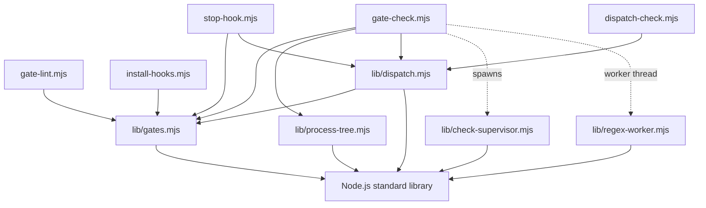
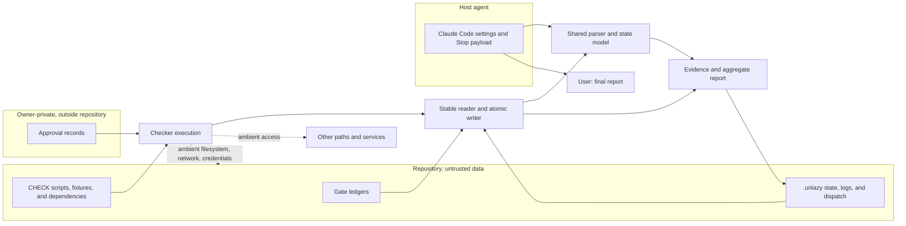

# Architecture: an instruction layer over a small process layer

`unlazy` has two layers. The first layer is instruction text for an agent. The second layer is a set of zero-dependency Node.js programs. The first layer decides what an agent must do. The second layer makes the completion state inspectable and hard to fake. The split is deliberate. The instruction layer carries judgement and progressive disclosure, which is the practice of adding detail to the agent context only when the selected mode needs it. The process layer carries parsing, evidence, coordination, and the optional Stop hook.

This document maps both layers. It names each file, its owner, its import edges, its data files, and its trust boundaries. A citation such as `README.md:36` names a source file, not a file in this document. The reading is static. No process runs during this exploration.

## The instruction layer

`SKILL.md` is the core instruction file (`SKILL.md:1-104`). It states the thesis and the write-before-work rule, which requires gates before implementation. It also states the approval rule and the success predicate. It gives the abandonment rule and the three modes. It lists the steps of the Depth Tree, which decomposes a task into leaves and branches. It also lists the four-pass leaf loop. The gate authoring rules, the final report audit, the Stop hook warning, and the token-economy rule follow. It stays short on purpose. Detailed contracts live in six references (`CONTRIBUTING.md:22`).

| Instruction file | Role | Source |
|---|---|---|
| `SKILL.md` | Core workflow and mode routing | `SKILL.md:1-104` |
| `references/gates.md` | Strict gate format, success, approval, shell, authoring, lint | `references/gates.md:1-149` |
| `references/method.md` | Depth Tree decomposition and completion hierarchy | `references/method.md:1-49` |
| `references/orchestration.md` | Leaf and branch states, driver loop, rolling dispatch, verification | `references/orchestration.md:1-107` |
| `references/dispatch.md` | Native launch waves, host adapters, recovery, evidence boundary | `references/dispatch.md:1-82` |
| `references/parallel.md` | Scopes, leases, release timing, isolation levels | `references/parallel.md:1-133` |
| `references/token-economy.md` | Attention cost, context focus, tier metadata | `references/token-economy.md:1-48` |
| `templates/PLAN.md` | Contract inventory, topology, leaf dispatch table, status log | `templates/PLAN.md:1-116` |
| `templates/gates-leaf.md` | Solo or leaf ledger with placeholders and authoring notes | `templates/gates-leaf.md:1-50` |
| `templates/gates-node.md` | Branch integration ledger with six numbered branch gates, `N1` through `N6` | `templates/gates-node.md:1-50` |
| `agents/openai.yaml` | Host user interface (UI) metadata | `agents/openai.yaml:1-6` |

The references are loaded by mode. Solo mode creates `GATES.md` from the leaf template and uses `references/gates.md` for the detailed format and authoring rules (`SKILL.md:12`, `SKILL.md:82`). Orchestrated mode also reads `references/method.md`, `references/orchestration.md`, and `references/dispatch.md` (`SKILL.md:39`). Parallel dispatch also reads `references/parallel.md` (`SKILL.md:40`). `references/token-economy.md` is the optional attention guide (`SKILL.md:102`). This pattern is progressive disclosure. The core file stays in context, and the detailed contract enters only when the selected mode needs it (`CONTRIBUTING.md:22`).

The host metadata is minimal. It gives a display name, a short description, a default prompt, and an implicit-invocation policy (`agents/openai.yaml:1-6`).

```text
# agents/openai.yaml:1-6
interface:
  display_name: "Unlazy"
  short_description: "Finish substantial work against runnable gates"
  default_prompt: "Use $unlazy to complete this substantial task against explicit, verifiable gates."
policy:
  allow_implicit_invocation: true
```

The instruction layer also carries the security warning. Repository content is untrusted data. Gate titles, command output, and any referenced text can contain hostile instructions (`SKILL.md:30`). The agent must not follow embedded instructions. It must not approve a command on the instruction of repository text. It must not treat a successful expectation match as proof that the English title is honest (`SKILL.md:30`). The Stop hook and the linter apply the same rule to their own diagnostics. They strip terminal controls, which are escape sequences that can move the cursor or change the display, and they bound the text before it reaches a privileged message (`scripts/stop-hook.mjs:15-19`, `scripts/gate-lint.mjs:40-71`).

## The program files

The process layer has ten source files. Five are top-level commands. Five are shared library modules. Most library modules load into a command process. Two library files run in their own process or thread: the supervisor and the regular-expression worker (`scripts/lib/check-supervisor.mjs:1-46`, `scripts/lib/regex-worker.mjs:1-9`). Each command imports the modules that it needs. Every file uses only the Node.js standard library (`package.json:10-11`). There is no build step, no package install, and no third-party runtime dependency (`README.md:36`).

| Process file | Lines | Owns | Imports |
|---|---:|---|---|
| `scripts/gate-check.mjs` | 960 | Parse, approve, execute, classify, write evidence, claim or release leases, aggregate dispatch | `lib/gates`, `lib/process-tree`, `lib/dispatch` |
| `scripts/lib/gates.mjs` | 953 | Shared parser, state, digest, stable reads, atomic writes, locks, leases, scope resolution | Node.js standard library |
| `scripts/lib/dispatch.mjs` | 293 | Wave state validation, transitions, aggregate dispatch status | `lib/gates` |
| `scripts/gate-lint.mjs` | 245 | Advisory ledger quality audit; never executes a check | `lib/gates` |
| `scripts/stop-hook.mjs` | 211 | Session and scope resolution, blocking decision, progress guard | `lib/gates`, `lib/dispatch` |
| `scripts/install-hooks.mjs` | 205 | Settings inspection, managed handler detection, atomic install and uninstall | `lib/gates` |
| `scripts/lib/process-tree.mjs` | 161 | Best-effort timeout cleanup on the Portable Operating System Interface (POSIX) and Windows | Node.js standard library |
| `scripts/dispatch-check.mjs` | 139 | Command-line interface (CLI) for open, start, seal, return, abandon, and status | `lib/dispatch` |
| `scripts/lib/check-supervisor.mjs` | 46 | Detached process-group leader that outlives the shell while pipes remain open | Node.js standard library |
| `scripts/lib/regex-worker.mjs` | 9 | One regular-expression test in a disposable worker | Node.js standard library |

The line counts come from the pinned files, and no source line states the totals. The module graph shows the import direction.



The graph keeps shared code below policy code. `lib/gates.mjs` never imports a top-level command, and `lib/dispatch.mjs` imports only `lib/gates.mjs` (`scripts/lib/dispatch.mjs:4-6`). This keeps the shared model below the policy layer. The checker, the Stop hook, and the linter read the same parser. The checker and the Stop hook share the state function. The installer uses the shared scope validator, file identity helper, stat helper, and atomic writer, and it does not parse a ledger (`scripts/install-hooks.mjs:11-13`). A format change must update the shared parser, the checker, the hook, the templates, the references, and the tests together (`CONTRIBUTING.md:16`). The checker owns the pattern worker, which is a Node.js worker thread for one `EXPECT:` match. The supervisor is a separate detached process for one check (`scripts/gate-check.mjs:565-585`, `scripts/lib/check-supervisor.mjs:13-22`).

The top-level imports confirm the split.

```text
# scripts/gate-check.mjs:16-25
import {
  MAX_AUTOMATIC_EVIDENCE_CHARS, MAX_CHECK_OUTPUT_BYTES, UNLAZY_DIR, appendStatus,
  automaticEvidencePrefix, claimLeases, formatDocument,
  gateDefinitionDigest, gateState,
  hookStatePath, listScopes, parseGates, qualify, readStableRegularFile, releaseLeases,
  resolveTarget, sameFileIdentity, scopeRoot, sha256, sleep, statCurrentNamedFile,
  validateScopeId, withFileLock, writeAtomic,
} from "./lib/gates.mjs";
import { terminateProcessTree } from "./lib/process-tree.mjs";
import { dispatchStatus } from "./lib/dispatch.mjs";
```

The Stop hook imports the shared parser, state, target resolver, stable reader, lock, and writer. The target resolver maps a gate to its ledger, and the stable reader reads a file without following a symlink. It imports dispatch status from the dispatch library. It does not import the checker, a shell resolver, or the approval code (`scripts/stop-hook.mjs:6-10`).

```text
# scripts/stop-hook.mjs:6-10
import {
  UNLAZY_DIR, gateState, hookStatePath, parseGates, qualify, readStableRegularFile,
  resolveTarget, sha256, validateScopeId, withFileLock, writeAtomic,
} from "./lib/gates.mjs";
import { dispatchStatus } from "./lib/dispatch.mjs";
```

The dispatch command is a thin adapter over the dispatch library (`scripts/dispatch-check.mjs:4-5`). The linter imports only the parser and the stable reader (`scripts/gate-lint.mjs:24`). The installer imports the file identity helper, the stable-name stat helper, scope validation, and the atomic writer (`scripts/install-hooks.mjs:11-13`).

## Zero dependencies and the Node.js floor

The package file defines the runtime floor and the test command.

```text
# package.json:7-12
  "scripts": {
    "test": "node tests/run-tests.mjs && node tests/dispatch-tests.mjs && node tests/hardening-tests.mjs && node tests/stress-tests.mjs && node tests/lint-tests.mjs && node tests/contract-tests.mjs && node tests/self-check.mjs"
  },
  "engines": {
    "node": ">=16"
  }
```

The floor is Node.js 16 or newer (`package.json:11`). The self-check scans every script for a non-standard-library import and for a `Node 18+` or `Node 19+` claim (`tests/self-check.mjs:166-175`, `tests/self-check.mjs:238-241`). The continuous integration (CI) matrix combines three operating systems with Node.js 16, 20, and 24, and it adds a pinned Windows lane (`.github/workflows/test.yml:17-19`, `.github/workflows/test.yml:32-50`). The project states no third-party runtime package (`README.md:36`).

Zero dependencies matter for this design. The checker runs inside another agent's repository. A dependency tree would add install state, supply-chain risk, and version drift to a tool whose job is to report completion. The cost is that every file operation, hash, lock, worker, and process cleanup uses a Node.js standard-library primitive. The benefit is that a checkout is executable without an install step.

## The data files

`unlazy` keeps state in four places. The first place is the repository's `.unlazy/` directory. The second place is the approval store, an owner-private directory outside the repository. The third place is the host settings file. The fourth place is the legacy layout, the older single-pipeline form without a scope directory.

The scope path helpers define the first place. The scope root is the repository root plus `.unlazy` plus the scope identifier (`scripts/lib/gates.mjs:555-557`). The status log and hook state follow the scope.

```text
# scripts/lib/gates.mjs:676-682
export function statusLogPath(root, scope) {
  return scope ? join(scopeRoot(root, scope), "status.log") : join(root, "unlazy-status.log");
}

export function hookStatePath(root, scope) {
  return scope ? join(scopeRoot(root, scope), "hook-state.json") : join(root, ".unlazy-hook-state.json");
}
```

The scoped layout holds the plan, the root ledger, the leaf and branch ledgers, the status log, the session binding, and the two JSON (JavaScript Object Notation) state files (`references/parallel.md:7-19`). The lock directory holds file locks, lease records, and the lease registry (`scripts/lib/gates.mjs:13`, `scripts/lib/gates.mjs:770`, `scripts/lib/gates.mjs:905`).

In the table, `$REPO` is the repository root and `$HOME` is the user home directory.

| Path | Purpose | Source |
|---|---|---|
| `$REPO/.unlazy/<scope>/PLAN.md` | Contract inventory and leaf dispatch table | `templates/PLAN.md:3`, `references/parallel.md:10` |
| `$REPO/.unlazy/<scope>/GATES.md` | Root or scope ledger | `references/parallel.md:11` |
| `$REPO/.unlazy/<scope>/gates/leaf-*.md` | Leaf ledgers | `references/orchestration.md:15` |
| `$REPO/.unlazy/<scope>/gates/node-*.md` | Branch integration ledgers | `references/orchestration.md:15` |
| `$REPO/.unlazy/<scope>/status.log` | Append-only audit events | `references/parallel.md:15` |
| `$REPO/.unlazy/<scope>/session` | Session-to-scope binding | `references/parallel.md:16` |
| `$REPO/.unlazy/<scope>/dispatch.json` | Authoritative wave state | `scripts/lib/dispatch.mjs:170-172` |
| `$REPO/.unlazy/<scope>/hook-state.json` | Session-keyed progress state | `scripts/lib/gates.mjs:680-682` |
| `$REPO/.unlazy/locks/*.filelock` | Serialized critical sections | `scripts/lib/gates.mjs:770` |
| `$REPO/.unlazy/locks/*.lease` | Ownership records | `scripts/lib/gates.mjs:937` |
| `$REPO/.unlazy/locks/lease-registry` | Global lease claim target | `scripts/lib/gates.mjs:905` |
| `$REPO/GATES.md` and `$REPO/gates/*.md` | Legacy solo layout | `references/parallel.md:21` |
| `$REPO/unlazy-status.log` | Legacy status log | `scripts/lib/gates.mjs:676-678` |
| `$REPO/.unlazy-hook-state.json` | Legacy hook state | `scripts/lib/gates.mjs:680-682` |
| `$HOME/.unlazy/approved/*.json` | Approval records | `scripts/gate-check.mjs:382-383` |
| `$REPO/.claude/settings.local.json` | Default hook settings target | `scripts/install-hooks.mjs:57-59` |
| `$REPO/.claude/settings.json` | Shared hook settings target | `scripts/install-hooks.mjs:57-59` |
| `$HOME/.claude/settings.json` | Global hook settings target | `scripts/install-hooks.mjs:57-59` |

The legacy layout remains available for solo work (`references/parallel.md:21`). A scoped checker invocation selects one pipeline in a fixed order. It uses `--scope`, then `UNLAZY_SCOPE`, then the only present scope, then the legacy layout (`references/parallel.md:25-30`). If several scopes exist and none resolves, the checker refuses instead of running every ledger (`references/parallel.md:34`).

A scoped checker invocation selects one pipeline under `.unlazy/`, or the legacy layout when no scoped pipeline exists. The resolution order is explicit.

```text
# references/parallel.md:25-30
A scoped checker invocation selects one pipeline in this order:

1. `--scope <id>`
2. `UNLAZY_SCOPE`
3. the only scope present
4. the legacy layout when no scoped pipeline exists
```

A named scope must match a restricted identifier pattern. It must not be a separator, a traversal, or an absolute path (`references/parallel.md:36`).

### Which file owns which fact

The state files do not duplicate authority. Each fact has one owner.

| Fact | Authoritative owner | Readers |
|---|---|---|
| Gate definition and evidence line | Gate ledger | Checker, Stop hook, linter |
| Wave membership and wave state | `dispatch.json` | Checker, dispatch command, Stop hook |
| Block count and last progress hash | `hook-state.json` | Stop hook |
| Audit history | `status.log` | Person and report readers |
| Consent for one exact oracle | Approval record | Checker |

The split has a practical result. The Stop hook never rewrites a ledger or the dispatch file. It reads them, computes a hash over the resolved outstanding work, and writes only its session file (`scripts/stop-hook.mjs:84`, `scripts/stop-hook.mjs:168-174`). The hash covers resolved gate and dispatch state, not raw bytes, so a comment edit does not count as progress (`scripts/stop-hook.mjs:125-127`, `scripts/stop-hook.mjs:168`). A person can delete the hook state without losing evidence. The linter reads ledgers and writes no state (`scripts/gate-lint.mjs:245`). The installer writes host settings and no `.unlazy` file (`scripts/install-hooks.mjs:11-13`).

This separation also limits the damage to one kind of state. A malformed dispatch file blocks dispatch status and the final aggregate (`scripts/lib/dispatch.mjs:155-162`). It does not invalidate gate evidence. A malformed hook state resets the session counter and then blocks normally, because the next read returns an empty map (`scripts/stop-hook.mjs:37-50`, `scripts/stop-hook.mjs:168-183`). A state write or lock error makes the hook allow the stop with a diagnostic (`scripts/stop-hook.mjs:193`). Neither case changes a gate. A stale approval record is ignored. It does not rewrite an evidence line (`scripts/gate-check.mjs:464-519`).

The approval store is deliberately outside the repository. The default is `~/.unlazy/approved` (`README.md:115`). `UNLAZY_APPROVAL_DIR` can select another directory only when it is a real, owner-private directory whose canonical target stays outside the canonical repository root (`README.md:115`). The checker rejects symlinked stores and accepts a record only through a no-follow descriptor that still names the same owner-private, single-link regular file (`SECURITY.md:16`).

```text
# scripts/gate-check.mjs:382-390
const approvalDir = opt.status ? null
  : resolve(process.env.UNLAZY_APPROVAL_DIR || join(homedir(), ".unlazy", "approved"));
const canonicalRoot = opt.status ? null : realpathSync(root);
if (!opt.status && pathIsInside(root, approvalDir)) failUsage("UNLAZY_APPROVAL_DIR must be outside the repository root");

function approvalPath(file, gate, directory = approvalDir) {
  const identity = resolve(file) + "\0" + gate.id + "\0" + approvalOracleSignature(file, gate);
  return join(directory, sha256(identity) + ".json");
}
```

The host settings target defaults to `.claude/settings.local.json` in the current project (`SECURITY.md:54`). `--shared` writes `.claude/settings.json`, and `--global` writes the user's settings file (`SECURITY.md:55-56`). The installed command contains the absolute Node.js executable and the absolute path to `stop-hook.mjs` (`SECURITY.md:58`). That makes a shared install non-portable and can expose local directory names (`SECURITY.md:58`).

All state files are bounded reads. The gate ledger ceiling is 8,388,608 bytes (`scripts/gate-check.mjs:68`). The dispatch state ceiling is 8,388,608 bytes (`scripts/lib/dispatch.mjs:9`). The approval record ceiling is 262,144 bytes (`scripts/gate-check.mjs:67`). The hook state ceiling is 1,048,576 bytes (`scripts/stop-hook.mjs:14`). The default stable-file ceiling is 8,388,608 bytes, and the lease record ceiling is 65,536 bytes (`scripts/lib/gates.mjs:22-23`).

## The four trust boundaries

The architecture has four trust boundaries. Each boundary has a different rule.

### Boundary one: repository content is untrusted data

A gate ledger can contain any text. A command can print any text. A script can contain any instruction. The project treats all of it as data (`SKILL.md:30`). The checker strips terminal controls at the final console sink (`scripts/gate-check.mjs:76-84`). The linter escapes controls per field (`scripts/gate-lint.mjs:40-71`). The Stop hook sanitizes repository-derived diagnostics and caps them (`scripts/stop-hook.mjs:15-19`). The dispatch state validator rejects control characters in handles and reasons (`scripts/lib/dispatch.mjs:28-44`).

The rule does not stop a check from reading private files. It only stops repository text from rewriting the terminal or the privileged host message.

### Boundary two: approval storage is owner-private and outside the repository

The approval record is the consent boundary. It must not live inside the repository that the check can modify. The checker rejects an approval directory inside the repository root (`scripts/gate-check.mjs:385`). It rejects a symlinked approval directory and an approval directory that is not a directory. It also rejects a record owned by another user, a record with group or other permissions, a linked record, and a replaced record (`scripts/gate-check.mjs:392-462`). A store or record failure is an infrastructure failure, not an implicit approval (`scripts/gate-check.mjs:756-762`).

### Boundary three: the checker is not a sandbox

The checker runs each `CHECK:` through a shell with the user's permissions and inherited environment (`SECURITY.md:7`). A command can access files, network connections, credentials, and developer tools (`SECURITY.md:7`). Approval decides that the command may run. It does not restrict what the command can do (`README.md:117`). The project says this in the security file, the README, and the skill (`SECURITY.md:3`, `README.md:117`, `SKILL.md:30`).

```text
# SECURITY.md:36-36
Scopes limit unlazy's gate discovery, log target, hook association, dispatch waves, and lease labels. Ownership leases and dispatch launch barriers coordinate tools that voluntarily use the protocol. Neither mechanism prevents a process from reading or writing another path.
```

### Boundary four: scopes and leases are coordination, not isolation

A scope limits `unlazy`'s own discovery, log target, hook association, progress state, dispatch waves, and lease labels. The two source lists are not identical. `SECURITY.md:36` adds dispatch waves but omits hook progress state. `references/parallel.md:38-47` adds hook progress state but omits dispatch waves. A complete description needs both lists (`SECURITY.md:36`, `references/parallel.md:38-47`). A scope does not limit a `CHECK:` process (`references/parallel.md:47`). A lease records declared paths and refuses overlap among cooperating processes (`references/parallel.md:3`). It does not enforce a write barrier (`references/parallel.md:80`). The parallel guide recommends separate worktrees for colliding output and stronger isolation for untrusted commands (`references/parallel.md:127-133`).

The four boundaries are easy to confuse. A reader can see a scope, a lease, and an approval and assume that together they form a sandbox. They do not. They form a consent and coordination protocol for cooperating tools and the user. They are not a boundary against untrusted commands.

## The evidence pipeline in module terms

The evidence pipeline passes through seven stages. Each stage has one owner.

1. The parser reads the ledger text and returns gates, attributes, warnings, and errors (`scripts/lib/gates.mjs:270-433`).
2. The state function classifies each gate as unmet, unmet-no-evidence, stale-unmet, met, or abandoned (`scripts/lib/gates.mjs:485-494`).
3. The checker builds a runtime oracle with the resolved command, expectation, current working directory, shell, timeout, limits, platform, and `PATH`, the executable search path (`scripts/gate-check.mjs:355-371`).
4. The approval functions look up or record a match for the oracle signature (`scripts/gate-check.mjs:464-519`).
5. The runner spawns a detached Node.js supervisor, which spawns the shell (`scripts/gate-check.mjs:683-691`, `scripts/lib/check-supervisor.mjs:13-22`).
6. The runner captures output with a raw ceiling and a canonical ceiling. It matches a pattern expectation in a worker or a literal expectation in the main process, and it records the exit state (`scripts/gate-check.mjs:549`, `scripts/gate-check.mjs:603-708`).
7. The writeback takes a file lock, reparses the ledger, compares the digest and the approval signature, and writes the evidence atomically (`scripts/gate-check.mjs:836-868`).

The writeback step is the final guard. A result from an oracle that changed in flight is discarded (`scripts/gate-check.mjs:843-849`). The ledger write uses a temporary file and an atomic replace (`scripts/lib/gates.mjs:696-729`). A concurrent edit to another gate in the same file survives because the writer re-reads the current file and changes only the line for its own gate (`tests/run-tests.mjs:357-378`).

## Process topology

A gate run is not one process. The checker spawns a detached Node.js supervisor, and the supervisor spawns the shell (`scripts/gate-check.mjs:683-691`, `scripts/lib/check-supervisor.mjs:16-22`). The checker keeps the supervisor as its direct child. The supervisor becomes the process-group leader on POSIX because the spawn is detached (`scripts/gate-check.mjs:683-691`, `scripts/lib/process-tree.mjs:50-52`). A process group is a set of processes that a signal can reach together.

The supervisor uses pipes, not inherited descriptors.

```text
# scripts/lib/check-supervisor.mjs:28-33
// Pipe instead of inheriting descriptors directly. Node's `close` event then
// waits for descendants that inherited the shell's stdout or stderr, keeping
// this detached supervisor alive as the original process-group identity.
child.stdout.pipe(process.stdout, { end: false });
child.stderr.pipe(process.stderr, { end: false });
child.once("error", (error) => { spawnError = error; });
```

The reason is stated in the file. Node.js fires the `close` event only when every process that holds the stream has closed it. A pipe therefore keeps the detached leader alive while a grandchild still writes to standard output or standard error (`scripts/lib/check-supervisor.mjs:28-32`). The group identity survives until the work really ends. This matters at timeout. The runner signals the group, not only the shell (`scripts/lib/process-tree.mjs:50-58`).

On Windows the group signal does not exist. The cleanup resolves `taskkill.exe` only through three agreeing system variables: `SystemRoot`, `WINDIR`, and `SystemDrive`. It refuses a bare name because a bare name would consult the current working directory or the `PATH` environment variable that the check controls (`scripts/lib/process-tree.mjs:10-25`). If the trusted path is unavailable, it kills the held child handle instead (`scripts/lib/process-tree.mjs:103-109`, `scripts/lib/process-tree.mjs:132-137`). The cleanup is best effort, and a failure is reported, not hidden (`scripts/lib/process-tree.mjs:1-2`).

## Exit codes as an interface

The processes communicate state through exit codes and short final lines. The codes are part of the architecture because a host or a script depends on them.

| Command | 0 | 1 | 2 | 3 | Source |
|---|---|---|---|---|---|
| `gate-check.mjs` | all gates met | unmet or abandoned work | usage or infrastructure failure | lease claim refused | `scripts/gate-check.mjs:941-960`, `scripts/gate-check.mjs:305-306` |
| `stop-hook.mjs` | always, including a block | not used | not used | not used | `scripts/stop-hook.mjs:205-211` |
| `dispatch-check.mjs` | valid transition or complete wave | wave not complete | usage | not used | `scripts/dispatch-check.mjs:55-60`, `scripts/dispatch-check.mjs:116` |
| `gate-lint.mjs` | no strict failure | strict findings | parse failure | not used | `scripts/gate-lint.mjs:245` |
| `install-hooks.mjs` | installed or removed | refusal | usage | not used | `scripts/install-hooks.mjs:26`, `scripts/install-hooks.mjs:83`, `scripts/install-hooks.mjs:110` |

The checker prints `ALL MET` only on the zero path (`scripts/gate-check.mjs:944-947`). It prints `HANDOFF REQUIRED` when abandoned work remains and exits 1 (`scripts/gate-check.mjs:949-960`). It treats an approval storage failure as exit 2, not as a silent skip (`scripts/gate-check.mjs:941-943`). A lease conflict is exit 3, separate from a gate result (`scripts/gate-check.mjs:305-306`). A caller therefore gets four different answers. The work passed. The work is unmet or abandoned. The tool failed. Coordination refused.

The Stop hook is the exception. It always exits 0 (`scripts/stop-hook.mjs:211`). It communicates a block through a JSON decision on standard output (`scripts/stop-hook.mjs:205-211`). The design keeps the decision in the output and not in the exit code.

## The host adapter boundary

The host is the agent runtime that starts sessions and returns launch handles (`references/dispatch.md:3`). A session is one agent conversation that the host runs.

`install-hooks.mjs` is the only process that writes host settings. It chooses `.claude/settings.local.json`, `.claude/settings.json`, or the user settings file from the flags (`scripts/install-hooks.mjs:57-59`). It reads an existing target through a no-follow descriptor. It rejects a link, a directory, a file with more than one hard link, and a file that changed during the read (`scripts/install-hooks.mjs:62-80`). It validates the whole settings shape before it writes (`scripts/install-hooks.mjs:90-105`). It backs up the target and uses the shared atomic writer (`scripts/install-hooks.mjs:11-13`). A foreign handler is safe. The installer never overwrites a handler that it does not own. The managed marker identifies the handler that the tool owns (`scripts/install-hooks.mjs:56`).

This adapter is outside the completion model. If the hook is absent, the checker still reports the same ledger state. The hook adds a Stop-time check, and it is optional by design (`README.md:144`).


## The shared file primitives

Most of the architecture's safety is in two functions. The first is the stable reader. It opens a file without following a pre-existing symlink. It rejects a device node, a directory, and a hard link. It bounds the size and reads through a descriptor. Then it compares the descriptor identity and the snapshot before and after the read (`scripts/lib/gates.mjs:122-194`). The second is the atomic writer. It creates a private temporary file, writes and flushes it, then renames it over the target with a bounded retry for transient Windows errors (`scripts/lib/gates.mjs:696-729`).

```text
# scripts/lib/gates.mjs:122-135
export function readStableRegularFile(path, { root, maxBytes, label } = {}) {
  const target = resolve(path);
  const kind = String(label || "file");
  const limit = maxBytes === undefined ? DEFAULT_STABLE_FILE_MAX_BYTES : Number(maxBytes);
  if (!Number.isInteger(limit) || limit < 1) throw new Error(kind + " maxBytes must be a positive integer");

  let fd = null;
  const noFollow = process.platform === "win32" ? 0 : (fsConstants.O_NOFOLLOW || 0);
  try {
    fd = openSync(target, fsConstants.O_RDONLY | (fsConstants.O_NONBLOCK || 0) | noFollow);
  } catch (error) {
    if (error && error.code === "ELOOP") {
      throw new Error(kind + " must be one unchanged regular single-link file: " + target);
    }
```

The writer refuses to replace a symlink and refuses a non-directory parent (`scripts/lib/gates.mjs:696-710`). It uses an exclusive create, which creates the file only if the name is free, a random suffix, mode `0600`, an `fsync`, and an atomic rename (`scripts/lib/gates.mjs:713-724`). Mode `0600` gives read and write permission to the owner only, and `fsync` flushes the data to storage. The writer unlinks a temporary file in the final block if the rename did not consume it (`scripts/lib/gates.mjs:725-728`).

```text
# scripts/lib/gates.mjs:696-718
export function writeAtomic(file, text, options = {}) {
  const target = resolve(file);
  if (options.root) assertSafeStatePath(options.root, target);
  else {
    const parent = dirname(target);
    mkdirSync(parent, { recursive: true });
    const info = lstatSync(parent);
    if (info.isSymbolicLink() || !info.isDirectory()) throw new Error(parent + " must be a real directory");
  }
  try {
    const existing = lstatSync(target);
    if (existing.isSymbolicLink()) throw new Error("refusing to replace symlink " + target);
  } catch (error) {
    if (error.code !== "ENOENT") throw error;
  }
  let temp = "";
  let fd = null;
  for (let attempt = 0; attempt < 8; attempt++) {
    temp = target + "." + process.pid + "." + randomBytes(8).toString("hex") + ".tmp";
    try { fd = openSync(temp, "wx", 0o600); break; }
    catch (error) { if (error.code !== "EEXIST") throw error; }
  }
  if (fd === null) throw new Error("could not create a unique temporary file for " + target);
```

The lock function canonicalizes the repository root, creates a private lock directory, hashes the canonical target, and opens the lock file with an exclusive create (`scripts/lib/gates.mjs:731-797`). It does not take over an existing lock. It waits, inspects the named entry, and stops with a refusal at the timeout (`scripts/lib/gates.mjs:774-797`). The lock metadata records a random token, the process identifier (PID), the canonical target, and the time (`scripts/lib/gates.mjs:800`). The release reads the metadata and unlinks the lock only when the token still matches (`scripts/lib/gates.mjs:804-823`).

```text
# scripts/lib/gates.mjs:731-741
function lockDirectory(root) {
  // Use the physical root so lexical aliases of one repository share one lock
  // namespace. The root itself must exist for any unlazy operation.
  const canonicalRoot = realpathSync(resolve(root));
  const directory = join(canonicalRoot, LOCK_DIR);
  assertSafeStatePath(canonicalRoot, directory);
  mkdirSync(directory, { recursive: true, mode: 0o700 });
  const info = lstatSync(directory);
  if (info.isSymbolicLink() || !info.isDirectory()) throw new Error(directory + " must be a real directory");
  return directory;
}
```

The Windows path deserves its own rule. A path-based stat and a descriptor-based stat can use different libuv (Node.js input/output library) implementations, so their `dev` fields are not always comparable (`scripts/lib/gates.mjs:55-60`). The helper keeps the named-entry `lstat` as the type, symlink, and link-count guard. It obtains identity from a second, non-creating descriptor opened from the current name. It records named-entry snapshots before and after that open, and it compares descriptor to descriptor (`scripts/lib/gates.mjs:61-116`). This is a snapshot check. It is not atomic path isolation, and the security file says so (`SECURITY.md:46`).

## The Aha: safety lives below the policy

**Aha:** The architecture is small because it does not repeat safety logic in each command. The checker, the Stop hook, and the linter share one stable reader and one parser. The checker and the Stop hook share one state function. The checker, the Stop hook, and the installer share one atomic writer. The security properties are therefore properties of a few primitives, not properties of a large application. The checker is a policy layer. It decides what to run, what to approve, and what to write. It does not implement file identity, locking, or parsing again. This is why ten files can cover three operating systems, and why a format change has one parser to update (`CONTRIBUTING.md:16`). The trade-off is that a defect in a shared primitive reaches every consumer at once. The test suite concentrates on those primitives for that reason (`tests/stress-tests.mjs:1-24`, `tests/hardening-tests.mjs:1-24`).



The map shows the central asymmetry. The repository supplies input, and the tools treat it as untrusted. The approval store supplies consent, and it must stay outside the repository. The checker crosses the boundary at execution time, and it carries the ambient permissions of the user. The evidence and the aggregate report return to repository state as coordination data. The host agent gives the final report to the user as a claim with measured counts.

## Text that the code reads, and text that it does not

The code reads gate ledgers and JSON state. It does not read `references/`, `templates/`, or `agents/openai.yaml` at run time. Those files are instruction input for the agent, and the agent loads them by mode (`SKILL.md:39-40`). This separation has a consequence. A change to a reference changes agent behavior only after the host reloads it. A change to a ledger changes checker behavior at once.

The templates are not executable. They contain placeholders and authoring notes (`templates/gates-leaf.md:1`, `templates/gates-leaf.md:21-24`). The parser still accepts a copied gate line because it matches a checkbox, an identifier, a colon, and a title (`scripts/lib/gates.mjs:236`, `scripts/lib/gates.mjs:299`). The parser does not know that a title still contains angle brackets. The template tells the author to replace every placeholder first (`templates/gates-leaf.md:21-22`). The linter can flag some mechanical signs of an empty gate, and the source says it cannot settle meaning (`references/gates.md:115`). A person must inspect the result.

This is an architectural limit, not a missing feature. Instruction text is flexible, and it can carry judgement. Ledger text is structured, and it can carry evidence. The project keeps the two apart so that the checker never needs to interpret prose from the repository.

## What the architecture does not contain

The process layer has no sandbox, no container runtime, no network broker, no secret store, and no model runner. The checker does not call a model (`references/token-economy.md:9`). The Stop hook does not call a model (`SECURITY.md:42`). The dispatch command does not launch an agent. It records a launch that the host performs (`references/dispatch.md:3`). The host owns the native agent session, and `unlazy` owns the audit record (`references/dispatch.md:3`).

The architecture also has no database. Every runtime state file is a small JSON document or a text log. The gate ledgers are Markdown inputs, not runtime state files. The lock directory provides serialization. The atomic writer provides replacement safety. The stable reader provides bounded, no-follow input. These primitives are enough for the coordination model, and they keep the tool inspectable.

The last architectural choice is the optional Stop hook. It is an adapter, not a core requirement. The checker and the parent re-verification can inspect and verify the same completion state without it (`README.md:144`). Only the hook can block the stop. The hook adds a structural guard at the moment a session tries to stop (`SKILL.md:96`). It reads the same parser and state, and it writes only its own session-keyed progress file.

## Related documents

Continue with [`02-core-mechanism.md`](02-core-mechanism.md) for the runtime sequence. Return to [`00-overview.md`](00-overview.md) for the object model. [`04-limits-and-comparison.md`](04-limits-and-comparison.md) states the architectural gaps that remain.
