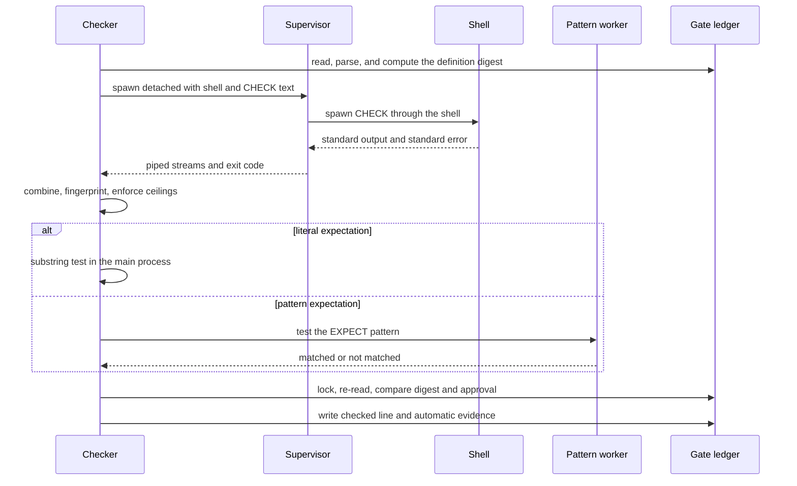
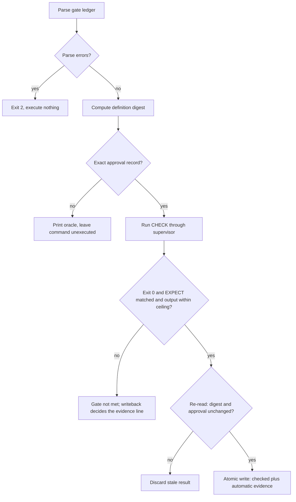

# Core mechanism: how one gate becomes met

A gate is more than a checkbox. The checker must parse it, bind it to a definition, authorize the exact command, execute the command, capture a bounded result, match the expectation, and write evidence that stays valid. Each step can refuse. A refusal leaves the gate unmet. This document follows one gate through every step.

The account is static. A citation such as `README.md:91` names a source file, not a file in this document. No command from the source runs during this reading.

## Step one: the shared strict parser

One parser serves the checker, the Stop hook, and the linter (`scripts/lib/gates.mjs:268-270`). The installer uses the shared scope validator, not the parser (`scripts/install-hooks.mjs:11-13`). The parser reads the whole ledger in one pass and returns gates, abandoned identifiers, owned paths, errors, and warnings together (`scripts/lib/gates.mjs:270-280`, `scripts/lib/gates.mjs:432`). It does not stop at the first error. This lets an author see every malformed line in one report.

The token patterns are small, and each one is anchored to a defined position in the line.

```text
# scripts/lib/gates.mjs:236-243
const GATE_RE = /^- \[( |x|X)\] (.*)$/;
const ATTR_RE = /^(\s+)(CHECK|EXPECT|EVIDENCE|CWD):\s?(.*)$/;
const UNINDENTED_ATTR_RE = /^(CHECK|EXPECT|EVIDENCE|CWD):\s?(.*)$/;
const ABANDON_RE = /^ABANDON:\s*(\S*)\s*(.*)$/;
const INDENTED_ABANDON_RE = /^\s+ABANDON:/;
const OWNS_RE = /^OWNS:\s*(.*)$/;
const FENCE_OPEN_RE = /^( {0,3})(`{3,}|~{3,})(.*)$/;
const REGEX_RE = /^\/([\s\S]*)\/([a-z]*)$/;
```

The parser tolerates two line endings, the carriage-return plus line-feed pair and the single line feed. It records the dominant end-of-line sequence and whether the file ends with a newline, so a later write can preserve both (`scripts/lib/gates.mjs:272-274`, `scripts/lib/gates.mjs:435-439`). It ignores fenced blocks. It tracks a fence character and length and resumes only on a matching close (`scripts/lib/gates.mjs:288-297`). An unclosed fence is an error (`scripts/lib/gates.mjs:401`).

A gate line needs a checkbox and a title. The title must start with an explicit identifier and a colon. The parser trims the identifier and the remaining title (`scripts/lib/gates.mjs:299-305`). If the identifier is absent, the parser still records the gate with a fallback identifier of the letter `L` plus the one-based line number. It also records an error (`scripts/lib/gates.mjs:304`, `scripts/lib/gates.mjs:319`). The fallback exists so the malformed line appears in later diagnostics. It does not make the gate valid. The checker stops with exit 2 when any parse error exists (`scripts/gate-check.mjs:259-262`).

```text
# scripts/lib/gates.mjs:299-319
    const gateMatch = line.match(GATE_RE);
    if (gateMatch) {
      seenGate = true;
      const rawTitle = gateMatch[2].trim();
      const idMatch = rawTitle.match(/^(\S+?):(?:\s+|$)/);
      const id = idMatch ? idMatch[1] : "L" + (index + 1);
      const title = idMatch ? rawTitle.slice(idMatch[0].length).trim() : rawTitle;
      current = {
        line: index,
        checked: gateMatch[1].toLowerCase() === "x",
        id,
        title,
        check: null,
        expect: null,
        evidence: null,
        evidenceLine: -1,
        cwd: null,
      };
      gates.push(current);
      attrs.set(current, new Set());
      if (!idMatch) errors.push("line " + (index + 1) + ": gate needs an explicit ID followed by a colon");
```

The identifier must match the pattern `[A-Za-z0-9][A-Za-z0-9._-]*`, and a duplicate identifier is an error (`scripts/lib/gates.mjs:320-327`). The title must not be blank (`scripts/lib/gates.mjs:323`). Attribute lines must be indented. An unindented `CHECK`, `EXPECT`, `EVIDENCE`, or `CWD` is an error, and it detaches the current gate (`scripts/lib/gates.mjs:341-347`). A detached attribute belongs to no gate, so it cannot attach to the next one. An indented attribute without a current gate is an orphan error (`scripts/lib/gates.mjs:349-353`). A repeated attribute is an error, but the first value stays in place (`scripts/lib/gates.mjs:358-361`).

The `ABANDON` rule points the other way. It must start at column one. An indented `ABANDON` is an error, and the parser explains that the line is not applied (`scripts/lib/gates.mjs:331-339`). The reason must not be blank, and a duplicate abandonment is an error (`scripts/lib/gates.mjs:370-377`). An abandonment for an unknown identifier is an error (`scripts/lib/gates.mjs:427-429`). `OWNS` must appear before the first gate, must declare at least one path, and each declared glob must pass a normalization check (`scripts/lib/gates.mjs:382-395`). A glob is a path pattern that can contain wildcard segments. Normalization trims the value, converts backslashes, removes a leading `./`, and collapses empty and `.` segments. It rejects an absolute path, a `..` segment, and an empty claim (`scripts/lib/gates.mjs:509-521`).

The final pass checks each gate as a unit. A runnable gate needs both `CHECK` and `EXPECT`. One without the other is an error, and a blank value is an error (`scripts/lib/gates.mjs:403-411`). A ledger with zero live gates is an error by default (`scripts/lib/gates.mjs:430`).

```text
# scripts/lib/gates.mjs:403-424
  for (const gate of gates) {
    const hasCheck = gate.check !== null && gate.check !== "";
    const hasExpect = gate.expect !== null && gate.expect !== "";
    if (hasCheck !== hasExpect) {
      errors.push("gate " + gate.id + ": runnable gates require both non-blank CHECK and EXPECT");
    }
    if (gate.check === "" || gate.expect === "") {
      errors.push("gate " + gate.id + ": CHECK and EXPECT cannot be blank");
    }
    if (hasExpect) {
      const parsed = parseRegex(gate.expect);
      if (parsed.error) errors.push("gate " + gate.id + ": " + parsed.error);
      else if (parsed.pathLike) {
        // Warn rather than reject: the pattern reading may be intended, and a
        // literal path cannot be expressed once the wrapping slashes sniff.
        warnings.push("gate " + gate.id + ": EXPECT " + JSON.stringify(gate.expect) +
          " is read as a regular expression, so its dots and other metacharacters" +
          " are wildcards. Escape the inner slashes to keep the pattern, or drop" +
          " the wrapping slashes to match a literal substring.");
      }
      gate.expectation = parsed;
    } else gate.expectation = null;
```

The `EXPECT` value has two readings. A value wrapped in slashes is a regular expression. The pattern must compile, and its regular-expression source text must not exceed 1,000 characters (`scripts/lib/gates.mjs:243`, `scripts/lib/gates.mjs:249-265`). A pattern with an unescaped inner slash also looks like a path, so the parser emits a warning instead of rejecting it (`scripts/lib/gates.mjs:415-422`). For example, `/tmp/report.txt` parses as a delimited pattern with source `tmp/report.txt`. Its dots then match any character. A literal path cannot be expressed behind wrapping slashes, so the parser warns and keeps the pattern reading. Every other value is a literal substring (`scripts/lib/gates.mjs:251`). The checker tests it with a simple inclusion test (`scripts/gate-check.mjs:549`). This is a deliberate limit. The checker does not interpret a natural-language expectation. It matches exact text or a declared pattern.

## Step two: the definition digest

A current result must be bound to the definition that produced it. The binding is a Secure Hash Algorithm 256-bit (SHA-256) digest over a fixed list.

```text
# scripts/lib/gates.mjs:445-455
export function gateDefinitionDigest(gate) {
  if (!gate || typeof gate.check !== "string" || gate.check === "" ||
      typeof gate.expect !== "string" || gate.expect === "") return null;
  return sha256(JSON.stringify([
    "unlazy.gate-definition",
    1,
    gate.check,
    gate.expect,
    gate.cwd === null || gate.cwd === undefined ? null : String(gate.cwd),
  ]));
}
```

The digest covers the `CHECK` text, the `EXPECT` text, and the `CWD` value or null. `CWD` is the declared current working directory for the gate. It does not cover the identifier, the title, or the checkbox. It does not cover the ledger path or the indentation. It does not cover the resolved current working directory, the shell, the timeout, or the platform. It does not cover `PATH`, the executable search path, or the approval. The source states this exclusion and its purpose (`references/gates.md:57-61`). The digest answers one question. Is this gate still the same declared check with the same expected observation? It does not answer whether the environment is the same.

A runnable gate with a blank value returns no digest (`scripts/lib/gates.mjs:446-447`). The automatic evidence prefix function then throws, because it needs a full digest (`scripts/lib/gates.mjs:457-460`). This prevents a partial definition from producing automatic evidence. The parser already rejects a blank value before any run (`scripts/lib/gates.mjs:403-411`). The null return guards a caller that builds a gate object directly.

The digest is unkeyed. Anyone who can edit the ledger can compute it. It detects structural drift. It does not authenticate the author, and it does not stop a deliberate forger (`README.md:91`). The security value comes from the approval store and the parent re-verification, not from the digest alone.

## Step three: evidence classification

The classifier reads the `EVIDENCE` string and assigns one of four classes: `pending`, `automatic-current`, `automatic-stale`, and `human`. Missing evidence and the exact word `pending` are pending (`scripts/lib/gates.mjs:465-466`). Otherwise the classifier computes the current prefix from the parsed definition (`scripts/lib/gates.mjs:467-470`).

```text
# scripts/lib/gates.mjs:464-483
export function classifyGateEvidence(gate) {
  const evidence = gate && gate.evidence === null ? "" : String((gate && gate.evidence) || "");
  if (evidence === "" || /^pending$/i.test(evidence)) return "pending";
  const definitionDigest = gateDefinitionDigest(gate);
  if (definitionDigest !== null) {
    const prefix = automaticEvidencePrefix(definitionDigest);
    const decidingFields = evidence.slice(prefix.length);
    const success = decidingFields.match(
      /^ exit=0; EXPECT=matched; output-sha256=[a-f0-9]{64}; output-bytes=(0|[1-9][0-9]{0,6}); shell=./,
    );
    if (evidence.length <= MAX_AUTOMATIC_EVIDENCE_CHARS && evidence.startsWith(prefix) &&
        success && Number(success[1]) <= MAX_CHECK_OUTPUT_BYTES) {
      return "automatic-current";
    }
  }
  if (evidence.startsWith("automatic-evidence=") || evidence.startsWith("exit=0; shell=")) {
    return "automatic-stale";
  }
  return "human";
}
```

The deciding fields after the prefix must match one fixed pattern. They must contain `exit=0`, `EXPECT=matched`, a 64-character lowercase output digest, an output byte count, and a nonempty shell text (`scripts/lib/gates.mjs:471-473`). The count pattern accepts a value from 0 through 9,999,999, but a lower ceiling governs. The line must start with the exact current prefix, fit the 900-character automatic evidence limit, and report no more than 1,048,576 bytes of output (`scripts/lib/gates.mjs:474-475`, `scripts/lib/gates.mjs:14-15`). A line that passes every check is automatic-current.

An automatic line has a fixed field order. It is `automatic-evidence=v1`, then `definition-sha256`, `exit=0`, `EXPECT=matched`, `output-sha256`, `output-bytes`, `shell`, `cwd`, and `path` (`scripts/gate-check.mjs:818-821`). Each digest is 64 lowercase hexadecimal characters, and the path field is `<hash>/<count> entries` (`scripts/lib/gates.mjs:458-461`, `scripts/gate-check.mjs:343`).

A line is automatic-stale when it looks like machine evidence but fails the current test (`scripts/lib/gates.mjs:479-481`). That happens when the prefix is wrong, a deciding field is wrong, the line is too long, or the byte count passes the ceiling. The fallback accepts two shapes. One shape starts with `automatic-evidence=`, which covers a current-format line that went stale. The other shape starts with the legacy `exit=0; shell=`, which carries no definition binding. Any other nonempty text is human evidence (`scripts/lib/gates.mjs:482`). The source does not validate the content of human evidence. A person can write any sentence. The gate counts as met when the checkbox is checked and the evidence is human. This is the `human` class, which records a manual review.

The five gate states combine the checkbox, the class, and the abandonment map.

```text
# scripts/lib/gates.mjs:485-494
export function gateState(gate, abandoned) {
  if (abandoned.has(gate.id)) return "abandoned";
  if (!gate.checked) return "unmet";
  const evidence = classifyGateEvidence(gate);
  const runnable = gateDefinitionDigest(gate) !== null;
  if (runnable) return evidence === "automatic-current" ? "met" : "stale-unmet";
  if (evidence === "pending") return "unmet-no-evidence";
  if (evidence === "automatic-current" || evidence === "automatic-stale") return "stale-unmet";
  return "met";
}
```

| Condition, in order | State |
|---|---|
| The identifier has an `ABANDON` line | abandoned |
| The checkbox is clear | unmet |
| The gate is runnable and evidence is automatic-current | met |
| The gate is runnable and evidence is anything else | stale-unmet |
| The gate is manual and evidence is pending | unmet-no-evidence |
| The gate is manual and evidence is automatic | stale-unmet |
| The gate is manual and evidence is human | met |

The order matters. An abandoned gate wins over every other condition. An unchecked gate is unmet even when a valid evidence line exists. That is one reason a failed run can clear the checkbox (`scripts/gate-check.mjs:858-860`). The checker clears the box only when the failure must be recorded, and step nine states the three cases. A manual gate cannot be satisfied by machine evidence. A machine gate cannot be satisfied by handwritten text. The state function is pure, which means that it returns a value from its arguments and changes no state. It needs only the parsed gate and the abandonment map.

`--status` is the checker mode that reports state without execution (`scripts/gate-check.mjs:337-343`). Purity means that a state report needs only file text. The digest also excludes the shell and `PATH`, so `--status` and the Stop hook work without a shell lookup (`references/gates.md:61`). The Stop hook imports the same state function (`scripts/stop-hook.mjs:6-10`). The hook and the checker cannot disagree about a gate state unless they read different files.

## Step four: the approval oracle

Approval answers a different question from currentness. Currentness asks whether the definition changed. Approval asks whether this exact execution was authorized. The oracle is the authorization object.

```text
# scripts/gate-check.mjs:355-371
function oracle(file, gate) {
  const cwd = resolvedGateCwd(gate, file);
  return {
    schema: 1,
    check: gate.check,
    expect: gate.expect,
    cwd,
    shell,
    timeoutMs: timeoutSeconds * 1000,
    maxOutputBytes: MAX_OUTPUT_BYTES,
    regexTimeoutMs: REGEX_TIMEOUT_MS,
    regexStartupTimeoutMs: REGEX_STARTUP_TIMEOUT_MS,
    maxRegexWorkers: MAX_REGEX_WORKERS,
    platform: process.platform,
    path: pathValue,
  };
}
```

The oracle includes a schema number, the check text, and the expectation text. It includes the resolved absolute current working directory and the resolved shell. It includes the timeout in milliseconds and the output byte limit. It includes the regular-expression match budget, the regular-expression startup budget, and the maximum worker count. It includes the platform name and the full `PATH` value (`scripts/gate-check.mjs:355-371`). The approval signature is the SHA-256 digest of the JavaScript Object Notation (JSON) serialization of that object (`scripts/gate-check.mjs:373-375`). Two oracles are equal only when every field is equal.

The approval record path also binds the absolute ledger path, the gate identifier, and the signature (`scripts/gate-check.mjs:387-390`). The record itself stores the schema version, the absolute ledger path, the gate identifier, the signature, the full oracle, and a timestamp (`scripts/gate-check.mjs:505-509`). A match requires the record file, the gate identifier, and the current signature to agree (`scripts/gate-check.mjs:478-479`). Editing `CHECK` or `EXPECT` changes the digest and the signature. Editing the raw `CWD` text changes the digest. The signature changes only when the resolved working directory changes, because the oracle stores the resolved path (`scripts/gate-check.mjs:355-371`, `scripts/lib/gates.mjs:445-455`). Changing the shell, timeout, platform, or `PATH` changes the signature too. The result is an exact, local consent token.

`--status` never builds that signature. It sets the shell and `PATH` values to null, and it sets the approval directory to null (`scripts/gate-check.mjs:337-343`, `scripts/gate-check.mjs:382`). It can report currentness with no shell lookup and no approval storage. This is why the Stop hook does not execute a command. The Stop hook reads state, not approval files.

The approval store must stay outside the repository root (`scripts/gate-check.mjs:384-385`). Its default location is the user home directory plus `.unlazy/approved` (`scripts/gate-check.mjs:383`). The store must be a real directory, must be owned by the current user, and must not grant group or other permissions (`scripts/gate-check.mjs:392-407`). Its canonical path must also be outside the repository (`scripts/gate-check.mjs:414-417`). These checks run again after a read, so a directory swap during use is an error (`scripts/gate-check.mjs:423-429`).

A record is read with a no-follow open, a bounded size, a single-link requirement, and an identity comparison before and after the read (`scripts/gate-check.mjs:431-462`). A record failure is not a silent denial. It propagates to the caller. The checker counts it and exits 2 at the end (`scripts/gate-check.mjs:775-777`, `scripts/gate-check.mjs:940-943`). A missing record is different. It returns false and leaves the command unexecuted (`scripts/gate-check.mjs:469-471`).

A new approval is written under a separate lock file with an exclusive create and a 10,000-millisecond deadline (`scripts/gate-check.mjs:482-501`). The lock is not taken over by path. The owner writes its process identifier (PID) and a random token. It writes the record atomically, checks that the directory is unchanged, and removes the lock only when its token still matches (`scripts/gate-check.mjs:503-517`).

## Step five: the execution sequence

A normal run without an approval prints the resolved oracle and does not run the command (`scripts/gate-check.mjs:521-529`, `scripts/gate-check.mjs:763-768`, `README.md:53-58`). The common question is whether a normal run executes the command. It does not, until the exact oracle has a record. This is not a permanent preview mode. The first run is a preview, not a mode.

The checker first builds a task list from the parser state (`scripts/gate-check.mjs:726-731`). Two gates never enter that list. An abandoned gate has no task, and a manual gate has no `CHECK` text. A normal run also skips a gate that is already met. A `--reverify` run adds met runnable gates back, but abandoned and manual gates still stay out. A `--status` run builds no task list at all. The checker prints one `RUN` line per task with the shell, current working directory, and the full `PATH` value (`scripts/gate-check.mjs:783-785`). Then it runs the tasks with a rolling worker limit, which defaults to one check in flight and accepts a value from 1 through 64 (`scripts/gate-check.mjs:34`, `scripts/gate-check.mjs:710-720`, `scripts/gate-check.mjs:786`).

Each task launches a Node.js supervisor. On POSIX systems, the supervisor is detached and leads its own process group, so the checker can signal the whole tree. Windows uses a different tree termination path (`scripts/gate-check.mjs:683-691`, `scripts/lib/process-tree.mjs:9-25`). The supervisor launches the shell. The spawn passes the supervisor path, the resolved shell, and the check text as separate arguments. The checker does not use a shell for that first launch (`scripts/gate-check.mjs:683-691`).

```text
# scripts/gate-check.mjs:683-691
    try {
      child = spawn(process.execPath, [CHECK_SUPERVISOR, shell, task.gate.check], {
        cwd: task.cwd,
        shell: false,
        windowsHide: true,
        detached: process.platform !== "win32",
        env: process.env,
        stdio: ["ignore", "pipe", "pipe"],
      });
```

The supervisor spawns the check through the resolved shell, inherits the environment, and pipes both streams (`scripts/lib/check-supervisor.mjs:16-22`). The pipe is not a style choice. It keeps the supervisor alive until every descendant closes standard output and standard error. On POSIX systems, the supervisor remains the process-group identity for that tree (`scripts/lib/check-supervisor.mjs:28-32`). The supervisor returns the child exit code when the child closes normally. It returns 127 when the spawn fails and 1 when a signal ends the child (`scripts/lib/check-supervisor.mjs:33-46`).

The checker combines the streams before it matches. The combined string is standard output, then one newline when both streams are nonempty, then standard error (`scripts/gate-check.mjs:623-625`). The expectation and the fingerprint use that exact string (`scripts/gate-check.mjs:626-630`). The `ok` flag has three conditions. There must be no error, the exit code must be zero, and the expectation must match (`scripts/gate-check.mjs:642-646`).



## Step six: two output ceilings

The runner enforces two ceilings. The first is the raw capture ceiling. The runner truncates each chunk to the remaining space, and it increments the total byte count by the full chunk length (`scripts/gate-check.mjs:672-681`). The count measures what the child emitted, not what the buffer kept. That lets the overflow test fire after the buffer stops growing. When the count passes 1,048,576 bytes, the runner sets an overflow flag and starts process-tree cleanup (`scripts/gate-check.mjs:677-680`). The second is the canonical ceiling. After both buffers are decoded as Unicode Transformation Format 8-bit (UTF-8), the combined string is fingerprinted again. If its UTF-8 byte length passes 1,048,576, the result is also an overflow (`scripts/gate-check.mjs:623-632`).

```text
# scripts/gate-check.mjs:623-632
      const stdout = Buffer.concat(chunks.stdout).toString("utf8");
      const stderr = Buffer.concat(chunks.stderr).toString("utf8");
      const output = stdout + (stdout && stderr ? "\n" : "") + stderr;
      // EXPECT and persisted fingerprints both use this exact combined string.
      // Keep its UTF-8 representation within the same 1 MiB ceiling as raw
      // capture: invalid byte replacement and the stream separator can expand
      // it even when the child emitted exactly MAX_OUTPUT_BYTES raw bytes.
      const fingerprint = outputFingerprint(output);
      const normalizedOverflow = fingerprint.bytes > MAX_OUTPUT_BYTES;
      const overflow = rawOverflow || normalizedOverflow;
```

The second ceiling exists because decoding and combination can expand the text. Invalid bytes become the Unicode replacement character, and the synthetic newline adds a byte. A child can emit exactly 1,048,576 raw bytes and still produce a canonical string above the limit (`scripts/gate-check.mjs:626-629`). An overflow is an error. The checker never truncates it into a success (`scripts/gate-check.mjs:637-640`). The checker reports which ceiling failed when the raw capture was within the limit (`scripts/gate-check.mjs:638-639`).

The fingerprint is the digest of the canonical string and its UTF-8 byte count (`scripts/gate-check.mjs:598-601`). The success evidence writes both values before the machine-specific tail (`scripts/gate-check.mjs:812-821`). The evidence line is capped at 900 characters, and the structural fields come first so truncation can remove only the transcript tail (`scripts/gate-check.mjs:815-817`).

## Step seven: timeout and process cleanup

The default timeout is 120 seconds (`scripts/gate-check.mjs:72`, `scripts/gate-check.mjs:363`). The timer sets a timed-out flag and calls the cleanup function (`scripts/gate-check.mjs:702-705`). Cleanup asks the shared process-tree helper to terminate the group on Portable Operating System Interface (POSIX) systems, or the tree on Windows (`scripts/gate-check.mjs:649-652`).

The cleanup does not assume that a signal request succeeded. It destroys the streams after 1,000 milliseconds, and it settles the result after 1,500 milliseconds even if no close event arrives (`scripts/gate-check.mjs:653-669`). This handles a descendant that escaped the shell and still holds a pipe. The result keeps any cleanup diagnostic (`scripts/gate-check.mjs:636`, `scripts/gate-check.mjs:652`).

On Windows, the helper prefers the trusted `taskkill.exe` under the system directory. It uses that path only when `SystemRoot`, `WINDIR`, and `SystemDrive` agree (`scripts/lib/process-tree.mjs:9-25`). It refuses a bare executable name because a bare name would consult the current working directory or the `PATH` environment variable that the check controls (`scripts/lib/process-tree.mjs:24-25`). If the trusted path is unavailable or the helper fails, it falls back to the held child handle (`scripts/lib/process-tree.mjs:103-109`, `scripts/lib/process-tree.mjs:132-137`). The helper calls itself best effort (`scripts/lib/process-tree.mjs:1-2`).

## Step eight: regular-expression isolation

A literal expectation is a substring test in the main process (`scripts/gate-check.mjs:549`). A pattern expectation runs in a disposable worker thread. The worker exists to contain catastrophic backtracking (`scripts/lib/gates.mjs:254-255`). The checker limits concurrent workers to four (`scripts/gate-check.mjs:71`, `scripts/gate-check.mjs:534-546`).

The startup budget is 5,000 milliseconds, and the match budget is 250 milliseconds (`scripts/gate-check.mjs:69-70`). The match budget starts only after the worker reports that it is online (`scripts/gate-check.mjs:574-583`). The source explains why. Process startup and a busy job queue are not pattern time (`scripts/gate-check.mjs:578-579`). A worker that fails to start, throws, exits early, or exceeds a budget produces a non-match with a diagnostic (`scripts/gate-check.mjs:565-591`). The worker is terminated on every finish path (`scripts/gate-check.mjs:557-563`). The worker file has one job. It posts the test result back (`scripts/lib/regex-worker.mjs:1-9`).

```text
# scripts/gate-check.mjs:574-583
      worker.once("online", () => {
        if (settled) return;
        clearTimeout(startupTimer);
        startupTimer = null;
        // The catastrophic-backtracking budget starts only after the worker is
        // online; process startup and a busy --jobs queue are not regex time.
        matchTimer = setTimeout(() => finish({
          matched: false,
          error: "EXPECT regex exceeded " + REGEX_TIMEOUT_MS + "ms",
        }), REGEX_TIMEOUT_MS);
```

This is a containment boundary, not a security sandbox. The pattern runs in the same user account and can read the same environment. The boundary limits CPU time and memory for one match. It cannot make a pattern correct. A fast hostile pattern can still return a wrong match or hide a real failure. The worker is neither a semantic validator nor an isolation boundary. It runs with the same access as the checker (`SECURITY.md:7`).

## Step nine: the guarded writeback

A successful result is not written immediately. The checker reloads the ledger under a file lock and parses it again (`scripts/gate-check.mjs:839-841`). A parse error at this point is an error, because the file changed into an invalid state (`scripts/gate-check.mjs:841`).

The fresh gate must still have the same digest and the same approval signature (`scripts/gate-check.mjs:842-849`). If either value differs, the checker records a stale result, prints a stale message, and writes nothing (`scripts/gate-check.mjs:843-848`). The stale set later appears as extra unmet work in the aggregate, so a stale success cannot disappear (`scripts/gate-check.mjs:930-936`). This is the rule that prevents a slow command from certifying a definition that changed while it ran.

```text
# scripts/gate-check.mjs:839-862
    await withFileLock(root, result.file, () => {
      let doc = parseGates(readLedgerFile(result.file));
      if (doc.errors.length) throw new Error("fresh ledger became invalid: " + doc.errors.join("; "));
      const fresh = doc.gates.find((gate) => gate.id === result.gate.id);
      if (!fresh || gateDefinitionDigest(fresh) !== result.definitionDigest ||
          approvalOracleSignature(result.file, fresh) !== result.approvalSignature) {
        staleResults.set(resultKey(result.file, result.gate.id), qualify(result.file, result.gate.id));
        console.log("  STALE " + qualify(result.file, result.gate.id) +
          ": definition or runtime approval oracle changed; result not written");
        return;
      }
      const freshState = gateState(fresh, doc.abandoned);
      if (freshState === "abandoned") return;
      const mustWriteFailure = result.startingState === "stale-unmet" ||
        (opt.reverify && result.wasMet) || fresh.checked;
      if (!result.ok && !mustWriteFailure) return;
      if (result.ok) {
        doc.lines[fresh.line] = doc.lines[fresh.line].replace(/^- \[( |x|X)\]/, "- [x]");
        insertOrUpdateEvidence(doc, fresh, evidenceFor(result));
      } else {
        doc.lines[fresh.line] = doc.lines[fresh.line].replace(/^- \[(x|X)\]/, "- [ ]");
        insertOrUpdateEvidence(doc, fresh, "pending");
      }
      writeAtomic(result.file, formatDocument(doc));
```

If the fresh gate is abandoned, the write is skipped (`scripts/gate-check.mjs:850-851`). If the result succeeded, the checker checks the box and writes automatic evidence. A failed result is not always recorded. The checker writes the failure only in three cases. The gate started as `stale-unmet`. The run is a re-verification of a gate that was met. The old gate was checked (`scripts/gate-check.mjs:852-854`). In those cases it clears the box and writes `pending` (`scripts/gate-check.mjs:855-861`). The update function replaces only the gate's own evidence line, or inserts one after its attributes. It does not rewrite the whole gate (`scripts/gate-check.mjs:824-833`). The file is written through the shared atomic writer (`scripts/gate-check.mjs:862`).

## Step ten: durable reads and writes

The shared reader opens with no-follow and non-blocking flags where the platform supports them. It converts a symlink loop into the project's own single-link error (`scripts/lib/gates.mjs:128-135`). It rejects a non-file, a symlink, a hard link, and an oversized file (`scripts/lib/gates.mjs:46-53`). It reads through the descriptor, compares the descriptor to the named entry before and after, and compares the snapshot fields (`scripts/lib/gates.mjs:136-194`). A change during the read is an error.

The writer creates a private temporary file in the same directory, writes it, flushes it, and renames it over the target (`scripts/lib/gates.mjs:713-724`). It refuses a symlink target and a non-directory parent (`scripts/lib/gates.mjs:696-710`). The replace step retries the three transient Windows errors, `EACCES`, `EBUSY`, and `EPERM`, with a synchronous sleep and a 2,000-millisecond deadline (`scripts/lib/gates.mjs:20-27`, `scripts/lib/gates.mjs:220-234`). It removes an unconsumed temporary file in the final block (`scripts/lib/gates.mjs:725-728`).

The lock helper canonicalizes the repository root, hashes the canonical target, and creates a private lock file with an exclusive create (`scripts/lib/gates.mjs:731-775`). It waits without taking over an existing lock, and it stops with a refusal at the timeout (`scripts/lib/gates.mjs:774-797`). Release removes the file only when the recorded token still matches (`scripts/lib/gates.mjs:804-823`).

Windows needs a separate identity rule. A path-based status and a descriptor-based status can use different runtime implementations, so their volume identifiers are not comparable (`scripts/lib/gates.mjs:55-60`). The helper keeps the named-entry status as the type and link guard. It obtains identity from a second descriptor, brackets that open with named-entry snapshots, and compares descriptor to descriptor (`scripts/lib/gates.mjs:61-110`). It also compares the exact BigInt inode value of the named entry and the descriptor. BigInt is an arbitrary-precision integer type, and an inode is the file identity number (`scripts/lib/gates.mjs:99-106`). The source calls this a snapshot, not atomic path isolation (`scripts/lib/gates.mjs:102-103`).

## The Aha: two bindings, two purposes

**Aha:** The mechanism uses two different bindings on purpose. The definition digest is small and portable. It covers only the check, the expectation, and the raw current working directory. The approval signature is large and local. It covers the resolved environment, the runtime limits, the platform, and the full `PATH` value. The first binding makes currentness cheap enough for `--status` and the Stop hook. The second binding makes execution consent exact enough for a command that can read the user's files. Neither binding alone is enough. A digest without approval would let any ledger edit authorize execution. An approval without a digest would let a command result certify a changed definition. The writeback checks both, and it discards the result if either one moved. This is the central safety property of the tool.



The diagram shows why a successful process is not enough. The zero exit must survive the expectation, the ceilings, and the writeback re-check. Each decision diamond is a refusal point. The ledger gate becomes met only after every refusal point passes.

The diagram compresses the failure path. A failed run does not always write `pending`. The checker writes it only in the three cases that step nine states. Otherwise the ledger keeps its earlier evidence line (`scripts/gate-check.mjs:852-861`).

## Limits of the mechanism

The mechanism cannot tell whether a command measures its title. A gate named for a business outcome can run a command that prints a constant (`references/gates.md:97`). The parser accepts it, the digest binds it, the approval covers it, and the evidence records it. The result is structurally valid and semantically empty. Only a person can catch that mismatch (`references/gates.md:115`).

The mechanism also cannot prove that the evidence line was not rewritten with a newly computed digest. The digest is unkeyed. A forger with write access can compute a new prefix and a new output fingerprint. The design raises the cost and makes the edit visible. It does not make forgery impossible (`README.md:91`).

The mechanism assumes that the ledger and the state files are the same files that the checker read. The stable reader and the writeback re-check defend that assumption within the tool's control. The source states the remaining Windows path boundary honestly (`SECURITY.md:46`). A reader should not treat a snapshot check as an operating system guarantee.

## Related documents

Continue with [`03-workflow-and-quality.md`](03-workflow-and-quality.md) for the operating sequence and the tests. Read [`01-architecture.md`](01-architecture.md) for the module boundaries around these steps. [`04-limits-and-comparison.md`](04-limits-and-comparison.md) states the mechanism limits in full.
