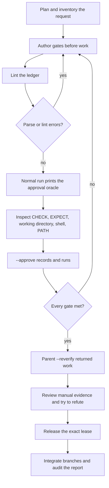
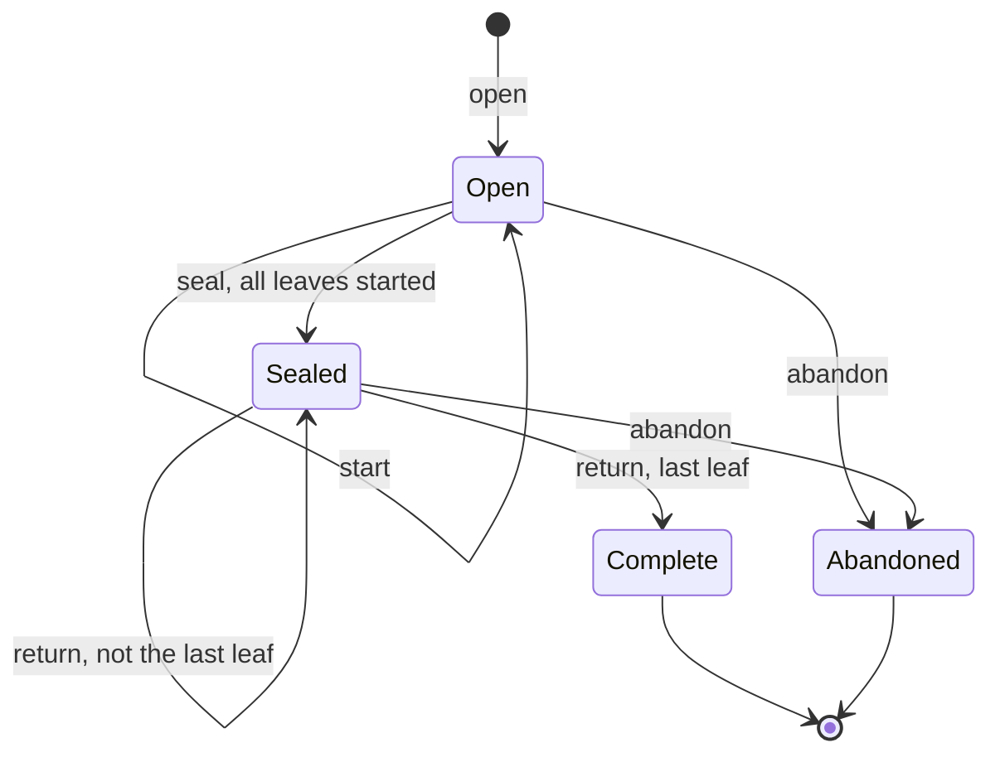

# Workflow and quality: from plan to measured report

The mechanism document follows one gate. This document follows one task. It covers the authoring rules, the lint pass, the approval sequence, re-verification, orchestration, leases, dispatch waves, the Stop hook, and the final report audit. It ends with the tests and the continuous integration (CI) matrix.

The account is static. A citation such as `README.md:91` names a source file, not a file in this document. No command from the source runs during this reading.

## Choose the cheapest mode that fits

`unlazy` has three modes. Solo mode uses one context and one ledger (`SKILL.md:12`). Orchestrated mode splits the work into leaves and branches when one context cannot hold the task and its verification at full attention (`references/orchestration.md:3`). Parallel dispatch adds scopes, leases, and native wave launches when independent leaves run at the same time (`references/dispatch.md:3`).

The project also states when not to use the discipline. A trivial edit or a factual reply does not need a ledger (`SKILL.md:104`). Orchestration adds planning and integration overhead, and solo mode is better when one focused context can finish and verify the task (`references/orchestration.md:105-107`). The mode choice is a cost decision, not a sign of greater maturity.

## Author gates that can fail

The authoring rules are short. Observe the outcome directly. Emit a success-only marker. Test a negative control, a case that must fail, before trusting an absence. Measure supplied numbers independently. Review consequential manual gates by risk. Keep evidence decisive (`references/gates.md:99-104`).

```text
# references/gates.md:99-104
- **Observe the outcome directly.** Make the check read the artifact, service, or measurement named by the title.
- **Emit a success-only marker.** Let the script perform all assertions, exit nonzero on any failure, and print the expected marker only after every assertion passes.
- **Test negative controls.** Before trusting an absence check, run the same logic against a known positive fixture and confirm that it fails. A missing file, wrong path, or malformed pattern can otherwise look like valid absence.
- **Measure supplied numbers independently.** Do not make a number copied from the brief its own expectation. Make the script calculate the value from source data, apply the acceptance rule, and print a separate success marker.
- **Review consequential manual gates by risk.** A contributor's single 17-gate course audit found that its only manual gate was also its most consequential. Use that observation as a prompt for stronger review, not as evidence of a general correlation between checkability and risk. Cite exact evidence and obtain a second review when the consequence warrants it.
- **Keep evidence decisive.** Automated successful evidence stores an output fingerprint, not raw output. For manual gates, record the smallest non-sensitive fact that proves the outcome; do not paste full logs into a ledger.
```

The source does not define the course or the audit behind the 17-gate example. Treat that sentence as a prompt for review, not as evidence. The sentence describes one audit of 17 gates in one course. That audit found one manual gate, and that gate was also the most consequential. The sentence does not say that manual gates are generally riskier.

The skill adds a portability rule. Prefer portable Node.js scripts and do not assume that `grep`, `tail`, or `tr` exists on a stock Windows system (`SKILL.md:74`). It also adds an environment rule. Re-run with the same declared shell and required toolchain, and treat a mismatch as a failed verification (`SKILL.md:75`).

A runnable gate must carry both `CHECK` and `EXPECT`. It must exit zero and match the expectation. A manual gate carries neither, and its evidence is a person's written fact. The distinction is structural, not stylistic. The checker refuses a gate with only one of the two attributes (`scripts/lib/gates.mjs:403-411`).

The order matters too. The ledger comes before implementation (`SKILL.md:12`). A gate written after the code can describe what the code already does. A gate written before the code states the acceptance condition while the work is still open. The project records this as rule zero, the rule that the ledger comes first, in its change history (`CHANGELOG.md:103`).

## Lint the mechanical subset

The linter is advisory. It never executes a `CHECK:` (`references/gates.md:108`). It reads the ledger through the shared stable reader and the shared parser. A parse failure is exit 2, because the linter cannot judge a ledger that the parser rejects (`scripts/gate-lint.mjs:154-159`).

The rule pass is separate from the parse pass. The rule pass filters out abandoned gates. It then applies lexical checks, which are text-level checks, to every live gate. A live gate is one that is not abandoned (`scripts/gate-lint.mjs:162-196`). The checks are narrow on purpose.

```text
# scripts/gate-lint.mjs:112-119
const FIXED_OUTPUT_COMMAND = /^\s*(?:(?:echo|printf)(?:\s+[^&|;]*)?|true|:|exit\s+0)\s*$/i;
// Tokens that appear in failure output as readily as in success output.
const WEAK_EXPECT = new Set([
  "ok", "okay", "done", "pass", "passed", "success", "successful", "succeeded",
  "complete", "completed", "finished", "yes", "true", "0", "good", "fine", "working",
]);
// Openings that name an activity rather than an outcome a stranger could judge.
const ACTIVITY_START = /^(work(ing)? on|improve|enhance|handle|support|ensure|make sure|try|attempt|look (at|into)|investigate|consider|review|refactor|clean ?up|polish|update|tidy|address|deal with|add support)\b/i;
```

The linter warns on a fixed-output command and a weak expectation. It warns on a path-shaped pattern and a manual gate. It warns on a number in a manual title that nothing measures, and on an activity title instead of an outcome (`scripts/gate-lint.mjs:168-195`). It also warns when fewer than half of the live gates are runnable (`scripts/gate-lint.mjs:198-201`). It does not parse the command through a shell. The source says that a command prefix or an expectation text in the argument list is not proof that the check can fail. A check that cannot fail satisfies no gate (`references/gates.md:115`).

The linter has no suppression comment. The source defines no ignore directive, so a finding can be fixed or accepted, but it cannot be muted in the ledger. Default mode exits 0 with warnings and prints `LINT OK` (`scripts/gate-lint.mjs:236-240`). Strict mode exits 1 when any warning exists (`scripts/gate-lint.mjs:204`). A parse failure exits 2 (`scripts/gate-lint.mjs:245`).

```text
# scripts/gate-lint.mjs:204-204
const failed = errorCount > 0 || (strict && warningCount > 0);
```

A ledger can make lint part of its own acceptance. A gate can run the linter and require the `LINT OK` marker (`references/gates.md:119-126`). That gate refers to the linter that reads it. The loop is safe because the linter never executes a check. It reads the gate that runs it as one more title to review, and the gate command runs the linter from outside. The reference is useful, because it makes ledger quality observable before the work starts.

## Inspect, approve, and run

The approval sequence has three cases. An oracle is the resolved execution tuple. It contains the check text, the expectation, the working directory, the shell, and `PATH` (the executable search path). It also binds the timeout, the output and regular-expression limits, and the platform. `--status` reads the ledger and reports state without a shell lookup or approval storage (`scripts/gate-check.mjs:337-343`). A normal run without approval prints the resolved oracle and does not execute (`scripts/gate-check.mjs:763-768`). A run with `--approve` records the approval and then executes in the same invocation (`scripts/gate-check.mjs:770-786`). A typical sequence is `node scripts/gate-check.mjs GATES.md`, then the same command with `--approve` after inspection.

```text
# scripts/gate-check.mjs:763-772
  if (!approved) {
    printOracle(task.file, task.gate, "APPROVAL REQUIRED");
    if (!opt.approve) {
      console.log("    NOT RUN: inspect this oracle, then re-run with --approve");
      notRun.push(task);
      continue;
    }
    try {
      await recordApproval(task.file, task.gate);
      console.log("    APPROVED: " + approvalPath(task.file, task.gate, validatedApprovalDir().path));
```

The printed oracle is the object that the person reviews. It shows the check text, the expectation, the resolved current working directory, the resolved shell, and the full `PATH` value, which is the executable search path (`scripts/gate-check.mjs:521-529`). A person must inspect all five. The timeout, output limit, regular-expression budgets, worker limit, and platform also enter the signature. They come from defaults or options, so the person checks them once for each run configuration (`scripts/gate-check.mjs:355-371`). The check text can call another script, so the inspection must include that script (`references/orchestration.md:20`).

The approval record is exact. It covers the full environment object from the mechanism document (`scripts/gate-check.mjs:355-375`). If the shell, the timeout, the platform, or the `PATH` value changes, the old record no longer matches. The next run prints a new `APPROVAL REQUIRED` oracle and does not execute. This is not a bug. It prevents an old consent from covering a new execution.

`--status` and `--approve` are mutually exclusive (`scripts/gate-check.mjs:166`). The checker refuses the combination because status never approves commands. `--status` and `--reverify` are also exclusive (`scripts/gate-check.mjs:165`). The flags encode different questions. Status asks what the ledger says. Re-verification asks the commands again.

Approval is consent, not isolation. The command runs with the user's permissions and inherited environment (`SECURITY.md:7`). The workflow must treat an approved command as trusted code. A repository that receives untrusted contributions needs an external sandbox before approval (`README.md:117`).

## Re-verify returned work

A returned leaf is not verified. The parent must run the leaf's runnable gates again, including gates that are already checked (`references/orchestration.md:29-35`). The command uses `--reverify` with explicit ledger files (`references/orchestration.md:32`). `--status` alone is not re-verification (`SKILL.md:51`).

`--reverify` includes met gates in the task list. Without it, the planner skips a gate whose state is met (`scripts/gate-check.mjs:730-731`). With it, every non-abandoned runnable gate is a task. A gate that fails re-verification clears its checkbox and writes `pending` (`scripts/gate-check.mjs:852-861`). A gate whose definition or approval changed during the run is discarded as stale (`scripts/gate-check.mjs:843-849`).

Checks run one at a time by default. `--jobs` accepts an integer from 1 through 64 (`scripts/gate-check.mjs:140-147`). The limit is rolling. The runner starts another check as soon as one finishes, and the results keep ledger order (`scripts/gate-check.mjs:710-723`). `--jobs` controls command execution only. It does not dispatch subagents and it does not decide dependency readiness (`references/orchestration.md:63`).

The parallel guide recommends concurrency only when the runnable gates are independent and the wall-clock saving is real (`references/orchestration.md:57`). A shared environment can make apparently independent checks interfere. The operator must judge that risk.

## Orchestrate with explicit states

The host is the agent runtime that starts sessions and returns launch handles (`references/dispatch.md:3`). A session is one agent conversation that the host runs. Orchestrated mode uses five leaf states. `WAITING` means a dependency is not verified. `READY` means dependencies are verified and ownership is available. `IN-FLIGHT` means dispatched but not independently verified. `VERIFIED` means the parent re-verified it and reviewed its manual gates. `ABANDONED` means a required gate has a recorded handoff, which is an `ABANDON` line with a reason (`references/orchestration.md:7-13`). Branch states are `OPEN`, `VERIFIED`, and `ABANDONED` (`references/orchestration.md:15`).

```text
# references/orchestration.md:7-13
Use these leaf states only:

- `WAITING`: one or more ids in `Needs` are not yet `VERIFIED`
- `READY`: dependencies are verified and ownership is available
- `IN-FLIGHT`: dispatched and not yet independently verified
- `VERIFIED`: parent re-verification passed and manual gates were reviewed
- `ABANDONED`: at least one required gate has a recorded handoff; never treat this as full completion
```

The driver, the agent that coordinates the leaves, has eight steps. Plan before fan-out, which is the parallel launch of independent leaves. Inspect and approve checks. Claim every concurrent leaf. Launch each ready wave. Verify each return independently. Append a status event and continue to the next step. Integrate bottom-up, from each leaf through its branch. Reconcile, release, and report (`references/orchestration.md:17-51`). The loop is written as instructions, not as code. The host agent performs the planning and the review.

Verification has four layers. Leaf self-check catches ordinary incompleteness, but it is self-certification. Parent `--reverify` executes the oracles again. Branch integration catches children that do not compose. The optional Stop hook blocks a stop while the resolved pipeline has unmet work, and it does not execute checks (`references/orchestration.md:85-90`).

```text
# references/orchestration.md:85-90
## Verification hierarchy

1. **Leaf self-check:** catches ordinary incompleteness but remains self-certification.
2. **Parent `--reverify`:** executes each runnable oracle again instead of trusting old or manually written evidence.
3. **Branch integration:** catches locally correct children that do not compose.
4. **Optional Stop hook:** blocks the driver from ending while its resolved pipeline has unmet ledgers or incomplete dispatch waves. It does not execute checks or validate their meaning.
```

The parent must use the same toolchain and the declared shell. If the environment differs, the mismatch is recorded and resolved, not accepted (`references/orchestration.md:92`). This is the practical meaning of execution provenance, which is the record of the environment that produced a result. The digest binds the text. The re-run binds the environment.

## Coordinate with scopes and leases

A scope changes where the tool looks and where it writes. It limits gate discovery, the status log target, Stop hook resolution and progress state, dispatch waves, and lease labels (`SECURITY.md:36`, `references/parallel.md:38-47`). `SECURITY.md:36` lists dispatch waves and omits hook progress state. `references/parallel.md:38-47` lists hook progress state and omits dispatch waves. A complete scope description needs both lists. It does not limit a `CHECK:` process (`references/parallel.md:47`). A check can read and write outside the scope. Scopes coordinate the tool. They do not isolate the command.

Leases cover declared paths. Each leaf declares its paths in `OWNS` before the first gate, and an absolute path or a `..` traversal is rejected (`references/parallel.md:51-57`). A claim is all-or-nothing, and it runs under one global lease lock (`references/parallel.md:63`). Either the claim records every declared path, or it records none. A second claim with the same scope and leaf identifier is refused even when the new paths are disjoint (`references/parallel.md:65`). Release that exact leaf before claiming it again.

Overlap detection is conservative. The checker splits each glob into path segments and compares them from left to right. Only a disagreement in a literal path segment proves disjointness (`scripts/lib/gates.mjs:535-553`). A wildcard segment conflicts with any segment, and a common prefix with different lengths also conflicts (`scripts/lib/gates.mjs:546-552`). The reference gives examples.

```text
# references/parallel.md:73-78
| First declaration | Second declaration | Result |
|---|---|---|
| `src/api/**` | `src/web/**` | disjoint |
| `src/shared/**` | `src/shared/util.mjs` | conflict |
| `src/a*.mjs` | `src/ab*.mjs` | conflict because intersection is possible |
| `**` | `docs/**` | conflict |
```

A lease is a coordination record, not a write barrier. It covers only declared paths and only participants that honor it (`references/parallel.md:80`). The guide recommends separate worktrees for colliding output and stronger isolation for untrusted commands (`references/parallel.md:127-133`).

The parent releases the leaf lease after parent re-verification and manual review, before any dependent leaf moves from `WAITING` to `READY` (`references/parallel.md:82-83`). The guide reserves a whole-scope release for the end, or for explicit recovery after the recorded owner is gone (`references/parallel.md:90-97`). The checker never auto-breaks a lock. A human must verify that the owner is gone before removing an abandoned lock (`references/parallel.md:67`).

## Treat a refused claim as a planning signal

A refused claim is not an obstacle to bypass. The orchestration loop says a refused claim means the split is not safe for concurrent dispatch. The driver must change the plan or run the work sequentially, and it must never bypass the refusal (`references/orchestration.md:27`).

The refusal can mean three things. Two leaves declared overlapping paths. One leaf tried to claim the same identity twice. A path declaration was absolute, traversed upward, or claimed the repository root (`references/parallel.md:57`, `references/parallel.md:65`, `scripts/lib/gates.mjs:520`). Each condition points to a planning error, not to a lock failure. The correct response is to fix the ownership map and try again.

The overlap rule is conservative on purpose. A false conflict costs one sequential run. A false clearance can let two workers write one file. The source chooses the expensive error (`references/parallel.md:69`). An operator who sees many conflicts should simplify the path declarations into literal disjoint subtrees, not weaken the rule.

## Recover stuck state without taking it

A crashed worker can leave a lock, a lease, or a wave behind. The tool does not break a lock automatically. Removing a lock file or lease record that a live owner still holds can let two successors enter at once (`references/parallel.md:67`). The recovery rule is manual. Verify that the recorded process is gone and that no operation can still own the lock. Then remove only that specific lock. Never clear the whole lock directory during active work (`references/parallel.md:67`).

Lease recovery follows the same rule. A whole-scope release is allowed after the recorded owner is gone, and an explicit scope can release leases even when the ledger directory is missing (`scripts/gate-check.mjs:196-201`). A normal release still needs the exact leaf, and an unknown leaf is an error (`references/parallel.md:99`).

Dispatch recovery is different. A missing dispatch file reads as empty state, so a new pipeline can start (`scripts/lib/dispatch.mjs:155-167`). An existing wave with an impossible transition is rejected and reports an error. A driver must inspect the state and choose a valid next transition, not repeat a command that already committed (`references/dispatch.md:44`).

## Report manual evidence without inflating it

A manual gate still needs proof. The author must cite the exact artifact, location, measurement, or reviewer decision (`references/orchestration.md:96-98`). The review must consider consequences, not only visual polish (`references/orchestration.md:99`). High-risk outcomes should receive an independent review when feasible (`references/orchestration.md:100`). If the evidence is ambiguous, the gate stays unmet (`references/orchestration.md:101`).

The ledger should hold the smallest non-sensitive fact that proves the outcome. It should not hold a full log (`references/gates.md:104`). A smaller record is easier to review and less likely to leak a secret. The manual gate counts as met only when the checkbox is checked and the evidence is human text (`scripts/lib/gates.mjs:485-494`). A person can still write a weak sentence. The workflow cannot detect that weakness. The final audit must.

## Record dispatch waves

A dispatch wave records a launch protocol for a set of native launches. The protocol is the declared leaf list and the start records for that set. The source calls this protocol a contract (`references/dispatch.md:3`). This document reserves the word contract for the Plan contract of interfaces and shared assumptions (`00-overview.md`). A native launch is a call to the host tool that starts an agent. The wave does not launch an agent. The host launches the agent, and `unlazy` records an opaque handle, which is a start identifier whose meaning stays with the host (`references/dispatch.md:3`). The command set is fixed: open, start, seal, return, abandon, status (`scripts/dispatch-check.mjs:7`).

```text
# scripts/dispatch-check.mjs:7-7
const COMMANDS = new Set(["open", "start", "seal", "return", "abandon", "status"]);
```

A wave has four states: `open`, `sealed`, `complete`, and `abandoned` (`scripts/lib/dispatch.mjs:10`). The `open` command creates an `open` wave (`scripts/lib/dispatch.mjs:227-237`). The `seal` command requires a distinct start handle for every declared leaf, and it moves the wave to `sealed` (`scripts/lib/dispatch.mjs:259-264`). The `return` command requires a `sealed` wave (`scripts/lib/dispatch.mjs:266-269`). The last return moves the wave to `complete` (`scripts/lib/dispatch.mjs:270-274`). The `abandon` command is terminal and needs a nonblank reason (`scripts/lib/dispatch.mjs:241-248`, `scripts/lib/dispatch.mjs:227-277`).

```text
# scripts/lib/dispatch.mjs:259-265
      } else if (spec.action === "seal") {
        if (current.state !== "open") fail("wave " + waveId + " is " + current.state + "; seal requires an open wave");
        const missing = current.leaves.filter((leaf) => !current.started[leaf]);
        if (missing.length) fail("cannot seal " + waveId + ": missing starts for " + missing.join(", "));
        current.state = "sealed";
        current.sealedAt = now;
        event = "dispatch " + waveId + " sealed";
```

The barrier is the point of the protocol. The driver must make every native launch call and write every start record before it accepts the first wait, join, result read, or return record (`references/dispatch.md:5`). Seal fails until every declared leaf has a distinct handle. A return fails before seal (`references/dispatch.md:28`). These refusals catch the serial pattern where the driver launches one leaf, waits for it, and then launches the next.

The wave state is authoritative. A later audit-log append can fail, and the transition still succeeds with a bounded warning (`references/dispatch.md:44`). The state loader rejects an impossible terminal state, such as a wave with returns but no seal (`references/dispatch.md:46`). The main aggregate includes the aggregate dispatch state and cannot print `ALL MET` while a wave is open, sealed, abandoned, or invalid (`references/dispatch.md:46`).

The barrier proves only that the host accepted every start before the driver accepted a return. It does not prove worker honesty, exact central processing unit overlap, filesystem isolation, or successful integration (`references/dispatch.md:82`). Leases, parent re-verification, and branch gates remain separate requirements.

## Install and understand the Stop hook

The Stop hook is optional and requires the user's consent (`SKILL.md:90`). The installer targets `.claude/settings.local.json` by default, `.claude/settings.json` with `--shared`, or the user settings file with `--global` (`SECURITY.md:54-56`). It writes an absolute command with the Node.js executable and the hook path (`SECURITY.md:58`).

The installer detects its own handler and preserves foreign handlers. It recognizes the current managed marker, a narrow legacy path, and the packaged script path (`scripts/install-hooks.mjs:120-146`). The narrow legacy path is the conventional `.claude/skills/unlazy/scripts/stop-hook.mjs` location from upstream version 2.0, which shipped before the marker (`scripts/install-hooks.mjs:141-145`). Uninstall removes only the handlers it owns and keeps sibling handlers (`scripts/install-hooks.mjs:148-158`, `scripts/install-hooks.mjs:180-187`). A second install with the same command is idempotent (`scripts/install-hooks.mjs:190-195`).

The hook reads the Stop payload and resolves the repository root (`scripts/stop-hook.mjs:66-74`). The payload is a JavaScript Object Notation (JSON) document on standard input. The hook reads a `cwd` string and a `session_id` or `sessionId` string. It defaults to `process.cwd()` and `anonymous` (`scripts/stop-hook.mjs:66-71`). It then selects its target in a fixed order (`scripts/lib/gates.mjs:621-674`). The order is explicit files, an explicit scope, the only present scope, a session binding, then the legacy layout. The explicit scope can also come from `UNLAZY_SCOPE`. A session binding applies only when more than one scope exists (`scripts/lib/gates.mjs:653-662`). The same resolver serves the checker. An explicit ledger argument list returns before any discovery (`scripts/lib/gates.mjs:621-625`). The hook then reads the dispatch state and every resolved ledger. A gate that is not met becomes an outstanding item. An abandoned gate becomes a handoff item and does not block (`scripts/stop-hook.mjs:115-165`).

```text
# scripts/stop-hook.mjs:161-175
if (!unmet.length && !invalid.length) {
  await clearSessionState();
  if (!handoffs.length) allow(null);
  const where = target.scope ? " [scope " + target.scope + "]" : "";
  allow("unlazy" + where + ":" + handoffMessage());
}

const progressHash = sha256(resolved.sort().join("\0")).slice(0, 24);
let sessionState;
try {
  sessionState = await withFileLock(root, statePath, () => {
    const state = readHookState(statePath, root).state;
    let current = state.sessions[sessionKey];
    if (!current || current.hash !== progressHash) current = { hash: progressHash, blocks: 0 };
    current.blocks += 1;
```

The progress guard, the counter of repeated stops with no change, uses a hash of resolved state, not raw bytes. A comment edit or a line with different line breaks does not reset the counter (`scripts/stop-hook.mjs:124-130`). It builds strings of the form `qualified-id=state` for every gate and dispatch issue. It sorts them, joins them with a null byte, and takes the first 24 hexadecimal characters of the SHA-256 digest (`scripts/stop-hook.mjs:131-168`). The counter is keyed by the session and the scope (`scripts/stop-hook.mjs:84-85`). It caps stored sessions at 64 entries (`scripts/stop-hook.mjs:178-180`).

The release rule has a boundary detail. The constant is 6 (`scripts/stop-hook.mjs:12`). The counter increments on each stop with the same progress hash (`scripts/stop-hook.mjs:174-175`). Release happens when the count is greater than 6 (`scripts/stop-hook.mjs:198-201`). That is the seventh consecutive no-progress block. The skill prose says the guard releases after six no-progress blocks (`SKILL.md:96`). The code is the authority, and this exploration reports the code behavior.

```text
# scripts/stop-hook.mjs:196-201
const where = target.scope ? " [scope " + target.scope + "]" : "";
const outstanding = [...invalid, ...unmet].map((item) => safeHostText(item));
if (sessionState.blocks > MAX_BLOCKS) {
  allow("unlazy: releasing after " + MAX_BLOCKS + " blocks without gate progress" + where +
    "; " + outstanding.length + " item(s) remain (" + outstanding.slice(0, 4).join(", ") + ")." +
    handoffMessage());
```

The hook fails open on a generic state write or lock error, which means it allows the stop, so a state write failure does not trap a session (`scripts/stop-hook.mjs:193`). Malformed state is different. The state reader returns an empty session map for invalid JSON. The counter then starts at one, and the hook blocks while an item remains outstanding (`scripts/stop-hook.mjs:37-50`, `scripts/stop-hook.mjs:166-188`). It fails closed on an invalid named scope, which means it blocks with a repair message, because the scope discovery error stays in the outstanding set (`scripts/stop-hook.mjs:105-116`, `scripts/stop-hook.mjs:196-210`). It always exits 0 and returns a decision object (`scripts/stop-hook.mjs:205-211`).

The hook is a structural guard. It does not execute checks and it does not judge meaning (`references/orchestration.md:90`). A session can satisfy it with human evidence that a person wrote carelessly. The parent review remains necessary.

## Audit the final report

The final audit is a separate step. The agent must re-read the current request, reconcile it against the plan inventory, and re-measure every number and completion claim immediately before reporting (`SKILL.md:86`). It must use qualified identifiers such as `leaf-1.2.1:G3`. The qualified form is a report label that joins the ledger file stem and the gate identifier with a colon. The gate identifier contains only letters, digits, dots, underscores, and hyphens (`references/gates.md:46`, `scripts/lib/gates.mjs:320`). It must report the measured met, unmet, and abandoned counts. It must surface every abandonment. It must not compose a done report while a required gate is unmet, abandoned, deferred, or awaiting an owner decision (`SKILL.md:86`).

The checker supports that audit with a final line. It prints `ALL MET` and exits 0 only when the effective unmet count and the abandoned count are both zero (`scripts/gate-check.mjs:944-947`). It adds stale results, unverified re-runs, and blocking dispatch items to the unmet count (`scripts/gate-check.mjs:930-939`). It prints `HANDOFF REQUIRED` when an abandonment exists (`scripts/gate-check.mjs:949-954`). The report can copy those measured counts, but it must also reconcile the plan inventory, which the checker does not read.



## Tests and CI

The test command chains six behavioral suites and one structural self-check (`package.json:8`). The suites run 34 behavioral tests, 27 dispatch tests, 51 hardening tests, 24 stress tests, 29 lint tests, and 8 contract tests. The total is 173 (`tests/run-tests.mjs:24-25`, `tests/dispatch-tests.mjs:1-707`, `tests/hardening-tests.mjs:1-1423`, `tests/stress-tests.mjs:1-715`, `tests/lint-tests.mjs:1-398`, `tests/contract-tests.mjs:1-127`).

The suites divide by risk. The behavioral suite runs the checker, hook, and installer against temporary repositories (`tests/run-tests.mjs:1-4`). The dispatch suite is a black-box test of launch barriers (`tests/dispatch-tests.mjs:1-2`). The hardening suite covers security, parser, execution, and writeback regressions (`tests/hardening-tests.mjs:1-2`). The stress suite covers concurrency and mutation (`tests/stress-tests.mjs:1-2`). The lint suite covers the linter findings and exit codes (`tests/lint-tests.mjs:1-4`). The contract suite checks that the PLAN inventory control can detect an omitted requirement (`tests/contract-tests.mjs:1-6`).

The self-check contains 15 structural checks (`tests/self-check.mjs:166-350`). The checks cover zero non-standard-library imports, one shared parser, argument parsing without index arithmetic, atomic gate writes, output capture, and approval identity. The argument check forbids the version 2.0 filter that dropped a file argument when `--timeout` was absent (`tests/self-check.mjs:187-194`). The checks also cover scope resolution, local resource existence, and the Node.js 16 floor. The remaining checks cover the PLAN contract denominator, which is the revisioned inventory of required outcomes and constraints (`tests/self-check.mjs:243-252`). They cover PLAN dispatch authority, which makes the dispatch table the only source of leaf order, tier, and state. They also cover contradictory PLAN rejection, release order, request reconciliation, and abandonment (`tests/self-check.mjs:166-350`). The file length is 366 lines (`tests/self-check.mjs:1-366`).

The CI matrix combines three operating systems with Node.js 16, 20, and 24. It adds one pinned Windows lane with Node.js 22.14.0 and libuv 1.49.2, the Node.js asynchronous input/output library (`.github/workflows/test.yml:17-19`, `.github/workflows/test.yml:32-50`). The pinned lane checks both versions before it runs the same test command (`.github/workflows/test.yml:45-50`).

```text
# .github/workflows/test.yml:17-19
      matrix:
        os: [ubuntu-latest, windows-latest, macos-latest]
        node: [16, 20, 24]
```

This exploration does not claim that any test passes. It reports the declared counts and the matrix. The source does not include a test result artifact.

## The Aha: quality has two parts

**Aha:** The workflow does not try to prove quality with one mechanism. It splits the job into two parts. The deterministic part parses, digests, authorizes, executes, and writes evidence. It refuses structure that cannot be trusted. The human part writes gates that mean something, reviews the oracle, re-runs returned work, reads manual evidence, and audits the final inventory. The split is visible in the tool limits. The linter says it cannot settle meaning (`references/gates.md:115`). The Stop hook says it does not execute checks (`references/orchestration.md:90`). The dispatch barrier says it does not prove work (`references/dispatch.md:82`). Each automated layer states its own boundary. The workflow is therefore not a substitute for review. It is a way to make skipped review visible as a measured unmet or abandoned count.



## What the workflow cannot enforce

The workflow cannot enforce that gates were written before the code. It can only make a changed acceptance condition visible in the current ledger text and in the later report. It cannot enforce that a person inspected a command before approval. It can only require an approval record for the exact oracle. It cannot enforce that a parent re-ran every returned leaf. It can only make old evidence stale and make re-verification a separate command.

These are honest limits. The source presents the method as a completion discipline, not as a proof system. A team that wants a stronger guarantee must add review policy, branch protection, and execution isolation outside the tool. The workflow gives those controls a precise set of artifacts to inspect.

## Related documents

Continue with [`04-limits-and-comparison.md`](04-limits-and-comparison.md) for the proof boundary and the sibling comparison. Return to [`02-core-mechanism.md`](02-core-mechanism.md) for the mechanism behind each command. [`00-overview.md`](00-overview.md) supplies the vocabulary.
