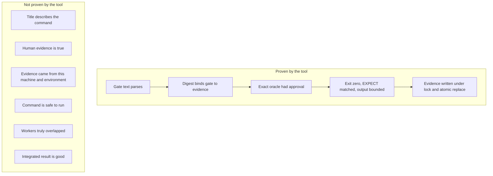
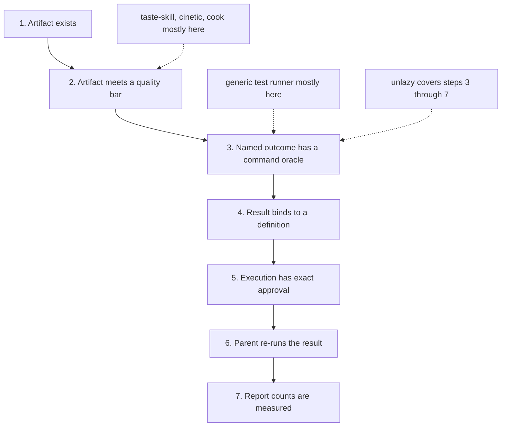

# Limits and comparison: what completion discipline cannot prove

The earlier documents describe a careful mechanism. This document states its boundaries. It covers the proof boundary, which is the line between what the tool checks and what it cannot check. It covers the named failure modes. It covers the cost model and the research posture, which is the way that the source uses cited research. It covers the release history as part of that posture. It also compares sibling skills, which are the other packages next to the `unlazy` source checkout. It then compares `unlazy` with generic test runners.

The account is static. A citation such as `README.md:91` names a source file, not a file in this document. No command from the source runs during this reading. Citations for sibling packages use paths under `src.aidesign/src.leonnix/`.

## The proof boundary

The checker proves a narrow chain. The gate text parses into a definition. The definition digest matches the evidence prefix, which is the fixed text at the start of the evidence line. The exact oracle, the resolved execution tuple, had an approval record. The process exited zero, the expectation matched, and the output stayed within the byte ceiling. The checker writes the evidence line through a lock and an atomic replace. An atomic replace renames a temporary file over the target. The aggregate then reports a state for every gate. The final aggregate also includes the dispatch wave state, and it withholds `ALL MET` while a wave is unresolved (`scripts/gate-check.mjs:930-947`).

The chain does not prove the meaning of the gate. The source states the gap directly. A gate titled `G1: invoices reconcile` with a command that prints a constant is syntactically valid and semantically useless (`references/gates.md:97`). The checker validates the declared oracle. It cannot infer that unrestricted English and unrestricted shell code mean the same thing.

```text
# references/gates.md:97-97
The checker validates a declared oracle. It cannot infer whether unrestricted English and unrestricted shell code mean the same thing. `G1: invoices reconcile` plus `CHECK: node -e "console.log('ok')"` is syntactically valid and semantically useless.
```

The chain also does not prove that human evidence is true. The classifier treats nonempty text as human evidence only after it rejects every machine form. The machine forms are the current canonical line and two stale shapes (`scripts/lib/gates.mjs:467-482`). A checked manual gate with the sentence `reviewed` is met. The source does not parse the sentence or check that a review happened.

```text
# scripts/lib/gates.mjs:479-482
  if (evidence.startsWith("automatic-evidence=") || evidence.startsWith("exit=0; shell=")) {
    return "automatic-stale";
  }
  return "human";
```

The digest is unkeyed. It detects drift, and it does not prove that a ledger editor did not write the result (`README.md:91`). A person with write access can compute a new prefix and a new output digest. The design makes the edit visible. It does not make forgery impossible.

The checker does not sandbox the command. A check runs through a shell with the user's permissions and inherited environment (`SECURITY.md:7`). It can read files, use the network, and reach credentials. Approval decides that the command may run. It does not restrict what the command can do (`README.md:117`).

```text
# SECURITY.md:7-7
`gate-check.mjs` runs each `CHECK:` through a shell with the checker's user permissions and inherited environment. A command can access files, network connections, credentials, and developer tools available to that process.
```

A scope is not an isolation boundary either. It limits discovery, the log target, hook resolution and progress state, dispatch waves, and lease labels (`SECURITY.md:36`, `references/parallel.md:38-47`). It does not limit a check process (`references/parallel.md:47`). The same is true of a lease. It covers declared paths and cooperating participants, and it is not a write barrier (`references/parallel.md:80`).

```text
# references/parallel.md:80-80
Leases cover only declared paths and only participants that honor them. They are coordination records, not write isolation.
```

The Windows file identity helper, which compares a path status and a descriptor status, is a snapshot, not atomic path isolation. The source says so in the code and in the security file (`scripts/lib/gates.mjs:102-103`, `SECURITY.md:46`).



The two subgraphs have no edge between them. The tool's structural claim stops at the evidence line. No mechanism in the tool connects any unproven node to the proven chain.

## The provenance gap

One limit deserves separate treatment. Definition currentness and execution provenance are not the same check. Currentness asks whether the definition text is unchanged. Provenance records where and how the result was produced. The tool checks currentness from ledger text alone. It records provenance in the evidence line, and those local fields do not bind the current machine.

The definition digest covers the check text, the expectation, and the raw current working directory (`scripts/lib/gates.mjs:445-455`). The classifier compares the evidence prefix to that digest and then validates fixed fields. It requires a nonempty shell text, and it does not compare that text to the current shell (`scripts/lib/gates.mjs:471-475`). The evidence line also stores the resolved current working directory. It stores a `PATH` field, which is a hash of the executable search path plus the number of its entries (`scripts/gate-check.mjs:812-821`, `scripts/gate-check.mjs:343`). The hash is the first 12 hexadecimal characters of a SHA-256 digest of the `PATH` string. The count uses the platform path delimiter (`scripts/gate-check.mjs:340-343`). The classifier ignores those tail fields.

The approval signature does cover the environment. It binds the resolved shell, the full `PATH`, the platform, the timeout, and the limits (`scripts/gate-check.mjs:355-375`). `--status` is the checker mode that reports state without execution (`scripts/gate-check.mjs:337-343`). Approval is checked at execution time, not at `--status` time. A met gate therefore means that this definition produced a successful, bounded output under one exact approval, for one environment, at one time. It does not mean that the result came from the current machine or the current environment.

This is a deliberate split. It lets a ledger travel with a repository and stay readable. It also means a copied evidence line can show `met` on a new machine after the same definition. The parent `--reverify` is the step that restores the local claim (`references/orchestration.md:85-90`). A reader who treats `met` as a local proof has overstated it.

## Named failure modes and their controls

| Failure mode | Control in the source | Residual limit |
|---|---|---|
| A confident report with no evidence | The checker counts met, unmet, and abandoned, and prints `ALL MET` only at zero (`scripts/gate-check.mjs:944-947`) | A person can still write a prose report that ignores the counts |
| Evidence from an old definition | Definition digest mismatch makes the evidence stale (`scripts/lib/gates.mjs:474-477`) | An unkeyed digest can be recomputed by a forger |
| An old approval reused for a new command | The signature covers the oracle, so it no longer matches (`scripts/gate-check.mjs:373-375`) | Approval covers one environment at one time |
| A truncated run counted as a success | Raw and canonical 1,048,576-byte ceilings turn overflow into an error (`scripts/gate-check.mjs:623-640`) | A command can still exit zero with meaningless small output |
| A pattern that hangs the checker | A disposable worker with a 250-millisecond match budget and a 5,000-millisecond startup budget (`scripts/gate-check.mjs:569-591`) | The worker is not a security sandbox |
| Serial launches described as parallel | Seal fails until every leaf has a distinct start handle (`scripts/lib/dispatch.mjs:259-265`) | The barrier does not prove worker honesty or overlap |
| Two leaves writing one path | A lease claim is all-or-nothing and overlap detection is conservative (`scripts/lib/gates.mjs:535-553`) | Leases cover only participants that honor them |
| A silent abandonment | `HANDOFF REQUIRED`, exit 1, and a bounded handoff message (`references/gates.md:130`) | The reason text is not judged for truth |
| A Stop hook that traps a session | The block count releases above 6, and a state write or lock error allows the stop (`scripts/stop-hook.mjs:12`, `scripts/stop-hook.mjs:193-201`) | A malformed state file resets the counter and blocks; the release is per session |
| A hostile terminal escape | Output is sanitized at the console sink and in the hook (`scripts/gate-check.mjs:75-84`, `scripts/stop-hook.mjs:15-19`) | Sanitization does not make the content true |
| A symlink or file swap during a read | The stable reader compares descriptor and name before and after the read (`scripts/lib/gates.mjs:122-194`) | The Windows check remains a snapshot |
| A scope assumed to be a sandbox | The source states that checks inherit the access of the user (`SECURITY.md:7`, `references/parallel.md:47`) | Real isolation needs an external boundary |

The controls reduce specific errors. They do not turn the tool into a proof system. The table is the honest summary. Each row names one thing that is checked and one thing that remains outside the check. The hook release depends on one constant, `MAX_BLOCKS`.

```text
# scripts/stop-hook.mjs:12-12
const MAX_BLOCKS = 6;
```

## Who can defeat which control

The controls have different strengths against different actors. A short threat model makes the gaps concrete. The host is the agent runtime that reads the hook setting and starts sessions (`references/dispatch.md:3`). A session is one agent conversation that the host runs.

| Actor | Capability | Control | What is not defended |
|---|---|---|---|
| A repository author | Writes gate titles, command output, and scripts | Repository text is treated as untrusted data, and the console is sanitized (`SKILL.md:30`, `scripts/gate-check.mjs:75-84`) | An approved command still runs |
| A ledger editor | Rewrites an evidence line after a run | The definition digest detects drift (`scripts/lib/gates.mjs:445-455`) | The digest is unkeyed, so the editor can recompute it (`README.md:91`) |
| A command author | Runs any process with user access | The exact oracle needs an approval record (`scripts/gate-check.mjs:355-375`) | The command is not sandboxed (`SECURITY.md:7`) |
| A pattern author | Writes an expensive or hostile regular expression | A worker budget contains a slow match (`scripts/gate-check.mjs:569-583`) | A fast wrong match is not detected; the worker has the same user access |
| A parallel worker | Ignores its lease and writes anyway | A conflicting claim is refused (`scripts/lib/gates.mjs:907-940`) | Leases are coordination, not a write barrier (`references/parallel.md:80`) |
| The local user | Reads and writes local files | Approval storage is owner-private and checked for links and permissions (`scripts/gate-check.mjs:392-407`) | The same user can edit the ledger and approve new commands |
| A host settings editor | Changes or removes the hook | The installer recognizes its own handler and preserves others (`scripts/install-hooks.mjs:120-146`) | The user can remove the hook |

The model has one important omission. It does not defend against the user. The tool is a discipline for the user's own agent, not a control against the user's own access. A different threat model needs a different tool.

## The Aha: currentness is portable, provenance is local

**Aha:** The most important limit is not the unkeyed digest. It is the split between the two bindings. The definition digest is portable, so `--status` and the Stop hook can judge currentness with no shell and no approval store. The approval signature is local, so execution consent covers the exact shell, platform, timeout, and `PATH` value. The evidence line carries both structural fields and an environment tail. The classifier enforces the structural fields, and it checks only that the shell text is nonempty. It does not compare the tail values to the current environment. As a result, a gate can show `met` after a repository moves to another machine, as long as the definition text matches. The tool is honest about the mechanism, but the word `met` is easy to read as a stronger claim than it is. The missing step is the parent re-run. That is why the workflow treats `--reverify` as a distinct layer and says `--status` alone is not re-verification (`SKILL.md:51`). A reader should translate `met` as "this definition passed under an exact approval for that environment". A parent re-run means "this definition passes here now".

## The cost model

The runtime cost is low. The package needs Node.js 16 or newer and no third-party runtime dependency (`package.json:10-11`). The checker, hook, linter, installer, and dispatch command all use the standard library. There is no install step beyond the source checkout.

```text
# package.json:10-11
  "engines": {
    "node": ">=16"
```

The per-run cost has several parts. Approval requires a person to inspect the command, the expectation, the current working directory, the shell, and the full `PATH` value (`scripts/gate-check.mjs:521-529`). That inspection is the main human cost. The tool cannot remove it without removing consent.

The evidence cost is capped. A successful line stores the definition prefix, the exit and match fields, the output digest and byte count, and a short environment tail. The whole line is capped at 900 characters. The structural fields come first, so truncation can remove only the later transcript tail (`scripts/lib/gates.mjs:15`, `scripts/gate-check.mjs:815-821`). Raw output and full logs are not stored. The output ceiling is one mebibyte.

```text
# scripts/lib/gates.mjs:14-14
export const MAX_CHECK_OUTPUT_BYTES = 1024 * 1024;
```

The execution cost defaults to sequential. `--jobs` starts at 1 (`scripts/gate-check.mjs:140-147`). The guide recommends concurrency only for independent checks with a real wall-clock saving (`references/orchestration.md:57-63`). Sequential execution keeps the transcript easy to diagnose.

The hook cost is a scan. It does not call a model (`references/token-economy.md:9`). A block causes another agent continuation, and that continuation consumes model work. The source recommends keeping each block actionable for that reason (`references/token-economy.md:9`).

```text
# references/token-economy.md:7-10
- **Use runnable checks.** External command execution does not itself require model inference. The agent still spends context on the command, returned output, failure interpretation, and evidence review.
- **Cap evidence.** Store resolved environment facts plus the automatic output fingerprint, never raw successful output or a full build log.
- **Keep the Stop hook scan-only.** The hook itself does not call a model. A block causes another agent continuation, which does consume model work, so keep the six-block no-progress guard and make each block actionable.
- **Use sequential checks by default.** Raise `--jobs` only for independent checks when wall-clock savings justify harder failure diagnosis.
```

The quoted `six-block` phrase follows the source prose. The implementation releases on the seventh no-progress block (`scripts/stop-hook.mjs:198-201`).

The guide also names a false saving. If an author skips approval, negative controls, parent re-verification, or integration gates, the work looks faster. That speed produces a fast false completion, which costs more than a direct failure (`references/token-economy.md:42`). A reader detects that saving from the ledger. Missing or stale evidence, a missing approval record, or a final audit that cannot reconcile the plan inventory are the visible signs (`SKILL.md:86`).

```text
# references/token-economy.md:42-42
Do not save time by skipping approval, negative controls, parent re-verification, or integration gates. Those checks exist because a fast false completion costs more than a direct failure.
```

The cost model has a social part. The ledger only helps if a person or a parent agent reads it. A team that installs the hook and ignores the final audit gets a structural reminder, not a quality guarantee.

## Operational failure modes

The controls also have normal operating failures. Each has a stated recovery path.

An environment change invalidates an approval. A new shell, a new `PATH`, a new platform, or a new timeout produces a new signature (`scripts/gate-check.mjs:355-375`). The old evidence can still look current because the digest does not cover the environment. The correct response is a new inspection and a new approval, then a parent re-run. A reader must not treat the old evidence as a local result.

An abandoned lock needs manual recovery. The lock helper does not steal a lock by path (`references/parallel.md:67`). A person must verify that the recorded process is gone before removing that one lock. The same rule applies to approval-record locks.

Corrupt hook state resets the counter and blocks. A malformed state file normalizes to an empty session map (`scripts/stop-hook.mjs:37-50`). The next stop with outstanding work counts as block one, so the hook keeps blocking. A state write or lock error is different. That error allows the stop with a diagnostic (`scripts/stop-hook.mjs:193`). This avoids a trap in that one case, and it also means the guard can be lost.

A hand-edited dispatch state is rejected with an error. The validator checks identifiers, timestamps, start order, seal order, and terminal completeness (`scripts/lib/dispatch.mjs:55-153`). An impossible state is an error, not a silent reset.

If the repository moves, or the approval directory moves, the records no longer match. The record path binds the absolute ledger path, the gate identifier, and the signature (`scripts/gate-check.mjs:387-390`). A repository move changes the absolute ledger path. A directory move changes where the checker looks. Either change makes the next run ask for approval again. That refusal is the safer result.

A shared hook install embeds absolute paths. The installed command contains the Node.js executable and the hook path (`SECURITY.md:58`). A shared settings file is therefore machine-specific. The installer warns about this, and the security file recommends a local install unless the team accepts the coupling (`SECURITY.md:58`).

## Research posture

The source is careful about its evidence. It says research supports the failure modes that motivate explicit structure, and it does not prove that the tool produces a fixed improvement (`README.md:210`).

```text
# README.md:210-210
Research supports the failure modes that motivate explicit structure; it does not prove that unlazy produces a fixed improvement.
```

The cited findings are specific. Detailed multi-part prompts still show partial compliance and premature truncation (`README.md:212`). Reasoning can stop too early or continue past useful work (`README.md:213`). The best agent in SlopCodeBench passed `14.8%` of checkpoints, and no tested agent fully solved a problem end to end. A checkpoint is one scored milestone in that benchmark, and the source does not define the term. The source adds that checkpoint success is not task completion (`README.md:214`). The research report METR (Model Evaluation and Threat Research) Time Horizon 1.1 gives a `196.5`-day overall median (P50) doubling-time fit and `130.8` days for the post-2023 fit (`README.md:216`). The source does not define the fit in the repository, so this exploration does not expand it. Closed-book knowledge tasks can hallucinate more with additional test-time compute (`README.md:217`).

The historical six-run comparison is design input, not a benchmark. Its raw prompts, traces, output repositories, reviewer forms, recordings, and calculation code are not in the repository (`README.md:219`, `research/validation-protocol.md:12`). The protocol describes what a defensible rerun would need. The current documents do not reproduce the ratios.

The release history matches that posture. The 1.0.0 milestone was instruction-only. It added the Depth Tree method and behavioral rules against premature completion, silent scope reduction, and unmeasured final claims (`CHANGELOG.md:110-113`). The 2.0.0 milestone moved enforcement from prose into gate files, runnable checks, evidence, and an optional Stop hook (`CHANGELOG.md:100-106`).

```text
# CHANGELOG.md:100-106
Moved completion enforcement from prose into gate files, runnable checks, evidence, and an optional Claude Code Stop hook.

- Reframed the Depth Tree as decomposition and integration rather than an arithmetic effort multiplier.
- Added rule zero: write acceptance gates before real work.
- Added the original zero-dependency checker, Stop hook, and installer.
- Added solo and orchestrated workflows, per-leaf and per-branch ledgers, parent verification guidance, and final report remeasurement.
- Split detailed method, gate, orchestration, and token guidance into references for progressive disclosure.
```

The package file says version 2.1.0 (`package.json:3`). The changelog heading says "Unreleased, target 2.1.0" (`CHANGELOG.md:3`). This exploration does not claim that a 2.1.0 release exists. The source supplies both labels, and they disagree about release state.

## Comparison with sibling skills

The sibling packages are domain skills, which encode judgement about one kind of artifact. `unlazy` encodes a completion protocol that can apply to any artifact that has a command oracle, which is a command that can observe the outcome. The difference is the object under test.

| Project | Domain | Main gate | Evidence | Runtime |
|---|---|---|---|---|
| `unlazy` | Any coding task | Gate ledger with `CHECK`, `EXPECT`, approval, digest | Output digest and byte count plus definition prefix | Node.js 16, zero dependencies (`package.json:10-11`) |
| `taste-skill` | Web design | Finish gate with `PASS`, `FAIL`, `OPEN`, `QUICK`, `SETUP`, `ERROR`, and `OFF` verdicts, rounds, and waivers (`taste-skill/skills/taste-skill/scripts/gate.mjs:60-68`) | Checker findings and a waiver file | Node.js 22 or later (`taste-skill/skills/taste-skill/SKILL.md:28`) |
| `cinetic` | Motion film production | Production gates run by the Node.js package manager (npm) command `npm run gates`, then a review round (`cinetic/skills/cinetic/SKILL.md:169-176`) | Rendered frames, probe and sync checks | Node.js 22, ffmpeg, Python (`cinetic/skills/cinetic/SKILL.md:5`) |
| `cook` | Visual builds matched to references | Numeric bar per dimension, zero-context critics, and a user approval gate before the final render (`cook/README.md:48-52`) | Side-by-side images, critic scores, round ledger | Markdown skill. The side-by-side script needs Node.js 18 or later (`cook/README.md:30`) |
| Generic test runner | Software tests | Test case pass or fail | Test report | Depends on the runner |

The sibling citations are relative to the parent of the `unlazy` source checkout, not to the `unlazy` root. That parent directory also contains `taste-skill`, `cinetic`, and `cook`. In `taste-skill`, `PASS`, `FAIL`, `OPEN`, `QUICK`, `SETUP`, `ERROR`, and `OFF` are finish-gate verdict labels. A waiver is a recorded permission to ignore one named check. A round is one pass of that gate over the build. In `cook`, a zero-context critic reviews the artifact with no history, code, or brief (`cook/references/loop-and-critics.md:34`). In `cinetic`, probe checks measure media properties, and sync checks compare sound and picture timing (`cinetic/skills/cinetic/SKILL.md:259`, `cinetic/skills/cinetic/SKILL.md:222-223`). A review round is one pass that fixes the highest severity findings.

`taste-skill` is the closest in how it enforces its gate. It runs a finish gate as a Stop hook, so a build may not end while fixable failures remain (`taste-skill/skills/taste-skill/scripts/gate.mjs:3`). It adds mechanisms that `unlazy` does not have. A waiver covers one named check with a reason, and more than five waivers is itself a failure (`taste-skill/skills/taste-skill/scripts/gate.mjs:47-53`). It counts rounds, changes the verdict to `OPEN` at the last round, and then allows later stops (`taste-skill/skills/taste-skill/scripts/gate.mjs:55-61`). `unlazy` has no waiver concept. Its abandonment is a terminal handoff with no time limit.


`cinetic` spreads verification across a production pipeline. Its gates check media properties and a review loop fixes the highest severity findings (`cinetic/skills/cinetic/SKILL.md:169-176`). Its evidence is the rendered artifact, not a single command result. `unlazy` would treat each of those checks as one gate, but it would not supply the media expertise.

`cook` is the clearest complement. It gives the agent a target, a numeric bar, and a long autonomous loop. It uses zero-context critics and holds the final render for user approval (`cook/README.md:48-52`). Its own skill file names `/unlazy` as an optional companion for effort and completion discipline (`cook/SKILL.md:12`). The two tools answer different questions. `cook` asks whether the work matches the references. `unlazy` asks whether each declared outcome has current evidence.


## Comparison with generic test runners

A generic test runner executes tests and reports pass or fail. This exploration uses that term as a category, and the source does not define it. The comparison is conceptual.

A test runner has test cases and a result. `unlazy` has gates, approvals, definition digests, evidence classes, a parent re-verification protocol, and a dispatch barrier. A test suite can fail while the planned work is complete. A test suite can pass while a required outcome has no test. `unlazy` adds the inventory and the state model that connect a plan to observations (`references/method.md:24-40`).

A test runner also has no consent boundary. It runs whatever the test file says. `unlazy` requires an approval record for the exact oracle (`scripts/gate-check.mjs:355-375`). That difference matters when the command comes from a repository the user did not write.

The trade is real. A test runner is simpler and more familiar. `unlazy` adds files, approval friction, and a report discipline. The source recommends the lighter path for a trivial edit or a factual reply (`SKILL.md:104`).



The diagram is a qualitative map. It is not a measurement. A sibling can cover later steps with its own scripts, and `unlazy` can cover step 2 only through a manual gate.

## Shared lineage, different layers

The sibling skills are not direct competitors. They sit at different layers, and the source history shows the same move from prose rules to host-level checks.

`unlazy` 1.0.0 was instruction-only. It added the Depth Tree and behavioral rules against premature completion (`CHANGELOG.md:110-113`). Version 2.0.0 moved enforcement into files, checks, evidence, and a Stop hook (`CHANGELOG.md:100-106`). `taste-skill` follows the same shape for web design. Its finish gate runs as a Stop hook, and it adds waivers and a round limit (`taste-skill/skills/taste-skill/scripts/gate.mjs:47-61`). The shared idea is a host-level stop condition backed by a checker. The difference is the object. `taste-skill` judges a page. `unlazy` judges a completion claim.

`cook` chooses a different enforcement point. It holds the final render until the user approves the stills (`cook/README.md:52`). That is a human gate inside a long loop, not a ledger of command evidence. Its skill file names `/unlazy` as an optional companion for effort and completion discipline (`cook/SKILL.md:12`). The two can run together. `cook` supplies the target and the critics. `unlazy` supplies the ledger.

`cinetic` embeds its gates in a production pipeline. The gates check media properties, and a review round fixes the highest severity findings (`cinetic/skills/cinetic/SKILL.md:169-176`). The evidence is the rendered artifact. A completion ledger would add little unless the producer needs to prove that every planned deliverable was observed.

The practical reading is additive. A team can use a domain skill for judgement and `unlazy` for completion accounting. No sibling replaces a generic test runner, and `unlazy` does not either. Each layer answers a different question about the same artifact.

## When unlazy is the wrong tool

`unlazy` is the wrong tool in five cases.

It is wrong for a small edit or a factual answer. The ledger and approval cost more than the work (`SKILL.md:104`).

It is wrong when no command can observe the outcome and no independent reviewer is available. A manual gate records a person's statement. If no person will review, the gate adds ceremony without evidence (`references/gates.md:103`).

It is wrong for untrusted commands without an external sandbox. Approval is consent, not containment (`SECURITY.md:3`, `SECURITY.md:16`).

It is wrong as a productivity benchmark. The source does not claim a fixed improvement (`README.md:210`).

It is wrong when a team will not read the final counts. The tool can make an unmet gate visible. It cannot make a person act on it.

The correct use is narrower. Use it when a plan has several outcomes. Use it when a command can observe each outcome. Use it when a person can approve the commands. Use it when a parent will re-run the returned work. In that setting, the ledger turns a vague completion claim into a set of measured states with dated, bounded evidence.

## What would change this assessment

Four changes would materially strengthen the tool.

A keyed signature would raise the cost of evidence forgery. The current digest is unkeyed and the source says so (`README.md:91`). A signature tied to a commit or a private key would make a recomputed prefix detectable. It would also add key management and portability costs.

An external sandbox would make approval safer. The checker runs commands with ambient access (`SECURITY.md:7`). A container or virtual machine boundary would turn consent into containment. That boundary is outside the current source (`SECURITY.md:38`).

A reproducible benchmark would support a productivity claim. The historical six-run comparison cannot be reproduced from the repository (`README.md:219`, `research/validation-protocol.md:12`). The validation protocol defines what a rerun needs. Until such a rerun exists, the source correctly claims support for failure modes, not a fixed improvement (`README.md:210`).

A semantic oracle assistant could narrow the title gap. A model could propose a command for a stated outcome, and a person could review it. The current source does not do this, and the checker still could not prove that the proposal measures the title (`references/gates.md:97`). The review would remain the decisive step.

None of these changes is present in the pinned source. They are directions, not descriptions.

## What this comparison does not cover

The comparison reads the sibling skill files. It does not run any sibling. It does not measure artifact quality, speed, or cost. The runtime needs are quoted from each skill's own statement (`taste-skill/skills/taste-skill/SKILL.md:28`, `cinetic/skills/cinetic/SKILL.md:5`, `cook/README.md:30`). The domain descriptions summarize each skill's stated purpose (`taste-skill/skills/taste-skill/scripts/gate.mjs:3`, `cook/README.md:7`). A reader who needs a measured comparison must run all four skills on one task. This exploration did not do that.

The comparison also does not verify the cited research papers. It reports the source's reading of them (`README.md:212-217`). It gives `196.5` days for the overall METR fit and `130.8` days for the post-2023 fit (`README.md:216`).

The comparison uses sibling source files. It does not depend on any sibling exploration document.

The line counts and the test counts are static reads. They are not measurements from a running system. A later revision can change them without changing this document's argument.

## Final assessment

`unlazy` is strongest as a format for auditing a completion claim. It gives a task a small, readable state model and a set of refusals that are easy to explain. It is weakest where meaning and trust are required. The checker cannot tell a meaningful check from an empty one, the digest cannot stop a forger, and the approval cannot make a command safe.

The design is honest about those gaps. That honesty is its main quality. A reader who wants a guarantee should look elsewhere. A reader who wants a visible, reviewable completion claim has a precise tool, provided the reader also performs the review that the tool cannot automate.

## Related documents

Return to [`README.md`](README.md) for the reading order. Read [`01-architecture.md`](01-architecture.md) for the module and trust boundaries that this document qualifies. [`03-workflow-and-quality.md`](03-workflow-and-quality.md) gives the operating rules that the limits constrain.
