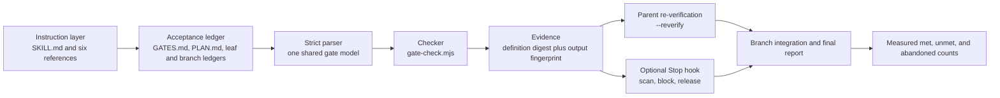
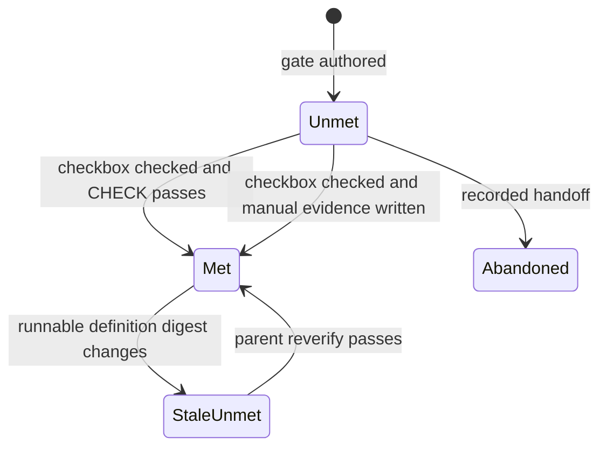

# unlazy: make completion testable

`unlazy` is a skill for autonomous coding agents. It changes what an agent must do before it can report that substantial work is complete. The agent writes an acceptance ledger first. The ledger is a file of gates, and each gate states one observable outcome. A runnable gate carries a command and an `EXPECT:` text. A checker is a script that runs approved commands and records evidence. A runnable gate counts as met only when its process exits zero, the expectation matches, and the evidence binds the current gate definition (`SKILL.md:32`, the core instruction file).

The source is the `unlazy` Git checkout at commit `16671491f6679ad9378f52604d3bc2415b4120c7`. This reading used the checkout at `/Users/darkvoid/GitSources/src.aidesign/src.leonnix/unlazy`. A citation such as `README.md:91` names a file in that checkout, not in this exploration. The checkout holds 37 tracked files and 9,181 lines. No source line states those totals, so they are checkout metadata, not source claims. It uses the Massachusetts Institute of Technology (MIT) licence (`LICENSE:1`). The checker needs Node.js 16 or newer and no third-party runtime package (`package.json:10-11`). This exploration is a static reading. It does not run the checker, linter, installer, Stop hook, or test suite. The checker runs approved commands. The linter reviews gate quality (`scripts/gate-lint.mjs:1-12`). The installer writes the host setting. The host is the agent runtime that starts sessions and returns launch handles (`references/dispatch.md:3`). A session is one agent conversation that the host runs. The Stop hook is that setting in operation: it runs when a session tries to stop (`SKILL.md:96`). No command from the source executes during this work.

## A confident report is not evidence

An agent can finish a long task with a clear and confident summary. That summary is still a claim. The project names failure modes that make the claim unreliable. Detailed multi-part prompts still show partial compliance and premature truncation in tested models (`README.md:212`). Reasoning can stop exploration too early, or continue beyond useful work (`README.md:213`). SlopCodeBench is a benchmark of long coding tasks. The best reported agent passed `14.8%` of its checkpoints, and no tested agent fully solved a problem end to end (`README.md:214`). A checkpoint is one scored milestone in that benchmark. The source does not define the term. METR (Model Evaluation and Threat Research) Time Horizon 1.1 is a research report. It gives a `196.5` day overall median (P50) doubling-time fit and `130.8` days for the post-2023 fit (`README.md:216`). P50 is the median. A fit is a statistical estimate from observed data, and the source does not define the fitting method in this file (`README.md:216`). Closed-book knowledge tasks can hallucinate more when test-time compute increases (`README.md:217`).

The source is careful about these figures. It says research supports the failure modes, and it does not prove that `unlazy` produces a fixed improvement (`README.md:210`). It also states that checkpoint success is not task completion (`README.md:214`). The historical six-run comparison is design input only. It compared two build tasks under three conditions each: no skill, tree 3, and tree 6 (`research/validation-protocol.md:7-8`). The repository does not contain its raw artifacts, so no reader can reproduce its ratios and counts (`README.md:219`, `research/validation-protocol.md:12`).

The project makes one central decision. A model's opinion of its own work is not evidence. A deterministic check is evidence. The rest of the design follows from that decision.

**Aha:** The design does not try to make the agent more honest. It changes the completion report into a claim that another process can test. The definition digest, a fixed-length hash of the parsed definition, is the key part. A stored result stays current only while the parsed `CHECK:`, `EXPECT:`, and `CWD:` keep the same digest (`scripts/lib/gates.mjs:445-455`).

## The answer: a ledger, an approval, and a bound result

`unlazy` uses five mechanisms together.

1. Write acceptance gates before real work (`SKILL.md:12`).
2. Treat each `CHECK:` line as code, and run it only after explicit approval (`SKILL.md:28`).
3. Record automatic evidence. The stored result carries a versioned digest of the parsed gate definition (`README.md:91`).
4. Re-run returned work in the parent with `--reverify` instead of trusting old evidence (`SKILL.md:51`). The parent is the ledger owner that recorded the leaf as returned. A leaf is one delegated deliverable with its own ledger, and returned work is its result after the leaf stops (`references/method.md:10`).
5. Offer an optional Stop hook that blocks a session while any gate remains unmet or unreadable. A recorded abandonment does not block. The hook reports it as a handoff. Unreadable means a parse error or a read error (`SKILL.md:96`, `scripts/stop-hook.mjs:140-150`).

The core statement is short.

```text
# SKILL.md:8-8
Make incomplete work visible and make completion testable. Prove outcomes against a ledger instead of relying on a confident done report.
```

A gate ledger is not a plan. A gate names one outcome and one observation of that outcome. The observation is either a command or a manual review. The ledger records both the claim and the evidence for the claim. This difference matters at report time. A plan can be complete while the work is incomplete. A valid ledger with unmet gates is visibly incomplete (`SKILL.md:12`, `references/gates.md:3`).

The ledger also comes before the work. An agent that writes gates after implementation can shape each gate to fit what it already built. An agent that writes gates first must state the acceptance condition while the work is still open. The project calls this rule zero (`CHANGELOG.md:103`). The rule does not prove honest authoring. It makes a later change to the acceptance condition visible as an edit to the ledger.

A gate ledger has a small shape. A gate starts with a checkbox and an explicit identifier. A runnable gate has indented `CHECK:` and `EXPECT:` lines. A manual gate has neither line. Both forms use `EVIDENCE:` to record the result. The template shows the intended shape (`templates/gates-leaf.md:7-19`).

A normal run is ordinary execution. It is not one of the three workflow modes: solo, orchestrated, and parallel. A normal run without an exact approval does not execute the command. It prints the command, expectation, working directory, shell, and `PATH` (the executable search path). The same oracle also binds the timeout, output and regular-expression limits, worker limit, and platform (`scripts/gate-check.mjs:355-371`, `scripts/gate-check.mjs:521-529`). Then it leaves the command unexecuted (`README.md:58`). That resolved set is the oracle. Once the exact oracle has an approval record, a normal run can execute it (`README.md:58`). Approval is a permission, not an isolation boundary (`README.md:117`). The checker runs with the permissions and inherited environment of its user (`SECURITY.md:7`).

## The map



The left side is authoring. The middle is execution and evidence. The right side is independent verification. A leaf is one delegated deliverable with its own ledger (`references/method.md:10`). A branch integrates leaves and holds the composition gates (`references/gates.md:140-145`). The Stop hook only observes state, not checks (`SECURITY.md:42`).

## One gate from authoring to report

A gate moves through a small set of states (`scripts/lib/gates.mjs:485-494`). This diagram shows the main transitions, not every edge.



The diagram shows four of the five code states: `unmet`, `met`, `stale-unmet`, and `abandoned`. It omits `unmet-no-evidence`, a checked manual gate with no evidence (`scripts/lib/gates.mjs:485-494`). `Met` needs current evidence, and an abandoned gate is a recorded handoff (`references/gates.md:130`).

For a runnable gate, the success predicate has three parts. The gate must also be checked. An unchecked gate is unmet even when its evidence is current (`scripts/lib/gates.mjs:485-494`). The process exits zero. `EXPECT:` matches the combined output. The automatic evidence carries the current versioned definition digest for the parsed `CHECK:`, `EXPECT:`, and raw `CWD:` (the declared current working directory) (`SKILL.md:32`). Missing, pending, handwritten, legacy, malformed, or definition-mismatched runnable evidence stays unmet (`SKILL.md:32`).

```text
# SKILL.md:32-32
Count a runnable gate as met only when its process exits zero, its `EXPECT:` matches combined output, and its automatic evidence carries the current versioned definition digest for parsed `CHECK:`, `EXPECT:`, and raw `CWD:`. Record the output fingerprint and bounded runtime transcript after that binding; raw successful output is not persisted. Missing, pending, handwritten, legacy, malformed, or definition-mismatched runnable evidence is unmet until the current definition passes. Manual gates keep ordinary human evidence, but automatic evidence cannot silently become a manual attestation.
```

The last sentence of that passage means that the classifier does not relabel an automatic record as human evidence. A runnable gate with an automatic record that is not current is `stale-unmet` (`scripts/lib/gates.mjs:479-491`).

The digest has a fixed schema and a fixed input list.

```text
# scripts/lib/gates.mjs:445-455
export function gateDefinitionDigest(gate) {
  if (!gate || typeof gate.check !== "string" || gate.check === "" ||
      typeof gate.expect !== "string" || gate.expect === "") return null;
  return sha256(JSON.stringify([
    "unlazy.gate-definition",
    1,
    gate.check,
    gate.expect,
    gate.cwd === null || gate.cwd === undefined ? null : String(gate.cwd),
  ]));
}
```

The code serializes a JavaScript Object Notation (JSON) array.

`--status` is the checker mode that reports state without execution (`scripts/gate-check.mjs:337-343`). The digest excludes the gate identifier, the title, formatting, the ledger path, resolved paths, the shell, the timeout, the platform, and `PATH` (`references/gates.md:57`). That exclusion lets `--status` and the Stop hook judge definition currentness without a shell, approval storage, or a process (`references/gates.md:61`). The digest detects structural drift. It does not prove who wrote an evidence line, because it has no secret key (`README.md:91`).

The checker proves one declared oracle. It cannot infer that an English title and arbitrary shell code mean the same thing (`references/gates.md:97`). A gate titled "invoices reconcile" with a command that prints a constant is syntactically valid and semantically empty (`references/gates.md:97`). The lint tool can flag some mechanical signs of that mismatch. It cannot settle the meaning (`references/gates.md:115`). A person must inspect each consequential gate.

The checker also runs with the full access of its user. It does not put the command in an isolated environment (`SECURITY.md:7`, `README.md:117`). Approval decides that the command may run. It does not restrict what the command can read, write, or reach on the network (`SECURITY.md:16`). A team that needs isolation must supply an operating system (OS), container, or virtual machine boundary outside `unlazy` (`SECURITY.md:38`).

The checker prints `ALL MET` only when every gate is met and every wave is complete. A dispatch wave is an audited record of host launch calls (`references/dispatch.md:3`, `scripts/gate-check.mjs:944-951`).

```text
# scripts/gate-check.mjs:944-947
if (effectiveUnmet === 0 && totalAbandoned === 0) {
  console.log("ALL MET (" + totalMet + " met" + verifyNote + ")" + where);
  process.exit(0);
}
```

The `verifyNote` value adds the `reran` and `previously met reverified` counts under `--reverify`, and `where` adds a scope label. An abandoned gate is a recorded handoff, not completion. The checker exits `1` and prints `HANDOFF REQUIRED` (`SKILL.md:34`, `references/gates.md:130`). The Stop hook lets the session end but reports the handoff (`references/gates.md:130`).

## The six documents

| File | Question it answers | Main objects |
|---|---|---|
| [`README.md`](README.md) | What is the thesis, and how should I read the set? | Problem, answer, map, non-claims |
| [`00-overview.md`](00-overview.md) | What failure modes and object model come first? | Gate, ledger, scope, wave, approval, evidence |
| [`01-architecture.md`](01-architecture.md) | How is the skill built? | Instruction layer, ten source files, data files, trust boundaries |
| [`02-core-mechanism.md`](02-core-mechanism.md) | How does a gate become met? | Parser, digest, classifier, oracle, supervisor, writer |
| [`03-workflow-and-quality.md`](03-workflow-and-quality.md) | How does a person or agent use it? | Authoring, lint, approve, reverify, orchestrate, dispatch, report |
| [`04-limits-and-comparison.md`](04-limits-and-comparison.md) | What can it not prove, and how does it compare? | Threats, costs, research posture, siblings |

The documents cite the same pinned source. A claim without a source line is not a claim about it.

## Reading order

A new reader should start with this page, then read `00-overview.md`. That file supplies the vocabulary and the two diagrams that make the rest legible. Read `02-core-mechanism.md` next if the main question is how a gate becomes met. Read `01-architecture.md` before `03-workflow-and-quality.md` if the main question is where each action lives. Read `04-limits-and-comparison.md` last, because it qualifies every earlier claim.

A skill author should read `00-overview.md`, then `03-workflow-and-quality.md`, then `04-limits-and-comparison.md`. The workflow file gives the authoring rules and the lint contract. The limits file prevents an overclaim in a skill description.

A maintainer or reviewer should read `01-architecture.md`, then `02-core-mechanism.md`, then `03-workflow-and-quality.md`. The architecture file shows the module and data boundaries. The mechanism file shows the invariants. The workflow file shows the tests and the continuous integration (CI) matrix.

An agent operator should read `00-overview.md` first, then `03-workflow-and-quality.md`. The workflow file contains the mode entry conditions, the approval sequence, the wave protocol, and the Stop hook release rule. The operator should then read the limits file before enabling the hook in a shared repository.

## Non-claims

This exploration makes no claim that any command was executed. It did not run `gate-check.mjs`, `gate-lint.mjs`, `dispatch-check.mjs`, `install-hooks.mjs`, `stop-hook.mjs`, or the package tests.

It makes no claim that the method improves agent output. The source itself says research supports the failure modes and does not prove a fixed improvement (`README.md:210`).

It makes no benchmark guarantee. The reported figures are citations from the named papers and reports (`README.md:212-217`). This exploration does not re-measure them.

It does not reproduce the historical six-run comparison. The repository lacks the prompts, model snapshots, transcripts, token logs, output repositories, reviewer forms, recordings, and calculation code for those runs (`research/validation-protocol.md:12`). Treat those results as design history, not as a benchmark.

It makes no claim that scopes or leases isolate a process. A scope is a named pipeline directory under `.unlazy/` (`references/parallel.md:7-19`). A lease is a recorded claim on declared paths (`references/parallel.md:51-63`). They coordinate cooperating processes and do not restrict file access (`references/parallel.md:3`, `SECURITY.md:36`).

It makes no claim that the digest is tamper proof. It is unkeyed structural drift detection (`README.md:91`).

It makes no claim that the checker understands an English gate title. It validates a declared oracle, and it cannot infer that arbitrary shell code measures the title (`references/gates.md:97`).

The correct summary is narrow. `unlazy` makes completion claims inspectable. It binds a declared command, an observed exit, a matched expectation, and a recorded evidence line to one definition at one time. It also makes the absence of that chain visible. A reader who wants a measured productivity claim must look outside this repository, because the source does not supply one.
