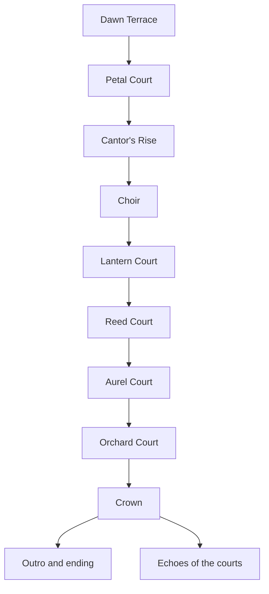
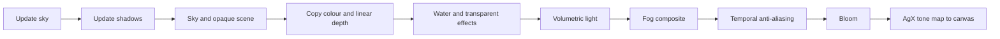

# Unsung Vale: a complete system in one pass

Unsung Vale is an original third-person role-playing game (RPG) that runs in a browser tab. The player is the Cantor, a singer who carries one musical note. The Cantor crosses a valley of mesas and waterfalls, breaks the constructs that guard eight Tuning Spires, and wakes each spire. Version 0.1.0. The code is under the Massachusetts Institute of Technology (MIT) licence. The audio files follow their own terms.

The unusual promise is the origin of the content, not the genre. Every mesh, every texture, every tree and every building is generated by code in the repository. The hero mesh comes from a Blender Python script in the same repository. The audio files arrive from outside. This document explains that promise, the journey, the world, the engine, the content, the sound, the film, the tools and the interfaces. Later documents go deeper.

```text
# package.json:2-12
  "name": "unsung-vale",
  "version": "0.1.0",
  "description": "Unsung Vale: an original third-person open-world RPG demo rendered in the browser with three.js. Every mesh and texture is generated procedurally.",
  "private": true,
  "type": "module",
  "license": "MIT",
  "scripts": {
    "dev": "vite --port 5183 --strictPort",
    "build": "vite build",
    "preview": "vite preview --port 5184 --strictPort",
    "world": "node tools/build-world.mjs --threads 4 --preview"
```

The package declares a development server, a production build, a preview server and one content command. Only the world bake writes game data.

## The player journey

The journey has a clear spine. A short opening scene wakes the Cantor on the Dawn Terrace. The story then points to the first mesa. A mesa is a raised site, and a court is the built place on it. Each outer court holds a Tuning Spire, three bells, a reliquary, a trial and a set of encounters. The player clears the guards, rings the bells and tunes the spire. Seven of the eight spires then teach a skill, and the Crown teaches none. Later spires open the valley further. Two boss fights mark the journey. The final spire ends the journey and starts an outro.

The eight spires have a fixed order. The order is the order of the story.

```text
# src/world/arch/sites.js:448-450
    // The order of the journey: the three of the inner Vale, then round the lake to the Crown.
    const ORDER = ['petal', 'cantor', 'choir', 'east', 'south3', 'aurel', 'south1', 'crown'];
    out.spires.sort((a, b) => ORDER.indexOf(a.id) - ORDER.indexOf(b.id));
```

The array at `sites.js:449` is the authority; the sort at line 450 applies it. One old architecture sentence says "the three spires"; it is stale. The game and the README agree on eight spires.

The eight identifiers map to places. Petal is the Petal Court, cantor is Cantor's Rise and choir is the Choir. East is the Lantern Court, south3 the Reed Court, aurel the Aurel Court, south1 the Orchard Court and crown the Crown. The first three are inner mesas; the last five are outer courts.



Each court shares a grammar, but only the outer five have bells. Encounters guard the spire. A trial offers a side challenge. A reliquary holds a charm. A geode cluster grows in the meadow. Written notes lie along the path. Strings of light connect pylons once their spires are tuned. After the ending, echoes are harder court waves. The arrangement, enemy mix and terrain vary the pattern.

Strings of light are the roads between courts. A pylon is a small tower with a floating crystal. A string links two pylons, and it wakes when every spire in its `needs` list is tuned. The hero can ride an awake string in either direction. The `route` function runs a breadth-first search over the awake links, so a journey can cross several strings. A reached pylon becomes a place of rest.

```text
# src/game/strings.js:101-118
  awake(l) { return l.needs.every((id) => this.game.spires.find((s) => s.id === id)?.tuned); }
  point(l, t, out) { return out.lerpVectors(l.A.top, l.B.top, t).setY(l.A.top.y + (l.B.top.y - l.A.top.y) * t + l.bump * Math.sin(Math.PI * t)); }

  // The hops from one court to another over strings that are awake, or null.
  route(from, to) {
    if (from === to) return null;
    const prev = { [from]: null }, q = [from];
    while (q.length) {
      const id = q.shift();
      if (id === to) { const hops = []; for (let c = to; prev[c]; c = prev[c].from) hops.unshift(prev[c]); return hops; }
      for (const l of this.links) {
        if (!this.awake(l)) continue;
        const o = l.a === id ? l.b : l.b === id ? l.a : null;
        if (o && !(o in prev)) { prev[o] = { l, from: id, to: o, dir: l.a === id ? 1 : -1 }; q.push(o); }
      }
    }
    return null;
  }
```

The story layer keeps the goal near the player. `src/game/story.js` holds breadcrumb legs for the first three mesas, the opening and closing narration. The marker chooses a lookout, a bell, a string pylon or a breadcrumb.

## The world and its scale

The world is one analytic height function, pure mathematics. It takes an x and z coordinate and returns a height. Hand-placed mesas, procedural mesas, pools, paths and paving pads contribute. The Node world builder evaluates it. The browser reads the baked height maps at runtime. It decodes 16-bit integers into floating-point heights; it does not evaluate the analytic function.

```text
# src/world/layout.js:6-14
export const WORLD = {
  seed: 20261112,
  coreSize: 2048,     // metres covered by the 1 m/texel core map (centred on the origin)
  coreRes: 2048,
  regionSize: 16384,  // metres covered by the 8 m/texel region map
  regionRes: 2048,
  waterLevel: 0,
  heightMin: -64,     // quantisation range for the 16-bit height files
  heightMax: 3136,
```

These constants define the world frame. The playable core is 2,048 metres across with one sample per metre. The surrounding region is 16,384 metres across with one sample per eight metres. The water level is zero and the y axis points up.

The valley runs west to east along the positive x axis. The low sun rakes across the cliffs instead of standing behind them, which gives long shadows and visible faces on the main route. The terrain shadow maps are baked on the graphics processing unit (GPU) at load, so a designer can move the sun without a new world bake.

| Property | Core map | Region map |
|---|---|---|
| Extent | 2,048 metres | 16,384 metres |
| Sample spacing | 1 metre | 8 metres |
| Resolution | 2,048 by 2,048 | 2,048 by 2,048 |
| Storage | 16-bit integers, gzip compressed | 16-bit integers, gzip compressed |
| Output file | `public/world/core_h.bin` | `public/world/region_h.bin` |

```text
# tools/build-world.mjs:112-121
  const meta = {
    region: { size: WORLD.regionSize, res: WORLD.regionRes, min: Math.floor(rLo) - 1, max: Math.ceil(rHi) + 1 },
    core: { size: WORLD.coreSize, res: WORLD.coreRes, min: Math.floor(cLo) - 1, max: Math.ceil(cHi) + 1 },
  };
  const rq = quantise(region, meta.region.min, meta.region.max), cq = quantise(core, meta.core.min, meta.core.max);
  const rz = gzipSync(Buffer.from(rq.buffer), { level: 9 }), cz = gzipSync(Buffer.from(cq.buffer), { level: 9 });
  writeFileSync(path.join(outDir, 'region_h.bin'), rz);
  writeFileSync(path.join(outDir, 'core_h.bin'), cz);
  writeFileSync(path.join(outDir, 'world.json'), JSON.stringify(meta));
  console.log(`heights: region ${rLo.toFixed(1)}..${rHi.toFixed(1)} m (${(rz.length / 1e6).toFixed(1)} MB), core ${cLo.toFixed(1)}..${cHi.toFixed(1)} m (${(cz.length / 1e6).toFixed(1)} MB)`);
```

The builder evaluates the same `height` function in four worker threads. It computes the actual height range, quantises each sample into a 16-bit integer and compresses the result with gzip. The metadata records the range and the resolution; the browser reconstructs the height from them.

The analytic function has a fixed order. The `height0` function starts from the rolling floor. It then visits every mesa near the sample. Outside a mesa it adds a talus skirt, a low slope of loose rock. Inside it applies a cliff profile and a noisy top. It keeps the highest mesa result. It then carves pools into the tops and notches their rims toward the outflow. The outer `height` function applies the paving pads last with `Math.min`, so a court platform cuts the ground and never raises it.

```text
# src/world/layout.js:208-232
  function height0(x, z) {
    const base = floorHeight(x, z);
    let h = base;
    const gi = Math.floor((x + half) / G), gj = Math.floor((z + half) / G);
    if (gi >= 0 && gj >= 0 && gi < gn && gj < gn) {
      const list = grid[gj * gn + gi];
      for (let k = 0; k < list.length; k++) {
        const m = list[k];
        const sd = mesaSd(m, x, z);
        if (sd > 1e8) continue;
        const rise = m.h - base;
        if (rise <= 0) continue;
        let mh;
        if (sd >= 0) {
          mh = base + rise * 0.1 * Math.exp(-sd / (0.1 * m.h + 8));       // talus skirt
        } else {
          const u = saturate(-sd / m.run);
          const t = cliffProfile(u, 0.07 * fbm(x / 190, z / 190, 2, m.seed + 9), m);
          const inside = saturate(-sd / (m.r * 0.5));
          const top = m.h + (m.pinnacle ? 5 * inside + 2.4 * fbm(x / 13, z / 13, 2, m.seed + 6) - 1.2 : 4.5 * fbm(x / 95, z / 95, 3, m.seed + 1) + 1.1 * fbm(x / 21, z / 21, 2, m.seed + 2) + 3 * inside);
          mh = base + (top - base) * (0.1 + 0.9 * t);
        }
        if (mh > h) h = mh;
      }
    }
```

The signed distance `sd` is positive outside a mesa footprint and negative inside it. The exponential term in the skirt decays with distance. The cliff profile maps the run from rim to floor into a steep face. The pool pass and the pad pass can only lower the surface. No later pass adds a bump after another pass has cut, so a court platform stays flat.

This shared source is the first design choice. The map, collision floor and visual terrain cannot disagree, because they read the same baked samples. A layout change produces a new bake, and every consumer follows.

The terrain renderer uses a continuous distance-dependent level of detail (CDLOD) quadtree of instanced grid patches. A patch morphs to the next coarser grid before the switch, so no crack appears. A minimum and maximum height pyramid supports fast culling. The selector tests a sphere against each node, then a box against the view frustum. Near the camera it descends to small patches; far away it keeps large ones.

```text
# src/world/terrain.js:606-629
  // CDLOD selection (after Strugar). Writes the visible patch list into the instance buffer.
  select(camera) {
    const cam = _v.setFromMatrixPosition(camera.matrixWorld);
    _pm.multiplyMatrices(camera.projectionMatrix, camera.matrixWorldInverse);
    _frustum.setFromProjectionMatrix(_pm, camera.coordinateSystem, camera.reversedDepth);
    const base = 64 * this.lodScale;
    this.lodUniforms.uLodCam.value.copy(cam);
    this.lodUniforms.uLodBase.value = base;
    const half = this.regionSize / 2, leaf = this.leaf, pyr = this.pyr, data = this.nodeData, maxNodes = this.maxNodes;
    let count = 0;
    const push = (x0, z0, size, level) => {
      if (count >= maxNodes) return;
      const o = count * 4;
      data[o] = x0; data[o + 1] = z0; data[o + 2] = size; data[o + 3] = level;
      count++;
    };
    const sphereHits = (x0, z0, s, y0, y1, r) => {
      const dx = Math.max(x0 - cam.x, 0, cam.x - x0 - s), dy = Math.max(y0 - cam.y, 0, cam.y - y1), dz = Math.max(z0 - cam.z, 0, cam.z - z0 - s);
      return dx * dx + dy * dy + dz * dz <= r * r;
    };
    const visit = (level, i, j) => {
      const P = pyr[level], s = leaf * (1 << level), x0 = -half + i * s, z0 = -half + j * s;
      const y0 = P.mn[j * P.n + i] - 4, y1 = P.mx[j * P.n + i] + 4;
      if (!sphereHits(x0, z0, s, y0, y1, base * (1 << level))) return false;
```

The selector is the heart of the terrain cost model. The base distance is 64 metres multiplied by a quality scale. A node survives the distance test when its bounding sphere meets that distance. The frustum test then removes off-screen nodes. A leaf node, or a node that fails the child distance test, writes four half-size patches. The maximum node count bounds the patch list, not the recursion depth. The tree level bounds the recursion.

The world uses several scales of detail at once. Terrain is the first. Vegetation is the second: trees have a near mesh, a middle mesh and a baked billboard, and grass grows in cells that follow the camera. Architecture is the third: the courts use hand-built geometry from a small kit, and distant cities reuse it at a larger scale.

## The engine in plain terms

The engine is a forward renderer built on three.js. It uses a reversed depth buffer and a 32-bit floating-point depth texture. Reversed depth puts the far plane at zero, where floating-point values are densest. That gives usable precision across a large open world.

The frame order is fixed. The sky is updated first, then drawn later. The shadow maps are updated next. The sun shadow is cascaded: a few maps cover near and far ranges at different resolution. The terrain also has one static shadow map. The colour and the linear depth are copied. The transparent surfaces read those copies. The volumetric light is marched. An ambient occlusion pass darkens creases and contact areas where less sky light reaches. The fog composites the scene, the volume and that occlusion buffer. Temporal anti-aliasing (TAA) resolves the frame. Bloom adds the bright spread. The AgX tone map writes the final colour to the canvas.

```text
# src/engine/pipeline.js:296-313
    // Opaque scene on top of the sky.
    r.setRenderTarget(this.rtScene);
    r.clear(false, true, false);
    // With a reversed depth buffer the sky is drawn last, only where nothing covers it.
    if (!this.reversed) { this.skyPass.render(r, this.rtScene); r.setRenderTarget(this.rtScene); }
    r.render(this.scene, cam);
    if (this.reversed) this.skyPass.render(r, this.rtScene);

    // Second phase: surfaces that refract or reflect the opaque scene.
    if (this.sceneT.children.length) {
      this.copyPass.uniforms.uTex.value = this.rtScene.texture;
      this.copyPass.render(r, this.rtOpaque);
      this.linDepthPass.uniforms.uDepth.value = this.rtScene.depthTexture;
      this.linDepthPass.render(r, this.rtLinDepth);
      this.sceneUniforms.uProjJ.value.copy(cam.projectionMatrix);
      r.setRenderTarget(this.rtScene);
      r.render(this.sceneT, cam);
    }
```

The comment at line 299 explains the reversal. The depth test keeps the sky only where nothing covers the landscape. The second phase copies the opaque colour and linear depth before the water and effects are drawn, so those surfaces can refract and reflect the scene.

The order is not arbitrary. Water needs the opaque colour and depth. Fog needs the depth. TAA needs the resolved colour and depth. Bloom needs the high dynamic range colour. The tone map runs last, because it maps a high dynamic range (HDR) image to the display range.



The engine has quality presets and a frame governor. The presets change the render scale, shadows, volumetric light, reflections, ground cover and cloud quality. The governor watches the presented frame rate and moves the render scale in steps of 0.05 between 0.55 and the preset scale. A scale change keeps the TAA history and the bloom chain, so the image does not flicker.

```text
# src/game/settings.js:4-9
export const PRESETS = {
  low:    { renderScale: 0.55, shadows: false, volumetrics: false, reflections: false, cover: 0.55, clouds: 0, cloudRes: 1024, shadowRate: 2, softShadows: 0 },
  medium: { renderScale: 0.63, shadows: true, volumetrics: true, reflections: false, cover: 0.75, clouds: 1, cloudRes: 1024, shadowRate: 2, softShadows: 1 },
  high:   { renderScale: 0.8, shadows: true, volumetrics: true, reflections: true, cover: 1.0, clouds: 1, cloudRes: 2048, shadowRate: 1, softShadows: 2 },
  ultra:  { renderScale: 1.0, shadows: true, volumetrics: true, reflections: true, cover: 1.0, clouds: 2, cloudRes: 2048, shadowRate: 1, softShadows: 2 },
};
```

Low renders at 0.55 scale with no shadows. Medium renders at 0.63 with shadows. High renders at 0.8 with reflections. Ultra renders at full scale. The default target is 50 frames per second (fps). The value zero turns the governor off.

## The content and the rules

The rules live in `src/game`. The game object owns the state machine, player, camera, collision world, enemies, spires, save data and event bus. The real states are home, playing, paused, menu, photo, intro and ending. The comment at `game.js:183` also lists `free`, but no code assigns it. The film uses the same game with a different input source.

The enemy table has eleven kinds. Ten are constructs: shade, toller, seeker, brute, hound, warden, chorister, thrall, lancer and colossus. The colossus is a two-phase boss called the Unsung, and it waits at the Choir. The eleventh is the sovereign, the Stillness, the Crown boss with three phases. The project README lists the colossus among its ten constructs.

```text
# src/game/enemies.js:160-163
export const KINDS = {
  shade:     { slots: SHADE, hp: 55, speed: 3.9, reach: 2.3, windup: 0.52, strike: 0.2, recover: 0.95, damage: 15, poise: 26, radius: 0.5, sight: 28, hover: 0.3, core: 1.45, blink: true, xp: 14, name: 'Mute Shade' },
  toller:    { slots: TOLLER, hp: 110, speed: 1.7, reach: 13, windup: 1.15, strike: 0.2, recover: 1.9, damage: 13, poise: 60, radius: 0.8, sight: 32, hover: 0.45, core: 1.9, ranged: true, toll: true, xp: 22, name: 'Mute Toller' },
  seeker:    { slots: SEEKER, hp: 20, speed: 7.6, reach: 1.7, windup: 0.5, strike: 0.1, recover: 0.4, damage: 20, poise: 8, radius: 0.4, sight: 34, hover: 0.25, core: 1.3, burst: true, xp: 7, name: 'Mute Seeker' },
```

The field kinds are data. Hit points, speed, reach, windup, recovery, damage, poise, radius and sight range sit in one object; behaviour flags decide the special moves. The `slots` field is the shard formation for the kind. The `core` field is the body-centre height above the feet, and the hit test and the aim point read it. The `hover` field is the float height above the floor. A shade blinks, a toller sends a ring, a seeker bursts, a brute slams, a hound circles and lunges, a warden raises a shield and a chorister casts. A ward is a temporary shield that turns light blows. The thrall is the common melee kind; a lancer throws. The bosses add phases.

Elites are modifiers, not new kinds. The `derive` function scales a base kind. It changes health, damage, speed and experience. An elite can also carry an affix. The affixes are mark, split, shell and hymn. Mark leaves a delayed blast, split frees three seekers, shell resists damage while allies live, and hymn wards two allies.

The player has four attacks. The light combo has three steps. The heavy strike is slower and stronger. The sprinting strike turns the blade through a full circle. The falling strike dives from the air. The first three record a duration, an active window, damage, lunge, stamina cost, arc and reach. The falling strike records a hang, dive speed, radius and recovery.

```text
# src/game/player.js:12-27
  // Light combo steps: duration, active window, damage, lunge, stamina.
  combo: [
    { t: 0.46, hit: [0.14, 0.27], dmg: 18, lunge: 3.2, cost: 9, arc: 1.5, reach: 2.5 },
    { t: 0.46, hit: [0.13, 0.26], dmg: 21, lunge: 3.2, cost: 9, arc: 1.5, reach: 2.5 },
    { t: 0.7, hit: [0.22, 0.42], dmg: 36, lunge: 4.2, cost: 14, arc: 6.3, reach: 2.9 },
  ],
  heavy: { t: 0.86, hit: [0.33, 0.46], dmg: 58, lunge: 5.2, cost: 26, arc: 1.3, reach: 3.2 },
  pulseCooldown: 9, pulseRadius: 8.5,
  // Falling strike: a turn in the air, then straight down blade first.
  plunge: { cost: 16, hang: 0.26, dive: 30, radius: 3.8, dmg: 34, recover: 0.5 },
  swim: 2.7, swimFast: 4.0, swimCost: 5, swimDepth: 1.18,      // he floats with the water this far up his body
  // Sprinting strike: the run carried into a full turn of the blade.
  dash: { t: 0.7, hit: [0.2, 0.42], dmg: 46, lunge: 13, cost: 18, arc: 6.3, reach: 3.0 },
  // The refrain: he hums the note he carries and it mends him. A few to a journey between
  // places of rest; it takes a moment in which he cannot move or strike.
  refrain: { time: 0.95, at: 0.55, heal: 0.45, charges: 3 },
```

The active window is when the blade can hit. The hit test uses that window, the arc and the reach. The animation uses the same step index through its own key table, so an edit to one table must be checked against the other.

The player also has cadence and the refrain. Cadence counts blows landed since the last blow taken; it rises in steps and scales melee damage. The refrain is a set of healing charges, refilled at a rest. A rest is a tuned spire, a bell, a string pylon, a reliquary, a chime or an echo. Breath is the stamina meter. Charms can change the refrain, breath, cadence and guard break, which is poise damage.

The spires teach seven skills in all: Resonance pulse, Running cut, Echo step, Long pulse, Storm fall, Second wind and the orchard's gift. The Crown adds no skill. The luthier's bench sells three upgrades: Life, Breath and Edge. Each has eight steps. One step adds 20 health, 15 stamina or 12 percent blade power. The price starts at 100 resonance and rises by 60 with each purchase.

There are eight reliquaries, one on the Dawn Terrace and one at seven of the eight spires; the Choir has none. Each holds a charm. The hero wears two at the start and three after five spires are tuned, chosen on the Hero screen.

```text
# src/game/reliquaries.js:10-15
export const CHARMS = {
  lark: { name: 'Lark Bone', what: 'The refrain mends more: three fifths of your life, not half.' },
  reed: { name: 'Reed Whistle', what: 'Breath comes back a third faster.' },
  ember: { name: 'Ember Bead', what: 'Cadence holds twice as long before it fades.' },
  anvil: { name: 'Anvil Shard', what: 'Heavy blows break guard sooner, and a ward does not turn them.' },
  tide: { name: 'Tide Glass', what: 'A blow slipped at the last instant mends a little of you.' },
```

Each charm changes one rule. The Lark Bone raises the refrain heal from 45 to 60 percent in `player.js`. The Reed Whistle changes stamina regeneration, the Ember Bead extends cadence and the Anvil Shard changes guard break. The Tide Glass heals on a late dodge, the Orchard Thorn returns damage, the Gilt Peg adds resonance, the experience currency, and the Crown Splinter bursts a returned bolt.

The written notes are collectible memories of the valley. They are not the musical note the Cantor carries. They are generated, not stored as a fixed list. The generator places one every 46 metres along each story path and offsets them to alternating sides (`notes.js:60-61`). It finds the floor under each, so a note on a viaduct sits on the deck.

```text
# src/game/notes.js:45-54
  // legs: { name: [[x, z], ...] } polylines; a note is set down every `gap` metres along them.
  // more: further places off the paths (appended, so earlier notes keep their numbers).
  constructor(game, pipe, legs, { gap = 46, avoid = [], extra = [], more = [] } = {}) {
    this.game = game; this.pipe = pipe;
    const W = game.world, list = [];
    for (const pts of Object.values(legs)) {
      let carry = gap * 0.5, side = 1;
      for (let i = 1; i < pts.length; i++) {
        const [ax, az] = pts[i - 1], [bx, bz] = pts[i], len = Math.hypot(bx - ax, bz - az);
        if (len > 200) { carry = gap * 0.5; continue; }             // a leap between mesas, not a path
```

The source has no constant 70. The README says seventy notes. That number describes the current bake, not a rule in the code. A change to the paths changes the count. The README also mentions sixty notes in its cape dye list. That is a dye threshold, not a total count.

Chimes are three small bells on a stone frame at seven places. The player must strike them in the order that the set asks. A wrong bell resets the set, or restarts it from the lowest voice. These optional chimes are not the court bells. Geodes, also called song-crystals, are clusters of amber shards; a blade cut breaks one and gives resonance. Trials are rings with a fight, a timed run or a return challenge. Three bells gate each outer court. Quests are data with gather, slay, note, elite, trial, relic and other goals. People wake from stone to colour as the story advances.

## Sound and film

The audio is the only outside content in `CREDITS.md`. The manifest lists six music tracks, four ambience loops, 118 sound effects (SFX) and one impulse response for reverb. The audio manager owns the buses; the director maps events to layered sounds.

```text
# public/audio/manifest.json:1-7
{
  "music": {
    "home": {
      "file": "music/home.ogg",
      "duration": 197.9,
      "loop": true
    },
```

The manifest is a JavaScript Object Notation (JSON) file. Music and ambience entries give a file, duration and loop flag; effects use variant lists. The audio manager loads the files. Music cross-fades, ambience follows the location and one-shot effects use distance falloff and stereo pan.

The director layers effects. A hit is steel plus a chip of crystal; a heavy hit adds weight; a boss death adds a larger shatter and a delayed second shatter. The director never repeats a variation twice in a row and can delay a sound to land on a film cut. Every effect can feed a convolution reverb through its own send.

The film is a pre-rendered movie, not a play mode. It is 80 seconds long and has 14 shots. The director drives the hero through the same puppet input that a player uses, so the film is not a separate animation system. Each shot sets its own camera path.

```text
# src/cine/director.js:21-29
export class Director {
  constructor({ pipe, game, sites, terrain }) {
    this.pipe = pipe; this.game = game; this.sites = sites; this.terrain = terrain;
    this.time = 0; this.index = -1; this.shotTime = 0;
    this.puppet = { move: { x: 0, y: 0 }, look: { x: 0, y: 0 }, pressed: new Set(), held: new Set() };
    this.focus = new THREE.Vector3();          // smoothed look-at point
    this.shots = this.buildShots();
    this.duration = this.shots.reduce((s, x) => s + x.dur, 0);
  }
```

The duration is the sum of the shot durations. Each shot sets a camera path, a target, a field of view and a lens. The lens holds a focus distance and a blur amount. The film output adds depth of field, sub-frame accumulation and two encodings. Sub-frame accumulation renders several jittered samples for each output frame and averages them, so depth of field and motion resolve more cleanly. The high dynamic range master uses the perceptual quantizer (PQ) curve and the BT.2020 wide colour gamut. The companion file uses standard dynamic range and H.264 compression. H.264 is a common video compression format.

## Tools and interfaces

The repository includes its own production tools. The world builder is the content compiler. Browser drivers open Chrome and drive the game. Measurement tools report frame rate, frame cost, presented frames and slow frames. Film tools capture frames over the HyperText Transfer Protocol (HTTP) and pipe them to ffmpeg. ffmpeg is the external video tool that joins the frames and encodes the files.

The film render is resumable. `tools/render-film.mjs` splits the timeline into parts. A part is skipped when both of its output files already have the expected frame count.

The interfaces are part of the game, not a separate application. The user interface (UI) draws the heads-up display (HUD), compass, goal, tracker, vitals, conversation, journal, bench and map. The map is baked once from the terrain height query into a canvas, then drawn each frame while open.

## The central insight

**Aha:** Unsung Vale does not hand-author a world. The source of truth is a function, and the build bakes that function into the maps the browser reads. The same height function feeds the visual terrain, the collision floor, the map image and the note placement. The same enemy table feeds behaviour, sound and the interface. A single source per fact removes the classic asset-pipeline failure, where the visible world and the playable world drift apart. The rule holds while the bake is current. Attack timing is the exception. The combat table and the rig pose table use the same step index, but no code derives one from the other. A developer must edit both by hand. The cost is that every height change needs a new bake and a recheck of every consumer.

This insight explains the strengths and the limits. The project can generate a coherent 16-kilometre region without a modelling team. It cannot accept a hand-painted patch without changing the generator. It can keep the map and floor in agreement. It cannot skip the world command after a height change.

## What this exploration does not claim

This exploration is a static reading at pin `9f61b0d`. It does not run the game, world builder, film render, Blender or browser tool. It does not load an audio file, view an image or measure a frame.

Performance numbers are the author's records from one integrated GPU; they are not live results. Visual descriptions come from the shader code and project documents, not from an observed rendered frame.

The documents do not claim that every comment is current. The architecture document has one stale sentence about three spires. The README describes seventy notes while the generator computes the count from path length, and the changelog carries a date in 2026.

The next document maps the file tree and the layer rules. It explains which module owns which fact and which imports are allowed. Read [01-architecture.md](01-architecture.md) next.
