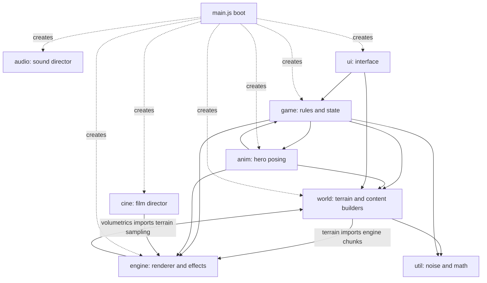
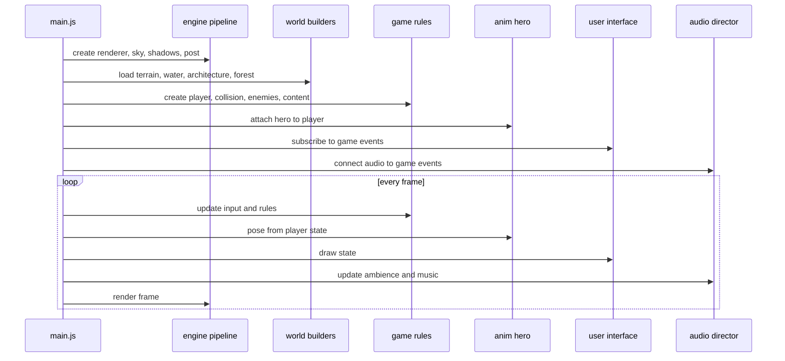

# Architecture: layers, modules and ownership

Unsung Vale is organised by layer, not by feature. A layer is a group of modules with one kind of responsibility. The engine draws. The world builds the landscape and its objects from data. The game changes state. The animation poses the hero. The audio turns events into sound. The film scripts a play session. The interface shows state. This document explains the folder tree, every module group, the import direction and the ownership of each important fact.

## The file tree

The listing omits `node_modules` and shows the generated files.

```
unsung-vale/
  index.html
  package.json
  README.md
  CREDITS.md
  LICENSE
  public/
    audio/           118 sound effects, 6 music tracks, 4 ambience loops, 1 impulse
    models/          hero.glb
    world/           core_h.bin, region_h.bin, world.json
  docs/
    ARCHITECTURE.md
    CHANGELOG.md
    images/          captured frames
  tools/
    build-world.mjs
    capture.mjs
    render-film.mjs
    tour.mjs
    perf.mjs
    profile.mjs
    fps.mjs
    hitch.mjs
    playtest.mjs
    sysmon.ps1
    render-at.ps1
    start-render.ps1
    blender/         hero.py, hero_verify.py
  src/
    main.js
    engine/          pipeline, sky, lighting, shadows, volumetrics, post,
                     forge, fullscreen, glsl, quality, governor
    world/           layout, terrain, terrainMaterials, water, waterfalls,
                     boats, rocks, landmarks, dressing, wildlife, meadow
      flora/         treegen, leafAtlas, forest, cliffVines, grass
      arch/          builder, kit, sites, archMaterial, floorGloss
    game/            game, player, camera, input, collision, settings,
                     enemies, encounters, story, people, quests, trials,
                     bells, chimes, notes, reliquaries, geodes, tuning,
                     strings, particles, vfx
    anim/            rig, hero
    audio/           audio, director
    cine/            director, output
    ui/              ui.js, ui.css
    util/            noise
```

The actual count under `src` is 62 JavaScript modules and one Cascading Style Sheets (CSS) file. The total is 16,506 lines of JavaScript. The exploration brief says 61 modules and 16,911 lines. The source at pin `9f61b0d` has 62 modules. The exploration uses the source count.

The `tools` folder holds the offline world build, the film capture, the measurement scripts and the Blender hero script.

| Folder | Modules | Responsibility |
|---|---:|---|
| `src/engine` | 11 | Renderer, frame order, sky, light, shadows, mist, post effects, texture forge |
| `src/world` | 21 | Terrain, water, vegetation, rocks, architecture, landmarks, dressing, wildlife |
| `src/game` | 21 | Rules, player, input, collision, enemies, content, effects, settings |
| `src/anim` | 2 | Skeleton rig, springs, procedural hero |
| `src/audio` | 2 | Audio buses, event director |
| `src/cine` | 2 | Film shot list, film output |
| `src/ui` | 1 script and 1 style | Heads-up display, menus, map |
| `src/util` | 1 | Noise and interpolation |
| `src/main.js` | 1 | Boot and wiring |

The package file names five runtime packages and two development packages. The description says every mesh and texture is procedural. The hero is generated offline by `tools/blender/hero.py` and shipped as `hero.glb`. Until it loads, the game uses a stand-in.

```text
# package.json:2-13
  "name": "unsung-vale",
  "version": "0.1.0",
  "description": "Unsung Vale: an original third-person open-world RPG demo rendered in the browser with three.js. Every mesh and texture is generated procedurally.",
  "private": true,
  "type": "module",
  "license": "MIT",
  "scripts": {
    "dev": "vite --port 5183 --strictPort",
    "build": "vite build",
    "preview": "vite preview --port 5184 --strictPort",
    "world": "node tools/build-world.mjs --threads 4 --preview"
  },
```

## The layer graph

The import graph has two folder-level cycles. `engine/volumetrics.js` reads `TERRAIN_SAMPLING` from `world/terrain.js`, and `world` reads engine shaders. `game/people.js` reads `HERO_FRAG` from `anim/hero.js`, and `anim/hero.js` reads `TUNE` from `game/player.js`. The first cycle is between the `engine` and `world` folders. The second is between the `game` and `anim` folders. No two modules import each other.

An arrow between layers is an import; an arrow from `main.js` is creation. `util` imports nothing from the project. `game` may import `world`, `engine`, `anim` and `util`. The other layers receive objects from `main.js`; `anim` and `ui` also import data tables.



A world module must not import a game module. That rule lets the tools reuse the world without the rules. The film keeps the rules and changes only the input.

A second rule is that no module reaches back into `main.js`. The boot file creates the objects and passes them down. A module that needs a service receives it as an argument, not a global singleton.

The boot follows the dependency order: pipeline, terrain and water, architecture, sites, waterfalls, forest, game, audio, interface and film director. The hero model loads asynchronously after the game. The `stage` helper reports load progress to the page.

```text
# src/main.js:48-59
const pipe = new Pipeline(canvas, { renderScale: Number(params.get('scale')) || 1, sky: { ...WORLD.sun }, shadows: FILM ? { size: 3072, staticSize: [8192, 2048] } : {} });
window.__pipe = pipe;
const settings = new Settings(pipe.renderer);

// --- world ---
await stage(0.08, 'Raising the mesas');
const terrain = await Terrain.load(pipe);
window.__terrain = terrain;
pipe.attachWorld();
pipe.scene.add(terrain.mesh);
const water = new Water(pipe, terrain);
pipe.sceneT.add(water.group);
```

The pipe is created with the render scale and the sun. The terrain loads from the baked maps. The water is added to the transparent scene, which is drawn after the colour and depth copies.

## The engine group

The engine owns the renderer and every pass that turns scene data into an image. It does not own gameplay state. The pipeline owns the frame and the render targets. The sky, lighting, shadows and volumetrics produce light. The post module resolves the image. The forge bakes textures. The quality and governor modules choose the cost.

The pipeline creates the renderer, the two scenes, the render targets and the passes. The passes include sky, shadows, volumetric light, fog, anti-aliasing and bloom.

The texture forge bakes material layers on the graphics processing unit (GPU). A material is a small OpenGL Shading Language (GLSL) function. It writes a height, an albedo and a roughness for each texel. Two array textures hold the results: albedo and height, then normal xy, roughness and ambient occlusion. The browser loads no image for a surface.

```text
# src/engine/forge.js:1-9
// TextureForge: bakes tileable PBR texture layers on the GPU from GLSL material functions.
// Nothing is loaded from disk; every surface in the game comes out of these shaders.
//
// Each material is a GLSL snippet defining
//   void material(vec2 uv, out float h, out vec3 col, out float rough)
// with uv in [0,1) and all noise periodic so the result tiles. Two array textures come out:
//   A: rgb = albedo (sRGB encoded), a = height
//   B: rg = tangent-space normal xy, b = roughness, a = ambient occlusion
import * as THREE from 'three';
```

A normal map stores a surface direction in two channels. The normal xy, the roughness and the ambient occlusion share one array texture, so one material lookup returns all three. The forge is the only texture source for terrain, architecture, the hero and the effects.

```text
# src/engine/pipeline.js:274-294
  render(dt, opts = {}) {
    const r = this.renderer;
    this.time += dt;
    this.globals.uTime.value = this.time;
    this.globals.uFrame.value = (this.globals.uFrame.value + 1) % 64;
    this._updateLamps(this.camera);
    r.info.reset();
    this.sky.update(dt);

    const cam = this.camera;
    cam.updateMatrixWorld();
    if (this.reversed) cam._reversedDepth = true;
    cam.updateProjectionMatrix();
    this._viewProj.multiplyMatrices(cam.projectionMatrix, cam.matrixWorldInverse);   // unjittered
    this.taa.applyJitter(cam, this.rw, this.rh);
    this.camUniforms.uProjInv.value.copy(cam.projectionMatrixInverse);
    this.camUniforms.uCamWorld.value.copy(cam.matrixWorld);
    this.camUniforms.uCamPos.value.setFromMatrixPosition(cam.matrixWorld);
    for (const fn of this.onBeforeScene) fn(cam, dt);
    this.cloudShadow.x = this.sky.cloudTime * 14; this.cloudShadow.y = this.sky.cloudTime * 5;
    this.shadows.update(cam);
```

The render method advances the clock, updates the sky and shadows, and prepares the camera. It stores the unjittered view projection, then applies the temporal jitter used to reproject the previous frame.

The sky module is the largest engine file: it bakes the atmosphere once, then marches clouds into a panorama over several frames. The shadows module bakes one large static map for the core and keeps two small cascades near the camera.

The full-screen helper is small. Every post pass uses one triangle and one raw shader. The helper also offers a scissored region render. The sky bake and the terrain occlusion bake use that method to spread expensive work over several frames.

```text
# src/engine/fullscreen.js:25-44
// A single full-screen triangle with a raw GLSL3 fragment shader.
export class FullscreenPass {
  // far: draw at the far plane with the depth test on, so only pixels nothing else covered
  // are shaded (used for the sky, which then costs nothing behind the landscape).
  constructor({ fragment, uniforms = {}, defines = {}, blending = THREE.NoBlending, outputs = 'layout(location = 0) out vec4 outColor;', far = false }) {
    this.uniforms = uniforms;
    this.material = new THREE.RawShaderMaterial({
      glslVersion: THREE.GLSL3,
      vertexShader: far ? FS_VERT.replace('0.5, 1.0', '0.0, 1.0') : FS_VERT,
      fragmentShader: FS_HEAD + outputs + '\n' + fragment,
      uniforms,
      defines,
      depthTest: far,
      depthWrite: false,
      blending,
    });
    if (blending !== THREE.NoBlending) this.material.transparent = true;
    this.mesh = new THREE.Mesh(tri, this.material);
    this.mesh.frustumCulled = false;
  }
```

The far flag moves the triangle to the far plane and enables the depth test. The sky uses that mode. With a reversed depth buffer (near is 1 and far is 0), the sky is drawn after the opaque scene and only fills the pixels that remain. The scissor method limits a draw to a small rectangle, so an integrated GPU never runs a long shader over the whole screen.

## The world group

The world group turns layout data into visible geometry. Its modules fall into five families. Terrain holds `layout.js`, `terrain.js` and `terrainMaterials.js`. Water holds `water.js` and `waterfalls.js`. Dressing holds the rocks, boats, landmarks, wildlife and meadow. Flora and architecture have their own folders.

The layout module is pure data and math. It has no three.js import. The Node builder and the browser can both import it. The builder uses the height function; the browser uses the data and the baked maps.

```text
# src/world/layout.js:6-14
export const WORLD = {
  seed: 20261112,
  coreSize: 2048,     // metres covered by the 1 m/texel core map (centred on the origin)
  coreRes: 2048,
  regionSize: 16384,  // metres covered by the 8 m/texel region map
  regionRes: 2048,
  waterLevel: 0,
  heightMin: -64,     // quantisation range for the 16-bit height files
  heightMax: 3136,
```

The constants are the shared frame. The core is 2,048 metres wide with one sample per metre. The region is 16,384 metres wide with one sample per eight metres. The water level is zero. The sun angles are 33 degrees of azimuth and 12 degrees of elevation. The layout file declares a nominal height range that the builder does not use. The builder measures each map.

The terrain module reads the baked maps and builds a continuous distance-dependent level of detail (CDLOD) quadtree. The tree is a set of instanced patches with an 8 by 8 cell grid. Each patch morphs toward its parent grid before the switch. The selector is the module's main algorithm.

```text
# src/world/terrain.js:606-621
  // CDLOD selection (after Strugar). Writes the visible patch list into the instance buffer.
  select(camera) {
    const cam = _v.setFromMatrixPosition(camera.matrixWorld);
    _pm.multiplyMatrices(camera.projectionMatrix, camera.matrixWorldInverse);
    _frustum.setFromProjectionMatrix(_pm, camera.coordinateSystem, camera.reversedDepth);
    const base = 64 * this.lodScale;
    this.lodUniforms.uLodCam.value.copy(cam);
    this.lodUniforms.uLodBase.value = base;
    const half = this.regionSize / 2, leaf = this.leaf, pyr = this.pyr, data = this.nodeData, maxNodes = this.maxNodes;
    let count = 0;
    const push = (x0, z0, size, level) => {
      if (count >= maxNodes) return;
      const o = count * 4;
      data[o] = x0; data[o + 1] = z0; data[o + 2] = size; data[o + 3] = level;
      count++;
    };
```

The selector converts the camera world matrix into a frustum. It walks the quadtree from the top. A node returns false when its bounding sphere is outside the distance for its level, and the parent covers that quadrant with a patch at its own level. A node outside the frustum returns true and draws nothing. A leaf node, or a node whose child distance test fails, writes four half-size patches. The visible list goes into an instance buffer for one draw. `pyr` is the minimum and maximum height pyramid, `levels` is the quadtree depth and `maxNodes` is the instance buffer capacity. `maxNodes` bounds the patch count, not the recursion depth.

The terrain shader blends several material layers by slope, height and noise. Cliffs use triplanar mapping. A triplanar shader projects a texture along three axes and blends the results by the surface normal. That avoids stretching on a vertical face.

The architecture folder holds the building kit and placement data. `builder.js` collects boxes, lathes and arches into one mesh with material identifiers. `kit.js` composes the named pieces. `sites.js` gives every piece a place and defines the spire order.

```text
# src/world/arch/sites.js:448-450
    // The order of the journey: the three of the inner Vale, then round the lake to the Crown.
    const ORDER = ['petal', 'cantor', 'choir', 'east', 'south3', 'aurel', 'south1', 'crown'];
    out.spires.sort((a, b) => ORDER.indexOf(a.id) - ORDER.indexOf(b.id));
```

The `ORDER` array is the story order. The sort applies it to the built spires. No other module repeats the list. A reader who wants the journey order has one place to look.

The world builder is the content compiler. It imports the layout function, evaluates the height at every sample, quantises the range, compresses both maps and writes three files.

```text
# tools/build-world.mjs:112-121
  const meta = {
    region: { size: WORLD.regionSize, res: WORLD.regionRes, min: Math.floor(rLo) - 1, max: Math.ceil(rHi) + 1 },
    core: { size: WORLD.coreSize, res: WORLD.coreRes, min: Math.floor(cLo) - 1, max: Math.ceil(cHi) + 1 },
  };
  const rq = quantise(region, meta.region.min, meta.region.max), cq = quantise(core, meta.core.min, meta.core.max);
  const rz = gzipSync(Buffer.from(rq.buffer), { level: 9 }), cz = gzipSync(Buffer.from(cq.buffer), { level: 9 });
  writeFileSync(path.join(outDir, 'region_h.bin'), rz);
  writeFileSync(path.join(outDir, 'core_h.bin'), cz);
  writeFileSync(path.join(outDir, 'world.json'), JSON.stringify(meta));
  console.log(`heights: region ${rLo.toFixed(1)}..${rHi.toFixed(1)} m (${(rz.length / 1e6).toFixed(1)} MB), core ${cLo.toFixed(1)}..${cHi.toFixed(1)} m (${(cz.length / 1e6).toFixed(1)} MB)`);
```

The builder writes the region map first, then the core map, then the metadata. The metadata holds the size, the resolution and the quantisation range for each map. The browser reads the metadata before it reads the heights. A missing or stale metadata file would break the scale, so one bake writes all three files.

## The game group

The game group owns mutable state and the rules that change it. Its 21 modules divide into a core, a content layer and an effects layer. The core is `game.js`, `player.js`, `camera.js`, `input.js`, `collision.js` and `settings.js`. The content layer holds the enemies, encounters, story, people, quests, trials, bells, chimes, notes, reliquaries, geodes, tuning and strings. The effects layer holds particles and visual effects.

The game object is the root of the rules. It creates the player, the camera rig, the collision world, the particle system, the enemies and every content system. It owns the state machine and the event bus, the `on` and `emit` methods. It also owns the save data.

```text
# src/game/game.js:413-431
  save() {
    if (this.cine) return;        // the film must never overwrite a player's progress
    try { localStorage.setItem(SAVE_KEY, JSON.stringify({ tuned: this.spires.filter((s) => s.tuned).map((s) => s.id), checkpoint: this.checkpoint, ended: this.ended, intro: !!this.introSeen, said: this.storySaid ?? [], notes: this.notesTaken ?? [], xp: this.xp, wild: this.wildDone, up: this.player.up, bought: this.bought, quests: this.quests?.dump() ?? this.questSave ?? {}, met: this.metPeople ?? [], map: !!this.hasMap, seen: this.seenPlaces ?? [], trials: this.trialsDone ?? [], bells: this.bellsRung ?? {}, outro: !!this.outroSeen, elites: this.elitesDown ?? [], charms: this.charmsFound ?? [], worn: this.charmsWorn ?? [], slain: this.slain ?? {}, echoes: this.echoes ?? [], cape: this.cape ?? 'red', falls: this.falls ?? 0, chimes: this.chimesDone ?? [], geodes: this.geodesBroken ?? [], waves: this.encounters?.reached ?? {}, time: Math.round(this.playTime ?? 0) })); } catch { /* storage may be unavailable */ }
  }
  load() {
    this.checkpoint = { ...this.sites.spawn };
    try {
      const d = JSON.parse(localStorage.getItem(SAVE_KEY) ?? 'null');
      if (!d) return;
      for (const s of this.spires) if (d.tuned?.includes(s.id)) { s.tuned = true; s.power = 1; s.zoneR = 0; s.zone.w = 0; s.crystal.material.uniforms.uPower.value = 1; s.beam.material.uniforms.uPower.value = 1; }
      if (d.checkpoint) this.checkpoint = d.checkpoint;
      this.xp = d.xp ?? 0; this.wildDone = d.wild ?? []; this.bought = d.bought ?? 0;
      Object.assign(this.player.up, d.up ?? {}); this.questSave = d.quests ?? {}; this.metPeople = d.met ?? []; this.hasMap = !!d.map; this.seenPlaces = d.seen ?? []; this.trialsDone = d.trials ?? []; this.playTime = d.time ?? 0; this.bellsRung = d.bells ?? {}; this.outroSeen = !!d.outro; this.elitesDown = d.elites ?? []; this.charmsFound = d.charms ?? []; this.charmsWorn = d.worn ?? []; this.slain = d.slain ?? {}; this.echoes = d.echoes ?? []; this.cape = d.cape ?? 'red'; this.falls = d.falls ?? 0; this.chimesDone = d.chimes ?? []; this.geodesBroken = d.geodes ?? []; if (this.encounters) this.encounters.reached = d.waves ?? {};
      this.ended = !!d.ended; this.introSeen = !!d.intro || !!d.tuned?.length; this.storySaid = d.said ?? []; this.notesTaken = d.notes ?? [];
      if (this.spires[1].tuned) { this.bridgeOpen = true; this.bridgeProgress = 1; }
      // A journey that ended when the Vale had three spires goes on now that it has eight.
      this.ended = this.ended && this.spires.every((s) => s.tuned);
    } catch { /* ignore a corrupt save */ }
  }
```

The save object is a flat record of progress. It stores the tuned spires, checkpoint, story lines, notes, experience, upgrades, quest state, people met, map ownership, trials, bells, charms, waves, cape and more. The film mode returns before the write, so it never overwrites progress.

The load path rebuilds the world state. It applies the tuned spires to their materials, restores the checkpoint and copies each field. A loaded spire sets `zoneR` to zero and `zone.w` to zero. `zoneR` is the radius of the silenced zone around an untuned spire. `zone.w` is its current strength. The load also lights the `crystal` mesh and raises the `beam` mesh. A save with the Cantor's Rise tuned sets `bridgeOpen`, the flag for the light bridge that grows outward from the Choir Gate over the gap. It then applies one compatibility rule. The journey stays ended only when every current spire is tuned. An older save with fewer spires is therefore reopened.

The enemy module owns the enemy definitions. The table has eleven entries.

```text
# src/game/enemies.js:160-163
export const KINDS = {
  shade:     { slots: SHADE, hp: 55, speed: 3.9, reach: 2.3, windup: 0.52, strike: 0.2, recover: 0.95, damage: 15, poise: 26, radius: 0.5, sight: 28, hover: 0.3, core: 1.45, blink: true, xp: 14, name: 'Mute Shade' },
  toller:    { slots: TOLLER, hp: 110, speed: 1.7, reach: 13, windup: 1.15, strike: 0.2, recover: 1.9, damage: 13, poise: 60, radius: 0.8, sight: 32, hover: 0.45, core: 1.9, ranged: true, toll: true, xp: 22, name: 'Mute Toller' },
  seeker:    { slots: SEEKER, hp: 20, speed: 7.6, reach: 1.7, windup: 0.5, strike: 0.1, recover: 0.4, damage: 20, poise: 8, radius: 0.4, sight: 34, hover: 0.25, core: 1.3, burst: true, xp: 7, name: 'Mute Seeker' },
```

The table is the single source for health, speed, reach, timing, damage, poise, radius, sight and experience. The `derive` function makes an elite from a base entry. The enemy class builds a body from shard slots. Each slot gives a rest position, an axis, a length and a thickness. The `slots` field in the table is that formation. The manager updates the enemies, projectiles, blast marks and toll rings.

The content modules share a common shape. Each one is built with the game and the pipe, adds its props, registers an update function and emits events. The reliquary module is one example. Its charm table is data, not the module shape.

```text
# src/game/reliquaries.js:10-15
export const CHARMS = {
  lark: { name: 'Lark Bone', what: 'The refrain mends more: three fifths of your life, not half.' },
  reed: { name: 'Reed Whistle', what: 'Breath comes back a third faster.' },
  ember: { name: 'Ember Bead', what: 'Cadence holds twice as long before it fades.' },
  anvil: { name: 'Anvil Shard', what: 'Heavy blows break guard sooner, and a ward does not turn them.' },
  tide: { name: 'Tide Glass', what: 'A blow slipped at the last instant mends a little of you.' },
```

The charm table is the player-facing description. The effect lives in the module that applies it. That split keeps the description near the data and the behaviour near the rule. The reliquary module also owns placement, guard spawning, the lid animation, the open prompt and the save fields.

The collision module is a service for the rules. It owns a bounding volume hierarchy (BVH) of solid meshes, a spatial grid of tree-trunk capsules and a height query. A BVH is a tree of bounding boxes that accelerates ray and shape tests. The module exposes ground height, floor below, water level, raycast and capsule resolution. It does not own the player.

The settings module owns the quality presets and the persisted options. The presets are data.

```text
# src/game/settings.js:4-9
export const PRESETS = {
  low:    { renderScale: 0.55, shadows: false, volumetrics: false, reflections: false, cover: 0.55, clouds: 0, cloudRes: 1024, shadowRate: 2, softShadows: 0 },
  medium: { renderScale: 0.63, shadows: true, volumetrics: true, reflections: false, cover: 0.75, clouds: 1, cloudRes: 1024, shadowRate: 2, softShadows: 1 },
  high:   { renderScale: 0.8, shadows: true, volumetrics: true, reflections: true, cover: 1.0, clouds: 1, cloudRes: 2048, shadowRate: 1, softShadows: 2 },
  ultra:  { renderScale: 1.0, shadows: true, volumetrics: true, reflections: true, cover: 1.0, clouds: 2, cloudRes: 2048, shadowRate: 1, softShadows: 2 },
};
```

Low runs at 0.55 render scale with no shadows. Medium runs at 0.63 with shadows and soft penumbrae near the camera. High runs at 0.8 with reflections. Ultra runs at full scale. The governor may lower the scale, never raise it above the preset.

## Animation, audio, film, interface and utilities

`rig.js` owns the skeleton abstraction and the spring chains. `hero.js` owns the procedural posing. The rig stores rest rotations in character space. It offers a two-bone inverse kinematics (IK) solver and a world-space foot lock. The hero reads the player state and writes the pose each frame.

```text
# src/anim/hero.js:185-190
const ATTACKS = [
  // 1: a wide cut from behind the right shoulder round to the left, stepping in with the
  // right foot. Seen from behind, the blade comes round the right side and across the front.
  { keys: [
    { t: 0.1, sw: [-0.42, 0.2, 0.02, -0.9, 0.42, 0.05], hips: [-0.03, -0.28, 0], chest: [-0.08, -0.47, 0.1], pel: [-0.04, -0.06, -0.05], L: [0.14, 0.16, 0.1, 0], R: [-0.18, -0.2, -0.55, 0], la: [-0.1, 0.05, 0.5] },
    { t: 0.145, sw: [-0.43, 0.21, 0, -0.9, 0.4, -0.02], hips: [-0.04, -0.3, 0], chest: [-0.1, -0.52, 0.1], pel: [-0.04, -0.07, -0.06], L: [0.14, 0.16, 0.1, 0], R: [-0.18, -0.2, -0.55, 0], la: [-0.15, 0.05, 0.5] },
```

The attack table is a list of key frames. A key gives a time and rotations for the sword, hips, chest, pelvis, feet and left arm. The sword entry holds a grip point and a blade direction in chest space. The animation interpolates the keys, and the blade trail samples them between frames. The hit window is a separate table in `player.js`; a shared step index links the two.

`audio.js` owns the Web Audio graph. It loads the manifest, creates the master, music and sound-effect buses, and feeds a convolution reverb. `director.js` maps game events to sounds and chooses the music.

```text
# src/audio/director.js:146-160
  return function update(dt) {
    if (!audio.ready) return;
    const p = game.player, c = game.pipe.camera;
    cam.setFromMatrixPosition(c.matrixWorld);
    right.set(1, 0, 0).applyQuaternion(c.quaternion);
    const here = game.state === 'home' ? cam : p.pos;

    // How deep inside a silenced zone we are.
    let mute = 0;
    for (const s of game.spires) {
      if (s.zone.w <= 0) continue;
      const d = Math.hypot(here.x - s.x, here.z - s.z);
      mute = Math.max(mute, s.zone.w * Math.min(1, Math.max(0, (s.zone.z - d) / 10)));
    }
    // Nearness to the closest waterfall, top or bottom.
```

The block above is the update function. The director computes how deep the player stands inside a silenced zone, a radius around an untuned spire where the sound is muffled. It also computes nearness to a waterfall. It passes those values to the audio manager, which fades the ambience and closes a low-pass filter. The rest of the director is a long chain of event tests. It maps a hit, a step, a tuned spire, a tuning result, a note, an objective, a respawn, a bell, a death and a phase change to small sound recipes.

The film group has `director.js` and `output.js`. The former owns the shot list and the puppet input; the latter owns the grade, depth of field, sub-frame accumulation and two encodings.

```text
# src/cine/director.js:21-29
export class Director {
  constructor({ pipe, game, sites, terrain }) {
    this.pipe = pipe; this.game = game; this.sites = sites; this.terrain = terrain;
    this.time = 0; this.index = -1; this.shotTime = 0;
    this.puppet = { move: { x: 0, y: 0 }, look: { x: 0, y: 0 }, pressed: new Set(), held: new Set() };
    this.focus = new THREE.Vector3();          // smoothed look-at point
    this.shots = this.buildShots();
    this.duration = this.shots.reduce((s, x) => s + x.dur, 0);
  }
```

The director calculates its duration from the shot list. The puppet object has the same shape as player input, so the film uses the real movement, combat and camera code. A shot changes the camera and the puppet targets, not the rules. `buildShots` returns an array. A shot holds `dur`, an optional `setup` and an `update`. The update receives the director, the shot time and the normalised progress. It moves the camera through `d.cam(position, target, field of view, lens)`. The director installs its `puppet` object as `input.puppet`, so the game reads film actions as player actions.

```text
# src/cine/director.js:107-117
      { // 1. Dawn: the Cantor at the lookout, the Lattice ahead.
        dur: 6.5,
        setup: (d) => d.game.cineSetup({ tuned: [], player: [terrace[0] + 15.5, terrace[1] + 0.05, terrace[2] - 1.5, Math.PI / 2] }),
        update: (d, t, k) => {
          // Drift up behind the Cantor so the rings rise over his shoulder.
          const h = d.game.player.pos;
          const p = along([[h.x - 15, h.y + 0.9, h.z - 5.5], [h.x - 9.5, h.y + 1.35, h.z - 3.6], [h.x - 5.2, h.y + 1.9, h.z - 2.0]], k);
          const near = Math.hypot(p[0] - h.x, p[1] - h.y - 1.2, p[2] - h.z);
          d.cam(p, [h.x + 260, h.y + 38 - 8 * k, h.z + 70], lerp(34, 38, k), [lerp(near, 400, ease(clamp01(k * 1.5))), 70]);
        },
      },
```

The interface is one script and one style sheet. The script owns the heads-up display, menus, journal, bench, map and conversations. The bench is where resonance buys upgrades. The map is baked once from the terrain height query into a canvas and redrawn each frame while open.

## Ownership boundaries

Each fact has one owner. Every other module reads the fact through a call, a uniform or an event.

| Fact | Owner | Readers |
|---|---|---|
| Height of the ground | Baked height maps from `world/layout.js` | Terrain, collision, map, note placement, world builder |
| Terrain mesh and material | `world/terrain.js` | Pipeline scene |
| Spire order and position | `world/arch/sites.js` | Game, story, strings, interface |
| Player state and vitals | `game/player.js` | Hero, camera, interface, audio |
| Note placement | `game/notes.js` | Game, interface, map |
| Enemy definitions | `game/enemies.js` | Encounters, audio, interface |
| Progress and save fields | `game/game.js` | Interface, audio, load path |
| Shader frame order | `engine/pipeline.js` | Main, film output |
| Sky and ambient light | `engine/sky.js` | Lighting, fog, water, materials |
| Shadow maps | `engine/shadows.js` | Scene materials |
| Sound recipes | `audio/director.js` | Game events |
| Film timeline | `cine/director.js` | Film output, capture tool |
| Interface layout | `ui/ui.js` | Input and game |

State flows down from the game to the presentation. Input flows up to the game.

## The boot and ownership graph

The boot creates objects in dependency order. Each frame updates the game, the hero, the interface and the audio, then renders. In a film capture, the film director also updates.



## The central architectural insight

**Aha:** The project avoids a game-engine framework by making the folder boundary a contract. Neither the world folder nor the engine folder imports the game folder. That rule gives the tour tool and the benchmark tool the same world without the rules. The film differs: it runs the real rules through a puppet input. The boundary gives the rules a stable application programming interface (API). The cost is visible in `main.js`, which must wire every object by hand. There is no service locator and no global service registry, only debug handles such as `window.__pipe` and `window.__dbg`. A new system must be created and passed in explicitly.

A framework would reduce the wiring in `main.js`. It would also allow hidden dependencies between layers. The explicit wiring keeps the dependency graph readable from one file. A reader can see the whole object graph in the boot sequence.

The next document traces six mechanisms end to end. Read [02-core-mechanism.md](02-core-mechanism.md) next.
