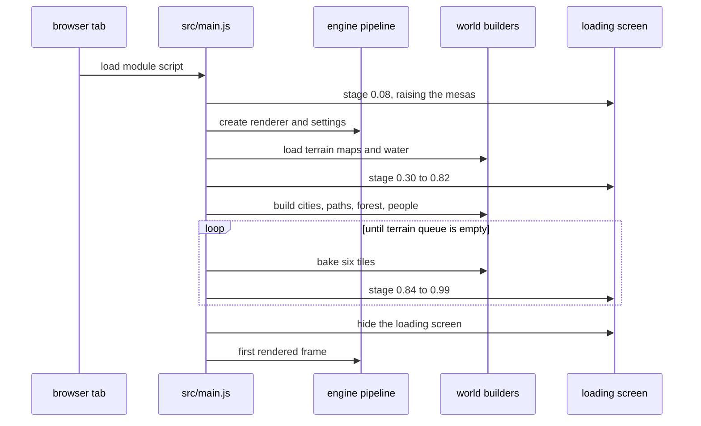
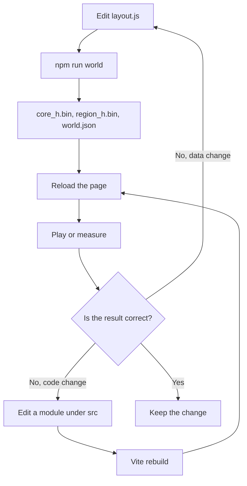
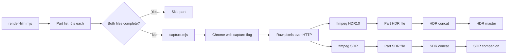

# Workflow and quality: change, verify and film

This document follows the project from the first page load to a finished film. It explains how a developer starts the game, plays, changes a layout constant, renders the film and measures a frame. It also explains which checks exist and which do not. The source is a static reading at pin `9f61b0d`. No command in this document was run for this exploration.

## Boot and loading

The developer starts the game with `npm run dev`. The package file names the development server, the production build, the preview server and the world bake.

```text
# package.json:8-12
  "scripts": {
    "dev": "vite --port 5183 --strictPort",
    "build": "vite build",
    "preview": "vite preview --port 5184 --strictPort",
    "world": "node tools/build-world.mjs --threads 4 --preview"
```

The development server serves `index.html` through Vite, the build tool. Vite transforms the modules and reloads the page when a source file changes. The production build writes a static bundle, served by the preview server on port 5184. The film tools use the preview server. The measurement tools use the development server.

The first load is a sequence of awaited stages. The stage function writes a progress value and a short text to the loading screen.

```text
# src/main.js:38-46
const stage = (p, text) => new Promise((resolve) => {
  (window.__boot ??= []).push([text, Math.round(performance.now())]);
  boot.querySelector('i').style.transform = `scaleX(${p})`;
  boot.querySelector('p').textContent = text;
  const tip = boot.querySelector('.tip'); if (tip && !FILM && p < 0.84) tip.textContent = TIPS[tipN++ % TIPS.length];
  // Normally the next animation frame; a short timer keeps loading moving in a background tab.
  const t = setTimeout(resolve, 60);
  requestAnimationFrame(() => { clearTimeout(t); setTimeout(resolve, 0); });
});
```

The function records a timestamp, scales the progress bar and writes the text. It sets a short timer and also waits for one animation frame. The timer keeps the load moving in a background tab, where frames are throttled.

The boot creates the pipeline and settings first. The pipeline creates the renderer. The settings read the saved options and the graphics processing unit (GPU) name.

```text
# src/main.js:53-59
await stage(0.08, 'Raising the mesas');
const terrain = await Terrain.load(pipe);
window.__terrain = terrain;
pipe.attachWorld();
pipe.scene.add(terrain.mesh);
const water = new Water(pipe, terrain);
pipe.sceneT.add(water.group);
```

The terrain and water load first. The remaining stages build the architecture, the courts, the waterfalls, the forest, the people, the enemies and the game. The hero loads in the background. The stage labels are "Raising the mesas", "Building the cities", "Laying the paths", "Letting the water fall", "Growing the forest" and "Waking the valley". The cities label covers the far cities, and the paths label covers the playable courts. "Letting the water fall" means the waterfalls, not the water surface. The progress values run from 0.08 to 0.82.

Some work does not finish before the screen opens. The terrain occlusion bake, the sky bake and the shadow bake continue in small tiles. These browser bakes are not the offline height-map bake. The boot waits for the terrain queue after the last stage.

```text
# src/main.js:230-238

// Finish the load-time bakes behind the loading screen, a few tiles per frame.
{
  const total = terrain._queue.length;
  while (terrain._queue.length) {
    for (let i = 0; i < 6 && terrain._queue.length; i++) tick(1 / 60);
    await stage(0.84 + 0.15 * (1 - terrain._queue.length / total), 'Casting the evening light');
  }
  for (let i = 0; i < 4; i++) tick(1 / 60);
```

Each `tick` bakes a terrain tile and renders. The stage value rises from 0.84 to 0.99 as the queue shrinks. Four more ticks finish the last tiles. The boot element fades and the interface hides the loading screen.



The order matters. The pipeline exists before the terrain, the terrain before the water and the game before the hero. The boot sequence is the dependency order in executable form.

## One minute of play

A play minute is the normal test case. The player selects Continue or a new journey and takes control on the Dawn Terrace. The input module reads the keyboard, mouse and gamepad. The player module moves the hero and runs the attack tables. The game module updates enemies, content and the save.

The frame rate target is a setting, not a constant in the loop. The presets are data.

```text
# src/game/settings.js:4-11
export const PRESETS = {
  low:    { renderScale: 0.55, shadows: false, volumetrics: false, reflections: false, cover: 0.55, clouds: 0, cloudRes: 1024, shadowRate: 2, softShadows: 0 },
  medium: { renderScale: 0.63, shadows: true, volumetrics: true, reflections: false, cover: 0.75, clouds: 1, cloudRes: 1024, shadowRate: 2, softShadows: 1 },
  high:   { renderScale: 0.8, shadows: true, volumetrics: true, reflections: true, cover: 1.0, clouds: 1, cloudRes: 2048, shadowRate: 1, softShadows: 2 },
  ultra:  { renderScale: 1.0, shadows: true, volumetrics: true, reflections: true, cover: 1.0, clouds: 2, cloudRes: 2048, shadowRate: 1, softShadows: 2 },
};

const DEFAULTS = { preset: 'medium', ...PRESETS.medium, targetFps: 50, fov: 60, sensitivity: 1, invertY: false, master: 0.8, music: 0.55, sfx: 0.85, showFps: false, challenge: 'standard', shake: 1, flashes: true, sprintToggle: false };
```

The preset raises the render scale and adds shadows, volume light and reflections. The default is medium, with a target of 50 frames per second (fps). A GPU name that does not match the integrated list starts at high. An empty name keeps the default. The settings class reads the name, not a benchmark.

The frame governor holds the target in `src/engine/governor.js`. It counts presented frames over short windows and moves the render scale in steps of 0.05 between 0.55 and the preset scale. It never goes above the preset scale. A scale change keeps the temporal anti-aliasing (TAA) history and the bloom chain.

A minute of play tests the load, input, collision, enemy wakes, save and interface. No test asserts the result. The player or a bot performs it.

## The authoring loop

The project has two authoring loops. The data loop changes the world. The code loop changes the behaviour.

The data loop starts in `src/world/layout.js`. The developer changes a mesa position, path point or paving pad. The browser cannot see it until the height maps are baked again. The command is `npm run world`. The Node builder evaluates the height function on four worker threads and writes two compressed maps and one metadata file.

```text
# tools/build-world.mjs:112-121
  const meta = {
    region: { size: WORLD.regionSize, res: WORLD.regionRes, min: Math.floor(rLo) - 1, max: Math.ceil(rHi) + 1 },
    core: { size: WORLD.coreSize, res: WORLD.coreRes, min: Math.floor(cLo) - 1, max: Math.ceil(cHi) + 1 },
  };
  const rq = quantise(region, meta.region.min, meta.region.max), cq = quantise(core, meta.core.min, meta.core.max);
  const rz = gzipSync(Buffer.from(rq.buffer), { level: 9 }), cz = gzipSync(Buffer.from(cq.buffer), { level: 9 });
  writeFileSync(path.join(outDir, 'region_h.bin'), rz);
  writeFileSync(path.join(outDir, 'core_h.bin'), cz);
  writeFileSync(path.join(outDir, 'world.json'), JSON.stringify(meta));
  console.log(`heights: region ${rLo.toFixed(1)}..${rHi.toFixed(1)} m (${(rz.length / 1e6).toFixed(1)} MB), core ${cLo.toFixed(1)}..${cHi.toFixed(1)} m (${(cz.length / 1e6).toFixed(1)} MB)`);
```

The builder writes the region map, core map and metadata. The metadata holds the map size, resolution and quantisation range. The browser reads it before the heights. A missing or stale file would break the scale, so one bake writes all three.

The code loop starts in any module under `src`. The developer saves the file. Vite detects the change, rebuilds the module graph and reloads the page. A shader string change also reloads. A layout change alone does not update the baked maps: the page reloads, but the terrain shows the old bake.

A change in `src/world/arch/sites.js` is different. That file builds court walls, arches and the bridge landing. It reads the terrain height through a query, but it does not change the height function. A new court shape needs no bake. A new paving pad does, because the pads are in `layout.js`.



The film mode has one constant and two query forms. `FILM` is true when the address has `capture` or `film` (`src/engine/quality.js:1-4`). The mode pushes detail ranges out, sharpens shadows and enlarges cloud maps. It is too heavy for play.

The flag `?film=1` previews that look only. The flag `?capture=1` also runs the capture loop and posts frames to the encoder. A plain address is play. Both film forms ignore the frame governor. The value `sessionStorage.uvHold = '1'` stops the page drawing on its own; the developer steps frames with the in-page harness, `window.__dbg`. That frees the GPU and makes a frame repeatable.

The sun is a special case. A developer can try a sun position without a new bake. The pipeline exposes `pipe.sky.setSun(azimuth, elevation)` and the terrain exposes `queueBakes()`. The terrain shadow maps rebuild on request.

## The film render

The film is a list of 14 shots and lasts 80 seconds. The director calculates the length from the shot table.

```text
# src/cine/director.js:21-29
export class Director {
  constructor({ pipe, game, sites, terrain }) {
    this.pipe = pipe; this.game = game; this.sites = sites; this.terrain = terrain;
    this.time = 0; this.index = -1; this.shotTime = 0;
    this.puppet = { move: { x: 0, y: 0 }, look: { x: 0, y: 0 }, pressed: new Set(), held: new Set() };
    this.focus = new THREE.Vector3();          // smoothed look-at point
    this.shots = this.buildShots();
    this.duration = this.shots.reduce((s, x) => s + x.dur, 0);
  }
```

The film uses the real game. The director drives the hero through a puppet input with the same shape as player input, so the film uses the real movement, combat and camera code. A shot changes the camera and the puppet targets, not the rules.

A shot is data. Each entry has a duration, an optional `setup` that places the hero and the tuned spires, and an `update` that moves the camera and the puppet for that time. The first shot drifts behind the Cantor at the lookout. The second flies down the valley. The list is the edit.

```text
# src/cine/director.js:107-117
      { // 1. Dawn: the Cantor at the lookout, the Lattice ahead.
        dur: 6.5,
        setup: (d) => d.game.cineSetup({ tuned: [], player: [terrace[0] + 15.5, terrace[1] + 0.05, terrace[2] - 1.5, Math.PI / 2] }),
        update: (d, t, k) => {
          // Drift up behind the Cantor so the rings rise over his shoulder.
          const h = d.game.player.pos;
          const p = along([[h.x - 15, h.y + 0.9, h.z - 5.5], [h.x - 9.5, h.y + 1.35, h.z - 3.6], [h.x - 5.2, h.y + 1.9, h.z - 2.0]], k);
          const near = Math.hypot(p[0] - h.x, p[1] - h.y - 1.2, p[2] - h.z);
          d.cam(p, [h.x + 260, h.y + 38 - 8 * k, h.z + 70], lerp(34, 38, k), [lerp(near, 400, ease(clamp01(k * 1.5))), 70]);
        },
      },
```

The `k` argument runs from 0 to 1 over the shot. The `d.cam` call takes a camera position, a look point, a field of view and an optional focus distance with a blur amount. The update can read the hero position, so the camera follows a moving target.

The developer runs `npm run build && npm run preview`, then `node tools/render-film.mjs --w 3840 --h 2160 --fps 60 --out renders/unsung-vale`. The preview terminal, ffmpeg and a Chrome or Edge browser must be ready. The capture tools look for Chrome or Edge at two Windows paths.

The render is split into parts so a long 4K run can stop and resume. The default part is 5 seconds (`SEG = 5` at `tools/render-film.mjs:13`).

```text
# tools/render-film.mjs:25-35
const parts = [];
for (let from = 0, i = 0; from < TOTAL - 1e-6; from += SEG, i++) {
  const to = Math.min(TOTAL, from + SEG), base = path.join(dir, `part${String(i).padStart(2, '0')}`);
  parts.push(base);
  if (ONLY && !ONLY.split(',').includes(String(i))) continue;
  const want = Math.round((to - from) * FPS);
  if (frames(`${base}-hdr10.mp4`) === want && frames(`${base}-sdr.mp4`) === want) { console.log(`[film] part ${i} (${from}-${to} s) already rendered`); continue; }
  console.log(`[film] rendering part ${i}: ${from}-${to} s`);
  const r = spawnSync('node', ['tools/capture.mjs', '--w', W, '--h', H, '--fps', String(FPS), '--from', String(from), '--to', String(to), '--sub', SUB, '--threads', THREADS, '--url', URL_BASE, '--out', base], { stdio: 'inherit' });
  if (r.status !== 0 || frames(`${base}-hdr10.mp4`) !== want) { console.error(`[film] part ${i} failed; run the same command again to resume`); process.exit(1); }
}
```

The tool checks each part. It skips a part when both output files exist with the expected frame count: the part length in seconds times the frame rate. It reads the count with `ffprobe`, not a stored marker. A killed render therefore resumes at the first part with a missing or short file.

Each part calls `tools/capture.mjs`. That tool opens Chrome or Edge, loads the game with `?capture=1` and waits for frames. The page renders each frame at a fixed time step and posts the raw pixels to a local HyperText Transfer Protocol (HTTP) server. The server pipes the pixels into ffmpeg. Both encoders receive the same frame. The HDR path reads packed 10-bit pixels; the SDR path reads 8-bit pixels.

```text
# tools/capture.mjs:31-39
const size = `${W}x${H}`;
const hdr = encoder('hdr', [
  '-f', 'rawvideo', '-pix_fmt', 'x2bgr10le', '-s', size, '-r', String(FPS), '-i', '-',
  '-vf', 'vflip,zscale=matrix=2020_ncl:range=limited,format=yuv420p10le',
  '-c:v', 'libx265', '-preset', 'medium', '-crf', '15', '-tag:v', 'hvc1',
  '-color_primaries', 'bt2020', '-color_trc', 'smpte2084', '-colorspace', 'bt2020nc', '-color_range', 'tv',
  '-x265-params', `pools=${THREADS}:hdr10=1:hdr10-opt=1:repeat-headers=1:colorprim=bt2020:transfer=smpte2084:colormatrix=bt2020nc:master-display=G(13250,34500)B(7500,3000)R(34000,16000)WP(15635,16450)L(10000000,50):max-cll=1000,300`,
  '-an', `${OUT}-hdr10.mp4`,
]);
```

The high dynamic range (HDR) master uses 10-bit pixels, the High Efficiency Video Coding (HEVC) encoder, the perceptual quantizer (PQ) transfer function and the BT.2020 colour space. The standard dynamic range (SDR) companion uses 8-bit pixels, H.264 and BT.709. Both use quality 15 and no audio. The server respects back-pressure: the browser cannot render faster than ffmpeg encodes, so memory stays bounded.



The parts are joined with the ffmpeg concat demuxer and stream copy. The HDR file gets the `hvc1` tag and the SDR file the fast-start flag. No frame is re-encoded.

The scheduled helper `tools/render-at.ps1` copies the last commit into `renders/_film`, builds that copy and renders from it, so later work cannot touch it. The direct helper `tools/start-render.ps1` serves the current tree, so a source edit or Vite reload can ruin the render.

## The measurement tools

Four tools measure frame behaviour. Each answers a different question. None of them is a test with a pass or fail result.

`tools/perf.mjs` measures the cost of each preset. It opens a real Chrome window at 1920 by 1080 and loads the game with `?perf=1`.

```text
# tools/perf.mjs:1-8
// Measures frame cost per quality preset in a real Chrome window (npm run dev must be up).
//   node tools/perf.mjs [--w 1920 --h 1080]
import { existsSync } from 'node:fs';
import puppeteer from 'puppeteer-core';
const arg = (n, d) => { const i = process.argv.indexOf(`--${n}`); return i > 0 ? process.argv[i + 1] : d; };
const W = Number(arg('w', 1920)), H = Number(arg('h', 1080));
const chrome = ['C:/Program Files/Google/Chrome/Application/chrome.exe', 'C:/Program Files (x86)/Microsoft/Edge/Application/msedge.exe'].find(existsSync);
const browser = await puppeteer.launch({ executablePath: chrome, headless: false, defaultViewport: null, args: [`--window-size=${W},${H + 90}`, '--ignore-gpu-blocklist', '--disable-background-timer-throttling', '--disable-renderer-backgrounding', '--mute-audio', '--no-first-run'] });
```

The page runs a warm-up of 40 frames at each of three viewpoints (`src/main.js:720-725`). It then renders 60 frames at each point. The tool prints the frame time and the render size for each preset. The page reads one pixel after the warm-up. A pixel read waits until the graphics pipeline finishes, so the measured time includes the queued GPU work. The result depends on the machine, the driver and the other work on the GPU.

`tools/profile.mjs` measures where the milliseconds go. It times a frame with parts of the scene switched off.

The tool switches off the forest, ground cover, terrain, architecture, water, shadows, rocks, clouds, ambient occlusion, bloom and volume light. It also tests half resolution and a post-only frame. A post-only frame draws an empty scene through the post chain, so its time is the fixed cost of anti-aliasing, bloom and tone map. The difference is the cost of that part. The method is coarse. Two parts can hide each other, and a read-back adds a stall.

`tools/fps.mjs` lets the page run freely and counts presented frames. The rate includes the browser compositor and the display refresh. It is not the render cost. `tools/hitch.mjs` wraps the update, interface and render functions and prints the parts of the slowest frames. It shows whether a hitch comes from the rules, the interface, the draw calls, a shadow refresh, a cloud tile or a scale change.

The performance record comes from these tools. It is one machine, not a general result.

```text
# docs/ARCHITECTURE.md:123-133
## Performance targets

Developed on an AMD Radeon 780M (integrated). Budget is roughly 16 ms at 1080p with the
render scale around 0.65 and TAA. Measured there with nothing else running (1080p window):
Low about 60 fps, Medium about 52, High about 45, Ultra about 39. About half of a Medium
frame is fixed post-processing at display resolution (anti-aliasing, bloom, tone map), the
rest the scene. Shadows are the largest single cost, so Low and Medium redraw the two
cascades on alternate frames (`shadows.rate = 2`) and Medium keeps soft penumbrae to the
near cascade (`shadows.soft = 'near'`). Measure with `node tools/perf.mjs` and `node tools/profile.mjs` on an
idle machine only: other GPU work makes the numbers meaningless. `node tools/fps.mjs` lets
the page run freely in a window and counts presented frames (the rate a player sees).
```

The budget is about 16 milliseconds at 1080p with a render scale near 0.65 and TAA. The record is about 60 fps on Low, 52 on Medium, 45 on High and 39 on Ultra. Half of a Medium frame is fixed post-processing. Shadows cost most. The 16 millisecond budget is a development guide; the live target is 50 fps, or 20 milliseconds. The Low preset disables shadows, so only Medium redraws the two cascades on alternate frames. The quoted sentence about Low is stale. Medium keeps soft penumbrae to the near cascade. Measure on an idle machine only.

The frame governor is the runtime answer to a slow machine. It remembers where it had to back off and tries the higher scale again later. It never raises the scale above the preset value.

## The in-page harness

The most important test surface is the page itself. The boot file publishes `window.__dbg`. The object can drive the camera, step frames and run scripted scenes.

```text
# src/main.js:309-313
window.__dbg = {
  look(yaw, pitch, fov) { freeCam = true; look.yaw = yaw; look.pitch = pitch; if (fov) { pipe.camera.fov = fov; pipe.camera.updateProjectionMatrix(); } applyLook(); },
  pos(x, y, z) { freeCam = true; pipe.camera.position.set(x, y, z); applyLook(); },
  step(n = 1, dt = 1 / 60) { for (let i = 0; i < n; i++) tick(dt); },
  settle() { this.step(8); return 0; },
```

The `look` and `pos` methods set a free camera and bypass the player camera. The `step` method calls the same `tick` function that the frame loop calls. The `settle` method advances eight frames. The `ui` method hides or shows the interface. These methods make a frame repeatable without a live player.

| Method | What it does | What it can show |
|---|---|---|
| `strip` | Films the hero from the side while a scripted input plays | A gait or attack cycle as a strip of frames |
| `bot` | Walks a fixed route and fights | Route, collision and spire tuning faults |
| `botPlay` | Plays the whole game under the real rules | Story, quests and progression faults |
| `holes` | Checks the terrain around every paving cut | Ground holes and exposed banks |
| `audit` | Checks every walkable surface on a grid | Ground through a floor and hollow floors |
| `fuzz` | Sends random input at listed places | Stuck spots, falls and broken numbers |
| `reel` | Builds a contact sheet from the film timeline | Shot framing and film pacing |
| `filmStill` | Renders one graded film frame | Depth of field and the film grade |
| `gpuMs` | Times a fixed number of render calls | A quick GPU cost sample |

The `botPlay` method is the full-game bot. A run with `fresh` resets the game state. The bot removes the save and follows the story goals.

```text
# src/main.js:467-475
  botPlay(seconds = 120, { fresh = false, cheat = true, side = true } = {}) {
    const d = director, g = game, p = g.player, dt = 1 / 30, pu = d.puppet;
    let b = this._play;
    if (!b || fresh) {
      if (fresh) {
        g.cine = false; g.input.puppet = null;
        g.cineSetup({ tuned: [] });
        for (const sp of g.spires) { sp.tuned = false; sp.power = 0; sp.zoneR = sp.zoneR0; sp.zone.z = sp.zoneR; sp.zone.w = 1; }
        g.enemies.list.length = 0; g.wildDone = []; g.xp = 0; g.bought = 0; g.ended = false; g.outroSeen = false; g.story.mode = null; g.story.endT = 0; g.elitesDown = []; g.hasMap = false; g.metPeople = [];
```

A fresh run clears the spires, the enemies, the quests, the trials, the bells, the charms, the geodes, the chimes, the notes and the people (`src/main.js:474-479`). It then spawns the player at the start. The bot replaces `g.save` with an empty function, so a run never touches the player's save.

```text
# src/main.js:552-553
    return { trials: g.trials.list.filter((t) => t.done).map((t) => t.def.id), seconds: Math.round(b.t), done: (!!g.ended && !Q.active.length) || b.stuck >= 14, ended: !!g.ended, tuned: g.spires.filter((q) => q.tuned).map((q) => q.id), pos: p.pos.toArray().map(Math.round), health: Math.round(p.health), deaths: b.deaths, xp: g.xp, up: { ...p.up },
      quests: Object.fromEntries(Object.entries(Q.state).map(([k, v]) => [k, v.s])), side: tr ? `${tr.title}: ${tr.text} ${tr.count ?? ''}` : null, notes: g.notes.count, time: Object.fromEntries(Object.entries(b.time).map(([k, v]) => [k, Math.round(v)])), objective: g.objective, log: b.log.slice(-12) };
```

The result reports the tuned spires, the quests, the time in each mode, the deaths and the last log lines. The modes are story, side, fight, talk, ride and tune. `docs/ARCHITECTURE.md` gives a full run as about 43 simulated minutes. It returns `ended` and `done` flags. A developer calls the method in chunks until `done` is true. That run tests the story order, the quest chain, the string rides (rides along a string of light) and the notes. It does not test control feel.

The `audit` method checks every walkable surface. It casts a ray down from the top of each solid, up to five levels. It records ground that comes up through a floor, called a poke, and a floor with open air under it, called a hollow. The results group by ten-metre cells, worst first.

```text
# src/main.js:584-590
  audit(step = 1.2, { gapMax = 2.2, box = null } = {}) {
    const W = game.world, T = game.terrain;
    for (const l of W.lazy) if (!l.done && (!box || (l.cx > box[0] - l.r && l.cx < box[2] + l.r && l.cz > box[1] - l.r && l.cz < box[3] + l.r))) { l.done = true; const g = l.build(); if (g) W.addGeometry(g); }
    const ray = new THREE.Ray(), dir = new THREE.Vector3(), o = new THREE.Vector3(), SKY = new THREE.Vector3(0, 1, 0);
    const poke = new Map(), hollow = new Map();
    const add = (m, x, z, v, fy) => { const k = Math.round(x / 10) + ',' + Math.round(z / 10); let c = m.get(k); if (!c) m.set(k, c = { n: 0, max: 0, at: null }); c.n++; if (v > c.max) { c.max = v; c.at = [Math.round(x * 10) / 10, Math.round(fy * 10) / 10, Math.round(z * 10) / 10]; } };
    const seen = new Set(); let samples = 0;
```

The method takes a step size and an optional box. The box limits the audit to one court or one region. The step size trades run time for coverage. The `holes` method applies a similar check to every paving cut, where the ground is cut under stone. The `fuzz` method sends random input at a list of places. It records a not-a-number (NaN) position, a fall below the ground, a stall and a large distance from the start. Every 45 frames it compares the position with the last sample. If the hero moves less than 0.25 metres in the move state, a counter rises. Three such samples make a stall. A clean run is a search result, not a proof.

```text
# src/main.js:624-633
  fuzz(places, seconds = 30, seed = 1) {
    const g = game, p = g.player, pu = director.puppet, dt = 1 / 30, out = [];
    let r = seed * 9301 + 49297; const rnd = () => ((r = (r * 9301 + 49297) % 233280) / 233280);
    g.state = 'playing'; g.cine = false; g.input.enabled = true; g.input.puppet = pu;
    const save = g.save; g.save = () => {};
    for (const [x, z] of places) {
      g.world.stream(x, z, 8);
      const y0 = g.world.floorBelow(x, g.world.groundHeight(x, z) + 40, z, 80);
      p.spawn(x, y0 + 0.2, z, rnd() * 6.28); p.invulnerable = 1e9; g.rig.snap(p);
      let under = 0, stuck = 0, still = 0, nan = false, last = p.pos.clone(), minY = 1e9, far = 0, mx = 0, my = 1;
```

The film methods reuse the director. `reel` jumps to listed times and draws each frame into a contact sheet, a grid of frames. `filmStill` renders one frame through the film output, including depth of field and the film grade. `gpuMs` times a fixed number of render calls. A developer can judge the 4K film (3,840 by 2,160) on a normal display with a crop at full size.

The harness is not available to a normal player. It lives in the boot file and uses the same objects as the game. It is a development interface, not a public application programming interface (API). A change to an internal name can break a tool.

## The quality record

The project has a changelog. The latest entry is dated 13 November 2026. It is a list of fixes and additions, not a test report. The excerpt below is the first four bullets. The full entry continues.

```text
# docs/CHANGELOG.md:3-16
## 13 November 2026

Fixed

- Ground that could be seen through. Where the terrain stood higher than a court's paving
  it was cut away at the rim and one could look under it. The ground is now brought down to
  just under the stone round every court and at the head of the long stair, and the height
  maps were baked again.
- Stairs that could be seen through. Every step had been built without the face toward the
  foot of the flight, so the long stair was a ladder of treads from below.
- A shove could put the hero through a wall. Constructs overlapping him (a brute's rush
  above all) moved him with no regard for stone, and beside a pier that could leave him
  inside it. Every such push is now short and stops at a wall.
- Falling in a court no longer sends its fight back to the first wave.
```

The quoted part records four faults. Ground was seen through at a court rim. Stairs had no face toward the foot of the flight. A shove put the hero inside a wall. A court fight restarted after a fall. The full entry continues with fixes of the same kind.

The changelog shows the kind of fault that the harness finds. Most entries are state faults at a boundary. A fall, a return to the title, a lost focus, a save and load, a dead hero and a prompt overlap are all boundary cases. A unit test could cover some of them. The project uses the running game instead.

The project has no unit test suite, no test script, no test folder, no linter configuration and no continuous integration (CI) workflow. The checks are manual and in-page. This is a deliberate trade, but it has costs. A change can break an old boundary case with no failing check. A measurement can pass on one machine and fail on another. A visual check depends on the eye of the developer.

The performance target is the frame budget in the architecture document. The visual target is the film. The functional target is a clean run of the bots and audits. None is checked on every change.

## The central workflow insight

**Aha:** The project uses the running game as its test harness. The frame stepper, the route bot, the full-game bot, the geometry audit, the random-input fuzz and the film stills all run inside the same page as the player. That choice tests the real integration: the GPU, the load, the save, the input and the render order. It also means no check has a pass or fail record, and no in-page check can run without Chrome and a GPU. The trade is integration realism for reproducibility. A team that needs a gate on every commit would add a small headless suite for the pure functions and keep the in-page harness for the integration cases.

The next document examines the limits of this approach and compares the project with a general game engine and a hand-authored pipeline. Read [04-limits-and-comparison.md](04-limits-and-comparison.md) next.
