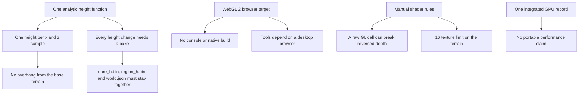
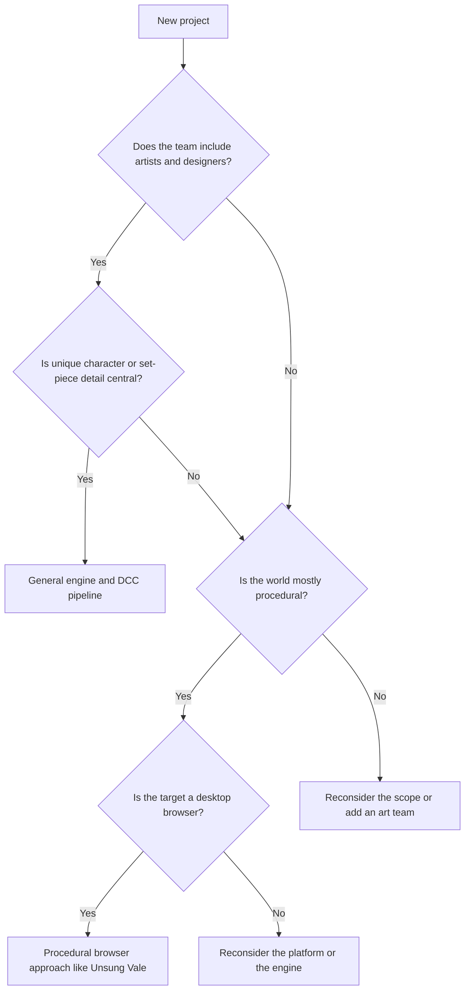

# Limits and comparison: what the design cannot do

This document states the limits of Unsung Vale. It separates a measured record from a live result. It also compares the project with a general game engine and with a hand-authored content pipeline. The source is a static reading at pin `9f61b0d`. No performance number in this document was measured for this exploration.

## Platform and tool limits

The project README states the runtime. The game is a browser application, not a desktop package.

```text
# README.md:45-46
Then open http://localhost:5183. A recent Chrome or Edge with WebGL 2 is needed. The first
load takes a little while because the world is baked on your GPU.
```

The target is a recent Chrome or Edge browser with WebGL 2 (Web Graphics Library version 2). The source does not claim support for mobile browsers, Safari, Firefox, a console or a native desktop build. The interface uses HyperText Markup Language (HTML), Cascading Style Sheets and Web Audio. That choice keeps the download small. It also ties the project to the browser sandbox and graphics driver. The load bake builds runtime resources; the height-map bake is the offline `npm run world` step.

The development tools add limits. The measurement tools look for Chrome or Edge at two fixed Windows paths.

```text
# tools/perf.mjs:7-8
const chrome = ['C:/Program Files/Google/Chrome/Application/chrome.exe', 'C:/Program Files (x86)/Microsoft/Edge/Application/msedge.exe'].find(existsSync);
const browser = await puppeteer.launch({ executablePath: chrome, headless: false, defaultViewport: null, args: [`--window-size=${W},${H + 90}`, '--ignore-gpu-blocklist', '--disable-background-timer-throttling', '--disable-renderer-backgrounding', '--mute-audio', '--no-first-run'] });
```

On another operating system, the search returns no path. Most tools have no browser path argument. A developer must change the list or install the browser at one of those paths. The capture tool accepts a `--chrome` argument, but the film render calls the capture tool without it. `render-at.ps1`, `start-render.ps1` and `sysmon.ps1` are Windows only. A macOS or Linux developer can run the game, but the measurement and film scripts need a change.

The film path needs more software. It needs ffmpeg on the PATH, a local preview server and a Chrome or Edge window. The hero rebuild needs Blender 5.x. The project does not bundle these tools. A new contributor must install them for the full workflow.

The browser target also sets the input model. The game uses pointer lock and raw mouse movement. It uses the Web Audio graph for sound. It uses local storage for the save. These features have browser limits. The project does not ship a native audio mixer, a native file system or a platform achievement system.

## The performance record is not a live result

The architecture document gives the performance record for one machine in one idle state.

```text
# docs/ARCHITECTURE.md:123-131
## Performance targets

Developed on an AMD Radeon 780M (integrated). Budget is roughly 16 ms at 1080p with the
render scale around 0.65 and TAA. Measured there with nothing else running (1080p window):
Low about 60 fps, Medium about 52, High about 45, Ultra about 39. About half of a Medium
frame is fixed post-processing at display resolution (anti-aliasing, bloom, tone map), the
rest the scene. Shadows are the largest single cost, so Low and Medium redraw the two
cascades on alternate frames (`shadows.rate = 2`) and Medium keeps soft penumbrae to the
near cascade (`shadows.soft = 'near'`). Measure with `node tools/perf.mjs` and `node tools/profile.mjs` on an
```

The record is an AMD Radeon 780M integrated graphics processing unit (GPU) at 1080p. The architecture document gives a 16 millisecond budget with a render scale near 0.65 and temporal anti-aliasing (TAA). The rates are about 60 frames per second (fps) on Low, 52 on Medium, 45 on High and 39 on Ultra. Each preset has its own scale in `src/game/settings.js`, from 0.55 to full. One sentence in that excerpt is stale. Low disables shadows, so only Medium redraws the two cascades.

The README gives a second view of the machine.

```text
# README.md:180-185
The demo was developed on an integrated GPU (AMD Radeon 780M). The default Medium preset
renders at two thirds resolution with temporal anti-aliasing; discrete GPUs start on High.
Every preset holds a frame rate of your choosing (50 by default) by lowering the internal
render resolution when it has to, never the detail: on that integrated GPU, Ultra at 1080p
settles at about three quarters of full resolution. Set "Frame rate to hold" to Off to
render at the preset's full resolution regardless.
```

The README says each preset holds its frame rate by lowering the render resolution. The governor is the frame-rate controller. The default target is 50 fps. On the 780M at 1080p, Ultra settles at about three quarters of full resolution. The README gives no measured frame rate for that state. The architecture document gives 39 fps for Ultra.

The records are not comparable. The architecture document gives a preset record, but it does not state whether the governor was active. The README gives a live governor result and no frame rate for it. The source gives no test conditions that join them. This exploration records the gap.

The settings class adds one more variable: a nonempty GPU name that is not in the integrated list starts at High, not Medium.

```text
# src/game/settings.js:17-22
    try {
      const gl = renderer.getContext(), ext = gl.getExtension('WEBGL_debug_renderer_info');
      const name = ext ? String(gl.getParameter(ext.UNMASKED_RENDERER_WEBGL)) : '';
      const integrated = /Intel|UHD|Iris|Radeon\(TM\) Graphics|780M|760M|680M|Vega|Apple M1\b/i.test(name);
      if (!integrated && name) Object.assign(this.values, { preset: 'high', ...PRESETS.high });
      this.gpu = name;
```

The settings class reads the unmasked renderer name. It matches a list of integrated names. If the name is not in the list and is not empty, the preset becomes High. The choice is a heuristic, not a benchmark. A matched integrated name keeps Medium, the default preset. An unmatched nonempty name starts at High. The user can change the preset in the settings menu.

The governor is the runtime response to a slow machine. It changes only the render scale. It never changes the scene detail in a preset.

```text
# src/engine/governor.js:31-37
  end(dt) {
    if (!this.target) return;
    // A stall (a tab switch, a long load) says nothing about the frame rate.
    if (dt > 0.25) { this.t = 0; this.n = 0; return; }
    this.t += dt; this.n++; this.cool -= dt; this.ceilingT -= dt;
    if (this.t < 0.75) return;
    const fps = (this.fps = this.n / this.t);
```

The governor waits for a 0.75 second window. It ignores a frame longer than 0.25 seconds, because a tab switch says nothing about the frame rate. It steps down by 0.05 after two short windows, or by 0.1 when the rate is below 75 percent of the target. It steps up by 0.05 after two comfortable windows. It clamps the scale between 0.55 and the preset scale. It remembers a failed scale and waits longer before retrying.

The governor hides the true cost of a preset. Two machines can show the same frame rate and different image sharpness. A performance report must state the render scale, the target and the governor state. The architecture document states the budget scale and the idle-machine condition. It does not state the governor state.

The frame loop also has a limit. It clamps the delta time to 50 milliseconds.

```text
# src/main.js:747-755
function frame(now) {
  requestAnimationFrame(frame);          // first of all: a frame that fails must not be the last
  const dt = Math.min(0.05, Math.max(0, (now - last) / 1000));
  last = now;
  // Development: sessionStorage.uvHold = '1' stops the page drawing on its own, so frames are
  // only rendered when stepped through __dbg (keeps the GPU free while other work runs).
  if (held()) return;
  try { tick(dt); } catch (e) { if (++frameErrors <= 5) console.error(e); }
}
```

The clamp stops a long stall from moving the player far in one frame. The catch block keeps the loop alive after an error. It logs the first five errors. It does not show them to the player and it does not stop the game. A silent error can therefore survive a play session. The changelog records one related fix: a failing frame no longer freezes the picture, and a graphics device reset shows a reload prompt (`docs/CHANGELOG.md`).
## Rendering and shader limits

The renderer is a rasterizer on WebGL 2. Its light transport is a set of approximations: a baked sky, an environment probe, screen-space reflections, cascaded shadow maps and quarter-resolution volumetric light. The source describes these passes. This reading found no path-traced or ray-traced pass.

The shader rules are strict. The architecture document lists them.

```text
# docs/ARCHITECTURE.md:61-70
- Scene materials are `THREE.ShaderMaterial` **without** `glslVersion` (three then defines
  `gl_FragColor`); full-screen passes are `RawShaderMaterial` with GLSL3 via `FullscreenPass`.
- Lit materials pass `defines: pipe.depthDefines` and `uniforms: { ...pipe.lit(), ... }` and
  include, in order: `COMMON, SKYMAP, SKY_SAMPLE, SH_GLSL, TERRAIN_SAMPLING, LIGHTING`.
- Loops that sample textures use `textureLod`, and textures inside branches use
  `textureGrad`, so the D3D shader compiler never has to unroll or flatten them.
- Heavy one-off GPU work (sky, terrain bakes) is always split into small scissored tiles so
  no single draw can run long on an integrated GPU.
- A fragment shader may use at most 16 textures. The terrain uses all 16, which is why the
  two occlusion maps share one array texture; adding a sampler there means merging another.
```

Scene materials use `ShaderMaterial` without a GLSL version. Full-screen passes use `RawShaderMaterial` with OpenGL Shading Language (GLSL) 3. Lit materials include a fixed set of shader chunks in a fixed order. Texture reads in loops use `textureLod`. Texture reads in branches use `textureGrad`. That rule stops the Direct3D shader compiler from unrolling or flattening the code. A fragment shader may use at most 16 textures. The terrain uses all 16, so a new sampler means merging another texture first.

The 16-texture rule is a project rule, not a style choice. A developer who adds a seventeenth sampler to the terrain shader breaks that rule. The workaround is to merge another map into an existing array.

The chunks have separate jobs. `COMMON` holds shared constants and helpers. `SKYMAP` and `SKY_SAMPLE` read the baked sky. `SH_GLSL` holds the spherical-harmonic ambient light. `TERRAIN_SAMPLING` holds the height-map decode and the core-region blend. `LIGHTING` applies the sun, the cascaded shadows and the ambient terms. The order is a contract.

A normal map stores a surface direction in two channels. The forge packs that direction, the roughness and the ambient occlusion into one four-channel array texture. The terrain shader packs its two occlusion maps into one array texture, so they cost one sampler.

The reversed depth buffer adds a second discipline. Any code that touches the GL context directly must restore the reversed depth state.

```text
# src/engine/pipeline.js:192-199
  // reversed depth buffer off, which would silently break every depth test, so restore it.
  resetGL() {
    this.renderer.resetState();
    if (this.reversed) {
      const depth = this.renderer.state.buffers.depth;
      depth.setReversed(true);
      depth.setClear(1);          // becomes 0 on the GL side while reversed
    }
```

The pipeline calls `renderer.resetState()` and then restores the reversed depth buffer. Three's reset turns the reversed buffer off, and that change silently breaks every depth test. A raw GL call that leaves the reset state in place can therefore break depth. The rule is manual. The code cannot enforce it.

The height field adds a world limit. The terrain surface stores one height for each horizontal sample. It cannot fold over itself. A cave, an arch or an overhang cannot come from the height map alone. Separate meshes can add those shapes, but the base ground cannot carry them.

```text
# src/world/terrain.js:532-547
  heightAt(x, z) {
    const sample = (data, res, size) => {
      const fx = (x / size + 0.5) * res - 0.5, fz = (z / size + 0.5) * res - 0.5;
      const ix = Math.max(0, Math.min(res - 2, Math.floor(fx))), iz = Math.max(0, Math.min(res - 2, Math.floor(fz)));
      const tx = Math.max(0, Math.min(1, fx - ix)), tz = Math.max(0, Math.min(1, fz - iz));
      const o = iz * res + ix;
      return (data[o] * (1 - tx) + data[o + 1] * tx) * (1 - tz) + (data[o + res] * (1 - tx) + data[o + res + 1] * tx) * tz;
    };
    const e = Math.max(Math.abs(x), Math.abs(z)) / (this.coreSize * 0.5);
    const hr = e < 0.9 ? 0 : sample(this.region, this.regionRes, this.regionSize);
    if (e >= 0.985) return hr;
    const hc = sample(this.core, this.coreRes, this.coreSize);
    if (e <= 0.9) return hc;
    const t = (e - 0.9) / 0.085, w = 1 - t * t * (3 - 2 * t);
    return hr + (hc - hr) * w;
  }
```

The core map has one sample per metre. The region map has one sample per eight metres. The builder measures the lowest and highest height and stores that range. The file stores a 16-bit integer scaled by the measured range. The loader converts each value to a 32-bit float and makes a float texture. A one-metre sample cannot show a half-metre ledge. The normal maps and the cliff shader add small detail. They do not add real geometry at that scale.

The renderer also has resolution limits. TAA reuses the previous frame. The reuse is the source of its cost saving, and it means the image is not a pure sample of the current frame. Screen-space reflections can only reflect what the frame shows. Volumetric light is marched at quarter resolution and then upsampled with a depth-aware filter. These choices trade accuracy for speed on an integrated GPU. A comparison with a path-traced image must say so.



## World and content limits

The world is code. That choice removes an editor. A designer changes a mesa or a path in `src/world/layout.js` and runs `npm run world`, then reloads. A court shape in `src/world/arch/sites.js` needs only a reload. A mesa or pad move in `src/world/layout.js` changes the ground and needs a new bake. The data loop suits a programmer, not a designer.

The world scale is fixed by the bake. The playable core is 2,048 metres with one-metre samples. The region is 16,384 metres with eight-metre samples. A larger core needs a new map size. A finer region needs more memory and a longer bake. The 16-bit height is finer than the sample spacing in both maps. The sample spacing is the real limit. A one-metre sample is enough for a landscape and too coarse for a table.

The content set is finite. The enemy table has 11 kinds. The story has 8 spires. The reliquary table has 8 charms. The chime system has 7 places. The project README states 18 side quests and 8 trials. A new enemy kind needs a table entry, a body build, a state machine branch, audio recipes and interface text. A new quest needs data and a reward. The code makes additions possible, not free.

An enemy moves through a fixed state cycle. `dormant` waits for sight. `rise` assembles the body. `chase` closes or circles. `windup` telegraphs. `strike` applies the blow. `recover` holds it open to a counter. `return` goes home when the hero dies or the enemy strays. A hit that breaks poise sends it to `stagger`, then back to `chase`. Zero health sends it to `dead`.

```text
# src/game/enemies.js:308-312
      if (e.state === 'dormant') {
        if (playerAlive && dist < d.sight * 0.62 && Math.abs(player.pos.y - e.pos.y) < 8) { e.state = 'rise'; e.t = 0; this.events.push({ type: 'wake', enemy: e }); }
      } else if (e.state === 'rise') {
        e.assembled = Math.min(1, e.t / (d.boss ? 2.2 : 1.1));
        if (e.assembled >= 1) { e.state = 'chase'; e.t = 0; }
```

The hero is a special case. The mesh comes from a Blender Python script, not from an art package. A shape change means a Blender run and a new `hero.glb`. The animation is procedural, so a new move needs key tables and timing data, not a captured animation clip. That suits a small team but limits an animator who uses a digital content creation (DCC) tool.

The credits list audio only. The credits state the terms.

```text
# CREDITS.md:1-9
# Credits

## Audio

All audio in `public/audio/` is third-party material used under Creative Commons licences
(CC BY 4.0 or CC0 1.0). Nothing was synthesised or generated for this project.

Every file was edited with ffmpeg: trimmed, given short fades, normalised (music and ambience to
about -16 LUFS integrated, effects to a -3 dBFS peak) and re-encoded as Ogg Vorbis. The per-file
```

The music section (lines 20 to 24) names Scott Buckley under Creative Commons Attribution 4.0 (CC BY 4.0). The ambience section (lines 46 to 49) is Creative Commons Zero 1.0 (CC0 1.0). The restriction at lines 42 to 44 asks that the music is not redistributed alone, re-uploaded to a streaming platform or registered with a fingerprinting service. A user who reuses the code under the Massachusetts Institute of Technology (MIT) licence does not receive the audio under that licence. The audio keeps its own terms.

The audio was normalised to a loudness target in loudness units relative to full scale (LUFS) and to a peak in decibels relative to full scale (dBFS).

The film also has a fixed shot list. It lasts 80 seconds. It has no audio track. The `--seconds 45` example renders a shorter segment, not the whole film. The director sums the shot durations from `buildShots` (`src/cine/director.js:21-29`). The capture tool writes video only (`tools/capture.mjs:1-8`). The film therefore needs a separate soundtrack if a user wants sound. The project does not supply one.
The high dynamic range (HDR) master uses 10-bit pixels and the High Efficiency Video Coding (HEVC) encoder. It uses the perceptual quantizer (PQ) curve and the BT.2020 colour space. The standard dynamic range (SDR) companion uses 8-bit pixels, the H.264 encoder and the BT.709 colour space.

## Documentation drift

The project documents drift from the source at the pin. A reader must know the differences. The architecture document adds rules near its end.

The architecture document says that `game.js` owns "the three spires".

```text
# docs/ARCHITECTURE.md:144-146
- `game.js`: rules and flow (`home`, `playing`, `paused`, `ending`). Owns `Player`, `CameraRig`,
  `CollisionWorld`, `Particles`, `Enemies`, the three spires, the light bridge and saving
  (`localStorage`). Emits events (`state`, `objective`, `boss`, `tuned`, `player`, `enemy`,
```

The game has eight spires. A light bridge is a span of light that grows outward from the Choir Gate. The order is in `src/world/arch/sites.js` at line 449. The spire sentence is stale. The state list is short; the code adds free, menu and photo. The README and code agree on eight.

The project README says "seventy lost notes". The generator has no constant 70. It places a note every 46 metres along the story paths.

```text
# src/game/notes.js:45-51
  // legs: { name: [[x, z], ...] } polylines; a note is set down every `gap` metres along them.
  // more: further places off the paths (appended, so earlier notes keep their numbers).
  constructor(game, pipe, legs, { gap = 46, avoid = [], extra = [], more = [] } = {}) {
    this.game = game; this.pipe = pipe;
    const W = game.world, list = [];
    for (const pts of Object.values(legs)) {
      let carry = gap * 0.5, side = 1;
```

The count is the path length divided by 46, plus the extra places. A path change changes the count. The project README also mentions "sixty notes" in the dye list. That number is a threshold for one cape dye, not the total count. The two numbers are not a contradiction. They are different facts.

The exploration brief, the starting specification for this document set, says 61 JavaScript modules and 16,911 lines in `src`. The source at the pin has 62 modules and 16,506 lines in `src`. The module difference is one module in `src/game`. The line difference is 405 lines. The exploration uses the source count. The specification gives `index.html` line 44 for the module script. The source has it at line 41. It gives the note gap as line 46. The default is at line 47. It gives the dye threshold at line 28. The test is at line 35.

The changelog is dated 13 November 2026. The date is later than the package version history. The exploration records the date as written and does not interpret it.

## Verification limits

The project has no unit test suite. The package file has no test script.

```text
# package.json:8-12
  "scripts": {
    "dev": "vite --port 5183 --strictPort",
    "build": "vite build",
    "preview": "vite preview --port 5184 --strictPort",
    "world": "node tools/build-world.mjs --threads 4 --preview"
```

The repository has no test folder, linter configuration or continuous integration (CI) workflow. The checks are manual. They run in a browser with a GPU. The in-page harness is the `window.__dbg` object. It is strong for integration, but it has no pass or fail record. A developer must read the output and decide.

This has three costs. First, a regression can pass with no failing check. The changelog shows boundary faults that a small test could catch: a fall, a lost focus, a save and load. Second, a measurement depends on the machine. The governor can hide a slowdown by lowering the scale. Third, a visual check depends on the eye of the developer. The tour tool (`tools/tour.mjs`) saves a screenshot of each scripted situation. The screenshots help, but no tool compares them with a reference image.

The project's quality claims rest on a manual process. A reader must not read the changelog as a test report.

## Comparison with a general game engine

A general engine is a platform. Unity, Unreal Engine and Godot provide an editor, an asset pipeline, a physics engine, an animation system, a user interface system, an audio mixer and several build targets. Unsung Vale provides a thin slice of those systems on top of three.js. The comparison must be fair. The project is a 0.1.0 demo with 239 tracked files (`git ls-files`). An engine is a product with a long history.

| Area | Unsung Vale | General engine |
|---|---|---|
| World authoring | Code and a Node bake | Editor terrain tools and scene placement |
| Assets | Generated meshes and textures; one Blender script | Import from DCC tools |
| Rendering | Custom three.js WebGL 2 pipeline | Built-in pipelines and shader graph |
| Physics | Capsule, height field, bounding volume hierarchy (BVH) | Full 3D physics with joints and vehicles |
| Animation | Procedural rig, inverse kinematics (IK), key tables | Skinning, state machines, captured clips |
| Interface | HTML and Cascading Style Sheets | Engine user interface system |
| Audio | Custom Web Audio graph | Built-in mixer and spatial audio |
| Tools | Node scripts and an in-page harness | Editor, profiler, debugger, build targets |
| Platforms | Desktop Chrome and Edge with WebGL 2 | Desktop, mobile, console, web |
| Testing | Manual harness | Engine test tools, but game tests are still user work |
| Licence | MIT for code | Engine-specific licence and terms |
| Team fit | Small programmer-led team | Team with artists, designers and engineers |

The strengths of the Unsung Vale approach are control and coherence. The order of render passes in each frame is explicit. The world has one height source. The visual terrain and the collision floor cannot drift. The whole game is 16,506 lines of JavaScript plus tools. A reader can understand the system from the source. The code licence is simple. There is no editor state, no binary scene file and no hidden asset import. The height maps and the hero model are data assets, not scene files.

The costs are also clear. There is no editor, so a designer must edit code. There is no asset import, so an artist must write a generator or run Blender. There is no built-in physics, so the collision code is custom. There is no console or mobile build. There is no built-in profiler, so the team writes its own tools. The project must maintain its renderer, its terrain system and its animation system. That is a large surface for a small team.

A general engine would remove much of that surface. It would also add a dependency, a licence, a larger runtime and a different skill set. It would not automatically give a coherent procedural world. A team can build a bad world in any engine. The choice is about which work the team wants to own.

## Comparison with a hand-authored pipeline

A hand-authored pipeline uses artists and designers. A modeller builds the hero, the enemies and the architecture. A texture artist paints the materials. An animator captures or keys the moves. A level designer places the content in an editor. The engine imports the result.

| Area | Unsung Vale | Hand-authored pipeline |
|---|---|---|
| Unique detail | Limited by generators and code | High, limited by artist time |
| Visual and collision agreement | Shared source, hard to drift | Separate assets, can drift |
| Iteration | Fast for code, slow for art | Fast for art, slow for code |
| Team size | Small, programmer-led | Larger, multi-discipline |
| Asset size | Small, generated at load or bake | Large, shipped as files |
| Cost per new area | Low for a new arrangement, high for a new kind | High for new art, lower for a new arrangement |
| Animation quality | Stylised and procedural | Can use captured or hand-keyed motion |
| Reproducibility | High, the world is a function | Lower, the world is a set of files |
| Licensing | Code MIT, audio separate | Every asset has its own terms |

The hand-authored pipeline wins on unique detail and on the quality of character motion. A human can make a face, a costume or a set piece that a generator does not. The pipeline also lets an artist work in a familiar tool. The cost is a larger team, a larger repository and a longer asset pipeline. The visual and collision meshes can disagree, and that disagreement is a source of bugs. For example, a hand-built stair can show a tread 0.2 metres above its collision floor. The hero then floats above the step or sinks into it. Unsung Vale's base ground cannot have that fault, because the visible mesh and the collision query read one height map.

The Unsung Vale pipeline wins on coherence and on the cost of a new arrangement. An arrangement reuses existing parts. A kind needs its own generator. A new court can reuse the kit and the layout function. The collision follows the visible ground because both read the same data. The repository stays small. The cost is that every new kind of content needs a programmer. The visual style is the style that the generators can produce.

## Decision table

The choice depends on the team, the target and the content. The table gives a first answer, not a rule.

| Situation | Better choice | Reason |
|---|---|---|
| Small programmer-led team, browser target, procedural landscape | Unsung Vale approach | Code control, small runtime, one world source |
| Team with artists and a unique character-driven look | General engine with a DCC pipeline | Art fidelity and familiar tools |
| Console or mobile release | General engine | Platform reach and certification |
| Large hand-crafted open world with many set pieces | General engine and a level team | Authoring speed and unique detail |
| Terrain or rendering technology prototype | Custom renderer | Exact control of frame order and data |
| Need a reproducible world from a function or seed | Procedural approach | The world is a function, not a file set |
| Need a live content pipeline and frequent art updates | General engine | Asset import and editor workflow |
| Need to onboard artists quickly | General engine | Shared tools and conventions |
| Need the smallest possible code and asset footprint | Procedural approach | Generated content and a small repository |
| Need a fixed 80-second film with exact frame control | Custom capture path | The project already has one |



## The central limit insight

**Aha:** The central limit is the other side of the central design choice. Unsung Vale makes every fact procedural and gives it one owner. That choice buys coherence, a small repository and exact control of the frame. It costs an editor, an asset pipeline, platform reach and a portable performance claim. The project cannot accept a hand-painted exception without a new generator. It cannot ship to a console without a new renderer and platform layer. It cannot prove a frame rate on another machine without a new measurement. A reader who understands this trade can use the project well and can judge its claims fairly.

This is the last document in the set. Return to [README.md](README.md) for the index and the reading order.
