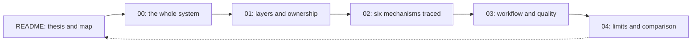

# Unsung Vale: a world generated by code

Unsung Vale is an original third-person role-playing game (RPG) that runs in a browser tab. The player is the Cantor, a singer who carries one musical note. The Cantor crosses a valley of mesas and waterfalls, breaks the stone constructs that guard eight Tuning Spires and wakes each spire by tuning it. Every mesh and every texture in the game comes from code in the repository. The hero mesh comes from a Blender Python script in the same repository. The audio files come from outside.

This package is a static reading of the source at pin `9f61b0d`. It has six documents. It explains the promise, the architecture, the core mechanisms, the workflow and the limits. It does not run the game, the world builder, the film render, Blender or a browser tool. The limits of the reading are stated below.

## The problem

An open-world game usually needs a large content pipeline. A team models the terrain, paints the materials, builds the buildings, places the props and animates the characters. A browser game usually has a small scope, because a large download and a long load break the medium. These two facts pull in opposite directions.

Procedural generation can break the tension. A function can produce a large landscape from a small amount of code. But a naive generator often produces a world that looks large and feels empty. The visible surface and the collision surface can disagree. The map can disagree with the ground. A change to the terrain can leave the old collision mesh in place.

## The thesis

Unsung Vale answers the problem with one rule: every fact has one owner, and the owner is usually a function. One analytic height function defines the ground. The Node world builder evaluates it and writes the height maps. The browser reads those maps. The terrain mesh, the collision floor, the map image and the note placement all read the result. The visual world and the playable world cannot drift while the bake is current, because they do not have separate sources. A stale bake is a separate failure, not a second source. The repository has no version stamp or hash check for the maps. The loader reads a minimum and a maximum from `world.json`, but it cannot tell whether the maps match the current height function. After a change to the ground, a developer must run the builder by hand.

```text
# src/world/layout.js:6-22
export const WORLD = {
  seed: 20261112,
  coreSize: 2048,     // metres covered by the 1 m/texel core map (centred on the origin)
  coreRes: 2048,
  regionSize: 16384,  // metres covered by the 8 m/texel region map
  regionRes: 2048,
  waterLevel: 0,
  heightMin: -64,     // quantisation range for the 16-bit height files
  heightMax: 3136,
  // The sun stands just to the right of the great tree as seen from the Dawn Terrace: still
  // in the picture with its glow and shafts, but off the valley's axis, so the light rakes
  // across cliff faces, terraces and the rings instead of leaving everything backlit.
  sun: { azimuthDeg: 33, elevationDeg: 12 },
};

// Hand-placed mesas for the playable core. h is the absolute top height in metres.
// ax squashes the footprint along its local x axis, rot rotates it.
```

The constants set the frame. The playable core is 2,048 metres across with one sample per metre. The region is 16,384 metres across with one sample per eight metres. The water level is zero. The sun sits at 33 degrees of azimuth and 12 degrees of elevation.

The same rule applies to the rules and the content. One enemy table defines the 11 kinds: ten constructs and the Crown sovereign. The Unsung is the colossus, the tenth construct; the sovereign is the Stillness. The `TUNE` table defines the damage window and the reach of a strike. One key table defines the pose for the same combo steps. One spire order defines the journey. One save record defines the progress.

```text
# src/world/arch/sites.js:448-450
    // The order of the journey: the three of the inner Vale, then round the lake to the Crown.
    const ORDER = ['petal', 'cantor', 'choir', 'east', 'south3', 'aurel', 'south1', 'crown'];
    out.spires.sort((a, b) => ORDER.indexOf(a.id) - ORDER.indexOf(b.id));
```

The `ORDER` array is the story order. The sort applies it to the built spires. The rest of the game reads this order.

The rule has a cost. Every new kind of content needs code. Every edit that changes the ground needs a new world bake. The project cannot accept a hand-painted texture or mesh without a new generator. It cannot ship to a console without a new renderer and platform layer, because it uses WebGL 2 and browser storage. The exploration treats these costs as part of the design, not as defects.

## What the game is

The journey has eight spires. The first three are the inner mesas: the Petal Court, Cantor's Rise and the Choir. The last five are the outer courts: the Lantern Court (`east`), the Reed Court (`south3`), the Aurel Court (`aurel`), the Orchard Court (`south1`) and the Crown (`crown`). Each court has a trial and a set of encounters. A reliquary is a stone casket that holds one charm. Seven of the eight spires hold a reliquary, and the Choir has none. The eighth reliquary is on the Dawn Terrace, where the game starts. Each outer court has three bells. Each bell has a guard. The player beats the guard, rings all three bells and then fights the court guard. The inner three courts have no bells, so their court guard waits from the start. The player tunes the spire. Seven spires then teach a skill: Resonance pulse, Running cut, Echo step, Long pulse, Storm fall, Second wind and the orchard's gift. The Crown teaches no skill. Two boss fights mark the journey. The Unsung, the colossus, waits at the Choir, and the Stillness, the sovereign, waits at the Crown. The last spire starts an outro and unlocks echoes.

The combat has a light combo, a heavy strike, a sprinting cut and a falling strike. Cadence counts blows landed without a blow taken. Three light blows make a cadence step, and four steps are the whole. Each step adds damage to the blade. The refrain mends 45 percent of maximum health. It has three charges at the start, and a place of rest restores them. The maximum refrain charges grow to five as spires are tuned. The places of rest are a tuned spire, a rung bell, a reached pylon, an opened reliquary, a completed chime and a won echo. A pylon is a small tower that anchors a string of light. A chime set is three small bells on a stone step. The player rings them in the order that the set asks. A bolt met with the blade returns to the sender. A heavy blow on a staggered enemy deals 1.5 times damage, but not to a boss. A perfect dodge opens a riposte, which deals 1.7 times damage.

```text
# src/game/player.js:12-27
  // Light combo steps: duration, active window, damage, lunge, stamina.
  combo: [
    { t: 0.46, hit: [0.14, 0.27], dmg: 18, lunge: 3.2, cost: 9, arc: 1.5, reach: 2.5 },
    { t: 0.46, hit: [0.13, 0.26], dmg: 21, lunge: 3.2, cost: 9, arc: 1.5, reach: 2.5 },
    { t: 0.7, hit: [0.22, 0.42], dmg: 36, lunge: 4.2, cost: 14, arc: 6.3, reach: 2.9 },
  ],
  heavy: { t: 0.86, hit: [0.33, 0.46], dmg: 58, lunge: 5.2, cost: 26, arc: 1.3, reach: 3.2 },
  pulseCooldown: 9, pulseRadius: 8.5,
  // Falling strike: a turn in the air, then straight down blade first.
  plunge: { cost: 16, hang: 0.26, dive: 30, radius: 3.8, dmg: 34, recover: 0.5 },
  swim: 2.7, swimFast: 4.0, swimCost: 5, swimDepth: 1.18,      // he floats with the water this far up his body
  // Sprinting strike: the run carried into a full turn of the blade.
  dash: { t: 0.7, hit: [0.2, 0.42], dmg: 46, lunge: 13, cost: 18, arc: 6.3, reach: 3.0 },
  // The refrain: he hums the note he carries and it mends him. A few to a journey between
  // places of rest; it takes a moment in which he cannot move or strike.
  refrain: { time: 0.95, at: 0.55, heal: 0.45, charges: 3 },
```

The `TUNE` table is the combat source. The block above is the middle of that table. The declaration `export const TUNE = {` is at line 5 of `player.js`. The block gives each strike a duration, an active window, damage, lunge, stamina cost, arc and reach. The times are seconds. Damage is in health points, and cost is in stamina points. The arc is in radians, and the reach is in metres. Without a target, the travel is about `lunge / 7.5` metres. With a target ahead, the game recomputes the speed to close the gap. The hit test reads these values. The animation uses its own key table, indexed by the same combo step.

The pulse is a ring of force. It strikes every enemy within 8.5 metres and staggers it. The base cooldown is 9 seconds, and the base damage is 12 health points. The surge skill is the Long pulse ability from the Lantern Court. It raises the radius by 1.4 and the damage from 12 to 30, and it shortens the cooldown to 6 seconds.

### Tuning a spire

Tuning is the central action. The hero stands near the spire and raises the blade. Rings of light close on the shaft, one after another. Each ring is higher than the one before. The player presses the interact key or the attack button as a ring meets the shaft. The interact key is E, and the attack button is the left mouse button.

A hit within 0.18 seconds of the meeting lights that part of the spire. A hit within 0.075 seconds is a perfect hit. A perfect hit sends a wider ring of light and a brighter flash than a normal hit. It does not count for more than one note. A miss breaks the ring, and the ring returns. The first spire needs four tuning notes. The last spire needs eight tuning notes. These tuning notes are not the lost notes that lie along the paths. The `s` argument is the spire record. Its `index` field is the place of the spire in the journey, from 0 to 7. The count is `4 + min(4, ceil(s.index / 2))`.

```text
# src/game/tuning.js:20-24
    this.total = 4 + Math.min(4, Math.ceil(s.index / 2));  // four notes at the first spire, eight at the last
    this.base = Math.max(0.86, 1.25 - 0.06 * s.index);
    this.rhythm = s.index < 3 ? [1] : s.index < 6 ? [1, 0.74, 1, 0.74, 1.12] : [1, 0.7, 0.7, 1.1, 0.7, 1];
    this.period = this.base;
    this.h = s.h ?? 24;
```

The base period starts at 1.25 seconds and falls by 0.06 seconds for each spire. It never falls below 0.86 seconds. The rhythm pattern changes at zero-based index 3 and index 6, the fourth and seventh positions. The `rhythm` array gives the multiplier for each beat. The array repeats with `this.beat % this.rhythm.length`. A multiplier below 1 shortens the wait. A multiplier above 1 lengthens it. The `h` field is the height of the spire.

```text
# src/game/tuning.js:70-75
      if (this.ring) {
        const err = this.bt - this.period, pressed = g.input.pressed.has('interact') || g.input.pressed.has('attack');
        if (pressed && Math.abs(err) < 0.18) this._hit(y, Math.abs(err) < 0.075);
        else if (pressed && this.bt > 0.25) this._miss(y);
        else if (err > 0.24) this._miss(y);
      }
```

In the snippet, `bt` is the time since the ring started, and `period` is the ring travel time. Their difference is the timing error.

When the last note is struck, the finale starts. The camera pulls back and rises round the spire. The spire opens, the strands climb and a beam goes up. Colour returns to the land.

The world has more than combat. It has water, waterfalls, forests, grass, rocks, architecture, landmarks and wildlife. It has people who wake from stone as their spire is tuned. It has quests, trials, chimes, geodes and lost notes. A geode is a cluster of amber song-crystals. A cut of the blade breaks it open and yields resonance, and sometimes a refrain charge. A lost note is a written memory. A collected note shows the memory and counts toward note quests. It has a map baked from the terrain and a journal that records what the player has seen.

## What the engine does

The engine is a forward renderer on three.js 0.187.0. It uses a reversed depth buffer and a 32-bit float depth texture. In a reversed buffer the near plane holds 1 and the far plane holds 0. A float value keeps more precision near 0, so the far ground keeps depth precision. The frame order is fixed.

```text
# src/engine/pipeline.js:296-313
    // Opaque scene on top of the sky.
    r.setRenderTarget(this.rtScene);
    r.clear(false, true, false);
    // With a reversed depth buffer the sky is drawn last, only where nothing covers it.
    if (!this.reversed) { this.skyPass.render(r, this.rtScene); r.setRenderTarget(this.rtScene); }
    r.render(this.scene, cam);
    if (this.reversed) this.skyPass.render(r, this.rtScene);

    // Second phase: surfaces that refract or reflect the opaque scene.
    if (this.sceneT.children.length) {
      this.copyPass.uniforms.uTex.value = this.rtScene.texture;
      this.copyPass.render(r, this.rtOpaque);
      this.linDepthPass.uniforms.uDepth.value = this.rtScene.depthTexture;
      this.linDepthPass.render(r, this.rtLinDepth);
      this.sceneUniforms.uProjJ.value.copy(cam.projectionMatrix);
      r.setRenderTarget(this.rtScene);
      r.render(this.sceneT, cam);
    }
```

The sky and the opaque scene share the first colour target. With a reversed depth buffer, the sky is drawn after the scene and only fills the pixels that remain. The transparent scene is drawn next, after a copy of the colour and the linear depth. Water, effects and particles read those copies. The volumetric light is marched at quarter resolution. The fog composites the scene, the volume and the ambient occlusion. Temporal anti-aliasing (TAA) resolves the frame. Bloom spreads the bright pixels. The AgX tone map writes the final colour.

A texture forge bakes tileable material layers on the graphics processing unit (GPU) from OpenGL Shading Language (GLSL) functions. Two array textures hold the albedo and height, then the normal, roughness and ambient occlusion. The engine has a physically based sky, volumetric clouds, cascaded shadows, a static terrain shadow map, cloud shadows and a frame governor. The governor holds a chosen frame rate by changing the render scale, never the preset detail. The quality presets are data.

The performance record is one integrated graphics processing unit (GPU). The numbers are records, not live results.

```text
# docs/ARCHITECTURE.md:123-133
## Performance targets

Developed on an AMD Radeon 780M (integrated). Budget is roughly 16 ms at 1080p with the
render scale around 0.65 and TAA. Measured there with nothing else running (1080p window):
Low about 60 fps, Medium about 52, High about 45, Ultra about 39. About half of a Medium
frame is fixed post-processing at display resolution (anti-aliasing, bloom, tone map), the
rest the scene. Shadows are the largest single cost, so Low and Medium redraw the two
cascades on alternate frames (`shadows.rate = 2`) and Medium keeps soft penumbrae to the
near cascade (`shadows.soft = 'near'`). Measure with `node tools/perf.mjs` and `node tools/profile.mjs` on an
idle machine only: other GPU work makes the numbers meaningless. `node tools/fps.mjs` lets
the page run freely in a window and counts presented frames (the rate a player sees).
```

The budget is about 16 milliseconds at 1080p with a render scale near 0.65 and TAA. The record is about 60 frames per second (fps) on Low, 52 on Medium, 45 on High and 39 on Ultra. Each preset runs at its own scale, from 0.55 to full. The architecture document says to measure on an idle machine only. One sentence in that excerpt is stale. Low disables shadows, so only Medium redraws the two cascades.

## Feature map

| Area | What is in it | Where to read |
|---|---|---|
| World | Height function, two baked maps, continuous distance level of detail, triplanar cliffs, water, waterfalls, flora, architecture, landmarks, wildlife | [00](00-overview.md), [01](01-architecture.md), [02](02-core-mechanism.md) |
| Engine | Reversed depth, frame order, sky, clouds, shadows, volumetrics, fog, TAA, bloom, AgX, texture forge, governor | [00](00-overview.md), [01](01-architecture.md), [02](02-core-mechanism.md) |
| Rules | Player, combat, tuning, cadence, refrain, 11 enemy kinds, 8 spires, quests, trials, bells, chimes, reliquaries, geodes, notes, save | [00](00-overview.md), [02](02-core-mechanism.md) |
| Animation | Procedural rig, inverse kinematics (IK), planted feet, attack key tables, cape springs, blade trail | [01](01-architecture.md), [02](02-core-mechanism.md) |
| Audio | 118 sound effects (SFX), 6 music tracks, 4 ambience loops, 1 impulse response, buses, cross-fades, reverb | [00](00-overview.md), [01](01-architecture.md) |
| Film | 80 seconds, 14 shots, depth of field, sub-frame accumulation, high dynamic range (HDR) 10-bit and standard dynamic range (SDR) outputs | [00](00-overview.md), [03](03-workflow-and-quality.md) |
| Interface | Heads-up display, compass, map from the terrain, journal, bench, conversations, settings | [00](00-overview.md), [01](01-architecture.md) |
| Tools | World bake, tour, perf, profile, fps, hitch, in-page harness, film capture | [03](03-workflow-and-quality.md) |

## The six documents

| Document | Question it answers | Words | Snippets | Mermaid | Insight |
|---|---|---:|---:|---:|---:|
| [README.md](README.md) | What is this package, and how do I read it? | 3,876 | 8 | 1 | 1 |
| [00-overview.md](00-overview.md) | What is the game, the world, the engine, the content and the making? | 4,998 | 15 | 2 | 1 |
| [01-architecture.md](01-architecture.md) | How is the source divided, which layer may import which, and who owns each fact? | 4,931 | 17 | 2 | 1 |
| [02-core-mechanism.md](02-core-mechanism.md) | How do the boot, the terrain bake, one frame, one strike, the hero and one save work end to end? | 4,903 | 17 | 3 | 1 |
| [03-workflow-and-quality.md](03-workflow-and-quality.md) | How does a developer load, play, author, film, measure and test the game? | 4,999 | 18 | 3 | 1 |
| [04-limits-and-comparison.md](04-limits-and-comparison.md) | What can the design not do, and how does it compare with an engine or a hand-authored pipeline? | 4,998 | 15 | 2 | 1 |

The word counts include the code blocks. Every deep dive is between 4,900 and 5,000 words. Every source snippet has a citation header with the source path and the line range. Every deep dive has at least two Mermaid diagrams and one `**Aha:**` insight. The snippet check found zero mismatched blocks. The sentence check found zero sentences over 30 words. The link check found zero broken relative links.

## Reading order

The order goes from the whole system to the smallest mechanism, then to the workflow and the limits.



A reader who wants the claim first can read this page and then [04](04-limits-and-comparison.md). A reader who wants the code path can read [01](01-architecture.md) and [02](02-core-mechanism.md) together. A reader who wants to change the game can read [03](03-workflow-and-quality.md) before touching a file.

## Pin, version and licence

| Property | Value |
|---|---|
| Pin (Git commit) | `9f61b0d` |
| Version | 0.1.0 |
| Tracked files | 239 |
| Code licence | Massachusetts Institute of Technology (MIT) |
| Audio licence | Creative Commons terms in `CREDITS.md` |
| Runtime | Recent Chrome or Edge with WebGL 2 (Web Graphics Library version 2) |
| Build tool | Vite 8.3.8 |
| Rendering library | three.js 0.187.0 |
| Collision library | three-mesh-bvh (bounding volume hierarchy) 0.9.18 |
| Test browser driver | puppeteer-core 25.17.0 |

```text
# package.json:2-12
  "name": "unsung-vale",
  "version": "0.1.0",
  "description": "Unsung Vale: an original third-person open-world RPG demo rendered in the browser with three.js. Every mesh and texture is generated procedurally.",
  "private": true,
  "type": "module",
  "license": "MIT",
  "scripts": {
    "dev": "vite --port 5183 --strictPort",
    "build": "vite build",
    "preview": "vite preview --port 5184 --strictPort",
    "world": "node tools/build-world.mjs --threads 4 --preview"
```

The package declares the development server, the production build, the preview server and the world bake. The code is MIT. The audio files are not. They belong to their authors and follow the licences in `CREDITS.md`. A user who reuses the code must read the audio terms separately.

## What this exploration does not claim

This is a static reading. The game was not started. The world builder was not run. The film was not rendered. Blender was not run. No browser tool was run. No package was installed. No network request was made.

No image was viewed. The descriptions of the visuals come from the shader code and the project documents. No audio file was heard. The descriptions of the sound come from the audio director and the manifest. No frame was measured. The performance numbers are the author's records from one integrated GPU. They are not live results and they do not predict another machine.

This is not a line-by-line code review, a security audit or a legal review of the audio licences. It is not an endorsement of the game. It is not a claim that every project document is current.

The reading did find several stale or ambiguous points. The architecture document says "the three spires" at line 145 and uses it as the total, but the game has eight. The project README says "seventy lost notes", but the generator has no constant 70; the count comes from path length, at one note every 46 metres. The changelog is dated 13 November 2026, later than the package history; the source does not explain the date. The exploration brief for this reading says 61 modules and 16,911 lines, but the source has 62 modules and 16,506 lines. These points are recorded where they matter. They are not smoothed over.

The exploration also does not reconcile two performance records. The architecture document gives 39 fps on Ultra. The project README says the governor lowers Ultra to about three quarters of full resolution to hold 50 fps. The documents do not state whether the 39 fps record used the governor. A reader must not treat the two numbers as the same measurement.

## The central insight

**Aha:** Unsung Vale does not hand-author a world. The source of truth is a function, and the build bakes that function into the maps the browser reads. The same height function defines the ground. The Node builder evaluates it into the maps, and one bake feeds the browser terrain, the collision floor, the map image and the note placement. The same enemy table feeds the hit test, the enemy state machine, the audio director and the interface. This one-source rule removes the classic asset-pipeline failure, where the visible world and the playable world drift apart, as long as the bake is current. The attack timing is the exception. The combat table and the rig pose table use the same step index, but no code derives one from the other. A developer must edit both by hand. The cost is that every change to the function invalidates the bake, and every new kind of content needs a programmer. The project is coherent because it is small and single-sourced. It is limited for the same reason.

Start with [00-overview.md](00-overview.md) for the whole system.
