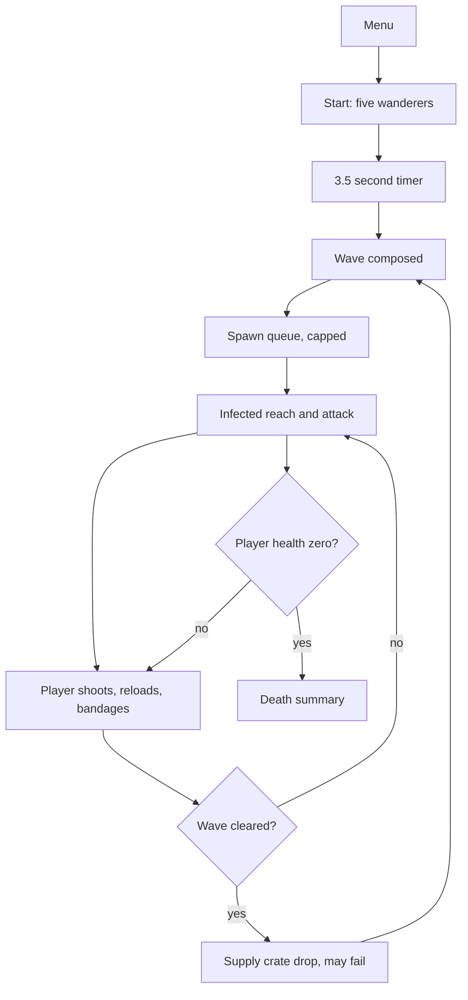
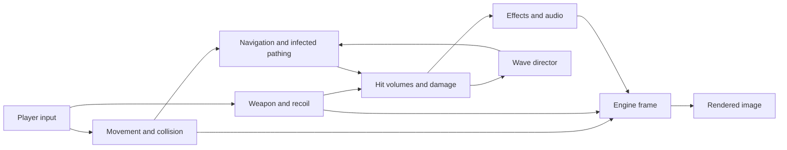

# Overview: the valley, the loop and the shipped machine

**Short answer.** Valle Morta is a browser first-person shooter. The player is a soldier in a ruined alpine valley. The player fights waves of infected, finds supply crates and crosses the village. Every visual asset comes from code, including 22 physically based rendering (PBR) texture sets (`README.md:3-5`). The tracked checkout splits into `src` 39 files, `tools` 250 files, `public` 225 files, `cinematic` 2 files, `docs` 1 file and 7 root files (`spec.md:51-55`). The game is the 39 files under `src`; `tools` is offline tooling and `public` holds generated assets (`spec.md:51-52`).

This document answers what the player does minute by minute. The later deep dives are architecture, core mechanism, workflow, and limits and comparison.

The version is `1.0.0` (`package.json:3`). The checkout is the source folder at `/Users/darkvoid/GitSources/src.aidesign/src.leonnix/valle-morta`, read at pin `64471ca`. `spec.md` is the package brief one directory above `markdown/`, not part of the checkout. The source was read only, and no game was started. Every claim about runtime behaviour is a static reading of code, not an observation of play.

## Terms used in this document

| Term | Meaning |
|---|---|
| Wave | One group of infected that the director composes and spawns (`src/game/game.js:345-367`). |
| Director | The wave logic in `src/game/game.js` that composes a wave, queues it and calls the spawn search (`src/game/game.js:345-423`). |
| Supply crate | A box with ammunition and bandages that appears after a wave is cleared (`src/game/game.js:18`). |
| Infected | The enemy class. It has four types: walker, runner, brute and boss (`src/game/zombies.js:207-238`). |
| Operation | A run that starts with a helicopter insertion, earns salvage from kills and can end at a 30 second extraction window after every fifth cleared wave (`src/game/operation.js:12-14`). |
| Salvage | The Operation currency. A kill and a cleared wave add salvage. The Base screen spends it (`src/game/operation.js:12`, `src/game/operation.js:542-550`). |
| Base | The between-run screen where the player spends salvage on permanent upgrades (`src/ui/base.js:1`). |
| Extraction window | A 30 second period every fifth wave when the player can board the helicopter and bank the salvage (`src/game/operation.js:13`). |
| Flow field | A grid of blocked, walkable or slow water state and player distance (`src/game/zombies.js:103-195`). |
| Play radius | The 330 metre circle around (20, -20) that limits the play area (`src/world/layout.js:10-17`). |
| Creative Commons Zero (CC0) | A public-domain dedication used for most sounds (`public/assets/audio/CREDITS.md:5`). |
| Creative Commons Attribution (CC BY) | A licence that requires credit, used for the music and six impacts (`public/assets/audio/CREDITS.md:5`). |
| Profile | The saved record of purchases between runs, in browser storage (`src/game/progress.js:6-9`). |
| Physically based rendering (PBR) | Materials whose colour, roughness and normal maps follow measured light behaviour (`README.md:5`). |
| Graphics processing unit (GPU) | The processor that draws the picture and runs the image passes. |

## The first minute

The player chooses Survival or Operation in the menu and presses Play (`src/game/game.js:268-271`). The player starts at one of five street positions in the village (`src/game/game.js:17`). Up to five wanderers are placed 12 to 52 metres from the village centre and more than 34 metres from the player (`src/game/game.js:291-294`). A wanderer is an idle infected, not a fifth type. The first inter-wave timer is 3.5 seconds (`src/game/game.js:286`). Then the first wave begins. A bell plays, and every living infected becomes aware and pursues (`src/game/game.js:369-380`).

The player can walk, sprint, crouch, lie prone and roll (`docs/DESIGN.md:18-32`). The player carries a rifle, a pistol and a sniper rifle. The infected walk or run toward the player through the streets and ruins. The player shoots, reloads, takes damage, bandages and moves to cover. When the last infected of the wave dies, the game tries to drop a supply crate near the player (`src/game/game.js:527-538`). If the drop fails, no crate appears and the inter-wave wait is 7 seconds instead of 14 (`src/game/game.js:529-531`).

Four pressures shape the loop. Ammunition is limited: the rifle magazine holds 30 rounds (`src/game/weapon.js:31`). Health regenerates only to a 25-point boundary (`src/game/player.js:12-13`). Space is constrained: walls, roofs and a river shape the flow field (`src/game/zombies.js:103-195`, `src/game/collision.js:1-5`). Composition follows a five-wave pattern, and the counts grow.

The game has two modes. Survival is the direct loop. Operation adds a helicopter insertion, a salvage currency, abilities and an extraction deadline (`src/game/operation.js:12-14`). Both modes use the same combat code; Operation adds count, health and speed changes.

## The game as a state machine

The values are `menu`, `playing`, `paused`, `over`, `film` and `debug`; the last occurs only in tooling mode, entered by `?auto=1` (`src/main.js:20-22`, `src/main.js:116-117`). Play starts from the menu. Pause and resume swap two states, death leads to `over`, and a tool can enter `debug` or `film` (`src/game/game.js:288-342`).

```text
# src/game/game.js:127-134
export class Game {
  constructor({ engine, terrain, layout, world, settings }) {
    this.engine = engine; this.terrain = terrain; this.layout = layout; this.world = world; this.settings = settings;
    this.state = 'menu';       // menu | playing | paused | over | film
    this.mode = 'survival';
    this.ui = null;
    this.wave = 0; this.waveKind = ''; this.queue = 0; this.queueList = []; this.spawnT = 0; this.interT = 0; this.time = 0; this.playTime = 0;
    this.stats = { kills: 0, headshots: 0, shots: 0, hits: 0 };
```

The wave number drives the difficulty. The mode string selects the survival rules or the Operation rules.

A separate operation object exists only in Operation mode (`src/game/game.js:138`). The game asks that object for spawn options and extraction state, so the combat logic is not duplicated.

## Wave composition is deterministic in shape

The director uses the wave number modulo five to select a pattern (`src/game/game.js:347-364`). Remainder 0 gives a boss wave. Remainder 3 gives a runner pack. Remainder 4 gives a brute escort. Other remainders give a mixed wave. A mixed wave has `6 + n * 3` infected. Its runner share rises to 40 percent, and brutes start at wave 6 (`src/game/game.js:361-364`). A pack wave has `6 + n * 2` runners and `n` walkers. An escort wave adds brutes to walkers and runners. A boss wave adds `1 + floor(n / 15)` bosses and `floor(n / 5)` brutes (`src/game/game.js:348-360`). The boss count grows by one every 15 waves.

```text
# src/game/game.js:345-367
  _compose(n) {
    const list = [];
    const push = (type, count) => { for (let i = 0; i < Math.round(count); i++) list.push(type); };
    const shuffle = (from) => { for (let i = list.length - 1; i > from; i--) { const j = from + Math.floor(Math.random() * (i - from + 1)); const t = list[i]; list[i] = list[j]; list[j] = t; } };
    let kind = 'mixed', text = '';
    if (n % 5 === 0) {
      kind = 'boss'; text = 'Something far bigger is coming with them';
      push('boss', 1 + Math.floor(n / 15)); push('brute', Math.floor(n / 5)); push('runner', 3 + n * 0.5); push('walker', 4 + n);
      shuffle(1 + Math.floor(n / 15));
    } else if (n % 5 === 3) {
      kind = 'pack'; text = 'A pack of runners, and they are fast';
      push('runner', 6 + n * 2); push('walker', n);
    } else if (n % 5 === 4) {
      kind = 'escort'; text = 'Brutes among them: body shots barely slow them';
      push('brute', 1 + Math.floor(n / 4)); push('walker', 6 + n * 2); push('runner', n);
      shuffle(0);
    } else {
      const total = 6 + n * 3, runners = n >= 2 ? Math.round(total * Math.min(0.4, 0.1 + n * 0.05)) : 0, brutes = n >= 6 ? Math.floor((n - 4) / 2) : 0;
      push('walker', total - runners - brutes); push('runner', runners); push('brute', brutes);
      shuffle(0);
    }
    return { kind, text: text || `${list.length} infected approaching`, list };
  }
```

This shape gives a rhythm: pack waves reward spacing and a quick reload, brute waves reward head shots, and boss waves change the scale of the fight.

The director caps the living infected count. The cap is `Math.min(zombies.maxActive - 2, 7 + this.wave * 2)` (`src/game/game.js:512`). `maxActive` is 26 (`src/game/zombies.js:266`). At wave 1 the cap is `min(26 - 2, 7 + 2)`, or 9. At wave 9 the second term is 25, so the cap is 24. The director increments before it composes, so wave 1 is first (`src/game/game.js:369-372`). The first spawn waits 1.5 seconds (`src/game/game.js:375`). Later spawns use `max(0.35, 1.5 - wave * 0.12) * (0.6 + Math.random() * 0.8)` (`src/game/game.js:521`). The cap spreads a wave over time.

```text
# src/game/game.js:512-517
            const cap = Math.min(zombies.maxActive - 2, 7 + this.wave * 2);
            const type = this.queueList.length ? this.queueList[this.queueList.length - 1] : 'walker';
            const pack = type === 'runner' ? this._packPoint() : null;
            const s = alive < cap ? pack || this._spawnPoint(type === 'walker' || type === 'brute') : null;
            const z = s ? zombies.spawn(s[0], s[1], op ? { aware: true, type, ...op.spawnOpts(type) } : { aware: true, type }) : null;
            if (z) {
```

The spawn point search tries 48 positions (`src/game/game.js:400`). It rejects a point outside the play radius, too close to the player, or not walkable. It also rejects an unreachable point when the player stands inside the flow field (`src/game/game.js:398-409`). If the player is outside the field, it skips the reachability test. It prefers a point that the player cannot see. If no hidden point exists, it keeps the farthest valid point. If the visible fallback is closer than 72 metres, it returns nothing (`src/game/game.js:414`).

The source implies this effect: infected usually appear behind a wall, a house or a ridge. They do not appear in the open in front of the player.

## The four infected

The infected are not one enemy with four skins. Each type has its own speed, health, reach, damage and reaction to a hit.

```text
# src/game/zombies.js:207-219
export const INFECTED = {
  walker: {
    name: 'Walker', model: 'zombie', tall: 0, bulk: 1, size: [0.95, 1.05], tint: null, voice: 1, albedo: ['b', 'c'],
    gaits: { Walk: 1.0, Run: 3.0, Sprint: 4.2 }, lunge: 2.6,
    speed: [0.9, 1.3], accel: 3, brake: 7, turn: 3.4, health: 100, bodyMult: 1, mass: 1, radius: 0.3,
    reach: 1.55, damage: [11, 17], knock: 0, attackRate: 1, flinch: 'any', slowOnHit: true,
    clips: {}, corpse: 22, pool: 0.5, drop: 0.04,
  },
  runner: {
    name: 'Runner', model: 'runner', tall: 0, bulk: 0.9, size: [0.95, 1.03], tint: [1.0, 0.84, 0.78], voice: 1.15, albedo: ['b'],
    gaits: { Walk: 1.5, Run: 3.4, Sprint: 5.2 },
    speed: [4.5, 5.5], accel: 7, brake: 10, turn: 5, health: 60, bodyMult: 1, mass: 0.8, radius: 0.28,
    reach: 1.5, damage: [8, 12], knock: 0, attackRate: 1.25, flinch: 'any', slowOnHit: true, flank: true,
```

The two heavy types follow.

```text
# src/game/zombies.js:222-235
  brute: {
    name: 'Brute', model: 'brute', tall: 2.1, bulk: 1.28, size: [0.98, 1.02], tint: [0.6, 0.58, 0.56], voice: 0.75, albedo: ['b'],
    gaits: { Walk: 1.6, Run: 3.2, Sprint: 4.4 }, shove: true,
    speed: [1.5, 1.7], accel: 2.2, brake: 5, turn: 2.3, health: 450, bodyMult: 0.5, mass: 4, radius: 0.46,
    reach: 2.0, damage: [26, 32], knock: 7.5, attackRate: 0.8, flinch: 'head', slowOnHit: false,
    clips: {}, corpse: 26, pool: 0.75, drop: 0.3,
  },
  boss: {
    name: 'Abomination', model: 'boss', tall: 2.5, bulk: 1.3, size: [1, 1], tint: [0.5, 0.36, 0.34], voice: 0.55, boss: true, albedo: ['b'],
    gaits: { Walk: 2.2, Run: 6.6, Sprint: 7.6 },
    speed: [2.4, 2.6], accel: 4, brake: 6, turn: 2.6, health: 2600, bodyMult: 1, mass: 12, radius: 0.6,
    reach: 2.6, damage: [30, 36], knock: 8, attackRate: 0.8, flinch: 'none', slowOnHit: false,
    charge: { min: 9, max: 34, windup: 0.9, speed: 7, accel: 9, turn: 0.9, time: 3.2, damage: 38, knock: 10, cooldown: 8, recover: 1.3 },
    slam: { range: 4.6, radius: 6.5, windup: 0.8, damage: 34, knock: 7, cooldown: 6.5, recover: 1.0 },
```

The walker has 100 health. The runner moves at 4.5 to 5.5 metres per second and has 60 health (`src/game/zombies.js:216-218`). `gaits` sets the animation rate and `speed` the movement rate. The runner also has `flank: true`, so it can take a side approach. The brute has 450 health and a body multiplier of 0.5 (`src/game/zombies.js:225`). The boss has 2600 health, a charge and a slam (`src/game/zombies.js:232-235`).

The body multiplier applies only when the part is not the head (`src/game/zombies.js:673`). A head hit uses the weapon head value instead: 4 for the rifle, so a rifle head shot does 144 damage (`src/game/weapon.js:32`).

## The weapons and the feel of a shot

Three weapons cover three distances and tempos. The rifle is automatic and fires 600 rounds per minute. The pistol is semi-automatic and has infinite reserve ammunition. The sniper rifle fires one heavy round and then cycles the bolt.

```text
# src/game/weapon.js:29-43
export const WEAPONS = {
  rifle: {
    id: 'rifle', name: 'AK rifle', slot: 1, mode: 'auto', interval: 60 / 600, mag: 30, reserve: 120, reserveMax: 240,
    damage: 36, head: 4, falloff: [60, 150, 0.6], bodies: 1, calibre: 1,
    times: { Reload: 2.4, ReloadEmpty: 3.0, Draw: 0.45, Holster: 0.3 },
    events: {
      Reload: [[0.5, 'mag_out'], [1.5, 'mag_in'], [1.5, 'ammo']],
      ReloadEmpty: [[0.5, 'mag_out'], [1.5, 'mag_in'], [1.5, 'ammo'], [2.25, 'bolt_back'], [2.5, 'bolt_forward']],
    },
    // view-model framing: grip position in camera space (m), base rotation [pitch up, yaw inward, cant] (rad),
    // weapon-camera field of view at the hip and aimed (deg), eye to rear sight when aimed (m), extra sprint offset [y, z, pitch]
    pose: { rot: [0.05, 0.07, 0.05], fov: 54, adsFov: 46, eye: 0.25, sprint: [-0.03, 0.02, -0.12] },
    hip: [0.115, -0.148, -0.235], zoom: 1.35, scopeFov: 0, adsRate: 11, sway: 0.0014,
    spread: { hip: 0.0115, ads: 0.0012, bloom: 0.0018, bloomMax: 0.012, recover: 6, move: 0.012, air: 0.03 },
    recoil: { v0: 0.0095, v1: 0.003, tau: 4.5, h0: 0.0006, h: 0.0026, hStart: 3, hPeriod: 8, jit: 0.1, hJit: 0.0006, ads: 0.7, hold: 0.16, recover: 7, max: 0.17 },
```

```text
# src/game/weapon.js:49-51
  pistol: {
    id: 'pistol', name: '9 mm pistol', slot: 2, mode: 'semi', interval: 0.11, mag: 15, reserve: Infinity, reserveMax: Infinity,
    damage: 26, head: 3.5, falloff: [25, 70, 0.5], bodies: 1, calibre: 0.7,
```

```text
# src/game/weapon.js:67-68
    id: 'sniper', name: 'Bolt-action rifle', slot: 3, mode: 'bolt', interval: 0, mag: 5, reserve: 20, reserveMax: 40,
    damage: 220, head: 3, falloff: null, bodies: 3, calibre: 1.8,
```

The pistol deals 26 damage with a head multiplier of 3.5 (`src/game/weapon.js:49-51`). The sniper deals 220 damage with a head multiplier of 3 (`src/game/weapon.js:67-68`). `falloff: [60, 150, 0.6]` means full damage to 60 metres, then a linear fall to 60 percent at 150 metres. `bodies` is the maximum number of bodies that one ray can report. The ray passes through earlier bodies, but the field is a cap on hits, not a penetration flag. The sniper has `bodies: 3`, so one ray can hit up to three infected (`src/game/weapon.js:69`). The recoil is mostly a pattern. The vertical value decays from `v0` to `v1`, and the horizontal value follows a slow wave (`src/game/weapon.js:86-92`). The fields `jit` and `hJit` add a small random offset to that pattern (`src/game/weapon.js:42`). The model takes 0.8 of the vertical step and the aim takes 0.2. Both parts are scaled by aim, crouch, prone, bipod and a perk modifier (`src/game/weapon.js:604-609`).

`st` is the equipped weapon state, and `st.mod` holds its upgrade modifiers. The duplex perk is a profile entry that adds a second pellet. `st.mod.pellets` starts at 1. The duplex perk raises it to 2 (`src/game/weapon.js:156`, `src/game/progress.js:45`). Every pellet, including the first, receives spread around the camera axis (`src/game/weapon.js:594-600`). Later pellets add 0.007 radians to the spread radius. The source comment says the first bullet leaves on the exact view axis, but the loop applies spread at `k = 0` (`src/game/weapon.js:593-600`). A hit asks for a decal on the surface behind the body, so a torso shot can mark the wall behind (`src/game/game.js:240-250`).

## Player movement and the body model

The player is a capsule with a radius of 0.34 metres. The height changes with stance: 1.8 metres standing, 1.18 crouched, 0.7 prone and 0.95 during a roll. The eye height is 1.68 metres standing, 1.06 crouched and 0.35 prone.

```text
# src/game/player.js:7-19
const RADIUS = 0.34;
const H_STAND = 1.8, H_CROUCH = 1.18, H_PRONE = 0.7, H_ROLL = 0.95;
const EYE_STAND = 1.68, EYE_CROUCH = 1.06, EYE_PRONE = 0.35;
const FLOAT = 1.3;   // water deeper than this carries the player
const STEP = 0.45;   // tallest ledge the player walks onto without jumping
const SEGMENT = 25;  // health regenerates only to the top of the current segment
const REGEN_DELAY = 5, REGEN_RATE = 5;
export const ROLL = { time: 0.6, dist: 4.5, cooldown: 1.2 };
export const FALL = { safe: 3.5, lethal: 14, rollWindow: 0.3 };
export const BANDAGE = { heal: 35, time: 1.6, max: 3 };
// Mouse look: an event that turns the view faster than `suspect` and several times faster than
// everything around it is held back until the next event confirms it; nothing turns faster than `impossible`.
export const LOOK = { suspect: 14, ratio: 6, impossible: 150 };   // rad/s
```

Health is 100 points. Regeneration stops at the next multiple of 25 above the health when the five second delay ends. A small loss can then heal fully, and a large loss stops at a boundary (`src/game/player.js:317`). A bandage restores 35 points over 1.6 seconds, and the player can carry three (`src/game/player.js:16`). A fall below 3.5 metres is safe. A fall of 14 metres deals 100 damage, which is lethal without a roll. Between the two, the damage rises as `k^1.15 * 100`, where `k` is the fraction of the lethal range (`src/game/player.js:200-203`). A roll within 0.3 seconds of landing halves the damage (`src/game/player.js:15`).

The mouse filter is a quality detail. It compares each event with recent events. An event six times faster than its neighbours is suspect and waits for the next event. An event faster than 150 radians per second is replaced by an extrapolated motion (`src/game/player.js:17-19`, `src/game/player.js:106-136`). This prevents a bad input spike from spinning the camera.

## Operation mode: the loop with a stake

Operation mode adds a frame around the same combat. A helicopter inserts the player. The player kills infected for salvage. Every fifth wave opens an extraction window of 30 seconds (`src/game/operation.js:13`). `reach`, `board` and `ride` are the boarding distance, boarding time and ride time. `INSERT.firstWave` is the 4-second wait after insertion, `CURVE` scales count, health and speed, and `BURN_TIME` is four seconds. The player can board the helicopter and keep all salvage plus a 25 percent bonus. If the player dies, the player keeps half (`src/game/operation.js:412-416`).

```text
# src/game/operation.js:12-18
export const SALVAGE = { walker: 5, runner: 7, brute: 25, boss: 150, head: 1.5, wave: [20, 10] };   // per kill; per cleared wave: 20 + 10 * wave
export const EXTRACT = { every: 5, window: 30, bonus: 0.25, keep: 0.5, reach: 5.5, board: 0.9, ride: 3.2 };
export const INSERT = { out: 0.9, wait: 1.2, firstWave: 4 };
// each wave beyond the first: more of them, tougher, and the walkers and runners a little quicker
export const CURVE = { count: 0.12, health: 0.05, walker: 0.04, walkerMax: 0.6, runner: 0.015, runnerMax: 0.2 };
const REGEN = { delay: 5, rate: 5 };      // the player's own figures (player.js); "second wind" shortens the wait
const BURN_TIME = 4;
```

A boss is worth 150, a head shot adds a 1.5 multiplier, and a cleared wave adds 20 plus 10 times the wave number. The player buys abilities and upgrades between runs.

The `second wind` upgrade starts the segment refill before the player's own five second delay (`src/game/operation.js:671-672`, `src/game/progress.js:74`). Extraction trades a known reward for a larger risk. An extraction banks `earned * (1 + 0.25 + build.run.bonus)`. `earned` is the rounded salvage for the run, and `build` is the current Operation loadout. `build.run.bonus` is the Extraction premium from the profile, an additive fraction (`src/game/progress.js:92`, `src/game/operation.js:415`). A death banks half, rounded down (`src/game/operation.js:415`).

## Between runs: the profile

The profile is a browser-storage record. It stores salvage, one level for each catalogue entry, a loadout and records (`src/game/progress.js:1-4`). The catalogue covers weapon lines, body perks, abilities and run modifiers. A weapon line is damage, magazine, reload speed or recoil control. A body perk is armour, health, speed or healing. A run modifier is a salvage multiplier or a later start wave (`docs/DESIGN.md:75-80`).

```text
# src/game/progress.js:6-15
export const PROFILE_KEY = 'valle-morta-profile';
export const PROFILE_VERSION = 1;
export const SLOT_KEYS = ['G', '4', '5'];          // ability slots: player.input.ability 1 / 2 / 3
export const WEAPON_IDS = ['rifle', 'pistol', 'sniper'];
export const TABS = [
  { id: 'weapons', name: 'Weapons', groups: [['rifle', 'AK rifle'], ['pistol', '9 mm pistol'], ['sniper', 'Bolt-action rifle']] },
  { id: 'body', name: 'Body' },
  { id: 'abilities', name: 'Abilities' },
  { id: 'run', name: 'Run' },
];
```

The cost curve is `first * growth^level`, rounded to a multiple of five (`src/game/progress.js:26`, `src/game/progress.js:31`). The base weapon line starts at 60 and multiplies by 1.6 for each level. The effects are multiplicative, additive or fixed, depending on the entry (`src/game/progress.js:20-23`). The saved object is cleaned on load, so a corrupt profile cannot inject a bad value (`src/game/progress.js:140-164`).

## The design rules that shape the game

The project keeps a short design document. It lists rules that every contributor must follow. They ban premade art and synthesised sound. They demand physical plausibility, 60 frames per second on an integrated graphics processing unit (GPU), and a restrained interface.

```text
# docs/DESIGN.md:5-14
## Rules that hold everywhere

- No premade 3D assets or textures. Geometry, textures, rigs and animation are generated by code (JS or Blender scripts in `tools/`).
- Sounds are licensed recordings from online sources only (CC0 or CC BY, recorded in `public/assets/audio/CREDITS.md`). Never synthesise a sound.
- Everything must be physically plausible: nothing floats or intersects, weapons handle like real firearms, bodies have weight.
- Quality and performance come first. Target: 60 fps or better at 1280x720 on the "high" preset on an integrated Radeon 780M (about 14 ms per frame in `tools/shot.mjs --bench`), no hitches.
- UI: clean, modern, minimal and clearly designed, not a default template. One sans-serif family (Inter). Neutral palette with at most one restrained accent, a muted red only for danger. No serif, no monospace, no all-caps or letter-spaced eyebrow labels, no clutter.
- The machine is a laptop shared with other jobs and must never be overloaded: one GPU job at a time (`tools/lib/gpulock.mjs`, already used by `shot.mjs` and `playtest.mjs`), Blender with at most 6 threads and CPU Cycles at low sample counts, check `powershell -NoProfile -File tools\sysmon.ps1` before long jobs.
- The vite dev server already runs at http://127.0.0.1:5173. Never start another. `?auto=1` is the tooling mode (no menu, `window.__vm` API).
- Only edit the files your task owns. Do not commit; the lead commits.
```

The rules are contracts. The first explains the 250 tool files, the fifth the interface, and the sixth the single-GPU lock in every capture tool.

## What the player can see and hear

The terrain gives the valley its shape. The layout gives the village its roads, river, bridge and buildings. The renderer gives the scene its light, cloud shadows, fog, ambient occlusion and tone mapping. The interface gives health, ammunition, wave and minimap information.

The audio result rests on recorded material. Music is by Kevin MacLeod under the CC BY 4.0 licence. Most other sounds are CC0, but six impact sounds are CC BY 3.0 (`public/assets/audio/CREDITS.md:5`, `public/assets/audio/CREDITS.md:88-93`). The credits table lists 131 recordings with title, author, source and licence (`public/assets/audio/CREDITS.md:7`).

```text
# README.md:1-5
# Valle Morta

A first-person zombie survival shooter set in a war-ruined alpine valley, running in the browser on three.js (WebGL2).

Every visual asset is generated by code in this repository: the eroded mountain range, the valley, the ruined village and its church, the broken bridge, the river, grass and trees, the tank wreck, the rifle, the infected and all 22 PBR texture sets. No premade models or textures are used. Sound effects and music are licensed third-party recordings (see Credits).
```

The README names the stack and the unusual claim: the whole visual scene is code, including the rifle and the enemies.

## The film is the same game

The project defines one film, and no rendered video file is in the checkout. The film is 45 seconds long, at 3840 by 2160 pixels and 24 frames per second, in high dynamic range (HDR) with 10-bit output (`README.md:55`, `src/cinematic/film.js:1`). The film is not a second renderer. It is a script that drives the live game through ten shots and captures each frame.

```text
# src/cinematic/film.js:165-184
  const SHOTS = [
    {
      // 1. the helicopter comes in low over the rooftops, seen from the street below
      name: 'insert', dur: 4.5,
      setup() {
        const k0 = 0.3, h = heliIn(k0);
        const s0 = heliAt(k0), s1 = heliAt(0.86);
        const dx = s0.x - LZ.x, dz = s0.z - LZ.z, l = Math.hypot(dx, dz), ux = dx / l, uz = dz / l;
        const [x, z] = spot(LZ.x - ux * 15 + uz * 3, LZ.z - uz * 15 - ux * 3, 1.2, true); void s1;
        this.c = [x, z, ux, uz]; this.look = null;
        p.spawn(LZ.x + 30, LZ.z, 0);
        void h;
      },
      cam(u, dt) {
        const [x, z, ux, uz] = this.c, h = op.heli.group.position, k = ease(u);
        place(x - ux * 1.5 * k, 1.2 + 0.3 * k, z - uz * 1.5 * k);
        cam.lookAt(track(this, h.x, h.y + 0.6, h.z, 3, dt));
        cam.fov = 44 - 4 * k;
      },
    },
```

Each shot has a name, a duration, a setup function and a camera function. The camera function sets the framing: the eye starts 1.2 metres above the street and rises with the ease value. The view tracks the helicopter, and the field of view narrows from 44 to 40 degrees (`src/cinematic/film.js:178-183`). The total length is the sum of the durations (`src/cinematic/film.js:383`). The capture tool renders at 24 frames per second and averages three jittered sub-frames for each output frame (`src/cinematic/film.js:385`, `cinematic/capture.mjs:12`). Each sub-frame advances the game by `1 / (24 * 3)` seconds. The camera is offset by a sub-pixel jitter, and the three pictures are averaged on the graphics processing unit (GPU) (`src/cinematic/film.js:519-530`).

The film relies on reproducible timing. The tools call the same update with a fixed time step, so a shot advances by the same amount on every run (`tools/playtest.mjs:83-86`, `src/cinematic/film.js:494-498`). The live game passes the frame time, clamped to 0.05 seconds (`src/main.js:155`).

## Two diagrams of the loop

The first diagram shows the survival loop. The second shows how the player's minute connects to the systems that this package documents.





## Aha: the loop is a queue with a spatial rule

**Aha:** The wave director is not a random spawner. The placement rule carries the interest. A point must be walkable. It must lie outside a minimum distance: 22 metres for a walker or a brute, and 30 metres for a runner or a boss (`src/game/game.js:408`, `src/game/game.js:515`). The random radius is 24 to 54 metres for a walker or a brute, and 32 to 76 metres for a runner or a boss, measured from the player (`src/game/game.js:402-403`). A point is hidden when neither the head sample nor the foot sample is visible (`src/game/game.js:411`). If no hidden point exists, the director keeps the farthest valid point. It accepts that visible fallback only when the point is beyond 72 metres (`src/game/game.js:414`). A runner pack also reuses the last runner point for up to 2.5 seconds, for at most four extra runners (`src/game/game.js:418-424`). The buildings do not only decorate the scene. They decide where a wave can enter. The field is a 380 metre square of 1.5 metre cells, centred on (20, -20), so a player beyond 190 metres from that centre is outside it (`src/game/zombies.js:103-105`, `src/game/zombies.js:394-396`). While the player stands inside the field, a spawn point that passes the test has a route to the player. The spatial rule and the navigation rule coincide only inside the field. Outside the field, the test checks walkability but skips reachability (`src/game/game.js:398-409`).

## What this package does not claim

- No game, browser, build, generator, capture or Blender script was run. The source was read only.
- No performance number was measured. The 60 frames per second target is the project's own target (`docs/DESIGN.md:10`).
- The audio was not heard. The licence and the recording notes come from the credits file.
- The visual quality is not judged. The README admits that the look approximates photographic references and that the rifle and infected show their procedural origin at close range (`README.md:59-61`).
- The film was not rendered. The shot list and the capture settings are read from the source.
- The profile was not exercised. The storage key and the cost curve are read from the source.
- The package has no test suite. The playtest tool automates a session but is not a unit test (`tools/playtest.mjs:1-9`).

## The loop, stated plainly

The player moves through a small ruined valley. The player kills a composed wave of infected drawn from four possible types with three weapons. In Survival, death ends the run. In Operation, the player chooses whether to extract or to stay for more. The rest of this package explains how each word is made true.
