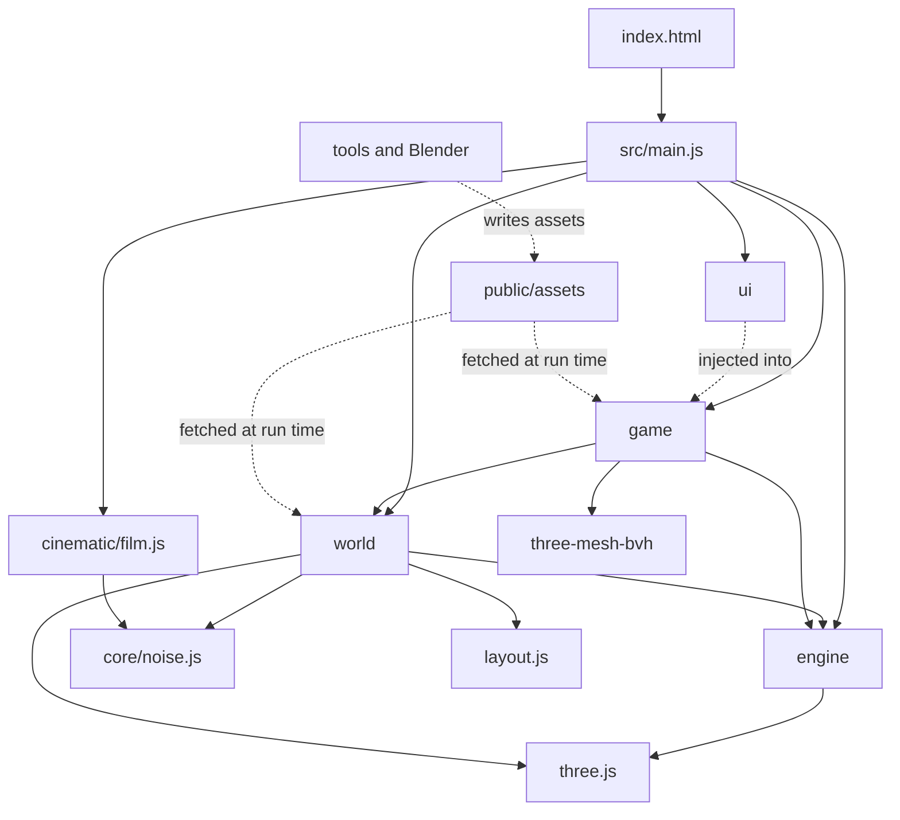
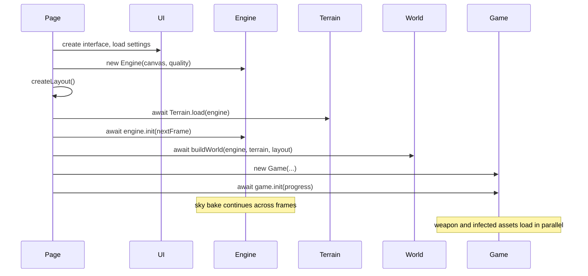

# Architecture: seven layers, one system

**Short answer.** The repository has seven layers. Five run inside the game: page, engine, world, game and interface. The engine owns the renderer and the image. The world builds the valley and the village. The game owns the player, weapons, infected (the zombie bodies), the spawn director and sound. The interface owns the menus and the heads-up display (HUD). The sixth layer, the cinematic, drives the live game from outside. The seventh, offline layer produces most visual assets, except the sky panorama, the minimap, a runtime noise texture and the font. Audio is licensed. The page imports the engine, world, game, interface and cinematic. The game imports the engine and world. The interface imports neither the game nor the engine. The page passes the engine and layout to `ui.bakeMap` (`src/main.js:163`, `src/ui/ui.js:205`). The page assigns `game.ui` (`src/main.js:91`), a field that starts null (`src/game/game.js:132`). No running module imports offline.

This document maps that structure. It names the layers and their main modules. It does not explain the render mathematics; `02-core-mechanism.md` does that. It does not explain the quality process; `03-workflow-and-quality.md` does that.

## Terms used in this document

| Term | Meaning |
|---|---|
| Layer | A group of modules with one kind of responsibility. |
| Module | One JavaScript file under `src` that exports a function or a class. |
| World | The scene objects: terrain, buildings, water, vegetation and props. |
| Handle | The object that a world builder returns to the caller. |
| Collider | A mesh or box that the player and the bullets collide with. |
| Flow field | A grid of walking costs and distances that guides the infected. |
| High dynamic range (HDR) | A picture with light values far above the display white. |
| Physically based rendering (PBR) | Materials with procedural colour, roughness and normal maps. |
| Checkout | The source folder at `/Users/darkvoid/GitSources/src.aidesign/src.leonnix/valle-morta`, read at pin `64471ca`. |
| User interface (UI) | The menus, settings, HUD and summary screens. |
| Graphics processing unit (GPU) | The processor that runs the image passes. |

## The layer table

| Layer | Main files | Reads | Produces |
|---|---|---|---|
| Page | `index.html`, `src/main.js` | HyperText Markup Language (HTML), modules | The canvas and the running application |
| Engine | `src/engine/` (7 files) | three.js, shared uniforms | The HDR image and the post chain |
| World | `src/world/` (14 files) | engine, layout data, baked assets | Meshes, colliders, updaters |
| Game | `src/game/` (10 files) | engine, world handles, assets, storage | The simulation and the sound |
| Interface | `src/ui/` (5 files) | game state, settings | The HUD and the menus |
| Cinematic | `src/cinematic/film.js` | the live game object | A scripted shot list |
| Offline | `tools/`, `cinematic/capture.mjs` | source data, Blender, Python | Textures, models, terrain, pictures |

The count per layer comes from `spec.md`, the brief above `markdown/`; it is not part of the checkout. The tree has 14 world files, 10 game files, 7 engine files, 5 interface files, 1 core file and 1 cinematic file, plus `main.js` (`spec.md:51-53`). `src` has 39 files.

The core file is not a layer. `src/core/noise.js` is a shared noise and random library. The world imports it, and the film imports its seeded random function (`src/world/layout.js:8`, `src/world/buildings.js:5`, `src/cinematic/film.js:10`). The table lists stages, not shared libraries, so core has no row.

## The page layer

The page is small. It has one canvas, one interface container and one module script. The interface stylesheet is loaded from `src/ui/ui.css`. The page has no framework and no router.

```text
# index.html:1-15
<!doctype html>
<html lang="en">
  <head>
    <meta charset="utf-8" />
    <meta name="viewport" content="width=device-width, initial-scale=1" />
    <title>Valle Morta</title>
    <meta name="description" content="A first-person zombie survival shooter set in a war-ruined alpine valley. Built with three.js, every asset generated by code." />
    <link rel="stylesheet" href="/src/ui/ui.css" />
  </head>
  <body>
    <canvas id="view"></canvas>
    <div id="ui"></div>
    <script type="module" src="/src/main.js"></script>
  </body>
</html>
```

The manifest declares the stack. The entries are caret ranges, which permit compatible later versions; `package-lock.json` records the resolved versions. The game uses three.js 0.187.0 for rendering, three-mesh-bvh 0.9.18 for collision, Vite 8.3.8 for the development server and the build, and puppeteer-core 25.17.0 for headless capture (`package.json:15-22`). The version is `1.0.0` (`package.json:3`). The font is Inter, variable (`src/ui/ui.css:24`).

```text
# package.json:2-26
  "name": "valle-morta",
  "version": "1.0.0",
  "description": "",
  "main": "index.js",
  "scripts": {
    "dev": "vite",
    "build": "vite build",
    "preview": "vite preview",
    "bake:terrain": "node tools/bake-terrain.mjs"
  },
  "keywords": [],
  "author": "",
  "license": "ISC",
  "dependencies": {
    "@fontsource-variable/inter": "^5.3.0",
    "three": "^0.187.0",
    "three-mesh-bvh": "^0.9.18"
  },
  "devDependencies": {
    "puppeteer-core": "^25.17.0",
    "vite": "^8.3.8"
  },
  "type": "module",
  "private": true
}
```

The manifest licence field says `ISC` (`package.json:14`). The licence file and the README say Massachusetts Institute of Technology (MIT) (`LICENSE:1`, `README.md:71`). This documentation package records the conflict and follows the licence file. The package is `private` (`package.json:25`).

The build configuration is equally small. It fixes the output base to a relative path, fixes the development port to 5173, binds the server to the loopback address and sets the build target to ECMAScript 2022.

```text
# vite.config.js:1-7
import { defineConfig } from 'vite';

export default defineConfig({
  base: './',
  server: { port: 5173, strictPort: true, host: '127.0.0.1' },
  build: { target: 'es2022', chunkSizeWarningLimit: 2000 },
});
```

The relative base lets the built game run from a subfolder, with no absolute path baked into the output.

## Boot order

`src/main.js` imports every layer. It also imports the cinematic module. It creates the interface first for the progress bar. It then creates the engine, the layout, the terrain, the world and the game, in that order.

```text
# src/main.js:68-82
  ui.progress(0.05, 'Starting renderer');
  await nextFrame();
  engine = new Engine(canvas, settings.quality);
  engine.renderScale = engine.q.scale * (AUTO ? 1 : settings.renderScale);
  G.uNoiseTex.value = makeNoiseTexture(256, 11);
  const resize = () => engine.resize(Math.max(320, window.innerWidth), Math.max(200, window.innerHeight));
  resize();
  window.addEventListener('resize', resize);

  const layout = createLayout();
  ui.progress(0.12, 'Raising the mountains');
  const terrain = await Terrain.load(engine, (p) => ui.progress(0.12 + p * 0.3));
  engine.scene.add(terrain.group);
  ui.progress(0.45, 'Gathering clouds');
  await engine.init(nextFrame);
```

The order follows dependencies: the engine precedes terrain materials, the terrain precedes the village, and the layout is pure data. The game needs all three.

The `?auto=1` parameter starts in `debug` with no menu and exposes `window.__vm`. `AUTO` is true when that parameter is present (`src/main.js:21`). `G.uNoiseTex` is the shared noise texture uniform (`src/engine/shared.js:24`), and `settings` is the stored settings object (`src/ui/ui.js:12-15`). Every capture tool uses that mode (`src/main.js:21-24`). The mode is the same application with the interface hidden and the loop under external control.

## The engine layer

The engine has seven files. `engine.js` owns the renderer, camera, light, sky and post chain. `pass.js` is a fullscreen-pass helper. `shared.js` holds the uniforms and shader library. `materials.js` patches materials. `textures.js` loads texture arrays. `sky.js` bakes clouds. `post.js` runs image passes.

The quality presets are one table (`src/engine/engine.js:9-14`). `scale` multiplies render resolution. `msaa` is the multisample anti-aliasing sample count. `shadow` is the shadow map side; `shadowRange` is half its box width. `pano` is cloud panorama width and height. `cloudSteps` is cloud march steps. `ao` and `vol` switch ambient occlusion and volumetric light. `volSteps` is light steps; `volScale` divides volumetric resolution. `texSize` is texture-array layer side; `grass` is density; `aniso` is texture anisotropy limit. `far` is defined but unread.

```text
# src/engine/engine.js:9-14
export const QUALITY = {
  low:    { scale: 0.6,  msaa: 0, shadow: 1024, shadowRange: 55, pano: [1024, 256], cloudSteps: 36, ao: false, vol: true, volSteps: 14, volScale: 4, texSize: 512,  grass: 0.35, aniso: 2,  far: 0.5 },
  medium: { scale: 0.75, msaa: 0, shadow: 2048, shadowRange: 70, pano: [2048, 512], cloudSteps: 48, ao: true,  vol: true, volSteps: 18, volScale: 3, texSize: 1024, grass: 0.6,  aniso: 4,  far: 1 },
  high:   { scale: 1.0,  msaa: 2, shadow: 4096, shadowRange: 130, pano: [3072, 768], cloudSteps: 56, ao: true,  vol: true, volSteps: 22, volScale: 3, texSize: 1024, grass: 0.85, aniso: 16,  far: 1 },
  ultra:  { scale: 1.0,  msaa: 4, shadow: 4096, shadowRange: 130, pano: [4096, 1024], cloudSteps: 72, ao: true, vol: true, volSteps: 30, volScale: 2, texSize: 2048, grass: 1.0,  aniso: 16, far: 1 },
};
```

The `high` preset is the default (`src/engine/engine.js:17`). It uses a 4096 pixel shadow map, a 3072 by 768 cloud panorama and 56 steps. `ultra` raises the panorama to 4096 by 1024 and uses 72 steps. `low` disables ambient occlusion and drops grass to 35 percent.

The render method has one unusual detail. The world camera and the weapon camera share one depth buffer. The weapon is drawn after the world with the depth range compressed to the first two percent.

```text
# src/engine/engine.js:157-178
    this.camera.updateMatrixWorld();
    this.weaponCamera.matrixWorld.copy(this.camera.matrixWorld);
    this.weaponCamera.matrixWorldInverse.copy(this.camera.matrixWorldInverse);

    // compile every program in the scene once, before the first frame, rather than on first sight
    if (!this._precompiled) { this._precompiled = true; try { r.compile(this.scene, this.camera); } catch (e) { /* compiled lazily */ } }
    r.shadowMap.needsUpdate = true;
    r.setRenderTarget(this.sceneRT);
    r.setClearColor(0x000000, 1);
    r.autoClear = true;
    this.camera.layers.set(0);
    r.render(this.scene, this.camera);
    if (this.weaponVisible) {
      r.autoClear = false;
      this.gl.depthRange(0.0, 0.02);
      r.render(this.scene, this.weaponCamera);
      this.gl.depthRange(0.0, 1.0);
      r.autoClear = true;
    }
    this.post.render(this.sceneRT, this.camera, this.time, output, this.outW, this.outH);
    r.setRenderTarget(null);
  }
```

The code draws the world into the high dynamic range (HDR) `sceneRT`. It then draws the weapon into the same target with the compressed depth range. The post chain reads colour and depth. Because the weapon camera shares the world matrix, depth compression prevents a wall from hiding the weapon while lighting and shadows still apply.

The post chain is a sequence of fullscreen passes. The chain is ambient occlusion, a bilateral blur, volumetric light, a composite, a bloom pyramid, tone mapping and a final anti-aliasing and sharpening pass. The order is fixed in `render`.

```text
# src/engine/post.js:426-435
  render(sceneRT, camera, time, output = null, outW = 0, outH = 0) {
    const r = this.renderer, s = this.settings, t = this.targets;
    this.frame++;
    const du = this.depthU;
    du.tDepth.value = sceneRT.depthTexture;
    du.uProjInv.value.copy(camera.projectionMatrixInverse);
    du.uCamWorld.value.copy(camera.matrixWorld);

    if (s.ao) {
      const u = this.ao.uniforms;
```

The ambient occlusion pass reconstructs view-space positions from depth and tests 10 samples. It fades from 140 to 260 metres, where the far field uses baked lighting (`src/engine/post.js:51`). The far mesh supplies its own baked ambient occlusion (`src/world/terrain.js:334-345`), so the fade is not a lighting gap. It writes occlusion in red and linear depth in green. The bilateral blur does not smear across edges.

The material patch is the shared atmosphere. `enhance(material, options)` returns a patched material. The options carry a program key, extra uniforms, vertex and fragment code, a surface hook and an ambient occlusion hook (`src/engine/materials.js:40-73`). Every world material is wrapped by `enhance()`. Raw three.js materials escape it and are used only for the sky and special passes. The wrapper replaces the light chunk, adds a world-position varying and appends optional surface code. The directional light is multiplied by the cloud shadow at the world position. Every patched material gets that shadow, including the terrain, the buildings, the grass and the props.

```text
# src/engine/materials.js:1-17
// Patches three.js built-in materials so that everything in the world shares
// the same atmosphere (height fog + haze), cloud shadows on the sun, and
// optional custom vertex / surface code.
import * as THREE from 'three';
import { G, GLSL_COMMON, bindShared } from './shared.js';

const LIGHTS_BEGIN = THREE.ShaderChunk.lights_fragment_begin.replace(
  'getDirectionalLightInfo( directionalLight, directLight );',
  'getDirectionalLightInfo( directionalLight, directLight );\n\t\tdirectLight.color *= vmCloudShadow( vmWorldPos );',
);

const WORLD_POS_VERTEX = /* glsl */`
{
  vec4 vmwp = vec4( transformed, 1.0 );
  #ifdef USE_BATCHING
    vmwp = batchingMatrix * vmwp;
  #endif
```

The shared uniforms hold the sun, fog, haze, mist, cloud map, wind and ambient colours. The sky and engine write them; every material reads them.

```text
# src/engine/shared.js:6-20
export const G = {
  uTime: { value: 0 },
  uSunDir: { value: new THREE.Vector3(0.4, 0.6, 0.3).normalize() },
  uSunColor: { value: new THREE.Color(1, 0.93, 0.82) },
  // xyz = ambient in-scatter colour, sun-ward in-scatter colour
  uFogColor: { value: new THREE.Color(0.33, 0.46, 0.70) },
  uFogSunColor: { value: new THREE.Color(1.0, 0.9, 0.74) },
  // haze: x = density at y0, y = 1/scaleHeight, z = y0 ; mist: same
  // the haze is the blue distance on the mountains; the mist is thin and hugs the river hollow
  uHaze: { value: new THREE.Vector3(0.0001, 1 / 1200, 0) },
  uMist: { value: new THREE.Vector3(0.0012, 1 / 5, -2) },
  // cloud gobo: xy = centre (world xz), z = world size, w = cloud base height
  uCloudMap: { value: null },
  uCloudRect: { value: new THREE.Vector4(0, 0, 24000, 3300) },
  uCloudShadowMin: { value: 0.05 },
```

The haze layer is thin and covers the distant mountains. The mist layer is denser and hugs the river hollow at negative two metres. The shader integrates both optical depths and applies one transmittance (`src/engine/shared.js:52-76`).

## The world layer

The world layer loads four optional builders: water, buildings, props and vegetation. A missing module is skipped, and its error is logged. The caller can skip a module with the `?off=` parameter.

```text
# src/world/world.js:11-32
const LOADERS = {
  water: () => import('./water.js'),
  buildings: () => import('./buildings.js'),
  props: () => import('./props.js'),
  vegetation: () => import('./vegetation.js'),
};

export async function buildWorld(engine, terrain, layout, off = new Set(), onProgress = () => {}) {
  const ctx = { engine, scene: engine.scene, terrain, layout, quality: engine.q, colliders: [], updaters: [], mods: {} };
  const names = Object.keys(LOADERS).filter((n) => !off.has(n));
  let i = 0;
  for (const name of names) {
    try {
      const mod = await LOADERS[name]();
      ctx.mods[name] = (await mod.build(ctx)) || {};
    } catch (e) {
      console.error(`[world] module "${name}" failed:`, e);
    }
    onProgress(++i / names.length, name);
  }
  return ctx;
}
```

The context object is the module contract. It carries engine, scene, terrain, layout and quality, plus colliders, updaters and module handles. A builder fills them, and the game reads them. Modules stay independent of the game.

The layout is pure data and mathematics, with no mesh or GPU resource. It defines the world size, play radius, river path, roads, streets, buildings and cover. The baker and the runtime both call it, so the village sits on the baked ground.

```text
# src/world/layout.js:10-17
export const WORLD = {
  size: 1024,          // local detailed terrain covers [-512, 512]^2
  half: 512,
  playRadius: 330,     // soft boundary for the player
  playCenter: [20, -20],
  farSize: 28672,      // far terrain extent (m)
  seed: 20261,
};
```

The play area is 1024 metres square, with a 330 metre radius around (20, -20). The far terrain has a 28,672 metre extent. The seed is 20261. The runtime uses the same seed and functions, so every object agrees on the ground height.

The terrain module builds or loads two meshes. The local mesh is a six-level geometry clipmap: nested square grids, each level with cells twice as wide as the finer level. The far mesh is an adaptive triangle mesh with baked lighting. The runtime loads `far_mesh.bin` and drops each triangle whose three vertices lie inside 506 metres (`src/world/terrain.js:447-453`). The shader discards each far fragment inside 508 metres (`src/world/terrain.js:462-466`). The 2 metre overlap hides cracks at the seam.

```text
# src/world/terrain.js:387-407
    // Levels 1+ only show a ring: the middle is always covered by the finer level inside (the inner
    // level's square is half as wide and offset by at most one outer cell), so its quads are not built.
    // Before, every ground pixel near the eye was rasterised by all six levels and discarded by five.
    const hole = half / 2 - 2;
    const ringIdx = [];
    for (let j = 0; j < N; j++) for (let i = 0; i < N; i++) {
      const gx = i - half, gz = j - half;
      if (gx >= -hole && gx + 1 <= hole && gz >= -hole && gz + 1 <= hole) continue;
      const a = j * (N + 1) + i, b = a + 1, c = a + N + 1, d = c + 1;
      ringIdx.push(a, c, b, b, c, d);
    }
    const ringGeo = new THREE.BufferGeometry();
    ringGeo.setAttribute('position', geo.getAttribute('position'));
    ringGeo.setIndex(new THREE.BufferAttribute(new Uint32Array(ringIdx), 1));
    t.group = new THREE.Group();
    t.levels = [];
    const LEVELS = 6;
    for (let l = 0; l < LEVELS; l++) {
      const cell = 0.5 * 2 ** l;
      const u = { uLevel: { value: new THREE.Vector4(0, 0, cell, half) }, uInner: { value: new THREE.Vector4(1e9, 1e9, -1e9, -1e9) } };
      const mat = enhance(new THREE.MeshStandardMaterial({ roughness: 1, metalness: 0 }), {
```

```text
# src/world/terrain.js:447-466
      const inside = (v) => Math.max(Math.abs(P[v * 3]), Math.abs(P[v * 3 + 2])) < 506;
      for (let k = 0; k < tc * 3; k += 3) {
        if (inside(I[k]) && inside(I[k + 1]) && inside(I[k + 2])) continue;
        keep[n++] = I[k]; keep[n++] = I[k + 1]; keep[n++] = I[k + 2];
      }
      fgeo.setIndex(new THREE.BufferAttribute(keep.slice(0, n), 1));
    }
    fgeo.computeBoundingSphere();
    const fmat = enhance(new THREE.MeshStandardMaterial({ roughness: 1, metalness: 0, side: THREE.DoubleSide }), {
      key: 'terrain-far',
      uniforms: { ...shared, uFarN: { value: loadTexture(`${base}far_n.png`, { repeat: false, aniso, flipY: false }) }, uFarSize: { value: meta.far.size } },
      vertexNormal: 'objectNormal = vec3(0.0, 1.0, 0.0);',
      fragmentPars: FAR_FRAG_PARS,
      surface: FAR_SURFACE,
      ao: 'vmTerrainAO',
      patch: (shader) => {
        shader.fragmentShader = shader.fragmentShader.replace('void main() {', `void main() {
  if (max(abs(vmWorldPos.x), abs(vmWorldPos.z)) < 508.0) discard;`);
        shader.fragmentShader = shader.fragmentShader.replace('#include <lights_physical_fragment>', SPEC_CHUNK);
      },
```


The buildings module bakes the village into a few world-space meshes, not one object per wall. The buildings share one material, so draw cost stays low. It holds three `DataArrayTexture` objects: albedo, normal, and a combined ambient occlusion, roughness and height map. Each array holds one square layer per material name (`src/engine/textures.js:42-56`). A building vertex carries the material index in `vmMat.x`. The shader converts it to a layer and samples that slice (`src/world/bld/material.js:74-85`). The arrays use the preset `texSize` (`src/world/bld/material.js:125`).

```text
# src/world/buildings.js:1-4
// Ruined village, church and blown bridge. Everything is generated
// procedurally (see ./bld/*) and baked into a handful of world-space meshes
// that share one array-texture material.
import * as THREE from 'three';
```

The vegetation module builds the grass and trees. The grass has four camera-following distance rings and one separate flower layer. The numbers are the ring outer radii; each ring is an annulus around the camera. The rings are `feet` at 5.6 metres with a 0.2 metre cell, `near` at 12 metres with 0.285 metres, and `mid` at 46 metres with 0.86 metres. The `far` ring is at 150 metres with 2.0 metres (`src/world/vegetation.js:963-971`). The `flowers` layer reaches 38 metres with a 0.6 metre cell (`src/world/vegetation.js:972-973`). Every cell size is divided by `sq`, where `sq = sqrt(quality.grass)`, so a higher quality value makes denser grass (`src/world/vegetation.js:960`). Trees are instanced meshes with impostors. The water module builds the river with depth transparency, flow normals and foam. The props module builds the tank, watchtower and wire.

## The game layer

The game creates its systems in a fixed order. Collision comes first because the player, weapons and infected all need it. Audio loads next. The player, effects, weapon and infected follow. Navigation is built after the infected assets load. Supply is last.

```text
# src/game/game.js:151-165
  async init(onProgress = () => {}) {
    const { engine, terrain, layout, world } = this;
    this.collision = new Collision(terrain, layout);
    this.collision.build(world.colliders);
    onProgress(0.2);
    this.audio = new AudioSystem();
    await this.audio.load();
    this.player = new Player(engine, this.collision, layout, this.settings);
    this.fx = new FX(engine, this.collision);
    this.weapon = new Weapon(engine, this.player, this.fx, this.audio);
    this.zombies = new Zombies(engine, this.collision, layout, this.fx, this.audio, this.player);
    await Promise.all([this.weapon.load(), this.zombies.load()]);
    onProgress(0.7);
    this.zombies.buildNav();
    this.supply = new Supply(engine, this.collision, terrain, this.zombies);
```

Each system has a narrow interface. The weapon calls `onShoot`, the player calls `onStep` and `onLand`, the infected read the player and the flow field, effects read collision, and audio plays spatial sound.

Two layers write to browser storage: the interface stores settings under `valle-morta-settings`, and the game stores the profile under `valle-morta-profile` with the last 12 runs (`src/ui/ui.js:12-15`, `src/game/progress.js:259-269`). Each write is inside a `try` block.

The audio system is manifest driven. It reads `public/assets/audio/manifest.json`, which lists each sound's files, volume, category and loop flag. A missing sound or manifest plays nothing (`src/game/audio.js:1-4`).

```text
# src/game/audio.js:1-4
// Audio: Web Audio playback of the licensed sound library listed in
// public/assets/audio/manifest.json. Every lookup is tolerant: a missing
// sound or manifest simply plays nothing.
//
```

The graph has a master, music and effects bus, a compressor, a muffle low-pass filter and a panner per sound (`src/game/audio.js:120-205`). The muffle closes from 20000 hertz to 600 hertz as the player dies (`src/game/audio.js:150-160`).

## The interface layer

The interface is plain Document Object Model (DOM) code. It has no framework. It reads the settings, builds the menu, the settings screen, the pause screen and the summary screens. It updates the HUD each frame from the game state.

```text
# src/ui/ui.js:1-12
// Interface: loading screen, main menu, settings, pause, HUD and the summary screens.
// Plain DOM, one typeface, the tokens in ui.css. The minimap lives in minimap.js.
import { Vector3 } from 'three';
import { BaseScreen } from './base.js';
import { Minimap } from './minimap.js';

const DEFAULTS = {
  quality: 'high', renderScale: 1, fov: 72, sensitivity: 1, invertY: false,
  master: 0.8, music: 0.55, sfx: 0.9, grain: true, showFps: false,
};

export function loadSettings() {
```

The minimap bakes one orthographic picture of the valley after loading. It converts the picture on the central processing unit (CPU) into a 1024 by 1024 pixel canvas, then draws only a rotated picture and markers each frame. It renders the scene once, not per frame.

```text
# src/ui/minimap.js:1-4
// Minimap: an aerial picture of the valley, baked once after loading from an orthographic
// render of the real scene (sky hidden, no aerial-perspective pass), tone-mapped on the CPU
// into a 1024 px canvas. Per frame there is one 2D canvas draw: the picture rotated to the
// heading plus a handful of markers. No extra scene render per frame.
```

The minimap bake renders the real scene from above with the sky hidden (`src/ui/minimap.js:28-40`). The result is a picture, not a map texture. The interface then rotates the picture to the player's heading.

## The cinematic layer

The cinematic module is a script, not a renderer. It reads the live game object and sets up each shot. It can move the player, set the input, spawn infected and place the camera. It reads the result of the simulation after each step.

```text
# src/cinematic/film.js:165-184
  const SHOTS = [
    {
      // 1. the helicopter comes in low over the rooftops, seen from the street below
      name: 'insert', dur: 4.5,
      setup() {
        const k0 = 0.3, h = heliIn(k0);
        const s0 = heliAt(k0), s1 = heliAt(0.86);
        const dx = s0.x - LZ.x, dz = s0.z - LZ.z, l = Math.hypot(dx, dz), ux = dx / l, uz = dz / l;
        const [x, z] = spot(LZ.x - ux * 15 + uz * 3, LZ.z - uz * 15 - ux * 3, 1.2, true); void s1;
        this.c = [x, z, ux, uz]; this.look = null;
        p.spawn(LZ.x + 30, LZ.z, 0);
        void h;
      },
      cam(u, dt) {
        const [x, z, ux, uz] = this.c, h = op.heli.group.position, k = ease(u);
        place(x - ux * 1.5 * k, 1.2 + 0.3 * k, z - uz * 1.5 * k);
        cam.lookAt(track(this, h.x, h.y + 0.6, h.z, 3, dt));
        cam.fov = 44 - 4 * k;
      },
    },
```

The film has ten shots and lasts 45 seconds (`src/cinematic/film.js:1`, `src/cinematic/film.js:383`). The shot above shows the structure: a setup function changes the game, and a camera function sets the view each frame. The helpers `heliIn`, `heliAt`, `LZ`, `spot`, `ease`, `track` and `place` are local names in `film.js`; `LZ` is the landing zone. The module imports nothing from the game layer. It drives the game through `window.__vm`, the debug object that exposes the game, engine, terrain and helpers (`src/main.js:165-193`). The page attaches `film` to that object in auto mode (`src/main.js:198`), so importing the module does not start it. The capture tool opens `?auto=1` and calls `window.__vm.film`.

## The offline layer

The offline layer is the largest part of the repository by file count. Offline means outside the running game, not without a browser. It has five groups.

| Group | Path | Input | Output |
|---|---|---|---|
| Texture generator | `tools/texgen/` (30 files) | Python code and fixed seeds | 22 PBR texture sets in `public/assets/tex/` |
| Weapon pipeline | `tools/weapon/` (155 files) | Blender scripts and part definitions | `rifle.glb`, `pistol.glb`, `sniper.glb` and animation files |
| Infected pipeline | `tools/zombie/` (52 files) | Blender scripts, signed distance fields, rigs | `zombie.glb`, `runner.glb`, `brute.glb`, `boss.glb` |
| Terrain bake | `tools/bake-terrain.mjs` | Node.js, the layout module, noise | Nine files in `public/assets/terrain/` |
| Capture tools | `tools/*.mjs`, `cinematic/capture.mjs` | A running browser | Pictures, benchmark data, test reports and the film |

The texture generator uses numpy, scipy and pillow only. It has no source images. Each material produces a colour map, a normal map and a combined ambient occlusion, roughness and height map. It also writes `materials.json`, which records the tile size in metres and the relief in metres.

```text
# tools/texgen/README.md:1-5
# texgen - procedural PBR texture library for Valle Morta

Every texture in `public/assets/tex/` is generated by the code in this folder
(numpy / scipy / pillow only, no source images). Generation is deterministic:
fixed seeds live in `registry.py`.
```

The rebuild commands are Windows commands. The generator uses a fixed thread cap to avoid overloading the laptop (`tools/texgen/README.md:8-10`).

The weapon pipeline uses Blender 5.2 (`tools/weapon/README.md:3`). Every weapon uses one shared arms rig (`tools/weapon/README.md:9`). The export pushes each clip action to a Non-Linear Animation (NLA) track named like the clip and samples at 60 frames per second (`tools/weapon/README.md:74`). It exports a binary Graphics Library Transmission Format (glTF) file and an animation file, then verifies the result and produces contact sheets. The pipeline reports 57,608 weapon triangles and 17,320 arm triangles for the rifle (`tools/weapon/README.md:10`). These are source numbers, not a run.

The game loads weapon models with `GLTFLoader`. The contract is one binary glTF file per weapon plus one animation JavaScript Object Notation (JSON) file (`src/game/weapon.js:6`, `src/game/weapon.js:98-102`). If a file is missing, the game logs a message and uses a placeholder (`src/game/weapon.js:235`).

The terrain bake writes the height fields, the normal maps, the masks, the far mesh and a small metadata file (`tools/bake-terrain.mjs:1-9`). The runtime reads them from `./assets/terrain/` (`src/world/terrain.js:325-326`). The development server maps `public/` to the site root, so that relative path resolves there. The far mesh is a binary file with a vertex-count and triangle-count header, followed by positions and indices (`tools/bake-terrain.mjs:340-360`).

## The module graph

The diagram shows the import direction. A solid arrow is a direct import. A dashed arrow is a runtime reference, an asset write or a fetch. No running module imports a tool.



There is no cycle between world and game, and the engine imports neither. The world stays independent. The interface edge is dashed because the page injects the object (`src/main.js:91`).

The second boot diagram shows the asynchronous order and the progress bar.



The sky bake renders the panorama in strips across frames. `engine.init` passes `nextFrame`, and the sky awaits it between strips (`src/engine/sky.js:559-569`). The progress bar is set to 0.45 before the await and stays there while the page paints between strips.

## Aha: one atmosphere, not many materials

**Aha:** The project does not implement a new material system. It patches the three.js material chunks at one point. The patch adds cloud shadow to the directional light, a world-position varying, height fog, an ambient occlusion hook and a surface hook (`src/engine/materials.js:7-25`, `src/engine/materials.js:40-73`). Every material that uses the patch shares one atmosphere, so a new object looks correct without new lighting code. The cost is that the material must call `enhance()`. A raw three.js material does not receive the cloud shadow.

A second consequence is the custom program cache key. The patch adds a unique key for each variation (`src/engine/materials.js:70`). The source does not state the reason; the key distinguishes programs with different hooks. It lets the terrain, grass and water inject different code without collisions.

## What the architecture does not define

- There is no plugin system. A new module must be added to the `LOADERS` table by hand (`src/world/world.js:11-15`).
- There is no dependency injection container. The collaboration is through constructor arguments and callbacks.
- There is no server-side application logic. Vite serves the static page in development (`vite.config.js:1-7`), and the built game is one static page plus assets.
- There is no test suite. The playtest tool is a script that drives the game, not a unit test (`spec.md:221-222`).
- The source does not define module versioning.
- The source does not define a save migration path. The profile has a version field, but the source does not show a migration function (`src/game/progress.js:7`).
- The cinematic module is imported by `main.js`, but it is not part of the normal player flow. The source does not define a menu entry for the film.

## The architecture in one sentence

The page starts the engine, which draws an HDR scene through a post chain. The world adds geometry. The game simulates the fight; the interface presents it. Visuals come from offline tools; audio is licensed.
