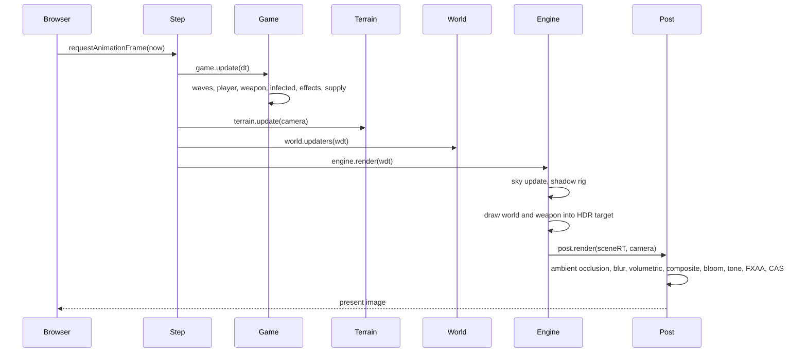
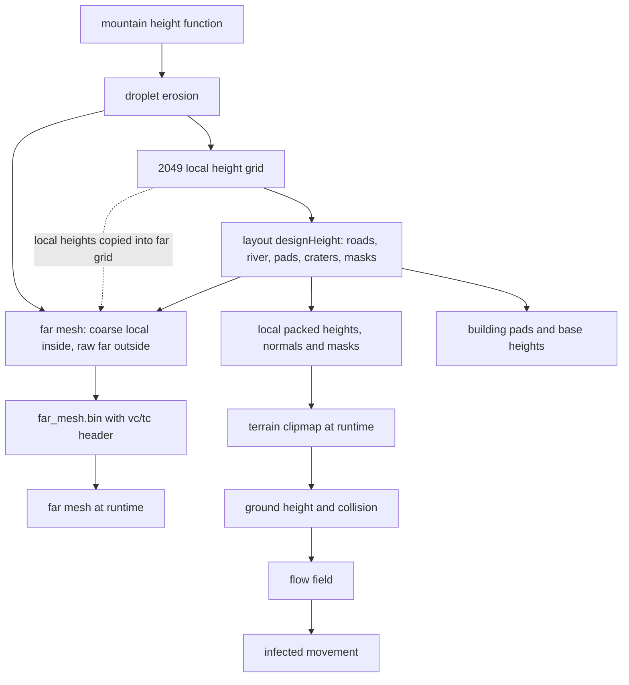

# Core mechanism: one frame, and the world under it

**Short answer.** One frame is a chain of decisions. `step()` updates the simulation, recentres the terrain, calls the world updaters and asks the engine to draw. The engine advances the sky, updates the shadow rig, draws the world and the weapon into a high dynamic range (HDR) target, then runs the image chain. That chain adds ambient occlusion, volumetric light, bloom, tone mapping and anti-aliasing.

The world beneath the frame is a second chain. A height function makes mountains. Erosion cuts valleys and deposits sediment. A packing step writes 16-bit heights into an image. The layout adds roads, a river, a church square and building pads. The runtime builds a six-level clipmap and loads an adaptive far mesh from the bake. Collision and navigation read the same ground. The bake writes `local_h.png`, `far_h.png`, normal maps, three masks and `far_mesh.bin` beside `terrain.json`; `Terrain.load` fetches them (`src/world/terrain.js:325-338`, `src/world/terrain.js:365`).

## Terms used in this document

A post pass is a fullscreen shader. A clipmap is a set of nested terrain grids with different cell sizes. A flow field is a grid of walking state and distance to the player. A preset is one of four quality settings (`src/engine/engine.js:9-14`). A massif is one mountain body. High dynamic range (HDR) means light values above display white. The graphics processing unit (GPU) runs the passes, and the central processing unit (CPU) runs the simulation and tools.

## Part one: the frame

### Step 1: the browser callback

The main loop requests the next frame before it does the work, so the loop stays alive if a frame throws. The step is clamped to 0.05 seconds, so a stall cannot push the player through a wall (`src/main.js:150-160`). The `running` flag lets a tool stop the loop and step it.

### Step 2: the step function

The step function has three branches: debug, paused and normal. Only the game update sits inside a branch. The terrain recentre, the world updaters and the render run after the branches, so they also run in debug and paused.

```text
# src/main.js:134-149
  const step = (dt) => {
    if (game.state === 'debug') {
      const sp = (keys.has('ShiftLeft') ? 60 : 12) * dt;
      const f = new THREE.Vector3(0, 0, -1).applyQuaternion(engine.camera.quaternion);
      const r = new THREE.Vector3(1, 0, 0).applyQuaternion(engine.camera.quaternion);
      if (keys.has('KeyW')) engine.camera.position.addScaledVector(f, sp);
      if (keys.has('KeyS')) engine.camera.position.addScaledVector(f, -sp);
      if (keys.has('KeyD')) engine.camera.position.addScaledVector(r, sp);
      if (keys.has('KeyA')) engine.camera.position.addScaledVector(r, -sp);
      game.fx.update(dt);
    } else if (game.state !== 'paused') game.update(dt);
    const wdt = game.state === 'paused' ? 0 : dt;
    terrain.update(engine.camera);
    for (const u of world.updaters) u(wdt, engine.camera, engine.time);
    engine.render(wdt);
  };
```

A paused game sends zero to the world updaters; in debug they receive `dt`. Terrain and renderer run in both cases.

### Step 3: the game update

The game update runs the wave director, the player, the weapon, the infected, the effects and the supply system. The player moves before the weapon reads the camera.

```text
# src/game/game.js:498-504
  update(dt) {
    this.time += dt;
    const { player: p, zombies, weapon } = this;
    const op = this.mode === 'operation' ? this.operation : null;
    const ts = this.state === 'playing' ? this.timeScale : 1, pdt = dt * (1 - (1 - ts) * 0.12);
    if (this.state === 'playing' || this.state === 'film') {
      const rdt = dt; dt *= ts;
```

```text
# src/game/game.js:561-563
      p.update(pdt);
      weapon.update(pdt);
      zombies.update(dt);
```

Adrenaline is an Operation ability that slows the world while the player keeps nearly full speed (`src/game/abilities.js:5`). Its start handler sets `tsTarget` (`src/game/abilities.js:698`). The eased `g.timeScale` follows it (`src/game/abilities.js:1004-1007`). The ease is `1 - exp(-5*dt)`, a fifth of a second. `pdt` is computed before `dt *= ts`, so the player keeps part of its speed (`src/game/game.js:502-504`). `g.timeScale` and `this.timeScale` are the same value (`src/game/abilities.js:1007`, `src/game/game.js:143`). At world speed 0.4 the player factor is 0.928. The Operation updates after the world step, so a new scale reaches the next frame (`src/game/game.js:577`).

The wave director is inline in `update`, before `p.update` (`src/game/game.js:507-548`, `src/game/game.js:561`). `queue` is the number of enemies left, and `queueList` holds one type name for each; the two counts are equal. A successful spawn pops one name and decrements both. A failed spawn keeps them and resets `spawnT` to 0.3 seconds, or 2.5 plus pace after a full runner pack (`src/game/game.js:518-524`).

```text
# src/game/game.js:507-518
        // wave director
        const alive = zombies.aliveCount;
        if (this.queue > 0) {
          this.spawnT -= dt;
          if (this.spawnT <= 0) {
            const cap = Math.min(zombies.maxActive - 2, 7 + this.wave * 2);
            const type = this.queueList.length ? this.queueList[this.queueList.length - 1] : 'walker';
            const pack = type === 'runner' ? this._packPoint() : null;
            const s = alive < cap ? pack || this._spawnPoint(type === 'walker' || type === 'brute') : null;
            const z = s ? zombies.spawn(s[0], s[1], op ? { aware: true, type, ...op.spawnOpts(type) } : { aware: true, type }) : null;
            if (z) {
              this.queueList.pop(); this.queue--;
```

```text
# src/game/game.js:561-562
      p.update(pdt);
      weapon.update(pdt);
```

At wave end the director sets `cleared`, drops a crate if one is available and starts an inter-wave timer (`src/game/game.js:527-535`). A living infected more than 95 metres away is moved by `_relocate` (`src/game/game.js:541-548`). `_relocate` first refuses a target that is visible (`src/game/game.js:429`). It then asks `_spawnPoint()` for a point 32 to 76 metres from the player, usually out of view (`src/game/game.js:395-414`). The fallback beyond 72 metres can be visible. `zombies.place` writes the new position and clears velocity, timers and probe state (`src/game/zombies.js:440-449`). The same enemy object is teleported and reset, not despawned and spawned. Half of the spawn points are pulled toward `(50, -88)`, which the comment calls the village (`src/game/game.js:404-405`).

### Step 4: the sky, before and during the frame

The sky bake is a boot task. Boot sets progress to 0.45 and awaits `engine.init(nextFrame)` (`src/main.js:81-82`). That call awaits `sky.init` (`src/engine/engine.js:113-114`). `init` renders eight strips per panorama and yields between them. Each yield lets the browser paint the progress bar. `engine.init` resolves only after all strips, and the loop starts after that. The per-frame call only advances the cloud clock. The sky is a raymarched stratocumulus model, too expensive per pixel. The project bakes it into a warped panorama, which the dome shader samples.

```text
# src/engine/sky.js:561-569
  async init(time, tick) {
    this.time = time;
    const k = Math.floor(time / this.period);
    for (const kk of [k, k + 1]) {
      while (!this._renderSlot(kk, this.panoSize[0] / 8)) await tick();
    }
    this.renderGobo(time);
    this._bind(k, time);
  }
```

The bake keeps slot `k` and slot `k+1`. The dome shader blends them over the 16 second period (`src/engine/sky.js:330`, `src/engine/sky.js:575`).

The cloud shadow map is a second bake: a top-down picture of the cloud field, also called a gobo. It refreshes one band per frame, and 12 frames cover the map (`src/engine/sky.js:501-516`). The sun samples it through `vmCloudShadow()`.

The prefiltered panorama also serves as image-based light for rough surfaces (`src/engine/sky.js:422`).

`engine.render` calls `sky.update` before the shadow rig; it advances the clock, not the bake (`src/engine/engine.js:152-154`).

### Step 5: the shadow rig

Before the scene draw, the engine updates the sun shadow camera. This is separate from the terrain recentre in `step`. `terrain.update` moves the clipmap levels (`src/world/terrain.js:479-492`). The six levels have cells of `0.5 * 2^l` metres, from 0.5 to 16 metres. Each level snaps its origin to twice its cell size, and each ring draws only the band outside the finer level (`src/world/terrain.js:387-400`, `src/world/terrain.js:482-489`). `engine.render` then updates the shadow rig (`src/engine/engine.js:152-154`). The shadow volume is centred on the viewer and snapped to shadow texels, so shadows do not shimmer. The comment in the snippet gives the reason it does not follow the view direction.

```text
# src/engine/engine.js:119-130
  _updateShadowRig() {
    const range = this.q.shadowRange;
    const cam = this.sun.shadow.camera;
    cam.left = -range; cam.right = range; cam.top = range; cam.bottom = -range;
    cam.near = 1; cam.far = 700;
    cam.updateProjectionMatrix();
    // The shadow volume is centred on the viewer and snapped to shadow texels. It must not follow
    // the view direction: a volume pushed ahead of the camera drops and regains the shadows at its
    // rim while the player turns.
    const cx = this.camera.position.x, cz = this.camera.position.z;
    const cy = this.camera.position.y;
    const texel = (2 * range) / this.q.shadow;
```

The shadow range is 130 metres on the `high` and `ultra` presets (`src/engine/engine.js:12-13`). The map is 4096 pixels square, so one texel covers about 6.3 centimetres. The sun direction is (-0.84, 0.54, 0.04), roughly due west and 33 degrees above the horizon (`src/engine/engine.js:51`).

### Step 6: the scene draw

The engine sets the HDR target, clears it and draws the world camera. If the weapon is visible, it draws the weapon camera into the same target.

```text
# src/engine/engine.js:163-177
    r.shadowMap.needsUpdate = true;
    r.setRenderTarget(this.sceneRT);
    r.setClearColor(0x000000, 1);
    r.autoClear = true;
    this.camera.layers.set(0);
    r.render(this.scene, this.camera);
    if (this.weaponVisible) {
      r.autoClear = false;
      this.gl.depthRange(0.0, 0.02);
      r.render(this.scene, this.weaponCamera);
      this.gl.depthRange(0.0, 1.0);
      r.autoClear = true;
    }
    this.post.render(this.sceneRT, this.camera, this.time, output, this.outW, this.outH);
    r.setRenderTarget(null);
```

The weapon camera uses layer 1 and copies the world camera matrix (`src/engine/engine.js:36-38`, `src/engine/engine.js:158-159`). The world camera is set to layer 0 before the draw (`src/engine/engine.js:167`), so each camera sees one layer. `depthRange(0.0, 0.02)` maps every weapon depth into the first two percent, so a wall cannot hide it.

### Step 7: the image chain

The chain runs seven groups. Occlusion darkens creases. A bilateral blur removes sample noise but keeps edges. A volumetric pass marches the sun shafts and height fog. The composite multiplies colour by occlusion and adds the light (`src/engine/post.js:450-459`). A six-mip bloom pyramid spreads bright areas. Tone and final passes follow.

The ambient occlusion pass reads depth and samples 10 points, ignoring samples below the weapon depth (`src/engine/post.js:5`, `:36`). The volumetric pass marches height fog and the sun, and reads a prefiltered cloud-shadow mip (`src/engine/post.js:116`). It renders at quarter resolution on `low`, a third on `medium` and `high`, and half on `ultra` (`src/engine/engine.js:9-13`).

The bloom pyramid has six mips (`src/engine/post.js:406-411`). The down pass filters and downsamples. The up pass blends each mip into the one below, writing to `t.ups` because WebGL forbids a pass that samples its own target (`:502-514`). The tone pass applies exposure (`:233-294`). The Uchimura `GT` curve is filmic, with a toe and a shoulder fitted to a peak. Contrast bends values around mid grey and limits highlight gain. Saturation mixes each pixel toward its luma, vibrance favours muted colours, and clarity adds local contrast against a wide blur.

The final pass applies fast approximate anti-aliasing (FXAA) only on edges (`src/engine/post.js:324-328`). Contrast adaptive sharpening (CAS) follows it and sharpens flat areas more than busy ones.

### Step 8: the output

The post settings default to mode 0 (`src/engine/post.js:374`). Mode 0 writes an 8-bit standard dynamic range image in sRGB to the screen (`src/engine/post.js:297-301`). The film sets mode 3, where the tone pass writes the Perceptual Quantizer (PQ) signal as floats (`src/engine/post.js:311-312`, `src/cinematic/film.js:444-447`). `gl.readPixels(..., gl.FLOAT, film.f32)` converts the half-float target to 32-bit floats (`src/cinematic/film.js:534-535`). The central processing unit (CPU) then writes 16-bit integer Y'CbCr samples into `film.yuv` (`src/cinematic/film.js:537-554`). Y'CbCr is one luma and two chroma components, and the samples are planar: each component has its own byte plane. Modes 1 and 2 write the high or low byte of a 16-bit code (`src/engine/post.js:308-312`), but the checkout assigns neither. The float readback avoids banding.

```text
# src/engine/post.js:303-312
    // Rec.709 -> Rec.2020, absolute luminance, PQ
    const mat3 toBT2020 = mat3(0.6274, 0.0691, 0.0164, 0.3293, 0.9195, 0.0880, 0.0433, 0.0114, 0.8956);
    vec3 nits = toBT2020 * col * uPaperWhite;
    vec3 pq = pqOETF(nits);
    pq += g * gm * 0.6;
    vec3 code = floor(clamp(pq, 0.0, 1.0) * 65535.0 + 0.5);
    vec3 hiB = floor(code / 256.0);
    vec3 loB = code - hiB * 256.0;
    // mode 3: PQ signal as floats (the film renderer reads the target back directly)
    outColor = uMode == 3 ? vec4(clamp(pq, 0.0, 1.0), 1.0) : vec4((uMode == 1 ? hiB : loB) / 255.0, 1.0);
```

The output is converted from Recommendation BT.709 (Rec.709) to Recommendation BT.2020 (Rec.2020), then to absolute luminance at 203 nits, then to PQ (`src/engine/post.js:303-306`, `src/engine/post.js:374`).

## Part two: the procedural world

### The height function

The far mountains are a sum of 12 massifs and six summits, shaped by a ridged fractal (`tools/bake-terrain.mjs:28-51`). Each massif is an elliptical Gaussian (`tools/bake-terrain.mjs:58-61`). Each summit adds `p[3] * (1 - d)^1.6 * (0.55 + 0.7 * R)` inside its radius (`tools/bake-terrain.mjs:66-69`). The ridged noise gives the rock its channels (`tools/bake-terrain.mjs:63-65`).

```text
# tools/bake-terrain.mjs:54-73
function mountains(x, z) {
  const wx = x + 950 * nz.fbm2(x / 5200 + 3.1, z / 5200 - 1.7, 3);
  const wz = z + 950 * nz.fbm2(x / 5200 - 8.2, z / 5200 + 4.4, 3);
  let U = 0;
  for (const m of massifs) {
    const dx = (wx - m[0]) / m[2], dz = (wz - m[1]) / m[3];
    U += m[4] * Math.exp(-0.5 * (dx * dx + dz * dz));
  }
  U += 700 * smoothstep(7000, 12500, Math.hypot(x, z));
  const R = nz.ridged2(wx / 3900, wz / 3900, 8, 2.07, 0.53, 0.55);
  const R2 = nz2.ridged2(wx / 1250 + 5, wz / 1250, 6, 2.1, 0.5, 0.35);
  let h = U * (0.2 + 1.0 * R) + U * 0.13 * R2;
  for (const p of summits) {
    const d = Math.hypot(wx - p[0], wz - p[1]) / p[2];
    if (d < 1) h += p[3] * Math.pow(1 - d, 1.6) * (0.55 + 0.7 * R);
  }
  // foothill texture
  h += 60 * saturate(U / 500) * nz3.fbm2(x / 700, z / 700, 4);
  return h;
}
```

The `wx` and `wz` terms warp the coordinates before the massifs are evaluated.

The valley axis is `[0.735, 0.678]` (`tools/bake-terrain.mjs:52`). `farBase` keeps the river valley open with `mask = smoothstep(620, 2500, r) * smoothstep(260, 2100, rd)` (`tools/bake-terrain.mjs:74-80`). Here `r` is the elliptical distance from the valley centre, and `rd` is the distance from the river path. The far base height is the layout base plus `mask * mountains * 0.5` (`tools/bake-terrain.mjs:80`).

### The erosion simulation

The raw mountain shape is too smooth. The bake runs a droplet erosion simulation with 1,800,000 drops (`tools/bake-terrain.mjs:179`). Each drop follows the gradient and carries sediment.

```text
# tools/bake-terrain.mjs:123-135
  for (let it = 0; it < drops; it++) {
    let px = rnd() * (N - 3) + 1, py = rnd() * (N - 3) + 1;
    let dx = 0, dy = 0, speed = 1, water = 1, sed = 0;
    for (let l = 0; l < life; l++) {
      const nx = Math.floor(px), ny = Math.floor(py);
      const ox = px - nx, oy = py - ny;
      const idx = ny * N + nx;
      const hNW = map[idx], hNE = map[idx + 1], hSW = map[idx + N], hSE = map[idx + N + 1];
      const gx = (hNE - hNW) * (1 - oy) + (hSE - hSW) * oy;
      const gy = (hSW - hNW) * (1 - ox) + (hSE - hNE) * ox;
      const h = hNW * (1 - ox) * (1 - oy) + hNE * ox * (1 - oy) + hSW * (1 - ox) * oy + hSE * ox * oy;
      dx = dx * inertia - gx * (1 - inertia);
      dy = dy * inertia - gy * (1 - inertia);
```

```text
# tools/bake-terrain.mjs:147-160
      flow[idx] += water;
      const cap = Math.max(-dh * speed * water * capF, minCap);
      if (sed > cap || dh > 0) {
        const amt = (dh > 0 ? Math.min(dh, sed) : (sed - cap) * depositSpeed) * m;
        sed -= amt;
        map[idx] += amt * (1 - ox) * (1 - oy); map[idx + 1] += amt * ox * (1 - oy);
        map[idx + N] += amt * (1 - ox) * oy; map[idx + N + 1] += amt * ox * oy;
      } else {
        const amt = Math.min((cap - sed) * erodeSpeed, -dh) * m;
        for (let b = 0; b < nb; b++) {
          const bi = idx + brushOff[b];
          const we = amt * brushW[b];
          const de = map[bi] < we ? map[bi] : we;
          map[bi] -= de; sed += de;
```

The brush is circular with a linear falloff (`tools/bake-terrain.mjs:116-122`), so the drop erodes a disk, not a point. `dh` is the height change along the step. Capacity is `-dh * speed * water * 5.5`, with a floor of 0.008 (`tools/bake-terrain.mjs:148`). If sediment exceeds capacity, the drop deposits 0.28 of the excess or fills a rise (`:149-153`). If sediment is under capacity, it erodes 0.32 of the deficit over the brush (`:154-161`). Speed rises with descent, and water falls by 0.012 per step (`:163-164`).

The bake blurs the flow map and packs it with the normal. The far height becomes a 16-bit Portable Network Graphics (PNG) image (`tools/bake-terrain.mjs:1-9`). The local height is a 2049 square grid with 0.5 metre spacing (`tools/bake-terrain.mjs:5`, `tools/bake-terrain.mjs:247`).

The far mesh adapts. `tol(x, z)` is the allowed height error in metres. A triangle splits while `|interp - far[mid]| / tol > 1` (`tools/bake-terrain.mjs:338-352`). Within 440 metres on each axis, the tolerance is 60 metres. In the 440 to 640 metre ring it is 0.6 metres. Beyond 640 metres it is `max(1.5, distance * 0.00105 * hero) * 2.0`, where `hero` is 0.62 in the northern sector (`:325-336`). The loose inner value is safe because the far fragment discards inside 508 metres (`src/world/terrain.js:462-465`). The tight ring is the seam. Triangles inside 506 metres are dropped (`src/world/terrain.js:447-453`). The source does not relate the 508, 506 and 440 metre constants. The output has a vertex and triangle count header, then float positions and unsigned integer indices (`:340-360`).

### The layout function

The height function is the ground. The layout function is the design, and its height export is `designHeight` (`src/world/layout.js:508`). It adds the roads, the streets, the church square, the building pads, the craters, the mud and the river channel. It is a pure function: the same input gives the same output in the baker and at runtime.

A road, a pad and a crater blend into the base height with a smooth mask (`src/world/layout.js:519-534`). The function also returns road, cobble, mud, rubble, bed, wet, forest and river-distance masks.

The river has a Catmull-Rom path (`src/world/layout.js:167-172`). A Catmull-Rom spline passes through its control points, uses the two neighbours of each segment for the tangent, and tabulates cumulative arc length (`src/world/layout.js:20-39`). The water level follows the river slope, minus 0.0052 per metre. The half width is 10.5 metres plus noise (`src/world/layout.js:209-211`).

The layout checks each building footprint against the roads, the river, the start positions and the other buildings. A rejected site moves to the next candidate.

### The buildings

A building is a set of wall slabs, each one wall segment with thickness `t`. The builder cuts the slab into a grid of cells, 0.4 metres by default (`src/world/bld/house.js:96`). The damage field decides which cells survive. `makeField` returns a scalar function `v(x, y, z)` (`src/world/bld/house.js:26-46`). `H` is the base height. The default top edge is `H * 1.2 + 1.0`, minus a collapse dent and plus noise (`src/world/bld/house.js:329-333`). A `blast` sphere raises `v` toward its centre and destroys cells. A `keep` sphere lowers `v` and preserves cells. `rag` adds noise to the top edge. `amp` scales the internal noise. A positive `v` means destroyed.

```text
# src/world/bld/house.js:26-38
export function makeField(o) {
  const { noise, H } = o, blasts = o.blasts || [], keep = o.keep || null, amp = o.amp === undefined ? 0.5 : o.amp;
  const sx = (o.seed % 977) * 0.37, rag = o.rag === undefined ? 0.6 : o.rag, col = o.collapse || null;
  const hb = o.hbFn || ((x, z) => {
    let h = H * 1.2 + 1.0;
    if (col) { const dx = x - col.x, dz = z - col.z; h -= H * col.depth * Math.exp(-(dx * dx + dz * dz) / (2 * col.sigma * col.sigma)); }
    return h + rag * (1.5 * noise.n2(x * 0.33 + sx, z * 0.33) + 0.6 * noise.n2(x * 1.1, z * 1.1 + sx));
  });
  const f = (x, y, z) => {
    let v = (y - hb(x, z)) / 1.3;
    for (let k = 0; k < blasts.length; k++) {
      const b = blasts[k], w = 1 - Math.hypot(x - b.x, y - b.y, z - b.z) / b.r;
      if (w > v) v = w;
```

`buildWall` samples `v` at the centre of each cell (`src/world/bld/house.js:113-121`). A thin-topped cell above the eave becomes a sliver (`7`), a declared opening becomes `1`, a cell with `v > 0` becomes broken (`2`), and the rest are solid (`0`). The snippet shows only this classification. A two-pass rule removes one-cell spikes (`src/world/bld/house.js:122-128`). A flood fill from the open bottom then marks any solid cell that is not reachable as broken, so no island floats (`src/world/bld/house.js:129-138`).

```text
# src/world/bld/house.js:112-121
  const st = new Uint8Array(nu * nv), mid = t * 0.5;
  for (let j = 0; j < nv; j++) for (let i = 0; i < nu; i++) {
    const a = j * nu1 + i, c = j * nu + i;
    const uc = (us[i] + us[i + 1]) / 2, yc = (vy[a] + vy[a + 1] + vy[a + nu1] + vy[a + nu1 + 1]) / 4;
    if (j >= jE && (vy[a + nu1] - vy[a]) + (vy[a + nu1 + 1] - vy[a + 1]) < 0.06) { st[c] = 7; continue; }
    let s = 0;
    for (const o of ops) if (uc > o.u0 && uc < o.u1 && yc > o.v0 && yc < o.v1) { s = 1; break; }
    if (!s && yc > 0.05 && field(fr.ox + fr.ux * uc - fr.nx * mid, yc, fr.oz + fr.uz * uc - fr.nz * mid) > 0) s = 2;
    st[c] = s;
  }
```

The roof uses the same field, and a connectivity pass removes detached tiles (`src/world/bld/house.js:300-312`). The builder emits a slab mesh and a box collider per solid cell (`src/world/bld/house.js:194-195`). All buildings merge into a few chunks, one material each (`src/world/buildings.js:60-64`).

### The collision mesh

The collision system merges every static collider into one three-mesh-bvh tree. A bounding volume hierarchy (BVH) is a tree of boxes around triangles. A leaf is a small group of triangles at the bottom of the tree. The tree is built with `indirect: true` and a target leaf size of 12 (`src/game/collision.js:30-62`). The indirect mode stores triangle indices in a separate buffer, which keeps the tree small. A leaf of 12 trades a deeper tree against fewer, larger leaf tests. The player capsule, bullet ray and line-of-sight test all use the tree.

The bullet ray first tests the mesh tree. It then marches the terrain in steps that grow with distance. When the march crosses below ground, it bisects eight times. A downward ray that ends more than 3 centimetres under water moves to the water plane, with normal `(0, 1, 0)` and surface `water` (`src/game/collision.js:180-191`).

```text
# src/game/collision.js:143-154
  raycast(origin, dir, maxDist = 600, out = {}) {
    let best = maxDist, hit = false;
    out.point = out.point || new THREE.Vector3();
    out.normal = out.normal || new THREE.Vector3();
    const mh = this.raycastMesh(origin, dir, maxDist, out);
    if (mh) { best = mh.distance; hit = true; }
    // terrain: march, then bisect
    const T = this.terrain;
    let t = 0, prev = 0;
    const lim = Math.min(best, maxDist);
    let h0 = origin.y - T.heightAt(origin.x, origin.z);
    if (h0 > -0.2) {
```

The step is at least 0.35 metres and at least three percent of the distance. It also aims for at least half the height above the ground, capped at 8 metres. Eight bisections give a precision of step/256. The player uses a segment capsule and `shapecast`, then resolves the boxes (`src/game/collision.js:199-245`).

### The navigation field

The infected run no path search per enemy. The game builds one flow field, with 1.5 metre cells and 254 cells per side, centred on the play centre (`src/game/zombies.js:103-108`). Its 190 metre half extent is smaller than the 330 metre play radius, so it covers the village core. Outside it, `cellOf` returns -1 and the spawn search skips reachability (`src/game/game.js:398-409`). Each cell is blocked, walkable or slow water.

```text
# src/game/zombies.js:103-112
export class FlowField {
  constructor(collision, layout, cx, cz, half = 190, cell = 1.5) {
    this.col = collision; this.cell = cell; this.n = Math.ceil((half * 2) / cell);
    this.x0 = cx - half; this.z0 = cz - half;
    const n = this.n;
    this.walk = new Uint8Array(n * n);     // 0 blocked, 1 walkable, 2 slow (water)
    this.dist = new Uint16Array(n * n);
    this.queue = new Int32Array(n * n);
    this.inq = new Uint8Array(n * n);
    const T = collision.terrain;
```

A cell is blocked if the slope is greater than 0.95, or if a collision box intersects 0.45 to 1.5 metres above ground. Water is slow from 0.25 metres deep and blocked from 1.5 metres. The box test uses `intersectsBox` (`src/game/zombies.js:113-123`).

The distance update is a label-correcting search in a circular first-in, first-out queue (`src/game/zombies.js:151-170`). A straight step costs 2, a diagonal step 3, and water adds 2 (`:164`). When a neighbour improves, the update writes the distance and queues the cell if absent (`:165-168`). It is not Dijkstra. A diagonal step is barred if either straight neighbour is blocked. The search starts at the player cell; if blocked, it checks rings up to five cells (`:140-150`). The field rebuilds every 0.45 seconds (`:785-786`).

```text
# src/game/zombies.js:151-164
    let head = 0, tail = 0, count = 0;
    d[start] = 0; q[tail++] = start; count = 1; inq[start] = 1;
    while (count > 0) {
      const c = q[head++]; if (head === cap) head = 0;
      count--; inq[c] = 0;
      const cd = d[c];
      const ci = c % n, cj = (c / n) | 0;
      for (let k = 0; k < 8; k++) {
        const i = ci + DI[k], j = cj + DJ[k];
        if (i < 0 || j < 0 || i >= n || j >= n) continue;
        const nb = j * n + i;
        if (!w[nb]) continue;
        if (k >= 4 && (!w[cj * n + i] || !w[j * n + ci])) continue;   // no corner cutting
        const nd = cd + (k < 4 ? 2 : 3) + (w[nb] === 2 ? 2 : 0);
```

The direction function reads the eight neighbours and picks the lowest distance (`src/game/zombies.js:174-192`). It adds 0.9 to a diagonal candidate, which favours a straight step when routes are close. The source gives no reason. Steering follows it with a limited turn rate.

### The grass rings

The grass is four camera-following rings plus a flower layer. The `feet` ring has radius 5.6 metres and cell 0.2 metres; `near` is 12 and 0.285, `mid` 46 and 0.86, and `far` 150 and 2.0. The `flowers` layer has radius 38 and cell 0.6 (`src/world/vegetation.js:963-974`). Every cell is divided by `sqrt(quality.grass)`, so higher quality gives smaller cells (`:960`).

Each ring is instanced geometry. The vertex shader reads a height texture and a placement hash, so the CPU builds no mesh per tuft. The shader shrinks a tuft to zero between the last two fade values, so no hard edge appears.

## Two diagrams

The first diagram shows the frame chain; the second shows the world-data chain.





The far mesh follows the local grid. Inside the local square, the bake copies local heights into the far grid, so the far mesh includes the layout at coarser spacing (`tools/bake-terrain.mjs:274-280`). Outside the square it keeps the raw eroded mountain. In the second diagram, a dashed arrow marks a copy of heights, not a runtime dependency.

## Aha: one height function keeps the world honest

**Aha:** The terrain is not drawn and decorated. `designHeight` shapes the ground and the pads under the buildings (`src/world/layout.js:508-590`). The bake samples that function into the 2049 local grid and copies it into the coarse far grid (`tools/bake-terrain.mjs:247`, `tools/bake-terrain.mjs:274-280`). `terrain.heightAt` reads bilinear local samples while both coordinates are below 511.5 metres, and bilinear far samples outside (`src/world/terrain.js:494-502`). The bake copies local heights into the far grid inside its square, so the two grids meet at that cut. Collision, spawn and navigation call `heightAt`, so one change to the design travels through the bake to every system. A wall cannot float, because wall and ground share one definition. It also returns road, cobble, mud and rubble masks, so it controls shape and surface together.

## What the source does not define

- The source does not define a runtime rebuild for the terrain. The bake is an offline step.
- The source does not define a fallback if `terrain.json` is missing. The boot would fail (`src/world/terrain.js:325-326`).
- The source does not define a separate physics time step. The player sub-steps inside its own update (`src/game/player.js:378-385`).

## The mechanism in one sentence

One frame moves the simulation, recentres the terrain clipmap, updates the shadow rig, draws the scene and runs the image chain. Under it, a height function, an erosion simulation and a layout function produce one ground that every system shares.
